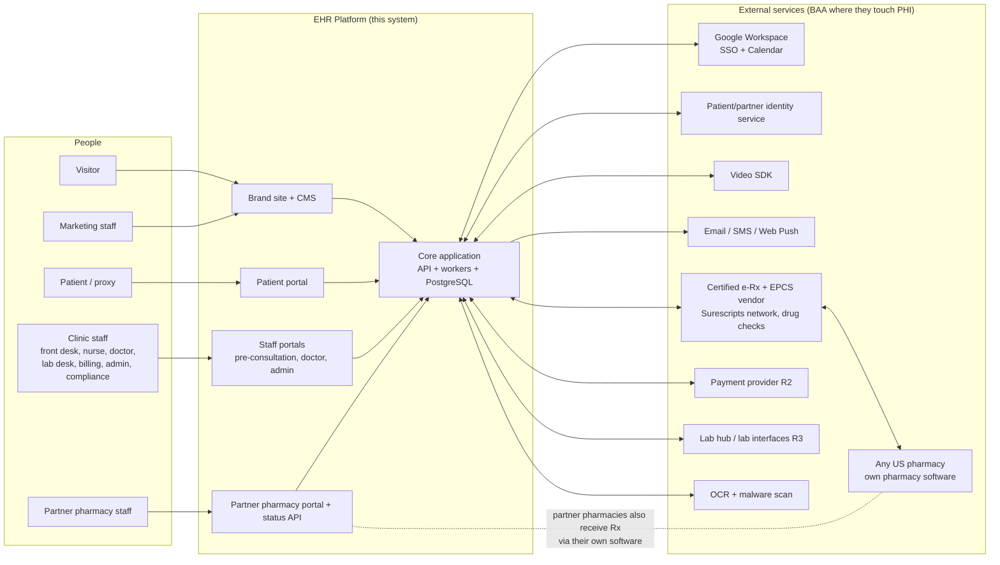
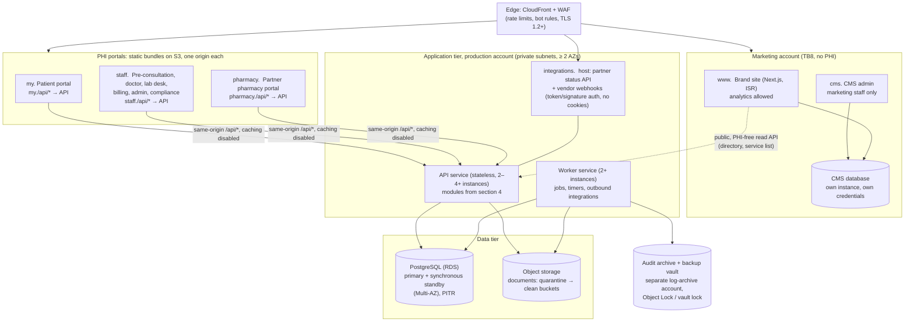
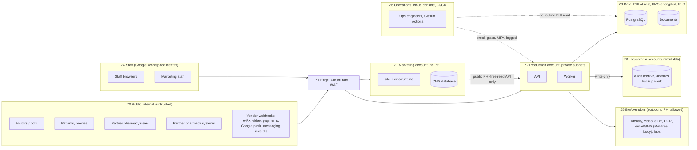
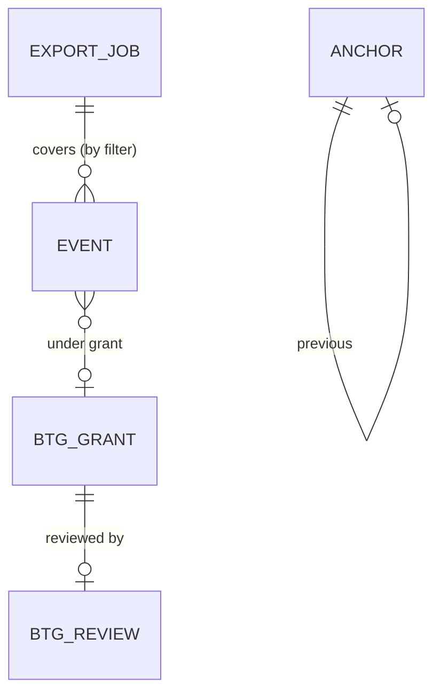
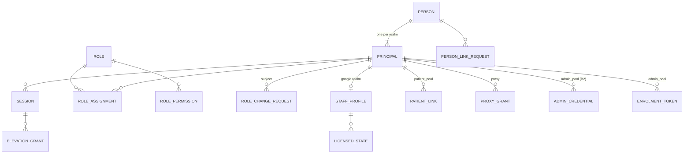
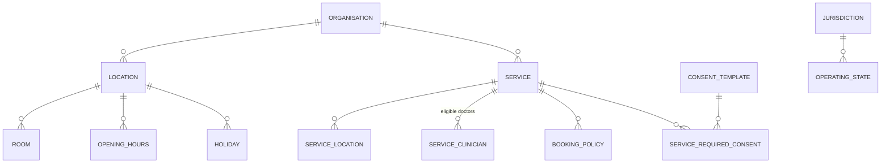
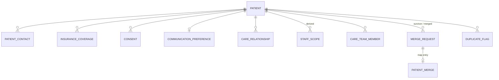
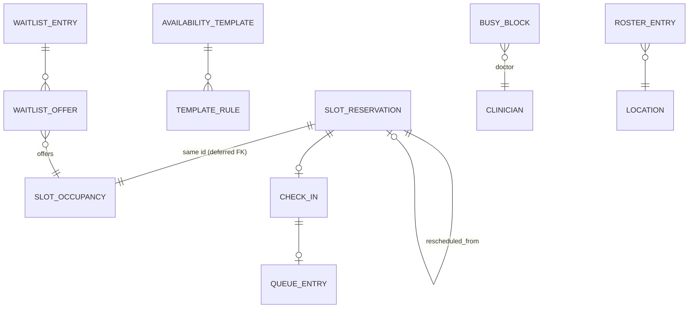
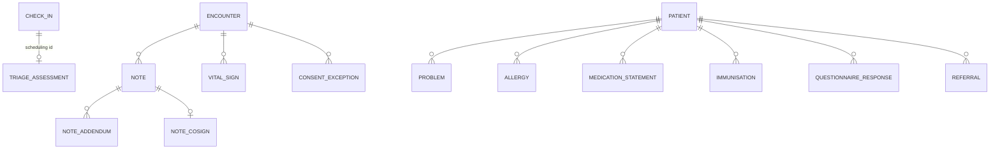

# ARCHITECTURE — Enterprise EHR Platform (G1 overview + detailed technical design)

| Field | Value |
| --- | --- |
| Task | HEAAA-8 `[SDLC:architecture-overview]` (drafts 1–2); HEAAA-41 (drafts 3–4); **HEAAA-13 `[SDLC:technical-design]` (draft 5: Part II detailed design)** |
| Author | Solution Architect agent (`7efe9f61-495f-4237-82f9-fa178629da09`) |
| Version | **Draft 5.** Part I (sections 0–18) is the G1-accepted overview, draft 4 (HEAAA-11 `architecture` rev `f2d240e4-2f63-45a1-aaa1-16a1f8854c32`, `docs/ARCHITECTURE.md` @ `f8d3d6e`). It is unchanged except for the errata listed in section 40.3, each marked in place with "(draft 5 erratum)". Part II (sections 19–40) is new: the detailed technical design that G1 unlocked, conforming to SHARED-BOUNDARIES draft 3 (HEAAA-12 rev `0fffc85d`, `docs/SHARED-BOUNDARIES.md` @ `d14ed7f`) |
| Approved inputs | PRD revision 3 (HEAAA-11 `prd` rev `bba336f3`); ARCHITECTURE draft 4 (above); G1 human acceptance: confirmations `cadd7751` and `009ac8a9`, 2026-11-04 22:03Z. Shared boundaries review PASS (HEAAA-12 `shared-boundaries-review` rev `80b898be`) |
| Status | **DRAFT 5. Part II not yet independently reviewed. Not human-approved. This is not G2.** Part I was accepted at G1 by a human (that acceptance covers draft 4 only). Identity tables and session contracts in Part II are **Provisional** (section 20.3) |
| Security input | HEAAA-9 `security-assessment` rev `22d5dcc6`; HEAAA-42 comment `e6414334` (SEC-D-19). Part II sections 21.6, 21.7 point 4, 25.9 and 26 need Cybersecurity review (section 37) |
| Review round | Part I: closed at G1. Part II: submitted for **round 1 of 3** (cumulative) to the Solution Architect Reviewer (`338c0bb5`) |

## 0. How to read this

**Draft 5 note:** Part I below is the G1 overview as accepted. Part II (section 19 onwards) holds the detailed design: ERDs, module interfaces, transactions, API contracts, failure and capacity design. Where Part I and Part II differ, Part II and SHARED-BOUNDARIES govern, and section 40.3 lists every such erratum.

This is the **G1 overview**. It sets direction: the shape of the system, the main technology choices, trust boundaries, capacity and cost scenarios, and tradeoffs. It does **not** contain ERDs, API contracts or migrations. Those come after G1 in HEAAA-12 (shared boundaries) and HEAAA-13 (technical design), in the order ERD → modules → API contracts.

Labels match the PRD:

| Label | Meaning |
| --- | --- |
| **Constraint** | Fixed by a confirmed intake/PRD statement (source tag given). |
| **Recommendation** | The Architect's proposal. A human endorses or rejects it at G1. |
| **Assumption** | A value I had to assume to size something. Each one is listed in section 12 with the decision that would replace it. |
| **Open** | Needs a human or vendor answer. |

Prices are list-price planning figures, not quotes. Two of them were checked on 2026-11-04 (section 10.4). The others are estimates with wide ranges. No vendor was contacted, nothing was bought, and no account was created.

## 1. Summary for the decision-maker

1. **The technical targets can be met with a simple design.** About 8,000 appointments a day and 1,000 staff is a moderate load. One well-structured application, one PostgreSQL database with a standby, and two to four app servers can meet p95 < 500 ms, slot search < 1 s and 99.9 % availability (section 9). This needs **no microservices, Kubernetes, Kafka or Redis**. Fewer moving parts means lower run cost and fewer failure modes.
2. **Buy the regulated and commodity parts. Build the workflow.** The build budget cannot cover DEA EPCS certification, a drug database, video, or identity. The recommendation is to integrate certified or BAA-covered services for those, and to build scheduling, triage, charting, the partner-pharmacy coordination layer, audit, and the portals.
3. **One design-changing finding (SA-F-01).** Under DEA rules, a pharmacy must receive controlled-substance e-prescriptions in its own DEA-certified pharmacy software. Our partner portal can therefore **not** be the legal channel that delivers prescriptions. Every prescription, partner or not, goes through the certified e-prescribing network. The partner portal mirrors the prescription and collects status (accepted, ready, out for delivery, delivered). PRD revision 2 now says this (PRD section 1, RA-R2-03, RA-R2-05); the owner is asked to acknowledge it as PRD decision D-24.
4. **The run budget (US$5–15k/month) is at risk.** Usage-based services, not hosting, are the main risk: SMS reminders, video minutes, and (from R2) per-prescriber e-prescribing fees. In the expected R1 scenario the cost is about **US$13,750/month**, close to the top of the range. The high scenario (about US$22,150) goes past US$15k. Draft 2 adds region-loss readiness, the brand-site/CMS runtime, the identity replication add-on and SMS registration fees, which draft 1 left out. Three inputs are missing: the share of visits by video, the default reminder channel, and the number of prescribers (section 10).
5. **The build budget and the date are the binding constraint, not the technology.** This overview does not change scope. It lists the technical scope levers (section 11) for the G1 trim decision (PRD D-1, D-22).
6. **Hosting provider is Open (intake C6).** I recommend **AWS** in a US region with a signed BAA, with Google Cloud as a close alternative (ADR-004). The owner decides (PRD D-30).
7. **Recovery from losing a whole region is designed per component (section 9.4), not just for the database.** It is backup-based (pilot light). PRD revision 2 includes region loss in NFR-2/NFR-3 by default (decision D-26). If the owner says no, the region-loss lines in section 10 can be dropped.
8. **Security specialist input is incorporated (section 8).** It changes two draft 1 positions: row-level security in the database is now part of the R1 design, not an option (SEC-D-01), and patients, partner pharmacies and staff use three separate identity realms (SEC-D-04, R-2). Admins stay in the staff realm. Cybersecurity accepted that with conditions C1–C7, provided the owner funds C1–C3. If the owner does not, Cybersecurity's position becomes REJECT and admins get a separate user pool. **This is an owner decision at G1** (section 8.3).

## 2. Context

### 2.1 System context



### 2.2 Constraints that shape the design

| Constraint | Source | Design consequence |
| --- | --- | --- |
| US only; HIPAA; BAA with every PHI vendor; HIPAA-eligible US region | `[05 §1–2]`, NFR-19 | Single US primary region plus a US recovery region. Only BAA-eligible services may touch PHI. |
| DEA EPCS: certified solution, identity proofing, two-factor signing | `[05 §1]`, `[07 A5]` | Use a certified e-Rx/EPCS vendor. We do not build or certify EPCS signing (ADR-006). |
| Many external pharmacies; each delivers on its own | `[07 A3, B5]` | Network for all prescriptions. Partner portal is a coordination and status layer (ADR-007). |
| Staff identity and calendars are Google Workspace | `[07 C4, C5]` | Staff sign in through Google OIDC. Busy-only calendar sync. |
| GitHub Actions CI; repo `zainnaeem28/enterprise-app` | `[01 §7]` | CI/CD and security gates run in GitHub Actions. Cloud access uses OIDC federation, not stored keys. |
| 99.9 %, RPO 15 min, RTO 4 h, zero-downtime deploys | NFR-1..5 | Multi-AZ database, ≥ 2 app instances, expand/contract migrations. Region-loss recovery planned per component (section 9.4); required by default per PRD D-26. |
| No migration R1–R3 | `[04 §5]` | Clean data model. No import tooling in R1–R3. |
| Build US$150–300k R1–R3; run US$5–15k/month; R1 by end May 2027 | `[07 D3–D5]` | Fewest deployables, managed services, no self-run clusters. |
| Synthetic data outside production | BR-35, SEC-D-20 | Separate cloud accounts per environment. Seed generators, not copies. |
| Possible 42 CFR Part 2 (substance-use) records | Open intake item; HEAAA-9 R-5 | **Open.** If yes: data segmentation, consent for redisclosure, and possibly a separate KMS key per data class. Needs an owner decision before G1 (SEC-D-16; PRD D-15, default "no Part 2 data"). |

## 3. Architecture style and topology (Recommendation, ADR-001)

**One modular application (a "modular monolith"): one codebase, one API deployable, one worker deployable, one database. Three PHI portals plus one brand site, each on its own origin. The brand site and its CMS are a separate, PHI-free deployable in a separate account.**

Why: The load (section 9) does not need independent scaling. The team is small and agent-assisted, and the budget is tight. A monolith with strict internal module boundaries gives one place to enforce authorization and audit, one transaction scope for safety rules (for example, "no double booking"), and one deployment to run at 99.9 %. Splitting a module out later stays possible if a real need appears. Example: the pharmacy status API could become its own service if partner traffic grows far beyond the stated 1,500 deliveries a day.

### 3.1 Deployable units



| Unit | Responsibility | Scales by |
| --- | --- | --- |
| `site` | Brand site pages, doctor directory, booking hand-off (a link into `my.`), SEO. Runs as a small Next.js server (ISR) on Fargate in the **marketing account**. | CDN cache in front; 1–2 small tasks. The site stays readable from the CDN cache if the origin is down. |
| `cms` | Headless CMS (e.g. Payload) admin and content API. Same Fargate service as `site` or a sibling. Own small PostgreSQL instance (or schema on a separate instance) with its own credentials. It holds no PHI and has no network path or credentials to the production database. | Single small instance |
| `patient` | Patient and proxy portal | Static bundle on CDN; API does the work |
| `staff` | All clinic staff surfaces, with role-based navigation | Static bundle on CDN |
| `pharmacy` | Partner pharmacy portal | Static bundle on CDN |
| `api` | All synchronous business operations, authorization, audit writes; serves `/api/*` for the three portals and the `integrations.` host | Horizontal, stateless |
| `worker` | Durable jobs: reminders, hold cleanup, waitlist offers, escalation timers, retries to external services, document scanning/OCR hand-off, audit anchoring and archiving | Horizontal; jobs are leased |
| PostgreSQL | System of record, job queue, audit hot store, notification fan-out | Vertical first; read replica if reports need it |
| Object storage | Documents, exports | Managed |
| Audit archive and backup vault | Exported audit partitions, audit anchors, immutable backup copies. In a separate log-archive account that production roles cannot delete from (SEC-D-06, SEC-D-17). | Managed |

**Alternative that removes the `site`/`cms` runtime:** static export of the site plus a SaaS CMS (e.g. Contentful, Sanity). This has no server and no CMS database to run, but it has a monthly SaaS fee and rebuilds on every content change. It is decided at G2 on cost (section 7). Either way the site stays in the marketing zone.

**Why separate origins (ADR-005).** Separate origins keep cookies, Content-Security-Policy, session lifetimes and third-party scripts apart. The brand site may load analytics and a cookie banner. The patient and staff origins must never load analytics, because analytics must never see health data (BR-36, NFR-18, SEC-D-07). Staff need a 15-minute idle timeout and Google SSO. Patients and partners use their own identity realms. All front ends live in one repository and share a UI component package, so this adds build targets, not separate teams.

**How each portal reaches the API (keeps the origin separation real).** Subdomains of one registrable domain are "same-site", so `SameSite` cookies alone do not separate them, and a single shared `api.` host would put patient, staff and partner sessions in one cookie jar with one CORS policy. Therefore:

- Each portal calls the API on **its own origin** at `/api/*`. A CloudFront behaviour forwards that path to the ALB. There is no cross-origin API call and no CORS allowance for the portals.
- Session cookies are **host-only `__Host-` cookies** (`Secure`, `HttpOnly`, `Path=/`, no `Domain` attribute, `SameSite=Lax` or stricter). A cookie set on `my.` is never sent to `staff.` or `pharmacy.`.
- Each session record is bound to its **audience** (patient, staff, partner). The API derives the audience from the request host and rejects a session whose audience does not match. Session lifetime and idle timeout are per audience. CSRF protection: `SameSite` plus an `Origin` check plus a token on state-changing requests (ASVS session controls).
- The CDN **never caches `/api/*`**: caching disabled, all cookies and the `Authorization` header forwarded, `Cache-Control: no-store` on every API response. No PHI is held in edge caches, which matches the client-rendering choice in section 7.
- Machine clients (partner pharmacy systems and vendor webhooks) use a separate `integrations.` host that accepts **no cookies**. It accepts only tokens and signatures (section 5.3).

## 4. Modules and ownership

Each module owns its tables. Other modules call its public interface and never write its tables directly. Lint rules on import boundaries enforce this in CI. Detailed ERDs and contracts come in HEAAA-13.

| Module | Owns (data) | Main responsibilities | First release |
| --- | --- | --- | --- |
| `identity` | Users, staff/patient/partner identities, staff profiles (including clinician licensed states, PRD TL-1), sessions (bound to one audience), role assignments, location assignments, proxy grants; for SEC-D-19 (section 8.4): staff step-up credentials (WebAuthn), elevation grants, privileged role-change requests and approvals, admin-eligibility snapshots | Sign-in through three realms (Google OIDC for staff; separate patient and partner user pools), step-up re-auth, idle timeout, deny-by-default authorization policy, and the per-request scope that row-level security uses (SEC-D-01); app-enforced step-up, second-approver workflow, admin-eligibility checks and session kill switch (SEC-D-19-C1, C3, C4, C6) | R1 |
| `organisation` | Organisation, clinics/locations, rooms, hours, holidays, services, policies, feature flags, templates | Admin configuration, time zone per location; a neutral patient-visible display name per service for condition-revealing services (PRD 7.3, BR-23 extension) | R1 |
| `patient` | Patient demographics, contacts, proxies, consents, preferences, care relationships (patient↔location), preferred pharmacy | Registration, proxy links, consent capture, duplicate detection and merge (SA-F-13) | R1 |
| `scheduling` | Availability templates, external busy blocks, slot reservations (holds and appointments in one table, section 5.1), waitlist, check-ins, queue | Slot search, holds, booking invariant, reschedule/cancel, waitlist offers, arrivals and queue; licensing check at booking for video visits (PRD TL-1, RA-R1-28) | R1 |
| `calendar-sync` | Calendar links, sync tokens, watch channels | Google Calendar busy-only two-way sync | R1 |
| `telehealth` | Video sessions, device-check results, waiting room state | Create vendor rooms, issue short-lived join tokens, licensing check at join with patient-confirmed location (PRD TL-1; states from D-2) | R1 |
| `clinical` | Encounters, notes, addenda, co-signatures, problems, allergies, medication list, vitals, triage, immunisations | Charting, sign-and-lock, triage and red-flag rules | R1 (coded, ADR-010) |
| `documents` | Document metadata, versions, classifications, legal holds, retention | Upload via pre-signed URL, scan, OCR, classify, confirm, retain | R1 |
| `messaging` | Threads, messages, tasks | Staff tasks and messages; patient messaging per D-5 | R1 |
| `notifications` | Templates, notification jobs, delivery receipts, preferences, staff alerts | Email/SMS/push sending with a PHI-free variable allowlist; durable staff alerts (red flag, BTG, critical results) | R1 |
| `audit` | Audit events, audit anchors, break-the-glass events, export jobs | Append-only recording, batch anchoring, BTG workflow, compliance views, verified archive (section 6) | R1 |
| `privacy` | Privacy requests | Export, deletion requests (D-8), legal-hold checks | R1 |
| `cms` | Public content, in the **CMS's own database in the marketing account**, not in the production database | Pages, blog, FAQ, banners. No PHI. It is a separate deployable (section 3.1), so it is not part of the monolith's module graph. | R1 |
| `prescribing` | Prescriptions (our copy), alert overrides, check outcomes, refill requests | Integrate the e-Rx vendor; mirror ST-03; record check outcomes (OUT-4) | R2 |
| `pharmacy-network` | Pharmacy directory cache, partner organisations, partner users, Rx routing, fulfilment events, hand-over records, delivery events, API clients | Partner portal, status API/webhooks, monotonic status machine | R2 (portal), R3 (API, tracking) |
| `billing` | Invoices, payments (tokens only), refunds | Hosted-field payments, refund approval | R2 |
| `labs` | Lab orders, specimens, results, acknowledgements, reconciliation queue | Order out, result in, release rules, critical escalation | R3 |
| `reporting` | Read models / materialised views | Dashboards, operations dashboard, pharmacy performance | R1 ops dashboard, R2 reports |
| `integration-core` | Outbound call log, inbound message log (idempotency keys), retry state | Timeouts, back-off, dead-letter view, operations dashboard feed (BR-33, NFR-21) | R1 |

`integration-core`, `audit`, `identity` and `notifications` are shared foundations. They are built first, and every other module depends on them.

## 5. Key flows

### 5.1 Booking without double booking (BR-02, X-01, X-02, RA-R1-03)

```mermaid
sequenceDiagram
  participant Pt as Patient (my.)
  participant API
  participant DB as PostgreSQL
  participant W as Worker
  participant G as Google Calendar
  Pt->>API: search slots (service, location, date)
  API->>DB: template − active reservations − cached busy blocks
  Note over API,DB: Google is never called in the request path.<br/>Busy data older than the stale threshold is flagged (X-03).
  Pt->>API: hold slot (idempotency key)
  API->>DB: one transaction: expire overlapping stale holds,<br/>INSERT reservation status=held (expires_at = now + hold time)<br/>partial exclusion constraint rejects overlap
  API-->>Pt: held, or "taken" plus alternatives
  Pt->>API: confirm (own idempotency key per step; draft 5 erratum, 28.3)
  API->>DB: one transaction: same row held → confirmed<br/>(only if expires_at > now), audit event, outbox: notify + calendar busy
  W->>G: insert "Busy" event (no patient data, BR-07)
  W->>Pt: confirmation email/SMS + .ics (PHI-free)
  W->>DB: cleanup sweep of expired holds (X-01) and offer freed slots (waitlist)
```

**How the invariant is enforced (direction; the exact model is in HEAAA-13).** The database enforces "no overlap", not application code. A PostgreSQL exclusion constraint works on one table and cannot use `now()`, so:

- Holds and appointments are **one table**, `slot_reservation`, with a `status` (`held`, `confirmed`, `cancelled`, `expired`, …), the doctor, an optional room, a `tstzrange` period and `expires_at` for holds.
- A **partial exclusion constraint** (GiST with `btree_gist`) forbids two rows for the same doctor with overlapping periods **where `status IN ('held','confirmed')`**. A second partial constraint does the same for a room, **where a room is assigned**. Video visits have no room.
- Expiry does not depend on the worker. The transaction that inserts a new hold first marks any **overlapping hold for that doctor with `expires_at < now()`** as `expired`, then inserts. Two racing requests serialise on that row lock and on the constraint, so exactly one wins. Confirmation is an `UPDATE` of the same row from `held` to `confirmed` that succeeds only while `expires_at > now()`. The worker sweep only tidies up and triggers waitlist offers. It is not needed for correctness, so a stale hold can never cause a false "taken" answer.
- Overbookable sessions (BR-02) are rows flagged as overbook capacity. They are excluded from the constraint and counted under a per-session row lock against the configured extra capacity.

RA-R1-03 ("100 parallel confirmations, exactly one succeeds") then holds by construction for normal slots. PRD revision 2 restates RA-R1-03 for non-overbookable slots (SA-F-10). Whether the same patient may hold two overlapping appointments is a product rule for HEAAA-13.

**Transactional outbox.** Side effects (messages, calendar writes) are recorded in the same transaction as the business change and sent by the worker. So a crash never produces "booked but not notified" or "notified but not booked".

### 5.2 Prescription to pharmacy (R2) and status (R2/R3)

```mermaid
sequenceDiagram
  participant Dr as Doctor (staff.)
  participant API
  participant V as Certified e-Rx/EPCS vendor
  participant N as Surescripts network
  participant Ph as Pharmacy software (any pharmacy)
  participant PP as Partner portal / status API
  participant Pt as Patient (my.)
  Dr->>API: draft Rx (coded RxNorm)
  API->>V: drug/allergy/interaction/dose checks
  V-->>API: alerts → doctor overrides with reason or changes order (BR-16)
  Dr->>V: sign (re-auth; EPCS: vendor identity proofing + two-factor)
  V->>N: NCPDP SCRIPT NewRx
  N->>Ph: NewRx into the pharmacy's own DEA-certified software
  V-->>API: status callbacks (sent, error, Verify/Status) → ST-03 mirror
  API-->>Pt: status shown in portal; PHI-free prompt by SMS/email
  Note over Ph,PP: Partner pharmacies ALSO see a mirrored Rx in our portal<br/>and report accepted / ready / out for delivery / delivered,<br/>by portal (R2) or API/webhook (R3).
  PP->>API: status event (idempotent, monotonic, BR-24)
  API-->>Pt: status + tracking link (R3)
```

The pharmacy legally dispenses from what it receives through the network. Our portal is not the dispensing record (SA-F-01). Refill and renewal requests arrive as network renewal messages and route to the prescriber (BR-19). If the network is down, the prescription stays Signed with a visible retry (X-09, RA-R2-04).

### 5.3 Inbound pharmacy status events (R3, F-PH-07)

- All machine traffic uses the `integrations.` host, which accepts no cookies (section 3.1).
- Each partner pharmacy organisation gets an API client. It authenticates with OAuth 2.0 client credentials, short-lived tokens, and per-client scopes limited to its own prescriptions (BR-21, TB4). Each request is also **signed** (HMAC over body and timestamp, with a 5-minute replay window), or the client uses mTLS. Credentials rotate on a schedule and can be revoked per client (SEC-D-09).
- Every event carries a pharmacy event ID (the idempotency key), `occurred_at`, and status. A unique index on (client, event ID) makes replays harmless (AC-24).
- A status rank decides the transition. A lower-rank or late event is stored in history and never moves the delivery backwards (BR-24, AC-23).
- Tracking links are validated: https only, allowlisted carrier domains or partner-registered domains. They are shown to the patient as external links behind a "you are leaving" interstitial (SEC-D-09).
- Per-client rate limits apply. Payloads have a size limit and a strict schema. Unknown fields are rejected.

### 5.4 Alerts that must reach a person (red flag R1, BTG R1, critical results R3)

An alert is a **database row first** and a push second. The flow is **worker or API → `NOTIFY` → every API instance → server-sent events (SSE) → staff browser**. Browsers connect only to API instances, never to the worker. Optionally Web Push is sent as well. If a browser was disconnected, it replays unacknowledged alerts from the table on reconnect, so a lost `NOTIFY` delays an alert but never loses it. An escalation timer job escalates to the on-call doctor when no acknowledgement arrives in the window (J-07, J-17; window D-11). The system records every step for audit. No message broker is needed at this volume (ADR-009).

Operating constraints:

- `LISTEN` needs a dedicated session connection. Each API instance holds **one `LISTEN` connection outside its query pool**, and never through a transaction-mode pooler (RDS Proxy would pin it).
- SSE goes through CloudFront and the ALB, so the API sends a **heartbeat every 15 s**. That is shorter than the CloudFront origin read timeout (30 s default) and the ALB idle timeout (60 s default). The client reconnects with `Last-Event-ID`.
- SSE streams use the same `/api/*` path, never cached, and the same audience-bound session as other API calls.

### 5.5 Documents (BR-28, J-19)

The browser uploads to a **quarantine** bucket through a short-lived pre-signed URL with size and content-type limits. Object keys are random IDs with no names or PHI. A malware scan and file-type sniffing run, and images are re-encoded (SEC-D-08). Clean files move to the clean bucket and go to OCR (BAA-eligible service). A staff member confirms the classification. Downloads use a short-lived signed URL, issued only after an authorization check and an audit write. Infected files stay quarantined and are never served (AC-30).

## 6. Data architecture (overview only)

- **System of record:** PostgreSQL 17 or later (managed; draft 5 erratum, BD-03). This is relational and transactional. Booking, prescriptions and audit need hard invariants. Detailed ERD: HEAAA-13.
- **Coding (ADR-010):** clinical data is coded from R1. RxNorm for medications and drug allergens, SNOMED CT and/or ICD-10-CM for problems, LOINC for vitals and labs. Free text is still allowed, but is flagged as uncoded. R2 drug checks can only check coded entries (SA-F-08). RxNorm, LOINC, ICD-10-CM and SNOMED CT US Edition are available to US users through NLM/UMLS licences. **CPT needs a paid AMA licence.** It is not needed until billing codes are used (assumed R4 with claims).
- **FHIR R4 / SMART:** the intake agrees these as standards but assigns no release. Recommendation: internal relational model with FHIR-aligned field semantics now; a FHIR R4 (US Core) read façade when a real consumer needs it (R3 labs, or R4). No ONC certification in R1–R3 unless legal advice requires it (SA-F-07).
- **Scoping (SEC-D-01, HEAAA-9 R-1; changed from draft 1):** every patient-data row is reachable through a patient and a care-relationship/location path, and every pharmacy row through its pharmacy organisation. Two layers enforce this, both from R1:
  1. **API policy layer:** deny by default. On every read and write it checks organisation, location, assignment, role, proxy grant and BTG, using the server-side session only. Identifiers are random, but that is not counted as a control.
  2. **PostgreSQL row-level security** on every table holding PHI or pharmacy-tenant data. Each transaction sets its scope with `SET LOCAL` (principal, audience, locations, pharmacy organisation, active BTG grant). Policies fail closed when the scope is missing. The application role does not own the tables and has no `BYPASSRLS`. This works with pooled connections because the scope is per transaction. The R1 load test must include RLS (section 9.2). If a policy proves too slow, the fix is an index or a simpler policy, not dropping RLS. Dropping it would be a human risk decision (SEC-D-01 must not be trimmed).
  Negative authorization tests cover every role pair and tenant boundary (SEC-D-01, AC-35).
- **Audit store (SA-F-11, SEC-D-06, ADR-008; changed from draft 1):**
  - **Write path:** an append-only table, partitioned by month. Each PHI read or write inserts one plain row in the request's transaction. There is **no per-row hash chain**, so concurrent API instances never wait on each other to write audit rows (SAR-04).
  - **Tamper evidence by batch anchoring:** every minute, the worker takes the rows committed before a safe watermark (now − 2 min). The watermark is longer than the maximum transaction time, which is bounded by `transaction_timeout` (60 s) on every audit-writing role (draft 5 erratum, SAR-10, section 21.5), so no older row can still commit later. The worker computes a Merkle root over the rows in a fixed order and writes an **anchor** (time range, row count, root, previous anchor's hash). Anchors form a chain. Each anchor is written to the database and to the object-locked archive in the separate log-archive account. A verification job recomputes recent anchors daily and alerts on any mismatch. A row that commits behind the watermark despite the limits is put into the next anchor and flagged. The load test still measures audit inserts at the 3 × burst (section 9.2).
  - **Grants:** the application role has INSERT and SELECT on audit tables only. No role used by the application, admins or support can UPDATE or DELETE audit rows. The audit table's owner role is used only by migrations and by the archival procedure below.
  - **Archive and removal from the hot store (SAR-07):** partitions older than the hot window (proposed 13 months) are exported to the archive bucket (S3 Object Lock, compliance mode, in the log-archive account). A partition is **detached and dropped only** (a) after the archive copy is verified by reading it back and checking row count and anchor roots, (b) under **dual control**: a named `audit_archiver` role, run by a protected CI job that needs a second human approver, and (c) with an audit event and a manifest entry for the drop itself. Nothing is deleted from the archive before its retention ends. So "no delete" means: no deletion of audit records at all, and removal from the hot store only after a verified, dual-controlled archive.
  - **Retention:** the **longest** of the HIPAA documentation minimum (6 years), the DEA EPCS record requirement and any applicable state rule. The value is set at G2 with legal input (SEC-D-06; reviewer note on HEAAA-9). Audit views and audit exports are themselves audited.
- **Time:** UTC stored. Location time zone on every clinic. Display conversion in the clients (BR-05, NFR-22).
- **PHI minimisation outside the database:** no PHI in logs, URLs, object keys, analytics, job payload names, payment metadata, calendar events, .ics files, or message bodies (BR-23, BR-36). Notification templates can only bind allowlisted non-clinical variables. Developers cannot bind a service or diagnosis name by mistake.

## 7. Technology choices (Recommendation; exact versions fixed at G2)

| Area | Recommendation | Alternatives considered | Why |
| --- | --- | --- | --- |
| Language | **TypeScript** front to back | Java/Spring, C#/.NET, Python/Django | One language for four front ends and the API. Large library ecosystem for FHIR/HL7, Google, AWS. Strong typing for contracts shared between client and server. |
| API framework | **NestJS** (modular monolith) | Fastify plain, Express | Built-in module system matches section 4. Dependency injection makes auth/audit guards uniform. |
| Data access | **SQL-first query builder** (Kysely or Drizzle) with plain SQL migrations | Prisma, TypeORM | Exclusion constraints, row-level security, partitions and grants need first-class SQL. Prisma handles these poorly. |
| Job queue | **PostgreSQL-backed queue** (pg-boss or Graphile Worker) | SQS, Redis/BullMQ, Kafka | Volume is tens of thousands of jobs/day. Jobs are created in the same transaction as the business change (outbox). One less service to secure and run. Revisit if backlog metrics say so. |
| Front ends | **React + TypeScript.** **Next.js** for `site` (SEO, ISR, on a small server runtime in the marketing account, section 3.1). Portals as client-rendered React apps served from the CDN | Next.js SSR everywhere; Angular | Portals do not need server rendering, and client rendering keeps PHI out of server and edge caches. The brand site needs SEO. |
| UI | Shared accessible component library (e.g. built on Radix/React Aria primitives) with WCAG 2.2 AA tests | Commercial UI kit | Accessibility is an acceptance criterion (NFR-10). UI/UX finalises at G2. |
| CMS | Self-hosted headless CMS (e.g. Payload) in the **marketing account**, with its own small database and credentials, **or** a SaaS CMS with a static-export site (no runtime) | Contentful, Sanity | No PHI, so a BAA is not needed. Self-hosting costs about US$150–400/month to run (section 10.1). A SaaS CMS has a subscription fee but nothing to run. Decide at G2 on cost. **Marketing identity:** CMS admins sign in with Google Workspace SSO through a **separate OAuth client** limited to a marketing group, with 2SV enforced. The CMS admin is on its own `cms.` host, with WAF rules and an optional IP allowlist. Marketing accounts get no role in the PHI portals. |
| Hosting | **AWS**, US region pair (e.g. us-east-2 primary, us-west-2 recovery). **Owner decides (C6).** | Google Cloud (Cloud Run, Cloud SQL, Identity Platform); Azure | Both AWS and Google Cloud sign BAAs and have the needed eligible services. AWS has eligible equivalents for every R1 vendor slot: Chime SDK (video), SES (email), End User Messaging/SNS (SMS), Textract (OCR), Cognito (identity), GuardDuty malware scanning. That lowers the number of separate vendor BAAs. Google Cloud's advantage is closeness to Google Workspace, but Workspace SSO/Calendar work equally from either. |
| Compute | **Containers on ECS Fargate** behind an ALB (API, worker, and `site`/`cms` in the marketing account); portal bundles on S3 + CloudFront | EKS (Kubernetes), EC2, Lambda | No cluster to operate. Rolling or blue/green deploys meet zero downtime. Kubernetes is not justified by this load. |
| Database | **RDS for PostgreSQL, Multi-AZ**, PITR, cross-Region automated backup replication | Aurora PostgreSQL; self-managed Postgres | Managed failover and PITR meet NFR-1/2 within budget. **Constraint on the G2 choice (SAR-01):** use RDS for PostgreSQL unless Aurora is shown to meet the same cross-Region RPO at an acceptable cost. Cross-Region automated backups with PITR are documented for RDS for PostgreSQL. I have not confirmed the same feature for Aurora, where the usual options are Global Database (extra cost) or snapshot copies (RPO of hours). |
| Patient & partner identity | **Managed identity service under BAA**: Cognito (if AWS), **Essentials plan**, with **two separate user pools**, one for patients and one for partner pharmacy users (separate realms, HEAAA-9 R-2). Patients: passkeys and email OTP preferred, SMS OTP as a fallback, TOTP optional. Partner users: MFA mandatory. **Regional recovery:** Cognito multi-Region replication (add-on; needs Essentials or Plus and a multi-Region KMS key; one replica; eventually consistent). In the replica, **TOTP MFA does not work**, and sign-up, password reset and profile changes are disabled. So every user must enrol a second factor that works in the replica (passkey or email OTP), and those operations are switched off in the UI during failover. MFA is never silently disabled (SEC-D-03). | Auth0 (BAA only on higher plans), Keycloak self-hosted | Avoids building credential storage. Keycloak saves fees but adds a security-critical server to operate. The replication add-on price is not verified (A-12). |
| Staff identity | **Google Workspace OIDC** directly; platform session after sign-in. Application roles live in the app, not only in Google groups. Workspace groups never grant application roles. Admin and compliance roles need: security-key 2SV in a dedicated Workspace organisational unit; **app-enforced step-up** with an app-enrolled WebAuthn credential; a short elevation window; a second approver enforced in code for privileged role changes; and same-day session revocation (SEC-D-04, SEC-D-19-C1..C7, section 8.4). | Federate Google into the patient identity service; separate admin IdP (a managed user pool) | Fewest hops. Staff and patient identity stay separate. MFA proof: see SA-F-06. HEAAA-9 asks for a "separate admin identity realm" (SEC-D-19). I proposed the controls above instead of a fourth IdP. **Cybersecurity accepted this with conditions C1–C7 (HEAAA-42), provided the owner funds C1–C3.** Otherwise their position is REJECT and the separate admin pool applies. That choice is an owner decision (section 8.4). The Workspace super-admin is a tier-0 principal (C3). |
| Video | **BAA-eligible video SDK** (Chime SDK as the low-cost reference; Zoom Video SDK, Daily, Vonage as alternatives). Selection criteria: encryption in transit, and end-to-end encryption where offered; per-visit single-use join tokens; waiting room with clinician admit; recording off by default (SEC-D-14) | Self-hosted WebRTC (SFU) | Media never touches our servers. Self-hosting at 250 concurrent visits is costly to run and secure. |
| E-Rx / EPCS / drug checks | **One certified e-prescribing vendor** with EPCS, identity proofing, two-factor and an embedded drug database (e.g. DoseSpot, DrFirst) | Direct Surescripts certification + separate drug DB licence | Certification is out of budget and time. Bundled drug checks may remove DEP-7 as a separate licence. Vendor must expose check outcomes by API (SA-F-02). |
| Payments (R2) | Hosted fields/tokens (Stripe or Adyen) | — | Card data never reaches our servers (BR-30). No PHI in payment metadata. |
| Labs (R3) | Integration hub (Health Gorilla, Redox) unless partner labs offer direct FHIR | Own HL7 v2 interface engine | No interface engine to run. Per-connection fees to be quoted. Decide in R3 design once labs are named (C3). |
| IaC & CI/CD | **Terraform/OpenTofu**, with state in a versioned, replicated S3 backend in a separate tooling account. **GitHub Actions** with OIDC to the cloud, actions pinned by commit SHA, protected environments | CDK | Agreed CI. No long-lived cloud keys in GitHub (SEC-D-15). |
| Observability | OpenTelemetry → CloudWatch (logs, metrics, traces, alarms), synthetic checks, on-call paging | Datadog/New Relic (BAA only on higher plans) | Stays under the cloud BAA. PHI scrubbing at the logger. |
| Security tooling | CodeQL or SonarQube (SAST), Dependabot/OSV (dependencies), gitleaks (secrets), Trivy (containers) in CI | — | NFR-15. Final selection at G2 (WORKFLOW: choose SonarQube/CodeRabbit/Strix in design). |

**Cost of reversal.** Hosting and language are expensive to reverse after build starts. Library choices (query builder, CMS, job queue) are cheap to reverse inside the module boundaries. Vendor choices (video, SMS, e-Rx) sit behind adapter interfaces in `integration-core`, so switching is a contained change. The exception is the e-Rx vendor: its embedded signing UI shapes the prescribing screens.

## 8. Trust boundaries and security controls

> **Status:** This section now includes the Cybersecurity lane's output: HEAAA-9 `security-assessment` rev `22d5dcc6-32c3-4cc9-8bc0-7fc47a103a1c` (Security Reviewer PASS, not human approval). Its trust boundaries TB1–TB8 and threats SEC-D-01..22 are the authority. This section shows where each one lands in the architecture. If HEAAA-9 is revised, this section and its review reopen.

### 8.1 Trust boundaries



| HEAAA-9 boundary | Where it is in this design |
| --- | --- |
| TB1 Internet ↔ edge | Z0 → Z1. Every public surface is behind CloudFront + WAF: `www.`, `cms.`, `my.`, `staff.`, `pharmacy.`, `integrations.`, and video join through the vendor. |
| TB2 Patient ↔ staff ↔ pharmacy principals | Three identity realms (section 7). Audience-bound host-only sessions on separate origins (section 3.1). |
| TB3 Clinic/location scope | API policy layer plus RLS scope per transaction (section 6). |
| TB4 Pharmacy tenant ↔ tenant | Pharmacy-organisation scope in the API and in RLS; per-client OAuth scopes (section 5.3). |
| TB5 Platform ↔ vendors | Z2 → Z5: BAA register, minimum data, signed or authenticated inbound messages. |
| TB6 App ↔ data/audit plane | Insert-only audit grants; archive and backup vault in a separate account (Z8) that production roles cannot delete from (section 6). |
| TB7 Production ↔ non-production | One cloud account per environment; synthetic data only; no production credentials in non-production. |
| TB8 Marketing/CMS ↔ PHI | Z7 is a separate account, deployment, database and credential set. It reaches Z2 only through the public, PHI-free read API. |

| Crossing | Who crosses | Control |
| --- | --- | --- |
| Z0→Z1 | Everyone | TLS 1.2+ (1.3 preferred), WAF managed rules, rate limits per IP/account, bot protection on public forms (NFR-17, SEC-D-13), HSTS, strict CSP and `frame-ancestors` per origin |
| Z1→Z2 (portals) | Authenticated users | Same-origin `/api/*`, never cached; audience-bound `__Host-` session; CSRF protection; deny-by-default authorization on every request (role + organisation + location + assignment + proxy + BTG); schema validation of all input; no PHI in URLs |
| Z1→Z2 (`integrations.`) | Partner systems, vendor webhooks | No cookies. Partners: OAuth2 client credentials + request signature or mTLS, per-client scopes and rate limits, idempotency. Vendors: signature verification, replay window, idempotency, IP allowlist where the vendor publishes ranges |
| Z7→Z2 | `site` runtime | Public, read-only, PHI-free endpoints only (doctor directory, service list); no credentials to Z3 |
| Z2→Z5 | Our worker/API | Only BAA-covered vendors receive PHI; go-live is blocked until each BAA is signed (SEC-D-15). Each vendor call has a timeout, retry with back-off, and a circuit state on the ops dashboard. SMS/email/push bodies are PHI-free by template design |
| Z2→Z3 | API/worker roles | Least-privilege DB roles per deployable; RLS; audit grants insert-only; KMS keys per environment with rotation; secrets in Secrets Manager; no public buckets |
| Z2→Z8 | Worker (archiving, anchoring) | Write-only cross-account role; Object Lock compliance mode; AWS Backup vault lock |
| Z2→Google Workspace directory | `identity` (admin-eligibility check, SEC-D-19-C2/C3) | Read-only directory access to organisational unit, suspension and super-admin status of staff accounts, with least-privilege scopes. No write access. The credential mechanism is fixed in HEAAA-13. Prefer keyless; otherwise use a key in Secrets Manager, rotated, with alerts on use. Eligibility is read live when an admin role is assigned, and that read fails closed. It is re-read on a schedule (section 8.4). During a directory outage no new admin role can be assigned. Elevation keeps working on the last snapshot until that snapshot is too old. |
| Z6→Z2/Z3 | Engineers, CI | SSO + MFA to the cloud; no standing production data access; break-glass role is time-boxed, approved and alerts; CI deploys through OIDC with protected environments; deployment credentials only after G3 |

### 8.2 Where each HEAAA-9 threat is handled

| SEC-D | Threat (short) | Architecture answer | Rel |
| --- | --- | --- | --- |
| 01 | Broken object/tenant authorization | Deny-by-default policy layer + RLS from R1 + negative tests for every role pair (section 6) | R1 |
| 02 | Proxy/guardian abuse | Proxy grants are explicit, consented, time-bound rows in `identity`, included in the RLS scope; proxy sessions show whose record is open; review at age thresholds (rule detail is a PRD item) | R1 |
| 03 | Patient account takeover | Passkeys/email OTP preferred over SMS; breached-password check, throttling, new-device notice; recovery needs re-verification and never silently removes MFA (section 7) | R1 |
| 04 | Staff identity compromise | Workspace 2SV enforced; app-side roles; idle timeout and step-up; deprovisioning within one business day plus a session kill switch (same day for admin and compliance roles, SEC-D-19-C6); Workspace super-admin treated as tier-0 (SEC-D-19-C3) | R1 |
| 05 | Insider snooping | Assignment-based access; BTG with reason and compliance alert; anomaly reports (volume, same surname, co-worker lookups) as `reporting` read models; viewing audit is itself audited | R1 |
| 06 | Audit tampering or gaps | Insert-only grants, batch-anchored Merkle chain, Object Lock archive in a separate account, dual-control archival, retention = longest legal minimum (section 6) | R1 |
| 07 | PHI side-channel leakage | Origin separation; no analytics/error SDKs on PHI origins unless under BAA; allowlisted structured logging with redaction tests; template variable allowlist; data-flow inventory kept with this document | R1 |
| 08 | Upload attacks | Quarantine, scan, type sniffing, size and count caps, image re-encoding, no inline active content, signed URLs after authorization (section 5.5) | R1 |
| 09 | Webhook/API abuse | `integrations.` host; OAuth + HMAC/mTLS, replay window, idempotency, own-prescription scope, rate limits, link validation with interstitial (section 5.3) | R2–R3 |
| 10 | EPCS compliance and diversion | Certified vendor does proofing, two-factor signing and logical access control; signed prescriptions immutable, changes are new records; hand-over ID check recorded; ASVS L3 (ADR-006) | R2 |
| 11 | Wrong-patient / wrong-medicine | Two-identifier confirmation on write paths; server-side validation before the network call; check failures block; note sign-and-lock (section 4 `clinical`) | R1–R2 |
| 12 | Payment fraud / PCI scope | Hosted fields (SAQ A target); webhook signatures; bot and rate limits on payment endpoints; refund permission and dual control above a threshold | R2 |
| 13 | Public-surface abuse | WAF, CAPTCHA, generic sign-up/reset responses, hold limits, sanitising rich-text editor in the CMS, TB8 separation | R1 |
| 14 | Telehealth exposure | Vendor selection criteria (section 7): single-use tokens bound to the participant, waiting room, recording off by default, encryption | R1 |
| 15 | Supply chain | BAA register as a go-live gate; scans in CI; actions pinned by SHA; OIDC; signed images | R1 |
| 16 | Key and secret management | KMS per environment with rotation; multi-Region keys where recovery needs them (section 9.4); Secrets Manager; secret scanning; per-data-class key for Part 2 data if Part 2 applies | R1 |
| 17 | Availability / ransomware | CloudFront/WAF/Shield Standard; immutable cross-Region backups in a vault-locked separate account (section 9.4); scheduled restore tests; incident runbook with breach-notification clocks confirmed by counsel | R1 |
| 18 | Data-subject / Cures Act misuse | Re-verification before export or deletion; legal holds; FHIR/SMART scopes minimal and revocable when the façade is built | R1–R3 |
| 19 | Admin privilege abuse | Staff realm with conditions C1–C7 (section 8.4): app-enforced WebAuthn step-up and elevation window (C1); OU and 2SV evidence (C2); super-admin tier-0 and no app admin role on a super-admin identity (C3); second approver in code (C4); no PHI by default, BTG, export limits, audited configuration (C5); same-day revocation (C6); QA tests (C7). Disposition: ACCEPTED-WITH-CONDITIONS (HEAAA-42). **Owner must fund C1–C3, or the separate admin pool applies** (section 8.4) | R1 |
| 20 | Non-production leakage | Separate accounts, synthetic data, no production credentials outside production | R1 |
| 21 | Lab result integrity | Multi-attribute matching with a manual queue, idempotent ingestion, dead-letter view, critical-result timer, authenticated transport | R3 |
| 22 | Calendar sync | Minimal OAuth scopes, tokens encrypted at rest, busy-only, inbound events never change bookings without validation | R1 |

ASVS L2 applies across the platform. L3 applies to authentication, authorization-policy code, prescribing and payment paths (NFR-14). The Security Reviewer's checklist is set at G2. HEAAA-9 section 5 baseline requirements apply to every ticket.

### 8.3 Security items that need a human or another lane

| Item | Owner | Note |
| --- | --- | --- |
| Part 2 applicability (R-5) | Owner, before G1 (PRD D-15) | Adds segmentation, consent-redisclosure rules and possibly a separate key. PRD default if undecided: no Part 2 data |
| Operating states (R-8, D-2) | Owner | State privacy rules (minors, mental health, reproductive health) |
| Audit retention period; breach-notification clock | Counsel / compliance | Longest of HIPAA, DEA EPCS and state rules; confirm the 60-day HIPAA clock and stricter state rules |
| Admin realm (SEC-D-19): fund C1–C3, or require a separate admin pool | **Owner, at G1** | Cybersecurity disposition (HEAAA-42): ACCEPTED-WITH-CONDITIONS C1–C7. If C1–C3 are not funded, the disposition becomes REJECT. Paths, cost and design delta are in section 8.4. Residual risk with path A is **Medium**: staff and admin identity share one trust root (Google Workspace). Accepting it is the owner's decision. Recommendation: path A. Default if undecided: path B, because Cybersecurity's acceptance depends on the funding. |
| SEC-D-19 follow-ups in other lanes | Orchestrator | C7 tests go to the QA plan. C2 and C3 evidence and runbooks go to the DevOps plan. PM checks whether RA-R1-01 needs amending or a new acceptance row is needed for C1/C4/C6. |
| Penetration tests before R1, R2 and R3 production | Owner (budget) | Release-gate items; no budget line yet (section 10.3, SA-F-14) |
| Not trimming SEC-D-01, -06, -07, -10 or the pen-test cadence | Owner | Trimming any of them is a human risk decision (HEAAA-9 §7) |
| PM items from HEAAA-9 §8 (authorization negative tests and PHI-free log checks as acceptance criteria; BAA and pen-test completion as release gates) | PM via Orchestrator | Reflected in PRD revision 2: RA-R1-17 (negative authorization), NFR-18 (PHI-free logs), NFR-19 (BAA before go-live), RA-R1-18 and DEP-13 (penetration test as R1 release gate) |

### 8.4 SEC-D-19: disposition, conditions and owner decision

**Disposition (Cybersecurity, HEAAA-42 comment `e6414334`, 2026-11-04):** ACCEPTED-WITH-CONDITIONS. Admin and compliance roles stay in the Google Workspace staff realm instead of a fourth identity realm, on condition that SEC-D-19-C1..C7 below are designed, built and evidenced before G2 hand-off to build, **and** the owner funds C1–C3. If the owner does not fund C1–C3, Cybersecurity's position is **REJECT**: admins then need a separate managed user pool with WebAuthn, separate from the patient and partner pools. This disposition is not human approval. Accepting residual risk is the owner's decision.

**Scope.** "Admin and compliance roles" means every role that can assign roles, change configuration or policy, read audit data, export data, or approve break-the-glass (BTG). The exact role list is fixed in HEAAA-13. The billing-admin role is included from R2 (C4).

| ID | Condition (short) | Architecture answer | Owner (module or lane) | Rel |
| --- | --- | --- | --- | --- |
| C1 | Step-up is enforced by the app and can be verified, not inferred from Google | A privileged action needs an **elevation grant**, held server-side in `identity`, bound to the session and short-lived. Planning value: 15 minutes; the final value is set in HEAAA-13. The grant is issued after the user proves an **app-enrolled WebAuthn credential** (FIDO2 security key, user verification required). Admin and compliance roles must enrol this credential. Enrolment itself needs a fresh Google sign-in plus the second approver (C4). The app also re-authenticates through Google OIDC with forced re-authentication (`prompt=login` and/or `max_age`) and checks `auth_time`, the `hd` domain and `email_verified` on the ID token. **Unverified:** whether Google honours forced re-authentication and returns `auth_time` is not confirmed; HEAAA-13 must test it. If Google does not, WebAuthn is the step-up factor on its own and the Google check is dropped. The app never assumes the Workspace policy alone. | `identity` | R1 |
| C2 | Evidence that 2SV is enforced | Operations evidence: a policy export for the dedicated admin OU, showing security-key-only 2SV with no SMS or TOTP fallback and no recovery bypass. Captured at go-live and every quarter. App control: `identity` refuses an admin or compliance role for an account outside that OU or a suspended account. It checks at assignment through the read-only directory crossing (section 8.1). It re-checks **hourly** for current holders, which are a small set. On a mismatch it removes elevation, suspends the role and raises a staff alert. **Unverified:** which Workspace edition allows enforcing security-key-only 2SV and exporting the policy; DevOps confirms this before G2. | Evidence: DevOps plan. Check: `identity` | R1 |
| C3 | The Workspace super-admin is a tier-0 principal | Operations: exactly two named super-admins, no shared accounts, security keys only. A sealed break-glass account that alerts on use. Super-admin and OU/policy changes alert the security contact. A quarterly access review by someone who is not a super-admin. App control: `identity` refuses any app admin or compliance role on an identity the directory reports as a Workspace super-admin. Separately, every such grant still needs the second approver (C4). Both branches of C3 are therefore met. | Evidence and runbook: DevOps plan. Check: `identity` | R1 |
| C4 | The second approver is enforced in code | A privileged role change is a **request** row in `identity`. Approval rules: the approver is a different person from both the requester and the subject; the approver holds an eligible role and has an active elevation (C1); nobody approves their own request; the request expires (planning value 24 hours). Requester, approver, the before and after role set, and the outcome are written to `audit`. This covers granting admin, compliance and (R2) billing-admin roles, and **changes to the approver set itself**. Workspace group membership never grants an app role. Group sync, if used at all, can only make an account eligible; the grant is always an app-side assignment. **Bootstrap:** the first two admins are created once per environment through a dual-controlled, audited runbook (DevOps plan). After that, the in-app rule applies. | `identity`; audit trail in `audit` | R1 |
| C5 | The remaining SEC-D-19 controls stay in R1 | Admins see audit metadata but no PHI by default. Admin access to PHI is BTG with a reason and a compliance alert (section 5.4). Export rate limits and alerts. Configuration changes are audited with who, what, before and after, in the append-only audit store (section 6). | `identity` (policy), `audit`, `organisation` | R1 |
| C6 | Session kill switch and deprovisioning that do not depend on Google | Sessions are server-side in `identity`. The kill switch revokes every session and elevation grant of a user at once. Removing a role ends its elevation at once. Deprovisioning targets: **same business day** for admin and compliance roles; one business day for other staff (SEC-D-04). The C2 hourly reconciliation is a backstop, not the main path. | `identity`; runbook in DevOps plan | R1 |
| C7 | QA tests | Authorization tests for: role elevation without an approver; self-approval; a stale `auth_time` or an expired elevation; an account outside the OU holding an admin role; a Workspace super-admin identity given an app admin role; a Workspace group change that does not grant a role; the kill switch ending an active elevated session. These extend RA-R1-17 (negative authorization). | QA plan (through Orchestrator) | R1 |

**Owner decision (G1): fund C1–C3 (path A), or require a separate admin pool (path B).** Both paths keep C4–C7. **(Draft 5 erratum: G1 was accepted without a choice, so path B is in effect by default (D-35). Its detailed design is Part II section 26 and ADR-017. Path A remains possible until the identity tables are frozen.)**

| | Path A: staff realm + C1–C3 (Recommendation) | Path B: separate admin user pool (Cybersecurity's position if C1–C3 are not funded) |
| --- | --- | --- |
| Design delta | The `identity` additions in the C1–C4 and C6 rows. One read-only directory crossing (section 8.1). No new deployable or realm. | A fourth realm: a separate managed user pool (Cognito in the AWS recommendation) with mandatory WebAuthn for admin and compliance roles, a second sign-in path on the `staff.` origin, and an admin account lifecycle separate from Workspace. Admin people have two identities: their Google staff identity for ordinary work, and the admin-pool identity for privileged work. The C2/C3 Workspace controls are still advisable for the staff realm, but they no longer guard app admin roles. |
| Run cost (US$/month) | No new metered service. The directory reads are not expected to carry a separate fee (**not verified**). Section 10.1 totals unchanged. | +0–200 (planning allowance, **not verified**). The pool has few MAU, so most of the allowance is a multi-Region replication add-on for that pool, if region loss stays in scope (PRD D-26; A-12). |
| One-time cost | FIDO2 security keys for admin and compliance users and super-admins (2 per person): about US$600–4,500 at list prices (A-14). These keys are largely already needed by SEC-D-04 security-key 2SV, so the C1-only addition is small. Build: about 1–2 engineer-weeks more than draft 3's scope (A-14; estimate). | The same keys. Build: about 2–4 engineer-weeks (second sign-in path, separate lifecycle, enrolment and recovery; A-14; estimate). |
| Operating cost | Quarterly OU-policy evidence and super-admin access review: about half a day per quarter (estimate). | A second identity lifecycle to run and review: joiners, leavers, recovery, separate deprovisioning. |
| Residual risk | **Medium** (Cybersecurity). There is one trust root. A Workspace super-admin compromise, or a Google-side account-recovery failure, is a single point of failure. C1 (app WebAuthn) and C3 reduce this but do not remove it. | Cybersecurity has not stated a rating for this path. Admin authentication no longer depends on the Google trust root, but it adds a second identity system for a small team to operate. |

**Default if undecided at G1:** path B. Cybersecurity's acceptance depends on the funding, so without that decision the accepted position does not hold. **Recommendation:** path A. It costs less, uses one identity per person, and Cybersecurity accepts it if funded.

## 9. Capacity model and feasibility of NFR-6, NFR-8 and NFR-9

### 9.1 From business volume to load

| Input (NFR-9) | Value | Assumption used to convert | Derived load |
| --- | --- | --- | --- |
| Appointments | 8,000/day peak | 12-hour booking day; peak hour = 2 × average hour | ~1,350 bookings/hour peak ≈ **0.4 bookings/s** |
| Slot searches | — | 20 searches per booking (A-1) | ~**8 searches/s** peak |
| Staff | ~1,000 | 80 % active at peak; one API call every 5 s | ~**160 req/s** |
| Patients | ~250,000 registered | 1 % concurrent at peak (2,500); one call every 10 s | ~**250 req/s** |
| Prescriptions | 4,000/day | 3 vendor round-trips each | < 1 call/s |
| Deliveries | 1,500/day | ~5 status events each | ~7,500 events/day |
| Video | 250 concurrent | Media goes to the vendor; we handle join and token calls only | < 5 req/s |
| Notifications | — | 3 per appointment + OTPs | ~30,000/day |
| Audit events | — | ~1 per PHI read/write | up to ~2 million rows/day ≈ **~1 GB/day** (A-6) |

**Design point:** ~**450 req/s at peak**. Load tests run at **2 × peak (≈ 900 req/s sustained for 30 min) plus a 3 × burst for 5 min**. This is the headroom factor the PRD asked the Architect to set (NFR-9). It covers modelling error and the unknown 3-year growth until that is decided.

### 9.2 Feasibility

| Target | Verdict | How |
| --- | --- | --- |
| NFR-6 API p95 < 500 ms | **Feasible, to be proven by load test** | 2–4 API instances (1–2 vCPU each); indexed queries; no external calls in the request path for reads; connection pooling within the budget below. One PostgreSQL primary (4–8 vCPU, 32 GB) handles this with large margin. Two design costs are measured explicitly at 2 × peak and 3 × burst: RLS policy evaluation, and one audit insert per PHI read (no per-row hash chain, section 6). |
| NFR-8 slot search p95 < 1 s | **Feasible** | Availability computed from templates and indexed appointment/busy-block ranges; Google busy data pre-synced; per-location/date queries; optional short-lived cache only if tests show need. |
| NFR-9 volumes | **Feasible** | Throughput is low. Correctness under contention (bookings) is the hard part, and section 5.1 handles it. |
| RA-R1-10: 250 concurrent video visits | **Feasible via vendor** | A vendor capacity question, not ours. Confirm limits in the vendor contract. |
| NFR-1 99.9 % | **Feasible with discipline** | Multi-AZ DB failover (typically 1–2 min); ≥ 2 instances per service across AZs; zero-downtime deploys; error budget 43 min/month. Measurement scope per PRD revision 2 NFR-1: third-party outages excluded, BR-33 behaviour still required, no planned-maintenance exclusion. Needs the on-call rota (DEP-15, D-29). |
| NFR-2 RPO 15 min | **Feasible in-region; region loss per component (section 9.4)** | In-region: Multi-AZ synchronous standby and PITR (transaction logs every ~5 min). Region loss: section 9.4 states how each component is recovered and its expected RPO. PRD revision 2 includes region loss by default (D-26). |
| NFR-3 RTO 4 h | **Feasible with a rehearsed runbook** | In-region failures recover in minutes. Region loss: IaC redeploys into the recovery Region from replicated state and images, the database restores from replicated backups, the identity replica is activated, and DNS switches (section 9.4). A timed rehearsal is required before R1 (NFR-3). |
| NFR-5 zero downtime | **Feasible** | Rolling/blue-green deploys; expand → migrate → contract database changes; backward-compatible API for one release. |
| NFR-7 LCP < 2.5 s on 4G | **Feasible** | CDN, static rendering for `site`, code splitting, image optimisation; budget enforced in CI (Lighthouse). |

**Database connection budget (per deployable, at maximum scale-out):**

| Deployable | Instances (max) | Pool per instance | Extra | Connections |
| --- | --- | --- | --- | --- |
| `api` | 8 | 20 | +1 `LISTEN` connection each, outside the pool | 168 |
| `worker` | 4 | 10 | — | 40 |
| Migrations, reporting, break-glass | — | — | fixed | 20 |
| **Total** | | | | **≈ 230** |

Rule: (pool × instances) summed over deployables, plus `LISTEN` connections, stays below 60 % of the instance's `max_connections`. The 32 GB instance class allows about 3,000+ by default, and the parameter group sets an explicit lower limit. Auto-scaling maximums are set from this table, and an alarm fires at 70 % use. No transaction-mode pooler is needed at this size. If one is added later, `LISTEN` connections must bypass it (section 5.4).

### 9.3 Database sizing (year 1, planning)

| Data | Estimate |
| --- | --- |
| Core clinical and scheduling rows | Tens of GB in year 1 |
| Audit hot store | ~1 GB/day → ~400 GB for a 13-month hot window (A-6); ≈ 550 GB with indexes (draft 5 erratum, section 35.3) |
| Documents | In object storage, not in the DB; size depends on upload volume (A-7) |
| Initial instance | 4 vCPU / 32 GB, Multi-AZ, 1 TB storage autoscaling; resize after the load test |

### 9.4 Recovery from losing the primary region (SAR-01, SEC-D-17)

**Scope.** This is a backup-based ("pilot light") recovery into the US recovery Region (e.g. us-west-2). It is not a hot second region (A-8). PRD revision 2 includes loss of a whole region in NFR-2/NFR-3 by default (decision D-26, from SA-F-05). This design and its cost (section 10.1) follow that default. If the owner says no, the rows marked † can be dropped, and NFR-2/NFR-3 then apply to in-region failures only.

| Component | How it is protected | Expected RPO on region loss | How it is recovered |
| --- | --- | --- | --- |
| PostgreSQL (RDS) † | Cross-Region automated backup replication with transaction logs, encrypted with a KMS key in the recovery Region. A second copy goes to an AWS Backup vault with vault lock in the log-archive account (SEC-D-17). | **Minutes, expected within 15 min. Not verified;** the rehearsal measures the replication lag. If it exceeds 15 min, switch to a cross-Region read replica (adds roughly one DB instance of cost). | Point-in-time restore in the recovery Region from the replicated backups |
| Documents (S3 clean bucket) † | S3 Cross-Region Replication with **Replication Time Control** (AWS target: 99.99 % of objects within 15 min) to a bucket in the recovery Region, SSE-KMS with a multi-Region key. Versioning on. The quarantine bucket is not replicated, and uploads in progress are retried by the user. | ≤ 15 min (RTC target) | The replica bucket becomes the active bucket through configuration |
| Audit archive and anchors (log-archive account) † | CRR with RTC to a recovery-Region bucket, with **Object Lock compliance mode also on the replica**, and replication of the lock settings. | ≤ 15 min for exported partitions and anchors. The audit hot store follows the database RPO. | Read-only; nothing to fail over |
| Patient and partner identity (Cognito) † | Multi-Region replication: one replica per pool, multi-Region KMS key, Essentials plan, Route 53 health-check failover on the custom auth domain | Eventually consistent: seconds to minutes of directory changes | Activate the replica. In failover: no sign-up, password reset or profile change, and **TOTP users must use their second factor** (passkey or email OTP, section 7). Passkeys should keep working because the replica uses the same custom domain and so the same relying-party ID. **This is not verified and must be tested in the rehearsal.** |
| Staff identity (Google Workspace) | Google's service; not region-bound to us | n/a | Nothing; update the OAuth redirect if the hostname changes (it does not in this design) |
| KMS keys † | **Multi-Region keys** for S3, Cognito and secrets. RDS cross-Region backups use a key that already exists in the recovery Region. Key policies are in IaC. | n/a | Replica keys are already present |
| Secrets (Secrets Manager) † | Secret replication to the recovery Region. Vendor credentials that are Region-specific are listed in the runbook. | Seconds | Replicated secrets are read by the redeployed services |
| Terraform/OpenTofu state † | Versioned S3 backend in the tooling account, replicated to the recovery Region with state locking | Minutes | The pipeline points at the replica backend. The runbook includes a fallback that works without the primary Region. |
| Container images (ECR) † | ECR cross-Region replication of every release image | Seconds to minutes | Deploy the same image digests |
| DNS, CDN, WAF | Route 53 and CloudFront are global services. Origins have a recovery-Region alternative in IaC. | n/a | Switch origin records; health-check failover where automatic is safe |
| Jobs, outbox, alerts | Stored in PostgreSQL | Same as the database | Workers resume from the restored queue. Outbound side effects are idempotent, so retried sends are safe. |
| External integrations | Vendor webhooks and partners call `integrations.` by hostname | n/a | Hostnames are unchanged. Google Calendar watch channels are re-registered by a recovery job. |

**Recovery sequence for RTO 4 h (to be rehearsed and timed before R1):** declare the incident → activate the identity replicas → apply IaC in the recovery Region (network, ECS, RDS restore, bucket configuration) → restore the database to the latest point → verify the audit anchor chain up to the restore point → deploy the same image digests → switch DNS/origins → smoke tests → reopen. The rehearsal records the measured RPO for each † component and the total time.

## 10. Cost scenarios (monthly run cost)

### 10.1 R1 production run cost

All figures are US$/month at list prices. They are **not quotes**. The scenarios differ only in the assumptions shown. Rows marked † exist only because of region-loss recovery (section 9.4, SA-F-05).

| Line | Low | Expected | High | Driver and assumption |
| --- | --- | --- | --- | --- |
| Cloud infrastructure (prod + staging) | 2,500 | 3,500 | 5,000 | Multi-AZ RDS PostgreSQL, Fargate, ALB, NAT, CDN, WAF, KMS, logs/monitoring, GuardDuty, in-region backups, log-archive account; staging ≈ 30–40 % of prod (A-8) |
| Region-loss readiness † | 200 | 400 | 800 | Cross-Region DB backup replication and storage, S3 CRR with Replication Time Control, replicated secrets, ECR images and IaC state, multi-Region keys, backup vault copies. Scales with document and audit volume (A-6, A-7). |
| Brand site + CMS runtime (marketing account) | 150 | 250 | 400 | 1–2 small Fargate tasks and a small PostgreSQL instance. About zero if a static export with a SaaS CMS is chosen, but then add the SaaS fee (section 7). |
| SMS | 2,800 | 4,350 | 6,450 | 145,600 appointments/month (A-2) × 3 messages × SMS share 30 / 60 / 100 % (A-3) at a **provider-neutral planning rate of ≈ US$0.012 per segment all-in** (base price plus carrier fees), plus ~100,000 OTP SMS ≈ US$1,200 (A-4). The rate was checked against Twilio's list price. The AWS End User Messaging US rate was **not** verified and must be confirmed before G2. |
| SMS registration (US 10DLC) | 50 | 50 | 100 | Monthly campaign fees for about 3 campaigns (reminders, OTP, status) plus number leases, roughly US$10 per campaign per month in third-party summaries. One-time brand registration and vetting are under US$100. **Not verified** on the AWS pricing page. A toll-free number or short code is an alternative with different fees. |
| Video | 1,600 | 3,300 | 5,400 | Video share 15 / 30 / 50 % of visits (A-5), 44 attendee-minutes per visit, Chime SDK list US$0.0017/attendee-minute. Other SDKs can cost ~2× more. |
| Email | 50 | 50 | 100 | Bulk transactional email is cheap |
| Patient and partner identity | 300 | 750 | 1,500 | Monthly active patients 30k / 60k / 100k (A-9); Essentials-plan pricing per MAU; partner pool is small |
| Identity multi-Region replication add-on † | 200 | 400 | 1,000 | **Planning allowance only. The add-on price was not verified (A-12).** |
| OCR, malware scan, maps, misc. | 200 | 400 | 800 | Upload volume unknown (A-7) |
| Tooling (paging, SAST if paid) | 100 | 300 | 600 | Selected at G2 |
| **R1 total** | **8,150** | **13,750** | **22,150** | Budget US$5,000–15,000 |
| of which region-loss lines † | 400 | 800 | 1,800 | Dropped if the owner decides region loss is out of scope (PRD D-26) |

**One expected figure:** the expected R1 run cost is **US$13,750/month**. It replaces draft 1's US$12,650, which was also quoted as "≈ US$12.5k" (PM-F-A1, SAR-08). The increase is the four lines draft 1 left out: region-loss readiness, the site/CMS runtime, SMS registration and the identity replication add-on.

**SEC-D-19 path (section 8.4):** the figures above assume path A, which adds no run cost. Path B adds about US$0–200/month (not verified).

### 10.2 Added from R2 and R3

| Line | Status | Note |
| --- | --- | --- |
| E-Rx + EPCS vendor (per prescriber per month, plus set-up) | **Unknown: quote required** | Prescriber count is not in any source (SA-F-03). Cost = prescribers × per-prescriber fee. At 200 prescribers, every US$10 of per-prescriber fee adds US$2,000/month. This line can exceed the remaining budget by itself. |
| Drug database | Possibly included in the e-Rx vendor | Otherwise a separate licence (DEP-7) |
| Payments | Per-transaction fees | Usually netted from revenue, not the run budget. Owner to confirm treatment. |
| Lab hub (R3) | Quote required | Per lab connection and/or per message |
| Extra SMS for prescription/delivery status prompts | +10–30 % on SMS | 4,000 Rx and 1,500 deliveries/day at peak |

### 10.3 Costs outside the run budget that the PRD requires

Independent penetration tests before R1, R2 (EPCS) and R3 (webhook API) production, as release gates (NFR-16, HEAAA-9 §5 item 9; PRD DEP-13). Load-test environment sized for 2 × sustained and 3 × burst (PRD DEP-14). Timed disaster-recovery exercise (NFR-3; PRD DEP-16). Manual accessibility audit (NFR-10; PRD DEP-17). A licensed clinician's safety review, or the owner's recorded interim self-review for R1 (PRD DEP-11, D-12a). SOC 2 readiness (Recommendation). **None of these has a budget line.** PRD revision 2 defaults them to the US$150–300k build budget unless the owner says otherwise (SA-F-14; PRD D-28).

### 10.4 Levers if the cost is too high

1. **Email first, SMS by patient choice.** This is the largest single lever. **It is an owner choice, not a default (PM-F-A3; PRD D-25 (c)).** The confirmed rule BR-08 (two reminders) stays as it is. The owner could decide that one of the two reminders goes by email or push instead of SMS, or that SMS is opt-in. The design supports any of these.
2. Chime-class video pricing. Negotiate committed-use rates at the expected volume.
3. Web Push for portal users at no per-message cost.
4. Savings plans or reserved database capacity after the R1 load test (typically 20–40 % on those lines).
5. Get e-Rx quotes before G2 (DEP-6) so R2 costs are known before the R2 build.

**Price and limit checks done on 2026-11-04:** Chime SDK WebRTC media at US$0.0017 per attendee-minute (AWS pricing page). Twilio US SMS at about US$0.0079–0.0083 per segment plus about US$0.003–0.005 carrier fee (Twilio pricing page and third-party summaries; sources disagree slightly). The SMS row uses this as a provider-neutral planning rate. Cognito multi-Region replication requirements and limits come from the AWS developer guide (`user-pool-multi-region`). US 10DLC fees come from AWS documentation and third-party summaries; the exact amounts were not confirmed. All other figures are unverified estimates.

## 11. Technical scope levers for the G1 trim decision

These are options for the owner's trim decision (PRD D-1, D-22). The Architect does not choose scope.

| Lever | Saves | Cost of choosing it |
| --- | --- | --- |
| Buy, don't build: identity, video, CMS, e-signature (or simple built-in signature capture), OCR, e-Rx + drug checks, lab hub | Large build effort | Vendor fees (section 10); vendor lock-in behind adapters |
| One staff front end with role-based navigation (already recommended) instead of three staff apps | Build and test effort | None material |
| Defer FHIR/SMART external API to R4 (ADR-010) | Significant build and certification effort | Third-party apps cannot connect until then |
| Defer self check-in QR (F-PC-01 part) or Web Push to R2 | Small | Desk check-in only; email/SMS only |
| Defer patient messaging (D-5) and visit summaries (D-6) | Medium | Patients phone the clinic |
| Fewer operating states at R1 (D-2) | Licensing-rule logic and testing | Fewer patients served at launch |

## 12. Assumptions and unknowns

| ID | Assumption | Replaced by |
| --- | --- | --- |
| A-1 | 20 slot searches per booking | Analytics after launch; load-test result |
| A-2 | Monthly appointments = 8,000 × 70 % × 26 days ≈ 145,600 | Owner's real average-day volume |
| A-3 | 30 / 60 / 100 % of patients get SMS | Decision on default reminder channel (SA-F-03; PRD D-25 (c)) |
| A-4 | ~100,000 OTP SMS per month | Identity design (passkeys reduce OTPs) |
| A-5 | Video share 15 / 30 / 50 %; 22 min per attendee, 2 attendees | Owner's telehealth share (SA-F-04; PRD D-25 (b)) |
| A-6 | ~2 million audit events per day at peak | Measured after the R1 load test |
| A-7 | Upload volume moderate (tens of thousands of pages a month) | Clinic workflow data |
| A-8 | Staging ≈ 30–40 % of production. Region-loss recovery is backup-based (pilot light, section 9.4), not a hot second region. | DevOps plan at G2; PRD D-26 |
| A-9 | 30k–100k monthly active patients | Launch analytics |
| A-10 | Prescriber count ~150–400 (unknown) | Owner input (SA-F-03; PRD D-25 (a)) |
| A-11 | Custom build per intake (D-1 not yet decided). **If D-1 picks buy or hybrid, this overview reopens.** | PRD D-1 (default if undecided: custom build) |
| A-12 | Cognito multi-Region replication add-on costs US$200 / 400 / 1,000 per month (allowance; price not verified) | AWS pricing page or quote before G2 |
| A-13 | RDS cross-Region backup replication lag is under 15 min | Measured in the DR rehearsal |
| A-14 | 10–30 admin and compliance users plus 2 super-admins; FIDO2 keys US$25–70 each at list price, 2 per person; SEC-D-19 build delta 1–2 engineer-weeks (path A) or 2–4 (path B). All are estimates. | Owner's role roster; key quote; HEAAA-13 estimate |

## 13. Architecture decision records (proposed, to be endorsed at G1)

| ADR | Decision | Status | Reversal cost |
| --- | --- | --- | --- |
| ADR-001 | Modular monolith: one API, one worker, one database | Proposed | Medium: modules can be extracted later |
| ADR-002 | PostgreSQL as the only system of record, also job queue and alert fan-out | Proposed | Medium |
| ADR-003 | Transactional outbox and durable jobs for every external side effect | Proposed | Low |
| ADR-004 | AWS, US region pair, under BAA (owner decides; GCP is the alternative) | Proposed, **needs owner decision (C6; PRD D-30)** | High once built |
| ADR-005 | Separate web origins (site, patient, staff, pharmacy), each calling the API at its own same-origin `/api/*` with host-only, audience-bound `__Host-` cookies; no CDN caching of API paths; machine traffic on a cookie-less `integrations.` host | Proposed | Low–medium |
| ADR-006 | E-prescribing, EPCS signing/proofing and drug checks through one certified vendor | Proposed | High after R2 build |
| ADR-007 | Network is the legal prescription channel for every pharmacy; partner portal is coordination and status | Proposed; **adopted in PRD revision 2, needs owner acknowledgement (PRD D-24)** | High if reversed (needs DEA-certified pharmacy software) |
| ADR-008 | Append-only partitioned audit, insert-only grants, batch Merkle anchoring (no per-row chain), Object Lock archive in a separate account, dual-control archival | Proposed | Medium |
| ADR-009 | Realtime staff alerts: durable alert rows, `NOTIFY` → API → SSE with heartbeats; one `LISTEN` connection per API instance outside the pool; no broker | Proposed | Low |
| ADR-010 | Coded relational clinical model from R1; FHIR R4 façade later; no ONC certification R1–R3 | Proposed, **needs owner decision (SA-F-07; PRD D-27)** | Medium |
| ADR-011 | Three identity realms: Google OIDC for staff; separate managed user pools for patients and for partners, with multi-Region replication (no TOTP in the replica, so a second working factor is required). Admin and compliance roles stay in the staff realm, under SEC-D-19-C1..C7 (section 8.4). Step-up uses an app-enrolled WebAuthn credential and a server-side elevation grant, plus Google forced re-authentication if verified to work. **Fallback:** if the owner does not fund C1–C3, a fourth realm, a separate admin user pool with mandatory WebAuthn (path B). | Proposed; **needs owner decision on the SEC-D-19 path (section 8.3)**; Cybersecurity ACCEPTED-WITH-CONDITIONS (HEAAA-42) | Medium; path A → B after build costs about the path B build delta |
| ADR-012 | Terraform/OpenTofu IaC with replicated state, GitHub Actions with OIDC, one cloud account per environment plus tooling, log-archive and marketing accounts | Proposed | Low |
| ADR-013 | Deny-by-default API policy layer **plus** PostgreSQL row-level security on PHI and pharmacy-tenant tables from R1 (SEC-D-01) | Proposed | High to add later; that is why it is in R1 |
| ADR-014 | Region-loss recovery per component, backup-based (section 9.4); RDS for PostgreSQL unless Aurora meets the same cross-Region RPO | Proposed; **follows PRD D-26** (default: region loss in scope) | Medium |
| ADR-015 | Booking invariant: one reservation table with partial exclusion constraints; expired holds released in the inserting transaction | Proposed | Low before build |

## 14. Answers to the PM's hand-off questions (PRD §15)

1. **NFR-9/6/8 on budget; headroom.** Technically feasible on a small footprint (section 9). Headroom: load test at 2 × peak sustained, 3 × burst. The run budget, not infrastructure, is the risk (section 10).
2. **Partner API and EPCS authentication.** Partner API: OAuth2 client credentials per pharmacy organisation, scoped to its own prescriptions, with optional mTLS (section 5.3). Partner users: managed identity service with mandatory MFA. EPCS identity proofing and two-factor signing are done by the certified vendor (ADR-006).
3. **Slot hold and no double booking.** One reservation table for holds and appointments, with a partial exclusion constraint over doctor (and room) and time range for active rows. Expired holds are released inside the transaction that inserts a new hold. Confirm is idempotent, and side effects go through the outbox (section 5.1).
4. **Coding and FHIR/SMART scope.** Coded from R1 (RxNorm, SNOMED CT/ICD-10-CM, LOINC). CPT is deferred (paid licence). FHIR façade when there is a consumer. No ONC certification unless required (ADR-010, SA-F-07).
5. **Audit and BTG.** Section 6 (audit store) and 5.4 (BTG alert as a durable alert with compliance review queue). Retention value is set at G2 with legal input.
6. **R1 without drug database and payments.** Yes. To avoid R2 rework, the R1 build should include the items below. **These are Architect recommendations, not confirmed scope (PM-F-A2).** Each one is either a PM-confirmed addition or a trim candidate for the owner's D-1/D-22 decision:
   - coded medications and allergies (also SA-F-08) — **now in PRD revision 2** (RA-R1-09, [Rec]);
   - the patient's preferred pharmacy stored with its NCPDP ID from the vendor directory, or a free-text placeholder resolved in R2 — **recommended addition; trim candidate** (cost of trimming: data clean-up in R2);
   - prescriber attributes on staff profiles: **licensed states are now required in R1** by PRD revision 2 (TL-1, RA-R1-28, [Rec]); NPI and DEA number remain a **recommended addition; trim candidate** (cost of trimming: a staff-profile change and data entry before R2);
   - an invoice-ready service price on the catalogue — already in scope (F-AD-03);
   - the `integration-core` and outbox foundation — already in this architecture.
7. **Security assumptions.** In section 8 of this document, not in the PRD. Section 8 now incorporates HEAAA-9.

## 15. PRD technical review findings (summary)

Full findings with evidence and requested PRD wording are in the HEAAA-8 document `prd-technical-review` (draft 1). They were raised against PRD rev `3b976598`. Their recheck on PRD revision 2 (`7d196a7d`) is HEAAA-41 document `prd-technical-recheck`.

| ID | Severity | Finding |
| --- | --- | --- |
| SA-F-01 | **High** | Partner portal cannot be the legal prescription channel. All Rx go through the network. The portal mirrors and collects status. |
| SA-F-02 | **High** | EPCS proofing/signing and drug checks happen inside a certified vendor. OUT-4/RA-R2-01 must become a vendor capability requirement (check outcome available by API). |
| SA-F-03 | **High** | Run-budget inputs missing: prescriber count, telehealth share, default reminder channel. Expected R1 run cost is now US$13,750 (section 10.1, draft 2; the PRD review document quoted draft 1's ≈ US$12.5k). The high scenario passes US$15k before R2 e-Rx fees. |
| SA-F-04 | Medium | NFR-9 is internally unclear: 250 concurrent video visits implies ~700 video visits an hour at peak. Telehealth share and visit length are needed. |
| SA-F-05 | Medium | NFR-1 measurement scope (third-party outages, maintenance) and whether RPO/RTO cover loss of a region are undefined. |
| SA-F-06 | **High** | The platform cannot verify per sign-in that Google 2SV happened. Staff MFA must be enforced and evidenced by Workspace admin policy. RA-R1-01 needs that test method. |
| SA-F-07 | Medium | FHIR/SMART and ONC certification have no release or decision. Recommend: no certification R1–R3; FHIR API in R4 unless legal says otherwise. |
| SA-F-08 | Medium | R1 must capture coded medications/allergies, or OUT-4 (100 % checks) is at risk in R2. |
| SA-F-09 | Medium | Telehealth licensing checks need enforcement points (booking and join) even before D-2 is answered. |
| SA-F-10 | Low | RA-R1-03 conflicts with overbookable slots (BR-02). Restrict it to non-overbookable slots. |
| SA-F-11 | Low | Audit volume (~2 M events/day) and retention need a G2 value. Retention drives storage cost. |
| SA-F-12 | Medium | BR-23 should also cover .ics files, push, calendar titles, payment descriptors, and service/specialty names that reveal a condition. |
| SA-F-13 | Medium | No requirement for duplicate-patient detection and merge (front desk vs self-registration). This is a wrong-patient safety risk. |
| SA-F-14 | Medium | Penetration test, DR rehearsal, accessibility audit and clinician review have no budget or schedule before end of May 2027. |
| SA-F-15 | Medium | 99.9 % with on-call alerts needs a named on-call rota. The operations owner is one person. |

## 16. Limitations

- Built from documents only: the PRD draft, intake pack, BA map, research and the HEAAA-9 security assessment. No vendor was contacted. No prototype or load test ran. No cloud account exists.
- Prices: two were checked online, and the Cognito replication limits were read in AWS documentation (section 10.4). The 10DLC fees, the AWS SMS rate and the Cognito replication add-on price are **not** verified. Every other cost is an estimate with a wide range.
- Region-loss RPOs in section 9.4 are expected values from service documentation. None has been measured. Passkey behaviour in the Cognito replica is inferred, not verified.
- Not legal, regulatory or clinical advice. DEA, HIPAA, Part 2, Cures Act and state-law statements are an engineering reading and need qualified review (PRD D-12).
- Draft 4 is not yet re-reviewed. Not human-endorsed. The SEC-D-19 disposition is Cybersecurity's (HEAAA-42), not an owner decision. The path A/B choice and the Medium residual risk stay with the owner at G1.
- SEC-D-19 assumptions not verified: whether Google honours forced re-authentication and returns `auth_time`; which Workspace edition allows enforcing security-key-only 2SV and exporting the policy; any fee for directory reads; the price of a separate admin pool and its replication add-on; security-key prices and the build-effort estimates (A-14).

## 17. Revision manifest

| Item | Identifier |
| --- | --- |
| This document | HEAAA-41 document key `architecture`, **draft 4** (revision ID and repo commit in the HEAAA-41 comment); supersedes HEAAA-41 `architecture` rev `4528a484-5966-40f3-9c43-efda8c4f24bd` (draft 3, commit `23d086d`), which superseded HEAAA-8 `architecture` rev `8f523903-7d3d-476e-93f6-1d1565f6defe` (draft 2, commit `53fc277`), which superseded rev `7842e3a0` (draft 1, commit `55a49ad`). Repo `docs/ARCHITECTURE.md` on branch `HEAAA-10-sdlc-discovery-align-consolidate-discovery-findings-and-freeze-g1-package` |
| PRD aligned with | HEAAA-39 `prd` rev `7d196a7d-8489-4dc1-86b7-d9dcd22711ad` (PRD revision 2, `docs/PRD.md` @ `12b9578`). Earlier: HEAAA-6 `prd` rev `3b976598` (draft 1) |
| PRD recheck | HEAAA-41 document `prd-technical-recheck` |
| Technical review of draft 3 | HEAAA-43 document `architecture-review` rev `afd5227e-3e01-4928-8b1c-39799f402cdf` (round 3 of 3, CHANGES REQUIRED: SAR-12 High, SAR-13 and SAR-14 Low) |
| Bounded-cycle grant | HEAAA-41 human confirmation `4a922922-413f-454e-a108-3f8d7e533107`, accepted 2026-11-04: draft 4 limited to SAR-12..14, plus one independent recheck |
| SEC-D-19 disposition | HEAAA-42 Cybersecurity comment `e6414334-475c-4ee2-8fc8-2fb54b887104`: ACCEPTED-WITH-CONDITIONS SEC-D-19-C1..C7 |
| Technical review of draft 2 | HEAAA-8 document `architecture-review` rev `46cabf10-20ee-47aa-984b-7f5c236f15b5` (round 2 of 3, PASS; Low SAR-09..11 routed to HEAAA-13) |
| Intake pack | Revision 2, commit `6ea01b5` |
| Findings against the PRD | HEAAA-8 document `prd-technical-review` rev `0050e877-2ce7-4072-8e80-fa78129ab478` |
| Technical review of draft 1 | HEAAA-8 document `architecture-review` rev `eeac0c21-abe8-4ccf-8157-60e840b683ef` (round 1 of 3, CHANGES REQUIRED) |
| Security input | HEAAA-9 `security-assessment` rev `22d5dcc6-32c3-4cc9-8bc0-7fc47a103a1c`, repo commit `cabe41f`; Security Reviewer PASS (not human approval) |

## 18. Changes in draft 2 and finding closure

| Finding | Change | Where |
| --- | --- | --- |
| SAR-01 (High) | Recovery stated per component (DB, documents, audit archive, identity, KMS, secrets, IaC state, images, DNS/CDN, jobs, integrations) with expected RPO and recovery steps. Cognito replication limits (Essentials/Plus, multi-Region key, one replica, eventual consistency, no TOTP in the replica) are in the identity choice and ADR-011, and the add-on is costed. RDS for PostgreSQL is now a constraint unless Aurora meets the same cross-Region RPO. Region loss is marked as dependent on SA-F-05. | §1.7, §2.2, §7, §9.2, §9.4, §10.1, A-12, A-13, ADR-014 |
| SAR-02 (Med) | Each portal uses same-origin `/api/*`; host-only `__Host-` cookies; sessions bound to an audience; CSRF controls; no CDN caching of API paths; cookie-less `integrations.` host for machines | §3.1, §5.3, §8.1, ADR-005 |
| SAR-03 (Med) | One reservation table, partial exclusion constraints (doctor; room where set), expired holds released in the inserting transaction, confirmation only while unexpired, sweep is cleanup only | §5.1, ADR-015 |
| SAR-04 (Med) | Per-row hash chain removed. Batch Merkle anchoring by the worker behind a safe watermark; anchors chained and archived; daily verification; audit insert cost still measured at 3 × burst | §6, §9.2, ADR-008 |
| SAR-05 (Med) | `site`/`cms` runtime added as a deployable in a separate marketing account, with its own database and credentials, marketing SSO via a separate OAuth client, zone Z7/TB8, and a cost line. Static export plus SaaS CMS is the alternative that removes it. | §3.1, §4, §7, §8.1, §10.1 |
| SAR-06 (Low) | Flow corrected (→ `NOTIFY` → API → SSE); one `LISTEN` connection per API instance outside the pool; 15 s heartbeats; DB connection budget | §5.4, §9.2, ADR-009 |
| SAR-07 (Low) | Named `audit_archiver` role; drop only after a verified archive, under dual control, itself audited; "no delete" wording made precise | §6, §8.2 (SEC-D-06) |
| SAR-08 (Low) | SMS rate labelled provider-neutral (AWS rate unverified); 10DLC registration line added; one expected figure | §10.1, §10.4 |
| PM-F-A1 | One expected figure: US$13,750/month everywhere | §1.4, §10.1, §15 |
| PM-F-A2 | §14 Q6 items labelled as Architect recommendations, each a PM-confirmed addition or trim candidate | §14 |
| PM-F-A3 | SMS lever stated as an owner choice; BR-08 unchanged | §10.4 |
| PM-F-A4 / HEAAA-9 input | HEAAA-9 incorporated (TB1–TB8, SEC-D-01..22, R-1..R-8). Draft 1 positions changed: RLS from R1 (ADR-013); separate patient and partner realms. One proposed deviation (SEC-D-19 admin realm) needs Cybersecurity confirmation. C6 and D-1 remain owner decisions. | §1.8, §6, §7, §8, ADR-011, ADR-013 |

Draft 2 next action (historical): Solution Architect Reviewer round 2 returned PASS on rev `8f523903`.

### 18.1 Changes in draft 3 (alignment with PRD revision 2, HEAAA-41)

Draft 3 changes references and status text. It also adds two attributes to existing owners: licensed states on the staff profile (`identity`) and a neutral display name per service (`organisation`). There is no new module and no ownership moved (corrected in draft 4, SAR-14). Topology, deployables, technology choices, trust boundaries, security controls, capacity figures and cost figures are unchanged from draft 2. No SAR finding is reopened.

| Change | Why | Where |
| --- | --- | --- |
| Header, revision manifest: input is PRD revision 2 (`7d196a7d`); draft 3 supersedes `8f523903` | Draft 2 cited PRD draft 1 | Header, §17 |
| "The PRD needs to say this" replaced by the PRD revision 2 location and decision ID for the prescription channel (D-24), region loss (D-26), hosting (D-30), ONC/FHIR (D-27), Part 2 (D-15), cost inputs (D-25 (a)–(c)), build/buy (D-1) | Those PRD questions are now answered in the PRD, with a default if the owner does not decide | §1 items 3, 6, 7; §2.2; §5.1; §8.3; §9.2; §9.4; §10.1; §10.4; §12 A-3, A-5, A-8, A-10, A-11; §13 ADR-004, 007, 010, 014 |
| Clinician licensed states held on the staff profile; licensing check at booking (`scheduling`) and at join (`telehealth`) | PRD TL-1 and RA-R1-28 make it an R1 requirement ([Rec]); §14 Q6 had it as a trim candidate | §4 `identity`, `scheduling`, `telehealth`; §14 Q6 |
| Neutral patient-visible display name per service owned by `organisation` | PRD 7.3 BR-23 extension; the PHI-free template allowlist in §6 already prevents binding clinical names | §4 `organisation` |
| Coded medications and allergies marked as now in the PRD | PRD RA-R1-09 [Rec] | §14 Q6 |
| §10.3 assurance costs: load-test environment added (PRD DEP-14); wrong reference SA-F-15 corrected to SA-F-14; PRD DEP and D-28 references | Errata and alignment | §10.3 |
| §8.3 PM items marked as reflected in PRD revision 2; SEC-D-19 marked pending with the tracked Cybersecurity request | Status | §7 staff identity, §8.3 |

Items checked with no architecture change needed: duplicate detection and audited merge (BR-37) is already owned by `patient` (§4); its cross-module re-pointing of patient references is a HEAAA-13 transaction design item. Asynchronous audit export with a size limit (RA-R1-12) is already owned by `audit` (export jobs). Workspace-enforced staff 2SV (RA-R1-01) matches §7. NFR-1 scope, NFR-9 headroom, D-25 default assumptions (A-3, A-5, A-10) and cost figures (US$13,750 expected, 22,150 high, region-loss 800) match §9 and §10.1.

### 18.2 Changes in draft 4 (bounded correction of SAR-12..14, HEAAA-41)

Scope is limited to the HEAAA-43 findings, under the human-granted bounded cycle `4a922922`. (Draft 5 erratum, AL-R2-03: "the SEC-D-19 path" in this section is PRD decision D-35.) **What changes in substance:** staff identity controls (SEC-D-19-C1..C7); data owned by `identity`; one read-only outbound crossing to the Workspace directory; and a new owner decision with its cost. **What stays the same:** topology, deployables, hosting, the patient and partner realms, other trust boundaries, capacity and the section 10.1 totals. No new module. SAR-01..08 stay closed. SAR-09..11 stay routed to HEAAA-13.

| Finding | Change | Where |
| --- | --- | --- |
| SAR-12 (High) step 1 | Disposition ACCEPTED-WITH-CONDITIONS and C1–C7 recorded, each with an architecture answer and an owning module or lane | §7 staff identity; §8.2 rows 04 and 19; new §8.4; §4 `identity` (new owned data: step-up credentials, elevation grants, role-change requests and approvals, eligibility snapshots); §8.1 new crossing Z2→Workspace directory (read-only) |
| SAR-12 step 2 | ADR-011 covers the step-up mechanism (WebAuthn + server-side elevation grant; Google forced re-authentication only if verified) and the fallback (separate admin pool, path B) | §13 ADR-011 |
| SAR-12 step 3 | Owner decision "fund C1–C3 (path A) or separate admin pool (path B)", with residual risk (Medium, shared Google trust root), design delta, run, one-time and operating cost, recommendation and default if undecided | §1 item 8; §8.3; §8.4; §10.1 note; §12 A-14 |
| SAR-12 step 4 | Status lines and limitations updated | Header; §16; §17 |
| SAR-12 step 5 | Routing listed for the Orchestrator (C7 to QA, C2/C3 to DevOps, RA-R1-01 check with PM). Not done by the Architect | §8.3 |
| SAR-13 (Low) | "the owner acknowledges it" → "the owner is asked to acknowledge it" as D-24 | §1 item 3 |
| SAR-14 (Low) | §18.1 summary corrected: two attributes added to existing owners; no new module; no ownership moved | §18.1 |

**Next permitted action:** the Solution Architect Reviewer rechecks the changed lines of this exact revision (section 18.2), as the one independent recheck granted by `4a922922`. Cybersecurity may confirm that section 8.4 reflects C1–C7 as written. If this recheck does not pass, there is no further correction cycle without another human decision. G1 cannot be requested until this recheck passes or a human decides to go to G1 with the findings open, and until the owner has the open decisions in front of them: PRD D-1, D-2, D-12a, D-24..D-31, D-15, and the SEC-D-19 path (section 8.3). Detailed design (HEAAA-12, HEAAA-13) waits for G1.

---

# Part II — Detailed technical design (HEAAA-13, post-G1)

Part I (sections 0–18) is the G1 overview that a human accepted on 2026-11-04. Part II is the detailed design that G1 unlocked. It follows the order G1 requires: data and ownership first (sections 21–23), then modules (24–25), then API contracts (28–31). It conforms to SHARED-BOUNDARIES draft 3 (HEAAA-12 `shared-boundaries` rev `0fffc85d`, `docs/SHARED-BOUNDARIES.md` @ `d14ed7f`, review PASS round 3). That document is binding, and Part II cites its decisions by ID (`BD-nn`, `CN-nn`, `M-n`). Where Part II needs something the boundaries do not say, it says so and labels it.

Labels used in Part II: **Fixed** (design decision of this revision, binding on build tickets once reviewed and approved at G2), **Provisional** (designed, but must not be frozen until the named condition is met), **Proposal** (needs PM, Cybersecurity or the owner), **Setting** (configurable value, proposed default, decided at G2), **Verified (spike)** (checked by executing SQL in section 38.1), **Unverified**.

## 19. Summary for the decision-maker (technical design)

1. **Nothing in the G1 shape changes.** It is still one application, one worker, one PostgreSQL database, the same hosts and the same trust zones. There are no new modules, no new deployables, no message broker and no cache server.
2. **The data model for R1 is complete at table level** (section 22): about 115 tables in 15 module schemas plus the `kernel` schema. Every table has its owner, its data class, its access rule and its indexes. Every patient-data row carries the same scope keys, so the database can enforce who sees what in every module.
3. **The database behaviours this design relies on were checked by running them** on PostgreSQL 18 (section 38.1). Twenty-two of twenty-four checks passed. The two that did not are the same question asked two ways: whether the shared staff-access check can be packaged as a reusable SQL function. It cannot, because PostgreSQL does not inline it. So every policy uses the same generated `EXISTS` expression instead, which SHARED-BOUNDARIES allowed for. A probe over 180,000 rows confirmed that it uses the index. The run also showed that migrations need one extra role grant to hand functions to their owner roles. Locking races could not be tested in a single-connection engine; they are listed as tests for the integrated build.
4. **Admin sign-in: recommend running the security-key check in our own API, with no separate admin identity product** (section 26, variant B2). The approved default (path B) is a separate admin sign-in. The shared boundaries already allow the API to run the security-key ceremony itself if the managed pool falls short. Making that the starting design removes four unverified vendor behaviours, removes a cloud test that needs an account we do not have, removes the admin pool's replication fee (up to US$1,000/month, SAR-16) and keeps admin sign-in working after a region failover. It costs about 1 engineer-week more than the managed pool would. **Cybersecurity must review it before the identity tables are frozen**, and the owner can still choose path A (D-35).
5. **Cost.** Expected R1 run cost moves from US$13,750 to about **US$13,950/month** (section 36): +US$160 for per-doctor calendar tokens in the secret store, +US$40 for audit index storage, and no admin pool line under B2. The high scenario becomes about US$22,350. The budget position (D-25) is unchanged and still the owner's call.
6. **Every carried finding has a design answer.** SAR-09 and SAR-10 are closed in the design and checked in the spike. SBR-16 and SBR-17 are closed without changing a boundary decision, except one narrow exemption to the merge guard for reviewed data-repair jobs, which is flagged for the reviewer (section 37). SAR-11 and SA-F-18/19 stay with PM.
7. **Two things block freezing all of this; neither blocks review.**
   - **Identity tables:** they need the Cybersecurity review of SHARED-BOUNDARIES sections 7, 9.1 and 10 plus Part II section 26. They also need the owner's last chance to choose path A. No task for that review exists yet. The Orchestrator has to create it.
   - **Product answers:** eight PM questions (BQ-1..8) have stated defaults that the design uses. A different answer changes policies or contracts, not the table structure, except BQ-6 (unmerge).
8. **R2 and R3 are not designed in detail here.** G2 is expected to authorise R1 implementation. Prescribing, the pharmacy network, billing and labs keep their G1 boundaries (owners, root keys and scope keys). Their tables and contracts get their own technical-design revision before R2 build starts (section 22.17).

## 20. Inputs, decisions in effect, and what this revision freezes

### 20.1 Inputs (exact revisions)

| Input | Revision |
| --- | --- |
| PRD (G1-accepted) | HEAAA-11 `prd` rev `bba336f3-e934-4dbb-9158-0909fda132d7`, `docs/PRD.md` @ `f8d3d6e` |
| ARCHITECTURE Part I (G1-accepted) | HEAAA-11 `architecture` rev `f2d240e4-2f63-45a1-aaa1-16a1f8854c32`, `docs/ARCHITECTURE.md` @ `f8d3d6e` |
| Shared boundaries | HEAAA-12 `shared-boundaries` rev `0fffc85d-c3cd-4bad-a7f3-4f774fbbbf5a`, `docs/SHARED-BOUNDARIES.md` @ `d14ed7f`; review rev `80b898be-08e7-4026-a051-de89c9681c5c` (PASS, SBR-16/17 carried) |
| Carried architecture findings | HEAAA-8 `architecture-review` rev `46cabf10` (SAR-09..11); HEAAA-44 `architecture-review` rev `941973fa` (SAR-15, SAR-16) |
| Security input | HEAAA-9 `security-assessment` rev `22d5dcc6`; HEAAA-42 comment `e6414334` (SEC-D-19) |
| G1 human acceptance | HEAAA-11 confirmations `cadd7751` (PRD) and `009ac8a9` (ARCHITECTURE), 2026-11-04 22:03Z |

### 20.2 Decisions in effect

The G1 defaults listed in SHARED-BOUNDARIES 2.1 apply unchanged. No human has recorded a different answer on any task (checked on HEAAA-1..47 on 2026-11-04). The product questions that SHARED-BOUNDARIES and this revision leave to PM use these defaults until PM answers:

| ID | Question | Default used by this design | Changes if answered differently |
| --- | --- | --- | --- |
| BQ-1 | Cross-location chart visibility | Whole chart visible at every location with a care relationship | Clinical-row policies add a `location_id` comparison (section 21.4) |
| BQ-2 | Clinician name in messages | Excluded from the template allowlist | Allowlist entry only |
| BQ-3 | Who holds `patient.merge` | Roles `front_desk_lead` and `medical_records`; a second staff approver for every merge | Role-permission rows only |
| BQ-4 | Front desk attaching an out-of-scope match | Allowed only with an exact match on name, date of birth and phone or email, and with the patient present (Proposal in SHARED-BOUNDARIES 6.6) | `patient.attach` is disabled by a setting; the case goes to medical records |
| **BQ-5 (new)** | What "assigned patient" means for a doctor, assistant or trainee (BA matrix) | The patient has an active care-team membership with the clinician, **or** a non-cancelled appointment with the clinician from 24 months back to any future date, **or** an encounter the clinician authored or co-signed (section 27.4) | One resolver function |
| **BQ-6 (new)** | Is an unmerge built in R1 | No. A wrong merge is corrected by a documented clinical-records procedure using the merge audit record. `merged` stays terminal (BD-14) | Needs a boundary revision |
| **BQ-7 (new)** | Do care relationships end after inactivity | No automatic end in R1 | One organisation-wide job |
| **BQ-8 (new)** | Does signing a clinical note in R1 need re-authentication (J-22 says "re-auth to sign"; PRD 7.2 says "always" for prescriptions) | A note is signed by an explicit sign action in a valid session. If the session's sign-in is older than the **Setting** `note_sign_max_auth_age` (proposed 12 h), the user is sent to sign in again first. Prescriptions (R2) re-authenticate always, through the vendor | One check in the sign transaction |

### 20.3 What this revision freezes

| Part | State at the end of HEAAA-13 |
| --- | --- |
| ERD, constraints and indexes of every R1 module except `identity` (section 22) | **Fixed** once reviewed |
| `identity` tables (section 22.4, section 26) | **Provisional.** Freeze conditions: (1) Cybersecurity has reviewed SHARED-BOUNDARIES 7, 9.1, 10 and Part II section 26; (2) the owner has been asked about path A (D-35) and has either chosen or let the default stand; (3) the variant (B1 managed pool or B2 API-run WebAuthn) is chosen. If B1 is chosen, the cloud spike on P-1..P-7 runs first |
| Module interfaces, events, jobs (24, 33) | Fixed once reviewed |
| R1 API contracts (28–31) | Fixed once reviewed, except the `/api/v1/admin/auth/*` and `/api/v1/auth/*` session contracts, which follow the identity freeze |
| R2 and R3 | Not designed in detail (22.17) |

## 21. Data conventions and database mechanics

### 21.1 Column conventions (Fixed)

| Column | Type | Rule |
| --- | --- | --- |
| `id` | `uuid` | Generated by the application, UUID version 7 (BD-15). Never shown as a human identifier |
| `organisation_id` | `uuid NOT NULL` | Every PHI, tenant and configuration row (BD-04) |
| `patient_id` | `uuid NOT NULL` | Every row about one patient, including child rows (BD-04). Nullable only where a row may or may not concern a patient (messages, tasks, alerts, notifications); those tables use `patient_id IS NULL OR <policy>` |
| `location_id` | `uuid` | Rows created at a location |
| `created_at`, `created_by` | `timestamptz NOT NULL DEFAULT now()`, `uuid` (principal) | `created_by` is null for system rows, and then `created_by_job` holds the job ID |
| `row_version` | `bigint NOT NULL DEFAULT 1` | Mutable tables only. Incremented by trigger `kernel.bump_row_version`. Exposed as the `ETag` (CN-07) |
| `updated_at` | `timestamptz` | Mutable tables only, set by the same trigger |
| Status columns | `text` with `CHECK (status IN (…))` | No PostgreSQL enum types. Adding a state is an additive migration |
| Codes | `text` | Coded clinical values carry `code_system` and `code` columns plus `display`. `code_system` is one of `rxnorm`, `snomed`, `icd10cm`, `loinc`, `cvx` |
| Money | `bigint` cents plus `currency char(3)` | Stored only, never charged in R1 (D-3) |
| Free text | `text` with a `CHECK (char_length(x) <= n)` | Limits in section 31 |

Every table is tagged with a data class (BD-13). In section 22 the class is given per table, with any column that departs from it. Tags are stored as `COMMENT ON TABLE/COLUMN … IS 'class=C2'` so the CI catalog check (M-5) can list them.

### 21.2 Roles and grants: what this revision adds to SHARED-BOUNDARIES 6.2 (Fixed)

The roles of SHARED-BOUNDARIES 6.2 stand. The spike (38.1) showed three mechanics that migrations must follow:

1. **Function ownership.** A migration role can give a function to a function-owner role only if it may `SET ROLE` to it, and only if that role has `CREATE` on the schema. So: `GRANT patient_scope_owner, patient_match_owner, scheduling_booking_owner TO app_owner WITH INHERIT FALSE, SET TRUE`, and `GRANT CREATE ON SCHEMA <module>` to that module's function-owner role. With `INHERIT FALSE`, `app_owner` does not gain the owner roles' table rights. **Verified (spike):** the transfer fails without these grants and succeeds with them.
2. **Row locks need UPDATE rights.** `SELECT … FOR KEY SHARE` on `patient.patient` is refused to `app_api`, which has only SELECT. **Verified (spike).** So every patient-root lock that application code needs is taken through a `patient_scope_owner` definer function, `patient.lock_patients(ids uuid[], mode text)` (added to the 6.2 inventory, section 21.6). Foreign-key checks are unaffected: referential checks bypass RLS and run with the table owner's rights.
3. **Owner DML under `FORCE` sees nothing.** An `UPDATE` run as `app_owner` on a forced table changed 0 rows and reported success. **Verified (spike).** This is SBR-17. Section 21.7 sets the migration rules that follow from it.

| Role | Added in this revision |
| --- | --- |
| `app_owner` | `SET`-only membership in the three function-owner roles, as in point 1. A DDL-only rule (21.7) |
| `app_api`, `app_worker` | Role-level settings: `transaction_timeout = '60s'`, `statement_timeout = '15s'` (API) and `'50s'` (worker), `idle_in_transaction_session_timeout = '30s'`, `lock_timeout = '5s'`. `app_api` connections set `application_name = 'api'`, worker connections `'worker'` |
| `app_worker` | Member of nothing. Uses audience `system` (SHARED-BOUNDARIES 6.1) |
| `queue_owner` (new, `NOLOGIN`) | Owns the queue library's schema (21.8). Only DDL, through migrations |

### 21.3 Session settings and the scope setter (Fixed)

The kernel opens every transaction with one statement that sets every SHARED-BOUNDARIES 6.1 setting through `set_config(…, true)` (transaction-local), so the cost is one round trip. Arrays are passed as comma-separated UUID text. Policies read them through two stable helper functions, wrapped in a scalar sub-select so PostgreSQL evaluates each setting once per statement, not once per row:

```sql
-- kernel.uuids(name) → uuid[]: NULL or '' → '{}' (fail closed)
-- kernel.setting(name) → text: missing → NULL (fail closed)
patient_id = ANY ((SELECT kernel.uuids('app.patient_ids')))
```

Two settings are added for the pre-authentication phase and for the worker. Both were asked for by the shared-boundaries review (SBR-17):

| Setting | Values | Set from |
| --- | --- | --- |
| `app.audience` | adds `anonymous` (before a session is resolved) | The API, for the session lookup only. Policies for `anonymous` exist only on `identity.session` (the presented token hash) and `identity.webauthn_challenge` |
| `app.session_token_hash` | hex SHA-256 of the presented session cookie | The API, in the session-lookup transaction only |
| `app.org_id` for dequeue | organisation UUID | **Worker deployment configuration.** Used for dequeue and queue maintenance, before a job record is read. R1–R3 run one organisation, so this is one value per environment |

### 21.4 RLS policy templates (Fixed)

Every module table uses one or more of these templates. Policies are generated from one migration template per kind, so they cannot drift. Every policy names its roles (M-2). Every template also requires `organisation_id = (SELECT kernel.uuid1('app.org_id'))`.

| Template | For | Predicate (in addition to organisation) |
| --- | --- | --- |
| **T-PAT-OWN** | Patient-audience rows that are not appointment data | `kernel.setting('app.audience') = 'patient' AND patient_id = ANY(app.patient_ids) AND NOT patient_id = ANY(app.proxy_patient_ids)` |
| **T-PAT-APPT** | Appointment data (D-7: proxies see these only) | `kernel.setting('app.audience') = 'patient' AND patient_id = ANY(app.patient_ids)` |
| **T-STAFF** | Every PHI row for the `google` realm | `kernel.setting('app.realm') = 'google' AND (EXISTS (SELECT 1 FROM patient.staff_scope s WHERE s.patient_id = <t>.patient_id AND s.location_id = ANY(app.location_ids)) OR <t>.patient_id = ANY(app.btg_patient_ids))` |
| **T-STAFF-LOC** (only if BQ-1 is answered "location-bound") | Clinical rows | T-STAFF **and** (`location_id = ANY(app.location_ids)` or a BTG grant) |
| **T-ADMIN-BTG** | Every PHI row, for the admin realm | `kernel.setting('app.realm') = 'admin_pool' AND patient_id = ANY(app.btg_patient_ids)` |
| **T-SLICE(k)** | The compliance slice tables of SHARED-BOUNDARIES 6.7 | `kernel.setting('app.realm') = 'admin_pool' AND kernel.setting('app.phi_access') = 'limited' AND '<k>' = ANY(app.compliance_scopes)` |
| **T-SYS** | Every row a job touches | `current_user = 'app_worker' AND kernel.setting('app.audience') = 'system' AND (kernel.setting('app.job_scope') = 'org' OR (kernel.setting('app.job_scope') = 'patients' AND patient_id = ANY(app.job_patient_ids)))` |
| **T-CONF** | Configuration (C0/C1) rows | Organisation only. Writes are refused unless the audience is `staff` with realm `admin_pool`, or `system` (`WITH CHECK`). Which configuration a principal may change is the API guard's job (BD-07) |
| **T-PRINCIPAL** | Rows owned by one principal (sessions, own drafts, own preferences) | `principal_id = kernel.uuid1('app.principal_id')` |
| **T-PARTNER** (R2) | Pharmacy-tenant rows | `kernel.setting('app.audience') = 'partner' AND pharmacy_org_id = kernel.uuid1('app.pharmacy_org_id')` |

**Why T-STAFF is written out instead of calling `patient.staff_sees` (Fixed, changes SHARED-BOUNDARIES 6.3 implementation only).** SHARED-BOUNDARIES 6.3 asked HEAAA-13 to confirm with `EXPLAIN` that the invoker SQL function `patient.staff_sees` is inlined into the policies, and to fall back to the written-out `EXISTS` from one migration template if it is not. The spike shows it is **not inlined**, with or without a fixed `search_path` (the plan shows a per-row function call). PostgreSQL does not inline a scalar SQL function whose body contains a sub-query. So the fallback applies. With the written-out expression, a by-patient read is an index scan on the table plus an **index-only probe** of `staff_scope` per row, and a location-wide list uses one hashed sub-plan over the location's `staff_scope` rows. **Verified (spike, 60,000 patients, 180,000 rows).** `patient.staff_sees` stays as a published helper for application queries. The boundary is unchanged: `staff_scope` is still the only cross-schema table a policy may read, and the policy reads nothing else.

`staff_scope` gets a second index, `(location_id, patient_id)`, for location-wide lists. The plan above used the primary key `(patient_id, location_id)` with a filter on the second column (section 22.6).

### 21.5 Standard triggers (Fixed)

| Trigger | On | Does |
| --- | --- | --- |
| `kernel.bump_row_version` | `BEFORE UPDATE` on every mutable table | `row_version + 1`, `updated_at = now()` |
| `patient.guard_open_patient` | `BEFORE INSERT OR UPDATE` on every table with `patient_id`, except the exemptions | SHARED-BOUNDARIES 9.2. Refuses with SQLSTATE `PM001`, message `patient.merged`. One exemption for reviewed data-repair jobs (21.7). **Verified (spike):** an insert on a merged ID is refused, an insert on the survivor passes, and the guard runs as its definer under the owner role's organisation policy |
| `patient.guard_merged_root` (new, SBR-16 point 3) | `BEFORE UPDATE` on `patient.patient` | Refuses any update when `OLD.status = 'merged'`. `complete_merge` sets `status` as its last write, so it is never refused by this trigger. **Verified (spike)** |
| `kernel.refuse_update_when_terminal(status list)` | `BEFORE UPDATE` on tables with terminal states | Refuses any update once the row is in a terminal or locked state (for example a signed note). This makes "kept" rows immutable, so no legitimate update of a kept row exists (SBR-16, 21.7) |
| `kernel.append_only` | `BEFORE UPDATE OR DELETE` on append-only tables | Refuses always |
| `audit.require_bounded_tx` | `BEFORE INSERT` on `audit.event` | Refuses when `transaction_timeout` is 0 or above 60 s (SQLSTATE `PA001`). **Verified (spike):** unset → refused; 60 s → accepted; 120 s → refused; the role-level setting is stored |

Custom SQLSTATEs use class `P`, which PostgreSQL leaves to applications: `PM001` merged patient, `PA001` unbounded audit transaction, `PS001` illegal state transition, `PS002` booking rule (with a reason in `DETAIL`, never PHI), `PK001` idempotency conflict. The API maps them to codes (section 30).

### 21.6 Definer-function inventory: additions (Fixed; needs Cybersecurity review with SHARED-BOUNDARIES 10)

SHARED-BOUNDARIES 6.2 says that adding a definer function needs a revision of that document. This revision proposes two additions. They are listed here so the reviewer and Cybersecurity see them, and they are folded into SHARED-BOUNDARIES at its next revision:

| Function | Owner role | Reads or changes across scope | Returns | Audit | Why |
| --- | --- | --- | --- | --- | --- |
| `integration_core.receive_inbound(source, event_id, type, payload_ciphertext)` | `integration_receiver_owner` (new `NOLOGIN` role) | Inserts one `integration_core.inbound_message` row and its dispatch job. Called only after the API has verified the signature and replay window; unverified requests are refused with `401` and never stored. Reads nothing. `app_api` has no SELECT on that table | `inserted` or `duplicate` (the unique index on source and event ID decides) | None (no PHI read; the handler audits) | Vendor webhooks have no session and no audience in SHARED-BOUNDARIES 6.1. `app_api` may not use audience `system`. This function lets the `integrations.` routes record a verified message without either |
| `patient.lock_patients(ids, mode)` | `patient_scope_owner` | Locks patient roots `FOR KEY SHARE` or `FOR NO KEY UPDATE` in ascending ID order. Checks that each ID is visible to the caller (scope settings) before locking | Nothing | None (no data returned) | 21.2 point 2 and O-6 lock ordering (25.2) |

The session lookup (`identity.session` under the `anonymous` policy of 21.3) and the BTG scope read (`audit.btg_grant` under T-PRINCIPAL) are ordinary invoker queries, not definer functions. The waitlist offer job needs every patient's waitlist entry; it is declared an organisation-wide job type (`job_scope = org`, SHARED-BOUNDARIES 6.1) instead of getting a definer function (33.1).

### 21.7 Migrations, data repair and the merge guard (Fixed; closes SBR-16 point 4 and SBR-17)

1. **Migrations are DDL only.** `app_owner` runs schema changes, grants, policies and function definitions. A CI check fails any migration file that contains `INSERT`, `UPDATE`, `DELETE`, `COPY` or `MERGE` against a module schema or `kernel`. Expand-and-contract changes (NFR-5) add columns with constant defaults (no table rewrite).
2. **Reference data** (permission catalogue, jurisdictions, default settings, terminology) is loaded by the idempotent worker job `kernel.apply_reference_data` at deploy time, under audience `system` and `job_scope = org`, in chunks inside the 60 s bound (8.1 rule 4).
3. **Data repair and backfills** run as worker jobs of a declared class `data_repair`. They are reviewed like migrations, listed in the job registry, run in chunks, and write one audit row per chunk. They never run as `app_owner` and never as the RDS master user (M-1).
4. **The merge guard and repair jobs (SBR-16 point 4).** A backfill that updates a kept row of a merged patient would be refused. The guard therefore allows **one** case: an `UPDATE` whose `patient_id` is unchanged (`NEW.patient_id = OLD.patient_id`), when `current_user = 'app_worker'` **and** `app.job_class = 'data_repair'`. The `api` deployable logs in as `app_api` and cannot become `app_worker`, so this exemption is not reachable from a request. Inserts on a merged ID stay refused in every case. **This narrows the SHARED-BOUNDARIES 9.2 guard and is flagged for the reviewer (section 37, SBR-16).**
5. **Kept rows never need ordinary updates (SBR-16 point 1).** Every table that holds patient data classifies its rows as **re-pointed on merge** (mutable) or **kept** (terminal and immutable through `kernel.refuse_update_when_terminal` or `kernel.append_only`). Every later change that concerns a kept row is a **new row** that references it by ID and carries the survivor's `patient_id`. Examples: delivery receipts are rows in `notifications.delivery_receipt`, not updates of the message; legal holds are rows in `documents.legal_hold`; addenda are rows in `clinical.note_addendum`. The per-table classification is in section 22 and drives the merge participant contract (25.4).

### 21.8 Queue and outbox (Fixed; queue library still chosen at G2)

- The queue is the outbox. A business transaction inserts its jobs and its domain-event deliveries into the queue tables **in the same transaction**, through the same connection.
- **Domain events are fanned out at insert.** `kernel.publish(event, payload)` looks up the handlers registered in code for that event and inserts one job per handler: `<handler module>.on_<event>`. There is no separate event bus.
- The queue library's tables live in schema `queue`, owned by `queue_owner`. They get RLS with `FORCE` and a policy `TO app_api, app_worker USING (true) WITH CHECK (true)`. That meets M-1 and M-2. Queue rows hold IDs only (BD-09) and are class C1. `app_api` gets INSERT only; `app_worker` gets the library's required rights.
- **G2 acceptance test for the library (SBR-17):** the chosen library (Graphile Worker or pg-boss) must (a) enqueue inside the caller's transaction on the caller's connection, (b) dequeue and run maintenance on `FORCE`d tables with the role-targeted policy above, (c) honour a per-job-type maximum attempt count, back-off and run-at time, and (d) expose dead jobs. A library that fails (b) is rejected. Graphile Worker's SQL `add_job` function meets (a) by construction; that is why it is the first candidate (**Unverified** until the G2 test).
- The idempotency store `kernel.idempotency_key` is a module table (section 22.1), not part of the library.

## 22. Detailed ERD by module (R1)

### 22.0 How to read the tables

Each module has a diagram (keys and relationships only) and a table list. Column notation: `name type`, **bold** = not null, `PK`, `FK→`, `UQ`, `CK`. The standard columns of 21.1 (`organisation_id`, `created_at`, `created_by`, `row_version`, `updated_at`) are on every table and are not repeated. "RLS" names the templates of 21.4. "Writer" is who may write the table: **own** means the module's code through `app_api`/`app_worker` under RLS; **definer** names the function. "Merge" gives the row class for patient merge (21.7): **R** re-pointed, **K** kept (immutable), **R/K** re-pointed while open and kept once terminal, **—** no patient data.

Cross-module foreign keys point only at the published root keys (BD-04) with `ON DELETE RESTRICT`. They are marked "FK→ (root)". Other cross-module references are plain `uuid` columns resolved through the owner's interface.

### 22.1 `kernel` (platform kernel)

| Table | Class | Columns | Indexes and constraints | RLS | Writer | Merge |
| --- | --- | --- | --- | --- | --- | --- |
| `kernel.idempotency_key` | C2 (a stored response may hold PHI) | **`principal_id uuid`**, **`route_template text`**, **`key uuid`**, **`request_hash bytea`** (SHA-256, 28.3), `response_status smallint`, `response_body bytea` (≤ 64 KB, else null), `response_location text`, **`state text`** CK (`in_progress`,`completed`), **`expires_at timestamptz`** (created + 24 h) | PK (`organisation_id`, `principal_id`, `route_template`, `key`); index (`expires_at`) | T-PRINCIPAL; T-SYS (purge job, `org`) | own (kernel) | — (no `patient_id`; exempt from the guard) |
| `kernel.setting` | C1 | **`key text`** PK part, **`value jsonb`**, **`value_schema text`**, `location_id uuid` (null = organisation default) | UQ (`organisation_id`, `key`, `location_id`) NULLS NOT DISTINCT | T-CONF | own, admin API (`organisation.setting.manage`) | — |
| `kernel.reference_data_version` | C1 | **`dataset text`**, **`version text`**, **`applied_at`**, **`checksum bytea`** | PK (`organisation_id`, `dataset`) | T-CONF; T-SYS | worker (`kernel.apply_reference_data`) | — |
| `kernel.rate_counter` | C1 | **`key text`** (route class + principal or handle hash), **`window_start timestamptz`**, **`count int`** | PK (`organisation_id`, `key`, `window_start`) | Organisation only, `TO app_api, app_worker` (C1; keys are hashes, no PHI) | own (kernel) | — |

Every **Setting** in this document is a `kernel.setting` row with a JSON schema in code. The G2 settings list is in section 31.4.

### 22.2 `audit`



| Table | Class | Columns | Indexes and constraints | RLS | Writer | Merge |
| --- | --- | --- | --- | --- | --- | --- |
| `audit.event` | C2 | SHARED-BOUNDARIES 8.1 envelope: **`event_id uuid`**, **`occurred_at`**, `request_id uuid`, `job_id text`, `actor_principal_id`, `actor_person_id`, **`realm text`**, **`audience text`**, **`action text`** CK (closed list, 8.1 plus `care_attach`, `consent_exception`, `kill_switch`, `enrol`, `link_person`, `secret_write`), **`resource_type text`**, `resource_id uuid`, `patient_id uuid`, `location_id uuid`, `btg_grant_id uuid`, `reason text` (≤ 500), `ip inet`, `user_agent text` (≤ 512), `change jsonb` (config only, secrets as version IDs), **`outcome text`** CK (`allowed`,`denied`), `denial_reason text` CK (`forbidden`,`not_visible`), `anchor_id bigint` | **Partitioned by range on `occurred_at`, monthly.** PK (`event_id`, `occurred_at`). Indexes per partition: BRIN (`occurred_at`); (`patient_id`, `occurred_at`) WHERE `patient_id IS NOT NULL` (accounting of disclosures, BTG review); (`actor_person_id`, `occurred_at`) (insider review); (`resource_type`, `resource_id`) | INSERT: `app_api`, `app_worker`, function-owner roles. SELECT: T-SLICE(`audit_events`); T-SYS (anchoring, export, `org`) | own, append-only (`kernel.append_only`); `audit.require_bounded_tx` | K (exempt from the guard) |
| `audit.anchor` | C1 | **`id bigint`** PK (sequence), **`from_ts`**, **`to_ts`**, **`row_count bigint`**, **`merkle_root bytea`**, **`prev_hash bytea`**, **`hash bytea`**, `archived_at`, `archive_key text`, `late_rows int` | UQ (`to_ts`) | T-SLICE(`audit_events`); T-SYS | worker `audit.anchor` | — |
| `audit.btg_grant` | C2 | **`id`**, **`holder_principal_id`**, **`holder_person_id`**, **`holder_realm text`**, **`patient_id`** FK→ `patient.patient` (root), **`reason text`** (≤ 500, ≥ 10), **`opened_at`**, **`expires_at`** (opened + **Setting** `btg_duration`, proposed 4 h), `revoked_at`, **`review_status text`** CK (`pending`,`justified`,`not_justified`) | Index (`holder_principal_id`, `expires_at`) for the scope read; index (`review_status`, `opened_at`); index (`patient_id`) | T-PRINCIPAL (holder reads own active grants for the scope build); T-SLICE(`btg_grants`); T-SYS | own (`audit.openBtg`); review fields via `audit.reviewBtg` | K (a grant keeps its patient, SHARED-BOUNDARIES 3.2 rule 2) |
| `audit.btg_review` | C2 | **`grant_id`** PK FK, **`reviewer_person_id`**, **`outcome text`** CK (`justified`,`not_justified`), **`note text`** (≤ 2000), **`reviewed_at`** | CK reviewer ≠ holder person (trigger) | T-SLICE(`btg_grants`) | own | — |
| `audit.export_job` | C1 (filter may hold a patient ID: C2) | **`id`**, **`requested_by_person_id`**, **`reason text`**, **`filter jsonb`** (time range required; actor, patient, action optional), **`status text`** CK (`queued`,`running`,`ready`,`failed`,`expired`), `row_count bigint`, `object_key text`, `expires_at`, **`elevation_id uuid`** | Index (`requested_by_person_id`, `created_at`) | T-SLICE(`audit_events`); T-SYS | own; worker `audit.export` | — |

Archive and drop of partitions follow Part I section 6 (dual-controlled `audit_archiver`). Retention value: **Setting** decided at G2 with legal input.

### 22.3 `integration-core`

| Table | Class | Columns | Indexes and constraints | RLS | Writer | Merge |
| --- | --- | --- | --- | --- | --- | --- |
| `integration_core.connection` | C1 | **`id`**, **`kind text`** CK (`google_workspace_sso`,`google_calendar`,`email`,`sms`,`push`,`video`,`ocr`,`malware_scan`,`analytics_site`; R2+ added later), **`vendor text`**, **`settings jsonb`** (non-secret, schema per kind), **`enabled bool`**, **`health text`** CK (`unknown`,`ok`,`degraded`,`down`), `last_test_at`, `last_test_result jsonb` (no credential echo) | UQ (`organisation_id`, `kind`) | T-CONF; T-SYS | own (admin API, worker health job) | — |
| `integration_core.secret_ref` | C1 | **`connection_id`** FK, **`name text`**, **`class text`** CK (`outbound`,`inbound_verification`), **`secret_arn text`**, **`current_version_id text`**, `rotated_at`, `rotated_by_person_id` | PK (`connection_id`, `name`) | T-CONF; T-SYS | `outbound`: API; `inbound_verification`: worker only (BD-11) | — |
| `integration_core.secret_change_request` | C1 | **`id`**, **`connection_id`**, **`name`**, **`requester_person_id`**, **`request_hash bytea`**, **`status text`** CK (`requested`,`approved`,`applied`,`rejected`,`expired`), `approver_person_id`, `decided_at`, **`expires_at`** (+30 min), `job_id text` | CK approver ≠ requester (trigger) | T-CONF; T-SYS | own; worker applies | — |
| `integration_core.outbound_call` | C1 | **`id`**, **`connection_id`**, **`operation text`**, **`correlation_type text`**, `correlation_id uuid`, **`attempt int`**, **`outcome text`** CK (`ok`,`timeout`,`error`,`rejected`), `http_status int`, `latency_ms int`, `vendor_ref text`, **`at`** | Partition by month; index (`connection_id`, `at`) | T-SYS; read by admin ops view through `reporting` | worker | — (no PHI; IDs only) |
| `integration_core.inbound_message` | C2 (payloads may hold PHI) | **`id`**, **`source text`** (vendor or partner client), **`event_id text`**, **`message_type text`**, **`received_at`**, **`payload bytea`** (KMS-envelope encrypted, ≤ 256 KB), **`status text`** CK (`received`,`dispatched`,`handled`,`no_handler`,`failed`), `handler text`, `patient_id uuid` (set by the handler once resolved) | **UQ (`organisation_id`, `source`, `event_id`)** (de-duplication, CN-06, BR-33); index (`status`, `received_at`) | T-SYS only | **definer** `integration_core.receive_inbound` (21.6) for the insert; worker for status | R/K by status (`resolve` jobs) |

### 22.4 `identity` (Provisional; freeze conditions in 20.3)



| Table | Class | Columns | Indexes and constraints | RLS | Writer | Merge |
| --- | --- | --- | --- | --- | --- | --- |
| `identity.person` | C1 | **`id`**, **`display_name text`** (≤ 200), **`status text`** CK (`active`,`disabled`) | — | T-CONF read; T-PRINCIPAL (own person) | own | — |
| `identity.principal` | C1 (patient-pool rows: C2) | **`id`**, **`person_id`** FK, **`realm text`** CK (`patient_pool`,`google`,`admin_pool`,`partner_pool`), **`subject text`** (IdP `sub`; for B2 admin: the admin handle), `email text`, **`status text`** CK (`active`,`suspended`,`disabled`), `disabled_reason text`, `last_sign_in_at` | **UQ (`realm`, `subject`)**; UQ (`person_id`, `realm`) (one principal per realm per person, BD-05) | T-CONF (staff and admin realms); T-PRINCIPAL; T-SYS | own | — |
| `identity.session` | C1 | **`id`**, **`token_hash bytea`** UQ, **`principal_id`**, **`person_id`**, **`realm`**, **`audience text`** CK (`patient`,`staff`,`partner`), **`auth_time`**, **`amr text[]`**, **`csrf_hash bytea`**, **`idle_expires_at`**, **`absolute_expires_at`**, `last_seen_at`, `revoked_at`, `revoke_reason text` CK (`sign_out`,`kill_switch`,`role_change`,`idle`,`absolute`,`realm_switch`), `ip inet`, `user_agent text` | Index (`principal_id`) WHERE `revoked_at IS NULL`; index (`absolute_expires_at`) | **`anonymous`**: `token_hash = app.session_token_hash`; T-PRINCIPAL; T-SYS (purge, kill switch) | own | — |
| `identity.elevation_grant` | C1 | **`id`**, **`session_id`** FK, **`person_id`**, **`issued_at`**, **`expires_at`** (issued + **Setting** `elevation_minutes`, proposed 15), **`assertion_at`**, **`method text`** CK (`webauthn_api`,`pool_auth_time`), `credential_id bytea`, `revoked_at` | Index (`session_id`) WHERE `revoked_at IS NULL` | T-PRINCIPAL; T-SYS | own | — |
| `identity.role` | C1 | **`id`**, **`key text`** UQ, **`realm text`** (realm the role may be held in), **`privileged bool`** (BD-05 rule 1), **`location_bound bool`**, **`description`** | — | T-CONF | reference data | — |
| `identity.permission` | C1 | **`key text`** PK (`<module>.<resource>.<action>`), **`module text`**, **`privileged bool`**, **`needs_elevation bool`**, **`compliance_scope text`** (slice key, 6.7) | — | T-CONF | reference data | — |
| `identity.role_permission` | C1 | **`role_id`**, **`permission_key`** | PK both | T-CONF | reference data; changes only through a role-change request (C4) | — |
| `identity.role_assignment` | C1 | **`id`**, **`principal_id`**, **`role_id`**, `location_id` FK→ `organisation.location` (root), **`granted_via_request_id`**, `revoked_at` | UQ (`principal_id`, `role_id`, `location_id`) NULLS NOT DISTINCT WHERE `revoked_at IS NULL`; trigger: role realm = principal realm; privileged roles only in `admin_pool`; `location_bound` ⇔ `location_id` not null | T-CONF; T-PRINCIPAL | own, only by applying an approved request | — |
| `identity.role_change_request` | C1 | **`id`**, **`requester_person_id`**, **`subject_principal_id`**, **`change jsonb`** (`add`, `remove`: list of role and location), **`before jsonb`**, **`request_hash bytea`**, **`status text`** CK (`requested`,`approved`,`applied`,`rejected`,`expired`,`cancelled`), `approver_person_id`, `decided_at`, **`expires_at`** (+ **Setting** `role_request_hours`, proposed 24) | CK approver ≠ requester; trigger: approver ≠ subject's person; index (`status`, `expires_at`) | T-CONF | own | — |
| `identity.staff_profile` | C1 | **`principal_id`** PK, **`display_name`**, `npi text` CK 10 digits, `dea_number text` (R2, nullable), **`is_prescriber bool`**, **`is_trainee bool`**, `supervisor_principal_id` | — | T-CONF read for staff | own (admin API) | — |
| `identity.licensed_state` | C1 | **`principal_id`**, **`jurisdiction_code`** FK→ `organisation.jurisdiction`, `licence_number text`, `expires_on date` | PK (`principal_id`, `jurisdiction_code`) | T-CONF | own | — |
| `identity.patient_link` | C2 | **`principal_id`**, **`patient_id`** FK→ `patient.patient` (root), **`kind text`** CK (`self`), `linked_at` | PK (`principal_id`, `patient_id`); index (`patient_id`) | T-PRINCIPAL; T-STAFF; T-SYS | own | R (merge participant `identity.repointPatient`; many principals may link one patient) |
| `identity.proxy_grant` | C2 | **`id`**, **`proxy_principal_id`**, **`patient_id`** FK (root), **`relationship text`** CK (`parent`,`guardian`,`carer`,`other`), **`scope text`** CK (`appointments`) (D-7 default), **`patient_display_name text`** (given name and initial, copied at verification, so a proxy can tell linked patients apart without reading `patient.patient`, which T-PAT-OWN closes to proxies), **`status text`** CK (`requested`,`verified`,`active`,`revoked`,`expired`), `verified_by`, `verification_document_id`, `valid_until date` (age-out), `revoked_at`, `revoke_reason` | UQ (`proxy_principal_id`, `patient_id`) WHERE `status IN ('requested','verified','active')`; index (`patient_id`) | T-PRINCIPAL (proxy); T-PAT-OWN (patient sees own proxies); T-STAFF; T-SYS | own | R/K (`revoked`,`expired` kept) |
| `identity.admin_credential` (B2) | C1 | **`id bytea`** (credential ID), **`principal_id`**, **`public_key bytea`** (COSE), **`sign_count bigint`**, **`aaguid uuid`**, **`transports text[]`**, **`backup_eligible bool`**, **`user_verified_at_enrol bool`**, **`enrolment_token_id`**, `last_used_at`, `revoked_at`, `revoke_reason` | Index (`principal_id`) WHERE `revoked_at IS NULL`; insert-only except `sign_count`, `last_used_at`, `revoked_*` (trigger) | T-CONF read (admin); T-SYS | own | — |
| `identity.webauthn_challenge` (B2) | C1 | **`id`**, **`purpose text`** CK (`sign_in`,`elevation`,`enrol`,`tx_sign`), `principal_id`, **`challenge bytea`** (32 bytes), `bound_hash bytea` (for `tx_sign`: the request hash), **`expires_at`** (+2 min), `used_at` | Index (`expires_at`) | `anonymous` and staff: by `id` only through the API; T-SYS purge | own | — |
| `identity.enrolment_token` | C1 | **`id`**, **`principal_id`**, **`token_hash bytea`**, **`requested_by_person_id`**, **`approved_by_person_id`**, **`expires_at`** (+ **Setting** 30 min), `used_at`, `status` CK (`requested`,`approved`,`used`,`expired`,`cancelled`) | CK approver ≠ requester | T-CONF; `anonymous` by `token_hash` only | own | — |
| `identity.push_subscription` | C1 | **`id`**, **`principal_id`**, **`endpoint text`**, **`p256dh bytea`**, **`auth bytea`**, `user_agent`, `revoked_at` | Index (`principal_id`) | T-PRINCIPAL; T-SYS | own | — |
| `identity.person_link_request` | C1 | **`id`**, **`person_id`**, **`principal_id`** (to link), **`requester_person_id`**, `approver_person_id`, **`status`**, **`expires_at`** | CK approver ≠ requester; approver ≠ `person_id` | T-CONF | own | — |
| `identity.directory_check` (Proposal, leaver backstop, SHARED-BOUNDARIES 7.2.8) | C1 | **`principal_id`**, **`checked_at`**, **`workspace_status text`**, **`action_taken text`** | PK (`principal_id`, `checked_at`) | T-CONF; T-SYS | worker | — |

Variant B1 (managed admin pool) replaces `admin_credential` and `webauthn_challenge` with the pool. `principal.subject` then holds the pool `sub`, and `elevation_grant.method` is `pool_auth_time`. Everything else is the same.

### 22.5 `organisation`



All `organisation` tables are C0 or C1, RLS T-CONF (C0 tables also readable by audience `public` through C0 views), written through the admin API with permission `organisation.<resource>.manage`, merge class —.

| Table | Class | Key columns | Constraints |
| --- | --- | --- | --- |
| `organisation.organisation` | C0 | **`id`**, **`name`**, **`default_time_zone text`** (IANA) | — |
| `organisation.location` | C0 | **`id`**, **`name`**, **`kind`** CK (`clinic`,`virtual`), **`time_zone text`** (IANA, validated), `address jsonb`, **`state_code`** FK→ `jurisdiction`, `geo point`, `phone`, **`active bool`** | Virtual locations host video visits (SHARED-BOUNDARIES 6.6) |
| `organisation.room` | C1 | **`id`**, **`location_id`**, **`name`**, **`active`** | UQ (`location_id`, `name`) |
| `organisation.opening_hours` | C0 | **`location_id`**, **`weekday smallint`** CK 0–6, **`opens time`**, **`closes time`** | CK opens < closes; local time of the location |
| `organisation.holiday` | C0 | **`location_id`** (null = all), **`date date`**, **`name`** | UQ (`location_id`, `date`) NULLS NOT DISTINCT |
| `organisation.service` | C0 (name), C1 (rest) | **`id`**, **`internal_name`** (C1), **`patient_display_name`** (C0, neutral, BR-23 extension), **`duration_min`** CK 5–480, **`buffer_min`** CK 0–120, **`mode`** CK (`in_person`,`video`,`either`), `price_cents bigint`, `currency`, `fee_cents bigint`, **`condition_revealing bool`** (if true, `patient_display_name` must differ from `internal_name`; CK), **`active`** | — |
| `organisation.service_location`, `organisation.service_clinician` | C1 | (`service_id`, `location_id`); (`service_id`, `clinician_principal_id`) | PKs |
| `organisation.booking_policy` | C1 | **`service_id`**, `location_id` (null = all), **`lead_time_min`**, **`cutoff_hours`**, **`late_change`** CK (`block`,`fee`) — `fee` stored only (D-3), **`max_future_per_patient`** (BR-04), **`waitlist_enabled`**, **`overbook_cap_per_session`** (0 = none), **`hold_minutes`** (Setting, 10), **`no_show_grace_min`** (Setting 15; video 10) | UQ (`service_id`, `location_id`) NULLS NOT DISTINCT |
| `organisation.consent_template` | C1 | **`id`**, **`key`**, **`version int`**, **`language`**, **`body_document_id`**, **`status`** CK (`draft`,`published`,`retired`) | UQ (`key`, `version`, `language`); published versions immutable |
| `organisation.questionnaire_template` | C1 | **`id`**, **`key`**, **`version`**, **`schema jsonb`** (questions, types, red-flag rules), **`status`** | Published versions immutable. Red-flag rules are part of the template and are a safety rule (BR-10): changes need the D-12a reviewer's sign-off recorded in the template's `approved_by_note` |
| `organisation.service_required_consent` | C1 | (`service_id`, `consent_template_key`) | PK |
| `organisation.feature_flag` | C1 | **`key`**, `location_id`, **`enabled`** | UQ (`key`, `location_id`) NULLS NOT DISTINCT |
| `organisation.banner` | C0 | **`id`**, **`surface`** CK (`site`,`patient`,`staff`,`partner`), **`message`** (≤ 500), **`starts_at`**, **`ends_at`** | — |
| `organisation.jurisdiction` | C0 | **`code`** PK (USPS two-letter), **`name`** | Reference data |
| `organisation.operating_state` | C1 | **`jurisdiction_code`**, **`telehealth_allowed bool`**, **`effective_from date`** | Empty until D-2 |

`organisation.licensingCheck(clinicianStates, patientState)` returns `allowed`, `refused_not_licensed` or `refused_not_operating` (BD-17). With no operating states configured it returns `refused_not_operating` for every video booking, so the system fails closed until D-2 is answered. **Setting** `telehealth_licensing_mode` (`refuse` or `flag`; RA-R1-28 allows either), proposed `refuse`.

### 22.6 `patient`



| Table | Class | Columns | Indexes and constraints | RLS | Writer | Merge |
| --- | --- | --- | --- | --- | --- | --- |
| `patient.patient` | C2 | **`id`**, **`mrn text`** (organisation-unique, generated), **`given_name`**, **`family_name`**, `middle_name`, **`date_of_birth date`**, `sex_at_birth` CK, `gender_identity text`, `phone_e164 text`, `email citext`, `address jsonb`, **`state_code`** (for licensing), **`preferred_language`** (BCP 47), `photo_document_id uuid`, `preferred_pharmacy jsonb` (NCPDP ID or free text, D-24 note), **`status`** CK (`active`,`merged`), `merged_into` FK self, **`created_via`** CK (`self`,`front_desk`) | CK (`status='merged'`) ⇔ (`merged_into` not null) **Verified (spike)**; UQ (`organisation_id`, `mrn`); index (`organisation_id`, lower(`family_name`), `date_of_birth`) for matching; index (`organisation_id`, `phone_e164`); index (`organisation_id`, `email`); trigger `guard_merged_root` | T-PAT-OWN (`id` as the patient key); T-STAFF (on `id`); T-ADMIN-BTG; T-SYS. **No compliance slice** (labels only through `identity_label`) | own for profile fields; `status`, `merged_into` only by `complete_merge` (column grants) | root: guard on update when merged |
| `patient.patient_contact` | C2 | **`id`**, **`patient_id`**, **`kind`** CK (`emergency`,`next_of_kin`), **`name`**, `relationship`, `phone`, `email` | Index (`patient_id`) | T-PAT-OWN, T-STAFF, T-ADMIN-BTG, T-SYS | own | R |
| `patient.insurance_coverage` | C2 | **`id`**, **`patient_id`**, **`payer_name`**, **`member_id`**, `group_number`, `front_document_id`, `back_document_id`, **`eligibility_status`** CK (`unknown`,`verified_active`,`verified_inactive`,`unable_to_verify`), `verified_at`, `verified_by` (RA-R1-29), **`active bool`** | Index (`patient_id`) | T-PAT-OWN, T-STAFF, T-ADMIN-BTG, T-SYS | own | R |
| `patient.consent` | C2 | **`id`**, **`patient_id`**, **`template_key`**, **`template_version`**, **`status`** CK (`pending`,`signed`,`superseded`,`withdrawn`), `signed_at`, `signer_principal_id`, `signer_relationship`, `signature_document_id`, `withdrawn_at`, `reason` | Index (`patient_id`, `template_key`, `status`); `refuse_update_when_terminal(superseded, withdrawn)`; `signed` rows change only to `superseded` or `withdrawn` (trigger) | T-PAT-OWN, T-STAFF, T-SLICE(`consents`), T-ADMIN-BTG, T-SYS | own | R/K (`pending` R; `signed`, `superseded`, `withdrawn` K) |
| `patient.communication_preference` | C2 | **`patient_id`** PK, **`channels text[]`** (`email`,`sms`,`push`,`in_app`), **`reminder_channel`**, **`language`**, `quiet_hours jsonb`, `marketing_opt_in bool` (always false for PHI channels) | — | T-PAT-OWN, T-STAFF, T-SYS | own | R (if the survivor already has a row, the merged row is kept and marked `superseded` in `superseded_by_merge`) |
| `patient.care_relationship` | C2 | **`id`**, **`patient_id`**, **`location_id`** FK (root), **`reason`** CK (`registration`,`booking`,`referral`,`attach`,`merge`), **`started_at`**, `ended_at`, `ended_reason` | UQ (`patient_id`, `location_id`) WHERE `ended_at IS NULL`; index (`location_id`) | T-STAFF, T-SYS; read by `patient_scope_owner` policy | **definer** (`patient_scope_owner` functions only) | handled by `complete_merge` |
| `patient.staff_scope` | C1 by itself, PHI-adjacent | **`patient_id`**, **`location_id`** | **PK (`patient_id`, `location_id`)**; **index (`location_id`, `patient_id`)** (21.4) | SHARED-BOUNDARIES 6.3 | **definer** only | exempt (derived) |
| `patient.care_team_member` | C2 | **`id`**, **`patient_id`**, **`principal_id`**, **`role`** CK (`primary_clinician`,`clinician`,`nurse`,`coordinator`), **`from_date`**, `to_date` | UQ (`patient_id`, `principal_id`, `role`) WHERE `to_date IS NULL`; index (`principal_id`) WHERE `to_date IS NULL` (BQ-5 resolver) | T-STAFF, T-SYS | own | R |
| `patient.duplicate_flag` | C2 | **`id`**, **`patient_id`**, **`candidate_patient_id`**, **`strength`** CK (`exact`,`probable`), **`source`** CK (`self_registration`,`front_desk`), **`status`** CK (`open`,`not_duplicate`,`merge_requested`,`resolved`), `resolved_by` | Index (`status`, `created_at`); index (`patient_id`) | T-STAFF (both patients' staff see their side only), T-SYS | definer `match_candidates` creates; own resolves | R/K |
| `patient.merge_request` | C2 | **`id`**, **`survivor_id`**, **`merged_id`** (both FK self), **`requester_person_id`**, **`reason`** (≤ 1000), **`status`** CK (`requested`,`approved`,`rejected`,`executing`,`completed`,`failed`,`cancelled`), `approver_person_id`, `decided_at`, `job_id`, `failure_code`, `counts jsonb` | CK survivor ≠ merged; CK approver ≠ requester (BQ-3 default); UQ (`merged_id`) WHERE `status IN ('requested','approved','executing')` | T-STAFF (requester must see both; approver sees request metadata through `patient.merge.approve`), T-SYS | own; worker executes | exempt (references both by design) |
| `patient.patient_merge` | C2 | **`merged_id`** PK, **`direct_survivor_id`**, **`final_survivor_id`**, **`merge_request_id`**, **`merged_at`** | Index (`final_survivor_id`) (closure read) | SHARED-BOUNDARIES 6.6; T-STAFF read; T-SYS | **definer** `complete_merge` | exempt |

`patient.match_candidates` and `patient.identity_label` are the definer functions of SHARED-BOUNDARIES 6.2, unchanged. The **check that the referencing record is visible** before `identity_label` is called is an **API-layer** check (O-5). The database part is the slice key, the per-call audit row naming the reference, and the rate limit (31.3). The 6.8 test "refused without a visible referencing record" therefore runs against the API.

### 22.7 `documents`

| Table | Class | Columns | Indexes and constraints | RLS | Writer | Merge |
| --- | --- | --- | --- | --- | --- | --- |
| `documents.document` | C2 | **`id`**, **`patient_id`**, **`classification`** CK (`insurance_card`,`id_document`,`consent`,`referral_letter`,`external_record`,`clinical_photo`,`patient_upload_other`,`questionnaire_attachment`), `suggested_classification`, **`status`** CK (`awaiting_upload`,`scanning`,`quarantined`,`clean`,`confirmed`,`deleted`), **`current_version int`**, **`uploaded_by`**, **`upload_channel`** CK (`patient`,`staff`), `confirmed_by`, `confirmed_at`, `retention_until date`, `deleted_at` | Index (`patient_id`, `created_at`); index (`status`) WHERE `status IN ('scanning','quarantined')` | T-PAT-OWN (own uploads and documents released to the patient: `classification IN ('insurance_card','consent','patient_upload_other','questionnaire_attachment')`), T-STAFF, T-SLICE(`consents`) for `classification = 'consent'` only, T-ADMIN-BTG, T-SYS | own | R (metadata is mutable; the record follows the patient) |
| `documents.document_version` | C2 | **`document_id`**, **`version`**, **`patient_id`**, **`object_key text`** (random, no PHI), **`bucket`** CK (`quarantine`,`clean`), **`sha256 bytea`**, **`size_bytes`**, **`content_type`** (sniffed), **`scan_status`** CK (`pending`,`clean`,`infected`,`error`), `scanned_at`, `ocr_status` | PK (`document_id`, `version`); append-only except scan and OCR fields | as document | own; worker | K (versions are immutable files) |
| `documents.legal_hold` | C2 | **`id`**, **`document_id`**, **`patient_id`**, **`action`** CK (`placed`,`released`), **`reason`**, **`by_person_id`** | Append-only | T-STAFF (records role), T-SLICE(`incidents`), T-SYS | own | K |
| `documents.deletion_request` | C2 | **`id`**, **`document_id`**, **`patient_id`**, **`requested_by`**, **`outcome`** CK (`pending`,`deleted`,`refused_legal_hold`,`refused_retention`), `reason_recorded`, `decided_at` | — | T-PAT-OWN, T-STAFF, T-SYS | own | R/K |

Deletion of a document never removes the audit trail. "Deleted" marks the record and removes the object only after retention allows. Until D-8 is decided, deletion of clinical documents is refused with `refused_retention` (BR-29).

### 22.8 `scheduling`



| Table | Class | Columns | Indexes and constraints | RLS | Writer | Merge |
| --- | --- | --- | --- | --- | --- | --- |
| `scheduling.availability_template` | C1 | **`id`**, **`clinician_principal_id`**, **`location_id`**, **`valid_from date`**, `valid_to date`, **`status`** CK (`active`,`retired`) | Index (`clinician_principal_id`) | T-CONF read for every audience; writes by `scheduling.template.manage` (doctor own, admin) | own | — |
| `scheduling.template_rule` | C1 | **`template_id`**, **`weekday`**, **`start_local time`**, **`end_local time`**, `service_ids uuid[]` (null = all eligible), **`mode`**, `room_id`, **`overbookable bool`** | CK start < end | as above | own | — |
| `scheduling.blocked_time` | C1 | **`id`**, **`clinician_principal_id`**, **`period tstzrange`**, **`kind`** CK (`leave`,`blocked`,`admin`), `note` (≤ 200, no patient data, C1) | GiST (`clinician_principal_id`, `period`) | T-CONF | own | — |
| `scheduling.busy_block` | C1 | **`clinician_principal_id`**, **`period tstzrange`**, **`source`** CK (`google`), **`external_hash bytea`** (hash of the Google event ID, no title), **`synced_at`** | PK (`clinician_principal_id`, `external_hash`); GiST (`clinician_principal_id`, `period`) | T-CONF read; T-SYS write | worker (through `scheduling.replaceBusyBlocks`) | — |
| `scheduling.slot_occupancy` | C1 | SHARED-BOUNDARIES 6.5: **`id`** (= reservation ID), **`location_id`**, **`clinician_principal_id`**, `room_id`, **`period tstzrange`** CK (`[)` bounds, not empty), **`status`** CK (`held`,`confirmed`,`checked_in`,`in_consultation`,`completed`,`cancelled_patient`,`cancelled_clinic`,`rescheduled`,`no_show`,`expired`), `expires_at` CK (`status='held'`) ⇔ (`expires_at` not null), **`overbook bool`**, `session_key text` (template rule instance, for the overbook cap) | **EXCLUDE USING gist (`clinician_principal_id` WITH =, `period` WITH &&) WHERE (`status IN ('held','confirmed','checked_in','in_consultation','completed') AND NOT overbook`)**; the same for `room_id` WHERE `room_id IS NOT NULL`; **FK `id` → `slot_reservation(id)` DEFERRABLE INITIALLY DEFERRED** (O-3); index (`location_id`, lower(`period`)); index (`status`, `expires_at`) WHERE `status = 'held'` | SELECT: organisation-only for `patient`, `staff`, `system` (6.5) | **definer** `scheduling.occupy`, `scheduling.set_status` | — (no `patient_id`; never re-pointed; the reservation is) |
| `scheduling.slot_reservation` | C2 | **`id`**, **`patient_id`**, **`service_id`** FK→ `organisation.service` (root), **`location_id`**, **`clinician_principal_id`**, **`mode`** CK (`in_person`,`video`), `reason text` (≤ 500), `patient_stated_state` (TL-1), `licensing_result`, **`booked_by_principal_id`**, **`booked_via`** CK (`patient`,`proxy`,`staff`,`waitlist`), `rescheduled_from_id` FK self, `follow_up_of_encounter_id uuid`, `cancel_reason` (≤ 500), `late_change bool` | Index (`patient_id`, `created_at`); index (`clinician_principal_id`); UQ (`rescheduled_from_id`) | **T-PAT-APPT**, T-STAFF, T-ADMIN-BTG, T-SYS | own (insert under caller RLS in the hold transaction, 6.5) | R/K (R while the occupancy status is `held`, `confirmed` or `checked_in`; otherwise K) |
| `scheduling.check_in` | C2 | **`id`** (= reservation ID), **`patient_id`**, **`location_id`**, **`method`** CK (`desk`,`qr`), **`checked_in_at`**, **`by_principal_id`**, `previsit_status jsonb` (forms, consents, insurance: booleans only) | — | T-PAT-APPT (own QR check-in), T-STAFF, T-SYS | own | R/K |
| `scheduling.queue_entry` | C2 | **`id`** (= reservation ID), **`patient_id`**, **`location_id`**, **`stage`** CK (`waiting`,`vitals`,`triage`,`ready`,`with_clinician`,`done`), `assigned_clinician_principal_id`, `room_id`, **`entered_at`**, `stage_changed_at`, `triage_category` | Index (`location_id`, `stage`, `entered_at`) | T-STAFF, T-SYS | own | R/K (`done` K) |
| `scheduling.waitlist_entry` | C2 | **`id`**, **`patient_id`**, **`service_id`**, `location_id`, `clinician_principal_id`, **`window tstzrange`** (acceptable dates), **`status`** CK (`active`,`offered`,`fulfilled`,`cancelled`,`expired`), **`position_at`** (FIFO order key, BR-03) | Index (`service_id`, `status`, `position_at`) | T-PAT-APPT, T-STAFF, T-SYS (`org` for the offer job) | own | R/K |
| `scheduling.waitlist_offer` | C2 | **`id`**, **`waitlist_entry_id`**, **`patient_id`**, **`occupancy_id`** (the held slot), **`status`** CK (`offered`,`accepted`,`declined`,`expired`), **`expires_at`** | UQ (`occupancy_id`) WHERE `status = 'offered'` | T-PAT-APPT, T-STAFF, T-SYS | own | R/K |
| `scheduling.roster_entry` | C1 | **`id`**, **`location_id`**, **`duty`** CK (`on_duty_doctor`,`on_call_doctor`,`compliance_on_call`), **`principal_id`**, **`period tstzrange`** | EXCLUDE (`location_id` WITH =, `duty` WITH =, `period` WITH &&) | T-CONF | own (`scheduling.roster.manage`, Proposal: admin realm and a staff lead role) | — |

Notes:

- The occupancy exclusion constraints, the stale-hold expiry for **doctor and room** (SAR-09) and the deferred twin foreign key (O-3) are **Verified (spike)**: a stale hold on the doctor and a stale hold on the room were both expired by the inserting transaction; a live hold on the same room refused a different doctor's booking; an occupancy row without its reservation failed at commit.
- `completed` stays in the active set, so the time of a visit that finished early is not offered again. `no_show` and every cancellation leave the set.
- The overbook cap (BR-02) is checked in `scheduling.occupy` under `pg_advisory_xact_lock(hashtext('ob:' || clinician || session_key))`: count active overbook rows of the session, compare with `overbook_cap_per_session`.

### 22.9 `calendar-sync`

| Table | Class | Columns | Indexes and constraints | RLS | Writer | Merge |
| --- | --- | --- | --- | --- | --- | --- |
| `calendar_sync.calendar_link` | C1 | **`clinician_principal_id`** PK, **`google_calendar_id`**, **`status`** CK (`pending_consent`,`active`,`token_revoked`,`error`), **`token_secret_name`** (secret store, `outbound` class), `sync_token text`, `last_synced_at`, `last_error_code` | Index (`status`) | T-PRINCIPAL; T-CONF (admin view); T-SYS | own; worker | — |
| `calendar_sync.watch_channel` | C1 | **`id`**, **`clinician_principal_id`**, **`channel_id`**, **`resource_id`**, **`channel_token_hash`**, **`expires_at`** | UQ (`channel_id`); index (`expires_at`) | T-SYS | worker | — |
| `calendar_sync.event_map` | C1 | **`occupancy_id`** PK, **`clinician_principal_id`**, **`google_event_id`**, **`state`** CK (`pending`,`created`,`deleted`,`failed`) | — | T-SYS | worker | — (keyed by occupancy, no patient) |

Per-doctor OAuth refresh tokens are secrets (BD-13 class CS), so they live in the secret store, one secret per linked doctor, under `<env>/integration/outbound/calendar/<principal_id>`. The OAuth callback reaches the API, which may write `outbound` secrets (BD-11). Cost: section 36.

### 22.10 `telehealth`

| Table | Class | Columns | Indexes and constraints | RLS | Writer | Merge |
| --- | --- | --- | --- | --- | --- | --- |
| `telehealth.video_session` | C2 | **`id`**, **`reservation_id`** UQ, **`patient_id`**, **`clinician_principal_id`**, **`vendor_meeting_id`**, **`status`** CK (`scheduled`,`open`,`ended`,`failed`), `opened_at`, `ended_at` | — | T-PAT-APPT, T-STAFF, T-SYS | own; worker | R/K |
| `telehealth.participant` | C2 | **`id`**, **`session_id`**, **`patient_id`**, **`role`** CK (`patient`,`proxy`,`clinician`), `principal_id`, `vendor_attendee_id`, **`admission`** CK (`waiting`,`admitted`,`removed`), `joined_at`, `left_at`, `device_check jsonb` (camera, mic, bandwidth: pass/fail only) | UQ (`session_id`, `principal_id`) | T-PAT-APPT (own), T-STAFF, T-SYS | own | R/K |
| `telehealth.location_confirmation` | C2 | **`id`**, **`reservation_id`**, **`patient_id`**, **`stated_state`**, **`confirmed_at`**, **`result`** CK (`allowed`,`refused_not_licensed`,`refused_not_operating`), `override_reason` (flag mode only) | Index (`reservation_id`) | T-PAT-APPT, T-STAFF, T-SYS | own | K |

Join tokens are never stored. They are fetched from the vendor at join and returned once.

### 22.11 `clinical`



| Table | Class | Columns | Indexes and constraints | RLS | Writer | Merge |
| --- | --- | --- | --- | --- | --- | --- |
| `clinical.encounter` | C2 | **`id`**, **`patient_id`**, **`location_id`**, `reservation_id` UQ, **`clinician_principal_id`**, **`mode`** CK (`in_person`,`video`), **`status`** CK (`open`,`in_consultation`,`completed`,`cancelled`), `started_at`, `ended_at`, `note_deferred_reason` (ST-01 "explicitly deferred") | Index (`patient_id`, `started_at`); index (`clinician_principal_id`, `status`) | T-STAFF, T-ADMIN-BTG, T-SYS | own | R/K |
| `clinical.consent_exception` | C2 | **`id`**, **`encounter_id`**, **`patient_id`**, **`missing_templates text[]`**, **`reason`** (≥ 10, ≤ 500), **`by_principal_id`** | Append-only | T-STAFF, T-SLICE(`consents`), T-SYS | own | K |
| `clinical.note` | C2 | **`id`**, **`encounter_id`**, **`patient_id`**, **`author_principal_id`**, `template_id`, **`body jsonb`** (sections; ≤ 200 KB), **`status`** CK (`draft`,`pending_cosign`,`signed`), `signed_at`, `signed_by`, `cosign_required_from` | Index (`patient_id`, `created_at`); index (`author_principal_id`, `status`); `refuse_update_when_terminal('signed')` | T-STAFF, T-ADMIN-BTG, T-SYS | own | R/K (`draft`, `pending_cosign` R; `signed` K) |
| `clinical.note_cosign` | C2 | **`note_id`** PK, **`patient_id`**, **`supervisor_principal_id`**, **`cosigned_at`** | Append-only; CK supervisor ≠ author | T-STAFF, T-SYS | own | K |
| `clinical.note_addendum` | C2 | **`id`**, **`note_id`**, **`patient_id`** (survivor's if the note's patient is merged, 9.2), **`author_principal_id`**, **`body`** (≤ 50 KB), **`signed_at`** | Append-only | T-STAFF, T-ADMIN-BTG, T-SYS | own | K |
| `clinical.problem` | C2 | **`id`**, **`patient_id`**, `code_system`, `code`, **`display`**, **`coded bool`**, **`status`** CK (`active`,`resolved`,`inactive`,`entered_in_error`), `onset_date`, `resolved_date`, `recorded_by` | Index (`patient_id`, `status`) | T-STAFF, T-ADMIN-BTG, T-SYS | own | R |
| `clinical.allergy` | C2 | as problem, plus **`category`** CK (`drug`,`food`,`environment`), `reaction`, **`severity`** CK (`mild`,`moderate`,`severe`,`unknown`); `code_system` ∈ (`rxnorm`,`snomed`) | CK (`coded`) ⇔ (`code` not null) | as problem | own | R |
| `clinical.medication_statement` | C2 | **`id`**, **`patient_id`**, `rxnorm_code`, **`display`**, **`coded bool`**, `dose_text`, **`status`** CK (`active`,`stopped`,`entered_in_error`), `start_date`, `end_date` | as allergy | as problem | own | R |
| `clinical.vital_sign` | C2 | **`id`**, **`patient_id`**, `encounter_id`, `check_in_id`, **`loinc_code`**, **`value numeric`**, **`unit`** (UCUM), **`out_of_range bool`**, **`measured_at`**, **`by_principal_id`** | Index (`patient_id`, `measured_at`); append-only (corrections are `entered_in_error` rows referencing the original) | T-STAFF, T-ADMIN-BTG, T-SYS | own | K |
| `clinical.immunisation` | C2 | **`id`**, **`patient_id`**, **`cvx_code`**, **`display`**, **`administered_on date`**, `lot`, **`status`** CK (`completed`,`entered_in_error`) | — | as problem | own | R |
| `clinical.questionnaire_response` | C2 | **`id`**, **`patient_id`**, `reservation_id`, **`template_key`**, **`template_version`**, **`answers jsonb`** (≤ 64 KB), **`status`** CK (`in_progress`,`submitted`), `submitted_at`, **`red_flag bool`** (computed from the template's rules at submit) | Index (`reservation_id`); `refuse_update_when_terminal('submitted')` | T-PAT-OWN (patient fills in own), T-STAFF, T-ADMIN-BTG, T-SYS | own | R/K |
| `clinical.triage_assessment` | C2 | **`id`** (= check-in ID), **`patient_id`**, **`category`** CK (`emergency`,`urgent`,`standard`,`non_urgent`), `symptoms jsonb`, `notes` (≤ 5 KB), **`red_flag bool`**, `alert_id uuid`, **`by_principal_id`**, **`assessed_at`** | Append-only (re-triage is a new row with `supersedes_id`) | T-STAFF, T-SYS | own | K |
| `clinical.referral` | C2 | **`id`**, **`patient_id`**, **`from_location_id`**, **`from_principal_id`**, **`target_kind`** CK (`internal_location`,`internal_service`,`external`), `target_location_id`, `target_service_id`, `target_external_text` (≤ 500), **`reason`** (≤ 2 KB), **`status`** CK (`draft`,`sent`,`accepted`,`declined`,`completed`,`cancelled`), `decided_by`, `decided_at`, `decline_reason` | Index (`patient_id`); index (`target_location_id`, `status`) | T-STAFF (including the target location's staff for `sent` referrals: see note), T-ADMIN-BTG, T-SYS | own | R/K |
| `clinical.terminology_concept` | C0 | **`system`**, **`code`**, **`display`**, **`active`**, **`release`** | PK (`system`, `code`); trigram index on `display` (`pg_trgm`) | readable by every authenticated audience | worker `clinical.terminology_load` | — |

**Referral to another location (note).** Staff at the target location cannot see a patient who has no care relationship there. So a sent internal referral writes a PHI-minimal row to `clinical.referral_inbox` (`referral_id`, `target_location_id`, `patient_label_ref` = the referral ID only, `status`). Its policy is location-only: `target_location_id = ANY(app.location_ids)`. The target staff see "a referral for service X from location Y". Accepting it calls `patient.ensure_care_relationship` (SHARED-BOUNDARIES 6.6, reason `referral`), after which the patient and the referral are visible normally. `clinical.referral_inbox`: class C1, no `patient_id`, written by `clinical` in the send transaction.

### 22.12 `messaging`

| Table | Class | Columns | Indexes and constraints | RLS | Writer | Merge |
| --- | --- | --- | --- | --- | --- | --- |
| `messaging.thread` | C2 | **`id`**, **`kind`** CK (`staff`,`patient`), `patient_id` (null for staff threads about no patient), **`subject`** (≤ 200), **`status`** CK (`open`,`closed`), `location_id` | Index (`patient_id`) | participants (below) **and** (`patient_id IS NULL` or T-STAFF for staff, or T-PAT-OWN for patient threads); T-SYS | own | R/K |
| `messaging.thread_participant` | C1 | **`thread_id`**, **`principal_id`**, **`role`** CK (`member`,`owner`), `last_read_at` | PK (`thread_id`, `principal_id`); index (`principal_id`) | T-PRINCIPAL; T-SYS | own | — |
| `messaging.message` | C2 | **`id`**, **`thread_id`**, `patient_id`, **`author_principal_id`**, **`body`** (≤ 10 KB), `attachment_document_ids uuid[]`, **`sent_at`** | Index (`thread_id`, `sent_at`); append-only | as thread | own | K |
| `messaging.task` | C2 | **`id`**, `patient_id`, **`title`** (≤ 200), `detail` (≤ 5 KB), **`assignee_kind`** CK (`principal`,`role_location`), `assignee_principal_id`, `assignee_role_key`, `assignee_location_id`, **`status`** CK (`open`,`done`,`cancelled`), `due_at`, **`source`** CK (`manual`,`privacy_correction`,`no_show_follow_up`,`note_sign_deadline`), `source_ref uuid` | Index (`assignee_principal_id`, `status`); index (`assignee_location_id`, `assignee_role_key`, `status`) | assignee or creator **and** (`patient_id IS NULL` or T-STAFF); T-SYS | own | R/K |

The participant check is a lookup inside the module's own schema (`EXISTS` on `thread_participant (thread_id, principal_id)`). That is allowed: the BD-06 rule against joins in policies is about scope keys, and `staff_scope` stays the only cross-schema table a policy reads. Patient threads exist only when the feature flag `patient_messaging` is on (D-5 default: off).

### 22.13 `notifications`

| Table | Class | Columns | Indexes and constraints | RLS | Writer | Merge |
| --- | --- | --- | --- | --- | --- | --- |
| `notifications.template` | C1 | **`id`**, **`key`**, **`channel`** CK (`email`,`sms`,`push`,`in_app`,`ics`), **`language`**, **`version`**, **`subject`**, **`body`**, **`variables jsonb`** (names and types from the allowlist, BD-10), **`status`** CK (`draft`,`published`,`retired`), `render_check_passed_at` | UQ (`key`, `channel`, `language`, `version`); a version can be published only after the render check (RA-R1-05) | T-CONF | own (admin) | — |
| `notifications.notification` | C2 (references a patient; no message content) | **`id`**, **`recipient_kind`** CK (`patient`,`principal`), `patient_id`, `principal_id`, **`template_key`**, **`template_version`**, **`channel`**, **`variables jsonb`** (allowlisted values only), **`status`** CK (`queued`,`sending`,`sent`,`failed`,`suppressed`,`cancelled`), `suppress_reason`, `provider_message_id`, **`attempts int`**, `send_after`, `sent_at`, **`dedupe_key text`** | UQ (`dedupe_key`); index (`patient_id`, `created_at`); index (`status`, `send_after`) | T-PAT-OWN (`channel = 'in_app'` only), T-STAFF, T-SYS | own; worker | R/K (`queued` R, `sent`/`failed`/`cancelled` K) |
| `notifications.delivery_receipt` | C2 | **`id`**, **`notification_id`**, **`patient_id`** (survivor's if merged, SBR-16), **`status`** CK (`delivered`,`bounced`,`complaint`,`failed`), **`received_at`**, `vendor_event_id` | Append-only; index (`notification_id`) | T-STAFF, T-SYS | worker (inbound handler) | K |
| `notifications.in_app_read` | C2 | **`notification_id`** PK, **`patient_id`**, **`read_at`** | Append-only | T-PAT-OWN, T-SYS | own | K |
| `notifications.staff_alert` | C2 (admin-realm types: C1, `patient_id` always null) | **`id`**, **`type`** CK (`red_flag`,`btg_opened`,`privileged_change`,`kill_switch_used`,`audit_anchor_mismatch`,`scope_drift`,`note_unsigned`,`integration_down`), **`severity`**, `patient_id`, **`resource_type`**, `resource_id`, **`target_kind`** CK (`principal`,`role_location`,`compliance_permission`), `target_principal_ids uuid[]`, `target_role_key`, `target_location_ids uuid[]`, `target_permission`, **`status`** CK (`open`,`acknowledged`,`escalated`,`closed`), `acknowledged_by`, `acknowledged_at`, **`escalation_level smallint`**, `escalate_at`, **`seq bigint`** (identity, the SSE event ID) | Index (`status`, `escalate_at`); GIN (`target_principal_ids`); index (`seq`) | Staff: `app.principal_id = ANY(target_principal_ids)` **and** (`patient_id IS NULL` or T-STAFF); T-SYS | own | R/K (`open` R, closed K) |
| `notifications.staff_alert_event` | C2 | **`id`**, **`alert_id`**, **`patient_id`**, **`kind`** CK (`created`,`delivered`,`acknowledged`,`escalated`,`closed`), `principal_id`, **`at`** | Append-only | as staff_alert | own | K |
| `notifications.staff_alert_setting` | C1 | **`alert_type`**, `location_id`, **`escalate_after_min`** (no default for `red_flag`: clinical, D-12a), **`escalate_to_duty`** | UQ (`alert_type`, `location_id`) NULLS NOT DISTINCT | T-CONF | own | — |

**Alert targets are resolved to principals when the alert is created and again at each escalation.** RLS cannot see roles or permissions, only settings, so `target_role_key`, `target_location_ids` and `target_permission` record why a principal was chosen, and `target_principal_ids` decides visibility. The creator resolves them through `identity` (role holders at a location, holders of a compliance permission) or, for duty roles, through the roster (25.5). **Alerts for the admin realm never carry a `patient_id`.** Their resource is the BTG grant, the role-change request or the anchor, so admins see them without PHI access.

Addresses (email, phone, push endpoint) are never stored in `notifications`. The sending job resolves them through `patient`'s recipient-resolution contributor or `identity` at send time (SHARED-BOUNDARIES 3.2 rule 7). Push subscriptions belong to `identity` (`identity.push_subscription`: principal, endpoint, keys; class C1; T-PRINCIPAL).

### 22.14 `privacy`

| Table | Class | Columns | Indexes and constraints | RLS | Writer | Merge |
| --- | --- | --- | --- | --- | --- | --- |
| `privacy.request` | C2 | **`id`**, **`patient_id`**, **`kind`** CK (`access`,`export`,`correction`,`deletion`), **`requested_by_principal_id`**, **`channel`** CK (`portal`,`staff`), `detail` (≤ 5 KB), **`status`** CK (`received`,`identity_verified`,`in_progress`,`fulfilled`,`refused`,`blocked_d8`), `verification_method`, `verified_by_person_id`, `decided_by_person_id`, `decision_reason`, `due_at` | Index (`status`, `due_at`); index (`patient_id`) | T-PAT-OWN, T-STAFF (create only), T-SLICE(`privacy_requests`), T-SYS | own | R/K |
| `privacy.export_package` | C2 | **`id`**, **`request_id`**, **`patient_id`**, **`status`** CK (`assembling`,`ready`,`failed`,`released`,`expired`), `object_key`, `size_bytes`, `part_counts jsonb`, `expires_at`, `released_at` | — | T-PAT-OWN (download when `ready`/`released`), T-SLICE(`privacy_requests`) (metadata only; no download route for admins), T-SYS | worker | K |
| `privacy.incident` | C2 | **`id`**, **`title`** (≤ 200), **`description`** (≤ 10 KB), **`severity`** CK, **`status`** CK (`open`,`investigating`,`notified`,`closed`), `discovered_at`, `notification_deadline` | — | T-SLICE(`incidents`) | own | — |
| `privacy.incident_patient` | C2 | **`incident_id`**, **`patient_id`**, `audit_event_ids uuid[]` | PK both | T-SLICE(`incidents`) | own | K (exempt from the guard: it records history) |

### 22.15 `reporting` (R1 operations read models)

| Table | Class | Content | RLS | Writer |
| --- | --- | --- | --- | --- |
| `reporting.ops_integration_health` | C1 | Per connection: health, last success, error rate (5 min, 1 h), circuit state, dead letters | T-CONF (admin), `reporting_ro` | worker `reporting.refresh_ops` (every minute) |
| `reporting.ops_queue` | C1 | Per job type: ready, running, failed, dead, oldest age | as above | as above |
| `reporting.ops_calendar_staleness` | C1 | Per clinician: last sync, stale flag | as above | as above |
| `reporting.compliance_btg_summary` | C1 (counts only) | Open grants, pending reviews by age | T-SLICE(`btg_grants`) | as above |

PHI anomaly reports (Part I SEC-D-05) are queries on `audit.event` under the compliance slice, not stored read models.

### 22.16 Merge participant contract per module (Fixed)

Every module with a "Merge" class R or R/K above registers (or, for L1, publishes) `repointPatient(mergedId, survivorId, requestId)`. It re-points every **R** row and every **R/K** row that is still open, and reports per table: found, re-pointed, kept. It then checks that no row of an R table and no open row of an R/K table remains on the merged ID. The `patient` merge transaction (SHARED-BOUNDARIES 9.2) adds the totals and fails if found ≠ re-pointed + kept. Unique-constraint conflicts while re-pointing (for example both patients have a communication preference row, or both had a care-team member with the same clinician) are resolved by the rule written in the table above. A conflict with no rule fails the merge.

### 22.17 R2 and R3 (not designed in detail here)

`prescribing`, `pharmacy-network`, `billing` and `labs` keep the owners, root keys (`prescription`, `pharmacy_organisation`) and scope keys (`patient_id`, `pharmacy_org_id`) of SHARED-BOUNDARIES 4.2. Their entity lists in Part I section 4 stand. Their tables, state enforcement (ST-03, ST-04, ST-05), partner API contract, merge declarations (`on_merged`, default `fail`) and vendor adapters are designed in a technical-design revision **before R2 build starts**. That revision reopens this document's review and the affected G2 approval. R1 tables that R2 will reference are already shaped for it: coded medications and allergies (D-33), `patient.preferred_pharmacy`, prescriber fields on `identity.staff_profile`, service prices.

## 23. State machines and how the database enforces them (Fixed)

Rule for every machine: a transition not in the table is refused with `PS001` / `409 <module>.invalid_transition` and audited as `denied` (ST "any transition not listed is not allowed and must be rejected and logged"). Transitions are applied by one function per machine that checks `(from, to, actor permission)` against a table in code. Terminal states are protected by `kernel.refuse_update_when_terminal`.

### 23.1 Appointment (ST-01) on `scheduling.slot_occupancy.status`

```mermaid
stateDiagram-v2
  [*] --> held : hold (patient, proxy, staff, waitlist job)
  held --> confirmed : confirm while expires_at > now
  held --> expired : expiry (inserting tx or sweep)
  held --> cancelled_patient : release by holder
  confirmed --> checked_in : check-in (same day, same location)
  confirmed --> rescheduled : reschedule (new reservation confirmed in the same tx)
  confirmed --> cancelled_patient : patient cancel (within cut-off, else block; D-3)
  confirmed --> cancelled_clinic : staff cancel
  confirmed --> no_show : after grace (staff or sweep)
  checked_in --> in_consultation : encounter start (consents or exception, BR-09)
  in_consultation --> completed : note signed or deferral recorded
  checked_in --> no_show : staff (patient left)
```

- ST-01's "Requested" is `held`; "Confirmed" needs no payment in R1 (D-3).
- "Rescheduled" is terminal for the old reservation; the new one carries `rescheduled_from_id` (UQ, so one reschedule per reservation).
- Video visits: `checked_in` happens when the patient joins the waiting room.

### 23.2 Other machines

| Machine | States (terminal in **bold**) | Enforced by |
| --- | --- | --- |
| Clinical note (ST-02) | `draft` → `signed` (**locked**); trainee: `draft` → `pending_cosign` → `signed`. Changes after signing: `note_addendum` rows | `clinical.signNote`, `clinical.cosignNote`; `refuse_update_when_terminal('signed')` |
| Encounter | `open` → `in_consultation` → **`completed`**; `open` → **`cancelled`** | `clinical.startConsultation` (BR-09 check) |
| Consent (ST-06) | `pending` → `signed` → **`superseded`** / **`withdrawn`** | trigger on `patient.consent` |
| Proxy grant (ST-06) | `requested` → `verified` → `active` → **`revoked`** / **`expired`** (age-out job) | `identity.proxy*`; RA-R1-20b rules blocked on D-7 |
| BTG (ST-06) | `opened` (grant active until `expires_at`) → review **`justified`** / **`not_justified`** | `audit.openBtg`, `audit.reviewBtg` (reviewer ≠ holder person) |
| Document (ST-06) | `awaiting_upload` → `scanning` → `clean` → `confirmed`; `scanning` → **`quarantined`**; `confirmed` → **`deleted`** only through a deletion request that passed hold and retention checks | `documents.*`; X-17, X-18 |
| Privacy request (ST-06) | `received` → `identity_verified` → `in_progress` → **`fulfilled`** / **`refused`**; `deletion` kind → **`blocked_d8`** until D-8 | `privacy.*` |
| Waitlist offer (ST-06) | `offered` → **`accepted`** / **`declined`** / **`expired`** | `scheduling.*`; expiry job |
| Referral | `draft` → `sent` → `accepted` / **`declined`** → **`completed`**; any open → **`cancelled`** | `clinical.*` |
| Merge request | `requested` → `approved` → `executing` → **`completed`** / **`failed`**; `requested` → **`rejected`** / **`cancelled`** | `patient.*` |
| Role change request (C4) | `requested` → `approved` → **`applied`** (same transaction as approval); → **`rejected`** / **`expired`** / **`cancelled`** | `identity.*` |
| Staff alert | `open` → `acknowledged` → **`closed`**; `open` → `escalated` → `acknowledged` | `notifications.*` |
| Queue entry | `waiting` → `vitals` → `triage` → `ready` → `with_clinician` → **`done`** (stages may be skipped forward, never backward, except by a staff correction that is audited) | `scheduling.*` |

## 24. Module interfaces, events and contributors (Fixed)

Each module exposes one in-process service interface (TypeScript, generated types from the module's contract). The table lists the published functions other modules may call, the domain events the module publishes, and the handlers it registers. Calls go downwards only (BD-02). HEAAA-13 adds **no new allowed edge**; every call below follows the BD-02 diagram.

| Module | Published functions (callers) | Publishes events | Handles events / registers |
| --- | --- | --- | --- |
| `audit` | `record(envelope)` (all); `recordDenied(envelope)` (kernel, separate tx); `activeBtgGrants(principal)` (`identity`); `disclosuresFor(patientIds)` (`privacy` export); `openBtg`, `reviewBtg` (API) | `audit.btg_opened`, `audit.anchor_mismatch` | — |
| `integration-core` | `callVendor(connectionKind, op, args, correlation)` (adapters, all); `readInbound(messageId)` (handlers); `registerInboundHandler(source, type, handler)`; `connectionSettings(kind)` | `integration_core.inbound_received`, `integration_core.connection_down`, `integration_core.connection_restored` | — |
| `organisation` | `location(id)`, `services(filter)`, `bookingPolicy(service, location)`, `licensingCheck(states, state)`, `setting(key, location)`, `consentTemplatesRequired(service)`, `questionnaireTemplate(key)` | `organisation.config_changed` (cache invalidation) | — |
| `identity` | `resolveSession(cookie)`; `buildScope(session)` (kernel); `guard(route, permission, resolver)` (API layer); `principalsWithRole(role, location)`, `principalsWithPermission(perm)` (`notifications`, `clinical`); `staffProfile(principal)`, `licensedStates(principal)`; `requireElevation(session)`; `repointPatient`, `exportPart` (downward merge and export participants); `registerScopeContributor(fn)` | `identity.role_changed`, `identity.kill_switch_used`, `identity.elevation_issued` | Scope contributors from `patient` and (R2) `pharmacy-network` |
| `notifications` | `send(templateKey, recipientRef, variables, dedupeKey, sendAfter)`; `cancel(dedupeKey prefix)`; `raiseAlert(type, targets, resourceRef, patientId?)`; `escalate(alertId, targets)`; `repointPatient`, `exportPart` | `notifications.alert_unacknowledged`, `notifications.delivery_failed` | `audit.btg_opened`, `identity.kill_switch_used`, `audit.anchor_mismatch`, `integration_core.connection_down` → compliance or operations alerts; inbound receipts from email/SMS vendors |
| `patient` | `register`, `ensureCareRelationship`, `attach`, `endCareRelationship`, `matchCandidates`, `identityLabel`, `lockPatients`, `patientBanner(id)` (BR-34: name, DOB, photo), `isActive(id)`, `closure(id)`, `requiredConsentStatus(patient, templates)`; registry owner for merge participants | `patient.registered`, `patient.merged`, `patient.duplicate_flagged`, `patient.consent_signed` | Registers: scope contributor (`identity`), recipient-resolution contributor (`notifications`) |
| `documents` | `createUpload`, `completeUpload`, `downloadUrl`, `confirm`, `attachToPatient`; `exportPart`; merge participant | `documents.scan_completed`, `documents.quarantined` | — |
| `scheduling` | `searchAvailability`, `hold`, `confirm`, `cancel`, `reschedule`, `checkIn`, `startVisit(reservation)` (`clinical`), `completeVisit` (`clinical`), `reservation(id)` (`telehealth`, `clinical`), `onDuty(location, duty, at)` (`clinical`), `replaceBusyBlocks(clinician, blocks)` (`calendar-sync`); export contributor; merge participant | `scheduling.reservation_held`, `_confirmed`, `_cancelled`, `_rescheduled`, `_checked_in`, `_no_show`, `scheduling.slot_freed` | — |
| `calendar-sync` | `linkStart`, `linkComplete`, `unlink`, `status` | `calendar_sync.link_broken` | `scheduling.reservation_confirmed`, `_cancelled`, `_rescheduled`; Google push via inbound handler |
| `telehealth` | `sessionFor(reservation)`, `admit`, `join`, `end`, `confirmLocation`; export contributor; merge participant | `telehealth.patient_waiting` | `scheduling.reservation_confirmed` (video) → create meeting; vendor events via inbound handler |
| `clinical` | `chartSummary(patient)`, `startConsultation`, `signNote`, `addAddendum`, `cosign`, `recordVitals`, `triage`, `submitQuestionnaire`, `referral*`, `terminologySearch`, `isAssigned(principal, patient)` (API resolver, 27.4); export contributor; merge participant | `clinical.red_flag_raised`, `clinical.note_signed`, `clinical.referral_accepted` | `notifications.alert_unacknowledged` (red-flag escalation: resolves the on-call doctor through `scheduling.onDuty`, then calls `notifications.escalate`); `scheduling.reservation_checked_in` (pre-visit status) |
| `messaging` | `createThread`, `post`, `createTask`, `completeTask`; export contributor; merge participant | `messaging.task_created` | `privacy.correction_requested` → task |
| `privacy` | `createRequest`, `verifyIdentity`, `decide`; registration interface for export contributors | `privacy.correction_requested`, `privacy.export_ready` | — |
| `reporting` | read only | — | refresh jobs |

Red-flag escalation is handled by `clinical`, not `scheduling`, because `clinical` may call `scheduling` downwards to find the on-call doctor.

## 25. Transactions (Fixed)

All transactions run at `READ COMMITTED` unless stated. Each lists: locks, what is written, audit, outbox, and the failure answer. "Scope" is the transaction's settings (21.3). External calls never happen inside a database transaction; the pattern is: transaction 1 records intent, the call runs, transaction 2 records the result (34.3).

### 25.1 Booking (SHARED-BOUNDARIES 6.5, SAR-09, O-3, O-6)

| Step | Transaction |
| --- | --- |
| **Hold** `POST /holds` | (1) Idempotency row insert (28.3). (2) `patient.lock_patients([patient], 'key_share')` (also checks the patient is visible and active; merged → `409 patient.merged`). (3) BR-04 and same-patient overlap check under `pg_advisory_xact_lock(hashtext('pt:' || patient || service))`: count of the patient's active future reservations for the service < `max_future_per_patient`; no active reservation of the patient overlaps the period (**Proposal**, 37). (4) `organisation.licensingCheck` for video (TL-1); refuse or flag per Setting. (5) `scheduling.occupy(...)`: expires overlapping stale holds on the doctor **and** the room, checks the overbook cap if the slot is overbookable, inserts the occupancy row; the exclusion constraint decides. (6) Insert `slot_reservation` under the caller's RLS (`WITH CHECK`). (7) Audit `create`; publish `scheduling.reservation_held`. Commit. The deferred FK checks the twin at commit. Errors: `409 scheduling.slot_taken` (with up to 5 alternative start times from a fresh search), `422 scheduling.max_future_reached`, `422 scheduling.overlapping_appointment`, `422 scheduling.licensing_refused`, `409 patient.merged`, `404` |
| **Confirm** `POST /appointments/{id}/confirm` | (1) Idempotency row. (2) Read the reservation under RLS (`404` if not visible). If already `confirmed` by this principal, return the same result (idempotent by state). (3) `patient.lock_patients([patient], 'no_key_update')` **first** (O-6 lock order: the strongest patient-root lock the transaction will need, taken before any child-row write). (4) `scheduling.set_status(id, 'held' → 'confirmed')`, only while `expires_at > now()`; else `409 scheduling.hold_expired` with alternatives. (5) `patient.ensure_care_relationship(patient, location, 'booking')`. (6) Audit `update`; publish `scheduling.reservation_confirmed` (calendar busy block, confirmation message, reminders at 48 h and 4 h as delayed `notifications.send`, pre-visit invite at 72 h, video meeting creation). Commit |
| **Cancel** | Lock patient (`key_share`); `set_status` to `cancelled_patient` or `cancelled_clinic`; cut-off rule BR-01: within cut-off → allowed; after cut-off → `late_change = block` refuses with `422 scheduling.cutoff_passed`, `fee` records the fee as accepted only if the request carries `acceptFee: true` (stored, not charged, D-3). Publish `_cancelled` and `scheduling.slot_freed` (waitlist). Notifications are cancelled by dedupe-key prefix |
| **Reschedule** | One transaction: the new hold must already exist (`newHoldId`, same patient). Lock patient (`no_key_update`); confirm the new hold (as above); set the old one to `rescheduled`; link `rescheduled_from_id`. Either both change or neither. The cut-off rule applies to the old appointment |
| **Expiry sweep** (job, `org`) | `scheduling.set_status` on held rows with `expires_at < now()`, in batches of 500; publishes `slot_freed`. Not needed for correctness (6.5) |

### 25.2 Lock order (O-6, Fixed)

1. A transaction takes **all** patient-root locks it will need **at its start**, through `patient.lock_patients(ids, mode)`, which sorts the IDs ascending and uses the strongest mode needed (`no_key_update` if any `patient_scope_owner` function will run, else `key_share`).
2. Later foreign-key and guard locks on the same roots are then already held, so the transaction never upgrades a lock while a merge waits. This removes the lock-upgrade deadlock O-6 describes for a confirm racing a merge.
3. Transactions that touch two patients (only the merge in R1) lock both in ID order (SHARED-BOUNDARIES 9.2).
4. If a deadlock still happens (a code path that forgot rule 1), PostgreSQL aborts one side after `deadlock_timeout`. The kernel retries a transaction that failed with `40P01` or `40001` up to 2 times with jitter, and only if the request is idempotent (has an `Idempotency-Key` or is a read). A retry is a whole new transaction. Partial merges and orphan rows stay impossible because each transaction is atomic.
5. Tests (HEAAA-15): O-6's two cases, run on the integrated database with real concurrency (38.2).

### 25.3 Patient registration and matching (BR-37)

- `POST /patients/match` → `patient.match_candidates` (audited `search`, rate-limited). Returns a `matchCheckId` (stored for 15 minutes with the hash of the searched values and the candidate IDs).
- `POST /patients` must carry the `matchCheckId` for the same values and, if any candidate was returned, `duplicateAcknowledged: true` with a reason. Then `patient.register` (patient, care relationship at L, scope rows) in one transaction; audit `create`. A probable duplicate creates `duplicate_flag` rows.
- Self-registration: `patient.register` without a location (no care relationship, no staff scope). The match runs inside the same transaction through `match_candidates`; candidates are never returned to the patient; a flag is created for the first booking's location.

### 25.4 Merge (BD-14; SHARED-BOUNDARIES 9.2 order)

Request (staff, `patient.merge.request`): both patients visible to the requester; insert `merge_request` (`requested`); audit. Approve (`patient.merge.approve`, a different person): status `approved`; enqueue `patient.execute_merge` (`on_merged = fail`). Execute: one transaction under audience `system`, `job_scope = patients`, `job_patient_ids` = both IDs and their closures: `begin_merge` (locks), participants (22.16, counts), `complete_merge`, audit `merge` with counts, publish `patient.merged`. Any failure: rollback, then a separate transaction sets `failed` with `failure_code` and raises an operations alert. Time bound: 60 s (`transaction_timeout`); the load test measures a merge of a chart 10× the largest expected.

### 25.5 Check-in, triage and red flag (BR-09, BR-10)

- Check-in (desk or QR): `set_status(confirmed → checked_in)` (same location, same local day, else `422 scheduling.check_in_not_allowed`); insert `check_in` and `queue_entry`; pre-visit status computed from `patient.requiredConsentStatus` and questionnaire state (booleans only). Audit.
- Triage save: insert `triage_assessment`; if any answer matches a red-flag rule of the questionnaire template, or the nurse marks red flag: in the **same transaction**, `scheduling.onDuty(location, 'on_duty_doctor', now)` → principals; `notifications.raiseAlert('red_flag', principals, triage ref, patient)`; insert alert event; publish `clinical.red_flag_raised`. The patient-facing emergency advice is returned in the response (and shown on the patient's screen if the questionnaire was self-completed). If no on-duty doctor is rostered, the alert targets every principal holding `clinical.alert.red_flag.receive` at the location, and an operations alert is raised (roster gap). The alert row commits with the triage or not at all.
- Escalation: `notifications.escalate_alert` job at `escalate_at` (from `staff_alert_setting`; **no default for `red_flag`**, D-12a: the value must be set by the safety reviewer before go-live, and RA-R1-07 stays blocked until then). If still unacknowledged, it publishes `notifications.alert_unacknowledged`; `clinical`'s handler resolves the on-call doctor and calls `notifications.escalate`.
- Start consultation: lock patient; check the service's required consents are `signed` (BR-09). If not, `409 clinical.consents_missing` listing template keys, unless the request carries `emergencyException.reason` → insert `consent_exception`, audit `consent_exception`, proceed. Set occupancy `in_consultation`; encounter `in_consultation`.

### 25.6 Waitlist (BR-03)

`scheduling.slot_freed` → job `scheduling.offer_waitlist` (`org`): find the first `active` entry in `position_at` order whose service, location, doctor and window match; `scheduling.occupy` a hold for that patient with `expires_at` = offer time (**Setting** 30 min, 15 within 24 h); insert `waitlist_offer`; send a PHI-free offer message. Accept: confirm the hold (25.1). Decline or expiry: release the hold and offer to the next entry. One offer per slot at a time (UQ on `occupancy_id`).

### 25.7 Inbound vendor message

API route on `integrations.`: verify signature and replay window (≤ 5 min) → `integration_core.receive_inbound` (insert or duplicate) → `200` to the vendor (also for duplicates). Worker: dispatch job → handler for (source, type) → reads the message → resolves the patient where relevant (`on_merged = resolve`) → acts in its own transaction (for example insert a `delivery_receipt`) → marks the message `handled`. No handler → `no_handler`, visible in the dead-letter view.

### 25.8 Privileged admin actions (C1, C4, C6)

- Every privileged route requires an active `elevation_grant` on the session (`403 identity.elevation_required` otherwise).
- Role change: request row (`requested`, hash of the change) → approval by a different person who also holds an active elevation and an eligible role → in the **same transaction**: status `applied`, `role_assignment` rows inserted or revoked, the subject's sessions with that role revoked if a role was removed (`role_change`), audit `role_change_decision` with before and after. Expired requests cannot be approved (`409 identity.request_expired`).
- Kill switch (`identity.principal.kill`): one transaction: principal `disabled`, every session revoked (`kill_switch`), every elevation revoked, role assignments kept but inert; audit `kill_switch`; publish `identity.kill_switch_used` (compliance alert). Streams of that principal are closed within one heartbeat (32.4). Variant B1 only: a follow-up job disables the pool user and signs them out globally (second step, 7.5).

### 25.9 Secrets (BD-11; O-2 for Cybersecurity)

- **Outbound:** `PUT /admin/integrations/{id}/secrets/{name}` with an elevation. The API writes a new version to the secret store under `<env>/integration/outbound/`, then (transaction) updates `secret_ref.current_version_id` and audits `secret_write` with the version ID. If the database write fails after the store write, the new version exists but is not current; a retry with the same idempotency key writes no second version (the key's stored response holds the version ID).
- **Inbound verification, entered by an admin:** request (`secret_change_request`, `requested`, `request_hash` = SHA-256 over connection, name, and the SHA-256 of the value) → the value travels to the worker **only** as an encrypted job payload: the API encrypts it with a KMS key that only the worker role can decrypt (encryption context = request ID), and the ciphertext is the job payload (the single BD-09 exception). The value never enters a table. → approval by a different elevated person → the worker job runs only if the request is `approved` and not expired, decrypts, writes the secret under `<env>/integration/inbound/`, sets `applied`.
- **O-2 (Proposal for Cybersecurity).** A compromised `api` can write approval rows and enqueue jobs. Under variant B2 the approver's elevation can include a **transaction-signing WebAuthn assertion** whose challenge is the `request_hash` (`webauthn_challenge.purpose = 'tx_sign'`). The worker then verifies two assertions (requester and approver, different persons) against credentials that were enrolled before the request, and whose enrolment events are covered by an audit anchor older than the request. That is evidence the `api` alone cannot produce, unless it can also forge enrolment history that is already anchored and archived. Under B1 this check is not available (the pool verifies assertions, not us). Cybersecurity decides whether to require it.

### 25.10 Uploads (BR-28)

`POST /…/document-uploads` (idempotent): insert `document` (`awaiting_upload`) and version 1 with a random object key; return a pre-signed `PUT` to the quarantine bucket (5 min, `Content-Length` limit, `Content-Type` fixed). `POST /document-uploads/{id}/complete`: status `scanning`; enqueue `documents.await_scan`. That job polls the object's scan result tag (**Unverified**: the managed malware-scan service's tag name and timing, checked at G2) every 10 s, then every 60 s, for up to 30 min. Clean: copy to the clean bucket under a new random key, sniff type, re-encode images, set `clean`, enqueue OCR classification suggestion. Infected: `quarantined`, uploader told, never served (AC-30). Scan error or timeout: `scanning` stays, operations alert, retry; the file is never served while not `clean`.

## 26. Identity and session design (Provisional; SAR-15)

### 26.1 Realms and sign-in

| Realm | Sign-in | Session |
| --- | --- | --- |
| `patient_pool` | OIDC authorisation code with PKCE against the patient user pool's managed login. The API exchanges the code server-side; ID token checks: issuer, audience, `exp`, nonce. Sign-up with email or phone OTP; MFA offered (passkey, email OTP, SMS fallback; Part I 7) | `__Host-sid` on `my.`; audience `patient` |
| `google` | OIDC code + PKCE against Google. Checks: issuer, audience, nonce, `hd` = configured Workspace domain, `email_verified = true`. A first sign-in creates a principal with no roles. Note signing re-authentication uses `prompt=login` with `max_age` when `auth_time` is older than the Setting (BQ-8); if Google does not return a fresh `auth_time`, signing falls back to the explicit sign action only (**Unverified**, Part I C1 note) | `__Host-sid` on `staff.`; audience `staff` |
| `admin_pool`, variant **B2 (recommended)** | No external identity provider. The admin enters their handle; the API issues a WebAuthn assertion challenge (user verification required, RP ID = the `staff.` host) for that principal's enrolled credentials; it verifies the signature, origin, RP ID hash, UV flag and sign counter with a maintained server-side WebAuthn library (ASVS L3 path). Unknown handles get an indistinguishable challenge with no allowed credentials. Attestation and the AAGUID allowlist are checked at enrolment (P-5: Cybersecurity decides roaming-only). A sign-counter regression revokes the credential and raises a compliance alert | `__Host-sid` on `staff.`; audience `staff`, realm `admin_pool`, admin routes only |
| `admin_pool`, variant B1 | Managed admin user pool, WebAuthn-only (needs the P-1..P-7 spike, SHARED-BOUNDARIES 7.5) | same |
| `partner_pool` (R2) | Partner user pool, MFA mandatory | `__Host-sid` on `pharmacy.` |

**Why B2 is recommended.** SHARED-BOUNDARIES 7.5 makes path B acceptable only while four properties hold, and gives the API-run ceremony (F-1) as the fallback for every pool capability nobody has verified. Under B2:

- **No unverified pool behaviour:** P-1, P-2, P-5, P-6 and P-7 are met by our own code; P-3 does not arise (there is no self-service recovery to switch off); P-4 was already fixed as token-only enrolment.
- **Region recovery:** credentials restore with our database, so admins can sign in and elevate in a failover.
- **Cost:** no pool and no pool replication add-on. That removes SAR-16's open price question for the admin realm.
- **Effort:** about 1 engineer-week more than a pool that worked as hoped, which SHARED-BOUNDARIES 7.5 already estimated for F-1.
- **No cloud spike:** the identity tables can be frozen without the cloud test, which needs an AWS account that does not exist yet.
- **O-2:** B2 makes the O-2 control possible (25.9).

**Cost of B2:** we own a security-critical ceremony. That is mitigated by using a maintained library, ASVS L3 review, the Security Reviewer, and the penetration test. **Decision needed: Cybersecurity** (B2 deviates from the "separate managed user pool" wording of the SEC-D-19 disposition, while keeping the separate realm, mandatory WebAuthn, no self-recovery and an immediate kill switch).

### 26.2 Sessions (all realms)

- **Session token:** 256 random bits in the `__Host-sid` cookie (`Secure`, `HttpOnly`, `Path=/`, `SameSite=Lax`; `Strict` on `staff.`). Only the SHA-256 is stored (`identity.session.token_hash`). The token is rotated at sign-in, at elevation and at realm switch.
- **CSRF:** every state-changing request needs `X-CSRF-Token` equal to the session's CSRF secret (returned by `GET /api/v1/auth/session`; stored hashed), plus the `Origin` check (Part I 3.1).
- **Lookup:** one indexed read per request under the `anonymous` policy (21.3). No in-process session cache, so revocation takes effect on the next request. `last_seen_at` and `idle_expires_at` are written at most once a minute per session.

| Audience | Idle timeout (Setting) | Absolute lifetime (Setting) |
| --- | --- | --- |
| staff (`google`) | 15 min (PRD 7.2) | 12 h |
| staff (`admin_pool`) | 10 min | 8 h |
| patient | 30 min | 12 h |
| partner (R2) | 30 min | 12 h |

- **Idle with unsaved drafts (X-20, AC-33):** clinical drafts are saved to the server every 30 s while typing (`PATCH /notes/{id}` with `If-Match`), so a timeout loses at most 30 s of typing. After re-sign-in the draft is reopened. The client also keeps the last unsaved text in memory only (never `localStorage`, which would persist PHI on the device).

### 26.3 Elevation, enrolment, bootstrap, person link

- **Elevation** (C1): `POST /admin/auth/elevation/options` → challenge (purpose `elevation`) → `…/verify` → `elevation_grant` for 15 min (Setting), bound to the session. Privileged routes check it. Removing a role or the kill switch revokes it at once.
- **Enrolment** (P-4): two elevated admins create a single-use token (request + approve, different persons; 30 min; bound to one principal; shown once to the approver, who hands it over out of band). The new admin opens the enrolment page, enters handle and token, registers a security key, and must register a **second key** before the first session ends (Proposal; loss of one key then does not need the runbook).
- **Bootstrap:** the protected CI job `bootstrap-admins` (two approvers) runs the worker job `identity.bootstrap_admins`, which refuses if any `admin_pool` principal exists. It creates two principals and their enrolment tokens.
- **Person link** (BD-05 rule 2): request and approval by different elevated persons; the approver may not be the person being linked.
- **Leaver backstop** (Proposal, SHARED-BOUNDARIES 7.2.8): hourly job; reads the Workspace status of the linked `google` principal through the Directory API, read-only scope, with keyless workload identity federation from the worker's AWS role (fallback: a key in the secret store). Suspended or deleted → disable the linked admin principal (kill switch). Cybersecurity decides whether it is required.

### 26.4 What changes if the owner chooses path A (D-35)

Drop the `admin_pool` realm. `admin_credential` stays, now as the "app-enrolled WebAuthn credential" of `google` principals that hold privileged roles (C1). Enrolment then needs a fresh Google sign-in plus the second approver. Add the C2/C3 directory checks (an hourly eligibility job and an assignment-time check). Sessions, elevation, C4, C6, routes and the rest of Part II stay. Estimated change: 2–3 days of design, no table removed.

## 27. Authorization (Fixed unless marked)

### 27.1 Guard

Every route declares `{permission, resolver, elevation?, realm?}`. The guard (BD-07) runs before the handler: session valid → realm allowed for the route prefix (`/admin/*` needs `admin_pool`; other staff routes need `google`) → permission held (through role assignments; location-bound roles count only for resources at their locations) → elevation if the permission `needs_elevation` → resolver result (patient, location, pharmacy organisation) is in scope (BTG counts for doctors) → assignment rule where the permission is assignment-bound (27.4). A failure is `403 auth.forbidden` (audited `forbidden`), except a resource that RLS hides, which is `404` (audited `not_visible`, CN-04).

### 27.2 Permission catalogue (R1)

| Module | Permissions (`needs_elevation` marked †; privileged roles only marked ‡) |
| --- | --- |
| `identity` | `identity.principal.read`‡, `identity.role_change.request`†‡, `identity.role_change.approve`†‡, `identity.principal.kill`†‡, `identity.enrolment.request`†‡, `identity.enrolment.approve`†‡, `identity.person_link.request`†‡, `identity.person_link.approve`†‡, `identity.proxy.verify`, `identity.proxy.revoke`, `identity.staff_profile.manage`†‡ |
| `organisation` | `organisation.location.manage`†‡, `organisation.service.manage`†‡, `organisation.policy.manage`†‡, `organisation.template.manage`†‡, `organisation.flag.manage`†‡, `organisation.banner.manage`†‡, `organisation.setting.manage`†‡, `organisation.operating_state.manage`†‡ |
| `audit` | `audit.event.read`‡ (slice `audit_events`), `audit.export.create`†‡, `audit.btg.open` (doctors), `audit.btg.review`‡ (slice `btg_grants`) |
| `integration-core` | `integration.connection.read`‡, `integration.connection.manage`†‡, `integration.secret.write`†‡, `integration.secret.approve`†‡, `integration.dead_letter.retry`†‡, `integration.ops.read`‡ |
| `notifications` | `notifications.template.manage`†‡, `notifications.alert.read`, `notifications.alert.acknowledge`, `notifications.alert_setting.manage`†‡, `clinical.alert.red_flag.receive` (marker for duty fallback) |
| `patient` | `patient.read`, `patient.register`, `patient.update`, `patient.match`, `patient.attach` (BQ-4), `patient.merge.request` (BQ-3), `patient.merge.approve` (BQ-3), `patient.insurance.verify`, `patient.consent.read`‡ (slice `consents`), `patient.label.read`‡ (slice `patient_label`), `patient.care_team.manage` |
| `documents` | `documents.upload`, `documents.read`, `documents.classify`, `documents.legal_hold.manage`, `documents.deletion.decide` |
| `scheduling` | `scheduling.availability.search`, `scheduling.booking.manage` (for patients), `scheduling.booking.own_schedule`, `scheduling.check_in`, `scheduling.queue.manage`, `scheduling.template.manage`, `scheduling.blocked_time.manage`, `scheduling.waitlist.manage`, `scheduling.roster.manage` |
| `calendar-sync` | `calendar.link.own` |
| `telehealth` | `telehealth.session.host` |
| `clinical` | `clinical.chart.read` (assignment-bound), `clinical.chart.read_previsit` (pre-visit items only: questionnaire, consents status, insurance status, vitals), `clinical.vitals.record`, `clinical.triage.record`, `clinical.note.write`, `clinical.note.sign`, `clinical.note.cosign`, `clinical.list.write` (problems, allergies, meds, immunisations), `clinical.consultation.start`, `clinical.referral.manage`, `clinical.terminology.search` |
| `messaging` | `messaging.thread.staff`, `messaging.thread.patient` (flag D-5), `messaging.task.manage` |
| `privacy` | `privacy.request.create_for_patient`, `privacy.request.manage`‡ (slice `privacy_requests`), `privacy.incident.manage`‡ (slice `incidents`) |
| `reporting` | `reporting.ops.read`‡ |

Patient and proxy capabilities are not permissions; they follow from the realm and the scope (T-PAT-OWN, T-PAT-APPT), and the patient routes only exist on `my.`.

### 27.3 Default role-to-permission mapping (Proposal until G2; from the BA matrix, Appendix C 1.1)

| Role (realm) | Location-bound | Permissions |
| --- | --- | --- |
| `front_desk` (google) | yes | patient.read, .register, .update, .match, .insurance.verify; scheduling.availability.search, .booking.manage, .check_in, .queue.manage, .waitlist.manage; documents.upload, .read, .classify; clinical.chart.read_previsit; messaging.thread.staff, .task.manage; privacy.request.create_for_patient; notifications.alert.read, .acknowledge |
| `front_desk_lead` (google) | yes | front_desk + patient.attach (BQ-4), patient.merge.request (BQ-3), scheduling.roster.manage (Proposal) |
| `medical_records` (google) | yes | patient.read, .merge.request, .merge.approve (BQ-3), documents.read, .classify, .legal_hold.manage, .deletion.decide |
| `triage_nurse` (google) | yes | front_desk read rights + clinical.vitals.record, .triage.record, .chart.read_previsit; clinical.alert.red_flag.receive |
| `care_coordinator` (google) | yes | scheduling.booking.manage, .waitlist.manage; clinical.referral.manage; messaging.*; clinical.chart.read_previsit |
| `doctor` (google) | yes | clinical.* (assignment-bound reads, 27.4), audit.btg.open, scheduling.booking.own_schedule, .template.manage (own), .blocked_time.manage (own), calendar.link.own, telehealth.session.host, messaging.*, documents.read/upload, clinical.alert.red_flag.receive |
| `trainee_doctor` (google) | yes | doctor minus clinical.note.sign (notes go to `pending_cosign`) minus audit.btg.open |
| `assistant` (google) | yes | Prepare-only per D-18 default: clinical.note.write (drafts), clinical.list.write (drafts flagged unverified until a doctor confirms: **Proposal**), clinical.chart.read (assignment of the doctor they support, G-10) |
| `org_admin` (admin_pool) | no | organisation.*, identity.* (except approve their own), integration.*, notifications.template.manage, .alert_setting.manage, reporting.ops.read, scheduling.roster.manage |
| `compliance_officer` (admin_pool) | no | audit.event.read, .export.create, .btg.review, patient.consent.read, .label.read, privacy.request.manage, .incident.manage, reporting.ops.read |
| `compliance_on_call` (admin_pool) | no | audit.btg.review, notifications.alert.read, .acknowledge (compliance alert types) |

Billing staff and the lab coordinator have no R1 role (R2, R3). Marketing users have no role in the PHI portals (Part I 7).

### 27.4 Assignment resolver (BQ-5 default)

`clinical.isAssigned(principal, patient)` is true when any of these holds:

- the principal has an active `care_team_member` row for the patient (or for a patient in its closure);
- there is a reservation for the patient with `clinician_principal_id = principal`, not cancelled, starting no earlier than 24 months ago (**Setting** `assignment_lookback_months`);
- the principal authored or co-signed an encounter or note for the patient.

Assistants are assigned through the doctor they support (`identity.staff_profile.supervisor_principal_id` for trainees; a `supports_principal_id` list for assistants, **Proposal**, G-10). The query uses three indexed lookups and is evaluated per request for chart routes. An unassigned doctor gets `403 clinical.not_assigned` with `btgAvailable: true`; opening BTG (`POST /patients/{id}/break-glass`) creates the grant, the compliance alert and the audit row, and the next request passes.

## 28. API contracts: common rules (Fixed)

### 28.1 Source of truth (ADR-018)

CN-01 makes one OpenAPI 3.1 document per module the single source of truth, from which client and server types are generated. Before G2 no repository scaffolding or generated code is allowed. So **the R1 contract is the catalogue in section 29 together with the rules in 28–31.** The first build ticket after G2 transcribes it into `contracts/openapi/<module>.yaml`. That ticket's independent review checks the YAML against this catalogue line by line. From the moment that review passes, the OpenAPI files are the single source of truth, and this catalogue is kept only as the design record. A later contract change is made in the YAML and reviewed as a contract change (CN-02).

### 28.2 Request and response basics

- JSON (`application/json; charset=utf-8`), camelCase field names, RFC 3339 UTC times (CN-09); every location-bound resource also returns `timeZone` (IANA).
- IDs are UUID strings. Human identifiers (`mrn`) are separate fields and never in paths (CN-05).
- Mutable resources return `ETag: "<row_version>"`. `PATCH` and state-changing `POST` on an existing resource require `If-Match` (CN-07); a stale value returns `412 kernel.precondition_failed` with the current `ETag`.
- Lists: `?limit=` (1–100, default 25) and `?cursor=`; response `{ "items": [...], "nextCursor": "..." | null }`. Cursors are opaque (base64url of the sort key, HMAC-signed so they cannot be forged to probe ranges).
- Searches with personal data are `POST …/search` (CN-05).
- Every response carries `X-Request-Id` (CN-13) and `Cache-Control: no-store` (CN-10), except `/public/v1/*` (`max-age=60`).
- Unknown JSON fields: ignored on portal routes, refused on `integrations.` (CN-12).
- **Patient banner (BR-34).** Every staff response that returns patient-scoped clinical data includes `patientBanner: {patientId, displayName, dateOfBirth, mrn, photoUrl?}`, so every clinical screen can show it. `photoUrl` is a 60-second signed URL.

### 28.3 Idempotency (CN-06 detail; closes O-1)

- Header `Idempotency-Key: <uuid v4 or v7>` is **required** on every portal `POST` marked "Idem" in section 29. Missing → `400 kernel.idempotency_key_required`.
- Stored per (organisation, principal, route template, key) for 24 h (`kernel.idempotency_key`).
- **Request hash** = SHA-256 over: the HTTP method, the route template, the resolved path parameters in template order, the query string with keys sorted, and the body as canonical JSON (keys sorted, no insignificant whitespace, numbers as sent). The hash does not include headers.
- **Same key, same hash:** the stored status and body are replayed (or, for bodies over 64 KB, `200` with the resource re-read and `Idempotent-Replay: true`).
- **Same key, different hash:** `409 kernel.idempotency_conflict`.
- **Concurrent duplicate:** the idempotency row is inserted first in the business transaction; a second request with the same key waits on the unique index until the first commits, then replays. If the first rolled back, the second proceeds as new.
- One key per step of a multi-step flow (hold, then confirm). Confirm is also idempotent by state.

### 28.4 Errors (CN-03)

```json
{
  "type": "https://errors.<domain>/scheduling/slot_taken",
  "title": "This time is no longer available",
  "status": 409,
  "code": "scheduling.slot_taken",
  "requestId": "0192…",
  "retryable": false,
  "errors": [ { "path": "/startsAt", "code": "kernel.invalid_format" } ],
  "alternatives": [ "2027-03-01T09:20:00Z" ]
}
```

`errors` lists field paths and reason codes, never values. Extension members are allowed only where section 30 lists them (`alternatives`, `survivorId`, `missingConsentTemplates`, `btgAvailable`, `retryAfterSeconds`). No error contains PHI.

### 28.5 Versioning

`/v1` on every route (CN-02). Additive changes (new optional fields, new endpoints, new error codes in an existing family) need no new version. Clients must ignore unknown response fields.

## 29. R1 endpoint catalogue

Column guide: **Perm** = permission (27.2) or `patient`/`proxy` for the patient realm. **Scope** = how the resolver finds the resource's patient/location. **Idem** = `Idempotency-Key` required. **If-Match** = required. Errors list module codes beyond the common ones (`400 kernel.validation_failed`, `401 auth.unauthenticated`, `403 auth.forbidden`, `404 kernel.not_found`, `409 patient.merged`, `412`, `429`, `503 kernel.unavailable`), which apply everywhere.

### 29.1 Session routes (all portal hosts; Provisional with the identity freeze)

| Method and path | Who | Notes |
| --- | --- | --- |
| `GET /api/v1/auth/sign-in?returnTo=` | anonymous | 302 to the realm's IdP (patient pool on `my.`, Google on `staff.`). `state` and `nonce` are stored in a short-lived signed cookie. `returnTo` must be a relative path on the same host |
| `GET /api/v1/auth/callback?code&state` | anonymous | Exchanges the code, creates the session, sets `__Host-sid`, 302 to `returnTo`. Errors render a generic page with `requestId` (no IdP error text) |
| `GET /api/v1/auth/session` | any session | `{principalId, realm, audience, displayName, csrfToken, idleExpiresAt, elevationExpiresAt?, roles: [{key, locationId?}], permissions: [...], patients: [{patientId, relation: 'self'|'proxy', scope}]}` |
| `POST /api/v1/auth/sign-out` | any session | Revokes the session (`sign_out`) |
| `POST /api/v1/auth/reauth` (staff) | google | 302 to Google with `prompt=login` and `max_age` (BQ-8) |
| `POST /api/v1/admin/auth/sign-in/options` | anonymous on `staff.` | Body `{handle}` → WebAuthn request options (B2) |
| `POST /api/v1/admin/auth/sign-in/verify` | anonymous | Body: the assertion → session (`admin_pool`). `401 identity.sign_in_failed` (one code for every failure) |
| `POST /api/v1/admin/auth/elevation/options`, `…/verify` | admin_pool | → `elevationExpiresAt`. Errors `identity.elevation_failed` |
| `POST /api/v1/admin/auth/enrolment/options`, `…/verify` | anonymous with handle and token | Token single-use; `401 identity.enrolment_failed` for every failure |

### 29.2 Patient portal `my.` (`/api/v1`)

| Method and path | Perm | Scope | Idem / If-Match | Response and errors |
| --- | --- | --- | --- | --- |
| `GET /me` | patient | session | — | Principal, linked patients with relation and scope |
| `POST /patients/self-registration` | patient (no patient yet) | session | Idem | `201 {patientId}`. Creates the patient and `self` link; runs matching silently (25.3). `409 patient.already_linked` |
| `GET /patients/{patientId}/profile` | patient | path | — | Demographics, contacts, language, preferred pharmacy; `ETag` |
| `PATCH /patients/{patientId}/profile` | patient (own only, not proxy) | path | If-Match | Audited `update` (RA-R1-19) |
| `GET/POST /patients/{patientId}/contacts`, `PATCH/DELETE …/contacts/{id}` | patient | path | Idem on POST; If-Match | — |
| `GET/POST /patients/{patientId}/insurance-coverages`, `PATCH …/{id}` | patient | path | Idem; If-Match | Card images are document IDs from 29.2 uploads |
| `GET/PUT /patients/{patientId}/communication-preferences` | patient | path | If-Match on PUT | `422 patient.channel_unavailable` (for example SMS without a phone) |
| `GET /patients/{patientId}/proxies` | patient | path | — | Active and pending grants |
| `POST /patients/{patientId}/proxy-requests` | patient | path | Idem | **Blocked on D-7** for verification rules: creates `requested`; verification is a staff step. `422 identity.proxy_rules_not_configured` until D-7 values exist |
| `DELETE /patients/{patientId}/proxies/{grantId}` | patient | path | — | Revokes |
| `GET /services`, `GET /locations`, `GET /clinicians?serviceId&locationId` | patient | — | — | C0 directory (neutral service names) |
| `POST /availability/search` | patient | — | — | Body `{serviceId, locationId?, clinicianId?, mode, from, to}` (range ≤ 31 days). `{slots: [{startsAt, endsAt, clinicianId, locationId, mode}], availabilityStale: bool}`. p95 < 1 s (NFR-8) |
| `POST /holds` | patient, proxy | body `patientId` | Idem | `201 {reservationId, expiresAt}`; `409 scheduling.slot_taken` (+`alternatives`), `422 scheduling.max_future_reached`, `scheduling.overlapping_appointment`, `scheduling.licensing_refused`, `scheduling.lead_time`, `scheduling.outside_hours` |
| `POST /appointments/{reservationId}/confirm` | patient, proxy | reservation | Idem | `200` appointment; `409 scheduling.hold_expired` (+`alternatives`) |
| `GET /patients/{patientId}/appointments?status&from&to` | patient, proxy | path | — | Paged |
| `GET /appointments/{reservationId}` | patient, proxy | reservation | — | With location time zone; video: both zones (BR-05) |
| `POST /appointments/{reservationId}/cancel` | patient, proxy | reservation | Idem; If-Match | Body `{reason?, acceptFee?}`. `422 scheduling.cutoff_passed` (block) or `scheduling.fee_acceptance_required` (fee) |
| `POST /appointments/{reservationId}/reschedule` | patient, proxy | reservation | Idem; If-Match | Body `{newHoldId}` |
| `GET /appointments/{reservationId}/calendar.ics` | patient, proxy | reservation | — | `text/calendar`; summary "Appointment"; no service or clinician name (BR-23) |
| `POST /waitlist-entries`, `DELETE /waitlist-entries/{id}` | patient, proxy | body/path | Idem | `422 scheduling.waitlist_disabled` |
| `POST /waitlist-offers/{offerId}/accept`, `…/decline` | patient, proxy | offer | Idem | `409 scheduling.offer_expired` |
| `GET /appointments/{reservationId}/previsit` | patient | reservation | — | Questionnaire (template + response), required consents and their status, insurance status |
| `PUT /questionnaire-responses/{responseId}` | patient | response | If-Match | Save draft |
| `POST /questionnaire-responses/{responseId}/submit` | patient | response | Idem; If-Match | `{redFlag: bool, advice?}` — if `true`, the response includes the emergency advice text configured on the template (BR-10, AC-08) |
| `POST /consents/{consentId}/sign` | patient (or proxy if D-7 allows; default: not) | consent | Idem | Body `{signatureDocumentId? , typedName}`; `409 patient.consent_not_pending` |
| `POST /patients/{patientId}/document-uploads` | patient | path | Idem | `201 {documentId, uploadUrl, uploadHeaders, expiresAt}`; `422 documents.type_not_allowed`, `documents.too_large` |
| `POST /document-uploads/{documentId}/complete` | patient | document | Idem | `202 {status: 'scanning'}` |
| `GET /patients/{patientId}/documents` | patient | path | — | Own released classifications only |
| `POST /documents/{documentId}/download-url` | patient | document | — | `{url, expiresAt}` (60 s); audited `download`; `409 documents.not_available` (not clean) |
| `GET /appointments/{reservationId}/video-session` | patient, proxy | reservation | — | `{status, admission, joinOpensAt, needsLocationConfirmation}` — polled every 5 s while waiting |
| `POST /appointments/{reservationId}/video-session/device-check` | patient | reservation | — | Pass/fail per device |
| `POST /appointments/{reservationId}/video-session/location` | patient | reservation | Idem | Body `{state}`; `422 telehealth.licensing_refused` (TL-1) |
| `POST /appointments/{reservationId}/video-session/join` | patient, proxy | reservation | Idem | `{vendor, meetingId, attendeeToken}` once admitted; `409 telehealth.not_admitted`, `telehealth.location_required`, `telehealth.session_closed` |
| `GET /notices`, `POST /notices/{id}/read` | patient | own | — | In-app notices (X-04) |
| `GET/POST /patients/{patientId}/threads`, `POST /threads/{id}/messages` | patient | path | Idem | **Only if flag `patient_messaging`** (D-5); else `404` |
| `POST /privacy-requests` | patient | body | Idem | Kinds `access`, `export`, `correction`, `deletion` (the last is stored as `blocked_d8` until D-8) |
| `GET /privacy-requests`, `GET /privacy-requests/{id}` | patient | own | — | — |
| `POST /privacy-requests/{id}/export/download-url` | patient | request | — | `409 privacy.export_not_ready`; audited `export` |
| `POST /check-ins` (QR) | patient | body `reservationId`, `qrToken` | Idem | QR token is per location and day, rotated daily. `422 scheduling.check_in_not_allowed` |

### 29.3 Staff portal `staff.` (`/api/v1`, realm `google`)

| Method and path | Perm | Scope | Idem / If-Match | Response and errors |
| --- | --- | --- | --- | --- |
| `POST /patients/search` | patient.read | caller's scope | — | Body `{name?, dateOfBirth?, mrn?, phone?}`; in-scope patients only (AC-34); audited `search` (no terms) |
| `POST /patients/match` | patient.match | — | — | `{matchCheckId, candidates: [{candidateRef, strength, matchedFields, inScope, display?}]}` (≤ 5; out-of-scope: no demographics) |
| `POST /patients` | patient.register | body `locationId` (must be in scope) | Idem | Body includes `matchCheckId`, `duplicateAcknowledged`, `acknowledgeReason`. `422 patient.match_check_required`, `patient.match_check_stale` |
| `POST /patients/{patientId}/attach` | patient.attach | body `locationId`, `candidateRef` | Idem | BQ-4. `403 patient.attach_not_allowed` (setting off or not an exact match) |
| `GET /patients/{patientId}` | patient.read | path | — | Banner + demographics; `ETag` |
| `PATCH /patients/{patientId}` | patient.update | path | If-Match | — |
| `PUT /insurance-coverages/{id}/eligibility` | patient.insurance.verify | coverage | If-Match | `{status, verifiedAt}` (RA-R1-29) |
| `GET /patients/{patientId}/consents` | patient.read | path | — | — |
| `GET/POST /patients/{patientId}/care-team`, `DELETE …/{memberId}` | patient.care_team.manage | path | Idem | — |
| `POST /patient-merges` | patient.merge.request | both patients | Idem | Body `{survivorId, mergedId, reason}`; `409 patient.merge_pending`, `patient.already_merged` |
| `POST /patient-merges/{id}/approve`, `…/reject` | patient.merge.approve | request | Idem | `403 patient.merge_self_approval` |
| `GET /patient-merges/{id}` | patient.merge.request or .approve | request | — | Status, counts after completion |
| `GET /duplicate-flags?locationId&status` | patient.match | location | — | Work queue |
| `POST /availability/search` | scheduling.availability.search | — | — | As 29.2, plus `includeOverbook` for staff |
| `POST /holds`, `POST /appointments/{id}/confirm`, `…/cancel`, `…/reschedule` | scheduling.booking.manage (or .own_schedule for a doctor's own calendar) | patient in scope | Idem | As 29.2; staff cancel uses `cancelled_clinic` and `reason` required |
| `POST /appointments/{id}/check-in` | scheduling.check_in | reservation | Idem; If-Match | `{previsit: {questionnaire, consents, insurance}}` (AC-09 flags) |
| `POST /appointments/{id}/no-show` | scheduling.check_in | reservation | Idem; If-Match | `422 scheduling.grace_not_elapsed` |
| `PUT /appointments/{id}/assignment` | scheduling.queue.manage | reservation | If-Match | Body `{clinicianId?, roomId?}`; re-checks occupancy for the new doctor or room (`409 scheduling.slot_taken`) |
| `GET /locations/{locationId}/arrivals?date` | scheduling.check_in | location | — | Arrivals board |
| `GET /locations/{locationId}/queue` | scheduling.queue.manage | location | — | Queue with stage and waiting time |
| `PUT /queue-entries/{id}/stage` | scheduling.queue.manage | entry | If-Match | — |
| `GET/POST /clinicians/{id}/availability-templates`, `PUT/DELETE …/{templateId}` | scheduling.template.manage (own or admin) | clinician | Idem; If-Match | Takes effect in the next search (RA-R1-23) |
| `GET/POST/DELETE /clinicians/{id}/blocked-times` | scheduling.blocked_time.manage | clinician | Idem | `409 scheduling.conflicts_with_appointments` lists counts only |
| `GET /waitlist?serviceId&locationId` | scheduling.waitlist.manage | location | — | — |
| `GET/POST/DELETE /locations/{id}/roster` | scheduling.roster.manage | location | Idem | — |
| `GET /calendar-link`, `POST /calendar-link/start`, `GET /calendar-link/callback`, `DELETE /calendar-link` | calendar.link.own | own | — | OAuth with minimal scopes (events on one calendar, free/busy read) |
| `GET /appointments/{id}/video-session`, `POST …/admit`, `POST …/join`, `POST …/end` | telehealth.session.host | reservation | Idem | `{waiting: [...]}`; both time zones |
| `GET /patients/{patientId}/chart-summary` | clinical.chart.read (assignment) or .read_previsit | path | — | Problems, allergies (with `coded`), meds, recent vitals, encounters, documents list; `403 clinical.not_assigned` (+`btgAvailable`) |
| `POST /patients/{patientId}/break-glass` | audit.btg.open | path | Idem | Body `{reason}` (≥ 10 chars); `201 {grantId, expiresAt}` |
| `POST /encounters` | clinical.consultation.start | body `reservationId` | Idem | Body `{reservationId, emergencyException?: {reason}}`; `409 clinical.consents_missing` (+`missingConsentTemplates`) |
| `POST /encounters/{id}/complete` | clinical.consultation.start | encounter | Idem; If-Match | `409 clinical.note_unsigned` unless `{deferNoteReason}` |
| `POST /encounters/{id}/notes` | clinical.note.write | encounter | Idem | Draft from template |
| `PATCH /notes/{id}` | clinical.note.write (author) | note | If-Match | Autosave; `409 clinical.note_locked` |
| `POST /notes/{id}/sign` | clinical.note.sign or .write (trainee → pending co-sign) | note | Idem; If-Match | `401 auth.reauth_required` (BQ-8 setting) |
| `POST /notes/{id}/cosign` | clinical.note.cosign (supervisor) | note | Idem | `403 clinical.cosign_not_supervisor` |
| `POST /notes/{id}/addenda` | clinical.note.write | note | Idem | — |
| `GET/POST /patients/{patientId}/problems`, `/allergies`, `/medications`, `/immunisations`; `PATCH …/{id}` | clinical.list.write / .chart.read | path | Idem; If-Match | Coded entries need `codeSystem` + `code` from `/terminology/search`; free text is saved with `coded: false` (RA-R1-09) |
| `POST /terminology/search` | clinical.terminology.search | — | — | Body `{system, text}` → ≤ 20 concepts |
| `POST /check-ins/{id}/vitals` | clinical.vitals.record | check-in | Idem | `{outOfRange: [loincCode...]}` (AC-09) |
| `POST /check-ins/{id}/triage` | clinical.triage.record | check-in | Idem | `{category, redFlag, alertId?}` |
| `GET /patients/{patientId}/questionnaire-responses` | clinical.chart.read_previsit | path | — | — |
| `POST /patients/{patientId}/referrals`, `PATCH /referrals/{id}`, `POST /referrals/{id}/send` | clinical.referral.manage | path / referral | Idem | — |
| `GET /locations/{locationId}/referral-inbox` | clinical.referral.manage | location | — | PHI-minimal inbox (22.11) |
| `POST /referrals/{id}/accept`, `…/decline` | clinical.referral.manage | target location | Idem | Accept creates the care relationship |
| `POST /patients/{patientId}/document-uploads`, `…/complete` | documents.upload | path | Idem | As 29.2 |
| `GET /patients/{patientId}/documents`, `POST /documents/{id}/download-url` | documents.read | path | — | Audited |
| `PUT /documents/{id}/classification`, `POST /documents/{id}/confirm` | documents.classify | document | If-Match | — |
| `POST /documents/{id}/legal-holds` | documents.legal_hold.manage | document | Idem | `{action: placed|released, reason}` |
| `POST /documents/{id}/deletion-requests`, `POST /deletion-requests/{id}/decide` | documents.upload / .deletion.decide | document | Idem | `refused_legal_hold` (AC-31), `refused_retention` |
| `GET/POST /threads`, `POST /threads/{id}/messages`, `GET /threads/{id}/messages` | messaging.thread.staff | participant | Idem | — |
| `GET/POST /tasks`, `PATCH /tasks/{id}` | messaging.task.manage | assignee/creator | Idem; If-Match | — |
| `GET /alerts?status=open` | notifications.alert.read | own targets | — | — |
| `POST /alerts/{id}/acknowledge` | notifications.alert.acknowledge | own targets | Idem | Records the time (AC-08) |
| `GET /alerts/stream` | notifications.alert.read | own targets | — | SSE (section 32) |
| `POST /patients/{patientId}/privacy-requests` | privacy.request.create_for_patient | path | Idem | — |

### 29.4 Admin routes `staff./api/v1/admin` (realm `admin_pool`; † = elevation required)

| Method and path | Perm | Notes |
| --- | --- | --- |
| `GET /admin/principals?realm&q` | identity.principal.read | Paged |
| `POST /admin/principals` † | identity.role_change.request | Creates an `admin_pool` principal (no credential) or pre-registers a `google` principal by email |
| `GET /admin/roles` | identity.principal.read | Catalogue with permissions |
| `POST /admin/role-change-requests` † | identity.role_change.request | Body `{subjectPrincipalId, add: [{roleKey, locationId?}], remove: [...]}`; `422 identity.role_realm_mismatch`, `identity.privileged_role_in_staff_realm` |
| `POST /admin/role-change-requests/{id}/approve` †, `…/reject` †, `…/cancel` | identity.role_change.approve | `403 identity.self_approval`, `identity.approver_is_subject`; `409 identity.request_expired` |
| `POST /admin/principals/{id}/kill-switch` † | identity.principal.kill | Body `{reason}` |
| `POST /admin/enrolment-tokens` †, `POST /admin/enrolment-tokens/{id}/approve` † | identity.enrolment.request / .approve | Approve returns the token once |
| `POST /admin/person-links` †, `…/{id}/approve` † | identity.person_link.* | — |
| `GET/PUT /admin/staff-profiles/{principalId}` † | identity.staff_profile.manage | Licensed states, NPI, prescriber and trainee flags, supervisor |
| `GET/POST/PATCH /admin/locations`, `/admin/rooms`, `/admin/opening-hours`, `/admin/holidays` † | organisation.location.manage | — |
| `GET/POST/PATCH /admin/services`, `/admin/booking-policies` † | organisation.service.manage, .policy.manage | `422 organisation.neutral_name_required` |
| `GET/POST /admin/consent-templates`, `/admin/questionnaire-templates`, `POST …/{id}/publish` † | organisation.template.manage | Questionnaire red-flag rule changes record the safety reviewer note |
| `GET/PUT /admin/feature-flags`, `/admin/banners`, `/admin/settings`, `/admin/operating-states` † | organisation.* | Settings validated against their JSON schema |
| `GET/POST /admin/message-templates`, `POST …/{id}/render-check`, `POST …/{id}/publish` † | notifications.template.manage | `422 notifications.render_check_failed` (lists the failing rule, for example a forbidden variable) |
| `GET/PUT /admin/alert-settings` † | notifications.alert_setting.manage | — |
| `GET /admin/integrations`, `PATCH /admin/integrations/{id}` † | integration.connection.read / .manage | Settings only |
| `PUT /admin/integrations/{id}/secrets/{name}` † | integration.secret.write | `outbound` only; body `{value}`; response `{versionId}`; value never echoed |
| `POST /admin/integrations/{id}/inbound-secret-requests` †, `…/{requestId}/approve` † | integration.secret.write / .approve | 25.9 |
| `POST /admin/integrations/{id}/test` † | integration.connection.manage | `{health, checkedAt}` |
| `GET /admin/operations/summary`, `GET /admin/dead-letters`, `POST /admin/dead-letters/{id}/retry` † | integration.ops.read / .dead_letter.retry | Operations dashboard (BR-33, NFR-21) |
| `POST /admin/audit-events/search` | audit.event.read | Body `{from, to (≤ 31 days), actorPersonId?, patientId?, action?, resourceType?}`; one `view` audit row per query |
| `POST /admin/audit-exports` †, `GET /admin/audit-exports/{id}`, `POST /admin/audit-exports/{id}/download-url` † | audit.export.create | Body adds `reason`; size limit **Setting** 1,000,000 rows; `422 audit.export_too_large`; ready notice by alert (RA-R1-12) |
| `GET /admin/btg-grants?reviewStatus`, `POST /admin/btg-grants/{id}/review` | audit.btg.review | `403 audit.self_review` |
| `GET /admin/privacy-requests`, `POST /admin/privacy-requests/{id}/verify-identity`, `…/decide` | privacy.request.manage | Export content never shown (6.7) |
| `GET/POST/PATCH /admin/incidents` | privacy.incident.manage | — |
| `GET /admin/consents?referenceType&referenceId` | patient.consent.read | Slice `consents` |
| `POST /admin/patient-labels` | patient.label.read | Body `{patientId, referenceType: audit_event|privacy_request|consent|incident, referenceId}`. The API reads the reference under the caller's RLS first (O-5); `404` if not visible; rate limit 60/h |
| `GET /admin/reports/ops` | reporting.ops.read | — |

### 29.5 `integrations.` host

| Method and path | Caller | Authentication | Notes |
| --- | --- | --- | --- |
| `GET /public/v1/services`, `/locations`, `/clinicians` | `site` server | none (audience `public`) | C0 only; `max-age=60` |
| `GET /public/v1/clinicians/{id}/next-available?serviceId` | `site` server | none | `scheduling.next_available`; start time only |
| `POST /webhooks/google/calendar` | Google push | channel token (compared with `watch_channel.channel_token_hash`) + channel ID | `200` always after recording; triggers incremental sync |
| `POST /webhooks/video/{vendor}` | video vendor | vendor signature | Meeting and attendee events |
| `POST /webhooks/messaging/{vendor}` | email and SMS vendors | vendor signature (for example SNS message signature) | Delivery receipts |
| `POST /partner/v1/*` | R3 | — | Designed with R2/R3 (22.17) |

Every webhook: signature and timestamp check (≤ 5 min), body ≤ 256 KB, strict schema, then `integration_core.receive_inbound`; `401` for a bad signature (not recorded, counted in metrics).

## 30. Error code registry (R1, Fixed)

| Code | HTTP | Retryable | Meaning and client action |
| --- | --- | --- | --- |
| `auth.unauthenticated` | 401 | no | Sign in |
| `auth.session_expired` | 401 | no | Idle or absolute timeout; sign in, drafts kept (X-20) |
| `auth.reauth_required` | 401 | no | Re-authenticate, then repeat |
| `auth.forbidden` | 403 | no | — |
| `auth.csrf_failed` | 403 | no | Reload session |
| `identity.elevation_required` | 403 | no | Elevate, then repeat |
| `identity.sign_in_failed`, `identity.elevation_failed`, `identity.enrolment_failed` | 401 | no | Generic by design |
| `identity.self_approval`, `identity.approver_is_subject`, `identity.request_expired`, `identity.role_realm_mismatch`, `identity.privileged_role_in_staff_realm`, `identity.proxy_rules_not_configured` | 403/409/422 | no | — |
| `kernel.validation_failed` | 400 | no | `errors[]` |
| `kernel.not_found` | 404 | no | Also every out-of-scope resource (CN-04) |
| `kernel.idempotency_key_required` | 400 | no | — |
| `kernel.idempotency_conflict` | 409 | no | New key for a new request |
| `kernel.precondition_failed` | 412 | no | Reload, re-apply |
| `kernel.precondition_required` | 428 | no | Send `If-Match` |
| `kernel.rate_limited` | 429 | yes | `Retry-After` |
| `kernel.payload_too_large` | 413 | no | — |
| `kernel.unavailable` | 503 | yes | Database failover or dependency outage; retry with the same idempotency key |
| `kernel.timeout` | 504 | yes | Same idempotency key; the server may have committed (34.3) |
| `patient.merged` | 409 | no | `survivorId` only if readable (9.2) |
| `patient.already_merged`, `patient.merge_pending`, `patient.merge_self_approval`, `patient.match_check_required`, `patient.match_check_stale`, `patient.attach_not_allowed`, `patient.already_linked`, `patient.consent_not_pending`, `patient.channel_unavailable` | 403/409/422 | no | — |
| `scheduling.slot_taken`, `scheduling.hold_expired` | 409 | no | Show `alternatives` (X-01, X-02) |
| `scheduling.max_future_reached`, `scheduling.overlapping_appointment`, `scheduling.licensing_refused`, `scheduling.lead_time`, `scheduling.outside_hours`, `scheduling.cutoff_passed`, `scheduling.fee_acceptance_required`, `scheduling.waitlist_disabled`, `scheduling.check_in_not_allowed`, `scheduling.grace_not_elapsed`, `scheduling.invalid_transition`, `scheduling.conflicts_with_appointments` | 409/422 | no | — |
| `scheduling.offer_expired` | 409 | no | — |
| `telehealth.not_admitted` | 409 | yes (poll) | Keep polling |
| `telehealth.location_required`, `telehealth.licensing_refused`, `telehealth.session_closed`, `telehealth.vendor_unavailable` | 409/422/503 | last one yes | — |
| `clinical.not_assigned` | 403 | no | `btgAvailable` |
| `clinical.consents_missing` | 409 | no | `missingConsentTemplates` |
| `clinical.note_locked`, `clinical.note_unsigned`, `clinical.cosign_not_supervisor`, `clinical.invalid_transition`, `clinical.uncoded_requires_display` | 403/409/422 | no | — |
| `documents.type_not_allowed`, `documents.too_large`, `documents.not_available`, `documents.legal_hold`, `documents.retention` | 409/413/422 | no | — |
| `privacy.export_not_ready`, `privacy.blocked_on_decision` | 409 | no | — |
| `audit.export_too_large`, `audit.self_review` | 403/422 | no | — |
| `notifications.render_check_failed` | 422 | no | — |
| `organisation.neutral_name_required` | 422 | no | — |
| `integration.vendor_rejected`, `integration.vendor_unavailable` | 502/503 | second yes | — |

PostgreSQL errors map as: `PM001` → `patient.merged`; `PS001` → `<module>.invalid_transition`; `PS002` → the reason code in `DETAIL`; `23P01` (exclusion violation) on occupancy → `scheduling.slot_taken`; `23505` on the idempotency row → replay path; `40001`/`40P01` → internal retry (25.2), then `503 kernel.unavailable`; `57014`/`25P04` (timeouts) → `504 kernel.timeout`; `42501` or an RLS `WITH CHECK` violation → `404` for by-ID writes, `403` otherwise, audited.

## 31. Validation, limits and rate limits (Fixed; values marked Setting decided at G2)

### 31.1 Validation

- Every route validates its body, path and query against its schema before the guard reads the resource. Strings are trimmed of control characters and normalised to NFC.
- Names ≤ 100 characters each part; free-text reasons ≤ 500; note bodies ≤ 200 KB; messages ≤ 10 KB; questionnaire answers ≤ 64 KB.
- Phone numbers E.164; email RFC 5322 subset, ≤ 254; dates of birth not in the future and not before 1900; US state codes from `organisation.jurisdiction`.
- Time ranges: half-open, `from < to`, search range ≤ 31 days, audit search ≤ 31 days.
- Uploads: allowed types `application/pdf`, `image/jpeg`, `image/png`, `image/heic` (converted); ≤ 20 MB per file (**Setting**); ≤ 20 files per patient per day (patient channel, **Setting**). Type is sniffed after upload; a mismatch quarantines the file.

### 31.2 Request limits

JSON body 1 MB (CN-12), except note `PATCH` (256 KB) and webhook bodies (256 KB). Headers 16 KB. Request timeout at the API: 15 s (`statement_timeout` 15 s, transaction ≤ 60 s for jobs only). SSE streams are exempt from the request timeout.

### 31.3 Rate limits (CN-11)

Two layers. The WAF limits per IP at the edge. The API limits per principal: in memory per instance for general traffic (limit divided by the current instance count, so the total is approximate), and in PostgreSQL for the security-critical routes, where the limit must hold exactly across instances.

| Route class | Per principal (API) | Per IP (WAF, 5-minute window) | Store |
| --- | --- | --- | --- |
| Portal reads | 300 / min | 3,000 | memory |
| Portal writes | 60 / min | 1,000 | memory |
| `POST /availability/search` | 60 / min | 1,500 | memory |
| `POST /holds` | 10 / min; ≤ 3 active holds per patient | 300 | PostgreSQL (count of active holds) |
| Sign-in, callback, admin sign-in options/verify, enrolment | 10 / 5 min per handle or IdP subject | 100 | PostgreSQL |
| `POST /patients/match`, `/patients/search` | 30 / min | — | PostgreSQL |
| `POST /admin/patient-labels` | 60 / h (SHARED-BOUNDARIES 6.7) | — | PostgreSQL |
| `POST /admin/audit-exports` | 5 / day | — | PostgreSQL |
| `POST /documents/{id}/download-url` | 120 / h | — | memory |
| `/public/v1/*` | — | 600 (after CDN) | WAF |
| `/webhooks/*` | — | per vendor IP allowlist where published; 3,000 | WAF |

PostgreSQL-backed limits use `kernel.rate_counter (key, window_start, count)` with `INSERT … ON CONFLICT DO UPDATE` (class C1, T-SYS and T-PRINCIPAL; purged hourly). Exceeding a security-critical limit raises an operations alert at 10× the limit.

### 31.4 Settings decided at G2 (proposed defaults)

| Setting | Proposed | Source |
| --- | --- | --- |
| `hold_minutes` | 10 | PRD 7.2 |
| `reminder_offsets` | 48 h, 4 h | PRD 7.2, BR-08 |
| `previsit_send_offset` | 72 h | PRD 7.2 |
| `waitlist_offer_minutes` | 30 (15 within 24 h) | PRD 7.2 |
| `no_show_grace_min` | 15 (video 10) | PRD 7.2 |
| `cutoff_hours` | 24 per service | PRD 7.2 |
| `max_future_per_patient` | 3 per service | PRD 7.2 |
| `calendar_stale_minutes` | 15 | PRD 7.2 |
| `staff_idle_minutes`, `admin_idle_minutes`, `patient_idle_minutes` | 15, 10, 30 | PRD 7.2; 26.2 |
| `note_sign_deadline_hours` | 24 | PRD 7.2 |
| `note_sign_max_auth_age` | 12 h | BQ-8 |
| `elevation_minutes` | 15 | SEC-D-19 C1 |
| `role_request_hours` | 24 | C4 |
| `enrolment_token_minutes` | 30 | SHARED-BOUNDARIES 7.5 |
| `btg_duration` | 4 h | Proposal |
| `assignment_lookback_months` | 24 | BQ-5 |
| `telehealth_licensing_mode` | refuse | RA-R1-28 |
| `red_flag_escalation_minutes` | **no default** (D-12a reviewer sets it) | BR-10 |
| `upload_max_mb`, `uploads_per_day` | 20, 20 | 31.1 |
| `audit_export_max_rows` | 1,000,000 | RA-R1-12 |
| `audit_retention_years` | **no default** (legal input) | NFR-13 |

## 32. Realtime: the staff alert stream (Fixed; ADR-009)

The only realtime feature in R1 is staff alerts. It is needed because BR-10 (red flag) and BR-14 (BTG compliance alert) require a person to be told at once. Everything else polls.

### 32.1 Contract

`GET staff./api/v1/alerts/stream` with `Accept: text/event-stream` and an optional `Last-Event-ID`.

| Event | Data (no PHI) |
| --- | --- |
| `alert` | `{alertId, seq, type, severity, createdAt, link}`. `link` is a portal path with IDs only |
| `alert_closed` | `{alertId, seq}` (acknowledged by someone else, or closed) |
| `ping` | empty; every 15 s |
| `resync` | `{}`; the client must call `GET /alerts?status=open` (sent when the replay would exceed 200 alerts) |

`id:` of every `alert` event is the alert's `seq`. The detail is read through the normal audited routes.

### 32.2 Lifecycle and authorization

1. The guard checks the session and permission `notifications.alert.read`. Realms `google` and `admin_pool` are both accepted (SBR-10).
2. On connect, the API replays every `open` alert targeted at the principal with `seq > Last-Event-ID` (or all open ones), in `seq` order, through a normal RLS-scoped query.
3. The connection is registered in the instance's in-memory registry under the principal ID.
4. New alerts: the creating transaction runs `pg_notify('staff_alert', '{"alertId":…, "seq":…, "targets":[principal IDs]}')`. The payload carries IDs only and stays below PostgreSQL's 8,000-byte limit. Alerts with more than 100 targets send `{"alertId", "seq", "broadcast": true}`, and each instance re-reads the targets. Every API instance holds one `LISTEN` connection outside its pool (Part I 5.4). On a notification, the instance looks up local connections of the target principals and writes the event.
5. **Session revalidation:** every 60 s, the instance re-reads each stream's session row in one batched query. A revoked or expired session (kill switch, sign-out, timeout) closes the stream with a final `event: closed`. So the kill switch takes effect on streams within 60 s, and on every other request at once.
6. **Ordering and loss:** `NOTIFY` is delivered after commit, in commit order per instance. A lost notification (instance restart, `LISTEN` connection drop) is repaired by the client's reconnect replay and by a 60 s poll of `GET /alerts?status=open` that the client runs while the stream is open. An alert is never only in memory.

### 32.3 Limits, backpressure and capacity

- At most 3 streams per session and 10 per principal; the oldest is closed when a new one exceeds the limit.
- Each stream has a 64 KB write buffer. A client that does not read (buffer full) is disconnected; it reconnects and replays from the database.
- **Capacity:** about 1,000 staff, so at most about 1,200 concurrent streams across 2–4 API instances (300–600 each). An idle SSE connection costs a socket and a few KB in Node.js. This is far below an instance's limits and is part of the load test (35.5).
- **Proxies:** the 15 s ping keeps the CloudFront origin read timeout (30 s) and the ALB idle timeout (60 s) from closing the stream (Part I 5.4; **Unverified** until the DevOps test).
- **Deploys:** a draining API instance closes its streams with `event: closed`, and clients reconnect to another instance with `Last-Event-ID`.

### 32.4 Alert escalation timers

`notifications.escalate_alert` jobs run at `escalate_at`. The job re-reads the alert (no action if acknowledged), raises `escalation_level`, publishes `notifications.alert_unacknowledged` (the owning module re-targets: 25.5) and records an alert event. The job is idempotent by (`alert_id`, `escalation_level`).

## 33. Jobs and domain events registry (Fixed)

### 33.1 Jobs (R1)

Every job type declares: scope (`patients` or `org`, SHARED-BOUNDARIES 6.1), `on_merged` for patient-scoped types (9.2), idempotency key, maximum attempts and back-off, and timeout. Defaults: vendor-calling jobs 8 attempts, exponential back-off from 30 s to 30 min, with jitter; internal jobs 3 attempts from 10 s. Exhausted jobs go to `dead` and show in the operations view (BR-33). Handler transactions stay inside 60 s (`transaction_timeout`); longer work is chunked and re-enqueues a continuation job.

| Job type | Trigger | Scope | `on_merged` | Idempotency key | Notes |
| --- | --- | --- | --- | --- | --- |
| `scheduling.expire_holds` | every 1 min | org | — | minute | 500 per batch |
| `scheduling.offer_waitlist` | `slot_freed` | org | — | occupancy ID | 25.6 |
| `scheduling.expire_offer` | at offer expiry | patients | resolve | offer ID | — |
| `scheduling.no_show_sweep` | every 5 min | org | — | 5-min window | Marks only where the setting allows automatic no-show; otherwise flags for staff |
| `scheduling.send_previsit` | at start − 72 h | patients | resolve | reservation ID | Skips if cancelled |
| `calendar_sync.push_busy`, `calendar_sync.delete_busy` | `reservation_confirmed`, `_cancelled`, `_rescheduled` | org (reads occupancy only, no patient) | — | occupancy ID + action | Event title "Busy", no details (BR-07) |
| `calendar_sync.incremental_sync` | Google push or every 15 min | org | — | clinician + sync token | Replaces busy blocks through `scheduling.replaceBusyBlocks` |
| `calendar_sync.renew_watch` | daily | org | — | channel ID | — |
| `telehealth.create_meeting` | `reservation_confirmed` (video) | patients | resolve | reservation ID | Vendor call; the meeting is created ahead of time (start − 15 min at the latest) |
| `telehealth.end_stale` | every 15 min | org | — | window | Ends sessions 2 h after their slot |
| `clinical.note_sign_reminder` | encounter end + 24 h | patients | resolve | note ID | Alert type `note_unsigned` to the author |
| `clinical.on_alert_unacknowledged` | event | patients | resolve | alert ID + level | Red-flag re-targeting (25.5) |
| `clinical.terminology_load` | admin trigger or release | org | — | dataset + version | Chunked; class `data_repair` not needed (reference data) |
| `notifications.send_message` | `send()` with `send_after` | patients or principal | resolve | `dedupe_key` | Renders the published template, resolves the address (3.2 rule 7), calls the vendor, records `sent`/`failed` |
| `notifications.escalate_alert` | `escalate_at` | patients or org | resolve | alert + level | 32.4 |
| `notifications.on_receipt` | inbound handler | patients | resolve | vendor event ID | Inserts `delivery_receipt` with the survivor ID (SBR-16) |
| `documents.await_scan`, `documents.ocr_suggest` | upload complete | patients | resolve | document + version | 25.10 |
| `documents.retention_sweep` | daily | org | — | date | Marks eligible documents; deletion only after D-8 and retention |
| `patient.execute_merge` | merge approved | patients (the two IDs) | fail | request ID | 25.4 |
| `patient.verify_staff_scope` | daily | org | — | date | SHARED-BOUNDARIES 6.6 |
| `privacy.assemble_export` | request approved | patients | resolve | request ID + part | Chunked per contributor (6.7) |
| `privacy.expire_packages` | daily | org | — | date | — |
| `audit.anchor` | every 1 min | org | — | `to_ts` | Part I section 6 |
| `audit.verify_anchors` | daily | org | — | date | Mismatch → `audit_anchor_mismatch` alert |
| `audit.export` | export requested | org | — | export ID + chunk | Chunked; writes to an encrypted object |
| `identity.purge_sessions`, `identity.expire_requests` | hourly | org | — | hour | — |
| `identity.bootstrap_admins` | protected CI job | org | — | environment | Refuses if any admin exists |
| `identity.leaver_backstop` (Proposal) | hourly | org | — | hour | 26.3 |
| `integration_core.dispatch_inbound` | message received | org, then the handler's scope | per handler | message ID | 25.7 |
| `integration_core.health_check` | every 5 min per connection | org | — | connection + window | Circuit state (34.2) |
| `integration_core.apply_inbound_secret` | secret request approved | org | — | request ID | 25.9 |
| `kernel.purge_idempotency`, `kernel.purge_rate_counters` | hourly | org | — | hour | — |
| `kernel.apply_reference_data` | deploy | org | — | dataset + version | 21.7 |
| `reporting.refresh_ops` | every 1 min | org | — | minute | — |

A job type that carries patient IDs and declares no `on_merged` fails CI (SHARED-BOUNDARIES 9.2).

### 33.2 Domain events

Events are named `<module>.<past tense>` and carry `{eventId, occurredAt, organisationId, <resource IDs>, patientId?, locationId?}`, never PHI values. Each event's handlers are listed in section 24. Delivery is at least once, so handlers are idempotent by `eventId`. There is no global order. Where order matters, the consumer compares versions or ranks (BR-24 in R3), not arrival order.

## 34. Failure, recovery and reconciliation (Fixed)

### 34.1 Dependencies

| Dependency | Failure | Behaviour | User sees | Recovery |
| --- | --- | --- | --- | --- |
| PostgreSQL primary (Multi-AZ failover, 1–2 min) | Connections drop | API returns `503 kernel.unavailable` with `Retry-After: 5`; clients retry idempotent requests with the same key; the pool reconnects; `LISTEN` reconnects and clients replay alerts | "Temporarily unavailable, retrying" | Automatic |
| Google Calendar | Timeouts or errors | Push and sync jobs retry with back-off; slot search uses last-known busy blocks and returns `availabilityStale: true` beyond 15 min (X-03); `link_broken` alert to the doctor if the token is revoked | Doctor sees "calendar sync paused" | Retry; re-link |
| Email or SMS vendor | Send fails | Job retries (8 attempts); the in-app notice is still created (X-04); after exhaustion `failed` + operations dashboard | Patient sees the notice in the portal | Retry from the dead-letter view |
| Video vendor | Meeting create or join fails | Create retries ahead of time; join returns `503 telehealth.vendor_unavailable`; the clinician sees the failure and can switch to a phone call (clinic procedure) | "Video service unavailable" | Retry |
| Malware scan or OCR | No result | File stays `scanning`, never served; alert after 30 min | "Still checking your file" | Retry; manual review |
| Patient user pool | Sign-in down | Existing sessions keep working (server-side sessions); new sign-ins fail | Sign-in error page | Vendor recovery; region failover (Part I 9.4) |
| Google sign-in | Down | Existing staff sessions continue until idle or absolute timeout; admin realm (B2) unaffected | Staff cannot start new sessions | Vendor recovery |
| Secret store | Read fails | Adapters use the cached value for up to 5 min (BD-11), then fail the vendor call | As the vendor row | Automatic |
| Queue backlog | Jobs late | Alarm when the oldest ready job is older than 2 min (reminders, alerts) or 15 min (others) | — | Scale workers (35.4) |

### 34.2 Circuit state

`integration_core.callVendor` keeps a per-connection circuit state in memory per instance (closed → open after 5 consecutive failures or 50 % errors over 20 calls in 1 min → half-open after 30 s). An open circuit fails fast with `integration.vendor_unavailable` and the job is rescheduled. The health check job writes the shared state to `integration_core.connection.health`, which the operations dashboard shows (NFR-21).

### 34.3 Uncertain writes

A timeout after a commit can mean success. Rules:

- **Our API:** clients retry with the same `Idempotency-Key`; the server replays (28.3). The UI never creates a second key for a retry of the same user action.
- **Vendor calls:** every vendor call carries our idempotency token where the vendor supports one (email, SMS, video, OCR: checked per vendor at G2). Where it does not, the job first records `outbound_call` with `outcome = 'pending'`, then on retry asks the vendor for the object by our correlation ID before creating it again. Calendar events use a deterministic event ID derived from the occupancy ID, so a retry cannot create a duplicate.
- **Inbound:** de-duplicated by the sender's event ID (22.3).

### 34.4 Data recovery

Part I 9.4 stands. Additions from Part II:

- **Admin realm B2:** credentials, challenges and sessions are in the database, so they restore with it. Admin sign-in works in the recovery Region with no identity replica.
- **Per-doctor calendar tokens:** replicated secrets (Part I 9.4). After recovery, watch channels are re-registered by `calendar_sync.renew_watch`.
- **Restore point and anchors:** after a point-in-time restore, `audit.verify_anchors` checks the chain up to the restore point; anchors written after it (present in the archive, absent in the database) are recorded as "after restore point" and not treated as tampering.
- **Restore test:** monthly in staging from production-like synthetic data (BR-35), plus the timed rehearsal (DEP-16).

## 35. Capacity, performance budgets, pooling, caching and scaling (Fixed; numbers are planning values to be measured)

### 35.1 Load (from Part I 9.1)

Design point ≈ 450 requests/s at peak. Load test: 2 × peak sustained for 30 min, 3 × burst for 5 min. Booking ≈ 0.4/s, slot search ≈ 8/s at peak.

### 35.2 Latency budget per request class (NFR-6 p95 < 500 ms, NFR-8 slot search p95 < 1 s)

| Class | Database round trips | Budget p95 |
| --- | --- | --- |
| Session lookup + scope set | 2 (combined where possible) | 10 ms |
| Chart summary (6 lists) | 8 (scope, 6 lists, audit) | 150 ms |
| Slot search, one location, 14 days | 4 (templates, occupancy, busy blocks, blocked times) | 300 ms |
| Hold or confirm | 8–10 in one transaction | 150 ms (excluding lock waits) |
| Note autosave | 3 | 80 ms |
| Audit insert | 1 per PHI access, inside the transaction | 2 ms |

Rules: no N+1 queries (list endpoints load child rows with `= ANY($ids)`), no external call in a request path except the four listed vendor-facing routes (join token, upload URL signing, IdP callback, secret write).

### 35.3 Database sizing (year 1; updates Part I 9.3)

| Data | Year-1 estimate |
| --- | --- |
| `patient.patient` | 250,000 rows |
| `patient.staff_scope` | ≈ 330,000 rows (≈ 1.3 locations per patient): about 30 MB with both indexes |
| Reservations and occupancy | ≈ 1.7 million each per year (145,600/month) |
| Clinical rows (notes, vitals, lists) | ≈ 10 million rows; tens of GB |
| `audit.event` | ≈ 2 million rows/day; ≈ 1 GB/day of heap **plus ≈ 0.4 GB/day of indexes** (three B-tree indexes and a BRIN) → ≈ 550 GB for the 13-month hot window (Part I said ≈ 400 GB without indexes) |
| Queue | Completed jobs archived after 7 days |

Initial instance stays 4 vCPU / 32 GB, Multi-AZ, storage autoscaling from 1 TB.

### 35.4 Pools and scaling

The Part I 9.2 connection budget stands (≈ 230 at maximum scale-out). Per API instance: pool 20, plus 1 `LISTEN`. Per worker: pool 10; worker concurrency 8 jobs per instance (each job holds at most one connection at a time; vendor calls are made without a connection held).

| Service | Minimum | Maximum | Scale out when |
| --- | --- | --- | --- |
| `api` | 2 (two AZs) | 8 | CPU > 60 % for 3 min, or p95 > 400 ms for 5 min, or pool wait > 50 ms |
| `worker` | 2 | 4 | Oldest ready job > 60 s for 3 min |

### 35.5 Caching (no PHI is cached anywhere)

| What | Where | Lifetime | Invalidation |
| --- | --- | --- | --- |
| Configuration (services, locations, policies, templates, settings, permission catalogue, role mappings) | In-process per API and worker instance | 60 s | `organisation.config_changed` and `identity.role_changed` → `NOTIFY config_changed` → every instance drops the cache |
| Public directory and next available slot | CDN | 60 s | Time only |
| Secrets | In-process | ≤ 5 min (BD-11) | Rotation takes effect within 5 min |
| Slot search results | **None in R1.** If the load test shows slot search above budget, add a per-clinician-day availability cache in process (5 s) invalidated by occupancy `NOTIFY` | — | — |
| Sessions, scope, PHI | **Never cached** | — | — |

The load test must include: every PHI table's `google` policy at 2× and 3× (SHARED-BOUNDARIES 6.8), the merge write guard on booking and note paths, the merge of a 10× chart, 1,200 open SSE streams with alert fan-out, and slot search across all 30+ locations.

## 36. Cost delta from Part I section 10 (Fixed for planning)

| Item | Monthly (US$) | Note |
| --- | --- | --- |
| Admin realm, variant B2 | 0 | No admin pool, no pool replication add-on. Variant B1 would add 0–200, possibly up to 1,000 (SAR-16, unverified) |
| Per-doctor calendar tokens in the secret store | ≈ 160 | 400 doctors × US$0.40 per secret per month (list price as recalled, **Unverified**) plus API calls |
| Audit indexes | ≈ 40 | ≈ 150 GB more storage than Part I 9.3 at about US$0.23 per GB-month Multi-AZ (**Unverified**) |
| WebAuthn library, no vendor | 0 | — |
| **Expected R1 total** | **≈ 13,950** | Part I: 13,750. Low ≈ 8,350; high ≈ 22,350 (B2), or up to 23,350 with B1 at the top of the replication range |

One-time: path B with B2 is about 3–5 engineer-weeks for the admin realm (Part I path B estimate 2–4, plus about 1 for running the WebAuthn ceremony ourselves). Security keys as Part I A-14. The run budget position (D-25) is unchanged: the expected figure is still close to the US$15,000 top of the range, and the high scenario still exceeds it.

## 37. Carried findings, dispositions and open questions

| ID | Sev | Disposition in this revision | Where | State |
| --- | --- | --- | --- | --- |
| SAR-09 | Low | Stale holds are expired on the doctor and on the room before insert, inside `scheduling.occupy`; exclusion constraints on both | 22.8, 25.1 | **Closed in design; Verified (spike)**; race tests remain for HEAAA-15 (6.5 a–c) |
| SAR-10 | Low | PostgreSQL 17+; `transaction_timeout = 60s` on every audit-writing role; audit insert trigger refuses unbounded transactions; `occurred_at` = transaction start; long jobs chunked | 21.2, 21.5, 33.1 | **Closed in design; Verified (spike)** for the trigger and role setting. RDS behaviour stays **Unverified** (DevOps) |
| SAR-11 | Low | Unchanged Proposal: NFR-1..3 do not apply to `www.`/`cms.`; CMS backups copied to the recovery Region | SHARED-BOUNDARIES 9 | **Open, PM** (scope) and DevOps |
| SAR-15 | Low | Identity redesigned for path B; variant B2 recommended; path A delta stated | 22.4, 26 | **Provisional** until Cybersecurity review and the D-35 question |
| SAR-16 | Low | Removed for the admin realm under B2 (no pool); remains under B1 | 36 | Depends on B1/B2 |
| SBR-16 | Low | (1) Kept rows are immutable by trigger; every later change to a kept row is a new row on the survivor (receipts, holds, addenda) — option 1 of the review; (2) the inbound-handler `resolve` reason is corrected: receipts refer to kept rows, and `resolve` gives the new receipt row the survivor's ID; (3) root trigger `guard_merged_root`; (4) data-repair jobs: **one narrow guard exemption** (update with unchanged `patient_id`, `app_worker`, job class `data_repair`) | 21.5, 21.7, 22.16, 33.1 | **Closed in design**; point (4) narrows the SHARED-BOUNDARIES 9.2 guard and needs the reviewer's explicit acceptance (or a boundary revision) |
| SBR-17 | Low | Migrations DDL only (CI check); reference data and repairs as worker jobs; worker `app.org_id` from configuration for dequeue; queue library acceptance test on `FORCE`d tables | 21.3, 21.7, 21.8 | **Closed in design**; the queue test runs at G2 |
| O-1 | — | Request hash coverage stated | 28.3 | Closed |
| O-2 | — | Transaction-signing assertions verified by the worker under B2 | 25.9 | **Proposal for Cybersecurity** |
| O-3 | — | Deferred foreign key from occupancy to reservation | 22.8 | **Closed; Verified (spike)** |
| O-5 | — | Referencing-record check is API-layer; test at the API | 22.6, 29.4 | Closed in design; Cybersecurity judges sufficiency |
| O-6 | — | Lock order: strongest patient-root lock first, ascending IDs; bounded retry on deadlock | 25.2 | Closed in design; concurrency tests for HEAAA-15 |
| AL-R2-03 | — | §18.2 wording: "SEC-D-19 path (D-35)" | 40.3 | Closed |
| ARCH 5.1 erratum | — | One idempotency key per step; confirm idempotent by state | 5.1 note, 25.1, 28.3 | Closed |
| SA-F-18, SA-F-19 | Low | Unchanged: PRD errata (RA-R1-32 wording for the admin realm; merge is a staff permission) | — | **Open, PM** |
| Staff predicate inlining (SHARED-BOUNDARIES 6.3) | — | Not inlined; written-out `EXISTS` from one template; extra index | 21.4 | **Closed; Verified (spike)** |

**Open questions raised by this revision** (routed through the Orchestrator):

| ID | To | Question | Default used |
| --- | --- | --- | --- |
| BQ-5..8 | PM | Section 20.2 | As stated there |
| BQ-9 | PM | May a patient hold two overlapping appointments (Part I 5.1 left this to HEAAA-13)? | No (`scheduling.overlapping_appointment`) |
| BQ-10 | PM, with the safety reviewer | Assistant drafts of allergies and medications: "unverified until a doctor confirms" (27.3) | As proposed |
| SEC-1 | Cybersecurity | Variant B2 instead of a managed admin pool (26.1) | B2 in the design, not frozen |
| SEC-2 | Cybersecurity | O-2 transaction-signing control (25.9) | Not required until decided |
| SEC-3 | Cybersecurity | The two definer functions added in 21.6, and the data-repair guard exemption in 21.7 | As designed |
| OWN-1 | Owner | D-35: path A is still possible until the identity tables freeze | Path B |

## 38. Test obligations and spike evidence

### 38.1 PostgreSQL spike (executed 2026-11-04)

- **Environment:** PGlite 0.5.15, which is PostgreSQL 18.6 compiled to WebAssembly, with `btree_gist`, run under Node.js 24 in a throwaway scratch directory. This is not RDS for PostgreSQL 17 and not a migration.
- **Scope:** a single connection, so **no concurrency, lock-wait, deadlock or `READ COMMITTED` re-read behaviour was tested.**
- **Scripts:** `spike.js` (sha256 `a1317557…57eb`) and `inline2.js` (sha256 `3e0b0fff…ebb0`). Both are reproduced in the HEAAA-13 document `technical-design-spike`, with outputs `spike-out.json` (sha256 `1dc23c8e…bfefc`) and `inline2-out.txt` (sha256 `4b1e887a…72e2`).

| Check | Result |
| --- | --- |
| `FORCE ROW LEVEL SECURITY`: the table owner's insert is refused | Pass |
| SBR-17: the owner's `UPDATE` under `FORCE` reports 0 rows | Pass (confirms the finding) |
| Staff policy through `staff_scope` returns only in-scope rows | Pass |
| Missing setting returns 0 rows (fail closed) | Pass |
| `WITH CHECK` refuses an out-of-scope insert | Pass |
| `patient.staff_sees` inlined into the policy (without / with fixed `search_path`) | **Not inlined in both cases.** Fallback adopted (21.4) |
| Written-out `EXISTS` policy on 60,000 patients / 180,000 notes: by-patient read | Index scan plus index-only probe of `staff_scope` |
| Same policy: location-wide count | One hashed sub-plan over the location's scope rows |
| View without `security_invoker` owned by `app_owner` under `FORCE`: 0 rows; invoker view: the caller's rows | Pass (M-4) |
| `reporting_ro` refused on a PHI table | Pass |
| After a merge, staff read history of both IDs | Pass |
| Merge guard refuses an insert on a merged ID; allows the survivor; runs as definer | Pass |
| Root guard refuses an update of a merged root | Pass |
| `FOR KEY SHARE` needs UPDATE rights (`app_api` refused) | Pass (drives 21.2 point 2) |
| Audit trigger: `transaction_timeout` unset → refused; 60 s → accepted; 120 s → refused; role-level setting stored | Pass |
| SAR-09: stale doctor hold expired then insert; room exclusion; stale room hold expired | Pass |
| O-3: occupancy without reservation fails at commit | Pass |
| Overbook rows excluded from the constraint | Pass |
| Function ownership transfer needs `SET` membership and schema `CREATE` | Found during the run; adopted (21.2 point 1) |

### 38.2 Tests this design adds for HEAAA-15 (QA) and the build

On top of SHARED-BOUNDARIES 6.5, 6.8 and 9.2:

1. O-6: a booking confirm racing a merge, and one transaction writing rows for both patients while a merge locks them. Expected outcome: serialised, or one side retried whole.
2. SBR-16: a delivery receipt after a merge is recorded on the survivor; a root update on a merged patient is refused; a `data_repair` job updates a kept row; the same update from `app_api` is refused.
3. SBR-17: a migration file containing DML fails CI; the queue library dequeues on `FORCE`d tables.
4. Lock-order rule: a static check that every handler calling a `patient_scope_owner` function calls `lockPatients` first.
5. Idempotency: concurrent duplicate keys (one write, one replay); same key with a different body (`409`); replay after a server timeout.
6. SSE: kill switch closes the stream within 60 s; reconnect replays missed alerts; a slow consumer is dropped, not buffered.
7. Assignment (BQ-5): each of the three rules grants access; none of them → `403 clinical.not_assigned`; BTG then allows it.
8. B2 (if chosen): a sign-counter regression, a wrong origin or RP ID, UV not set, a replayed challenge, an unknown handle (indistinguishable response), enrolment with an expired or used token, enrolment token approved by the requester.
9. Every route in section 29 has a declared permission (CI route inventory, BD-07).
10. Error mapping: each SQLSTATE in section 30 produces its code, with no PHI in the body.

## 39. New architecture decision records (proposed for G2)

| ADR | Decision | Reversal cost |
| --- | --- | --- |
| ADR-016 | Staff RLS predicate written out as one generated `EXISTS` on `staff_scope` (function not inlined); index on `(location_id, patient_id)` | Low |
| ADR-017 | Path B admin realm implemented as API-run WebAuthn (variant B2), no managed admin pool; pending Cybersecurity | Medium before build (switch to B1 adds the pool and the spike); high after |
| ADR-018 | R1 contract held as the reviewed catalogue until G2; transcribed to OpenAPI 3.1 in the first build ticket, which then becomes the source of truth | Low |
| ADR-019 | Kept rows are immutable; later changes are new rows on the survivor; one guard exemption for reviewed data-repair jobs | Low before build |
| ADR-020 | The queue is the outbox; domain events fanned out to handler jobs at insert; queue tables under `FORCE` RLS with role-only policies | Medium |
| ADR-021 | Server-side sessions in `identity.session`, token hash only, no session cache; revocation immediate | Low |
| ADR-022 | Alert targets resolved to principals at creation and escalation; admin-realm alerts never carry a patient ID | Low |

Part I ADR-011 is amended by ADR-017 (path B in effect by default; path A still possible until the identity freeze). ADR-015 is implemented through the PHI-free occupancy table of SHARED-BOUNDARIES 6.5.

## 40. Revision manifest, limitations and next permitted action

### 40.1 This revision

| Item | Value |
| --- | --- |
| Document | HEAAA-13 document key `architecture`, **draft 5** (Part I G1 overview as accepted, with the errata in 40.3, plus Part II). Repo `docs/ARCHITECTURE.md` on branch `HEAAA-13-sdlc-technical-design-design-erds-modules-api-and-failure-contracts`. Revision ID and commit in the HEAAA-13 submission comment |
| Spike evidence | HEAAA-13 document `technical-design-spike` |
| Author | Solution Architect `7efe9f61` |
| Reviewer | Solution Architect Reviewer `338c0bb5` (HEAAA-13 review stage). Cybersecurity review needed for sections 21.6, 21.7 point 4, 25.9 and 26 together with SHARED-BOUNDARIES 7, 9.1 and 10 |
| Review round | Round 1 of 3 (cumulative) for this artifact |
| Status | **Not reviewed. Not human-approved. Not G2.** No product code, migration, OpenAPI file or configuration was written |

### 40.2 Limitations

- **Design only.** Apart from the spike in 38.1, nothing was built or run. No cloud account, vendor or identity provider was contacted. The spike ran on PostgreSQL 18 in WebAssembly with one connection, not on RDS 17, and tested no concurrency.
- **Unverified:**
  - RDS for PostgreSQL 17 parameters, and `transaction_timeout` behaviour on RDS;
  - the queue library on `FORCE`d tables;
  - the malware-scan result tag and its timing;
  - vendor idempotency support;
  - CloudFront and ALB behaviour for SSE;
  - the secret store and storage prices in section 36;
  - whether Google honours `prompt=login`/`max_age` with a fresh `auth_time`;
  - every admin-pool capability P-1..P-7 (relevant only under B1).
- **R2 and R3 are not designed in detail** (22.17).
- **Product answers are pending.** Defaults are used for BQ-1..10. A different answer changes policies, contracts or settings as listed in 20.2 and 37.
- **Not legal or clinical advice.** Retention, BTG duration, red-flag escalation and consent rules need the named reviewers (D-12, D-12a).

### 40.3 Errata to Part I folded into this revision

| Where | Erratum |
| --- | --- |
| Part I 5.1 diagram, "confirm (same idempotency key)" | One key per step; confirm is idempotent by state (CN-06; 28.3) |
| Part I 6 "PostgreSQL 16+" | PostgreSQL 17 or later (BD-03) |
| Part I 6 audit watermark "longer than `statement_timeout`/`idle_in_transaction_session_timeout`" | Bounded by `transaction_timeout` (60 s) on every audit-writing role (SAR-10; 21.5) |
| Part I 8.4, ADR-011 | Path B is in effect by default (G1, D-35); detailed in section 26; ADR-017 |
| Part I 18.2 "SEC-D-19 path" | Refers to D-35 (AL-R2-03) |
| Part I 9.3 audit hot store ≈ 400 GB | ≈ 550 GB with indexes (35.3) |

### 40.4 Next permitted action

1. The Solution Architect Reviewer (`338c0bb5`) reviews this exact revision (round 1 of 3), including whether the SBR-16 point (4) exemption is acceptable without a boundary revision.
2. The Orchestrator does three things. It creates the Cybersecurity review task (SEC-1..3, O-2, O-5, and SHARED-BOUNDARIES 7, 9.1 and 10). It sends BQ-1..10, SAR-11 and SA-F-18/19 to PM. It puts D-35 (path A still possible) to the owner, together with D-2, D-31 and the UMLS licence.
3. The identity tables and the session contracts stay Provisional until step 2's Cybersecurity review and the D-35 answer are recorded. A later revision of this document then freezes them.
4. HEAAA-14 (UX), HEAAA-15 (QA) and HEAAA-16 (DevOps) may use sections 22–35 as stated, and treat the Provisional parts as provisional.
5. This revision authorises no implementation. Build waits for G2.
