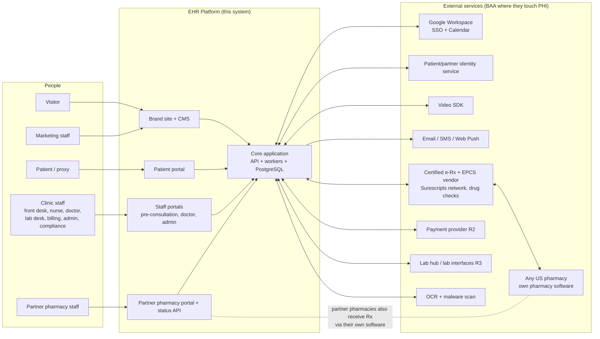
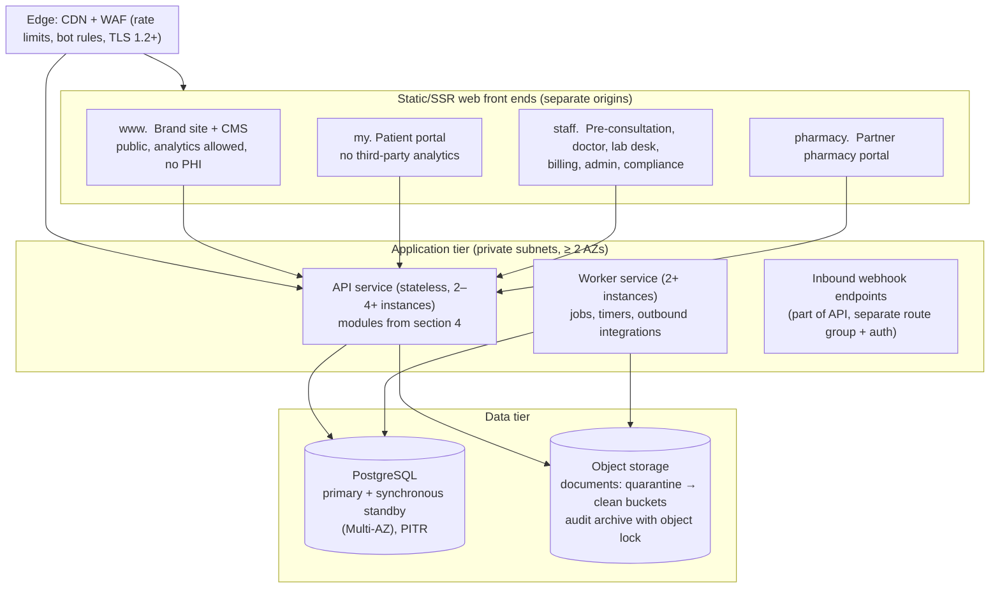
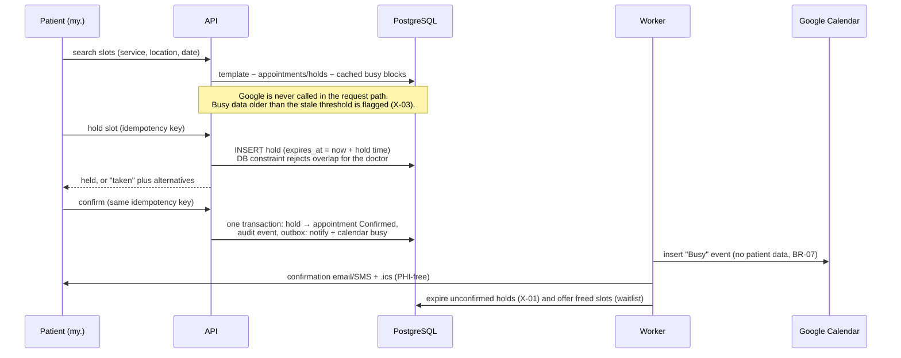

# ARCHITECTURE — Enterprise EHR Platform (G1 overview)

| Field | Value |
| --- | --- |
| Task | HEAAA-8 `[SDLC:architecture-overview]` |
| Author | Solution Architect agent (`7efe9f61-495f-4237-82f9-fa178629da09`) |
| Version | **Architecture overview draft 1** |
| Reviewed input | PRD draft 1: HEAAA-6 `prd` rev `3b976598-cd2f-4b4f-9903-7b83b5417f2b`; intake pack rev 2 (commit `6ea01b5`) |
| Status | **DRAFT. Not independently reviewed. Not human-endorsed. This is not G1.** The PM checks product alignment, then the Solution Architect Reviewer does the technical review. |
| Security input | Cybersecurity lane HEAAA-9 has **no output yet**. Section 8 is the Architect's baseline. It is not a specialist threat model. |
| Review round | 0 of 3 (cumulative) |

## 0. How to read this

This is the **G1 overview**. It sets direction: the shape of the system, the main technology choices, trust boundaries, capacity and cost scenarios, and tradeoffs. It does **not** contain ERDs, API contracts or migrations. Those come after G1 in HEAAA-12 (shared boundaries) and HEAAA-13 (technical design), in the order ERD → modules → API contracts.

Labels match the PRD:

| Label | Meaning |
| --- | --- |
| **Constraint** | Fixed by a confirmed intake/PRD statement (source tag given). |
| **Recommendation** | The Architect's proposal. A human endorses or rejects it at G1. |
| **Assumption** | A value I had to assume to size something. Each one is listed in section 12 with the decision that would replace it. |
| **Open** | Needs a human or vendor answer. |

Prices are list-price planning figures, not quotes. Two of them were checked on 2026-11-04 (section 10.4). The others are estimates with wide ranges. No vendor was contacted, nothing was bought, and no account was created.

## 1. Summary for the decision-maker

1. **The technical targets can be met with a simple design.** About 8,000 appointments a day and 1,000 staff is a moderate load. One well-structured application, one PostgreSQL database with a standby, and two to four app servers can meet p95 < 500 ms, slot search < 1 s and 99.9 % availability (section 9). This needs **no microservices, Kubernetes, Kafka or Redis**. Fewer moving parts means lower run cost and fewer failure modes.
2. **Buy the regulated and commodity parts. Build the workflow.** The build budget cannot cover DEA EPCS certification, a drug database, video, or identity. The recommendation is to integrate certified or BAA-covered services for those, and to build scheduling, triage, charting, the partner-pharmacy coordination layer, audit, and the portals.
3. **One design-changing finding (SA-F-01).** Under DEA rules, a pharmacy must receive controlled-substance e-prescriptions in its own DEA-certified pharmacy software. Our partner portal can therefore **not** be the legal channel that delivers prescriptions. Every prescription, partner or not, goes through the certified e-prescribing network. The partner portal mirrors the prescription and collects status (accepted, ready, out for delivery, delivered). The PRD and ST-03 need to say this.
4. **The run budget (US$5–15k/month) is at risk.** Usage-based services, not hosting, are the main risk: SMS reminders, video minutes, and (from R2) per-prescriber e-prescribing fees. In the expected R1 scenario the cost is about **US$12.5k/month**, close to the top of the range. The high scenario goes past US$15k. Three inputs are missing: the share of visits by video, the default reminder channel, and the number of prescribers (section 10).
5. **The build budget and the date are the binding constraint, not the technology.** This overview does not change scope. It lists the technical scope levers (section 11) for the G1 trim decision (PRD D-1, D-22).
6. **Hosting provider is Open (intake C6).** I recommend **AWS** in a US region with a signed BAA, with Google Cloud as a close alternative (ADR-004). The owner decides.

## 2. Context

### 2.1 System context



### 2.2 Constraints that shape the design

| Constraint | Source | Design consequence |
| --- | --- | --- |
| US only; HIPAA; BAA with every PHI vendor; HIPAA-eligible US region | `[05 §1–2]`, NFR-19 | Single US primary region plus a US recovery region. Only BAA-eligible services may touch PHI. |
| DEA EPCS: certified solution, identity proofing, two-factor signing | `[05 §1]`, `[07 A5]` | Use a certified e-Rx/EPCS vendor. We do not build or certify EPCS signing (ADR-006). |
| Many external pharmacies; each delivers on its own | `[07 A3, B5]` | Network for all prescriptions. Partner portal is a coordination and status layer (ADR-007). |
| Staff identity and calendars are Google Workspace | `[07 C4, C5]` | Staff sign in through Google OIDC. Busy-only calendar sync. |
| GitHub Actions CI; repo `zainnaeem28/enterprise-app` | `[01 §7]` | CI/CD and security gates run in GitHub Actions. Cloud access uses OIDC federation, not stored keys. |
| 99.9 %, RPO 15 min, RTO 4 h, zero-downtime deploys | NFR-1..5 | Multi-AZ database, ≥ 2 app instances, cross-region backups with logs, expand/contract migrations. |
| No migration R1–R3 | `[04 §5]` | Clean data model. No import tooling in R1–R3. |
| Build US$150–300k R1–R3; run US$5–15k/month; R1 by end May 2027 | `[07 D3–D5]` | Fewest deployables, managed services, no self-run clusters. |
| Synthetic data outside production | BR-35 | Separate cloud accounts per environment. Seed generators, not copies. |

## 3. Architecture style and topology (Recommendation, ADR-001)

**One modular application (a "modular monolith"): one codebase, one API deployable, one worker deployable, one database. Four web front ends on separate origins.**

Why: The load (section 9) does not need independent scaling. The team is small and agent-assisted, and the budget is tight. A monolith with strict internal module boundaries gives one place to enforce authorization and audit, one transaction scope for safety rules (for example, "no double booking"), and one deployment to run at 99.9 %. Splitting a module out later stays possible if a real need appears. Example: the pharmacy status API could become its own service if partner traffic grows far beyond the stated 1,500 deliveries a day.

### 3.1 Deployable units



| Unit | Responsibility | Scales by |
| --- | --- | --- |
| `site` | Brand site pages, doctor directory, booking hand-off, CMS-managed content, SEO | CDN cache; static/ISR rendering |
| `patient` | Patient and proxy portal | Static bundle on CDN; API does the work |
| `staff` | All clinic staff surfaces, with role-based navigation | Static bundle on CDN |
| `pharmacy` | Partner pharmacy portal | Static bundle on CDN |
| `api` | All synchronous business operations, authorization, audit writes, inbound webhooks | Horizontal, stateless |
| `worker` | Durable jobs: reminders, hold expiry, waitlist offers, escalation timers, retries to external services, document scanning/OCR hand-off, audit archiving | Horizontal; jobs are leased |
| PostgreSQL | System of record, job queue, audit hot store, notification fan-out | Vertical first; read replica if reports need it |
| Object storage | Documents, exports, audit archive | Managed |

**Why four separate origins (ADR-005).** Separate origins keep cookies, Content-Security-Policy, session lifetimes and third-party scripts apart. The brand site may load analytics and a cookie banner. The patient and staff origins must never load analytics, because analytics must never see health data (BR-36, NFR-18). Staff need a 15-minute idle timeout and Google SSO. Patients use a different identity service. Sharing one origin would make these rules depend on careful coding in every page instead of on the browser's origin isolation. All four front ends live in one repository and share a UI component package, so this adds build targets, not separate teams.

## 4. Modules and ownership

Each module owns its tables. Other modules call its public interface and never write its tables directly. Lint rules on import boundaries enforce this in CI. Detailed ERDs and contracts come in HEAAA-13.

| Module | Owns (data) | Main responsibilities | First release |
| --- | --- | --- | --- |
| `identity` | Users, staff/patient/partner identities, sessions, MFA state, role assignments, location assignments | Sign-in (Google OIDC for staff; identity service for patients and partners), step-up re-auth, idle timeout, authorization policy evaluation | R1 |
| `organisation` | Organisation, clinics/locations, rooms, hours, holidays, services, policies, feature flags, templates | Admin configuration, time zone per location | R1 |
| `patient` | Patient demographics, contacts, proxies, consents, preferences, care relationships (patient↔location), preferred pharmacy | Registration, proxy links, consent capture, duplicate detection and merge (SA-F-13) | R1 |
| `scheduling` | Availability templates, external busy blocks, holds, appointments, waitlist, check-ins, queue | Slot search, holds, booking invariant, reschedule/cancel, waitlist offers, arrivals and queue | R1 |
| `calendar-sync` | Calendar links, sync tokens, watch channels | Google Calendar busy-only two-way sync | R1 |
| `telehealth` | Video sessions, device-check results, waiting room state | Create vendor rooms, issue short-lived join tokens, state-licensing check hook (D-2) | R1 |
| `clinical` | Encounters, notes, addenda, co-signatures, problems, allergies, medication list, vitals, triage, immunisations | Charting, sign-and-lock, triage and red-flag rules | R1 (coded, ADR-010) |
| `documents` | Document metadata, versions, classifications, legal holds, retention | Upload via pre-signed URL, scan, OCR, classify, confirm, retain | R1 |
| `messaging` | Threads, messages, tasks | Staff tasks and messages; patient messaging per D-5 | R1 |
| `notifications` | Templates, notification jobs, delivery receipts, preferences, staff alerts | Email/SMS/push sending with a PHI-free variable allowlist; durable staff alerts (red flag, BTG, critical results) | R1 |
| `audit` | Audit events, break-the-glass events, export jobs | Append-only recording, BTG workflow, compliance views, archive | R1 |
| `privacy` | Privacy requests | Export, deletion requests (D-8), legal-hold checks | R1 |
| `cms` | Public content | Pages, blog, FAQ, banners. No PHI. | R1 |
| `prescribing` | Prescriptions (our copy), alert overrides, check outcomes, refill requests | Integrate the e-Rx vendor; mirror ST-03; record check outcomes (OUT-4) | R2 |
| `pharmacy-network` | Pharmacy directory cache, partner organisations, partner users, Rx routing, fulfilment events, hand-over records, delivery events, API clients | Partner portal, status API/webhooks, monotonic status machine | R2 (portal), R3 (API, tracking) |
| `billing` | Invoices, payments (tokens only), refunds | Hosted-field payments, refund approval | R2 |
| `labs` | Lab orders, specimens, results, acknowledgements, reconciliation queue | Order out, result in, release rules, critical escalation | R3 |
| `reporting` | Read models / materialised views | Dashboards, operations dashboard, pharmacy performance | R1 ops dashboard, R2 reports |
| `integration-core` | Outbound call log, inbound message log (idempotency keys), retry state | Timeouts, back-off, dead-letter view, operations dashboard feed (BR-33, NFR-21) | R1 |

`integration-core`, `audit`, `identity` and `notifications` are shared foundations. They are built first, and every other module depends on them.

## 5. Key flows

### 5.1 Booking without double booking (BR-02, X-01, X-02, RA-R1-03)



**How the invariant is enforced.** The database enforces "no overlap", not application code. A PostgreSQL exclusion constraint over (doctor, time range) covers active holds and confirmed appointments. A racing request therefore fails atomically, and RA-R1-03's "100 parallel confirmations, exactly one succeeds" holds by construction. Overbookable sessions (BR-02) are modelled as explicit extra capacity that is checked under a per-session row lock. The exact model is in HEAAA-13. SA-F-10 asks the PM to restate RA-R1-03 for non-overbookable slots.

**Transactional outbox.** Side effects (messages, calendar writes) are recorded in the same transaction as the business change and sent by the worker. So a crash never produces "booked but not notified" or "notified but not booked".

### 5.2 Prescription to pharmacy (R2) and status (R2/R3)

```mermaid
sequenceDiagram
  participant Dr as Doctor (staff.)
  participant API
  participant V as Certified e-Rx/EPCS vendor
  participant N as Surescripts network
  participant Ph as Pharmacy software (any pharmacy)
  participant PP as Partner portal / status API
  participant Pt as Patient (my.)
  Dr->>API: draft Rx (coded RxNorm)
  API->>V: drug/allergy/interaction/dose checks
  V-->>API: alerts → doctor overrides with reason or changes order (BR-16)
  Dr->>V: sign (re-auth; EPCS: vendor identity proofing + two-factor)
  V->>N: NCPDP SCRIPT NewRx
  N->>Ph: NewRx into the pharmacy's own DEA-certified software
  V-->>API: status callbacks (sent, error, Verify/Status) → ST-03 mirror
  API-->>Pt: status shown in portal; PHI-free prompt by SMS/email
  Note over Ph,PP: Partner pharmacies ALSO see a mirrored Rx in our portal<br/>and report accepted / ready / out for delivery / delivered,<br/>by portal (R2) or API/webhook (R3).
  PP->>API: status event (idempotent, monotonic, BR-24)
  API-->>Pt: status + tracking link (R3)
```

The pharmacy legally dispenses from what it receives through the network. Our portal is not the dispensing record (SA-F-01). Refill and renewal requests arrive as network renewal messages and route to the prescriber (BR-19). If the network is down, the prescription stays Signed with a visible retry (X-09, RA-R2-04).

### 5.3 Inbound pharmacy status events (R3, F-PH-07)

- Each partner pharmacy organisation gets an API client. It authenticates with OAuth 2.0 client credentials, short-lived tokens, and per-client scopes limited to its own prescriptions (BR-21). mTLS is an option for larger partners.
- Every event carries a pharmacy event ID (the idempotency key), `occurred_at`, and status. A unique index on (client, event ID) makes replays harmless (AC-24).
- A status rank decides the transition. A lower-rank or late event is stored in history and never moves the delivery backwards (BR-24, AC-23).
- Tracking links are validated: https only, allowlisted carrier domains or partner-registered domains. They are shown to the patient as external links.
- Per-client rate limits apply. Payloads have a size limit and a strict schema. Unknown fields are rejected.

### 5.4 Alerts that must reach a person (red flag R1, BTG R1, critical results R3)

An alert is a **database row first** and a push second. On creation, the worker fans it out to connected staff browsers over server-sent events (multi-instance fan-out through PostgreSQL `LISTEN/NOTIFY`), and optionally Web Push. If a browser was disconnected, it replays unacknowledged alerts on reconnect. An escalation timer job escalates to the on-call doctor when no acknowledgement arrives in the window (J-07, J-17; window D-11). The system records every step for audit. No message broker is needed at this volume (ADR-009).

### 5.5 Documents (BR-28, J-19)

The browser uploads to a **quarantine** bucket through a short-lived pre-signed URL. Object keys are random IDs with no names or PHI. A malware scan runs. Clean files move to the clean bucket and go to OCR (BAA-eligible service). A staff member confirms the classification. Downloads use a short-lived signed URL, issued only after an authorization check and an audit write. Infected files stay quarantined and are never served (AC-30).

## 6. Data architecture (overview only)

- **System of record:** PostgreSQL 16+ (managed). This is relational and transactional. Booking, prescriptions and audit need hard invariants. Detailed ERD: HEAAA-13.
- **Coding (ADR-010):** clinical data is coded from R1. RxNorm for medications and drug allergens, SNOMED CT and/or ICD-10-CM for problems, LOINC for vitals and labs. Free text is still allowed, but is flagged as uncoded. R2 drug checks can only check coded entries (SA-F-08). RxNorm, LOINC, ICD-10-CM and SNOMED CT US Edition are available to US users through NLM/UMLS licences. **CPT needs a paid AMA licence.** It is not needed until billing codes are used (assumed R4 with claims).
- **FHIR R4 / SMART:** the intake agrees these as standards but assigns no release. Recommendation: internal relational model with FHIR-aligned field semantics now; a FHIR R4 (US Core) read façade when a real consumer needs it (R3 labs, or R4). No ONC certification in R1–R3 unless legal advice requires it (SA-F-07).
- **Scoping:** every patient-data row is reachable through a patient and a care-relationship/location path. Authorization checks happen in the API on every read and write (organisation, location, assignment, role, BTG). Recommendation: also enable PostgreSQL row-level security on the highest-risk tables as defence in depth. HEAAA-13 decides this after a performance test.
- **Audit store (SA-F-11):** append-only table, partitioned by month. The application database role has INSERT and SELECT only. No role used by the app or admins can UPDATE or DELETE. Each partition carries a hash chain so tampering is detectable. Partitions older than the hot window (proposed 13 months) are exported to object storage with object lock (compliance mode) for the retention period set at G2. Retention is at least 6 years for HIPAA documentation and covers DEA EPCS needs. Legal confirmation is required.
- **Time:** UTC stored. Location time zone on every clinic. Display conversion in the clients (BR-05, NFR-22).
- **PHI minimisation outside the database:** no PHI in logs, URLs, object keys, analytics, job payload names, payment metadata, calendar events, .ics files, or message bodies (BR-23, BR-36). Notification templates can only bind allowlisted non-clinical variables. Developers cannot bind a service or diagnosis name by mistake.

## 7. Technology choices (Recommendation; exact versions fixed at G2)

| Area | Recommendation | Alternatives considered | Why |
| --- | --- | --- | --- |
| Language | **TypeScript** front to back | Java/Spring, C#/.NET, Python/Django | One language for four front ends and the API. Large library ecosystem for FHIR/HL7, Google, AWS. Strong typing for contracts shared between client and server. |
| API framework | **NestJS** (modular monolith) | Fastify plain, Express | Built-in module system matches section 4. Dependency injection makes auth/audit guards uniform. |
| Data access | **SQL-first query builder** (Kysely or Drizzle) with plain SQL migrations | Prisma, TypeORM | Exclusion constraints, row-level security, partitions and grants need first-class SQL. Prisma handles these poorly. |
| Job queue | **PostgreSQL-backed queue** (pg-boss or Graphile Worker) | SQS, Redis/BullMQ, Kafka | Volume is tens of thousands of jobs/day. Jobs are created in the same transaction as the business change (outbox). One less service to secure and run. Revisit if backlog metrics say so. |
| Front ends | **React + TypeScript.** **Next.js** for `site` (SEO, static/ISR). Portals as client-rendered React apps served from the CDN | Next.js SSR everywhere; Angular | Portals do not need server rendering, and client rendering avoids PHI in server/edge caches. The brand site needs SEO. |
| UI | Shared accessible component library (e.g. built on Radix/React Aria primitives) with WCAG 2.2 AA tests | Commercial UI kit | Accessibility is an acceptance criterion (NFR-10). UI/UX finalises at G2. |
| CMS | Self-hosted headless CMS on the same stack (e.g. Payload) **or** SaaS CMS | Contentful, Sanity | No PHI, so a BAA is not needed. Self-hosted avoids a monthly fee. A SaaS CMS saves build time. Decide at G2 on cost. |
| Hosting | **AWS**, US region pair (e.g. us-east-2 primary, us-west-2 recovery). **Owner decides (C6).** | Google Cloud (Cloud Run, Cloud SQL, Identity Platform); Azure | Both AWS and Google Cloud sign BAAs and have the needed eligible services. AWS has eligible equivalents for every R1 vendor slot: Chime SDK (video), SES (email), End User Messaging/SNS (SMS), Textract (OCR), Cognito (identity), GuardDuty malware scanning. That lowers the number of separate vendor BAAs. Google Cloud's advantage is closeness to Google Workspace, but Workspace SSO/Calendar work equally from either. |
| Compute | **Containers on ECS Fargate** behind an ALB; front ends on S3 + CloudFront | EKS (Kubernetes), EC2, Lambda | No cluster to operate. Rolling or blue/green deploys meet zero downtime. Kubernetes is not justified by this load. |
| Database | **RDS/Aurora PostgreSQL, Multi-AZ**, PITR, cross-region automated backup replication | Self-managed Postgres | Managed failover and PITR meet NFR-1/2 within budget. Aurora vs RDS chosen at G2 on cost. |
| Patient & partner identity | **Managed identity service under BAA** (Cognito if AWS) with email/phone OTP, TOTP/passkeys | Auth0 (BAA only on higher plans), Keycloak self-hosted | Avoids building credential storage. Keycloak saves fees but adds a security-critical server to operate. |
| Staff identity | **Google Workspace OIDC** directly; platform session after sign-in | Federate Google into the patient identity service | Fewest hops. Staff and patient identity stay separate. MFA proof: see SA-F-06. |
| Video | **BAA-eligible video SDK** (Chime SDK as the low-cost reference; Zoom Video SDK, Daily, Vonage as alternatives) | Self-hosted WebRTC (SFU) | Media never touches our servers. Self-hosting at 250 concurrent visits is costly to run and secure. |
| E-Rx / EPCS / drug checks | **One certified e-prescribing vendor** with EPCS, identity proofing, two-factor and an embedded drug database (e.g. DoseSpot, DrFirst) | Direct Surescripts certification + separate drug DB licence | Certification is out of budget and time. Bundled drug checks may remove DEP-7 as a separate licence. Vendor must expose check outcomes by API (SA-F-02). |
| Payments (R2) | Hosted fields/tokens (Stripe or Adyen) | — | Card data never reaches our servers (BR-30). No PHI in payment metadata. |
| Labs (R3) | Integration hub (Health Gorilla, Redox) unless partner labs offer direct FHIR | Own HL7 v2 interface engine | No interface engine to run. Per-connection fees to be quoted. Decide in R3 design once labs are named (C3). |
| IaC & CI/CD | **Terraform/OpenTofu**; **GitHub Actions** with OIDC to the cloud; protected environments | CDK | Agreed CI. No long-lived cloud keys in GitHub. |
| Observability | OpenTelemetry → CloudWatch (logs, metrics, traces, alarms), synthetic checks, on-call paging | Datadog/New Relic (BAA only on higher plans) | Stays under the cloud BAA. PHI scrubbing at the logger. |
| Security tooling | CodeQL or SonarQube (SAST), Dependabot/OSV (dependencies), gitleaks (secrets), Trivy (containers) in CI | — | NFR-15. Final selection at G2 (WORKFLOW: choose SonarQube/CodeRabbit/Strix in design). |

**Cost of reversal.** Hosting and language are expensive to reverse after build starts. Library choices (query builder, CMS, job queue) are cheap to reverse inside the module boundaries. Vendor choices (video, SMS, e-Rx) sit behind adapter interfaces in `integration-core`, so switching is a contained change. The exception is the e-Rx vendor: its embedded signing UI shapes the prescribing screens.

## 8. Trust boundaries and security baseline

> **Status:** This is the Architect's baseline so security is not missing if the Cybersecurity lane (HEAAA-9) adds nothing. When HEAAA-9 delivers threats and controls, I will incorporate them in a new revision, and the affected reviews reopen.

### 8.1 Trust boundaries

```mermaid
flowchart LR
  subgraph Z0["Z0 Public internet (untrusted)"]
    V[Visitors / bots]
    P[Patients, proxies]
    PS[Partner pharmacy users]
    PAPI[Partner pharmacy systems]
    VW[Vendor webhooks:<br/>e-Rx, video, payments,<br/>Google push, messaging receipts]
  end
  subgraph Z1["Z1 Edge: CDN + WAF"]
  end
  subgraph Z2["Z2 Application VPC, private subnets"]
    API[API]
    WRK[Worker]
  end
  subgraph Z3["Z3 Data: PHI at rest, KMS-encrypted"]
    DB[(PostgreSQL)]
    S3[(Documents, audit archive)]
  end
  subgraph Z4["Z4 Staff (Google Workspace identity)"]
    ST[Staff browsers]
  end
  subgraph Z5["Z5 BAA vendors (outbound PHI allowed)"]
    VEN[Identity, video, e-Rx, OCR,<br/>email/SMS (PHI-free body), labs]
  end
  subgraph Z6["Z6 Operations: cloud console, CI/CD"]
    OPS[Ops engineers, GitHub Actions]
  end
  Z0 --> Z1 --> Z2
  Z4 --> Z1
  Z2 --> Z3
  Z2 --> Z5
  Z6 -. "break-glass, MFA, logged" .-> Z2
  Z6 -. "no routine PHI read" .-> Z3
```

| Boundary | Who crosses | Control |
| --- | --- | --- |
| Z0→Z1 | Everyone | TLS 1.2+, WAF managed rules, rate limits per IP/account, bot protection on public forms (NFR-17), HSTS, strict CSP per origin |
| Z1→Z2 | Authenticated users | Session/JWT validation; server-side authorization on every request (role + organisation + location + assignment + BTG); schema validation of all input; no PHI in URLs |
| Partner systems → status API | Pharmacy API clients | OAuth2 client credentials, per-client scopes, idempotency, schema validation, per-client rate limits |
| Vendor webhooks → API | e-Rx, video, payment, Google | Vendor signature verification, replay window, idempotency, IP allowlist where the vendor publishes ranges |
| Z2→Z5 | Our worker/API | Only BAA-covered vendors receive PHI. Each vendor call has a timeout, retry with back-off, and a circuit state on the ops dashboard. SMS/email/push bodies are PHI-free by template design |
| Z2→Z3 | API/worker roles | Least-privilege DB roles per deployable; audit role is insert-only; KMS keys with rotation; no public buckets |
| Z6→Z2/Z3 | Engineers, CI | SSO + MFA to the cloud; no standing production data access; break-glass role is time-boxed and alerts; CI deploys through OIDC with protected environments; deployment credentials only after G3 |

### 8.2 Top risks and baseline controls (not a full threat model)

| ID | Threat | Baseline control |
| --- | --- | --- |
| T-1 | A patient reads another patient's data by changing an ID (IDOR) | Object-level authorization in a shared policy layer for every resource; random non-guessable IDs; negative tests (AC-35) |
| T-2 | Staff reaches patients outside their locations | Care-relationship and location scoping enforced server-side; optional RLS; BTG flow with reason and compliance alert (AC-12, AC-34) |
| T-3 | Account takeover of a prescriber | Google 2SV enforced by Workspace policy (security keys recommended for prescribers); re-auth before signing; EPCS two-factor by the certified vendor |
| T-4 | PHI leaks through logs, analytics, messages, calendar | Origin separation; logger redaction; template variable allowlist; CI log scan test (NFR-18) |
| T-5 | Forged or replayed pharmacy/vendor webhooks | Signature/OAuth verification, idempotency keys, monotonic state machine (AC-23, AC-24) |
| T-6 | Malware in uploads | Quarantine bucket, scan before access, no inline rendering of uploads, content-type checks |
| T-7 | Audit tampering by an admin | No delete path in the product; DB grants forbid it; hash chain; object-lock archive (AC-36) |
| T-8 | Supply-chain compromise | Lockfiles, dependency/secret/container scanning, pinned actions, signed images, least-privilege CI tokens |
| T-9 | Credential theft from CI or cloud | OIDC federation (no long-lived keys); separate accounts per environment; production deploy needs a protected environment approval |
| T-10 | Denial of service or booking abuse (slot hoarding) | WAF rate rules; hold limits per patient; max future appointments (BR-04); CAPTCHA on public forms |

ASVS L2 applies across the platform. L3 applies to authentication, prescribing and payment paths (NFR-14). The Security Reviewer's checklist is set at G2.

## 9. Capacity model and feasibility of NFR-6, NFR-8 and NFR-9

### 9.1 From business volume to load

| Input (NFR-9) | Value | Assumption used to convert | Derived load |
| --- | --- | --- | --- |
| Appointments | 8,000/day peak | 12-hour booking day; peak hour = 2 × average hour | ~1,350 bookings/hour peak ≈ **0.4 bookings/s** |
| Slot searches | — | 20 searches per booking (A-1) | ~**8 searches/s** peak |
| Staff | ~1,000 | 80 % active at peak; one API call every 5 s | ~**160 req/s** |
| Patients | ~250,000 registered | 1 % concurrent at peak (2,500); one call every 10 s | ~**250 req/s** |
| Prescriptions | 4,000/day | 3 vendor round-trips each | < 1 call/s |
| Deliveries | 1,500/day | ~5 status events each | ~7,500 events/day |
| Video | 250 concurrent | Media goes to the vendor; we handle join and token calls only | < 5 req/s |
| Notifications | — | 3 per appointment + OTPs | ~30,000/day |
| Audit events | — | ~1 per PHI read/write | up to ~2 million rows/day ≈ **~1 GB/day** (A-6) |

**Design point:** ~**450 req/s at peak**. Load tests run at **2 × peak (≈ 900 req/s sustained for 30 min) plus a 3 × burst for 5 min**. This is the headroom factor the PRD asked the Architect to set (NFR-9). It covers modelling error and the unknown 3-year growth until that is decided.

### 9.2 Feasibility

| Target | Verdict | How |
| --- | --- | --- |
| NFR-6 API p95 < 500 ms | **Feasible** | 2–4 API instances (1–2 vCPU each); indexed queries; no external calls in the request path for reads; connection pooling. One PostgreSQL primary (4–8 vCPU, 32 GB) handles this with large margin. |
| NFR-8 slot search p95 < 1 s | **Feasible** | Availability computed from templates and indexed appointment/busy-block ranges; Google busy data pre-synced; per-location/date queries; optional short-lived cache only if tests show need. |
| NFR-9 volumes | **Feasible** | Throughput is low. Correctness under contention (bookings) is the hard part, and section 5.1 handles it. |
| RA-R1-10: 250 concurrent video visits | **Feasible via vendor** | A vendor capacity question, not ours. Confirm limits in the vendor contract. |
| NFR-1 99.9 % | **Feasible with discipline** | Multi-AZ DB failover (typically 1–2 min); ≥ 2 instances per service across AZs; zero-downtime deploys; error budget 43 min/month. Scope of the measure needs a PRD rule (SA-F-05). |
| NFR-2 RPO 15 min | **Feasible** | In-region PITR (transaction logs every ~5 min). For loss of the region: cross-region replication of automated backups including logs. |
| NFR-3 RTO 4 h | **Feasible with a rehearsed runbook** | Infrastructure as code redeploys into the recovery region; restore the database from replicated backups; switch DNS. A timed rehearsal is required before R1 (NFR-3). |
| NFR-5 zero downtime | **Feasible** | Rolling/blue-green deploys; expand → migrate → contract database changes; backward-compatible API for one release. |
| NFR-7 LCP < 2.5 s on 4G | **Feasible** | CDN, static rendering for `site`, code splitting, image optimisation; budget enforced in CI (Lighthouse). |

### 9.3 Database sizing (year 1, planning)

| Data | Estimate |
| --- | --- |
| Core clinical and scheduling rows | Tens of GB in year 1 |
| Audit hot store | ~1 GB/day → ~400 GB for a 13-month hot window (A-6) |
| Documents | In object storage, not in the DB; size depends on upload volume (A-7) |
| Initial instance | 4 vCPU / 32 GB, Multi-AZ, 1 TB storage autoscaling; resize after the load test |

## 10. Cost scenarios (monthly run cost)

### 10.1 R1 production run cost

All figures are US$/month at list prices. They are **not quotes**. The scenarios differ only in the assumptions shown.

| Line | Low | Expected | High | Driver and assumption |
| --- | --- | --- | --- | --- |
| Cloud infrastructure (prod + staging + DR backups) | 2,500 | 3,500 | 5,000 | Multi-AZ PostgreSQL, Fargate, ALB, NAT, CDN, WAF, KMS, logs/monitoring, GuardDuty, cross-region backups; staging ≈ 30–40 % of prod (A-8) |
| SMS | 2,800 | 4,350 | 6,450 | 145,600 appointments/month (A-2) × 3 messages × SMS share 30 / 60 / 100 % (A-3) at ≈ US$0.012 per segment all-in, plus ~100,000 OTP SMS ≈ US$1,200 (A-4) |
| Video | 1,600 | 3,300 | 5,400 | Video share 15 / 30 / 50 % of visits (A-5), 44 attendee-minutes per visit, Chime SDK list US$0.0017/attendee-minute. Other SDKs can cost ~2× more. |
| Email | < 50 | < 50 | 100 | Bulk transactional email is cheap |
| Patient identity | 300 | 750 | 1,500 | Monthly active patients 30k / 60k / 100k (A-9); identity-service pricing per MAU |
| OCR, malware scan, maps, misc. | 200 | 400 | 800 | Upload volume unknown (A-7) |
| Tooling (paging, SAST if paid) | 100 | 300 | 600 | Selected at G2 |
| **R1 total** | **≈ 7,550** | **≈ 12,650** | **≈ 19,850** | Budget US$5,000–15,000 |

### 10.2 Added from R2 and R3

| Line | Status | Note |
| --- | --- | --- |
| E-Rx + EPCS vendor (per prescriber per month, plus set-up) | **Unknown: quote required** | Prescriber count is not in any source (SA-F-03). Cost = prescribers × per-prescriber fee. At 200 prescribers, every US$10 of per-prescriber fee adds US$2,000/month. This line can exceed the remaining budget by itself. |
| Drug database | Possibly included in the e-Rx vendor | Otherwise a separate licence (DEP-7) |
| Payments | Per-transaction fees | Usually netted from revenue, not the run budget. Owner to confirm treatment. |
| Lab hub (R3) | Quote required | Per lab connection and/or per message |
| Extra SMS for prescription/delivery status prompts | +10–30 % on SMS | 4,000 Rx and 1,500 deliveries/day at peak |

### 10.3 Costs outside the run budget that the PRD requires

Independent penetration test before each release with new external surface (NFR-16). Timed disaster-recovery exercise (NFR-3). Manual accessibility audit (NFR-10). A licensed clinician's safety review (D-12). SOC 2 readiness (Recommendation). **None of these has a budget line.** They come out of the US$150–300k build budget unless the owner says otherwise (SA-F-15).

### 10.4 Levers if the cost is too high

1. **Email first, SMS by patient choice.** Example: one SMS reminder instead of two. This is the largest single lever. The confirmed "two reminders" rule (BR-08) can still be met by email or push.
2. Chime-class video pricing. Negotiate committed-use rates at the expected volume.
3. Web Push for portal users at no per-message cost.
4. Savings plans or reserved database capacity after the R1 load test (typically 20–40 % on those lines).
5. Get e-Rx quotes before G2 (DEP-6) so R2 costs are known before the R2 build.

**Price checks done on 2026-11-04:** Chime SDK WebRTC media at US$0.0017 per attendee-minute (AWS pricing page). Twilio US SMS at about US$0.0079–0.0083 per segment plus about US$0.003–0.005 carrier fee (Twilio pricing page and third-party summaries; sources disagree slightly). All other figures are unverified estimates.

## 11. Technical scope levers for the G1 trim decision

These are options for the owner's trim decision (PRD D-1, D-22). The Architect does not choose scope.

| Lever | Saves | Cost of choosing it |
| --- | --- | --- |
| Buy, don't build: identity, video, CMS, e-signature (or simple built-in signature capture), OCR, e-Rx + drug checks, lab hub | Large build effort | Vendor fees (section 10); vendor lock-in behind adapters |
| One staff front end with role-based navigation (already recommended) instead of three staff apps | Build and test effort | None material |
| Defer FHIR/SMART external API to R4 (ADR-010) | Significant build and certification effort | Third-party apps cannot connect until then |
| Defer self check-in QR (F-PC-01 part) or Web Push to R2 | Small | Desk check-in only; email/SMS only |
| Defer patient messaging (D-5) and visit summaries (D-6) | Medium | Patients phone the clinic |
| Fewer operating states at R1 (D-2) | Licensing-rule logic and testing | Fewer patients served at launch |

## 12. Assumptions and unknowns

| ID | Assumption | Replaced by |
| --- | --- | --- |
| A-1 | 20 slot searches per booking | Analytics after launch; load-test result |
| A-2 | Monthly appointments = 8,000 × 70 % × 26 days ≈ 145,600 | Owner's real average-day volume |
| A-3 | 30 / 60 / 100 % of patients get SMS | Decision on default reminder channel (SA-F-03) |
| A-4 | ~100,000 OTP SMS per month | Identity design (passkeys reduce OTPs) |
| A-5 | Video share 15 / 30 / 50 %; 22 min per attendee, 2 attendees | Owner's telehealth share (SA-F-04) |
| A-6 | ~2 million audit events per day at peak | Measured after the R1 load test |
| A-7 | Upload volume moderate (tens of thousands of pages a month) | Clinic workflow data |
| A-8 | Staging ≈ 30–40 % of production; DR is backup-based (pilot light), not a hot second region | DevOps plan at G2 |
| A-9 | 30k–100k monthly active patients | Launch analytics |
| A-10 | Prescriber count ~150–400 (unknown) | Owner input (SA-F-03) |
| A-11 | Custom build per intake (D-1 not yet decided). **If D-1 picks buy or hybrid, this overview reopens.** | D-1 |

## 13. Architecture decision records (proposed, to be endorsed at G1)

| ADR | Decision | Status | Reversal cost |
| --- | --- | --- | --- |
| ADR-001 | Modular monolith: one API, one worker, one database | Proposed | Medium: modules can be extracted later |
| ADR-002 | PostgreSQL as the only system of record, also job queue and alert fan-out | Proposed | Medium |
| ADR-003 | Transactional outbox and durable jobs for every external side effect | Proposed | Low |
| ADR-004 | AWS, US region pair, under BAA (owner decides; GCP is the alternative) | Proposed, **needs owner decision (C6)** | High once built |
| ADR-005 | Four web origins: site, patient, staff, pharmacy | Proposed | Low–medium |
| ADR-006 | E-prescribing, EPCS signing/proofing and drug checks through one certified vendor | Proposed | High after R2 build |
| ADR-007 | Network is the legal prescription channel for every pharmacy; partner portal is coordination and status | Proposed, **needs PRD change (SA-F-01)** | High if reversed (needs DEA-certified pharmacy software) |
| ADR-008 | Append-only partitioned audit with hash chain and object-locked archive | Proposed | Medium |
| ADR-009 | Realtime staff alerts with server-sent events + durable alert rows; no broker | Proposed | Low |
| ADR-010 | Coded relational clinical model from R1; FHIR R4 façade later; no ONC certification R1–R3 | Proposed, **needs owner decision (SA-F-07)** | Medium |
| ADR-011 | Separate identity: Google OIDC for staff; managed identity service for patients and partners | Proposed | Medium |
| ADR-012 | Terraform/OpenTofu IaC, GitHub Actions with OIDC, one cloud account per environment | Proposed | Low |

## 14. Answers to the PM's hand-off questions (PRD §15)

1. **NFR-9/6/8 on budget; headroom.** Technically feasible on a small footprint (section 9). Headroom: load test at 2 × peak sustained, 3 × burst. The run budget, not infrastructure, is the risk (section 10).
2. **Partner API and EPCS authentication.** Partner API: OAuth2 client credentials per pharmacy organisation, scoped to its own prescriptions, with optional mTLS (section 5.3). Partner users: managed identity service with mandatory MFA. EPCS identity proofing and two-factor signing are done by the certified vendor (ADR-006).
3. **Slot hold and no double booking.** Database exclusion constraint over doctor and time range, held slots as rows with expiry, idempotent confirm, outbox side effects (section 5.1).
4. **Coding and FHIR/SMART scope.** Coded from R1 (RxNorm, SNOMED CT/ICD-10-CM, LOINC). CPT is deferred (paid licence). FHIR façade when there is a consumer. No ONC certification unless required (ADR-010, SA-F-07).
5. **Audit and BTG.** Section 6 (audit store) and 5.4 (BTG alert as a durable alert with compliance review queue). Retention value is set at G2 with legal input.
6. **R1 without drug database and payments.** Yes. To avoid R2 rework, R1 must include: coded medications and allergies; preferred pharmacy stored with its NCPDP ID from the vendor directory (or a placeholder resolved in R2); prescriber attributes on staff profiles (NPI, DEA number, licensed states); an invoice-ready service price on the catalogue (already F-AD-03); and the `integration-core` and outbox foundation.
7. **Security assumptions.** In section 8 of this document, not in the PRD.

## 15. PRD technical review findings (summary)

Full findings with evidence and requested PRD wording are in the HEAAA-8 document `prd-technical-review` (draft 1). They were raised against PRD rev `3b976598`.

| ID | Severity | Finding |
| --- | --- | --- |
| SA-F-01 | **High** | Partner portal cannot be the legal prescription channel. All Rx go through the network. The portal mirrors and collects status. |
| SA-F-02 | **High** | EPCS proofing/signing and drug checks happen inside a certified vendor. OUT-4/RA-R2-01 must become a vendor capability requirement (check outcome available by API). |
| SA-F-03 | **High** | Run-budget inputs missing: prescriber count, telehealth share, default reminder channel. Expected R1 run cost ≈ US$12.5k; the high scenario passes US$15k before R2 e-Rx fees. |
| SA-F-04 | Medium | NFR-9 is internally unclear: 250 concurrent video visits implies ~700 video visits an hour at peak. Telehealth share and visit length are needed. |
| SA-F-05 | Medium | NFR-1 measurement scope (third-party outages, maintenance) and whether RPO/RTO cover loss of a region are undefined. |
| SA-F-06 | **High** | The platform cannot verify per sign-in that Google 2SV happened. Staff MFA must be enforced and evidenced by Workspace admin policy. RA-R1-01 needs that test method. |
| SA-F-07 | Medium | FHIR/SMART and ONC certification have no release or decision. Recommend: no certification R1–R3; FHIR API in R4 unless legal says otherwise. |
| SA-F-08 | Medium | R1 must capture coded medications/allergies, or OUT-4 (100 % checks) is at risk in R2. |
| SA-F-09 | Medium | Telehealth licensing checks need enforcement points (booking and join) even before D-2 is answered. |
| SA-F-10 | Low | RA-R1-03 conflicts with overbookable slots (BR-02). Restrict it to non-overbookable slots. |
| SA-F-11 | Low | Audit volume (~2 M events/day) and retention need a G2 value. Retention drives storage cost. |
| SA-F-12 | Medium | BR-23 should also cover .ics files, push, calendar titles, payment descriptors, and service/specialty names that reveal a condition. |
| SA-F-13 | Medium | No requirement for duplicate-patient detection and merge (front desk vs self-registration). This is a wrong-patient safety risk. |
| SA-F-14 | Medium | Penetration test, DR rehearsal, accessibility audit and clinician review have no budget or schedule before end of May 2027. |
| SA-F-15 | Medium | 99.9 % with on-call alerts needs a named on-call rota. The operations owner is one person. |

## 16. Limitations

- Built from documents only: the PRD draft, intake pack, BA map and research. No vendor was contacted. No prototype or load test ran. No cloud account exists.
- Two prices were checked online (section 10.4). Every other cost is an estimate with a wide range.
- Not legal, regulatory or clinical advice. DEA, HIPAA, Cures Act and state-law statements are an engineering reading and need qualified review (PRD D-12).
- Cybersecurity input (HEAAA-9) is not yet available. Section 8 is a baseline, not a threat model.
- Not independently reviewed. Not human-endorsed.

## 17. Revision manifest

| Item | Identifier |
| --- | --- |
| This document | HEAAA-8 document key `architecture`, draft 1; repo `docs/ARCHITECTURE.md` on branch `HEAAA-8-sdlc-architecture-overview-review-technical-feasibility-and-prepare-architecture-overview` (commit in the task comment) |
| PRD reviewed | HEAAA-6 `prd` rev `3b976598-cd2f-4b4f-9903-7b83b5417f2b` |
| Intake pack | Revision 2, commit `6ea01b5` |
| Findings | HEAAA-8 document `prd-technical-review`, draft 1 |
| Security input | HEAAA-9: none at authoring time |

**Next permitted action:** PM product-alignment review, then Solution Architect Reviewer technical review of this exact revision. The Orchestrator (HEAAA-10) consolidates PRD findings SA-F-01..15 with the Product Owner Reviewer's and Cybersecurity's into one PRD revision round. Detailed design (HEAAA-12, HEAAA-13) waits for G1.
