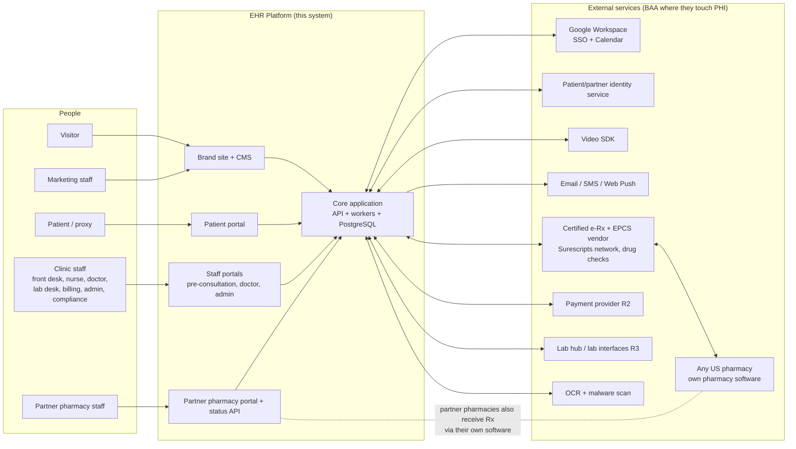
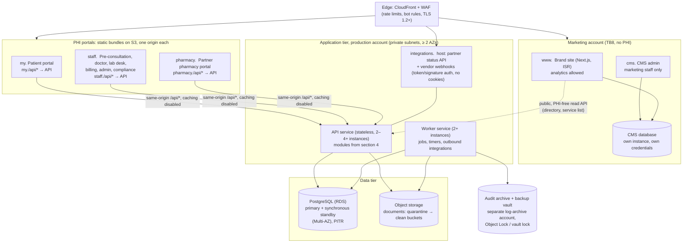
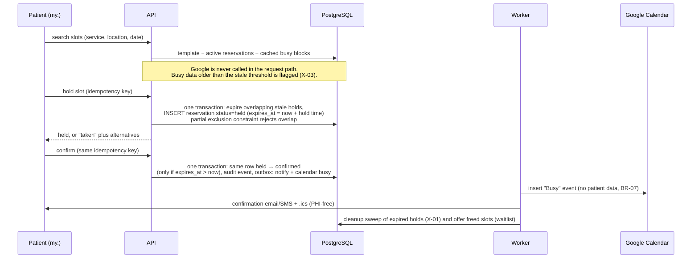
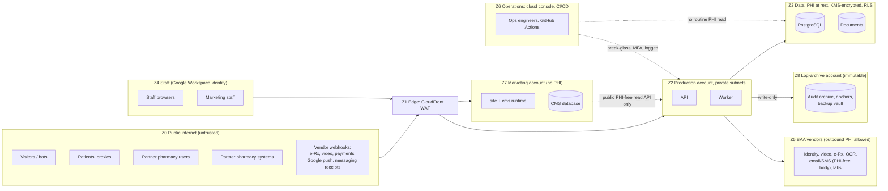

# ARCHITECTURE — Enterprise EHR Platform (G1 overview)

| Field | Value |
| --- | --- |
| Task | HEAAA-8 `[SDLC:architecture-overview]` (drafts 1–2); HEAAA-41 `[SDLC:prd-recheck-technical]` (draft 3, alignment only; draft 4, bounded correction of SAR-12..14) |
| Author | Solution Architect agent (`7efe9f61-495f-4237-82f9-fa178629da09`) |
| Version | **Architecture overview draft 4** (supersedes draft 3, HEAAA-41 `architecture` rev `4528a484-5966-40f3-9c43-efda8c4f24bd`, `docs/ARCHITECTURE.md` @ `23d086d`). Draft 4 is limited to SAR-12..14 from HEAAA-43 `architecture-review` rev `afd5227e`. It writes the Cybersecurity SEC-D-19 disposition and conditions C1–C7 (HEAAA-42) into the staff identity design and adds the owner decision they create. It also fixes two wording errata. Topology, deployables, hosting, other trust boundaries and the run-cost figures in section 10.1 are unchanged (section 18.2). |
| Reviewed input | PRD revision 2: HEAAA-39 `prd` rev `7d196a7d-8489-4dc1-86b7-d9dcd22711ad` (`docs/PRD.md` @ `12b9578`); earlier PRD draft 1 rev `3b976598`; intake pack rev 2 (commit `6ea01b5`) |
| Status | **DRAFT 4. Not yet re-reviewed. Not human-endorsed. This is not G1.** Draft 2 got Solution Architect Reviewer PASS (`architecture-review` rev `46cabf10`). Draft 3 got CHANGES REQUIRED (`architecture-review` rev `afd5227e`, SAR-12..14). Draft 4 needs a recheck of the changed lines only (section 18.2). |
| Security input | HEAAA-9 `security-assessment` rev `22d5dcc6-32c3-4cc9-8bc0-7fc47a103a1c` (repo commit `cabe41f`), independently reviewed PASS by the Security Reviewer (not human approval). Incorporated in section 8 and wherever a SEC-D control is cited. SEC-D-19 disposition: HEAAA-42 Cybersecurity decision comment `e6414334` (2026-11-04), **ACCEPTED-WITH-CONDITIONS SEC-D-19-C1..C7**. This is not a human decision. |
| Review round | Draft 2 closed cumulative round 2 of 3 with PASS. Draft 3's recheck was round 3 of 3 and returned CHANGES REQUIRED, so the loop stopped and escalated. A human granted **one bounded cycle** (HEAAA-41 confirmation `4a922922-413f-454e-a108-3f8d7e533107`, accepted 2026-11-04): this draft 4, limited to SAR-12..14, plus one independent recheck. That grant does not decide SEC-D-19 funding, accept residual risk or approve G1. |

## 0. How to read this

This is the **G1 overview**. It sets direction: the shape of the system, the main technology choices, trust boundaries, capacity and cost scenarios, and tradeoffs. It does **not** contain ERDs, API contracts or migrations. Those come after G1 in HEAAA-12 (shared boundaries) and HEAAA-13 (technical design), in the order ERD → modules → API contracts.

Labels match the PRD:

| Label | Meaning |
| --- | --- |
| **Constraint** | Fixed by a confirmed intake/PRD statement (source tag given). |
| **Recommendation** | The Architect's proposal. A human endorses or rejects it at G1. |
| **Assumption** | A value I had to assume to size something. Each one is listed in section 12 with the decision that would replace it. |
| **Open** | Needs a human or vendor answer. |

Prices are list-price planning figures, not quotes. Two of them were checked on 2026-11-04 (section 10.4). The others are estimates with wide ranges. No vendor was contacted, nothing was bought, and no account was created.

## 1. Summary for the decision-maker

1. **The technical targets can be met with a simple design.** About 8,000 appointments a day and 1,000 staff is a moderate load. One well-structured application, one PostgreSQL database with a standby, and two to four app servers can meet p95 < 500 ms, slot search < 1 s and 99.9 % availability (section 9). This needs **no microservices, Kubernetes, Kafka or Redis**. Fewer moving parts means lower run cost and fewer failure modes.
2. **Buy the regulated and commodity parts. Build the workflow.** The build budget cannot cover DEA EPCS certification, a drug database, video, or identity. The recommendation is to integrate certified or BAA-covered services for those, and to build scheduling, triage, charting, the partner-pharmacy coordination layer, audit, and the portals.
3. **One design-changing finding (SA-F-01).** Under DEA rules, a pharmacy must receive controlled-substance e-prescriptions in its own DEA-certified pharmacy software. Our partner portal can therefore **not** be the legal channel that delivers prescriptions. Every prescription, partner or not, goes through the certified e-prescribing network. The partner portal mirrors the prescription and collects status (accepted, ready, out for delivery, delivered). PRD revision 2 now says this (PRD section 1, RA-R2-03, RA-R2-05); the owner is asked to acknowledge it as PRD decision D-24.
4. **The run budget (US$5–15k/month) is at risk.** Usage-based services, not hosting, are the main risk: SMS reminders, video minutes, and (from R2) per-prescriber e-prescribing fees. In the expected R1 scenario the cost is about **US$13,750/month**, close to the top of the range. The high scenario (about US$22,150) goes past US$15k. Draft 2 adds region-loss readiness, the brand-site/CMS runtime, the identity replication add-on and SMS registration fees, which draft 1 left out. Three inputs are missing: the share of visits by video, the default reminder channel, and the number of prescribers (section 10).
5. **The build budget and the date are the binding constraint, not the technology.** This overview does not change scope. It lists the technical scope levers (section 11) for the G1 trim decision (PRD D-1, D-22).
6. **Hosting provider is Open (intake C6).** I recommend **AWS** in a US region with a signed BAA, with Google Cloud as a close alternative (ADR-004). The owner decides (PRD D-30).
7. **Recovery from losing a whole region is designed per component (section 9.4), not just for the database.** It is backup-based (pilot light). PRD revision 2 includes region loss in NFR-2/NFR-3 by default (decision D-26). If the owner says no, the region-loss lines in section 10 can be dropped.
8. **Security specialist input is incorporated (section 8).** It changes two draft 1 positions: row-level security in the database is now part of the R1 design, not an option (SEC-D-01), and patients, partner pharmacies and staff use three separate identity realms (SEC-D-04, R-2). Admins stay in the staff realm. Cybersecurity accepted that with conditions C1–C7, provided the owner funds C1–C3. If the owner does not, Cybersecurity's position becomes REJECT and admins get a separate user pool. **This is an owner decision at G1** (section 8.3).

## 2. Context

### 2.1 System context



### 2.2 Constraints that shape the design

| Constraint | Source | Design consequence |
| --- | --- | --- |
| US only; HIPAA; BAA with every PHI vendor; HIPAA-eligible US region | `[05 §1–2]`, NFR-19 | Single US primary region plus a US recovery region. Only BAA-eligible services may touch PHI. |
| DEA EPCS: certified solution, identity proofing, two-factor signing | `[05 §1]`, `[07 A5]` | Use a certified e-Rx/EPCS vendor. We do not build or certify EPCS signing (ADR-006). |
| Many external pharmacies; each delivers on its own | `[07 A3, B5]` | Network for all prescriptions. Partner portal is a coordination and status layer (ADR-007). |
| Staff identity and calendars are Google Workspace | `[07 C4, C5]` | Staff sign in through Google OIDC. Busy-only calendar sync. |
| GitHub Actions CI; repo `zainnaeem28/enterprise-app` | `[01 §7]` | CI/CD and security gates run in GitHub Actions. Cloud access uses OIDC federation, not stored keys. |
| 99.9 %, RPO 15 min, RTO 4 h, zero-downtime deploys | NFR-1..5 | Multi-AZ database, ≥ 2 app instances, expand/contract migrations. Region-loss recovery planned per component (section 9.4); required by default per PRD D-26. |
| No migration R1–R3 | `[04 §5]` | Clean data model. No import tooling in R1–R3. |
| Build US$150–300k R1–R3; run US$5–15k/month; R1 by end May 2027 | `[07 D3–D5]` | Fewest deployables, managed services, no self-run clusters. |
| Synthetic data outside production | BR-35, SEC-D-20 | Separate cloud accounts per environment. Seed generators, not copies. |
| Possible 42 CFR Part 2 (substance-use) records | Open intake item; HEAAA-9 R-5 | **Open.** If yes: data segmentation, consent for redisclosure, and possibly a separate KMS key per data class. Needs an owner decision before G1 (SEC-D-16; PRD D-15, default "no Part 2 data"). |

## 3. Architecture style and topology (Recommendation, ADR-001)

**One modular application (a "modular monolith"): one codebase, one API deployable, one worker deployable, one database. Three PHI portals plus one brand site, each on its own origin. The brand site and its CMS are a separate, PHI-free deployable in a separate account.**

Why: The load (section 9) does not need independent scaling. The team is small and agent-assisted, and the budget is tight. A monolith with strict internal module boundaries gives one place to enforce authorization and audit, one transaction scope for safety rules (for example, "no double booking"), and one deployment to run at 99.9 %. Splitting a module out later stays possible if a real need appears. Example: the pharmacy status API could become its own service if partner traffic grows far beyond the stated 1,500 deliveries a day.

### 3.1 Deployable units



| Unit | Responsibility | Scales by |
| --- | --- | --- |
| `site` | Brand site pages, doctor directory, booking hand-off (a link into `my.`), SEO. Runs as a small Next.js server (ISR) on Fargate in the **marketing account**. | CDN cache in front; 1–2 small tasks. The site stays readable from the CDN cache if the origin is down. |
| `cms` | Headless CMS (e.g. Payload) admin and content API. Same Fargate service as `site` or a sibling. Own small PostgreSQL instance (or schema on a separate instance) with its own credentials. It holds no PHI and has no network path or credentials to the production database. | Single small instance |
| `patient` | Patient and proxy portal | Static bundle on CDN; API does the work |
| `staff` | All clinic staff surfaces, with role-based navigation | Static bundle on CDN |
| `pharmacy` | Partner pharmacy portal | Static bundle on CDN |
| `api` | All synchronous business operations, authorization, audit writes; serves `/api/*` for the three portals and the `integrations.` host | Horizontal, stateless |
| `worker` | Durable jobs: reminders, hold cleanup, waitlist offers, escalation timers, retries to external services, document scanning/OCR hand-off, audit anchoring and archiving | Horizontal; jobs are leased |
| PostgreSQL | System of record, job queue, audit hot store, notification fan-out | Vertical first; read replica if reports need it |
| Object storage | Documents, exports | Managed |
| Audit archive and backup vault | Exported audit partitions, audit anchors, immutable backup copies. In a separate log-archive account that production roles cannot delete from (SEC-D-06, SEC-D-17). | Managed |

**Alternative that removes the `site`/`cms` runtime:** static export of the site plus a SaaS CMS (e.g. Contentful, Sanity). This has no server and no CMS database to run, but it has a monthly SaaS fee and rebuilds on every content change. It is decided at G2 on cost (section 7). Either way the site stays in the marketing zone.

**Why separate origins (ADR-005).** Separate origins keep cookies, Content-Security-Policy, session lifetimes and third-party scripts apart. The brand site may load analytics and a cookie banner. The patient and staff origins must never load analytics, because analytics must never see health data (BR-36, NFR-18, SEC-D-07). Staff need a 15-minute idle timeout and Google SSO. Patients and partners use their own identity realms. All front ends live in one repository and share a UI component package, so this adds build targets, not separate teams.

**How each portal reaches the API (keeps the origin separation real).** Subdomains of one registrable domain are "same-site", so `SameSite` cookies alone do not separate them, and a single shared `api.` host would put patient, staff and partner sessions in one cookie jar with one CORS policy. Therefore:

- Each portal calls the API on **its own origin** at `/api/*`. A CloudFront behaviour forwards that path to the ALB. There is no cross-origin API call and no CORS allowance for the portals.
- Session cookies are **host-only `__Host-` cookies** (`Secure`, `HttpOnly`, `Path=/`, no `Domain` attribute, `SameSite=Lax` or stricter). A cookie set on `my.` is never sent to `staff.` or `pharmacy.`.
- Each session record is bound to its **audience** (patient, staff, partner). The API derives the audience from the request host and rejects a session whose audience does not match. Session lifetime and idle timeout are per audience. CSRF protection: `SameSite` plus an `Origin` check plus a token on state-changing requests (ASVS session controls).
- The CDN **never caches `/api/*`**: caching disabled, all cookies and the `Authorization` header forwarded, `Cache-Control: no-store` on every API response. No PHI is held in edge caches, which matches the client-rendering choice in section 7.
- Machine clients (partner pharmacy systems and vendor webhooks) use a separate `integrations.` host that accepts **no cookies**. It accepts only tokens and signatures (section 5.3).

## 4. Modules and ownership

Each module owns its tables. Other modules call its public interface and never write its tables directly. Lint rules on import boundaries enforce this in CI. Detailed ERDs and contracts come in HEAAA-13.

| Module | Owns (data) | Main responsibilities | First release |
| --- | --- | --- | --- |
| `identity` | Users, staff/patient/partner identities, staff profiles (including clinician licensed states, PRD TL-1), sessions (bound to one audience), role assignments, location assignments, proxy grants; for SEC-D-19 (section 8.4): staff step-up credentials (WebAuthn), elevation grants, privileged role-change requests and approvals, admin-eligibility snapshots | Sign-in through three realms (Google OIDC for staff; separate patient and partner user pools), step-up re-auth, idle timeout, deny-by-default authorization policy, and the per-request scope that row-level security uses (SEC-D-01); app-enforced step-up, second-approver workflow, admin-eligibility checks and session kill switch (SEC-D-19-C1, C3, C4, C6) | R1 |
| `organisation` | Organisation, clinics/locations, rooms, hours, holidays, services, policies, feature flags, templates | Admin configuration, time zone per location; a neutral patient-visible display name per service for condition-revealing services (PRD 7.3, BR-23 extension) | R1 |
| `patient` | Patient demographics, contacts, proxies, consents, preferences, care relationships (patient↔location), preferred pharmacy | Registration, proxy links, consent capture, duplicate detection and merge (SA-F-13) | R1 |
| `scheduling` | Availability templates, external busy blocks, slot reservations (holds and appointments in one table, section 5.1), waitlist, check-ins, queue | Slot search, holds, booking invariant, reschedule/cancel, waitlist offers, arrivals and queue; licensing check at booking for video visits (PRD TL-1, RA-R1-28) | R1 |
| `calendar-sync` | Calendar links, sync tokens, watch channels | Google Calendar busy-only two-way sync | R1 |
| `telehealth` | Video sessions, device-check results, waiting room state | Create vendor rooms, issue short-lived join tokens, licensing check at join with patient-confirmed location (PRD TL-1; states from D-2) | R1 |
| `clinical` | Encounters, notes, addenda, co-signatures, problems, allergies, medication list, vitals, triage, immunisations | Charting, sign-and-lock, triage and red-flag rules | R1 (coded, ADR-010) |
| `documents` | Document metadata, versions, classifications, legal holds, retention | Upload via pre-signed URL, scan, OCR, classify, confirm, retain | R1 |
| `messaging` | Threads, messages, tasks | Staff tasks and messages; patient messaging per D-5 | R1 |
| `notifications` | Templates, notification jobs, delivery receipts, preferences, staff alerts | Email/SMS/push sending with a PHI-free variable allowlist; durable staff alerts (red flag, BTG, critical results) | R1 |
| `audit` | Audit events, audit anchors, break-the-glass events, export jobs | Append-only recording, batch anchoring, BTG workflow, compliance views, verified archive (section 6) | R1 |
| `privacy` | Privacy requests | Export, deletion requests (D-8), legal-hold checks | R1 |
| `cms` | Public content, in the **CMS's own database in the marketing account**, not in the production database | Pages, blog, FAQ, banners. No PHI. It is a separate deployable (section 3.1), so it is not part of the monolith's module graph. | R1 |
| `prescribing` | Prescriptions (our copy), alert overrides, check outcomes, refill requests | Integrate the e-Rx vendor; mirror ST-03; record check outcomes (OUT-4) | R2 |
| `pharmacy-network` | Pharmacy directory cache, partner organisations, partner users, Rx routing, fulfilment events, hand-over records, delivery events, API clients | Partner portal, status API/webhooks, monotonic status machine | R2 (portal), R3 (API, tracking) |
| `billing` | Invoices, payments (tokens only), refunds | Hosted-field payments, refund approval | R2 |
| `labs` | Lab orders, specimens, results, acknowledgements, reconciliation queue | Order out, result in, release rules, critical escalation | R3 |
| `reporting` | Read models / materialised views | Dashboards, operations dashboard, pharmacy performance | R1 ops dashboard, R2 reports |
| `integration-core` | Outbound call log, inbound message log (idempotency keys), retry state | Timeouts, back-off, dead-letter view, operations dashboard feed (BR-33, NFR-21) | R1 |

`integration-core`, `audit`, `identity` and `notifications` are shared foundations. They are built first, and every other module depends on them.

## 5. Key flows

### 5.1 Booking without double booking (BR-02, X-01, X-02, RA-R1-03)



**How the invariant is enforced (direction; the exact model is in HEAAA-13).** The database enforces "no overlap", not application code. A PostgreSQL exclusion constraint works on one table and cannot use `now()`, so:

- Holds and appointments are **one table**, `slot_reservation`, with a `status` (`held`, `confirmed`, `cancelled`, `expired`, …), the doctor, an optional room, a `tstzrange` period and `expires_at` for holds.
- A **partial exclusion constraint** (GiST with `btree_gist`) forbids two rows for the same doctor with overlapping periods **where `status IN ('held','confirmed')`**. A second partial constraint does the same for a room, **where a room is assigned**. Video visits have no room.
- Expiry does not depend on the worker. The transaction that inserts a new hold first marks any **overlapping hold for that doctor with `expires_at < now()`** as `expired`, then inserts. Two racing requests serialise on that row lock and on the constraint, so exactly one wins. Confirmation is an `UPDATE` of the same row from `held` to `confirmed` that succeeds only while `expires_at > now()`. The worker sweep only tidies up and triggers waitlist offers. It is not needed for correctness, so a stale hold can never cause a false "taken" answer.
- Overbookable sessions (BR-02) are rows flagged as overbook capacity. They are excluded from the constraint and counted under a per-session row lock against the configured extra capacity.

RA-R1-03 ("100 parallel confirmations, exactly one succeeds") then holds by construction for normal slots. PRD revision 2 restates RA-R1-03 for non-overbookable slots (SA-F-10). Whether the same patient may hold two overlapping appointments is a product rule for HEAAA-13.

**Transactional outbox.** Side effects (messages, calendar writes) are recorded in the same transaction as the business change and sent by the worker. So a crash never produces "booked but not notified" or "notified but not booked".

### 5.2 Prescription to pharmacy (R2) and status (R2/R3)

```mermaid
sequenceDiagram
  participant Dr as Doctor (staff.)
  participant API
  participant V as Certified e-Rx/EPCS vendor
  participant N as Surescripts network
  participant Ph as Pharmacy software (any pharmacy)
  participant PP as Partner portal / status API
  participant Pt as Patient (my.)
  Dr->>API: draft Rx (coded RxNorm)
  API->>V: drug/allergy/interaction/dose checks
  V-->>API: alerts → doctor overrides with reason or changes order (BR-16)
  Dr->>V: sign (re-auth; EPCS: vendor identity proofing + two-factor)
  V->>N: NCPDP SCRIPT NewRx
  N->>Ph: NewRx into the pharmacy's own DEA-certified software
  V-->>API: status callbacks (sent, error, Verify/Status) → ST-03 mirror
  API-->>Pt: status shown in portal; PHI-free prompt by SMS/email
  Note over Ph,PP: Partner pharmacies ALSO see a mirrored Rx in our portal<br/>and report accepted / ready / out for delivery / delivered,<br/>by portal (R2) or API/webhook (R3).
  PP->>API: status event (idempotent, monotonic, BR-24)
  API-->>Pt: status + tracking link (R3)
```

The pharmacy legally dispenses from what it receives through the network. Our portal is not the dispensing record (SA-F-01). Refill and renewal requests arrive as network renewal messages and route to the prescriber (BR-19). If the network is down, the prescription stays Signed with a visible retry (X-09, RA-R2-04).

### 5.3 Inbound pharmacy status events (R3, F-PH-07)

- All machine traffic uses the `integrations.` host, which accepts no cookies (section 3.1).
- Each partner pharmacy organisation gets an API client. It authenticates with OAuth 2.0 client credentials, short-lived tokens, and per-client scopes limited to its own prescriptions (BR-21, TB4). Each request is also **signed** (HMAC over body and timestamp, with a 5-minute replay window), or the client uses mTLS. Credentials rotate on a schedule and can be revoked per client (SEC-D-09).
- Every event carries a pharmacy event ID (the idempotency key), `occurred_at`, and status. A unique index on (client, event ID) makes replays harmless (AC-24).
- A status rank decides the transition. A lower-rank or late event is stored in history and never moves the delivery backwards (BR-24, AC-23).
- Tracking links are validated: https only, allowlisted carrier domains or partner-registered domains. They are shown to the patient as external links behind a "you are leaving" interstitial (SEC-D-09).
- Per-client rate limits apply. Payloads have a size limit and a strict schema. Unknown fields are rejected.

### 5.4 Alerts that must reach a person (red flag R1, BTG R1, critical results R3)

An alert is a **database row first** and a push second. The flow is **worker or API → `NOTIFY` → every API instance → server-sent events (SSE) → staff browser**. Browsers connect only to API instances, never to the worker. Optionally Web Push is sent as well. If a browser was disconnected, it replays unacknowledged alerts from the table on reconnect, so a lost `NOTIFY` delays an alert but never loses it. An escalation timer job escalates to the on-call doctor when no acknowledgement arrives in the window (J-07, J-17; window D-11). The system records every step for audit. No message broker is needed at this volume (ADR-009).

Operating constraints:

- `LISTEN` needs a dedicated session connection. Each API instance holds **one `LISTEN` connection outside its query pool**, and never through a transaction-mode pooler (RDS Proxy would pin it).
- SSE goes through CloudFront and the ALB, so the API sends a **heartbeat every 15 s**. That is shorter than the CloudFront origin read timeout (30 s default) and the ALB idle timeout (60 s default). The client reconnects with `Last-Event-ID`.
- SSE streams use the same `/api/*` path, never cached, and the same audience-bound session as other API calls.

### 5.5 Documents (BR-28, J-19)

The browser uploads to a **quarantine** bucket through a short-lived pre-signed URL with size and content-type limits. Object keys are random IDs with no names or PHI. A malware scan and file-type sniffing run, and images are re-encoded (SEC-D-08). Clean files move to the clean bucket and go to OCR (BAA-eligible service). A staff member confirms the classification. Downloads use a short-lived signed URL, issued only after an authorization check and an audit write. Infected files stay quarantined and are never served (AC-30).

## 6. Data architecture (overview only)

- **System of record:** PostgreSQL 16+ (managed). This is relational and transactional. Booking, prescriptions and audit need hard invariants. Detailed ERD: HEAAA-13.
- **Coding (ADR-010):** clinical data is coded from R1. RxNorm for medications and drug allergens, SNOMED CT and/or ICD-10-CM for problems, LOINC for vitals and labs. Free text is still allowed, but is flagged as uncoded. R2 drug checks can only check coded entries (SA-F-08). RxNorm, LOINC, ICD-10-CM and SNOMED CT US Edition are available to US users through NLM/UMLS licences. **CPT needs a paid AMA licence.** It is not needed until billing codes are used (assumed R4 with claims).
- **FHIR R4 / SMART:** the intake agrees these as standards but assigns no release. Recommendation: internal relational model with FHIR-aligned field semantics now; a FHIR R4 (US Core) read façade when a real consumer needs it (R3 labs, or R4). No ONC certification in R1–R3 unless legal advice requires it (SA-F-07).
- **Scoping (SEC-D-01, HEAAA-9 R-1; changed from draft 1):** every patient-data row is reachable through a patient and a care-relationship/location path, and every pharmacy row through its pharmacy organisation. Two layers enforce this, both from R1:
  1. **API policy layer:** deny by default. On every read and write it checks organisation, location, assignment, role, proxy grant and BTG, using the server-side session only. Identifiers are random, but that is not counted as a control.
  2. **PostgreSQL row-level security** on every table holding PHI or pharmacy-tenant data. Each transaction sets its scope with `SET LOCAL` (principal, audience, locations, pharmacy organisation, active BTG grant). Policies fail closed when the scope is missing. The application role does not own the tables and has no `BYPASSRLS`. This works with pooled connections because the scope is per transaction. The R1 load test must include RLS (section 9.2). If a policy proves too slow, the fix is an index or a simpler policy, not dropping RLS. Dropping it would be a human risk decision (SEC-D-01 must not be trimmed).
  Negative authorization tests cover every role pair and tenant boundary (SEC-D-01, AC-35).
- **Audit store (SA-F-11, SEC-D-06, ADR-008; changed from draft 1):**
  - **Write path:** an append-only table, partitioned by month. Each PHI read or write inserts one plain row in the request's transaction. There is **no per-row hash chain**, so concurrent API instances never wait on each other to write audit rows (SAR-04).
  - **Tamper evidence by batch anchoring:** every minute, the worker takes the rows committed before a safe watermark (now − 2 min). The watermark is longer than the maximum transaction time set by `statement_timeout`/`idle_in_transaction_session_timeout`, so no older row can still commit later. The worker computes a Merkle root over the rows in a fixed order and writes an **anchor** (time range, row count, root, previous anchor's hash). Anchors form a chain. Each anchor is written to the database and to the object-locked archive in the separate log-archive account. A verification job recomputes recent anchors daily and alerts on any mismatch. A row that commits behind the watermark despite the limits is put into the next anchor and flagged. The load test still measures audit inserts at the 3 × burst (section 9.2).
  - **Grants:** the application role has INSERT and SELECT on audit tables only. No role used by the application, admins or support can UPDATE or DELETE audit rows. The audit table's owner role is used only by migrations and by the archival procedure below.
  - **Archive and removal from the hot store (SAR-07):** partitions older than the hot window (proposed 13 months) are exported to the archive bucket (S3 Object Lock, compliance mode, in the log-archive account). A partition is **detached and dropped only** (a) after the archive copy is verified by reading it back and checking row count and anchor roots, (b) under **dual control**: a named `audit_archiver` role, run by a protected CI job that needs a second human approver, and (c) with an audit event and a manifest entry for the drop itself. Nothing is deleted from the archive before its retention ends. So "no delete" means: no deletion of audit records at all, and removal from the hot store only after a verified, dual-controlled archive.
  - **Retention:** the **longest** of the HIPAA documentation minimum (6 years), the DEA EPCS record requirement and any applicable state rule. The value is set at G2 with legal input (SEC-D-06; reviewer note on HEAAA-9). Audit views and audit exports are themselves audited.
- **Time:** UTC stored. Location time zone on every clinic. Display conversion in the clients (BR-05, NFR-22).
- **PHI minimisation outside the database:** no PHI in logs, URLs, object keys, analytics, job payload names, payment metadata, calendar events, .ics files, or message bodies (BR-23, BR-36). Notification templates can only bind allowlisted non-clinical variables. Developers cannot bind a service or diagnosis name by mistake.

## 7. Technology choices (Recommendation; exact versions fixed at G2)

| Area | Recommendation | Alternatives considered | Why |
| --- | --- | --- | --- |
| Language | **TypeScript** front to back | Java/Spring, C#/.NET, Python/Django | One language for four front ends and the API. Large library ecosystem for FHIR/HL7, Google, AWS. Strong typing for contracts shared between client and server. |
| API framework | **NestJS** (modular monolith) | Fastify plain, Express | Built-in module system matches section 4. Dependency injection makes auth/audit guards uniform. |
| Data access | **SQL-first query builder** (Kysely or Drizzle) with plain SQL migrations | Prisma, TypeORM | Exclusion constraints, row-level security, partitions and grants need first-class SQL. Prisma handles these poorly. |
| Job queue | **PostgreSQL-backed queue** (pg-boss or Graphile Worker) | SQS, Redis/BullMQ, Kafka | Volume is tens of thousands of jobs/day. Jobs are created in the same transaction as the business change (outbox). One less service to secure and run. Revisit if backlog metrics say so. |
| Front ends | **React + TypeScript.** **Next.js** for `site` (SEO, ISR, on a small server runtime in the marketing account, section 3.1). Portals as client-rendered React apps served from the CDN | Next.js SSR everywhere; Angular | Portals do not need server rendering, and client rendering keeps PHI out of server and edge caches. The brand site needs SEO. |
| UI | Shared accessible component library (e.g. built on Radix/React Aria primitives) with WCAG 2.2 AA tests | Commercial UI kit | Accessibility is an acceptance criterion (NFR-10). UI/UX finalises at G2. |
| CMS | Self-hosted headless CMS (e.g. Payload) in the **marketing account**, with its own small database and credentials, **or** a SaaS CMS with a static-export site (no runtime) | Contentful, Sanity | No PHI, so a BAA is not needed. Self-hosting costs about US$150–400/month to run (section 10.1). A SaaS CMS has a subscription fee but nothing to run. Decide at G2 on cost. **Marketing identity:** CMS admins sign in with Google Workspace SSO through a **separate OAuth client** limited to a marketing group, with 2SV enforced. The CMS admin is on its own `cms.` host, with WAF rules and an optional IP allowlist. Marketing accounts get no role in the PHI portals. |
| Hosting | **AWS**, US region pair (e.g. us-east-2 primary, us-west-2 recovery). **Owner decides (C6).** | Google Cloud (Cloud Run, Cloud SQL, Identity Platform); Azure | Both AWS and Google Cloud sign BAAs and have the needed eligible services. AWS has eligible equivalents for every R1 vendor slot: Chime SDK (video), SES (email), End User Messaging/SNS (SMS), Textract (OCR), Cognito (identity), GuardDuty malware scanning. That lowers the number of separate vendor BAAs. Google Cloud's advantage is closeness to Google Workspace, but Workspace SSO/Calendar work equally from either. |
| Compute | **Containers on ECS Fargate** behind an ALB (API, worker, and `site`/`cms` in the marketing account); portal bundles on S3 + CloudFront | EKS (Kubernetes), EC2, Lambda | No cluster to operate. Rolling or blue/green deploys meet zero downtime. Kubernetes is not justified by this load. |
| Database | **RDS for PostgreSQL, Multi-AZ**, PITR, cross-Region automated backup replication | Aurora PostgreSQL; self-managed Postgres | Managed failover and PITR meet NFR-1/2 within budget. **Constraint on the G2 choice (SAR-01):** use RDS for PostgreSQL unless Aurora is shown to meet the same cross-Region RPO at an acceptable cost. Cross-Region automated backups with PITR are documented for RDS for PostgreSQL. I have not confirmed the same feature for Aurora, where the usual options are Global Database (extra cost) or snapshot copies (RPO of hours). |
| Patient & partner identity | **Managed identity service under BAA**: Cognito (if AWS), **Essentials plan**, with **two separate user pools**, one for patients and one for partner pharmacy users (separate realms, HEAAA-9 R-2). Patients: passkeys and email OTP preferred, SMS OTP as a fallback, TOTP optional. Partner users: MFA mandatory. **Regional recovery:** Cognito multi-Region replication (add-on; needs Essentials or Plus and a multi-Region KMS key; one replica; eventually consistent). In the replica, **TOTP MFA does not work**, and sign-up, password reset and profile changes are disabled. So every user must enrol a second factor that works in the replica (passkey or email OTP), and those operations are switched off in the UI during failover. MFA is never silently disabled (SEC-D-03). | Auth0 (BAA only on higher plans), Keycloak self-hosted | Avoids building credential storage. Keycloak saves fees but adds a security-critical server to operate. The replication add-on price is not verified (A-12). |
| Staff identity | **Google Workspace OIDC** directly; platform session after sign-in. Application roles live in the app, not only in Google groups. Workspace groups never grant application roles. Admin and compliance roles need: security-key 2SV in a dedicated Workspace organisational unit; **app-enforced step-up** with an app-enrolled WebAuthn credential; a short elevation window; a second approver enforced in code for privileged role changes; and same-day session revocation (SEC-D-04, SEC-D-19-C1..C7, section 8.4). | Federate Google into the patient identity service; separate admin IdP (a managed user pool) | Fewest hops. Staff and patient identity stay separate. MFA proof: see SA-F-06. HEAAA-9 asks for a "separate admin identity realm" (SEC-D-19). I proposed the controls above instead of a fourth IdP. **Cybersecurity accepted this with conditions C1–C7 (HEAAA-42), provided the owner funds C1–C3.** Otherwise their position is REJECT and the separate admin pool applies. That choice is an owner decision (section 8.4). The Workspace super-admin is a tier-0 principal (C3). |
| Video | **BAA-eligible video SDK** (Chime SDK as the low-cost reference; Zoom Video SDK, Daily, Vonage as alternatives). Selection criteria: encryption in transit, and end-to-end encryption where offered; per-visit single-use join tokens; waiting room with clinician admit; recording off by default (SEC-D-14) | Self-hosted WebRTC (SFU) | Media never touches our servers. Self-hosting at 250 concurrent visits is costly to run and secure. |
| E-Rx / EPCS / drug checks | **One certified e-prescribing vendor** with EPCS, identity proofing, two-factor and an embedded drug database (e.g. DoseSpot, DrFirst) | Direct Surescripts certification + separate drug DB licence | Certification is out of budget and time. Bundled drug checks may remove DEP-7 as a separate licence. Vendor must expose check outcomes by API (SA-F-02). |
| Payments (R2) | Hosted fields/tokens (Stripe or Adyen) | — | Card data never reaches our servers (BR-30). No PHI in payment metadata. |
| Labs (R3) | Integration hub (Health Gorilla, Redox) unless partner labs offer direct FHIR | Own HL7 v2 interface engine | No interface engine to run. Per-connection fees to be quoted. Decide in R3 design once labs are named (C3). |
| IaC & CI/CD | **Terraform/OpenTofu**, with state in a versioned, replicated S3 backend in a separate tooling account. **GitHub Actions** with OIDC to the cloud, actions pinned by commit SHA, protected environments | CDK | Agreed CI. No long-lived cloud keys in GitHub (SEC-D-15). |
| Observability | OpenTelemetry → CloudWatch (logs, metrics, traces, alarms), synthetic checks, on-call paging | Datadog/New Relic (BAA only on higher plans) | Stays under the cloud BAA. PHI scrubbing at the logger. |
| Security tooling | CodeQL or SonarQube (SAST), Dependabot/OSV (dependencies), gitleaks (secrets), Trivy (containers) in CI | — | NFR-15. Final selection at G2 (WORKFLOW: choose SonarQube/CodeRabbit/Strix in design). |

**Cost of reversal.** Hosting and language are expensive to reverse after build starts. Library choices (query builder, CMS, job queue) are cheap to reverse inside the module boundaries. Vendor choices (video, SMS, e-Rx) sit behind adapter interfaces in `integration-core`, so switching is a contained change. The exception is the e-Rx vendor: its embedded signing UI shapes the prescribing screens.

## 8. Trust boundaries and security controls

> **Status:** This section now includes the Cybersecurity lane's output: HEAAA-9 `security-assessment` rev `22d5dcc6-32c3-4cc9-8bc0-7fc47a103a1c` (Security Reviewer PASS, not human approval). Its trust boundaries TB1–TB8 and threats SEC-D-01..22 are the authority. This section shows where each one lands in the architecture. If HEAAA-9 is revised, this section and its review reopen.

### 8.1 Trust boundaries



| HEAAA-9 boundary | Where it is in this design |
| --- | --- |
| TB1 Internet ↔ edge | Z0 → Z1. Every public surface is behind CloudFront + WAF: `www.`, `cms.`, `my.`, `staff.`, `pharmacy.`, `integrations.`, and video join through the vendor. |
| TB2 Patient ↔ staff ↔ pharmacy principals | Three identity realms (section 7). Audience-bound host-only sessions on separate origins (section 3.1). |
| TB3 Clinic/location scope | API policy layer plus RLS scope per transaction (section 6). |
| TB4 Pharmacy tenant ↔ tenant | Pharmacy-organisation scope in the API and in RLS; per-client OAuth scopes (section 5.3). |
| TB5 Platform ↔ vendors | Z2 → Z5: BAA register, minimum data, signed or authenticated inbound messages. |
| TB6 App ↔ data/audit plane | Insert-only audit grants; archive and backup vault in a separate account (Z8) that production roles cannot delete from (section 6). |
| TB7 Production ↔ non-production | One cloud account per environment; synthetic data only; no production credentials in non-production. |
| TB8 Marketing/CMS ↔ PHI | Z7 is a separate account, deployment, database and credential set. It reaches Z2 only through the public, PHI-free read API. |

| Crossing | Who crosses | Control |
| --- | --- | --- |
| Z0→Z1 | Everyone | TLS 1.2+ (1.3 preferred), WAF managed rules, rate limits per IP/account, bot protection on public forms (NFR-17, SEC-D-13), HSTS, strict CSP and `frame-ancestors` per origin |
| Z1→Z2 (portals) | Authenticated users | Same-origin `/api/*`, never cached; audience-bound `__Host-` session; CSRF protection; deny-by-default authorization on every request (role + organisation + location + assignment + proxy + BTG); schema validation of all input; no PHI in URLs |
| Z1→Z2 (`integrations.`) | Partner systems, vendor webhooks | No cookies. Partners: OAuth2 client credentials + request signature or mTLS, per-client scopes and rate limits, idempotency. Vendors: signature verification, replay window, idempotency, IP allowlist where the vendor publishes ranges |
| Z7→Z2 | `site` runtime | Public, read-only, PHI-free endpoints only (doctor directory, service list); no credentials to Z3 |
| Z2→Z5 | Our worker/API | Only BAA-covered vendors receive PHI; go-live is blocked until each BAA is signed (SEC-D-15). Each vendor call has a timeout, retry with back-off, and a circuit state on the ops dashboard. SMS/email/push bodies are PHI-free by template design |
| Z2→Z3 | API/worker roles | Least-privilege DB roles per deployable; RLS; audit grants insert-only; KMS keys per environment with rotation; secrets in Secrets Manager; no public buckets |
| Z2→Z8 | Worker (archiving, anchoring) | Write-only cross-account role; Object Lock compliance mode; AWS Backup vault lock |
| Z2→Google Workspace directory | `identity` (admin-eligibility check, SEC-D-19-C2/C3) | Read-only directory access to organisational unit, suspension and super-admin status of staff accounts, with least-privilege scopes. No write access. The credential mechanism is fixed in HEAAA-13. Prefer keyless; otherwise use a key in Secrets Manager, rotated, with alerts on use. Eligibility is read live when an admin role is assigned, and that read fails closed. It is re-read on a schedule (section 8.4). During a directory outage no new admin role can be assigned. Elevation keeps working on the last snapshot until that snapshot is too old. |
| Z6→Z2/Z3 | Engineers, CI | SSO + MFA to the cloud; no standing production data access; break-glass role is time-boxed, approved and alerts; CI deploys through OIDC with protected environments; deployment credentials only after G3 |

### 8.2 Where each HEAAA-9 threat is handled

| SEC-D | Threat (short) | Architecture answer | Rel |
| --- | --- | --- | --- |
| 01 | Broken object/tenant authorization | Deny-by-default policy layer + RLS from R1 + negative tests for every role pair (section 6) | R1 |
| 02 | Proxy/guardian abuse | Proxy grants are explicit, consented, time-bound rows in `identity`, included in the RLS scope; proxy sessions show whose record is open; review at age thresholds (rule detail is a PRD item) | R1 |
| 03 | Patient account takeover | Passkeys/email OTP preferred over SMS; breached-password check, throttling, new-device notice; recovery needs re-verification and never silently removes MFA (section 7) | R1 |
| 04 | Staff identity compromise | Workspace 2SV enforced; app-side roles; idle timeout and step-up; deprovisioning within one business day plus a session kill switch (same day for admin and compliance roles, SEC-D-19-C6); Workspace super-admin treated as tier-0 (SEC-D-19-C3) | R1 |
| 05 | Insider snooping | Assignment-based access; BTG with reason and compliance alert; anomaly reports (volume, same surname, co-worker lookups) as `reporting` read models; viewing audit is itself audited | R1 |
| 06 | Audit tampering or gaps | Insert-only grants, batch-anchored Merkle chain, Object Lock archive in a separate account, dual-control archival, retention = longest legal minimum (section 6) | R1 |
| 07 | PHI side-channel leakage | Origin separation; no analytics/error SDKs on PHI origins unless under BAA; allowlisted structured logging with redaction tests; template variable allowlist; data-flow inventory kept with this document | R1 |
| 08 | Upload attacks | Quarantine, scan, type sniffing, size and count caps, image re-encoding, no inline active content, signed URLs after authorization (section 5.5) | R1 |
| 09 | Webhook/API abuse | `integrations.` host; OAuth + HMAC/mTLS, replay window, idempotency, own-prescription scope, rate limits, link validation with interstitial (section 5.3) | R2–R3 |
| 10 | EPCS compliance and diversion | Certified vendor does proofing, two-factor signing and logical access control; signed prescriptions immutable, changes are new records; hand-over ID check recorded; ASVS L3 (ADR-006) | R2 |
| 11 | Wrong-patient / wrong-medicine | Two-identifier confirmation on write paths; server-side validation before the network call; check failures block; note sign-and-lock (section 4 `clinical`) | R1–R2 |
| 12 | Payment fraud / PCI scope | Hosted fields (SAQ A target); webhook signatures; bot and rate limits on payment endpoints; refund permission and dual control above a threshold | R2 |
| 13 | Public-surface abuse | WAF, CAPTCHA, generic sign-up/reset responses, hold limits, sanitising rich-text editor in the CMS, TB8 separation | R1 |
| 14 | Telehealth exposure | Vendor selection criteria (section 7): single-use tokens bound to the participant, waiting room, recording off by default, encryption | R1 |
| 15 | Supply chain | BAA register as a go-live gate; scans in CI; actions pinned by SHA; OIDC; signed images | R1 |
| 16 | Key and secret management | KMS per environment with rotation; multi-Region keys where recovery needs them (section 9.4); Secrets Manager; secret scanning; per-data-class key for Part 2 data if Part 2 applies | R1 |
| 17 | Availability / ransomware | CloudFront/WAF/Shield Standard; immutable cross-Region backups in a vault-locked separate account (section 9.4); scheduled restore tests; incident runbook with breach-notification clocks confirmed by counsel | R1 |
| 18 | Data-subject / Cures Act misuse | Re-verification before export or deletion; legal holds; FHIR/SMART scopes minimal and revocable when the façade is built | R1–R3 |
| 19 | Admin privilege abuse | Staff realm with conditions C1–C7 (section 8.4): app-enforced WebAuthn step-up and elevation window (C1); OU and 2SV evidence (C2); super-admin tier-0 and no app admin role on a super-admin identity (C3); second approver in code (C4); no PHI by default, BTG, export limits, audited configuration (C5); same-day revocation (C6); QA tests (C7). Disposition: ACCEPTED-WITH-CONDITIONS (HEAAA-42). **Owner must fund C1–C3, or the separate admin pool applies** (section 8.4) | R1 |
| 20 | Non-production leakage | Separate accounts, synthetic data, no production credentials outside production | R1 |
| 21 | Lab result integrity | Multi-attribute matching with a manual queue, idempotent ingestion, dead-letter view, critical-result timer, authenticated transport | R3 |
| 22 | Calendar sync | Minimal OAuth scopes, tokens encrypted at rest, busy-only, inbound events never change bookings without validation | R1 |

ASVS L2 applies across the platform. L3 applies to authentication, authorization-policy code, prescribing and payment paths (NFR-14). The Security Reviewer's checklist is set at G2. HEAAA-9 section 5 baseline requirements apply to every ticket.

### 8.3 Security items that need a human or another lane

| Item | Owner | Note |
| --- | --- | --- |
| Part 2 applicability (R-5) | Owner, before G1 (PRD D-15) | Adds segmentation, consent-redisclosure rules and possibly a separate key. PRD default if undecided: no Part 2 data |
| Operating states (R-8, D-2) | Owner | State privacy rules (minors, mental health, reproductive health) |
| Audit retention period; breach-notification clock | Counsel / compliance | Longest of HIPAA, DEA EPCS and state rules; confirm the 60-day HIPAA clock and stricter state rules |
| Admin realm (SEC-D-19): fund C1–C3, or require a separate admin pool | **Owner, at G1** | Cybersecurity disposition (HEAAA-42): ACCEPTED-WITH-CONDITIONS C1–C7. If C1–C3 are not funded, the disposition becomes REJECT. Paths, cost and design delta are in section 8.4. Residual risk with path A is **Medium**: staff and admin identity share one trust root (Google Workspace). Accepting it is the owner's decision. Recommendation: path A. Default if undecided: path B, because Cybersecurity's acceptance depends on the funding. |
| SEC-D-19 follow-ups in other lanes | Orchestrator | C7 tests go to the QA plan. C2 and C3 evidence and runbooks go to the DevOps plan. PM checks whether RA-R1-01 needs amending or a new acceptance row is needed for C1/C4/C6. |
| Penetration tests before R1, R2 and R3 production | Owner (budget) | Release-gate items; no budget line yet (section 10.3, SA-F-14) |
| Not trimming SEC-D-01, -06, -07, -10 or the pen-test cadence | Owner | Trimming any of them is a human risk decision (HEAAA-9 §7) |
| PM items from HEAAA-9 §8 (authorization negative tests and PHI-free log checks as acceptance criteria; BAA and pen-test completion as release gates) | PM via Orchestrator | Reflected in PRD revision 2: RA-R1-17 (negative authorization), NFR-18 (PHI-free logs), NFR-19 (BAA before go-live), RA-R1-18 and DEP-13 (penetration test as R1 release gate) |

### 8.4 SEC-D-19: disposition, conditions and owner decision

**Disposition (Cybersecurity, HEAAA-42 comment `e6414334`, 2026-11-04):** ACCEPTED-WITH-CONDITIONS. Admin and compliance roles stay in the Google Workspace staff realm instead of a fourth identity realm, on condition that SEC-D-19-C1..C7 below are designed, built and evidenced before G2 hand-off to build, **and** the owner funds C1–C3. If the owner does not fund C1–C3, Cybersecurity's position is **REJECT**: admins then need a separate managed user pool with WebAuthn, separate from the patient and partner pools. This disposition is not human approval. Accepting residual risk is the owner's decision.

**Scope.** "Admin and compliance roles" means every role that can assign roles, change configuration or policy, read audit data, export data, or approve break-the-glass (BTG). The exact role list is fixed in HEAAA-13. The billing-admin role is included from R2 (C4).

| ID | Condition (short) | Architecture answer | Owner (module or lane) | Rel |
| --- | --- | --- | --- | --- |
| C1 | Step-up is enforced by the app and can be verified, not inferred from Google | A privileged action needs an **elevation grant**, held server-side in `identity`, bound to the session and short-lived. Planning value: 15 minutes; the final value is set in HEAAA-13. The grant is issued after the user proves an **app-enrolled WebAuthn credential** (FIDO2 security key, user verification required). Admin and compliance roles must enrol this credential. Enrolment itself needs a fresh Google sign-in plus the second approver (C4). The app also re-authenticates through Google OIDC with forced re-authentication (`prompt=login` and/or `max_age`) and checks `auth_time`, the `hd` domain and `email_verified` on the ID token. **Unverified:** whether Google honours forced re-authentication and returns `auth_time` is not confirmed; HEAAA-13 must test it. If Google does not, WebAuthn is the step-up factor on its own and the Google check is dropped. The app never assumes the Workspace policy alone. | `identity` | R1 |
| C2 | Evidence that 2SV is enforced | Operations evidence: a policy export for the dedicated admin OU, showing security-key-only 2SV with no SMS or TOTP fallback and no recovery bypass. Captured at go-live and every quarter. App control: `identity` refuses an admin or compliance role for an account outside that OU or a suspended account. It checks at assignment through the read-only directory crossing (section 8.1). It re-checks **hourly** for current holders, which are a small set. On a mismatch it removes elevation, suspends the role and raises a staff alert. **Unverified:** which Workspace edition allows enforcing security-key-only 2SV and exporting the policy; DevOps confirms this before G2. | Evidence: DevOps plan. Check: `identity` | R1 |
| C3 | The Workspace super-admin is a tier-0 principal | Operations: exactly two named super-admins, no shared accounts, security keys only. A sealed break-glass account that alerts on use. Super-admin and OU/policy changes alert the security contact. A quarterly access review by someone who is not a super-admin. App control: `identity` refuses any app admin or compliance role on an identity the directory reports as a Workspace super-admin. Separately, every such grant still needs the second approver (C4). Both branches of C3 are therefore met. | Evidence and runbook: DevOps plan. Check: `identity` | R1 |
| C4 | The second approver is enforced in code | A privileged role change is a **request** row in `identity`. Approval rules: the approver is a different person from both the requester and the subject; the approver holds an eligible role and has an active elevation (C1); nobody approves their own request; the request expires (planning value 24 hours). Requester, approver, the before and after role set, and the outcome are written to `audit`. This covers granting admin, compliance and (R2) billing-admin roles, and **changes to the approver set itself**. Workspace group membership never grants an app role. Group sync, if used at all, can only make an account eligible; the grant is always an app-side assignment. **Bootstrap:** the first two admins are created once per environment through a dual-controlled, audited runbook (DevOps plan). After that, the in-app rule applies. | `identity`; audit trail in `audit` | R1 |
| C5 | The remaining SEC-D-19 controls stay in R1 | Admins see audit metadata but no PHI by default. Admin access to PHI is BTG with a reason and a compliance alert (section 5.4). Export rate limits and alerts. Configuration changes are audited with who, what, before and after, in the append-only audit store (section 6). | `identity` (policy), `audit`, `organisation` | R1 |
| C6 | Session kill switch and deprovisioning that do not depend on Google | Sessions are server-side in `identity`. The kill switch revokes every session and elevation grant of a user at once. Removing a role ends its elevation at once. Deprovisioning targets: **same business day** for admin and compliance roles; one business day for other staff (SEC-D-04). The C2 hourly reconciliation is a backstop, not the main path. | `identity`; runbook in DevOps plan | R1 |
| C7 | QA tests | Authorization tests for: role elevation without an approver; self-approval; a stale `auth_time` or an expired elevation; an account outside the OU holding an admin role; a Workspace super-admin identity given an app admin role; a Workspace group change that does not grant a role; the kill switch ending an active elevated session. These extend RA-R1-17 (negative authorization). | QA plan (through Orchestrator) | R1 |

**Owner decision (G1): fund C1–C3 (path A), or require a separate admin pool (path B).** Both paths keep C4–C7.

| | Path A: staff realm + C1–C3 (Recommendation) | Path B: separate admin user pool (Cybersecurity's position if C1–C3 are not funded) |
| --- | --- | --- |
| Design delta | The `identity` additions in the C1–C4 and C6 rows. One read-only directory crossing (section 8.1). No new deployable or realm. | A fourth realm: a separate managed user pool (Cognito in the AWS recommendation) with mandatory WebAuthn for admin and compliance roles, a second sign-in path on the `staff.` origin, and an admin account lifecycle separate from Workspace. Admin people have two identities: their Google staff identity for ordinary work, and the admin-pool identity for privileged work. The C2/C3 Workspace controls are still advisable for the staff realm, but they no longer guard app admin roles. |
| Run cost (US$/month) | No new metered service. The directory reads are not expected to carry a separate fee (**not verified**). Section 10.1 totals unchanged. | +0–200 (planning allowance, **not verified**). The pool has few MAU, so most of the allowance is a multi-Region replication add-on for that pool, if region loss stays in scope (PRD D-26; A-12). |
| One-time cost | FIDO2 security keys for admin and compliance users and super-admins (2 per person): about US$600–4,500 at list prices (A-14). These keys are largely already needed by SEC-D-04 security-key 2SV, so the C1-only addition is small. Build: about 1–2 engineer-weeks more than draft 3's scope (A-14; estimate). | The same keys. Build: about 2–4 engineer-weeks (second sign-in path, separate lifecycle, enrolment and recovery; A-14; estimate). |
| Operating cost | Quarterly OU-policy evidence and super-admin access review: about half a day per quarter (estimate). | A second identity lifecycle to run and review: joiners, leavers, recovery, separate deprovisioning. |
| Residual risk | **Medium** (Cybersecurity). There is one trust root. A Workspace super-admin compromise, or a Google-side account-recovery failure, is a single point of failure. C1 (app WebAuthn) and C3 reduce this but do not remove it. | Cybersecurity has not stated a rating for this path. Admin authentication no longer depends on the Google trust root, but it adds a second identity system for a small team to operate. |

**Default if undecided at G1:** path B. Cybersecurity's acceptance depends on the funding, so without that decision the accepted position does not hold. **Recommendation:** path A. It costs less, uses one identity per person, and Cybersecurity accepts it if funded.

## 9. Capacity model and feasibility of NFR-6, NFR-8 and NFR-9

### 9.1 From business volume to load

| Input (NFR-9) | Value | Assumption used to convert | Derived load |
| --- | --- | --- | --- |
| Appointments | 8,000/day peak | 12-hour booking day; peak hour = 2 × average hour | ~1,350 bookings/hour peak ≈ **0.4 bookings/s** |
| Slot searches | — | 20 searches per booking (A-1) | ~**8 searches/s** peak |
| Staff | ~1,000 | 80 % active at peak; one API call every 5 s | ~**160 req/s** |
| Patients | ~250,000 registered | 1 % concurrent at peak (2,500); one call every 10 s | ~**250 req/s** |
| Prescriptions | 4,000/day | 3 vendor round-trips each | < 1 call/s |
| Deliveries | 1,500/day | ~5 status events each | ~7,500 events/day |
| Video | 250 concurrent | Media goes to the vendor; we handle join and token calls only | < 5 req/s |
| Notifications | — | 3 per appointment + OTPs | ~30,000/day |
| Audit events | — | ~1 per PHI read/write | up to ~2 million rows/day ≈ **~1 GB/day** (A-6) |

**Design point:** ~**450 req/s at peak**. Load tests run at **2 × peak (≈ 900 req/s sustained for 30 min) plus a 3 × burst for 5 min**. This is the headroom factor the PRD asked the Architect to set (NFR-9). It covers modelling error and the unknown 3-year growth until that is decided.

### 9.2 Feasibility

| Target | Verdict | How |
| --- | --- | --- |
| NFR-6 API p95 < 500 ms | **Feasible, to be proven by load test** | 2–4 API instances (1–2 vCPU each); indexed queries; no external calls in the request path for reads; connection pooling within the budget below. One PostgreSQL primary (4–8 vCPU, 32 GB) handles this with large margin. Two design costs are measured explicitly at 2 × peak and 3 × burst: RLS policy evaluation, and one audit insert per PHI read (no per-row hash chain, section 6). |
| NFR-8 slot search p95 < 1 s | **Feasible** | Availability computed from templates and indexed appointment/busy-block ranges; Google busy data pre-synced; per-location/date queries; optional short-lived cache only if tests show need. |
| NFR-9 volumes | **Feasible** | Throughput is low. Correctness under contention (bookings) is the hard part, and section 5.1 handles it. |
| RA-R1-10: 250 concurrent video visits | **Feasible via vendor** | A vendor capacity question, not ours. Confirm limits in the vendor contract. |
| NFR-1 99.9 % | **Feasible with discipline** | Multi-AZ DB failover (typically 1–2 min); ≥ 2 instances per service across AZs; zero-downtime deploys; error budget 43 min/month. Measurement scope per PRD revision 2 NFR-1: third-party outages excluded, BR-33 behaviour still required, no planned-maintenance exclusion. Needs the on-call rota (DEP-15, D-29). |
| NFR-2 RPO 15 min | **Feasible in-region; region loss per component (section 9.4)** | In-region: Multi-AZ synchronous standby and PITR (transaction logs every ~5 min). Region loss: section 9.4 states how each component is recovered and its expected RPO. PRD revision 2 includes region loss by default (D-26). |
| NFR-3 RTO 4 h | **Feasible with a rehearsed runbook** | In-region failures recover in minutes. Region loss: IaC redeploys into the recovery Region from replicated state and images, the database restores from replicated backups, the identity replica is activated, and DNS switches (section 9.4). A timed rehearsal is required before R1 (NFR-3). |
| NFR-5 zero downtime | **Feasible** | Rolling/blue-green deploys; expand → migrate → contract database changes; backward-compatible API for one release. |
| NFR-7 LCP < 2.5 s on 4G | **Feasible** | CDN, static rendering for `site`, code splitting, image optimisation; budget enforced in CI (Lighthouse). |

**Database connection budget (per deployable, at maximum scale-out):**

| Deployable | Instances (max) | Pool per instance | Extra | Connections |
| --- | --- | --- | --- | --- |
| `api` | 8 | 20 | +1 `LISTEN` connection each, outside the pool | 168 |
| `worker` | 4 | 10 | — | 40 |
| Migrations, reporting, break-glass | — | — | fixed | 20 |
| **Total** | | | | **≈ 230** |

Rule: (pool × instances) summed over deployables, plus `LISTEN` connections, stays below 60 % of the instance's `max_connections`. The 32 GB instance class allows about 3,000+ by default, and the parameter group sets an explicit lower limit. Auto-scaling maximums are set from this table, and an alarm fires at 70 % use. No transaction-mode pooler is needed at this size. If one is added later, `LISTEN` connections must bypass it (section 5.4).

### 9.3 Database sizing (year 1, planning)

| Data | Estimate |
| --- | --- |
| Core clinical and scheduling rows | Tens of GB in year 1 |
| Audit hot store | ~1 GB/day → ~400 GB for a 13-month hot window (A-6) |
| Documents | In object storage, not in the DB; size depends on upload volume (A-7) |
| Initial instance | 4 vCPU / 32 GB, Multi-AZ, 1 TB storage autoscaling; resize after the load test |

### 9.4 Recovery from losing the primary region (SAR-01, SEC-D-17)

**Scope.** This is a backup-based ("pilot light") recovery into the US recovery Region (e.g. us-west-2). It is not a hot second region (A-8). PRD revision 2 includes loss of a whole region in NFR-2/NFR-3 by default (decision D-26, from SA-F-05). This design and its cost (section 10.1) follow that default. If the owner says no, the rows marked † can be dropped, and NFR-2/NFR-3 then apply to in-region failures only.

| Component | How it is protected | Expected RPO on region loss | How it is recovered |
| --- | --- | --- | --- |
| PostgreSQL (RDS) † | Cross-Region automated backup replication with transaction logs, encrypted with a KMS key in the recovery Region. A second copy goes to an AWS Backup vault with vault lock in the log-archive account (SEC-D-17). | **Minutes, expected within 15 min. Not verified;** the rehearsal measures the replication lag. If it exceeds 15 min, switch to a cross-Region read replica (adds roughly one DB instance of cost). | Point-in-time restore in the recovery Region from the replicated backups |
| Documents (S3 clean bucket) † | S3 Cross-Region Replication with **Replication Time Control** (AWS target: 99.99 % of objects within 15 min) to a bucket in the recovery Region, SSE-KMS with a multi-Region key. Versioning on. The quarantine bucket is not replicated, and uploads in progress are retried by the user. | ≤ 15 min (RTC target) | The replica bucket becomes the active bucket through configuration |
| Audit archive and anchors (log-archive account) † | CRR with RTC to a recovery-Region bucket, with **Object Lock compliance mode also on the replica**, and replication of the lock settings. | ≤ 15 min for exported partitions and anchors. The audit hot store follows the database RPO. | Read-only; nothing to fail over |
| Patient and partner identity (Cognito) † | Multi-Region replication: one replica per pool, multi-Region KMS key, Essentials plan, Route 53 health-check failover on the custom auth domain | Eventually consistent: seconds to minutes of directory changes | Activate the replica. In failover: no sign-up, password reset or profile change, and **TOTP users must use their second factor** (passkey or email OTP, section 7). Passkeys should keep working because the replica uses the same custom domain and so the same relying-party ID. **This is not verified and must be tested in the rehearsal.** |
| Staff identity (Google Workspace) | Google's service; not region-bound to us | n/a | Nothing; update the OAuth redirect if the hostname changes (it does not in this design) |
| KMS keys † | **Multi-Region keys** for S3, Cognito and secrets. RDS cross-Region backups use a key that already exists in the recovery Region. Key policies are in IaC. | n/a | Replica keys are already present |
| Secrets (Secrets Manager) † | Secret replication to the recovery Region. Vendor credentials that are Region-specific are listed in the runbook. | Seconds | Replicated secrets are read by the redeployed services |
| Terraform/OpenTofu state † | Versioned S3 backend in the tooling account, replicated to the recovery Region with state locking | Minutes | The pipeline points at the replica backend. The runbook includes a fallback that works without the primary Region. |
| Container images (ECR) † | ECR cross-Region replication of every release image | Seconds to minutes | Deploy the same image digests |
| DNS, CDN, WAF | Route 53 and CloudFront are global services. Origins have a recovery-Region alternative in IaC. | n/a | Switch origin records; health-check failover where automatic is safe |
| Jobs, outbox, alerts | Stored in PostgreSQL | Same as the database | Workers resume from the restored queue. Outbound side effects are idempotent, so retried sends are safe. |
| External integrations | Vendor webhooks and partners call `integrations.` by hostname | n/a | Hostnames are unchanged. Google Calendar watch channels are re-registered by a recovery job. |

**Recovery sequence for RTO 4 h (to be rehearsed and timed before R1):** declare the incident → activate the identity replicas → apply IaC in the recovery Region (network, ECS, RDS restore, bucket configuration) → restore the database to the latest point → verify the audit anchor chain up to the restore point → deploy the same image digests → switch DNS/origins → smoke tests → reopen. The rehearsal records the measured RPO for each † component and the total time.

## 10. Cost scenarios (monthly run cost)

### 10.1 R1 production run cost

All figures are US$/month at list prices. They are **not quotes**. The scenarios differ only in the assumptions shown. Rows marked † exist only because of region-loss recovery (section 9.4, SA-F-05).

| Line | Low | Expected | High | Driver and assumption |
| --- | --- | --- | --- | --- |
| Cloud infrastructure (prod + staging) | 2,500 | 3,500 | 5,000 | Multi-AZ RDS PostgreSQL, Fargate, ALB, NAT, CDN, WAF, KMS, logs/monitoring, GuardDuty, in-region backups, log-archive account; staging ≈ 30–40 % of prod (A-8) |
| Region-loss readiness † | 200 | 400 | 800 | Cross-Region DB backup replication and storage, S3 CRR with Replication Time Control, replicated secrets, ECR images and IaC state, multi-Region keys, backup vault copies. Scales with document and audit volume (A-6, A-7). |
| Brand site + CMS runtime (marketing account) | 150 | 250 | 400 | 1–2 small Fargate tasks and a small PostgreSQL instance. About zero if a static export with a SaaS CMS is chosen, but then add the SaaS fee (section 7). |
| SMS | 2,800 | 4,350 | 6,450 | 145,600 appointments/month (A-2) × 3 messages × SMS share 30 / 60 / 100 % (A-3) at a **provider-neutral planning rate of ≈ US$0.012 per segment all-in** (base price plus carrier fees), plus ~100,000 OTP SMS ≈ US$1,200 (A-4). The rate was checked against Twilio's list price. The AWS End User Messaging US rate was **not** verified and must be confirmed before G2. |
| SMS registration (US 10DLC) | 50 | 50 | 100 | Monthly campaign fees for about 3 campaigns (reminders, OTP, status) plus number leases, roughly US$10 per campaign per month in third-party summaries. One-time brand registration and vetting are under US$100. **Not verified** on the AWS pricing page. A toll-free number or short code is an alternative with different fees. |
| Video | 1,600 | 3,300 | 5,400 | Video share 15 / 30 / 50 % of visits (A-5), 44 attendee-minutes per visit, Chime SDK list US$0.0017/attendee-minute. Other SDKs can cost ~2× more. |
| Email | 50 | 50 | 100 | Bulk transactional email is cheap |
| Patient and partner identity | 300 | 750 | 1,500 | Monthly active patients 30k / 60k / 100k (A-9); Essentials-plan pricing per MAU; partner pool is small |
| Identity multi-Region replication add-on † | 200 | 400 | 1,000 | **Planning allowance only. The add-on price was not verified (A-12).** |
| OCR, malware scan, maps, misc. | 200 | 400 | 800 | Upload volume unknown (A-7) |
| Tooling (paging, SAST if paid) | 100 | 300 | 600 | Selected at G2 |
| **R1 total** | **8,150** | **13,750** | **22,150** | Budget US$5,000–15,000 |
| of which region-loss lines † | 400 | 800 | 1,800 | Dropped if the owner decides region loss is out of scope (PRD D-26) |

**One expected figure:** the expected R1 run cost is **US$13,750/month**. It replaces draft 1's US$12,650, which was also quoted as "≈ US$12.5k" (PM-F-A1, SAR-08). The increase is the four lines draft 1 left out: region-loss readiness, the site/CMS runtime, SMS registration and the identity replication add-on.

**SEC-D-19 path (section 8.4):** the figures above assume path A, which adds no run cost. Path B adds about US$0–200/month (not verified).

### 10.2 Added from R2 and R3

| Line | Status | Note |
| --- | --- | --- |
| E-Rx + EPCS vendor (per prescriber per month, plus set-up) | **Unknown: quote required** | Prescriber count is not in any source (SA-F-03). Cost = prescribers × per-prescriber fee. At 200 prescribers, every US$10 of per-prescriber fee adds US$2,000/month. This line can exceed the remaining budget by itself. |
| Drug database | Possibly included in the e-Rx vendor | Otherwise a separate licence (DEP-7) |
| Payments | Per-transaction fees | Usually netted from revenue, not the run budget. Owner to confirm treatment. |
| Lab hub (R3) | Quote required | Per lab connection and/or per message |
| Extra SMS for prescription/delivery status prompts | +10–30 % on SMS | 4,000 Rx and 1,500 deliveries/day at peak |

### 10.3 Costs outside the run budget that the PRD requires

Independent penetration tests before R1, R2 (EPCS) and R3 (webhook API) production, as release gates (NFR-16, HEAAA-9 §5 item 9; PRD DEP-13). Load-test environment sized for 2 × sustained and 3 × burst (PRD DEP-14). Timed disaster-recovery exercise (NFR-3; PRD DEP-16). Manual accessibility audit (NFR-10; PRD DEP-17). A licensed clinician's safety review, or the owner's recorded interim self-review for R1 (PRD DEP-11, D-12a). SOC 2 readiness (Recommendation). **None of these has a budget line.** PRD revision 2 defaults them to the US$150–300k build budget unless the owner says otherwise (SA-F-14; PRD D-28).

### 10.4 Levers if the cost is too high

1. **Email first, SMS by patient choice.** This is the largest single lever. **It is an owner choice, not a default (PM-F-A3; PRD D-25 (c)).** The confirmed rule BR-08 (two reminders) stays as it is. The owner could decide that one of the two reminders goes by email or push instead of SMS, or that SMS is opt-in. The design supports any of these.
2. Chime-class video pricing. Negotiate committed-use rates at the expected volume.
3. Web Push for portal users at no per-message cost.
4. Savings plans or reserved database capacity after the R1 load test (typically 20–40 % on those lines).
5. Get e-Rx quotes before G2 (DEP-6) so R2 costs are known before the R2 build.

**Price and limit checks done on 2026-11-04:** Chime SDK WebRTC media at US$0.0017 per attendee-minute (AWS pricing page). Twilio US SMS at about US$0.0079–0.0083 per segment plus about US$0.003–0.005 carrier fee (Twilio pricing page and third-party summaries; sources disagree slightly). The SMS row uses this as a provider-neutral planning rate. Cognito multi-Region replication requirements and limits come from the AWS developer guide (`user-pool-multi-region`). US 10DLC fees come from AWS documentation and third-party summaries; the exact amounts were not confirmed. All other figures are unverified estimates.

## 11. Technical scope levers for the G1 trim decision

These are options for the owner's trim decision (PRD D-1, D-22). The Architect does not choose scope.

| Lever | Saves | Cost of choosing it |
| --- | --- | --- |
| Buy, don't build: identity, video, CMS, e-signature (or simple built-in signature capture), OCR, e-Rx + drug checks, lab hub | Large build effort | Vendor fees (section 10); vendor lock-in behind adapters |
| One staff front end with role-based navigation (already recommended) instead of three staff apps | Build and test effort | None material |
| Defer FHIR/SMART external API to R4 (ADR-010) | Significant build and certification effort | Third-party apps cannot connect until then |
| Defer self check-in QR (F-PC-01 part) or Web Push to R2 | Small | Desk check-in only; email/SMS only |
| Defer patient messaging (D-5) and visit summaries (D-6) | Medium | Patients phone the clinic |
| Fewer operating states at R1 (D-2) | Licensing-rule logic and testing | Fewer patients served at launch |

## 12. Assumptions and unknowns

| ID | Assumption | Replaced by |
| --- | --- | --- |
| A-1 | 20 slot searches per booking | Analytics after launch; load-test result |
| A-2 | Monthly appointments = 8,000 × 70 % × 26 days ≈ 145,600 | Owner's real average-day volume |
| A-3 | 30 / 60 / 100 % of patients get SMS | Decision on default reminder channel (SA-F-03; PRD D-25 (c)) |
| A-4 | ~100,000 OTP SMS per month | Identity design (passkeys reduce OTPs) |
| A-5 | Video share 15 / 30 / 50 %; 22 min per attendee, 2 attendees | Owner's telehealth share (SA-F-04; PRD D-25 (b)) |
| A-6 | ~2 million audit events per day at peak | Measured after the R1 load test |
| A-7 | Upload volume moderate (tens of thousands of pages a month) | Clinic workflow data |
| A-8 | Staging ≈ 30–40 % of production. Region-loss recovery is backup-based (pilot light, section 9.4), not a hot second region. | DevOps plan at G2; PRD D-26 |
| A-9 | 30k–100k monthly active patients | Launch analytics |
| A-10 | Prescriber count ~150–400 (unknown) | Owner input (SA-F-03; PRD D-25 (a)) |
| A-11 | Custom build per intake (D-1 not yet decided). **If D-1 picks buy or hybrid, this overview reopens.** | PRD D-1 (default if undecided: custom build) |
| A-12 | Cognito multi-Region replication add-on costs US$200 / 400 / 1,000 per month (allowance; price not verified) | AWS pricing page or quote before G2 |
| A-13 | RDS cross-Region backup replication lag is under 15 min | Measured in the DR rehearsal |
| A-14 | 10–30 admin and compliance users plus 2 super-admins; FIDO2 keys US$25–70 each at list price, 2 per person; SEC-D-19 build delta 1–2 engineer-weeks (path A) or 2–4 (path B). All are estimates. | Owner's role roster; key quote; HEAAA-13 estimate |

## 13. Architecture decision records (proposed, to be endorsed at G1)

| ADR | Decision | Status | Reversal cost |
| --- | --- | --- | --- |
| ADR-001 | Modular monolith: one API, one worker, one database | Proposed | Medium: modules can be extracted later |
| ADR-002 | PostgreSQL as the only system of record, also job queue and alert fan-out | Proposed | Medium |
| ADR-003 | Transactional outbox and durable jobs for every external side effect | Proposed | Low |
| ADR-004 | AWS, US region pair, under BAA (owner decides; GCP is the alternative) | Proposed, **needs owner decision (C6; PRD D-30)** | High once built |
| ADR-005 | Separate web origins (site, patient, staff, pharmacy), each calling the API at its own same-origin `/api/*` with host-only, audience-bound `__Host-` cookies; no CDN caching of API paths; machine traffic on a cookie-less `integrations.` host | Proposed | Low–medium |
| ADR-006 | E-prescribing, EPCS signing/proofing and drug checks through one certified vendor | Proposed | High after R2 build |
| ADR-007 | Network is the legal prescription channel for every pharmacy; partner portal is coordination and status | Proposed; **adopted in PRD revision 2, needs owner acknowledgement (PRD D-24)** | High if reversed (needs DEA-certified pharmacy software) |
| ADR-008 | Append-only partitioned audit, insert-only grants, batch Merkle anchoring (no per-row chain), Object Lock archive in a separate account, dual-control archival | Proposed | Medium |
| ADR-009 | Realtime staff alerts: durable alert rows, `NOTIFY` → API → SSE with heartbeats; one `LISTEN` connection per API instance outside the pool; no broker | Proposed | Low |
| ADR-010 | Coded relational clinical model from R1; FHIR R4 façade later; no ONC certification R1–R3 | Proposed, **needs owner decision (SA-F-07; PRD D-27)** | Medium |
| ADR-011 | Three identity realms: Google OIDC for staff; separate managed user pools for patients and for partners, with multi-Region replication (no TOTP in the replica, so a second working factor is required). Admin and compliance roles stay in the staff realm, under SEC-D-19-C1..C7 (section 8.4). Step-up uses an app-enrolled WebAuthn credential and a server-side elevation grant, plus Google forced re-authentication if verified to work. **Fallback:** if the owner does not fund C1–C3, a fourth realm, a separate admin user pool with mandatory WebAuthn (path B). | Proposed; **needs owner decision on the SEC-D-19 path (section 8.3)**; Cybersecurity ACCEPTED-WITH-CONDITIONS (HEAAA-42) | Medium; path A → B after build costs about the path B build delta |
| ADR-012 | Terraform/OpenTofu IaC with replicated state, GitHub Actions with OIDC, one cloud account per environment plus tooling, log-archive and marketing accounts | Proposed | Low |
| ADR-013 | Deny-by-default API policy layer **plus** PostgreSQL row-level security on PHI and pharmacy-tenant tables from R1 (SEC-D-01) | Proposed | High to add later; that is why it is in R1 |
| ADR-014 | Region-loss recovery per component, backup-based (section 9.4); RDS for PostgreSQL unless Aurora meets the same cross-Region RPO | Proposed; **follows PRD D-26** (default: region loss in scope) | Medium |
| ADR-015 | Booking invariant: one reservation table with partial exclusion constraints; expired holds released in the inserting transaction | Proposed | Low before build |

## 14. Answers to the PM's hand-off questions (PRD §15)

1. **NFR-9/6/8 on budget; headroom.** Technically feasible on a small footprint (section 9). Headroom: load test at 2 × peak sustained, 3 × burst. The run budget, not infrastructure, is the risk (section 10).
2. **Partner API and EPCS authentication.** Partner API: OAuth2 client credentials per pharmacy organisation, scoped to its own prescriptions, with optional mTLS (section 5.3). Partner users: managed identity service with mandatory MFA. EPCS identity proofing and two-factor signing are done by the certified vendor (ADR-006).
3. **Slot hold and no double booking.** One reservation table for holds and appointments, with a partial exclusion constraint over doctor (and room) and time range for active rows. Expired holds are released inside the transaction that inserts a new hold. Confirm is idempotent, and side effects go through the outbox (section 5.1).
4. **Coding and FHIR/SMART scope.** Coded from R1 (RxNorm, SNOMED CT/ICD-10-CM, LOINC). CPT is deferred (paid licence). FHIR façade when there is a consumer. No ONC certification unless required (ADR-010, SA-F-07).
5. **Audit and BTG.** Section 6 (audit store) and 5.4 (BTG alert as a durable alert with compliance review queue). Retention value is set at G2 with legal input.
6. **R1 without drug database and payments.** Yes. To avoid R2 rework, the R1 build should include the items below. **These are Architect recommendations, not confirmed scope (PM-F-A2).** Each one is either a PM-confirmed addition or a trim candidate for the owner's D-1/D-22 decision:
   - coded medications and allergies (also SA-F-08) — **now in PRD revision 2** (RA-R1-09, [Rec]);
   - the patient's preferred pharmacy stored with its NCPDP ID from the vendor directory, or a free-text placeholder resolved in R2 — **recommended addition; trim candidate** (cost of trimming: data clean-up in R2);
   - prescriber attributes on staff profiles: **licensed states are now required in R1** by PRD revision 2 (TL-1, RA-R1-28, [Rec]); NPI and DEA number remain a **recommended addition; trim candidate** (cost of trimming: a staff-profile change and data entry before R2);
   - an invoice-ready service price on the catalogue — already in scope (F-AD-03);
   - the `integration-core` and outbox foundation — already in this architecture.
7. **Security assumptions.** In section 8 of this document, not in the PRD. Section 8 now incorporates HEAAA-9.

## 15. PRD technical review findings (summary)

Full findings with evidence and requested PRD wording are in the HEAAA-8 document `prd-technical-review` (draft 1). They were raised against PRD rev `3b976598`. Their recheck on PRD revision 2 (`7d196a7d`) is HEAAA-41 document `prd-technical-recheck`.

| ID | Severity | Finding |
| --- | --- | --- |
| SA-F-01 | **High** | Partner portal cannot be the legal prescription channel. All Rx go through the network. The portal mirrors and collects status. |
| SA-F-02 | **High** | EPCS proofing/signing and drug checks happen inside a certified vendor. OUT-4/RA-R2-01 must become a vendor capability requirement (check outcome available by API). |
| SA-F-03 | **High** | Run-budget inputs missing: prescriber count, telehealth share, default reminder channel. Expected R1 run cost is now US$13,750 (section 10.1, draft 2; the PRD review document quoted draft 1's ≈ US$12.5k). The high scenario passes US$15k before R2 e-Rx fees. |
| SA-F-04 | Medium | NFR-9 is internally unclear: 250 concurrent video visits implies ~700 video visits an hour at peak. Telehealth share and visit length are needed. |
| SA-F-05 | Medium | NFR-1 measurement scope (third-party outages, maintenance) and whether RPO/RTO cover loss of a region are undefined. |
| SA-F-06 | **High** | The platform cannot verify per sign-in that Google 2SV happened. Staff MFA must be enforced and evidenced by Workspace admin policy. RA-R1-01 needs that test method. |
| SA-F-07 | Medium | FHIR/SMART and ONC certification have no release or decision. Recommend: no certification R1–R3; FHIR API in R4 unless legal says otherwise. |
| SA-F-08 | Medium | R1 must capture coded medications/allergies, or OUT-4 (100 % checks) is at risk in R2. |
| SA-F-09 | Medium | Telehealth licensing checks need enforcement points (booking and join) even before D-2 is answered. |
| SA-F-10 | Low | RA-R1-03 conflicts with overbookable slots (BR-02). Restrict it to non-overbookable slots. |
| SA-F-11 | Low | Audit volume (~2 M events/day) and retention need a G2 value. Retention drives storage cost. |
| SA-F-12 | Medium | BR-23 should also cover .ics files, push, calendar titles, payment descriptors, and service/specialty names that reveal a condition. |
| SA-F-13 | Medium | No requirement for duplicate-patient detection and merge (front desk vs self-registration). This is a wrong-patient safety risk. |
| SA-F-14 | Medium | Penetration test, DR rehearsal, accessibility audit and clinician review have no budget or schedule before end of May 2027. |
| SA-F-15 | Medium | 99.9 % with on-call alerts needs a named on-call rota. The operations owner is one person. |

## 16. Limitations

- Built from documents only: the PRD draft, intake pack, BA map, research and the HEAAA-9 security assessment. No vendor was contacted. No prototype or load test ran. No cloud account exists.
- Prices: two were checked online, and the Cognito replication limits were read in AWS documentation (section 10.4). The 10DLC fees, the AWS SMS rate and the Cognito replication add-on price are **not** verified. Every other cost is an estimate with a wide range.
- Region-loss RPOs in section 9.4 are expected values from service documentation. None has been measured. Passkey behaviour in the Cognito replica is inferred, not verified.
- Not legal, regulatory or clinical advice. DEA, HIPAA, Part 2, Cures Act and state-law statements are an engineering reading and need qualified review (PRD D-12).
- Draft 4 is not yet re-reviewed. Not human-endorsed. The SEC-D-19 disposition is Cybersecurity's (HEAAA-42), not an owner decision. The path A/B choice and the Medium residual risk stay with the owner at G1.
- SEC-D-19 assumptions not verified: whether Google honours forced re-authentication and returns `auth_time`; which Workspace edition allows enforcing security-key-only 2SV and exporting the policy; any fee for directory reads; the price of a separate admin pool and its replication add-on; security-key prices and the build-effort estimates (A-14).

## 17. Revision manifest

| Item | Identifier |
| --- | --- |
| This document | HEAAA-41 document key `architecture`, **draft 4** (revision ID and repo commit in the HEAAA-41 comment); supersedes HEAAA-41 `architecture` rev `4528a484-5966-40f3-9c43-efda8c4f24bd` (draft 3, commit `23d086d`), which superseded HEAAA-8 `architecture` rev `8f523903-7d3d-476e-93f6-1d1565f6defe` (draft 2, commit `53fc277`), which superseded rev `7842e3a0` (draft 1, commit `55a49ad`). Repo `docs/ARCHITECTURE.md` on branch `HEAAA-10-sdlc-discovery-align-consolidate-discovery-findings-and-freeze-g1-package` |
| PRD aligned with | HEAAA-39 `prd` rev `7d196a7d-8489-4dc1-86b7-d9dcd22711ad` (PRD revision 2, `docs/PRD.md` @ `12b9578`). Earlier: HEAAA-6 `prd` rev `3b976598` (draft 1) |
| PRD recheck | HEAAA-41 document `prd-technical-recheck` |
| Technical review of draft 3 | HEAAA-43 document `architecture-review` rev `afd5227e-3e01-4928-8b1c-39799f402cdf` (round 3 of 3, CHANGES REQUIRED: SAR-12 High, SAR-13 and SAR-14 Low) |
| Bounded-cycle grant | HEAAA-41 human confirmation `4a922922-413f-454e-a108-3f8d7e533107`, accepted 2026-11-04: draft 4 limited to SAR-12..14, plus one independent recheck |
| SEC-D-19 disposition | HEAAA-42 Cybersecurity comment `e6414334-475c-4ee2-8fc8-2fb54b887104`: ACCEPTED-WITH-CONDITIONS SEC-D-19-C1..C7 |
| Technical review of draft 2 | HEAAA-8 document `architecture-review` rev `46cabf10-20ee-47aa-984b-7f5c236f15b5` (round 2 of 3, PASS; Low SAR-09..11 routed to HEAAA-13) |
| Intake pack | Revision 2, commit `6ea01b5` |
| Findings against the PRD | HEAAA-8 document `prd-technical-review` rev `0050e877-2ce7-4072-8e80-fa78129ab478` |
| Technical review of draft 1 | HEAAA-8 document `architecture-review` rev `eeac0c21-abe8-4ccf-8157-60e840b683ef` (round 1 of 3, CHANGES REQUIRED) |
| Security input | HEAAA-9 `security-assessment` rev `22d5dcc6-32c3-4cc9-8bc0-7fc47a103a1c`, repo commit `cabe41f`; Security Reviewer PASS (not human approval) |

## 18. Changes in draft 2 and finding closure

| Finding | Change | Where |
| --- | --- | --- |
| SAR-01 (High) | Recovery stated per component (DB, documents, audit archive, identity, KMS, secrets, IaC state, images, DNS/CDN, jobs, integrations) with expected RPO and recovery steps. Cognito replication limits (Essentials/Plus, multi-Region key, one replica, eventual consistency, no TOTP in the replica) are in the identity choice and ADR-011, and the add-on is costed. RDS for PostgreSQL is now a constraint unless Aurora meets the same cross-Region RPO. Region loss is marked as dependent on SA-F-05. | §1.7, §2.2, §7, §9.2, §9.4, §10.1, A-12, A-13, ADR-014 |
| SAR-02 (Med) | Each portal uses same-origin `/api/*`; host-only `__Host-` cookies; sessions bound to an audience; CSRF controls; no CDN caching of API paths; cookie-less `integrations.` host for machines | §3.1, §5.3, §8.1, ADR-005 |
| SAR-03 (Med) | One reservation table, partial exclusion constraints (doctor; room where set), expired holds released in the inserting transaction, confirmation only while unexpired, sweep is cleanup only | §5.1, ADR-015 |
| SAR-04 (Med) | Per-row hash chain removed. Batch Merkle anchoring by the worker behind a safe watermark; anchors chained and archived; daily verification; audit insert cost still measured at 3 × burst | §6, §9.2, ADR-008 |
| SAR-05 (Med) | `site`/`cms` runtime added as a deployable in a separate marketing account, with its own database and credentials, marketing SSO via a separate OAuth client, zone Z7/TB8, and a cost line. Static export plus SaaS CMS is the alternative that removes it. | §3.1, §4, §7, §8.1, §10.1 |
| SAR-06 (Low) | Flow corrected (→ `NOTIFY` → API → SSE); one `LISTEN` connection per API instance outside the pool; 15 s heartbeats; DB connection budget | §5.4, §9.2, ADR-009 |
| SAR-07 (Low) | Named `audit_archiver` role; drop only after a verified archive, under dual control, itself audited; "no delete" wording made precise | §6, §8.2 (SEC-D-06) |
| SAR-08 (Low) | SMS rate labelled provider-neutral (AWS rate unverified); 10DLC registration line added; one expected figure | §10.1, §10.4 |
| PM-F-A1 | One expected figure: US$13,750/month everywhere | §1.4, §10.1, §15 |
| PM-F-A2 | §14 Q6 items labelled as Architect recommendations, each a PM-confirmed addition or trim candidate | §14 |
| PM-F-A3 | SMS lever stated as an owner choice; BR-08 unchanged | §10.4 |
| PM-F-A4 / HEAAA-9 input | HEAAA-9 incorporated (TB1–TB8, SEC-D-01..22, R-1..R-8). Draft 1 positions changed: RLS from R1 (ADR-013); separate patient and partner realms. One proposed deviation (SEC-D-19 admin realm) needs Cybersecurity confirmation. C6 and D-1 remain owner decisions. | §1.8, §6, §7, §8, ADR-011, ADR-013 |

Draft 2 next action (historical): Solution Architect Reviewer round 2 returned PASS on rev `8f523903`.

### 18.1 Changes in draft 3 (alignment with PRD revision 2, HEAAA-41)

Draft 3 changes references and status text. It also adds two attributes to existing owners: licensed states on the staff profile (`identity`) and a neutral display name per service (`organisation`). There is no new module and no ownership moved (corrected in draft 4, SAR-14). Topology, deployables, technology choices, trust boundaries, security controls, capacity figures and cost figures are unchanged from draft 2. No SAR finding is reopened.

| Change | Why | Where |
| --- | --- | --- |
| Header, revision manifest: input is PRD revision 2 (`7d196a7d`); draft 3 supersedes `8f523903` | Draft 2 cited PRD draft 1 | Header, §17 |
| "The PRD needs to say this" replaced by the PRD revision 2 location and decision ID for the prescription channel (D-24), region loss (D-26), hosting (D-30), ONC/FHIR (D-27), Part 2 (D-15), cost inputs (D-25 (a)–(c)), build/buy (D-1) | Those PRD questions are now answered in the PRD, with a default if the owner does not decide | §1 items 3, 6, 7; §2.2; §5.1; §8.3; §9.2; §9.4; §10.1; §10.4; §12 A-3, A-5, A-8, A-10, A-11; §13 ADR-004, 007, 010, 014 |
| Clinician licensed states held on the staff profile; licensing check at booking (`scheduling`) and at join (`telehealth`) | PRD TL-1 and RA-R1-28 make it an R1 requirement ([Rec]); §14 Q6 had it as a trim candidate | §4 `identity`, `scheduling`, `telehealth`; §14 Q6 |
| Neutral patient-visible display name per service owned by `organisation` | PRD 7.3 BR-23 extension; the PHI-free template allowlist in §6 already prevents binding clinical names | §4 `organisation` |
| Coded medications and allergies marked as now in the PRD | PRD RA-R1-09 [Rec] | §14 Q6 |
| §10.3 assurance costs: load-test environment added (PRD DEP-14); wrong reference SA-F-15 corrected to SA-F-14; PRD DEP and D-28 references | Errata and alignment | §10.3 |
| §8.3 PM items marked as reflected in PRD revision 2; SEC-D-19 marked pending with the tracked Cybersecurity request | Status | §7 staff identity, §8.3 |

Items checked with no architecture change needed: duplicate detection and audited merge (BR-37) is already owned by `patient` (§4); its cross-module re-pointing of patient references is a HEAAA-13 transaction design item. Asynchronous audit export with a size limit (RA-R1-12) is already owned by `audit` (export jobs). Workspace-enforced staff 2SV (RA-R1-01) matches §7. NFR-1 scope, NFR-9 headroom, D-25 default assumptions (A-3, A-5, A-10) and cost figures (US$13,750 expected, 22,150 high, region-loss 800) match §9 and §10.1.

### 18.2 Changes in draft 4 (bounded correction of SAR-12..14, HEAAA-41)

Scope is limited to the HEAAA-43 findings, under the human-granted bounded cycle `4a922922`. **What changes in substance:** staff identity controls (SEC-D-19-C1..C7); data owned by `identity`; one read-only outbound crossing to the Workspace directory; and a new owner decision with its cost. **What stays the same:** topology, deployables, hosting, the patient and partner realms, other trust boundaries, capacity and the section 10.1 totals. No new module. SAR-01..08 stay closed. SAR-09..11 stay routed to HEAAA-13.

| Finding | Change | Where |
| --- | --- | --- |
| SAR-12 (High) step 1 | Disposition ACCEPTED-WITH-CONDITIONS and C1–C7 recorded, each with an architecture answer and an owning module or lane | §7 staff identity; §8.2 rows 04 and 19; new §8.4; §4 `identity` (new owned data: step-up credentials, elevation grants, role-change requests and approvals, eligibility snapshots); §8.1 new crossing Z2→Workspace directory (read-only) |
| SAR-12 step 2 | ADR-011 covers the step-up mechanism (WebAuthn + server-side elevation grant; Google forced re-authentication only if verified) and the fallback (separate admin pool, path B) | §13 ADR-011 |
| SAR-12 step 3 | Owner decision "fund C1–C3 (path A) or separate admin pool (path B)", with residual risk (Medium, shared Google trust root), design delta, run, one-time and operating cost, recommendation and default if undecided | §1 item 8; §8.3; §8.4; §10.1 note; §12 A-14 |
| SAR-12 step 4 | Status lines and limitations updated | Header; §16; §17 |
| SAR-12 step 5 | Routing listed for the Orchestrator (C7 to QA, C2/C3 to DevOps, RA-R1-01 check with PM). Not done by the Architect | §8.3 |
| SAR-13 (Low) | "the owner acknowledges it" → "the owner is asked to acknowledge it" as D-24 | §1 item 3 |
| SAR-14 (Low) | §18.1 summary corrected: two attributes added to existing owners; no new module; no ownership moved | §18.1 |

**Next permitted action:** the Solution Architect Reviewer rechecks the changed lines of this exact revision (section 18.2), as the one independent recheck granted by `4a922922`. Cybersecurity may confirm that section 8.4 reflects C1–C7 as written. If this recheck does not pass, there is no further correction cycle without another human decision. G1 cannot be requested until this recheck passes or a human decides to go to G1 with the findings open, and until the owner has the open decisions in front of them: PRD D-1, D-2, D-12a, D-24..D-31, D-15, and the SEC-D-19 path (section 8.3). Detailed design (HEAAA-12, HEAAA-13) waits for G1.
