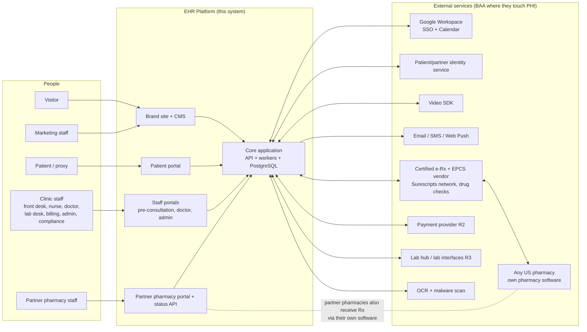
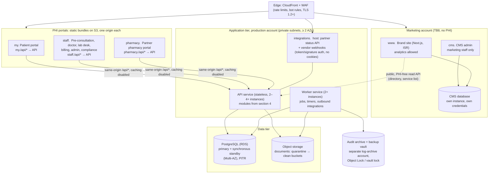
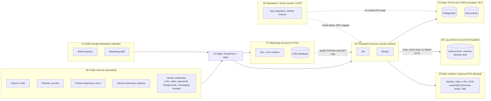
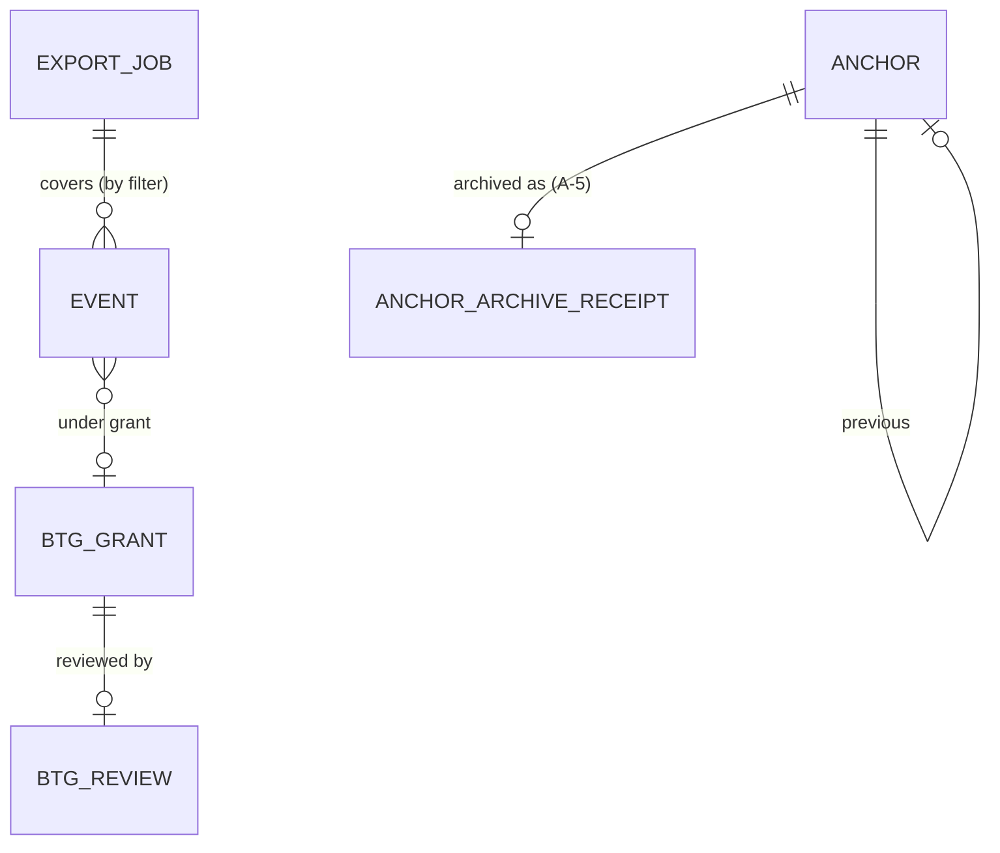
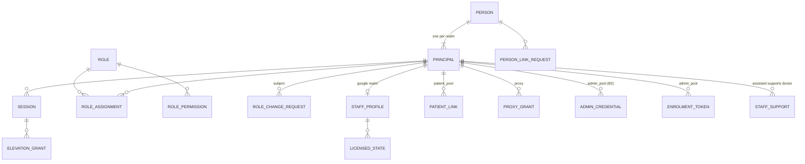
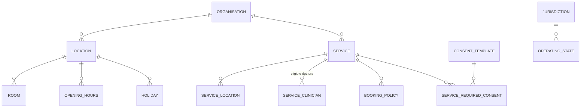
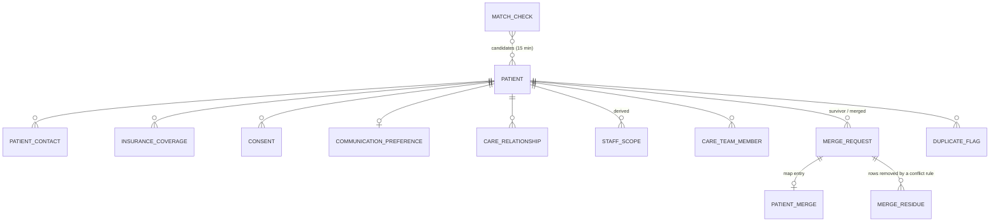
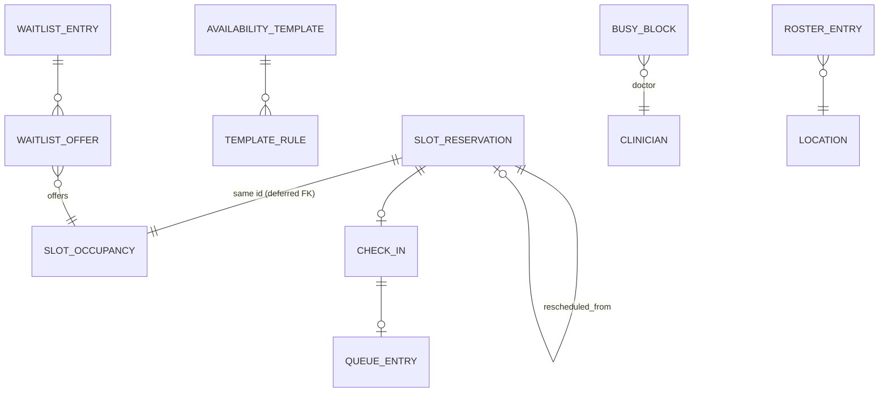
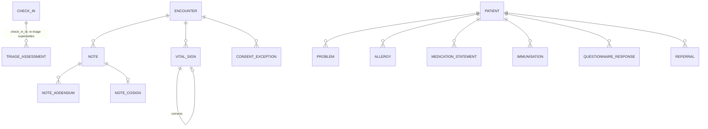

# ARCHITECTURE — Enterprise EHR Platform (G1 overview + detailed technical design)

| Field | Value |
| --- | --- |
| Task | HEAAA-8 `[SDLC:architecture-overview]` (drafts 1–2); HEAAA-41 (drafts 3–4); **HEAAA-13 `[SDLC:technical-design]` (drafts 5–7: Part II detailed design)**; **HEAAA-48 `[SDLC:design-align-fix]` (draft 8: alignment findings AL-01..AL-04, including TDR-14; draft 8.1 erratum: TDR-15, TDR-16)**; **HEAAA-66 `[SDLC:ticket:ID-FREEZE]` (draft 8.2 erratum: identity freeze, SEC-01 conditions T-1..T-13, carried notes)** |
| Author | Solution Architect agent (`7efe9f61-495f-4237-82f9-fa178629da09`) |
| Version | **Draft 8.3** (FE-10 erratum under the human G2 delta decision on HEAAA-285, decision HEAAA-286 rev `dcb2cf9d`; change line at the end of section 40.10). **Draft 8.2** (ID-FREEZE erratum to draft 8.1 under the owner's D-35 answer, HEAAA-66 question `997c2ce0`, 2026-11-05T23:30:43Z: path B, variant B2, and the erratum widened to every section that SEC-01 T-1..T-13 touches; change list in section 40.9). Draft 8.1 was an erratum to draft 8 under a second human decision on HEAAA-48, comment `4d7216e2`, 2026-11-05T13:38Z, option (A) of the HEAAA-52 review: grant wording for `directory_ro` only, findings TDR-15 and TDR-16, plus observations N-6..N-8; change list in section 40.8. Draft 8 was one human-granted bounded correction cycle, limited to design-alignment findings AL-01..AL-04, which include carried TDR-14; change list in section 40.7. Draft 7 corrected review round 2 findings TDR-11..13 and observations N-1, N-2; change list in section 40.6. Draft 6 corrected round 1 findings TDR-01..10, section 40.5). Part I (sections 0–18) is the G1-accepted overview, draft 4 (HEAAA-11 `architecture` rev `f2d240e4-2f63-45a1-aaa1-16a1f8854c32`, `docs/ARCHITECTURE.md` @ `f8d3d6e`). It is unchanged except for the errata listed in section 40.3, each marked in place with "(draft 5 erratum)". Part II (sections 19–40) is new: the detailed technical design that G1 unlocked, conforming to SHARED-BOUNDARIES draft 3 (HEAAA-12 rev `0fffc85d`, `docs/SHARED-BOUNDARIES.md` @ `d14ed7f`) |
| Approved inputs | PRD revision 3 (HEAAA-11 `prd` rev `bba336f3`); ARCHITECTURE draft 4 (above); G1 human acceptance: confirmations `cadd7751` and `009ac8a9`, 2026-11-04 22:03Z. Shared boundaries review PASS (HEAAA-12 `shared-boundaries-review` rev `80b898be`) |
| Status | **DRAFT 8. Part II round 3 of 3 returned CHANGES REQUIRED with TDR-14 open (HEAAA-13 `technical-design-review` rev `dc9d5d9a`); the human carried it (`3eade837`). HEAAA-17 design alignment (`design-align` rev `4447e3ec`) raised AL-01..AL-04 against this document, and a human accepted one bounded correction cycle (HEAAA-17 confirmation `a524dfdd`, 2026-11-05T13:14Z). Draft 8 was that cycle's single revision; its review (HEAAA-52 `architecture-draft8-review` rev `cf6b6fe7`) closed AL-01..AL-04 and TDR-14 and raised TDR-15 and TDR-16 (Low). A human then chose the erratum (HEAAA-48 comment `4d7216e2`). Draft 8.1 is that erratum, submitted for independent re-review of its diff against draft 8 only. Not human-approved. This is not G2.** Part I was accepted at G1 by a human (that acceptance covers draft 4 only). Identity tables and session contracts in Part II are **Provisional** (section 20.3). **Draft 8.2 (HEAAA-66, ID-FREEZE):** writes in the owner's D-35 answer (path B, variant B2) and the Cybersecurity conditions of SEC-01 (HEAAA-65, Security Reviewer PASS), and moves 22.4 and 26 from Provisional to Fixed (20.3). Round 1 of its diff-only review returned CHANGES REQUIRED (SAR-IDF-01..05, HEAAA-66 `id-freeze-review`); this is the round 2 resubmission against draft 8.1; the freeze takes effect only when a human accepts this revision at the ID-FREEZE gate (HEAAA-147). Not human-approved |
| Security input | HEAAA-9 `security-assessment` rev `22d5dcc6`; HEAAA-42 comment `e6414334` (SEC-D-19). Part II sections 21.4 (T-SIGNIN, T-SIGNIN-CLAIM), 21.6, 25.9, 26 and 31.3 need Cybersecurity review (section 37). **Draft 8.2:** reviewed in SEC-01 (HEAAA-65 `docs/security/SEC-01-identity-boundary-review.md` @ `66a29382`, Security Reviewer PASS); its conditions are written in (40.9) |
| Review round | Part I: closed at G1. Part II: round 1 of 3 closed with CHANGES REQUIRED (TDR-01..10, all closed in round 2); round 2 of 3 closed with CHANGES REQUIRED (TDR-11..13); round 3 of 3 closed with CHANGES REQUIRED (TDR-14 open, carried by human disposition `3eade837`). **Draft 8 is the one human-granted bounded cycle** (`a524dfdd`): diff-only re-review by the Solution Architect Reviewer (`338c0bb5`); an unresolved finding after it goes back to the Orchestrator for human escalation, not to a further round. That review left TDR-15 and TDR-16 open; **draft 8.1 is the human-chosen erratum for those two only** (HEAAA-48 comment `4d7216e2`), re-reviewed on its diff (HEAAA-53: PASS). **Draft 8.2 has its own ledger** (HEAAA-66 `review-ledger`): round 1 of 3 CHANGES REQUIRED (SAR-IDF-01..05); this revision is round 2 of 3 |

## 0. How to read this

**Draft 5 note:** Part I below is the G1 overview as accepted. Part II (section 19 onwards) holds the detailed design: ERDs, module interfaces, transactions, API contracts, failure and capacity design. Where Part I and Part II differ, Part II and SHARED-BOUNDARIES govern, and section 40.3 lists every such erratum.

This is the **G1 overview**. It sets direction: the shape of the system, the main technology choices, trust boundaries, capacity and cost scenarios, and tradeoffs. It does **not** contain ERDs, API contracts or migrations. Those come after G1 in HEAAA-12 (shared boundaries) and HEAAA-13 (technical design), in the order ERD → modules → API contracts.

Labels match the PRD:

| Label | Meaning |
| --- | --- |
| **Constraint** | Fixed by a confirmed intake/PRD statement (source tag given). |
| **Recommendation** | The Architect's proposal. A human endorses or rejects it at G1. |
| **Assumption** | A value I had to assume to size something. Each one is listed in section 12 with the decision that would replace it. |
| **Open** | Needs a human or vendor answer. |

Prices are list-price planning figures, not quotes. Two of them were checked on 2026-11-04 (section 10.4). The others are estimates with wide ranges. No vendor was contacted, nothing was bought, and no account was created.

## 1. Summary for the decision-maker

1. **The technical targets can be met with a simple design.** About 8,000 appointments a day and 1,000 staff is a moderate load. One well-structured application, one PostgreSQL database with a standby, and two to four app servers can meet p95 < 500 ms, slot search < 1 s and 99.9 % availability (section 9). This needs **no microservices, Kubernetes, Kafka or Redis**. Fewer moving parts means lower run cost and fewer failure modes.
2. **Buy the regulated and commodity parts. Build the workflow.** The build budget cannot cover DEA EPCS certification, a drug database, video, or identity. The recommendation is to integrate certified or BAA-covered services for those, and to build scheduling, triage, charting, the partner-pharmacy coordination layer, audit, and the portals.
3. **One design-changing finding (SA-F-01).** Under DEA rules, a pharmacy must receive controlled-substance e-prescriptions in its own DEA-certified pharmacy software. Our partner portal can therefore **not** be the legal channel that delivers prescriptions. Every prescription, partner or not, goes through the certified e-prescribing network. The partner portal mirrors the prescription and collects status (accepted, ready, out for delivery, delivered). PRD revision 2 now says this (PRD section 1, RA-R2-03, RA-R2-05); the owner is asked to acknowledge it as PRD decision D-24.
4. **The run budget (US$5–15k/month) is at risk.** Usage-based services, not hosting, are the main risk: SMS reminders, video minutes, and (from R2) per-prescriber e-prescribing fees. In the expected R1 scenario the cost is about **US$13,750/month**, close to the top of the range. The high scenario (about US$22,150) goes past US$15k. Draft 2 adds region-loss readiness, the brand-site/CMS runtime, the identity replication add-on and SMS registration fees, which draft 1 left out. Three inputs are missing: the share of visits by video, the default reminder channel, and the number of prescribers (section 10).
5. **The build budget and the date are the binding constraint, not the technology.** This overview does not change scope. It lists the technical scope levers (section 11) for the G1 trim decision (PRD D-1, D-22).
6. **Hosting provider is Open (intake C6).** I recommend **AWS** in a US region with a signed BAA, with Google Cloud as a close alternative (ADR-004). The owner decides (PRD D-30).
7. **Recovery from losing a whole region is designed per component (section 9.4), not just for the database.** It is backup-based (pilot light). PRD revision 2 includes region loss in NFR-2/NFR-3 by default (decision D-26). If the owner says no, the region-loss lines in section 10 can be dropped.
8. **Security specialist input is incorporated (section 8).** It changes two draft 1 positions: row-level security in the database is now part of the R1 design, not an option (SEC-D-01), and patients, partner pharmacies and staff use three separate identity realms (SEC-D-04, R-2). Admins stay in the staff realm. Cybersecurity accepted that with conditions C1–C7, provided the owner funds C1–C3. If the owner does not, Cybersecurity's position becomes REJECT and admins get a separate user pool. **This is an owner decision at G1** (section 8.3).

## 2. Context

### 2.1 System context



### 2.2 Constraints that shape the design

| Constraint | Source | Design consequence |
| --- | --- | --- |
| US only; HIPAA; BAA with every PHI vendor; HIPAA-eligible US region | `[05 §1–2]`, NFR-19 | Single US primary region plus a US recovery region. Only BAA-eligible services may touch PHI. |
| DEA EPCS: certified solution, identity proofing, two-factor signing | `[05 §1]`, `[07 A5]` | Use a certified e-Rx/EPCS vendor. We do not build or certify EPCS signing (ADR-006). |
| Many external pharmacies; each delivers on its own | `[07 A3, B5]` | Network for all prescriptions. Partner portal is a coordination and status layer (ADR-007). |
| Staff identity and calendars are Google Workspace | `[07 C4, C5]` | Staff sign in through Google OIDC. Busy-only calendar sync. |
| GitHub Actions CI; repo `zainnaeem28/enterprise-app` | `[01 §7]` | CI/CD and security gates run in GitHub Actions. Cloud access uses OIDC federation, not stored keys. |
| 99.9 %, RPO 15 min, RTO 4 h, zero-downtime deploys | NFR-1..5 | Multi-AZ database, ≥ 2 app instances, expand/contract migrations. Region-loss recovery planned per component (section 9.4); required by default per PRD D-26. |
| No migration R1–R3 | `[04 §5]` | Clean data model. No import tooling in R1–R3. |
| Build US$150–300k R1–R3; run US$5–15k/month; R1 by end May 2027 | `[07 D3–D5]` | Fewest deployables, managed services, no self-run clusters. |
| Synthetic data outside production | BR-35, SEC-D-20 | Separate cloud accounts per environment. Seed generators, not copies. |
| Possible 42 CFR Part 2 (substance-use) records | Open intake item; HEAAA-9 R-5 | **Open.** If yes: data segmentation, consent for redisclosure, and possibly a separate KMS key per data class. Needs an owner decision before G1 (SEC-D-16; PRD D-15, default "no Part 2 data"). |

## 3. Architecture style and topology (Recommendation, ADR-001)

**One modular application (a "modular monolith"): one codebase, one API deployable, one worker deployable, one database. Three PHI portals plus one brand site, each on its own origin. The brand site and its CMS are a separate, PHI-free deployable in a separate account.**

Why: The load (section 9) does not need independent scaling. The team is small and agent-assisted, and the budget is tight. A monolith with strict internal module boundaries gives one place to enforce authorization and audit, one transaction scope for safety rules (for example, "no double booking"), and one deployment to run at 99.9 %. Splitting a module out later stays possible if a real need appears. Example: the pharmacy status API could become its own service if partner traffic grows far beyond the stated 1,500 deliveries a day.

### 3.1 Deployable units



| Unit | Responsibility | Scales by |
| --- | --- | --- |
| `site` | Brand site pages, doctor directory, booking hand-off (a link into `my.`), SEO. Runs as a small Next.js server (ISR) on Fargate in the **marketing account**. | CDN cache in front; 1–2 small tasks. The site stays readable from the CDN cache if the origin is down. |
| `cms` | Headless CMS (e.g. Payload) admin and content API. Same Fargate service as `site` or a sibling. Own small PostgreSQL instance (or schema on a separate instance) with its own credentials. It holds no PHI and has no network path or credentials to the production database. | Single small instance |
| `patient` | Patient and proxy portal | Static bundle on CDN; API does the work |
| `staff` | All clinic staff surfaces, with role-based navigation | Static bundle on CDN |
| `pharmacy` | Partner pharmacy portal | Static bundle on CDN |
| `api` | All synchronous business operations, authorization, audit writes; serves `/api/*` for the three portals and the `integrations.` host | Horizontal, stateless |
| `worker` | Durable jobs: reminders, hold cleanup, waitlist offers, escalation timers, retries to external services, document scanning/OCR hand-off, audit anchoring and archiving | Horizontal; jobs are leased |
| PostgreSQL | System of record, job queue, audit hot store, notification fan-out | Vertical first; read replica if reports need it |
| Object storage | Documents, exports | Managed |
| Audit archive and backup vault | Exported audit partitions, audit anchors, immutable backup copies. In a separate log-archive account that production roles cannot delete from (SEC-D-06, SEC-D-17). | Managed |

**Alternative that removes the `site`/`cms` runtime:** static export of the site plus a SaaS CMS (e.g. Contentful, Sanity). This has no server and no CMS database to run, but it has a monthly SaaS fee and rebuilds on every content change. It is decided at G2 on cost (section 7). Either way the site stays in the marketing zone.

**Why separate origins (ADR-005).** Separate origins keep cookies, Content-Security-Policy, session lifetimes and third-party scripts apart. The brand site may load analytics and a cookie banner. The patient and staff origins must never load analytics, because analytics must never see health data (BR-36, NFR-18, SEC-D-07). Staff need a 15-minute idle timeout and Google SSO. Patients and partners use their own identity realms. All front ends live in one repository and share a UI component package, so this adds build targets, not separate teams.

**How each portal reaches the API (keeps the origin separation real).** Subdomains of one registrable domain are "same-site", so `SameSite` cookies alone do not separate them, and a single shared `api.` host would put patient, staff and partner sessions in one cookie jar with one CORS policy. Therefore:

- Each portal calls the API on **its own origin** at `/api/*`. A CloudFront behaviour forwards that path to the ALB. There is no cross-origin API call and no CORS allowance for the portals.
- Session cookies are **host-only `__Host-` cookies** (`Secure`, `HttpOnly`, `Path=/`, no `Domain` attribute, `SameSite=Lax` or stricter). A cookie set on `my.` is never sent to `staff.` or `pharmacy.`.
- Each session record is bound to its **audience** (patient, staff, partner). The API derives the audience from the request host and rejects a session whose audience does not match. Session lifetime and idle timeout are per audience. CSRF protection: `SameSite` plus an `Origin` check plus a token on state-changing requests (ASVS session controls).
- The CDN **never caches `/api/*`**: caching disabled, all cookies and the `Authorization` header forwarded, `Cache-Control: no-store` on every API response. No PHI is held in edge caches, which matches the client-rendering choice in section 7.
- Machine clients (partner pharmacy systems and vendor webhooks) use a separate `integrations.` host that accepts **no cookies**. It accepts only tokens and signatures (section 5.3).

## 4. Modules and ownership

Each module owns its tables. Other modules call its public interface and never write its tables directly. Lint rules on import boundaries enforce this in CI. Detailed ERDs and contracts come in HEAAA-13.

| Module | Owns (data) | Main responsibilities | First release |
| --- | --- | --- | --- |
| `identity` | Users, staff/patient/partner identities, staff profiles (including clinician licensed states, PRD TL-1), sessions (bound to one audience), role assignments, location assignments, proxy grants; for SEC-D-19 (section 8.4): staff step-up credentials (WebAuthn), elevation grants, privileged role-change requests and approvals, admin-eligibility snapshots | Sign-in through three realms (Google OIDC for staff; separate patient and partner user pools), step-up re-auth, idle timeout, deny-by-default authorization policy, and the per-request scope that row-level security uses (SEC-D-01); app-enforced step-up, second-approver workflow, admin-eligibility checks and session kill switch (SEC-D-19-C1, C3, C4, C6) | R1 |
| `organisation` | Organisation, clinics/locations, rooms, hours, holidays, services, policies, feature flags, templates | Admin configuration, time zone per location; a neutral patient-visible display name per service for condition-revealing services (PRD 7.3, BR-23 extension) | R1 |
| `patient` | Patient demographics, contacts, proxies, consents, preferences, care relationships (patient↔location), preferred pharmacy | Registration, proxy links, consent capture, duplicate detection and merge (SA-F-13) | R1 |
| `scheduling` | Availability templates, external busy blocks, slot reservations (holds and appointments in one table, section 5.1), waitlist, check-ins, queue | Slot search, holds, booking invariant, reschedule/cancel, waitlist offers, arrivals and queue; licensing check at booking for video visits (PRD TL-1, RA-R1-28) | R1 |
| `calendar-sync` | Calendar links, sync tokens, watch channels | Google Calendar busy-only two-way sync | R1 |
| `telehealth` | Video sessions, device-check results, waiting room state | Create vendor rooms, issue short-lived join tokens, licensing check at join with patient-confirmed location (PRD TL-1; states from D-2) | R1 |
| `clinical` | Encounters, notes, addenda, co-signatures, problems, allergies, medication list, vitals, triage, immunisations | Charting, sign-and-lock, triage and red-flag rules | R1 (coded, ADR-010) |
| `documents` | Document metadata, versions, classifications, legal holds, retention | Upload via pre-signed URL, scan, OCR, classify, confirm, retain | R1 |
| `messaging` | Threads, messages, tasks | Staff tasks and messages; patient messaging per D-5 | R1 |
| `notifications` | Templates, notification jobs, delivery receipts, preferences, staff alerts | Email/SMS/push sending with a PHI-free variable allowlist; durable staff alerts (red flag, BTG, critical results) | R1 |
| `audit` | Audit events, audit anchors, break-the-glass events, export jobs | Append-only recording, batch anchoring, BTG workflow, compliance views, verified archive (section 6) | R1 |
| `privacy` | Privacy requests | Export, deletion requests (D-8), legal-hold checks | R1 |
| `cms` | Public content, in the **CMS's own database in the marketing account**, not in the production database | Pages, blog, FAQ, banners. No PHI. It is a separate deployable (section 3.1), so it is not part of the monolith's module graph. | R1 |
| `prescribing` | Prescriptions (our copy), alert overrides, check outcomes, refill requests | Integrate the e-Rx vendor; mirror ST-03; record check outcomes (OUT-4) | R2 |
| `pharmacy-network` | Pharmacy directory cache, partner organisations, partner users, Rx routing, fulfilment events, hand-over records, delivery events, API clients | Partner portal, status API/webhooks, monotonic status machine | R2 (portal), R3 (API, tracking) |
| `billing` | Invoices, payments (tokens only), refunds | Hosted-field payments, refund approval | R2 |
| `labs` | Lab orders, specimens, results, acknowledgements, reconciliation queue | Order out, result in, release rules, critical escalation | R3 |
| `reporting` | Read models / materialised views | Dashboards, operations dashboard, pharmacy performance | R1 ops dashboard, R2 reports |
| `integration-core` | Outbound call log, inbound message log (idempotency keys), retry state | Timeouts, back-off, dead-letter view, operations dashboard feed (BR-33, NFR-21) | R1 |

`integration-core`, `audit`, `identity` and `notifications` are shared foundations. They are built first, and every other module depends on them.

## 5. Key flows

### 5.1 Booking without double booking (BR-02, X-01, X-02, RA-R1-03)

```mermaid
sequenceDiagram
  participant Pt as Patient (my.)
  participant API
  participant DB as PostgreSQL
  participant W as Worker
  participant G as Google Calendar
  Pt->>API: search slots (service, location, date)
  API->>DB: template − active reservations − cached busy blocks
  Note over API,DB: Google is never called in the request path.<br/>Busy data older than the stale threshold is flagged (X-03).
  Pt->>API: hold slot (idempotency key)
  API->>DB: one transaction: expire overlapping stale holds,<br/>INSERT reservation status=held (expires_at = now + hold time)<br/>partial exclusion constraint rejects overlap
  API-->>Pt: held, or "taken" plus alternatives
  Pt->>API: confirm (own idempotency key per step; draft 5 erratum, 28.3)
  API->>DB: one transaction: same row held → confirmed<br/>(only if expires_at > now), audit event, outbox: notify + calendar busy
  W->>G: insert "Busy" event (no patient data, BR-07)
  W->>Pt: confirmation email/SMS + .ics (PHI-free)
  W->>DB: cleanup sweep of expired holds (X-01) and offer freed slots (waitlist)
```

**How the invariant is enforced (direction; the exact model is in HEAAA-13).** The database enforces "no overlap", not application code. A PostgreSQL exclusion constraint works on one table and cannot use `now()`, so:

- Holds and appointments are **one table**, `slot_reservation`, with a `status` (`held`, `confirmed`, `cancelled`, `expired`, …), the doctor, an optional room, a `tstzrange` period and `expires_at` for holds.
- A **partial exclusion constraint** (GiST with `btree_gist`) forbids two rows for the same doctor with overlapping periods **where `status IN ('held','confirmed')`**. A second partial constraint does the same for a room, **where a room is assigned**. Video visits have no room.
- Expiry does not depend on the worker. The transaction that inserts a new hold first marks any **overlapping hold for that doctor with `expires_at < now()`** as `expired`, then inserts. Two racing requests serialise on that row lock and on the constraint, so exactly one wins. Confirmation is an `UPDATE` of the same row from `held` to `confirmed` that succeeds only while `expires_at > now()`. The worker sweep only tidies up and triggers waitlist offers. It is not needed for correctness, so a stale hold can never cause a false "taken" answer.
- Overbookable sessions (BR-02) are rows flagged as overbook capacity. They are excluded from the constraint and counted under a per-session row lock against the configured extra capacity.

RA-R1-03 ("100 parallel confirmations, exactly one succeeds") then holds by construction for normal slots. PRD revision 2 restates RA-R1-03 for non-overbookable slots (SA-F-10). Whether the same patient may hold two overlapping appointments is a product rule for HEAAA-13.

**Transactional outbox.** Side effects (messages, calendar writes) are recorded in the same transaction as the business change and sent by the worker. So a crash never produces "booked but not notified" or "notified but not booked".

### 5.2 Prescription to pharmacy (R2) and status (R2/R3)

```mermaid
sequenceDiagram
  participant Dr as Doctor (staff.)
  participant API
  participant V as Certified e-Rx/EPCS vendor
  participant N as Surescripts network
  participant Ph as Pharmacy software (any pharmacy)
  participant PP as Partner portal / status API
  participant Pt as Patient (my.)
  Dr->>API: draft Rx (coded RxNorm)
  API->>V: drug/allergy/interaction/dose checks
  V-->>API: alerts → doctor overrides with reason or changes order (BR-16)
  Dr->>V: sign (re-auth; EPCS: vendor identity proofing + two-factor)
  V->>N: NCPDP SCRIPT NewRx
  N->>Ph: NewRx into the pharmacy's own DEA-certified software
  V-->>API: status callbacks (sent, error, Verify/Status) → ST-03 mirror
  API-->>Pt: status shown in portal; PHI-free prompt by SMS/email
  Note over Ph,PP: Partner pharmacies ALSO see a mirrored Rx in our portal<br/>and report accepted / ready / out for delivery / delivered,<br/>by portal (R2) or API/webhook (R3).
  PP->>API: status event (idempotent, monotonic, BR-24)
  API-->>Pt: status + tracking link (R3)
```

The pharmacy legally dispenses from what it receives through the network. Our portal is not the dispensing record (SA-F-01). Refill and renewal requests arrive as network renewal messages and route to the prescriber (BR-19). If the network is down, the prescription stays Signed with a visible retry (X-09, RA-R2-04).

### 5.3 Inbound pharmacy status events (R3, F-PH-07)

- All machine traffic uses the `integrations.` host, which accepts no cookies (section 3.1).
- Each partner pharmacy organisation gets an API client. It authenticates with OAuth 2.0 client credentials, short-lived tokens, and per-client scopes limited to its own prescriptions (BR-21, TB4). Each request is also **signed** (HMAC over body and timestamp, with a 5-minute replay window), or the client uses mTLS. Credentials rotate on a schedule and can be revoked per client (SEC-D-09).
- Every event carries a pharmacy event ID (the idempotency key), `occurred_at`, and status. A unique index on (client, event ID) makes replays harmless (AC-24).
- A status rank decides the transition. A lower-rank or late event is stored in history and never moves the delivery backwards (BR-24, AC-23).
- Tracking links are validated: https only, allowlisted carrier domains or partner-registered domains. They are shown to the patient as external links behind a "you are leaving" interstitial (SEC-D-09).
- Per-client rate limits apply. Payloads have a size limit and a strict schema. Unknown fields are rejected.

### 5.4 Alerts that must reach a person (red flag R1, BTG R1, critical results R3)

An alert is a **database row first** and a push second. The flow is **worker or API → `NOTIFY` → every API instance → server-sent events (SSE) → staff browser**. Browsers connect only to API instances, never to the worker. Optionally Web Push is sent as well. If a browser was disconnected, it replays unacknowledged alerts from the table on reconnect, so a lost `NOTIFY` delays an alert but never loses it. An escalation timer job escalates to the on-call doctor when no acknowledgement arrives in the window (J-07, J-17; window D-11). The system records every step for audit. No message broker is needed at this volume (ADR-009).

Operating constraints:

- `LISTEN` needs a dedicated session connection. Each API instance holds **one `LISTEN` connection outside its query pool**, and never through a transaction-mode pooler (RDS Proxy would pin it).
- SSE goes through CloudFront and the ALB, so the API sends a **heartbeat every 15 s**. That is shorter than the CloudFront origin read timeout (30 s default) and the ALB idle timeout (60 s default). The client reconnects with `Last-Event-ID`.
- SSE streams use the same `/api/*` path, never cached, and the same audience-bound session as other API calls.

### 5.5 Documents (BR-28, J-19)

The browser uploads to a **quarantine** bucket through a short-lived pre-signed URL with size and content-type limits. Object keys are random IDs with no names or PHI. A malware scan and file-type sniffing run, and images are re-encoded (SEC-D-08). Clean files move to the clean bucket and go to OCR (BAA-eligible service). A staff member confirms the classification. Downloads use a short-lived signed URL, issued only after an authorization check and an audit write. Infected files stay quarantined and are never served (AC-30).

## 6. Data architecture (overview only)

- **System of record:** PostgreSQL 17 or later (managed; draft 5 erratum, BD-03). This is relational and transactional. Booking, prescriptions and audit need hard invariants. Detailed ERD: HEAAA-13.
- **Coding (ADR-010):** clinical data is coded from R1. RxNorm for medications and drug allergens, SNOMED CT and/or ICD-10-CM for problems, LOINC for vitals and labs. Free text is still allowed, but is flagged as uncoded. R2 drug checks can only check coded entries (SA-F-08). RxNorm, LOINC, ICD-10-CM and SNOMED CT US Edition are available to US users through NLM/UMLS licences. **CPT needs a paid AMA licence.** It is not needed until billing codes are used (assumed R4 with claims).
- **FHIR R4 / SMART:** the intake agrees these as standards but assigns no release. Recommendation: internal relational model with FHIR-aligned field semantics now; a FHIR R4 (US Core) read façade when a real consumer needs it (R3 labs, or R4). No ONC certification in R1–R3 unless legal advice requires it (SA-F-07).
- **Scoping (SEC-D-01, HEAAA-9 R-1; changed from draft 1):** every patient-data row is reachable through a patient and a care-relationship/location path, and every pharmacy row through its pharmacy organisation. Two layers enforce this, both from R1:
  1. **API policy layer:** deny by default. On every read and write it checks organisation, location, assignment, role, proxy grant and BTG, using the server-side session only. Identifiers are random, but that is not counted as a control.
  2. **PostgreSQL row-level security** on every table holding PHI or pharmacy-tenant data. Each transaction sets its scope with `SET LOCAL` (principal, audience, locations, pharmacy organisation, active BTG grant). Policies fail closed when the scope is missing. The application role does not own the tables and has no `BYPASSRLS`. This works with pooled connections because the scope is per transaction. The R1 load test must include RLS (section 9.2). If a policy proves too slow, the fix is an index or a simpler policy, not dropping RLS. Dropping it would be a human risk decision (SEC-D-01 must not be trimmed).
  Negative authorization tests cover every role pair and tenant boundary (SEC-D-01, AC-35).
- **Audit store (SA-F-11, SEC-D-06, ADR-008; changed from draft 1):**
  - **Write path:** an append-only table, partitioned by month. Each PHI read or write inserts one plain row in the request's transaction. There is **no per-row hash chain**, so concurrent API instances never wait on each other to write audit rows (SAR-04).
  - **Tamper evidence by batch anchoring:** every minute, the worker takes the rows committed before a safe watermark (now − 2 min). The watermark is longer than the maximum transaction time, which is bounded by `transaction_timeout` (60 s) on every audit-writing role (draft 5 erratum, SAR-10, section 21.5), so no older row can still commit later. The worker computes a Merkle root over the rows in a fixed order and writes an **anchor** (time range, row count, root, previous anchor's hash). Anchors form a chain. Each anchor is written to the database; a separate worker job then copies it to the object-locked archive in the separate log-archive account with a put that refuses to overwrite, and records an append-only receipt (amendment A-5: 22.2, 33.1). The **archive, not the database, is the authority**: a verification job lists the archived anchors daily, compares them with the database chain and the recomputed roots, and alerts on any difference and on any anchor not archived within 15 minutes. A row that commits behind the watermark despite the limits is put into the next anchor and flagged. The load test still measures audit inserts at the 3 × burst (section 9.2).
  - **Grants:** the application role has INSERT and SELECT on audit tables only. No role used by the application, admins or support can UPDATE or DELETE audit rows. The audit table's owner role is used only by migrations and by the archival procedure below.
  - **Archive and removal from the hot store (SAR-07):** partitions older than the hot window (proposed 13 months) are exported to the archive bucket (S3 Object Lock, compliance mode, in the log-archive account). A partition is **detached and dropped only** (a) after the archive copy is verified by reading it back and checking row count and anchor roots, (b) under **dual control**: a named `audit_archiver` role, run by a protected CI job that needs a second human approver, and (c) with an audit event and a manifest entry for the drop itself. Nothing is deleted from the archive before its retention ends. So "no delete" means: no deletion of audit records at all, and removal from the hot store only after a verified, dual-controlled archive.
  - **Retention:** the **longest** of the HIPAA documentation minimum (6 years), the DEA EPCS record requirement and any applicable state rule. The value is set at G2 with legal input (SEC-D-06; reviewer note on HEAAA-9). Audit views and audit exports are themselves audited.
- **Time:** UTC stored. Location time zone on every clinic. Display conversion in the clients (BR-05, NFR-22).
- **PHI minimisation outside the database:** no PHI in logs, URLs, object keys, analytics, job payload names, payment metadata, calendar events, .ics files, or message bodies (BR-23, BR-36). Notification templates can only bind allowlisted non-clinical variables. Developers cannot bind a service or diagnosis name by mistake.

## 7. Technology choices (Recommendation; exact versions fixed at G2)

| Area | Recommendation | Alternatives considered | Why |
| --- | --- | --- | --- |
| Language | **TypeScript** front to back | Java/Spring, C#/.NET, Python/Django | One language for four front ends and the API. Large library ecosystem for FHIR/HL7, Google, AWS. Strong typing for contracts shared between client and server. |
| API framework | **NestJS** (modular monolith) | Fastify plain, Express | Built-in module system matches section 4. Dependency injection makes auth/audit guards uniform. |
| Data access | **SQL-first query builder** (Kysely or Drizzle) with plain SQL migrations | Prisma, TypeORM | Exclusion constraints, row-level security, partitions and grants need first-class SQL. Prisma handles these poorly. |
| Job queue | **PostgreSQL-backed queue** (pg-boss or Graphile Worker) | SQS, Redis/BullMQ, Kafka | Volume is tens of thousands of jobs/day. Jobs are created in the same transaction as the business change (outbox). One less service to secure and run. Revisit if backlog metrics say so. |
| Front ends | **React + TypeScript.** **Next.js** for `site` (SEO, ISR, on a small server runtime in the marketing account, section 3.1). Portals as client-rendered React apps served from the CDN | Next.js SSR everywhere; Angular | Portals do not need server rendering, and client rendering keeps PHI out of server and edge caches. The brand site needs SEO. |
| UI | Shared accessible component library (e.g. built on Radix/React Aria primitives) with WCAG 2.2 AA tests | Commercial UI kit | Accessibility is an acceptance criterion (NFR-10). UI/UX finalises at G2. |
| CMS | Self-hosted headless CMS (e.g. Payload) in the **marketing account**, with its own small database and credentials, **or** a SaaS CMS with a static-export site (no runtime) | Contentful, Sanity | No PHI, so a BAA is not needed. Self-hosting costs about US$150–400/month to run (section 10.1). A SaaS CMS has a subscription fee but nothing to run. Decide at G2 on cost. **Marketing identity:** CMS admins sign in with Google Workspace SSO through a **separate OAuth client** limited to a marketing group, with 2SV enforced. The CMS admin is on its own `cms.` host, with WAF rules and an optional IP allowlist. Marketing accounts get no role in the PHI portals. |
| Hosting | **AWS**, US region pair (e.g. us-east-2 primary, us-west-2 recovery). **Owner decides (C6).** | Google Cloud (Cloud Run, Cloud SQL, Identity Platform); Azure | Both AWS and Google Cloud sign BAAs and have the needed eligible services. AWS has eligible equivalents for every R1 vendor slot: Chime SDK (video), SES (email), End User Messaging/SNS (SMS), Textract (OCR), Cognito (identity), GuardDuty malware scanning. That lowers the number of separate vendor BAAs. Google Cloud's advantage is closeness to Google Workspace, but Workspace SSO/Calendar work equally from either. |
| Compute | **Containers on ECS Fargate** behind an ALB (API, worker, and `site`/`cms` in the marketing account); portal bundles on S3 + CloudFront | EKS (Kubernetes), EC2, Lambda | No cluster to operate. Rolling or blue/green deploys meet zero downtime. Kubernetes is not justified by this load. |
| Database | **RDS for PostgreSQL, Multi-AZ**, PITR, cross-Region automated backup replication | Aurora PostgreSQL; self-managed Postgres | Managed failover and PITR meet NFR-1/2 within budget. **Constraint on the G2 choice (SAR-01):** use RDS for PostgreSQL unless Aurora is shown to meet the same cross-Region RPO at an acceptable cost. Cross-Region automated backups with PITR are documented for RDS for PostgreSQL. I have not confirmed the same feature for Aurora, where the usual options are Global Database (extra cost) or snapshot copies (RPO of hours). |
| Patient & partner identity | **Managed identity service under BAA**: Cognito (if AWS), **Essentials plan**, with **two separate user pools**, one for patients and one for partner pharmacy users (separate realms, HEAAA-9 R-2). Patients: passkeys and email OTP preferred, SMS OTP as a fallback, TOTP optional. Partner users: MFA mandatory. **Regional recovery:** Cognito multi-Region replication (add-on; needs Essentials or Plus and a multi-Region KMS key; one replica; eventually consistent). In the replica, **TOTP MFA does not work**, and sign-up, password reset and profile changes are disabled. So every user must enrol a second factor that works in the replica (passkey or email OTP), and those operations are switched off in the UI during failover. MFA is never silently disabled (SEC-D-03). | Auth0 (BAA only on higher plans), Keycloak self-hosted | Avoids building credential storage. Keycloak saves fees but adds a security-critical server to operate. The replication add-on price is not verified (A-12). |
| Staff identity | **Google Workspace OIDC** directly; platform session after sign-in. Application roles live in the app, not only in Google groups. Workspace groups never grant application roles. Admin and compliance roles need: security-key 2SV in a dedicated Workspace organisational unit; **app-enforced step-up** with an app-enrolled WebAuthn credential; a short elevation window; a second approver enforced in code for privileged role changes; and same-day session revocation (SEC-D-04, SEC-D-19-C1..C7, section 8.4). | Federate Google into the patient identity service; separate admin IdP (a managed user pool) | Fewest hops. Staff and patient identity stay separate. MFA proof: see SA-F-06. HEAAA-9 asks for a "separate admin identity realm" (SEC-D-19). I proposed the controls above instead of a fourth IdP. **Cybersecurity accepted this with conditions C1–C7 (HEAAA-42), provided the owner funds C1–C3.** Otherwise their position is REJECT and the separate admin pool applies. That choice is an owner decision (section 8.4). The Workspace super-admin is a tier-0 principal (C3). |
| Video | **BAA-eligible video SDK** (Chime SDK as the low-cost reference; Zoom Video SDK, Daily, Vonage as alternatives). Selection criteria: encryption in transit, and end-to-end encryption where offered; per-visit single-use join tokens; waiting room with clinician admit; recording off by default (SEC-D-14) | Self-hosted WebRTC (SFU) | Media never touches our servers. Self-hosting at 250 concurrent visits is costly to run and secure. |
| E-Rx / EPCS / drug checks | **One certified e-prescribing vendor** with EPCS, identity proofing, two-factor and an embedded drug database (e.g. DoseSpot, DrFirst) | Direct Surescripts certification + separate drug DB licence | Certification is out of budget and time. Bundled drug checks may remove DEP-7 as a separate licence. Vendor must expose check outcomes by API (SA-F-02). |
| Payments (R2) | Hosted fields/tokens (Stripe or Adyen) | — | Card data never reaches our servers (BR-30). No PHI in payment metadata. |
| Labs (R3) | Integration hub (Health Gorilla, Redox) unless partner labs offer direct FHIR | Own HL7 v2 interface engine | No interface engine to run. Per-connection fees to be quoted. Decide in R3 design once labs are named (C3). |
| IaC & CI/CD | **Terraform/OpenTofu**, with state in a versioned, replicated S3 backend in a separate tooling account. **GitHub Actions** with OIDC to the cloud, actions pinned by commit SHA, protected environments | CDK | Agreed CI. No long-lived cloud keys in GitHub (SEC-D-15). |
| Observability | OpenTelemetry → CloudWatch (logs, metrics, traces, alarms), synthetic checks, on-call paging | Datadog/New Relic (BAA only on higher plans) | Stays under the cloud BAA. PHI scrubbing at the logger. |
| Security tooling | CodeQL or SonarQube (SAST), Dependabot/OSV (dependencies), gitleaks (secrets), Trivy (containers) in CI | — | NFR-15. Final selection at G2 (WORKFLOW: choose SonarQube/CodeRabbit/Strix in design). |

**Cost of reversal.** Hosting and language are expensive to reverse after build starts. Library choices (query builder, CMS, job queue) are cheap to reverse inside the module boundaries. Vendor choices (video, SMS, e-Rx) sit behind adapter interfaces in `integration-core`, so switching is a contained change. The exception is the e-Rx vendor: its embedded signing UI shapes the prescribing screens.

## 8. Trust boundaries and security controls

> **Status:** This section now includes the Cybersecurity lane's output: HEAAA-9 `security-assessment` rev `22d5dcc6-32c3-4cc9-8bc0-7fc47a103a1c` (Security Reviewer PASS, not human approval). Its trust boundaries TB1–TB8 and threats SEC-D-01..22 are the authority. This section shows where each one lands in the architecture. If HEAAA-9 is revised, this section and its review reopen.

### 8.1 Trust boundaries



| HEAAA-9 boundary | Where it is in this design |
| --- | --- |
| TB1 Internet ↔ edge | Z0 → Z1. Every public surface is behind CloudFront + WAF: `www.`, `cms.`, `my.`, `staff.`, `pharmacy.`, `integrations.`, and video join through the vendor. |
| TB2 Patient ↔ staff ↔ pharmacy principals | Three identity realms (section 7). Audience-bound host-only sessions on separate origins (section 3.1). |
| TB3 Clinic/location scope | API policy layer plus RLS scope per transaction (section 6). |
| TB4 Pharmacy tenant ↔ tenant | Pharmacy-organisation scope in the API and in RLS; per-client OAuth scopes (section 5.3). |
| TB5 Platform ↔ vendors | Z2 → Z5: BAA register, minimum data, signed or authenticated inbound messages. |
| TB6 App ↔ data/audit plane | Insert-only audit grants; archive and backup vault in a separate account (Z8) that production roles cannot delete from (section 6). |
| TB7 Production ↔ non-production | One cloud account per environment; synthetic data only; no production credentials in non-production. |
| TB8 Marketing/CMS ↔ PHI | Z7 is a separate account, deployment, database and credential set. It reaches Z2 only through the public, PHI-free read API. |

| Crossing | Who crosses | Control |
| --- | --- | --- |
| Z0→Z1 | Everyone | TLS 1.2+ (1.3 preferred), WAF managed rules, rate limits per IP/account, bot protection on public forms (NFR-17, SEC-D-13), HSTS, strict CSP and `frame-ancestors` per origin |
| Z1→Z2 (portals) | Authenticated users | Same-origin `/api/*`, never cached; audience-bound `__Host-` session; CSRF protection; deny-by-default authorization on every request (role + organisation + location + assignment + proxy + BTG); schema validation of all input; no PHI in URLs |
| Z1→Z2 (`integrations.`) | Partner systems, vendor webhooks | No cookies. Partners: OAuth2 client credentials + request signature or mTLS, per-client scopes and rate limits, idempotency. Vendors: signature verification, replay window, idempotency, IP allowlist where the vendor publishes ranges |
| Z7→Z2 | `site` runtime | Public, read-only, PHI-free endpoints only (doctor directory, service list); no credentials to Z3 |
| Z2→Z5 | Our worker/API | Only BAA-covered vendors receive PHI; go-live is blocked until each BAA is signed (SEC-D-15). Each vendor call has a timeout, retry with back-off, and a circuit state on the ops dashboard. SMS/email/push bodies are PHI-free by template design |
| Z2→Z3 | API/worker roles | Least-privilege DB roles per deployable; RLS; audit grants insert-only; KMS keys per environment with rotation; secrets in Secrets Manager; no public buckets |
| Z2→Z8 | Worker (archiving, anchoring) | Write-only cross-account role; Object Lock compliance mode; AWS Backup vault lock. **Amendment A-5 (anchor archive):** the worker task role gets `s3:PutObject` on `arn:aws:s3:::<archive>/anchors/*` only, and `s3:GetObject`, `s3:GetObjectVersion` and `s3:ListBucketVersions` (prefix condition `anchors/*`) for verification; `kms:GenerateDataKey` and `kms:Decrypt` on the log-archive key through its key policy. In the archive module the worker role is added to both the writer and the reader principals, and each writer's `PutObject` resource is its own prefix (worker → `anchors/*`; `audit_archiver` → `partitions/*`). The worker gets no `s3:PutObjectRetention`, `s3:PutObjectLegalHold`, `s3:DeleteObject*` or `s3:BypassGovernanceRetention`; the bucket policy already denies delete and retention changes. All production IAM stays in the approvals root (DEVOPS-PLAN 7.5) |
| Z2→Google Workspace directory | `identity` (admin-eligibility check, SEC-D-19-C2/C3) | Read-only directory access to organisational unit, suspension and super-admin status of staff accounts, with least-privilege scopes. No write access. The credential mechanism is fixed in HEAAA-13. Prefer keyless; otherwise use a key in Secrets Manager, rotated, with alerts on use. Eligibility is read live when an admin role is assigned, and that read fails closed. It is re-read on a schedule (section 8.4). During a directory outage no new admin role can be assigned. Elevation keeps working on the last snapshot until that snapshot is too old. |
| Z6→Z2/Z3 | Engineers, CI | SSO + MFA to the cloud; no standing production data access; break-glass role is time-boxed, approved and alerts; CI deploys through OIDC with protected environments; deployment credentials only after G3 |

### 8.2 Where each HEAAA-9 threat is handled

| SEC-D | Threat (short) | Architecture answer | Rel |
| --- | --- | --- | --- |
| 01 | Broken object/tenant authorization | Deny-by-default policy layer + RLS from R1 + negative tests for every role pair (section 6) | R1 |
| 02 | Proxy/guardian abuse | Proxy grants are explicit, consented, time-bound rows in `identity`, included in the RLS scope; proxy sessions show whose record is open; review at age thresholds (rule detail is a PRD item) | R1 |
| 03 | Patient account takeover | Passkeys/email OTP preferred over SMS; breached-password check, throttling, new-device notice; recovery needs re-verification and never silently removes MFA (section 7) | R1 |
| 04 | Staff identity compromise | Workspace 2SV enforced; app-side roles; idle timeout and step-up; deprovisioning within one business day plus a session kill switch (same day for admin and compliance roles, SEC-D-19-C6); Workspace super-admin treated as tier-0 (SEC-D-19-C3) | R1 |
| 05 | Insider snooping | Assignment-based access; BTG with reason and compliance alert; anomaly reports (volume, same surname, co-worker lookups) as `reporting` read models; viewing audit is itself audited | R1 |
| 06 | Audit tampering or gaps | Insert-only grants, batch-anchored Merkle chain, Object Lock archive in a separate account, dual-control archival, retention = longest legal minimum (section 6) | R1 |
| 07 | PHI side-channel leakage | Origin separation; no analytics/error SDKs on PHI origins unless under BAA; allowlisted structured logging with redaction tests; template variable allowlist; data-flow inventory kept with this document | R1 |
| 08 | Upload attacks | Quarantine, scan, type sniffing, size and count caps, image re-encoding, no inline active content, signed URLs after authorization (section 5.5) | R1 |
| 09 | Webhook/API abuse | `integrations.` host; OAuth + HMAC/mTLS, replay window, idempotency, own-prescription scope, rate limits, link validation with interstitial (section 5.3) | R2–R3 |
| 10 | EPCS compliance and diversion | Certified vendor does proofing, two-factor signing and logical access control; signed prescriptions immutable, changes are new records; hand-over ID check recorded; ASVS L3 (ADR-006) | R2 |
| 11 | Wrong-patient / wrong-medicine | Two-identifier confirmation on write paths; server-side validation before the network call; check failures block; note sign-and-lock (section 4 `clinical`) | R1–R2 |
| 12 | Payment fraud / PCI scope | Hosted fields (SAQ A target); webhook signatures; bot and rate limits on payment endpoints; refund permission and dual control above a threshold | R2 |
| 13 | Public-surface abuse | WAF, CAPTCHA, generic sign-up/reset responses, hold limits, sanitising rich-text editor in the CMS, TB8 separation | R1 |
| 14 | Telehealth exposure | Vendor selection criteria (section 7): single-use tokens bound to the participant, waiting room, recording off by default, encryption | R1 |
| 15 | Supply chain | BAA register as a go-live gate; scans in CI; actions pinned by SHA; OIDC; signed images | R1 |
| 16 | Key and secret management | KMS per environment with rotation; multi-Region keys where recovery needs them (section 9.4); Secrets Manager; secret scanning; per-data-class key for Part 2 data if Part 2 applies | R1 |
| 17 | Availability / ransomware | CloudFront/WAF/Shield Standard; immutable cross-Region backups in a vault-locked separate account (section 9.4); scheduled restore tests; incident runbook with breach-notification clocks confirmed by counsel | R1 |
| 18 | Data-subject / Cures Act misuse | Re-verification before export or deletion; legal holds; FHIR/SMART scopes minimal and revocable when the façade is built | R1–R3 |
| 19 | Admin privilege abuse | Staff realm with conditions C1–C7 (section 8.4): app-enforced WebAuthn step-up and elevation window (C1); OU and 2SV evidence (C2); super-admin tier-0 and no app admin role on a super-admin identity (C3); second approver in code (C4); no PHI by default, BTG, export limits, audited configuration (C5); same-day revocation (C6); QA tests (C7). Disposition: ACCEPTED-WITH-CONDITIONS (HEAAA-42). **Owner must fund C1–C3, or the separate admin pool applies** (section 8.4) | R1 |
| 20 | Non-production leakage | Separate accounts, synthetic data, no production credentials outside production | R1 |
| 21 | Lab result integrity | Multi-attribute matching with a manual queue, idempotent ingestion, dead-letter view, critical-result timer, authenticated transport | R3 |
| 22 | Calendar sync | Minimal OAuth scopes, tokens encrypted at rest, busy-only, inbound events never change bookings without validation | R1 |

ASVS L2 applies across the platform. L3 applies to authentication, authorization-policy code, prescribing and payment paths (NFR-14). The Security Reviewer's checklist is set at G2. HEAAA-9 section 5 baseline requirements apply to every ticket.

### 8.3 Security items that need a human or another lane

| Item | Owner | Note |
| --- | --- | --- |
| Part 2 applicability (R-5) | Owner, before G1 (PRD D-15) | Adds segmentation, consent-redisclosure rules and possibly a separate key. PRD default if undecided: no Part 2 data |
| Operating states (R-8, D-2) | Owner | State privacy rules (minors, mental health, reproductive health) |
| Audit retention period; breach-notification clock | Counsel / compliance | Longest of HIPAA, DEA EPCS and state rules; confirm the 60-day HIPAA clock and stricter state rules |
| Admin realm (SEC-D-19): fund C1–C3, or require a separate admin pool | **Owner, at G1** | Cybersecurity disposition (HEAAA-42): ACCEPTED-WITH-CONDITIONS C1–C7. If C1–C3 are not funded, the disposition becomes REJECT. Paths, cost and design delta are in section 8.4. Residual risk with path A is **Medium**: staff and admin identity share one trust root (Google Workspace). Accepting it is the owner's decision. Recommendation: path A. Default if undecided: path B, because Cybersecurity's acceptance depends on the funding. |
| SEC-D-19 follow-ups in other lanes | Orchestrator | C7 tests go to the QA plan. C2 and C3 evidence and runbooks go to the DevOps plan. PM checks whether RA-R1-01 needs amending or a new acceptance row is needed for C1/C4/C6. |
| Penetration tests before R1, R2 and R3 production | Owner (budget) | Release-gate items; no budget line yet (section 10.3, SA-F-14) |
| Not trimming SEC-D-01, -06, -07, -10 or the pen-test cadence | Owner | Trimming any of them is a human risk decision (HEAAA-9 §7) |
| PM items from HEAAA-9 §8 (authorization negative tests and PHI-free log checks as acceptance criteria; BAA and pen-test completion as release gates) | PM via Orchestrator | Reflected in PRD revision 2: RA-R1-17 (negative authorization), NFR-18 (PHI-free logs), NFR-19 (BAA before go-live), RA-R1-18 and DEP-13 (penetration test as R1 release gate) |

### 8.4 SEC-D-19: disposition, conditions and owner decision

**Disposition (Cybersecurity, HEAAA-42 comment `e6414334`, 2026-11-04):** ACCEPTED-WITH-CONDITIONS. Admin and compliance roles stay in the Google Workspace staff realm instead of a fourth identity realm, on condition that SEC-D-19-C1..C7 below are designed, built and evidenced before G2 hand-off to build, **and** the owner funds C1–C3. If the owner does not fund C1–C3, Cybersecurity's position is **REJECT**: admins then need a separate managed user pool with WebAuthn, separate from the patient and partner pools. This disposition is not human approval. Accepting residual risk is the owner's decision.

**Scope.** "Admin and compliance roles" means every role that can assign roles, change configuration or policy, read audit data, export data, or approve break-the-glass (BTG). The exact role list is fixed in HEAAA-13. The billing-admin role is included from R2 (C4).

| ID | Condition (short) | Architecture answer | Owner (module or lane) | Rel |
| --- | --- | --- | --- | --- |
| C1 | Step-up is enforced by the app and can be verified, not inferred from Google | A privileged action needs an **elevation grant**, held server-side in `identity`, bound to the session and short-lived. Planning value: 15 minutes; the final value is set in HEAAA-13. The grant is issued after the user proves an **app-enrolled WebAuthn credential** (FIDO2 security key, user verification required). Admin and compliance roles must enrol this credential. Enrolment itself needs a fresh Google sign-in plus the second approver (C4). The app also re-authenticates through Google OIDC with forced re-authentication (`prompt=login` and/or `max_age`) and checks `auth_time`, the `hd` domain and `email_verified` on the ID token. **Unverified:** whether Google honours forced re-authentication and returns `auth_time` is not confirmed; HEAAA-13 must test it. If Google does not, WebAuthn is the step-up factor on its own and the Google check is dropped. The app never assumes the Workspace policy alone. | `identity` | R1 |
| C2 | Evidence that 2SV is enforced | Operations evidence: a policy export for the dedicated admin OU, showing security-key-only 2SV with no SMS or TOTP fallback and no recovery bypass. Captured at go-live and every quarter. App control: `identity` refuses an admin or compliance role for an account outside that OU or a suspended account. It checks at assignment through the read-only directory crossing (section 8.1). It re-checks **hourly** for current holders, which are a small set. On a mismatch it removes elevation, suspends the role and raises a staff alert. **Unverified:** which Workspace edition allows enforcing security-key-only 2SV and exporting the policy; DevOps confirms this before G2. | Evidence: DevOps plan. Check: `identity` | R1 |
| C3 | The Workspace super-admin is a tier-0 principal | Operations: exactly two named super-admins, no shared accounts, security keys only. A sealed break-glass account that alerts on use. Super-admin and OU/policy changes alert the security contact. A quarterly access review by someone who is not a super-admin. App control: `identity` refuses any app admin or compliance role on an identity the directory reports as a Workspace super-admin. Separately, every such grant still needs the second approver (C4). Both branches of C3 are therefore met. | Evidence and runbook: DevOps plan. Check: `identity` | R1 |
| C4 | The second approver is enforced in code | A privileged role change is a **request** row in `identity`. Approval rules: the approver is a different person from both the requester and the subject; the approver holds an eligible role and has an active elevation (C1); nobody approves their own request; the request expires (planning value 24 hours). Requester, approver, the before and after role set, and the outcome are written to `audit`. This covers granting admin, compliance and (R2) billing-admin roles, and **changes to the approver set itself**. Workspace group membership never grants an app role. Group sync, if used at all, can only make an account eligible; the grant is always an app-side assignment. **Bootstrap:** the first two admins are created once per environment through a dual-controlled, audited runbook (DevOps plan). After that, the in-app rule applies. | `identity`; audit trail in `audit` | R1 |
| C5 | The remaining SEC-D-19 controls stay in R1 | Admins see audit metadata but no PHI by default. Admin access to PHI is BTG with a reason and a compliance alert (section 5.4). Export rate limits and alerts. Configuration changes are audited with who, what, before and after, in the append-only audit store (section 6). | `identity` (policy), `audit`, `organisation` | R1 |
| C6 | Session kill switch and deprovisioning that do not depend on Google | Sessions are server-side in `identity`. The kill switch revokes every session and elevation grant of a user at once. Removing a role ends its elevation at once. Deprovisioning targets: **same business day** for admin and compliance roles; one business day for other staff (SEC-D-04). The C2 hourly reconciliation is a backstop, not the main path. | `identity`; runbook in DevOps plan | R1 |
| C7 | QA tests | Authorization tests for: role elevation without an approver; self-approval; a stale `auth_time` or an expired elevation; an account outside the OU holding an admin role; a Workspace super-admin identity given an app admin role; a Workspace group change that does not grant a role; the kill switch ending an active elevated session. These extend RA-R1-17 (negative authorization). | QA plan (through Orchestrator) | R1 |

**Owner decision (G1): fund C1–C3 (path A), or require a separate admin pool (path B).** Both paths keep C4–C7. **(Draft 5 erratum: G1 was accepted without a choice, so path B is in effect by default (D-35). Its detailed design is Part II section 26 and ADR-017. Path A remains possible until the identity tables are frozen.)**

| | Path A: staff realm + C1–C3 (Recommendation) | Path B: separate admin user pool (Cybersecurity's position if C1–C3 are not funded) |
| --- | --- | --- |
| Design delta | The `identity` additions in the C1–C4 and C6 rows. One read-only directory crossing (section 8.1). No new deployable or realm. | A fourth realm: a separate managed user pool (Cognito in the AWS recommendation) with mandatory WebAuthn for admin and compliance roles, a second sign-in path on the `staff.` origin, and an admin account lifecycle separate from Workspace. Admin people have two identities: their Google staff identity for ordinary work, and the admin-pool identity for privileged work. The C2/C3 Workspace controls are still advisable for the staff realm, but they no longer guard app admin roles. |
| Run cost (US$/month) | No new metered service. The directory reads are not expected to carry a separate fee (**not verified**). Section 10.1 totals unchanged. | +0–200 (planning allowance, **not verified**). The pool has few MAU, so most of the allowance is a multi-Region replication add-on for that pool, if region loss stays in scope (PRD D-26; A-12). |
| One-time cost | FIDO2 security keys for admin and compliance users and super-admins (2 per person): about US$600–4,500 at list prices (A-14). These keys are largely already needed by SEC-D-04 security-key 2SV, so the C1-only addition is small. Build: about 1–2 engineer-weeks more than draft 3's scope (A-14; estimate). | The same keys. Build: about 2–4 engineer-weeks (second sign-in path, separate lifecycle, enrolment and recovery; A-14; estimate). |
| Operating cost | Quarterly OU-policy evidence and super-admin access review: about half a day per quarter (estimate). | A second identity lifecycle to run and review: joiners, leavers, recovery, separate deprovisioning. |
| Residual risk | **Medium** (Cybersecurity). There is one trust root. A Workspace super-admin compromise, or a Google-side account-recovery failure, is a single point of failure. C1 (app WebAuthn) and C3 reduce this but do not remove it. | Cybersecurity has not stated a rating for this path. Admin authentication no longer depends on the Google trust root, but it adds a second identity system for a small team to operate. |

**Default if undecided at G1:** path B. Cybersecurity's acceptance depends on the funding, so without that decision the accepted position does not hold. **Recommendation:** path A. It costs less, uses one identity per person, and Cybersecurity accepts it if funded.

## 9. Capacity model and feasibility of NFR-6, NFR-8 and NFR-9

### 9.1 From business volume to load

| Input (NFR-9) | Value | Assumption used to convert | Derived load |
| --- | --- | --- | --- |
| Appointments | 8,000/day peak | 12-hour booking day; peak hour = 2 × average hour | ~1,350 bookings/hour peak ≈ **0.4 bookings/s** |
| Slot searches | — | 20 searches per booking (A-1) | ~**8 searches/s** peak |
| Staff | ~1,000 | 80 % active at peak; one API call every 5 s | ~**160 req/s** |
| Patients | ~250,000 registered | 1 % concurrent at peak (2,500); one call every 10 s | ~**250 req/s** |
| Prescriptions | 4,000/day | 3 vendor round-trips each | < 1 call/s |
| Deliveries | 1,500/day | ~5 status events each | ~7,500 events/day |
| Video | 250 concurrent | Media goes to the vendor; we handle join and token calls only | < 5 req/s |
| Notifications | — | 3 per appointment + OTPs | ~30,000/day |
| Audit events | — | ~1 per PHI read/write | up to ~2 million rows/day ≈ **~1 GB/day** (A-6) |

**Design point:** ~**450 req/s at peak**. Load tests run at **2 × peak (≈ 900 req/s sustained for 30 min) plus a 3 × burst for 5 min**. This is the headroom factor the PRD asked the Architect to set (NFR-9). It covers modelling error and the unknown 3-year growth until that is decided.

### 9.2 Feasibility

| Target | Verdict | How |
| --- | --- | --- |
| NFR-6 API p95 < 500 ms | **Feasible, to be proven by load test** | 2–4 API instances (1–2 vCPU each); indexed queries; no external calls in the request path for reads; connection pooling within the budget below. One PostgreSQL primary (4–8 vCPU, 32 GB) handles this with large margin. Two design costs are measured explicitly at 2 × peak and 3 × burst: RLS policy evaluation, and one audit insert per PHI read (no per-row hash chain, section 6). |
| NFR-8 slot search p95 < 1 s | **Feasible** | Availability computed from templates and indexed appointment/busy-block ranges; Google busy data pre-synced; per-location/date queries; optional short-lived cache only if tests show need. |
| NFR-9 volumes | **Feasible** | Throughput is low. Correctness under contention (bookings) is the hard part, and section 5.1 handles it. |
| RA-R1-10: 250 concurrent video visits | **Feasible via vendor** | A vendor capacity question, not ours. Confirm limits in the vendor contract. |
| NFR-1 99.9 % | **Feasible with discipline** | Multi-AZ DB failover (typically 1–2 min); ≥ 2 instances per service across AZs; zero-downtime deploys; error budget 43 min/month. Measurement scope per PRD revision 2 NFR-1: third-party outages excluded, BR-33 behaviour still required, no planned-maintenance exclusion. Needs the on-call rota (DEP-15, D-29). |
| NFR-2 RPO 15 min | **Feasible in-region; region loss per component (section 9.4)** | In-region: Multi-AZ synchronous standby and PITR (transaction logs every ~5 min). Region loss: section 9.4 states how each component is recovered and its expected RPO. PRD revision 2 includes region loss by default (D-26). |
| NFR-3 RTO 4 h | **Feasible with a rehearsed runbook** | In-region failures recover in minutes. Region loss: IaC redeploys into the recovery Region from replicated state and images, the database restores from replicated backups, the identity replica is activated, and DNS switches (section 9.4). A timed rehearsal is required before R1 (NFR-3). |
| NFR-5 zero downtime | **Feasible** | Rolling/blue-green deploys; expand → migrate → contract database changes; backward-compatible API for one release. |
| NFR-7 LCP < 2.5 s on 4G | **Feasible** | CDN, static rendering for `site`, code splitting, image optimisation; budget enforced in CI (Lighthouse). |

**Database connection budget (per deployable, at maximum scale-out):**

| Deployable | Instances (max) | Pool per instance | Extra | Connections |
| --- | --- | --- | --- | --- |
| `api` | 8 | 20 | +1 `LISTEN` connection each, outside the pool | 168 |
| `worker` | 4 | 10 | — | 40 |
| Migrations, reporting, break-glass | — | — | fixed | 20 |
| **Total** | | | | **≈ 230** |

Rule: (pool × instances) summed over deployables, plus `LISTEN` connections, stays below 60 % of the instance's `max_connections`. The 32 GB instance class allows about 3,000+ by default, and the parameter group sets an explicit lower limit. Auto-scaling maximums are set from this table, and an alarm fires at 70 % use. No transaction-mode pooler is needed at this size. If one is added later, `LISTEN` connections must bypass it (section 5.4).

### 9.3 Database sizing (year 1, planning)

| Data | Estimate |
| --- | --- |
| Core clinical and scheduling rows | Tens of GB in year 1 |
| Audit hot store | ~1 GB/day → ~400 GB for a 13-month hot window (A-6); ≈ 550 GB with indexes (draft 5 erratum, section 35.3) |
| Documents | In object storage, not in the DB; size depends on upload volume (A-7) |
| Initial instance | 4 vCPU / 32 GB, Multi-AZ, 1 TB storage autoscaling; resize after the load test |

### 9.4 Recovery from losing the primary region (SAR-01, SEC-D-17)

**Scope.** This is a backup-based ("pilot light") recovery into the US recovery Region (e.g. us-west-2). It is not a hot second region (A-8). PRD revision 2 includes loss of a whole region in NFR-2/NFR-3 by default (decision D-26, from SA-F-05). This design and its cost (section 10.1) follow that default. If the owner says no, the rows marked † can be dropped, and NFR-2/NFR-3 then apply to in-region failures only.

| Component | How it is protected | Expected RPO on region loss | How it is recovered |
| --- | --- | --- | --- |
| PostgreSQL (RDS) † | Cross-Region automated backup replication with transaction logs, encrypted with a KMS key in the recovery Region. A second copy goes to an AWS Backup vault with vault lock in the log-archive account (SEC-D-17). | **Minutes, expected within 15 min. Not verified;** the rehearsal measures the replication lag. If it exceeds 15 min, switch to a cross-Region read replica (adds roughly one DB instance of cost). | Point-in-time restore in the recovery Region from the replicated backups |
| Documents (S3 clean bucket) † | S3 Cross-Region Replication with **Replication Time Control** (AWS target: 99.99 % of objects within 15 min) to a bucket in the recovery Region, SSE-KMS with a multi-Region key. Versioning on. The quarantine bucket is not replicated, and uploads in progress are retried by the user. | ≤ 15 min (RTC target) | The replica bucket becomes the active bucket through configuration |
| Audit archive and anchors (log-archive account) † | CRR with RTC to a recovery-Region bucket, with **Object Lock compliance mode also on the replica**, and replication of the lock settings. | ≤ 15 min for exported partitions and anchors. The audit hot store follows the database RPO. | Read-only; nothing to fail over |
| Patient and partner identity (Cognito) † | Multi-Region replication: one replica per pool, multi-Region KMS key, Essentials plan, Route 53 health-check failover on the custom auth domain | Eventually consistent: seconds to minutes of directory changes | Activate the replica. In failover: no sign-up, password reset or profile change, and **TOTP users must use their second factor** (passkey or email OTP, section 7). Passkeys should keep working because the replica uses the same custom domain and so the same relying-party ID. **This is not verified and must be tested in the rehearsal.** |
| Staff identity (Google Workspace) | Google's service; not region-bound to us | n/a | Nothing; update the OAuth redirect if the hostname changes (it does not in this design) |
| KMS keys † | **Multi-Region keys** for S3, Cognito and secrets. RDS cross-Region backups use a key that already exists in the recovery Region. Key policies are in IaC. | n/a | Replica keys are already present |
| Secrets (Secrets Manager) † | Secret replication to the recovery Region. Vendor credentials that are Region-specific are listed in the runbook. | Seconds | Replicated secrets are read by the redeployed services |
| Terraform/OpenTofu state † | Versioned S3 backend in the tooling account, replicated to the recovery Region with state locking | Minutes | The pipeline points at the replica backend. The runbook includes a fallback that works without the primary Region. |
| Container images (ECR) † | ECR cross-Region replication of every release image | Seconds to minutes | Deploy the same image digests |
| DNS, CDN, WAF | Route 53 and CloudFront are global services. Origins have a recovery-Region alternative in IaC. | n/a | Switch origin records; health-check failover where automatic is safe |
| Jobs, outbox, alerts | Stored in PostgreSQL | Same as the database | Workers resume from the restored queue. Outbound side effects are idempotent, so retried sends are safe. |
| External integrations | Vendor webhooks and partners call `integrations.` by hostname | n/a | Hostnames are unchanged. Google Calendar watch channels are re-registered by a recovery job. |

**Recovery sequence for RTO 4 h (to be rehearsed and timed before R1):** declare the incident → activate the identity replicas → apply IaC in the recovery Region (network, ECS, RDS restore, bucket configuration) → restore the database to the latest point → verify the audit anchor chain up to the restore point → deploy the same image digests → switch DNS/origins → smoke tests → reopen. The rehearsal records the measured RPO for each † component and the total time.

## 10. Cost scenarios (monthly run cost)

### 10.1 R1 production run cost

All figures are US$/month at list prices. They are **not quotes**. The scenarios differ only in the assumptions shown. Rows marked † exist only because of region-loss recovery (section 9.4, SA-F-05).

| Line | Low | Expected | High | Driver and assumption |
| --- | --- | --- | --- | --- |
| Cloud infrastructure (prod + staging) | 2,500 | 3,500 | 5,000 | Multi-AZ RDS PostgreSQL, Fargate, ALB, NAT, CDN, WAF, KMS, logs/monitoring, GuardDuty, in-region backups, log-archive account; staging ≈ 30–40 % of prod (A-8) |
| Region-loss readiness † | 200 | 400 | 800 | Cross-Region DB backup replication and storage, S3 CRR with Replication Time Control, replicated secrets, ECR images and IaC state, multi-Region keys, backup vault copies. Scales with document and audit volume (A-6, A-7). |
| Brand site + CMS runtime (marketing account) | 150 | 250 | 400 | 1–2 small Fargate tasks and a small PostgreSQL instance. About zero if a static export with a SaaS CMS is chosen, but then add the SaaS fee (section 7). |
| SMS | 2,800 | 4,350 | 6,450 | 145,600 appointments/month (A-2) × 3 messages × SMS share 30 / 60 / 100 % (A-3) at a **provider-neutral planning rate of ≈ US$0.012 per segment all-in** (base price plus carrier fees), plus ~100,000 OTP SMS ≈ US$1,200 (A-4). The rate was checked against Twilio's list price. The AWS End User Messaging US rate was **not** verified and must be confirmed before G2. |
| SMS registration (US 10DLC) | 50 | 50 | 100 | Monthly campaign fees for about 3 campaigns (reminders, OTP, status) plus number leases, roughly US$10 per campaign per month in third-party summaries. One-time brand registration and vetting are under US$100. **Not verified** on the AWS pricing page. A toll-free number or short code is an alternative with different fees. |
| Video | 1,600 | 3,300 | 5,400 | Video share 15 / 30 / 50 % of visits (A-5), 44 attendee-minutes per visit, Chime SDK list US$0.0017/attendee-minute. Other SDKs can cost ~2× more. |
| Email | 50 | 50 | 100 | Bulk transactional email is cheap |
| Patient and partner identity | 300 | 750 | 1,500 | Monthly active patients 30k / 60k / 100k (A-9); Essentials-plan pricing per MAU; partner pool is small |
| Identity multi-Region replication add-on † | 200 | 400 | 1,000 | **Planning allowance only. The add-on price was not verified (A-12).** |
| OCR, malware scan, maps, misc. | 200 | 400 | 800 | Upload volume unknown (A-7) |
| Tooling (paging, SAST if paid) | 100 | 300 | 600 | Selected at G2 |
| **R1 total** | **8,150** | **13,750** | **22,150** | Budget US$5,000–15,000 |
| of which region-loss lines † | 400 | 800 | 1,800 | Dropped if the owner decides region loss is out of scope (PRD D-26) |

**One expected figure:** the expected R1 run cost is **US$13,750/month**. It replaces draft 1's US$12,650, which was also quoted as "≈ US$12.5k" (PM-F-A1, SAR-08). The increase is the four lines draft 1 left out: region-loss readiness, the site/CMS runtime, SMS registration and the identity replication add-on.

**SEC-D-19 path (section 8.4):** the figures above assume path A, which adds no run cost. Path B adds about US$0–200/month (not verified).

### 10.2 Added from R2 and R3

| Line | Status | Note |
| --- | --- | --- |
| E-Rx + EPCS vendor (per prescriber per month, plus set-up) | **Unknown: quote required** | Prescriber count is not in any source (SA-F-03). Cost = prescribers × per-prescriber fee. At 200 prescribers, every US$10 of per-prescriber fee adds US$2,000/month. This line can exceed the remaining budget by itself. |
| Drug database | Possibly included in the e-Rx vendor | Otherwise a separate licence (DEP-7) |
| Payments | Per-transaction fees | Usually netted from revenue, not the run budget. Owner to confirm treatment. |
| Lab hub (R3) | Quote required | Per lab connection and/or per message |
| Extra SMS for prescription/delivery status prompts | +10–30 % on SMS | 4,000 Rx and 1,500 deliveries/day at peak |

### 10.3 Costs outside the run budget that the PRD requires

Independent penetration tests before R1, R2 (EPCS) and R3 (webhook API) production, as release gates (NFR-16, HEAAA-9 §5 item 9; PRD DEP-13). Load-test environment sized for 2 × sustained and 3 × burst (PRD DEP-14). Timed disaster-recovery exercise (NFR-3; PRD DEP-16). Manual accessibility audit (NFR-10; PRD DEP-17). A licensed clinician's safety review, or the owner's recorded interim self-review for R1 (PRD DEP-11, D-12a). SOC 2 readiness (Recommendation). **None of these has a budget line.** PRD revision 2 defaults them to the US$150–300k build budget unless the owner says otherwise (SA-F-14; PRD D-28).

### 10.4 Levers if the cost is too high

1. **Email first, SMS by patient choice.** This is the largest single lever. **It is an owner choice, not a default (PM-F-A3; PRD D-25 (c)).** The confirmed rule BR-08 (two reminders) stays as it is. The owner could decide that one of the two reminders goes by email or push instead of SMS, or that SMS is opt-in. The design supports any of these.
2. Chime-class video pricing. Negotiate committed-use rates at the expected volume.
3. Web Push for portal users at no per-message cost.
4. Savings plans or reserved database capacity after the R1 load test (typically 20–40 % on those lines).
5. Get e-Rx quotes before G2 (DEP-6) so R2 costs are known before the R2 build.

**Price and limit checks done on 2026-11-04:** Chime SDK WebRTC media at US$0.0017 per attendee-minute (AWS pricing page). Twilio US SMS at about US$0.0079–0.0083 per segment plus about US$0.003–0.005 carrier fee (Twilio pricing page and third-party summaries; sources disagree slightly). The SMS row uses this as a provider-neutral planning rate. Cognito multi-Region replication requirements and limits come from the AWS developer guide (`user-pool-multi-region`). US 10DLC fees come from AWS documentation and third-party summaries; the exact amounts were not confirmed. All other figures are unverified estimates.

## 11. Technical scope levers for the G1 trim decision

These are options for the owner's trim decision (PRD D-1, D-22). The Architect does not choose scope.

| Lever | Saves | Cost of choosing it |
| --- | --- | --- |
| Buy, don't build: identity, video, CMS, e-signature (or simple built-in signature capture), OCR, e-Rx + drug checks, lab hub | Large build effort | Vendor fees (section 10); vendor lock-in behind adapters |
| One staff front end with role-based navigation (already recommended) instead of three staff apps | Build and test effort | None material |
| Defer FHIR/SMART external API to R4 (ADR-010) | Significant build and certification effort | Third-party apps cannot connect until then |
| Defer self check-in QR (F-PC-01 part) or Web Push to R2 | Small | Desk check-in only; email/SMS only |
| Defer patient messaging (D-5) and visit summaries (D-6) | Medium | Patients phone the clinic |
| Fewer operating states at R1 (D-2) | Licensing-rule logic and testing | Fewer patients served at launch |

## 12. Assumptions and unknowns

| ID | Assumption | Replaced by |
| --- | --- | --- |
| A-1 | 20 slot searches per booking | Analytics after launch; load-test result |
| A-2 | Monthly appointments = 8,000 × 70 % × 26 days ≈ 145,600 | Owner's real average-day volume |
| A-3 | 30 / 60 / 100 % of patients get SMS | Decision on default reminder channel (SA-F-03; PRD D-25 (c)) |
| A-4 | ~100,000 OTP SMS per month | Identity design (passkeys reduce OTPs) |
| A-5 | Video share 15 / 30 / 50 %; 22 min per attendee, 2 attendees | Owner's telehealth share (SA-F-04; PRD D-25 (b)) |
| A-6 | ~2 million audit events per day at peak | Measured after the R1 load test |
| A-7 | Upload volume moderate (tens of thousands of pages a month) | Clinic workflow data |
| A-8 | Staging ≈ 30–40 % of production. Region-loss recovery is backup-based (pilot light, section 9.4), not a hot second region. | DevOps plan at G2; PRD D-26 |
| A-9 | 30k–100k monthly active patients | Launch analytics |
| A-10 | Prescriber count ~150–400 (unknown) | Owner input (SA-F-03; PRD D-25 (a)) |
| A-11 | Custom build per intake (D-1 not yet decided). **If D-1 picks buy or hybrid, this overview reopens.** | PRD D-1 (default if undecided: custom build) |
| A-12 | Cognito multi-Region replication add-on costs US$200 / 400 / 1,000 per month (allowance; price not verified) | AWS pricing page or quote before G2 |
| A-13 | RDS cross-Region backup replication lag is under 15 min | Measured in the DR rehearsal |
| A-14 | 10–30 admin and compliance users plus 2 super-admins; FIDO2 keys US$25–70 each at list price, 2 per person; SEC-D-19 build delta 1–2 engineer-weeks (path A) or 2–4 (path B). All are estimates. | Owner's role roster; key quote; HEAAA-13 estimate |

## 13. Architecture decision records (proposed, to be endorsed at G1)

| ADR | Decision | Status | Reversal cost |
| --- | --- | --- | --- |
| ADR-001 | Modular monolith: one API, one worker, one database | Proposed | Medium: modules can be extracted later |
| ADR-002 | PostgreSQL as the only system of record, also job queue and alert fan-out | Proposed | Medium |
| ADR-003 | Transactional outbox and durable jobs for every external side effect | Proposed | Low |
| ADR-004 | AWS, US region pair, under BAA (owner decides; GCP is the alternative) | Proposed, **needs owner decision (C6; PRD D-30)** | High once built |
| ADR-005 | Separate web origins (site, patient, staff, pharmacy), each calling the API at its own same-origin `/api/*` with host-only, audience-bound `__Host-` cookies; no CDN caching of API paths; machine traffic on a cookie-less `integrations.` host | Proposed | Low–medium |
| ADR-006 | E-prescribing, EPCS signing/proofing and drug checks through one certified vendor | Proposed | High after R2 build |
| ADR-007 | Network is the legal prescription channel for every pharmacy; partner portal is coordination and status | Proposed; **adopted in PRD revision 2, needs owner acknowledgement (PRD D-24)** | High if reversed (needs DEA-certified pharmacy software) |
| ADR-008 | Append-only partitioned audit, insert-only grants, batch Merkle anchoring (no per-row chain), Object Lock archive in a separate account, dual-control archival | Proposed | Medium |
| ADR-009 | Realtime staff alerts: durable alert rows, `NOTIFY` → API → SSE with heartbeats; one `LISTEN` connection per API instance outside the pool; no broker | Proposed | Low |
| ADR-010 | Coded relational clinical model from R1; FHIR R4 façade later; no ONC certification R1–R3 | Proposed, **needs owner decision (SA-F-07; PRD D-27)** | Medium |
| ADR-011 | Three identity realms: Google OIDC for staff; separate managed user pools for patients and for partners, with multi-Region replication (no TOTP in the replica, so a second working factor is required). Admin and compliance roles stay in the staff realm, under SEC-D-19-C1..C7 (section 8.4). Step-up uses an app-enrolled WebAuthn credential and a server-side elevation grant, plus Google forced re-authentication if verified to work. **Fallback:** if the owner does not fund C1–C3, a fourth realm, a separate admin user pool with mandatory WebAuthn (path B). | Proposed; **needs owner decision on the SEC-D-19 path (section 8.3)**; Cybersecurity ACCEPTED-WITH-CONDITIONS (HEAAA-42) | Medium; path A → B after build costs about the path B build delta |
| ADR-012 | Terraform/OpenTofu IaC with replicated state, GitHub Actions with OIDC, one cloud account per environment plus tooling, log-archive and marketing accounts | Proposed | Low |
| ADR-013 | Deny-by-default API policy layer **plus** PostgreSQL row-level security on PHI and pharmacy-tenant tables from R1 (SEC-D-01) | Proposed | High to add later; that is why it is in R1 |
| ADR-014 | Region-loss recovery per component, backup-based (section 9.4); RDS for PostgreSQL unless Aurora meets the same cross-Region RPO | Proposed; **follows PRD D-26** (default: region loss in scope) | Medium |
| ADR-015 | Booking invariant: one reservation table with partial exclusion constraints; expired holds released in the inserting transaction | Proposed | Low before build |

## 14. Answers to the PM's hand-off questions (PRD §15)

1. **NFR-9/6/8 on budget; headroom.** Technically feasible on a small footprint (section 9). Headroom: load test at 2 × peak sustained, 3 × burst. The run budget, not infrastructure, is the risk (section 10).
2. **Partner API and EPCS authentication.** Partner API: OAuth2 client credentials per pharmacy organisation, scoped to its own prescriptions, with optional mTLS (section 5.3). Partner users: managed identity service with mandatory MFA. EPCS identity proofing and two-factor signing are done by the certified vendor (ADR-006).
3. **Slot hold and no double booking.** One reservation table for holds and appointments, with a partial exclusion constraint over doctor (and room) and time range for active rows. Expired holds are released inside the transaction that inserts a new hold. Confirm is idempotent, and side effects go through the outbox (section 5.1).
4. **Coding and FHIR/SMART scope.** Coded from R1 (RxNorm, SNOMED CT/ICD-10-CM, LOINC). CPT is deferred (paid licence). FHIR façade when there is a consumer. No ONC certification unless required (ADR-010, SA-F-07).
5. **Audit and BTG.** Section 6 (audit store) and 5.4 (BTG alert as a durable alert with compliance review queue). Retention value is set at G2 with legal input.
6. **R1 without drug database and payments.** Yes. To avoid R2 rework, the R1 build should include the items below. **These are Architect recommendations, not confirmed scope (PM-F-A2).** Each one is either a PM-confirmed addition or a trim candidate for the owner's D-1/D-22 decision:
   - coded medications and allergies (also SA-F-08) — **now in PRD revision 2** (RA-R1-09, [Rec]);
   - the patient's preferred pharmacy stored with its NCPDP ID from the vendor directory, or a free-text placeholder resolved in R2 — **recommended addition; trim candidate** (cost of trimming: data clean-up in R2);
   - prescriber attributes on staff profiles: **licensed states are now required in R1** by PRD revision 2 (TL-1, RA-R1-28, [Rec]); NPI and DEA number remain a **recommended addition; trim candidate** (cost of trimming: a staff-profile change and data entry before R2);
   - an invoice-ready service price on the catalogue — already in scope (F-AD-03);
   - the `integration-core` and outbox foundation — already in this architecture.
7. **Security assumptions.** In section 8 of this document, not in the PRD. Section 8 now incorporates HEAAA-9.

## 15. PRD technical review findings (summary)

Full findings with evidence and requested PRD wording are in the HEAAA-8 document `prd-technical-review` (draft 1). They were raised against PRD rev `3b976598`. Their recheck on PRD revision 2 (`7d196a7d`) is HEAAA-41 document `prd-technical-recheck`.

| ID | Severity | Finding |
| --- | --- | --- |
| SA-F-01 | **High** | Partner portal cannot be the legal prescription channel. All Rx go through the network. The portal mirrors and collects status. |
| SA-F-02 | **High** | EPCS proofing/signing and drug checks happen inside a certified vendor. OUT-4/RA-R2-01 must become a vendor capability requirement (check outcome available by API). |
| SA-F-03 | **High** | Run-budget inputs missing: prescriber count, telehealth share, default reminder channel. Expected R1 run cost is now US$13,750 (section 10.1, draft 2; the PRD review document quoted draft 1's ≈ US$12.5k). The high scenario passes US$15k before R2 e-Rx fees. |
| SA-F-04 | Medium | NFR-9 is internally unclear: 250 concurrent video visits implies ~700 video visits an hour at peak. Telehealth share and visit length are needed. |
| SA-F-05 | Medium | NFR-1 measurement scope (third-party outages, maintenance) and whether RPO/RTO cover loss of a region are undefined. |
| SA-F-06 | **High** | The platform cannot verify per sign-in that Google 2SV happened. Staff MFA must be enforced and evidenced by Workspace admin policy. RA-R1-01 needs that test method. |
| SA-F-07 | Medium | FHIR/SMART and ONC certification have no release or decision. Recommend: no certification R1–R3; FHIR API in R4 unless legal says otherwise. |
| SA-F-08 | Medium | R1 must capture coded medications/allergies, or OUT-4 (100 % checks) is at risk in R2. |
| SA-F-09 | Medium | Telehealth licensing checks need enforcement points (booking and join) even before D-2 is answered. |
| SA-F-10 | Low | RA-R1-03 conflicts with overbookable slots (BR-02). Restrict it to non-overbookable slots. |
| SA-F-11 | Low | Audit volume (~2 M events/day) and retention need a G2 value. Retention drives storage cost. |
| SA-F-12 | Medium | BR-23 should also cover .ics files, push, calendar titles, payment descriptors, and service/specialty names that reveal a condition. |
| SA-F-13 | Medium | No requirement for duplicate-patient detection and merge (front desk vs self-registration). This is a wrong-patient safety risk. |
| SA-F-14 | Medium | Penetration test, DR rehearsal, accessibility audit and clinician review have no budget or schedule before end of May 2027. |
| SA-F-15 | Medium | 99.9 % with on-call alerts needs a named on-call rota. The operations owner is one person. |

## 16. Limitations

- Built from documents only: the PRD draft, intake pack, BA map, research and the HEAAA-9 security assessment. No vendor was contacted. No prototype or load test ran. No cloud account exists.
- Prices: two were checked online, and the Cognito replication limits were read in AWS documentation (section 10.4). The 10DLC fees, the AWS SMS rate and the Cognito replication add-on price are **not** verified. Every other cost is an estimate with a wide range.
- Region-loss RPOs in section 9.4 are expected values from service documentation. None has been measured. Passkey behaviour in the Cognito replica is inferred, not verified.
- Not legal, regulatory or clinical advice. DEA, HIPAA, Part 2, Cures Act and state-law statements are an engineering reading and need qualified review (PRD D-12).
- Draft 4 is not yet re-reviewed. Not human-endorsed. The SEC-D-19 disposition is Cybersecurity's (HEAAA-42), not an owner decision. The path A/B choice and the Medium residual risk stay with the owner at G1.
- SEC-D-19 assumptions not verified: whether Google honours forced re-authentication and returns `auth_time`; which Workspace edition allows enforcing security-key-only 2SV and exporting the policy; any fee for directory reads; the price of a separate admin pool and its replication add-on; security-key prices and the build-effort estimates (A-14).

## 17. Revision manifest

| Item | Identifier |
| --- | --- |
| This document | HEAAA-41 document key `architecture`, **draft 4** (revision ID and repo commit in the HEAAA-41 comment); supersedes HEAAA-41 `architecture` rev `4528a484-5966-40f3-9c43-efda8c4f24bd` (draft 3, commit `23d086d`), which superseded HEAAA-8 `architecture` rev `8f523903-7d3d-476e-93f6-1d1565f6defe` (draft 2, commit `53fc277`), which superseded rev `7842e3a0` (draft 1, commit `55a49ad`). Repo `docs/ARCHITECTURE.md` on branch `HEAAA-10-sdlc-discovery-align-consolidate-discovery-findings-and-freeze-g1-package` |
| PRD aligned with | HEAAA-39 `prd` rev `7d196a7d-8489-4dc1-86b7-d9dcd22711ad` (PRD revision 2, `docs/PRD.md` @ `12b9578`). Earlier: HEAAA-6 `prd` rev `3b976598` (draft 1) |
| PRD recheck | HEAAA-41 document `prd-technical-recheck` |
| Technical review of draft 3 | HEAAA-43 document `architecture-review` rev `afd5227e-3e01-4928-8b1c-39799f402cdf` (round 3 of 3, CHANGES REQUIRED: SAR-12 High, SAR-13 and SAR-14 Low) |
| Bounded-cycle grant | HEAAA-41 human confirmation `4a922922-413f-454e-a108-3f8d7e533107`, accepted 2026-11-04: draft 4 limited to SAR-12..14, plus one independent recheck |
| SEC-D-19 disposition | HEAAA-42 Cybersecurity comment `e6414334-475c-4ee2-8fc8-2fb54b887104`: ACCEPTED-WITH-CONDITIONS SEC-D-19-C1..C7 |
| Technical review of draft 2 | HEAAA-8 document `architecture-review` rev `46cabf10-20ee-47aa-984b-7f5c236f15b5` (round 2 of 3, PASS; Low SAR-09..11 routed to HEAAA-13) |
| Intake pack | Revision 2, commit `6ea01b5` |
| Findings against the PRD | HEAAA-8 document `prd-technical-review` rev `0050e877-2ce7-4072-8e80-fa78129ab478` |
| Technical review of draft 1 | HEAAA-8 document `architecture-review` rev `eeac0c21-abe8-4ccf-8157-60e840b683ef` (round 1 of 3, CHANGES REQUIRED) |
| Security input | HEAAA-9 `security-assessment` rev `22d5dcc6-32c3-4cc9-8bc0-7fc47a103a1c`, repo commit `cabe41f`; Security Reviewer PASS (not human approval) |

## 18. Changes in draft 2 and finding closure

| Finding | Change | Where |
| --- | --- | --- |
| SAR-01 (High) | Recovery stated per component (DB, documents, audit archive, identity, KMS, secrets, IaC state, images, DNS/CDN, jobs, integrations) with expected RPO and recovery steps. Cognito replication limits (Essentials/Plus, multi-Region key, one replica, eventual consistency, no TOTP in the replica) are in the identity choice and ADR-011, and the add-on is costed. RDS for PostgreSQL is now a constraint unless Aurora meets the same cross-Region RPO. Region loss is marked as dependent on SA-F-05. | §1.7, §2.2, §7, §9.2, §9.4, §10.1, A-12, A-13, ADR-014 |
| SAR-02 (Med) | Each portal uses same-origin `/api/*`; host-only `__Host-` cookies; sessions bound to an audience; CSRF controls; no CDN caching of API paths; cookie-less `integrations.` host for machines | §3.1, §5.3, §8.1, ADR-005 |
| SAR-03 (Med) | One reservation table, partial exclusion constraints (doctor; room where set), expired holds released in the inserting transaction, confirmation only while unexpired, sweep is cleanup only | §5.1, ADR-015 |
| SAR-04 (Med) | Per-row hash chain removed. Batch Merkle anchoring by the worker behind a safe watermark; anchors chained and archived; daily verification; audit insert cost still measured at 3 × burst | §6, §9.2, ADR-008 |
| SAR-05 (Med) | `site`/`cms` runtime added as a deployable in a separate marketing account, with its own database and credentials, marketing SSO via a separate OAuth client, zone Z7/TB8, and a cost line. Static export plus SaaS CMS is the alternative that removes it. | §3.1, §4, §7, §8.1, §10.1 |
| SAR-06 (Low) | Flow corrected (→ `NOTIFY` → API → SSE); one `LISTEN` connection per API instance outside the pool; 15 s heartbeats; DB connection budget | §5.4, §9.2, ADR-009 |
| SAR-07 (Low) | Named `audit_archiver` role; drop only after a verified archive, under dual control, itself audited; "no delete" wording made precise | §6, §8.2 (SEC-D-06) |
| SAR-08 (Low) | SMS rate labelled provider-neutral (AWS rate unverified); 10DLC registration line added; one expected figure | §10.1, §10.4 |
| PM-F-A1 | One expected figure: US$13,750/month everywhere | §1.4, §10.1, §15 |
| PM-F-A2 | §14 Q6 items labelled as Architect recommendations, each a PM-confirmed addition or trim candidate | §14 |
| PM-F-A3 | SMS lever stated as an owner choice; BR-08 unchanged | §10.4 |
| PM-F-A4 / HEAAA-9 input | HEAAA-9 incorporated (TB1–TB8, SEC-D-01..22, R-1..R-8). Draft 1 positions changed: RLS from R1 (ADR-013); separate patient and partner realms. One proposed deviation (SEC-D-19 admin realm) needs Cybersecurity confirmation. C6 and D-1 remain owner decisions. | §1.8, §6, §7, §8, ADR-011, ADR-013 |

Draft 2 next action (historical): Solution Architect Reviewer round 2 returned PASS on rev `8f523903`.

### 18.1 Changes in draft 3 (alignment with PRD revision 2, HEAAA-41)

Draft 3 changes references and status text. It also adds two attributes to existing owners: licensed states on the staff profile (`identity`) and a neutral display name per service (`organisation`). There is no new module and no ownership moved (corrected in draft 4, SAR-14). Topology, deployables, technology choices, trust boundaries, security controls, capacity figures and cost figures are unchanged from draft 2. No SAR finding is reopened.

| Change | Why | Where |
| --- | --- | --- |
| Header, revision manifest: input is PRD revision 2 (`7d196a7d`); draft 3 supersedes `8f523903` | Draft 2 cited PRD draft 1 | Header, §17 |
| "The PRD needs to say this" replaced by the PRD revision 2 location and decision ID for the prescription channel (D-24), region loss (D-26), hosting (D-30), ONC/FHIR (D-27), Part 2 (D-15), cost inputs (D-25 (a)–(c)), build/buy (D-1) | Those PRD questions are now answered in the PRD, with a default if the owner does not decide | §1 items 3, 6, 7; §2.2; §5.1; §8.3; §9.2; §9.4; §10.1; §10.4; §12 A-3, A-5, A-8, A-10, A-11; §13 ADR-004, 007, 010, 014 |
| Clinician licensed states held on the staff profile; licensing check at booking (`scheduling`) and at join (`telehealth`) | PRD TL-1 and RA-R1-28 make it an R1 requirement ([Rec]); §14 Q6 had it as a trim candidate | §4 `identity`, `scheduling`, `telehealth`; §14 Q6 |
| Neutral patient-visible display name per service owned by `organisation` | PRD 7.3 BR-23 extension; the PHI-free template allowlist in §6 already prevents binding clinical names | §4 `organisation` |
| Coded medications and allergies marked as now in the PRD | PRD RA-R1-09 [Rec] | §14 Q6 |
| §10.3 assurance costs: load-test environment added (PRD DEP-14); wrong reference SA-F-15 corrected to SA-F-14; PRD DEP and D-28 references | Errata and alignment | §10.3 |
| §8.3 PM items marked as reflected in PRD revision 2; SEC-D-19 marked pending with the tracked Cybersecurity request | Status | §7 staff identity, §8.3 |

Items checked with no architecture change needed: duplicate detection and audited merge (BR-37) is already owned by `patient` (§4); its cross-module re-pointing of patient references is a HEAAA-13 transaction design item. Asynchronous audit export with a size limit (RA-R1-12) is already owned by `audit` (export jobs). Workspace-enforced staff 2SV (RA-R1-01) matches §7. NFR-1 scope, NFR-9 headroom, D-25 default assumptions (A-3, A-5, A-10) and cost figures (US$13,750 expected, 22,150 high, region-loss 800) match §9 and §10.1.

### 18.2 Changes in draft 4 (bounded correction of SAR-12..14, HEAAA-41)

Scope is limited to the HEAAA-43 findings, under the human-granted bounded cycle `4a922922`. (Draft 5 erratum, AL-R2-03: "the SEC-D-19 path" in this section is PRD decision D-35.) **What changes in substance:** staff identity controls (SEC-D-19-C1..C7); data owned by `identity`; one read-only outbound crossing to the Workspace directory; and a new owner decision with its cost. **What stays the same:** topology, deployables, hosting, the patient and partner realms, other trust boundaries, capacity and the section 10.1 totals. No new module. SAR-01..08 stay closed. SAR-09..11 stay routed to HEAAA-13.

| Finding | Change | Where |
| --- | --- | --- |
| SAR-12 (High) step 1 | Disposition ACCEPTED-WITH-CONDITIONS and C1–C7 recorded, each with an architecture answer and an owning module or lane | §7 staff identity; §8.2 rows 04 and 19; new §8.4; §4 `identity` (new owned data: step-up credentials, elevation grants, role-change requests and approvals, eligibility snapshots); §8.1 new crossing Z2→Workspace directory (read-only) |
| SAR-12 step 2 | ADR-011 covers the step-up mechanism (WebAuthn + server-side elevation grant; Google forced re-authentication only if verified) and the fallback (separate admin pool, path B) | §13 ADR-011 |
| SAR-12 step 3 | Owner decision "fund C1–C3 (path A) or separate admin pool (path B)", with residual risk (Medium, shared Google trust root), design delta, run, one-time and operating cost, recommendation and default if undecided | §1 item 8; §8.3; §8.4; §10.1 note; §12 A-14 |
| SAR-12 step 4 | Status lines and limitations updated | Header; §16; §17 |
| SAR-12 step 5 | Routing listed for the Orchestrator (C7 to QA, C2/C3 to DevOps, RA-R1-01 check with PM). Not done by the Architect | §8.3 |
| SAR-13 (Low) | "the owner acknowledges it" → "the owner is asked to acknowledge it" as D-24 | §1 item 3 |
| SAR-14 (Low) | §18.1 summary corrected: two attributes added to existing owners; no new module; no ownership moved | §18.1 |

**Next permitted action:** the Solution Architect Reviewer rechecks the changed lines of this exact revision (section 18.2), as the one independent recheck granted by `4a922922`. Cybersecurity may confirm that section 8.4 reflects C1–C7 as written. If this recheck does not pass, there is no further correction cycle without another human decision. G1 cannot be requested until this recheck passes or a human decides to go to G1 with the findings open, and until the owner has the open decisions in front of them: PRD D-1, D-2, D-12a, D-24..D-31, D-15, and the SEC-D-19 path (section 8.3). Detailed design (HEAAA-12, HEAAA-13) waits for G1.

---

# Part II — Detailed technical design (HEAAA-13, post-G1)

Part I (sections 0–18) is the G1 overview that a human accepted on 2026-11-04. Part II is the detailed design that G1 unlocked. It follows the order G1 requires: data and ownership first (sections 21–23), then modules (24–25), then API contracts (28–31). It conforms to SHARED-BOUNDARIES draft 3 (HEAAA-12 `shared-boundaries` rev `0fffc85d`, `docs/SHARED-BOUNDARIES.md` @ `d14ed7f`, review PASS round 3). That document is binding, and Part II cites its decisions by ID (`BD-nn`, `CN-nn`, `M-n`). Where Part II needs something the boundaries do not say, it says so and labels it.

Labels used in Part II: **Fixed** (design decision of this revision, binding on build tickets once reviewed and approved at G2), **Provisional** (designed, but must not be frozen until the named condition is met), **Proposal** (needs PM, Cybersecurity or the owner), **Setting** (configurable value, proposed default, decided at G2), **Verified (spike)** (checked by executing SQL in section 38.1), **Unverified**.

## 19. Summary for the decision-maker (technical design)

1. **Nothing in the G1 shape changes.** It is still one application, one worker, one PostgreSQL database, the same hosts and the same trust zones. There are no new modules, no new deployables, no message broker and no cache server.
2. **The data model for R1 is complete at table level** (section 22): about 115 tables in 15 module schemas plus the `kernel` schema. Every table has its owner, its data class, its access rule and its indexes. Every patient-data row carries the same scope keys, so the database can enforce who sees what in every module.
3. **The database behaviours this design relies on were checked by running them** on PostgreSQL 18 (section 38.1). Twenty-two of twenty-four checks passed. The two that did not are the same question asked two ways: whether the shared staff-access check can be packaged as a reusable SQL function. It cannot, because PostgreSQL does not inline it. So every policy uses the same generated `EXISTS` expression instead, which SHARED-BOUNDARIES allowed for. A probe over 180,000 rows confirmed that it uses the index. The run also showed that migrations need one extra role grant to hand functions to their owner roles. Locking races could not be tested in a single-connection engine; they are listed as tests for the integrated build.
4. **Admin sign-in: recommend running the security-key check in our own API, with no separate admin identity product** (section 26, variant B2). The approved default (path B) is a separate admin sign-in. The shared boundaries already allow the API to run the security-key ceremony itself if the managed pool falls short. Making that the starting design removes four unverified vendor behaviours, removes a cloud test that needs an account we do not have, removes the admin pool's replication fee (up to US$1,000/month, SAR-16) and keeps admin sign-in working after a region failover. It costs about 1 engineer-week more than the managed pool would. **Cybersecurity must review it before the identity tables are frozen**, and the owner can still choose path A (D-35).
5. **Cost.** Expected R1 run cost moves from US$13,750 to about **US$13,950/month** (section 36): +US$160 for per-doctor calendar tokens in the secret store, +US$40 for audit index storage, and no admin pool line under B2. The high scenario becomes about US$22,350. The budget position (D-25) is unchanged and still the owner's call.
6. **Every carried finding has a design answer.** SAR-09 and SAR-10 are closed in the design and checked in the spike. SBR-16 and SBR-17 are closed without changing a boundary decision. Draft 6 drops the data-repair exemption to the merge guard that draft 5 proposed: the reviewer did not accept it, and no R1 case needs it. Repairs never update kept rows (21.7). SAR-11 and SA-F-18/19 stay with PM.
7. **Two things block freezing all of this; neither blocks review.**
   - **Identity tables:** they need the Cybersecurity review of SHARED-BOUNDARIES sections 7, 9.1 and 10 plus Part II section 26. They also need the owner's last chance to choose path A. No task for that review exists yet. The Orchestrator has to create it.
   - **Product answers:** eight PM questions (BQ-1..8) have stated defaults that the design uses. A different answer changes policies or contracts, not the table structure, except BQ-6 (unmerge).
8. **R2 and R3 are not designed in detail here.** G2 is expected to authorise R1 implementation. Prescribing, the pharmacy network, billing and labs keep their G1 boundaries (owners, root keys and scope keys). Their tables and contracts get their own technical-design revision before R2 build starts (section 22.17).

## 20. Inputs, decisions in effect, and what this revision freezes

### 20.1 Inputs (exact revisions)

| Input | Revision |
| --- | --- |
| PRD (G1-accepted) | HEAAA-11 `prd` rev `bba336f3-e934-4dbb-9158-0909fda132d7`, `docs/PRD.md` @ `f8d3d6e` |
| ARCHITECTURE Part I (G1-accepted) | HEAAA-11 `architecture` rev `f2d240e4-2f63-45a1-aaa1-16a1f8854c32`, `docs/ARCHITECTURE.md` @ `f8d3d6e` |
| Shared boundaries | HEAAA-12 `shared-boundaries` rev `0fffc85d-c3cd-4bad-a7f3-4f774fbbbf5a`, `docs/SHARED-BOUNDARIES.md` @ `d14ed7f`; review rev `80b898be-08e7-4026-a051-de89c9681c5c` (PASS, SBR-16/17 carried) |
| Carried architecture findings | HEAAA-8 `architecture-review` rev `46cabf10` (SAR-09..11); HEAAA-44 `architecture-review` rev `941973fa` (SAR-15, SAR-16) |
| Security input | HEAAA-9 `security-assessment` rev `22d5dcc6`; HEAAA-42 comment `e6414334` (SEC-D-19) |
| G1 human acceptance | HEAAA-11 confirmations `cadd7751` (PRD) and `009ac8a9` (ARCHITECTURE), 2026-11-04 22:03Z |

### 20.2 Decisions in effect

The G1 defaults listed in SHARED-BOUNDARIES 2.1 apply unchanged. No human has recorded a different answer on any task (checked on HEAAA-1..47 on 2026-11-04). The product questions that SHARED-BOUNDARIES and this revision leave to PM use these defaults until PM answers:

| ID | Question | Default used by this design | Changes if answered differently |
| --- | --- | --- | --- |
| BQ-1 | Cross-location chart visibility | Whole chart visible at every location with a care relationship | Clinical-row policies add a `location_id` comparison (section 21.4) |
| BQ-2 | Clinician name in messages | Excluded from the template allowlist | Allowlist entry only |
| BQ-3 | Who holds `patient.merge` | Roles `front_desk_lead` and `medical_records`; a second staff approver for every merge | Role-permission rows only |
| BQ-4 | Front desk attaching an out-of-scope match | Allowed only with an exact match on name, date of birth and phone or email, and with the patient present (Proposal in SHARED-BOUNDARIES 6.6) | `patient.attach` is disabled by a setting; the case goes to medical records |
| **BQ-5 (new)** | What "assigned patient" means for a doctor, assistant or trainee (BA matrix) | The patient has an active care-team membership with the clinician, **or** a non-cancelled appointment with the clinician from 24 months back to any future date, **or** an encounter the clinician authored or co-signed (section 27.4) | One resolver function |
| **BQ-6 (new)** | Is an unmerge built in R1 | No. A wrong merge is corrected by a documented clinical-records procedure using the merge audit record. `merged` stays terminal (BD-14) | Needs a boundary revision |
| **BQ-7 (new)** | Do care relationships end after inactivity | No automatic end in R1 | One organisation-wide job |
| **BQ-8 (new)** | Does signing a clinical note in R1 need re-authentication (J-22 says "re-auth to sign"; PRD 7.2 says "always" for prescriptions) | A note is signed by an explicit sign action in a valid session. If the session's sign-in is older than the **Setting** `note_sign_max_auth_age` (proposed 12 h), the user is sent to sign in again first. Prescriptions (R2) re-authenticate always, through the vendor | One check in the sign transaction |

### 20.3 What this revision freezes

| Part | State at the end of HEAAA-13 |
| --- | --- |
| ERD, constraints and indexes of every R1 module except `identity` (section 22) | **Fixed** once reviewed |
| `identity` tables (section 22.4, section 26) | **Fixed in draft 8.2 (ID-FREEZE, HEAAA-66); in effect once a human accepts this revision at the ID-FREEZE gate (HEAAA-147).** Draft 8.1 named three freeze conditions, and draft 8.2 records each one: (1) Cybersecurity reviewed SHARED-BOUNDARIES 7, 9.1, 10 and Part II 21.2–21.6, 22.4, 22.5.1, 25.8, 25.9, 26, 31.3, 31.4, 32.2 and 37 in SEC-01 (HEAAA-65, commit `66a29382`, Security Reviewer PASS) and accepted them with conditions, which draft 8.2 writes in (40.9; SEC-01 section 4, T-1..T-13, and section 5); (2) the owner answered D-35 with **path B** (HEAAA-66 question `997c2ce0`, answered 2026-11-05T23:30:43Z); (3) the owner chose **variant B2** in the same answer. B1 is not taken, so the P-1..P-7 cloud spike is not needed. Until the gate decision, BE-04 and BE-05 stay blocked; an agent review PASS does not release them |
| Module interfaces, events, jobs (24, 33) | Fixed once reviewed |
| R1 API contracts (28–31) | Fixed once reviewed. The `/api/v1/admin/auth/*` and `/api/v1/auth/*` session contracts (29.1) and the admin routes that depend on identity (29.4) are fixed with the identity freeze above. Their headings in 29.1 still say "Provisional with the identity freeze"; that wording is outside this erratum and is read as Fixed from draft 8.2 on (40.9) |
| R2 and R3 | Not designed in detail (22.17) |

## 21. Data conventions and database mechanics

### 21.1 Column conventions (Fixed)

| Column | Type | Rule |
| --- | --- | --- |
| `id` | `uuid` | Generated by the application, UUID version 7 (BD-15). Never shown as a human identifier |
| `organisation_id` | `uuid NOT NULL` | Every PHI, tenant and configuration row (BD-04) |
| `patient_id` | `uuid NOT NULL` | Every row about one patient, including child rows (BD-04). Nullable only where a row may or may not concern a patient (messages, tasks, alerts, notifications); those tables use `patient_id IS NULL OR <policy>` |
| `location_id` | `uuid` | Rows created at a location |
| `created_at`, `created_by` | `timestamptz NOT NULL DEFAULT now()`, `uuid` (principal) | `created_by` is null for system rows, and then `created_by_job` holds the job ID |
| `row_version` | `bigint NOT NULL DEFAULT 1` | Mutable tables only. Incremented by trigger `kernel.bump_row_version`. Exposed as the `ETag` (CN-07) |
| `updated_at` | `timestamptz` | Mutable tables only, set by the same trigger |
| Status columns | `text` with `CHECK (status IN (…))` | No PostgreSQL enum types. Adding a state is an additive migration |
| Codes | `text` | Coded clinical values carry `code_system` and `code` columns plus `display`. `code_system` is one of `rxnorm`, `snomed`, `icd10cm`, `loinc`, `cvx` |
| Money | `bigint` cents plus `currency char(3)` | Stored only, never charged in R1 (D-3) |
| Free text | `text` with a `CHECK (char_length(x) <= n)` | Limits in section 31 |

Every table is tagged with a data class (BD-13). In section 22 the class is given per table, with any column that departs from it. Tags are stored as `COMMENT ON TABLE/COLUMN … IS 'class=C2'` so the CI catalog check (M-5) can list them.

### 21.2 Roles and grants: what this revision adds to SHARED-BOUNDARIES 6.2 (Fixed)

The roles of SHARED-BOUNDARIES 6.2 stand. The spike (38.1) showed three mechanics that migrations must follow:

1. **Function ownership.** A migration role can give a function to a function-owner role only if it may `SET ROLE` to it, and only if that role has `CREATE` on the schema. So: `GRANT patient_scope_owner, patient_match_owner, scheduling_booking_owner, integration_receiver_owner TO app_owner WITH INHERIT FALSE, SET TRUE` (draft 6: `integration_receiver_owner` added, TDR-04), and `GRANT CREATE ON SCHEMA <module>` to that module's function-owner role. With `INHERIT FALSE`, `app_owner` does not gain the owner roles' table rights. **Verified (spike):** the transfer fails without these grants and succeeds with them.
2. **Row locks need UPDATE rights.** `SELECT … FOR KEY SHARE` on `patient.patient` is refused to `app_api`, which has only SELECT. **Verified (spike).** So every patient-root lock that application code needs is taken through a `patient_scope_owner` definer function, `patient.lock_patients(ids uuid[], mode text)` (added to the 6.2 inventory, section 21.6). Foreign-key checks are unaffected: referential checks bypass RLS and run with the table owner's rights.
3. **Owner DML under `FORCE` sees nothing.** An `UPDATE` run as `app_owner` on a forced table changed 0 rows and reported success. **Verified (spike).** This is SBR-17. Section 21.7 sets the migration rules that follow from it.
4. **Attaching the one merge write guard (amendment A-2, HEAAA-179).** `CREATE TRIGGER` needs `EXECUTE` on the trigger function, and `patient.guard_open_patient` is owned by `patient_scope_owner` with `EXECUTE` revoked from `PUBLIC`. A migration in any module that adds a table with `patient_id` therefore attaches the guard like this, in one migration: `SET ROLE patient_scope_owner; GRANT EXECUTE ON FUNCTION patient.guard_open_patient() TO app_owner; RESET ROLE;` then `CREATE TRIGGER … BEFORE INSERT OR UPDATE … FOR EACH ROW EXECUTE FUNCTION patient.guard_open_patient();` then `SET ROLE patient_scope_owner; REVOKE EXECUTE ON FUNCTION patient.guard_open_patient() FROM app_owner; RESET ROLE;` (the same grant-then-revoke pattern as `CREATE` in point 1 and 22.5.1 (d)). The function is a trigger function, so even while the grant exists it cannot be called directly. No module writes its own copy of the guard, and no other function-owner role gets a right on `patient.patient` for this (SHARED-BOUNDARIES 6.2, SB-A1). **Unverified, required test:** a migrated database, then a write naming a merged patient to `scheduling.slot_reservation` is refused with `PM001` after the revoke; the triggers of 0701 on `identity` and `notifications` tables, created before the guard's ownership moved, already behave this way on candidate `eeecca6` (SEC-03 probes). The M-5 catalog test asserts that `app_owner` holds no `EXECUTE` on the guard after migration
5. **Owner steps in the migration runner (amendment A-3, HEAAA-190).** The runner refuses role switching in a migration (rule `RUNNER_OWNED`, `packages/kernel/src/db/migrate/rules.ts`), so the `SET ROLE` statements of point 4 cannot run as written. That refusal keeps migrations readable; it is not a trust boundary, because `app_owner` already holds `SET` on every function-owner role (point 1) and can give any function it writes to one of them. Point 4, and the removal of a function that a function-owner role owns, therefore run as an **owner step**, the one role switch the runner accepts. The list below is closed; another kind of owner statement needs an amendment of this point.
   - A step is `SET LOCAL ROLE <r>;` … `RESET ROLE;` with `<r>` either `patient_scope_owner` or `scheduling_booking_owner`, in a file run as one transaction (not `-- transaction: none`). Steps do not nest, and a file never ends inside one. `SET ROLE` without `LOCAL`, `SET SESSION AUTHORIZATION`, any other role, and every statement outside a step stay refused as before.
   - Inside a step only these statements are accepted (compared after whitespace and case normalisation): `GRANT EXECUTE ON FUNCTION patient.guard_open_patient() TO app_owner` and `REVOKE EXECUTE ON FUNCTION patient.guard_open_patient() FROM app_owner`, both only as `patient_scope_owner`; and, only in a `contract` file, `DROP FUNCTION <schema>.<name>(<argument types>)` without `IF EXISTS` or `CASCADE`.
   - A file that grants the guard revokes it in a later step of the same file, after its last `CREATE TRIGGER`.
   - Before each file commits, the runner checks that `current_user` is its own login role again and that `pg_proc.proacl` of `patient.guard_open_patient()` holds no entry for `app_owner`. Either failure rolls the file back.
   - Required tests: unit tests in `rules.test.ts` for each accepted form and its refused neighbours (other role, non-`LOCAL`, other function, `CASCADE`, `DROP` in an expand file, a grant without its revoke, an unterminated step); a runner test on PostgreSQL 17 showing that the post-check rolls a file back; and the point 4 test, extended to one guarded table in each of `documents`, `scheduling`, `telehealth` and `notifications`.

| Role | Added in this revision |
| --- | --- |
| `app_owner` | `SET`-only membership in the four function-owner roles, as in point 1, and in `directory_ro` (draft 8.1, TDR-15: `GRANT directory_ro TO app_owner WITH INHERIT FALSE, SET TRUE`, so migrations can give the C0 views to it; `app_owner` gains none of its rights). A DDL-only rule (21.7) |
| `app_api`, `app_worker` | Role-level settings: `transaction_timeout = '60s'`, `statement_timeout = '15s'` (API) and `'50s'` (worker), `idle_in_transaction_session_timeout = '30s'`, `lock_timeout = '5s'`. `app_api` connections set `application_name = 'api'`, worker connections `'worker'` |
| `app_worker` | Member of nothing. Uses audience `system` (SHARED-BOUNDARIES 6.1) |
| `queue_owner` (new, `NOLOGIN`) | Owns the queue library's schema `queue` and schema `queue_api` (21.8). Its DDL runs only through migrations and the queue install. **Amendment A-1 (HEAAA-152):** it is also the owner of the one queue definer function `queue_api.enqueue` (21.6), so the library's DML runs as this role inside that function. `NOLOGIN`, not a superuser, `NOBYPASSRLS`; its only member is `app_owner`, `SET`-only without inheritance (point 1 pattern) |
| `integration_receiver_owner` (new, `NOLOGIN`, 21.6) | Owns `integration_core.inbound_message` and `integration_core.receive_inbound`. INSERT on that table through a policy `TO integration_receiver_owner` whose `WITH CHECK` is `organisation_id = app.org_id`. **No rights on the `queue` schema**: the API enqueues the dispatch job itself (25.7, TDR-04). `CREATE` on schema `integration_core` |
| `app_api` on `kernel.setting` (draft 8.2, N-3) | Column grants: INSERT (`organisation_id`, `key`, `value`, `value_schema`, `location_id`, `created_by`) and UPDATE (`value`) only, so `pre_auth` stays at its default `false` for every row the API writes. `organisation_id` is `NOT NULL` with no default (21.1) and the T-CONF `WITH CHECK` pins it to `app.org_id`; `created_at`, `row_version` and `updated_at` are set by their defaults and the 21.5 trigger, which needs no column privilege (draft 8.2 round 2, SAR-IDF-02). The M-5 catalog test asserts exactly these two column lists. The T-CONF write policy on `kernel.setting` also requires `NOT pre_auth` (21.4). Together, no admin route can mark a setting readable by `anonymous`, and none can change a `pre_auth` value. `pre_auth` rows are written only by the worker job `kernel.apply_reference_data` (21.7 point 2) from reviewed configuration. For `clinic_egress_cidrs` that configuration is the IaC source of the WAF IP set (31.3) |
| `app_api` on `identity.session` (draft 8.2, SEC01-F-09) | Column grant UPDATE on (`last_seen_at`, `last_interaction_at`, `idle_expires_at`) for the session touch, (`token_hash`, `csrf_hash`) for token rotation (26.2), and (`revoked_at`, `revoke_reason`) for revocation. No other column of a session can be changed after insert. The rules for each update are in 22.4 |
| `identity_signin_ro` (new, `NOLOGIN`; draft 7, TDR-11; Fixed in draft 8.2) | Owns nothing and is not a definer owner. `GRANT identity_signin_ro TO app_api WITH INHERIT FALSE, SET TRUE`, so `app_api` gains none of its rights unless it switches to it. Rights: `USAGE` on schemas `identity` and `kernel`; `EXECUTE` on the `kernel` setting helpers; **column-level** SELECT on `identity.principal (id, organisation_id, realm, subject, status)` and on `identity.admin_credential (id, organisation_id, principal_id, public_key, sign_count, transports, revoked_at)`; nothing else. Its only policies are T-SIGNIN-CLAIM (21.4). The B2 sign-in and enrolment handlers switch to it with `SET LOCAL ROLE identity_signin_ro` for their pre-verification read, and switch back with `RESET ROLE` before any other statement (26.1). The kernel exposes the switch to those four handlers only; the CI call-site check of the `app.auth_*` setter (21.3) covers it too, including `SET LOCAL ROLE identity_signin_ro` and the claim setter (SEC-01 SI-4). **Draft 8.2 (SEC-01 RO-1..RO-3, CL-1, CL-2):** the kernel wrapper allows exactly the claim reads while the role is switched, and runs `RESET ROLE` in `finally`; any other statement in between aborts the transaction. The claim setting is set only through the kernel helper that applies the handle format of 26.1, in the same transaction as the role switch. `sign_count` is read for the comparison but never returned to a client. A catalog test asserts that the role owns nothing, is a member of nothing, and has exactly one member, `app_api` (`INHERIT FALSE, SET TRUE, ADMIN FALSE`). The behavioural test of 21.3 (AN-1) runs every identity table under this role. Like the other roles in this table, it is folded into SHARED-BOUNDARIES 6.2 at that document's next revision; it adds no definer and changes no boundary |
| `directory_ro` (new, `NOLOGIN`; draft 8, TDR-14 / AL-03) | **Owner of the C0 directory views** (22.5.1) and of nothing else. **Membership (draft 8.1, TDR-15):** its only member is `app_owner`, `SET`-only and without inheritance (point 1 pattern: `GRANT directory_ro TO app_owner WITH INHERIT FALSE, SET TRUE`), which a non-superuser migration role needs in order to transfer view ownership. No other role is a member; in particular there is no grant to `app_api` or `app_worker`, so no application role can switch to it. Rights: `USAGE` and `CREATE` on schemas `organisation`, `identity` and `scheduling` (`CREATE` because PostgreSQL requires the new owner to hold it on the view's schema; held only inside the transferring migration, (d) below); `USAGE` only on `kernel` (the T-DIRECTORY policies call the `kernel` setting helpers) and `EXECUTE` on those helpers; **column-level** SELECT on exactly the per-table lists of 22.5.1, which are the columns each view projects **plus the columns its filter and join conditions read** (draft 8.1, TDR-16); no INSERT, UPDATE, DELETE, TRUNCATE, REFERENCES or TRIGGER on any base table, and nothing in `kernel` except the helper `EXECUTE` above. As the owner of its nine views it holds the owner privileges on those views. They cannot be used to write: a write through an auto-updatable view needs base-table rights that it lacks, and `app_api` has SELECT on the views only (HEAAA-53 checks R7, R7b; draft 8.2, N-10). The `CREATE` right is bounded by the M-5 check: CI fails on any object owned by `directory_ro` that is not on the C0 view list (21.3). Its only policies are T-DIRECTORY (21.4). **Draft 8.2 (SEC-01 DR-1..DR-4, T-8; N-11):** (a) a **mandatory** catalog test compares the role with this row and 22.5.1. Its `pg_auth_members` rows are exactly (`app_owner`, `set_option = true`, `inherit_option = false`, `admin_option = false`). It owns only the nine C0 views, checked across every catalog that records an owner (`pg_class`, `pg_proc`, `pg_type`, `pg_namespace`, `pg_operator`, `pg_collation`, `pg_conversion`, `pg_ts_config`, `pg_ts_dict`, `pg_opclass`, `pg_opfamily`, `pg_extension`, `pg_event_trigger`, `pg_foreign_server`, `pg_publication`, `pg_statistic_ext`, `pg_largeobject_metadata`). Its table and column privileges equal the 22.5.1 grant list, excluding the owner privileges on its own views; (b) the nine views are created `WITH (security_barrier = true)`; (c) each view's migration sets `search_path` explicitly and schema-qualifies every name. A view that calls a function or uses a cast that is not on the reviewed allow-list fails review; (d) after the ownership transfer, the migration revokes `CREATE` on `identity`, `scheduling` and `organisation` from `directory_ro`. Spike 3 found that the transfer needs `CREATE`; PostgreSQL checks it only when ownership is assigned (`ALTER … OWNER TO`), not when the view is used, so the views keep working without it. A later migration that transfers a view again re-grants `CREATE` and revokes it in the same migration. The catalog test of (a) asserts that `directory_ro` holds no `CREATE` outside a migration (draft 8.2 round 2, SAR-IDF-N12; this replaces the per-deploy fallback). `app_api` gets SELECT on the views only, never on the role. Owner-rights views are allowed by M-5 because they are on the C0/C1 view list. Folded into SHARED-BOUNDARIES 6.2 with the other roles here; adds no definer and changes no boundary. **Verified (spike 2 and spike 3, 38.1)**; spike 3 runs the transfer as a non-superuser `app_owner` |

### 21.3 Session settings and the scope setter (Fixed)

The kernel opens every transaction with one statement that sets every SHARED-BOUNDARIES 6.1 setting through `set_config(…, true)` (transaction-local), so the cost is one round trip. Arrays are passed as comma-separated UUID text. Policies read them through two stable helper functions, wrapped in a scalar sub-select so PostgreSQL evaluates each setting once per statement, not once per row:

```sql
-- kernel.uuids(name) → uuid[]: NULL or '' → '{}' (fail closed)
-- kernel.setting(name) → text: missing → NULL (fail closed)
patient_id = ANY ((SELECT kernel.uuids('app.patient_ids')))
```

Settings are added for the pre-authentication phase, for sign-in provisioning (draft 6, TDR-01) and for the worker. The first and last were asked for by the shared-boundaries review (SBR-17):

| Setting | Values | Set from |
| --- | --- | --- |
| `app.audience` | adds `anonymous` (before a session is resolved) | The API, for the session lookup and the sign-in routes of 29.1 only. **Every policy that can match `anonymous`** (draft 7, TDR-11; this list is complete): (1) `identity.session` lookup by `token_hash = app.session_token_hash`; (2) T-SIGNIN on `identity.person`, `identity.principal`, `identity.session`, `identity.admin_credential` and `identity.enrolment_token`, which match nothing until `app.auth_subject` is set after verification; (3) T-SIGNIN-CLAIM on `identity.principal` and `identity.admin_credential`, `TO identity_signin_ro` only, before verification (21.2, 21.4); (4) `identity.enrolment_token` SELECT by `token_hash = app.auth_enrolment_token_hash`; (5) `identity.webauthn_challenge` by `id` (22.4), and its INSERT for purposes `sign_in` and `enrol` only (draft 8.2, SEC01-F-06); (6) `kernel.rate_counter` (22.1); (7) `kernel.setting` rows flagged `pre_auth` (22.1). These form a **closed key list** (draft 8.2, SEC-01 AN item 7): the session lifetimes, `preregistration_days`, `enrolment_token_minutes`, `signin_ip_failures`, `signin_clinic_ip_failures`, `signin_options_ip_limit`, `signin_clinic_options_ip_limit` and `clinic_egress_cidrs` (31.4). A CI check lists the `pre_auth` keys in reference data and fails on any key outside this list. No route returns a `pre_auth` value to a client. **T-CONF read does not match `anonymous`** (21.4), so an unauthenticated transaction cannot read other settings, `integration_core.secret_ref`, staff principals or their emails. **The 60 s stream revalidation (32.2 point 5) is not on this list and needs no `anonymous` policy (draft 8.2, SEC01-F-05, option (a)):** each stream's session is re-read under that stream's own authenticated settings through T-PRINCIPAL. **M-5 check (draft 8.2, SEC-01 AN-1: behavioural, not syntactic).** CI seeds one row per table and runs a SELECT on every table as every role and audience the application can become: `app_api` with audience unset, `anonymous`, `public`, `patient`, `staff` (each realm), `partner`, and a webhook transaction with no audience; `app_worker` with `system`; and `identity_signin_ro`. It fails if the set of tables that return rows under `anonymous` or `public` differs from these lists, or if any policy has no `TO` clause (default `PUBLIC`). A change to either list is a design change that needs a Cybersecurity review (SEC-01 AN-2) |
| `app.auth_claim_handle` (draft 7, TDR-11; Fixed in draft 8.2) | the admin handle, unverified, after the format check and normalisation of 26.1 (SEC-01 B2-6, CL-1); a handle that fails the check is never set, and the request fails like an unknown handle | The four B2 handlers `POST /admin/auth/sign-in/options`, `…/sign-in/verify`, `…/enrolment/options`, `…/enrolment/verify`, before verification. Read only by T-SIGNIN-CLAIM. It permits no write, and no read of any other principal or of any other column (26.1) |
| `app.auth_enrolment_token_hash` (draft 7) | hex SHA-256 of the presented enrolment token | The two B2 enrolment handlers. It names the key of draft 6's "`anonymous` SELECT by `token_hash`" policy |
| `app.webauthn_challenge_id` (draft 7) | the challenge ID returned by an options call | The B2 verify handlers (sign-in, enrolment) and the elevation verify handler. It names the key of the `webauthn_challenge` lookup |
| `app.session_token_hash` | hex SHA-256 of the presented session cookie, or of the new token in the transaction that creates a session | The API, in the session-lookup or session-creating transaction only |
| `app.revoke_principal_id` (draft 8.2 round 2, SAR-IDF-01) | the principal whose sessions and elevations an admin action revokes | Set only by the kernel helper used by the two revoking handlers: the kill switch (`identity.principal.kill`) and the application of an approved role change that removes a role (25.8), in that action's transaction, after the elevation and permission checks pass. A CI call-site check fails any other caller, as for the `app.auth_*` setter. Read only by the T-REVOKE policies of 22.4. Missing → they match nothing. It does not match `anonymous` |
| `app.session_id` (draft 8.2, SEC01-F-06) | the ID of the session that the lookup resolved | The API, with the other authenticated settings, on every request that has a session. The `webauthn_challenge` policies for `elevation` and `tx_sign` compare with it (22.4). Missing → those policies match nothing |
| `app.auth_realm`, `app.auth_subject` (draft 6) | realm; the IdP `sub` (`patient_pool`, `google`) or the admin handle (`admin_pool`, B2) | The API's sign-in handlers only, and only **after** verification has succeeded in that request: ID-token checks (26.1), or a verified WebAuthn assertion (B2 sign-in), or a matched enrolment token hash (enrolment). The kernel exposes the setter to the `identity` sign-in handlers only; a CI check fails any other call site. Missing → T-SIGNIN matches nothing |
| `app.auth_email` (draft 6) | lower-cased verified email | As above, `google` realm only, and only when the ID token has `email_verified = true` and the configured `hd`. Used once, to bind a pre-registered principal (26.1) |
| `app.org_id` for dequeue | organisation UUID | **Worker deployment configuration.** Used for dequeue and queue maintenance, before a job record is read. R1–R3 run one organisation, so this is one value per environment |
| `app.org_id` on `integrations.` webhooks (draft 6, TDR-04) | organisation UUID | **API deployment configuration** for the `integrations.` host, as SHARED-BOUNDARIES 6.1 already allows for audience `public`. No other setting is set on webhook transactions, so every PHI policy matches nothing there |

These settings protect against code-path mistakes; they do not replace verification. The API sets `app.auth_realm`, `app.auth_subject` and `app.auth_email` only after its own checks pass, and the policies make sure a sign-in transaction can write only the one principal it verified. `app.auth_claim_handle` is the one setting set **before** verification; it lets the B2 handlers read the public parts of one claimed admin's credentials and nothing more (T-SIGNIN-CLAIM).

**Everything audience `public` can read (draft 8, TDR-14; this list is complete).** `app.audience = 'public'` is set only for `integrations./public/v1/*` (SHARED-BOUNDARIES 6.1), with `app.org_id` from deployment configuration and no other setting. A `public` transaction can read exactly: (1) the nine C0 directory views of 22.5.1, through their owner `directory_ro` and template T-DIRECTORY; (2) the definer function `scheduling.next_available` (SHARED-BOUNDARIES 6.5). That function returns slot start times and opaque location, service and clinician keys only, with no appointment, hold, patient or count value (draft 8.2, SEC-01 PB-1). A `public` transaction cannot write: its route runs read-only, and a test sends INSERT, UPDATE and DELETE through it and expects refusal (PB-2). Nothing else: T-CONF read does not match `public` (21.4), no PHI template matches it, and `kernel.setting` and `kernel.rate_counter` are not reachable (the `/public/v1` limits are WAF-only, 31.3). The M-5 catalog check gets a second list next to the `anonymous` one: CI fails if the set of policies whose audience condition can match `public` is not exactly the T-DIRECTORY policies `TO directory_ro`, or if any object owned by `directory_ro` is not a view on the C0 view list (draft 8.1: this also bounds the `CREATE` right of 21.2). Draft 8.2 (N-11, DR-1): "any object owned" means every owner-bearing catalog listed in 21.2, not only `pg_class`. The behavioural matrix above also covers `public` against every base table, and every column outside the 22.5.1 grants through the views (SEC-01 DR-5).

### 21.4 RLS policy templates (Fixed)

Every module table uses one or more of these templates. Policies are generated from one migration template per kind, so they cannot drift. Every policy names its roles (M-2). Every template also requires `organisation_id = (SELECT kernel.uuid1('app.org_id'))`.

| Template | For | Predicate (in addition to organisation) |
| --- | --- | --- |
| **T-PAT-OWN** | Patient-audience rows that are not appointment data | `kernel.setting('app.audience') = 'patient' AND patient_id = ANY(app.patient_ids) AND NOT patient_id = ANY(app.proxy_patient_ids)` |
| **T-PAT-APPT** | Appointment data (D-7: proxies see these only) | `kernel.setting('app.audience') = 'patient' AND patient_id = ANY(app.patient_ids)` |
| **T-STAFF** | Every PHI row for the `google` realm | `kernel.setting('app.realm') = 'google' AND (EXISTS (SELECT 1 FROM patient.staff_scope s WHERE s.patient_id = <t>.patient_id AND s.location_id = ANY(app.location_ids)) OR <t>.patient_id = ANY(app.btg_patient_ids))` |
| **T-STAFF-LOC** (only if BQ-1 is answered "location-bound") | Clinical rows | T-STAFF **and** (`location_id = ANY(app.location_ids)` or a BTG grant) |
| **T-ADMIN-BTG** | Every PHI row, for the admin realm | `kernel.setting('app.realm') = 'admin_pool' AND patient_id = ANY(app.btg_patient_ids)` |
| **T-SLICE(k)** | The compliance slice tables of SHARED-BOUNDARIES 6.7 | `kernel.setting('app.realm') = 'admin_pool' AND kernel.setting('app.phi_access') = 'limited' AND '<k>' = ANY(app.compliance_scopes)` |
| **T-SYS** | Every row a job touches | `current_user = 'app_worker' AND kernel.setting('app.audience') = 'system' AND (kernel.setting('app.job_scope') = 'org' OR (kernel.setting('app.job_scope') = 'patients' AND patient_id = ANY(app.job_patient_ids)))` |
| **T-CONF** | Configuration (C0/C1) rows | **Read** (draft 7, TDR-11): `kernel.setting('app.audience') IN ('staff','patient','partner','system')`, the authenticated audiences. It never matches `anonymous` (21.3) or `public` (which reads C0 views only, SHARED-BOUNDARIES 6.1), nor a webhook transaction, which sets no audience. Two narrower read variants: **T-CONF(staff)** reads for `staff` (either realm) and `system` only; **T-CONF(admin)** for `staff` with realm `admin_pool`, and `system`. **Writes** (all variants) are refused unless the audience is `staff` with realm `admin_pool`, or `system` (`WITH CHECK`). Which configuration a principal may change is the API guard's job (BD-07). **On `kernel.setting` the write predicate also requires `NOT pre_auth`** for the `staff` audience, in `USING` and in `WITH CHECK` (draft 8.2, N-3; with the column grant of 21.2). Only `system` writes `pre_auth` rows. Each table in section 22 names its variant; plain T-CONF is used only where a patient transaction needs the rows (booking policy, licensing, permission catalogue, settings). The directory that patients and the brand site see is read through the C0 views of 22.5.1 (T-DIRECTORY), not through T-CONF (draft 8, TDR-14) |
| **T-CONF-STAFF(k)** (draft 6, TDR-01) | Configuration rows that `google`-realm staff also maintain | Read: as T-CONF. Write (`WITH CHECK` and `USING`): the T-CONF write predicate **or** (`kernel.setting('app.audience') = 'staff' AND kernel.setting('app.realm') = 'google' AND <k>`), where `<k>` is **own**: `clinician_principal_id = kernel.uuid1('app.principal_id')`, or **loc**: `location_id = ANY(app.location_ids)`. Each table in section 22 that uses it names `k`. The API guard still checks the permission (27.2); the policy limits a `google` principal to its own rows or its own locations |
| **T-SIGNIN** (draft 6, TDR-01; Fixed in draft 8.2) | The sign-in write path of `identity.person`, `identity.principal`, `identity.session`, `identity.admin_credential` (B2) and `identity.enrolment_token` | `kernel.setting('app.audience') = 'anonymous'` and the row belongs to the verified subject: on `principal`, `realm = app.auth_realm AND (subject = app.auth_subject OR (realm = 'google' AND subject IS NULL AND lower(email) = app.auth_email))`, and for INSERT the `WITH CHECK` also requires `realm IN ('patient_pool','google')` (draft 8.2, SEC01-F-07). An `admin_pool` principal can be inserted only under `system` (the bootstrap job) or by an `admin_pool` T-CONF write (`POST /admin/principals`), never on a sign-in path; on `session`, `admin_credential` and `enrolment_token`, `EXISTS` on that principal (same schema). `person`: INSERT only, allowed when `app.auth_subject` is set; a deferred constraint trigger refuses a commit that leaves a person without a principal. Operations allowed per table are in 26.1 |
| **T-SIGNIN-CLAIM** (draft 7, TDR-11; Fixed in draft 8.2) | The B2 pre-verification read of `identity.principal` and `identity.admin_credential`. SELECT only, `TO identity_signin_ro` only (21.2), so its column set is limited by that role's column grants | `kernel.setting('app.audience') = 'anonymous'`, and on `principal`: `realm = 'admin_pool' AND status = 'active' AND subject = kernel.setting('app.auth_claim_handle')`; on `admin_credential`: `revoked_at IS NULL AND EXISTS` (that principal, same predicate, same schema). Missing claim → matches nothing. It returns at most one principal's ID and status and its credentials' ID, public key, sign count and transports. Public keys and credential IDs are not secrets (WebAuthn sends the IDs to the browser in the options), and no email, setting or other row is reachable |
| **T-DIRECTORY** (draft 8, TDR-14) | The C0 directory views (22.5.1). SELECT only, `TO directory_ro` only (21.2), so its column set is limited by that role's column grants | `kernel.setting('app.audience') IN ('public','patient')` and the row is publishable: `active` on `location` and `service`. The join rows (`service_location`, `service_clinician`, `opening_hours`) have no `active` column; their views read it from `service` or `location` through the join (22.5.1; draft 8.2, N-11 wording); `surface = 'site'` and `now()` within `starts_at`..`ends_at` on `banner`; on `identity.principal`: `realm = 'google' AND status = 'active'`; on `identity.staff_profile`: `directory_listed`; on `scheduling.availability_template`: `status = 'active'`. It never matches `anonymous`, `staff`, `partner`, `system` or a webhook transaction. **Verified (spike 2, 38.1)**: under `public` and `patient` the views return the publishable rows, the base tables return none, a view over an ungranted column (`npi`) is refused, and `directory_ro` cannot write. **Verified (spike 3, draft 8.1)**: the views work with the 22.5.1 filter-column grants and the 21.2 membership, migrated by a non-superuser `app_owner` |
| **T-PRINCIPAL** | Rows owned by one principal (sessions, own drafts, own preferences) | `principal_id = kernel.uuid1('app.principal_id')` |
| **T-PARTNER** (R2) | Pharmacy-tenant rows | `kernel.setting('app.audience') = 'partner' AND pharmacy_org_id = kernel.uuid1('app.pharmacy_org_id')` |

**Why T-STAFF is written out instead of calling `patient.staff_sees` (Fixed, changes SHARED-BOUNDARIES 6.3 implementation only).** SHARED-BOUNDARIES 6.3 asked HEAAA-13 to confirm with `EXPLAIN` that the invoker SQL function `patient.staff_sees` is inlined into the policies, and to fall back to the written-out `EXISTS` from one migration template if it is not. The spike shows it is **not inlined**, with or without a fixed `search_path` (the plan shows a per-row function call). PostgreSQL does not inline a scalar SQL function whose body contains a sub-query. So the fallback applies. With the written-out expression, a by-patient read is an index scan on the table plus an **index-only probe** of `staff_scope` per row, and a location-wide list uses one hashed sub-plan over the location's `staff_scope` rows. **Verified (spike, 60,000 patients, 180,000 rows).** `patient.staff_sees` stays as a published helper for application queries. The boundary is unchanged: `staff_scope` is still the only cross-schema table a policy may read, and the policy reads nothing else.

`staff_scope` gets a second index, `(location_id, patient_id)`, for location-wide lists. The plan above used the primary key `(patient_id, location_id)` with a filter on the second column (section 22.6).

### 21.5 Standard triggers (Fixed)

| Trigger | On | Does |
| --- | --- | --- |
| `kernel.bump_row_version` | `BEFORE UPDATE` on every mutable table | `row_version + 1`, `updated_at = now()` |
| `patient.guard_open_patient` | `BEFORE INSERT OR UPDATE` on every table with `patient_id`, except the exemptions | SHARED-BOUNDARIES 9.2, unchanged: no exemption for any job class (draft 6, TDR-03). **One function for every module** (amendment A-2): a module attaches this function through 21.2 point 4 and never a copy of its own. Refuses with SQLSTATE `PM001`, message `patient.merged`. **Verified (spike):** an insert on a merged ID is refused, an insert on the survivor passes, and the guard runs as its definer under the owner role's organisation policy |
| `patient.guard_merged_root` (new, SBR-16 point 3) | `BEFORE UPDATE` on `patient.patient` | Refuses any update when `OLD.status = 'merged'`. `complete_merge` sets `status` as its last write, so it is never refused by this trigger. **Verified (spike)** |
| `kernel.refuse_update_when_terminal(status list)` | `BEFORE UPDATE` on every R/K table (22.16) | Refuses any update once the row is in one of its **K** states (for example a signed note). The K states per table are the ones listed in 22.16, so "kept" and "immutable" are the same set by construction and no job or route can update a kept row (SBR-16, TDR-02). Where the K state comes from a parent row in the same module (reservation, check-in, telehealth participant), the trigger variant `kernel.refuse_update_when_parent_terminal(parent, states)` reads the parent's state |
| `kernel.append_only` | `BEFORE UPDATE OR DELETE` on append-only tables | Refuses always |
| `audit.require_bounded_tx` | `BEFORE INSERT` on `audit.event` | Refuses when `transaction_timeout` is 0 or above 60 s (SQLSTATE `PA001`). **Verified (spike):** unset → refused; 60 s → accepted; 120 s → refused; the role-level setting is stored |

Custom SQLSTATEs use class `P`, which PostgreSQL leaves to applications: `PM001` merged patient, `PA001` unbounded audit transaction, `PS001` illegal state transition, `PS002` booking rule (with a reason in `DETAIL`, never PHI), `PK001` idempotency conflict. The API maps them to codes (section 30).

### 21.6 Definer-function inventory: additions (Fixed; reviewed by Cybersecurity in SEC-01, conditions below)

SHARED-BOUNDARIES 6.2 says that adding a definer function needs a revision of that document. This revision proposes two additions. They are listed here so the reviewer and Cybersecurity see them, and they are folded into SHARED-BOUNDARIES at its next revision. **Amendment A-2 (HEAAA-179, SEC03-F06)** adds the merge and sweep functions below the table and folds every row of this section into SHARED-BOUNDARIES 6.2 (amendment SB-A1), which is now the one inventory:

| Function | Owner role | Reads or changes across scope | Returns | Audit | Why |
| --- | --- | --- | --- | --- | --- |
| `integration_core.receive_inbound(source, event_id, type, payload_ciphertext)` | `integration_receiver_owner` (new `NOLOGIN` role; SET grant in 21.2 point 1) | Inserts one `integration_core.inbound_message` row, with `organisation_id` read from `app.org_id` (the API sets it from deployment configuration, 21.3; missing → the function raises and nothing is stored). **It does not touch the queue** (draft 6, TDR-04). Called only after the API has verified the request (29.5); unverified requests are refused with `401` and never stored. Reads nothing. `app_api` has no SELECT on that table | `(inserted, message_id)` or `(duplicate, null)` (the unique index on organisation, source and event ID decides, through `INSERT … ON CONFLICT DO NOTHING`) | None (no PHI read; the handler audits) | Vendor webhooks have no session and no audience in SHARED-BOUNDARIES 6.1. `app_api` may not use audience `system`. This function lets the `integrations.` routes record a verified message without either. On `inserted`, the API enqueues `integration_core.dispatch_inbound(message_id)` in the **same transaction** through `queue_api.enqueue` (21.8, amendment A-1), so the message and its job commit together |
| `queue_api.enqueue(task_identifier, payload, run_at, job_key, priority)` (amendment A-1, HEAAA-152) | `queue_owner` | Inserts one job into the library tables through `queue.add_job`, after checking the task identifier against `queue_api.task_type` (`api_enqueue` = true) and bounding every argument (21.8). Reads nothing outside `queue_api.task_type` and the jobs the library itself upserts by job key | The new job ID (`bigint`) | None (no PHI; payloads hold IDs only, BD-09) | `app_api` has no right on the queue tables or library functions (21.8). This function is the only way the API tier enqueues, so a compromised API session cannot read, rewrite, cancel or lock jobs, call library admin functions or enqueue system and `data_repair` jobs |
| `patient.lock_patients(ids, mode)` | `patient_scope_owner` | Locks patient roots `FOR KEY SHARE` or `FOR NO KEY UPDATE` in ascending ID order. Checks that each ID is visible to the caller (scope settings) before locking | Nothing | None (no data returned) | 21.2 point 2 and O-6 lock ordering (25.2) |

**Amendment A-2 additions (HEAAA-179; SEC-03 `docs/security/SEC-03-rls-assessment.md` @ `f4aa0ec`, F06; built in BE-09 0803 and BE-11 0903 of candidate `eeecca6`).** Draft 5 handled the merge request and approval as invoker statements under RLS (25.4, 22.6 `merge_request` row). That cannot work as written: the approver need not see the patients (BQ-3), and the database cannot see the `patient.merge.approve` permission, so an invoker read of the request would need either a new permission setting or a scope the approver does not have. These functions replace those invoker statements. Rows, returns and audit are in SHARED-BOUNDARIES 6.2:

| Function | Callers (`EXECUTE`) | Audience and settings checked inside | Why a definer and not invoker |
| --- | --- | --- | --- |
| `patient.request_merge(request_id, survivor, merged, reason)` | `app_api` | `staff`, realm `google`; `app.org_id`, `app.person_id`, `app.principal_id` set | One write path for `merge_request` (6.2 rule 2); the root lock needs UPDATE rights that `app_api` lacks (21.2 point 2) |
| `patient.get_merge_request(id)` | `app_api` | `staff`, realm `google`; `app.org_id` | The approver reads a request for patients outside its scope (BQ-3) |
| `patient.decide_merge(request_id, id, decision)` | `app_api` | `staff`, realm `google`; person and principal set | As above, and the state machine and the different-person rule stay in one place |
| `patient.load_merge_job(id)` | `app_worker` | `system`, `job_scope = org` | Gives the execute job its exact `job_patient_ids` (SHARED-BOUNDARIES 9.2) without giving `app_worker` SELECT on `merge_request` |
| `patient.fail_merge(id, code)` | `app_worker` | `system`, `job_scope = org` | An invoker write would let every organisation-wide job change merge decisions (compare SEC03-F11); this allows only `approved`/`executing` → `failed` |
| `patient.begin_merge(id)`, `patient.complete_merge(id, counts, residue)` (already listed; widened) | `app_worker` | `system`, `job_scope = patients`, both IDs in `app.job_patient_ids` | Unchanged reason; they also write `merge_request` state, `merge_residue`, care relationships and other open requests |
| `scheduling.expire_holds(limit)` | `app_worker` | `system`, `job_scope = org` | The 25.1 expiry sweep as one bounded statement instead of one `set_status` call per row; `slot_occupancy` keeps one write path |

**Refused (A-2):** `scheduling.guard_open_patient`, a copy of the merge write guard without the root lock (SEC03-F05, BE-11 deviation D1). It is removed with the policy `patient_booking_guard_select` and the grants `SELECT (id, organisation_id, status) ON patient.patient` and `USAGE ON SCHEMA patient` to `scheduling_booking_owner`; `scheduling.slot_reservation` gets `patient.guard_open_patient` through 21.2 point 4.

**Approved CI list (A-2).** `definerInventory` in `db/tools/catalog-lists.mjs` must contain exactly these 21 entries, in any order: `integration_core.receive_inbound`, `queue_api.enqueue`, `patient.guard_open_patient`, `patient.lock_patients`, `patient.ensure_care_relationship`, `patient.end_care_relationship`, `patient.verify_staff_scope`, `patient.register`, `patient.attach`, `patient.match_candidates`, `patient.identity_label`, `patient.request_merge`, `patient.get_merge_request`, `patient.decide_merge`, `patient.load_merge_job`, `patient.begin_merge`, `patient.complete_merge`, `patient.fail_merge`, `scheduling.occupy`, `scheduling.set_status`, `scheduling.expire_holds`. `scheduling.next_available` is approved (6.2) and is added to the list by the ticket that creates it (BE-12), in the same change. `queue_api.enqueue` is created by the queue install (21.8), not by `db/migrations`, so it is on the list for the database the full install produces. `M-5-definer` passes only on a database where `scheduling.guard_open_patient` no longer exists.

**Amendment A-3 (HEAAA-190; INT02-F02 on the M3 combined candidate `52fd4cd`).** Two more functions are accepted. Four more copies of the merge guard are refused:

| Function | Owner role | Reads or changes across scope | Returns | Audit | Why a definer |
| --- | --- | --- | --- | --- | --- |
| `scheduling.check_twin()` (trigger function of the deferred constraint trigger `slot_reservation_twin`; HEAAA-181 F09, migration 0951) | `scheduling_booking_owner` | Reads the one `scheduling.slot_occupancy` row with the reservation's ID, at commit | Nothing, or `PS001` without data | None | HEAAA-181 F09 gave `app_api` column grants on `slot_occupancy`. The twin check reads columns outside them (`created_by`), so as an invoker it would fail every booking. It is a trigger function, so nobody can call it directly. It needs no `EXECUTE` grant |
| `scheduling.replace_busy_blocks(clinician, hashes, periods)` (BE-14, migration 1403) | `scheduling_booking_owner` | Replaces one clinician's `google` rows in `scheduling.busy_block` (C1, no PHI) of `app.org_id` with the given complete set: deletes the missing ones, inserts the new ones, refreshes the rest. Audience `system` with `job_scope = org` only, else `42501` before any read. `EXECUTE` to `app_worker` only. At most 20,000 entries; hashes 16–64 bytes and distinct; periods finite, half-open and at most 400 days; else `22023`. One advisory lock per clinician | Counts inserted, updated and deleted | None (no PHI); the sync job writes its summary | The module function `scheduling.replaceBusyBlocks` (22.8, 33.1) calls it. `busy_block` then has one write path and `app_worker` holds no DML right on it, which is narrower than the T-SYS invoker write that 22.8 allowed |

Conditions DF-1, DF-2, DF-5, DF-8 and DF-9 apply to both and are met in the 0951 and 1403 source. Observation (not a condition): `replace_busy_blocks` checks only by foreign key that the clinician exists, not that the principal belongs to `app.org_id`; the calling job takes the clinician from its own organisation's `calendar_link`.

**Refused (A-3):** `documents.guard_open_patient` (1001, 1003), `telehealth.guard_open_patient` (1501), `scheduling.flow_guard_open_patient` (1301) and `scheduling.guard_open_patient_at_commit` (0904). The first three are copies of `patient.guard_open_patient`. Their extra `organisation_id` predicate adds nothing, because the policy `patient_scope_owner_select` already limits the root read to `app.org_id`, and the guard refuses a row whose organisation differs from it. The fourth was the SEC03-F05 stopgap for the refused unlocked copy. It is not needed once `slot_reservation` calls the locking guard. The 12 tables of those copies, `scheduling.slot_reservation`, and `notifications.staff_alert` and `staff_alert_event` (which have no guard on `52fd4cd`) get `patient.guard_open_patient` through point 5. The copies are then dropped in a separate contract migration.

**Approved CI list (A-3).** `definerInventory` holds exactly the 21 entries of A-2 plus `scheduling.check_twin` and `scheduling.replace_busy_blocks`, 23 in all. `scheduling.next_available` is still added by BE-12. `M-5-definer` passes only on a database where none of the five refused functions exists.

**Amendment A-4 (HEAAA-332; INT03-F03 Part B on the INT-03 r2 base `11eb194`).** Decision: HEAAA-332 `decision-log` rev `bf854c3a-fb72-4912-8c87-8c017b867d9c` (option O1, Solution Architect Reviewer PASS, round 1 of 3), on HEAAA-310 `ruling` rev `d9504db5-1908-43fb-8226-82f8b923fddf` sections 2 and 3 Part B. Security input: Cybersecurity, HEAAA-333 comment `5f4974c6-610c-48b8-83f2-52845bf054bd`. Built by HEAAA-334 (migrations 2203 and 2204, code `9691777`, evidence `c8af1ee`, Backend Reviewer and Security Reviewer PASS, round 1 of 3). As written, the invoker lookups of 22.12 cannot run on PostgreSQL: rule (b) makes `thread_participant` read itself, and rule (a) together with the thread policy makes the chain `thread_participant` → `thread` → `thread_participant`, which PostgreSQL refuses (`infinite recursion detected in policy`). A `SECURITY DEFINER` SQL function is never inlined, so its body's policies are not expanded into the caller's query, and that breaks the chain. Two definers are enough:

| Function | Disposition | Owner role | Reads across scope (policies `TO` the owner role) | Returns | Audit | Used in |
| --- | --- | --- | --- | --- | --- | --- |
| `messaging.is_participant(uuid)` (migration 2002) | **Accepted** | `patient_scope_owner` | `messaging.thread_participant` columns `thread_id`, `organisation_id`, `principal_id`, `role` only, rows of the caller's organisation **and the caller's own principal only**, under audience `staff`/`patient` (policy `participant_definer_select`, C-1). Under any other audience, or with `app.org_id`/`app.principal_id` unset, it reads no row | `boolean`: is the caller a participant of this thread. A foreign or non-existent thread ID gives `false`, the same as "not a participant" | None (no PHI; the caller can already read their own participant rows through `participant_principal_select`) | `thread_staff_select`, `thread_staff_update`, `thread_patient_select`, `thread_patient_update`, `message_staff_insert`, `message_patient_insert` |
| `messaging.is_owner(uuid)` (migration 2002) | **Accepted** | `patient_scope_owner` | As `is_participant` | `boolean`: does the caller hold an `owner` row of this thread | None | `thread_staff_update`, `thread_patient_update`, `participant_owner_insert`, `participant_owner_delete` (rule (b) of 22.12) |
| `messaging.is_creator(uuid)` (migration 2002) | **Refused**; dropped by migration 2204 (contract, owner step of 21.2 point 5, no `CASCADE`) | — | It read every thread row of the organisation (C2 `subject` included) through the policy `thread_definer_select`, and it skipped the thread's patient-scope clause that 22.12 (a) keeps | — | — | Its two uses in `participant_owner_insert/delete` are replaced by the invoker `EXISTS` of 22.12 (a) (migration 2203). With `is_participant` in place, that `EXISTS` expands only the `thread` policies, whose only other sublink is `patient.staff_scope`, so nothing reaches `thread_participant` again |

Privilege changes made with A-4 (migration 2203): the policy `thread_definer_select` is dropped; `patient_scope_owner` holds **no privilege on `messaging.thread`** and, on `messaging.thread_participant`, only `SELECT (thread_id, organisation_id, principal_id, role)`, without `GRANT OPTION`; it keeps `USAGE` on schema `messaging` and nothing else there. After migration 2201 dropped the merge-guard copy `messaging.guard_open_patient`, these two predicates are the only functions `patient_scope_owner` owns in schema `messaging`. The messaging tables call `patient.guard_open_patient`, which reads only `patient.patient` and `NEW`, so revoking the `thread` grant breaks no other code (correcting the HEAAA-332 decision-log, section 2, sixth bullet; SAR-332-R1-01). No role, audience, permission or trust boundary is added. No API, ERD or UI contract changes.

**Conditions on both accepted functions (A-4).** These are the A-3 set DF-1, DF-5 and DF-8, the A-4 conditions A4-1..A4-4 and the Cybersecurity conditions C-1..C-4. "Verified" means proven on PostgreSQL 17.11 from an empty database by HEAAA-334 (`docs/evidence/corrections/INT03-F03B/RESULT.md`, `raw/db-test-candidate.txt`, `db-test.mjs` 54/54 pass) and re-run by both of that ticket's reviewers:

| ID | Condition | State |
| --- | --- | --- |
| DF-1 | `REVOKE ALL … FROM PUBLIC`; `EXECUTE` to `app_api` and `app_worker` only. `app_worker` keeps `EXECUTE`: no worker policy calls the functions, under audience `system` they return `false`, and withdrawing it would need an owner step that 21.2 point 5 does not list | Verified (T-9: `proacl` pinned, no PUBLIC entry) |
| DF-5 | `STABLE`, no dynamic SQL | Verified (T-9: `provolatile = 's'`) |
| DF-8 | `SET search_path = pg_catalog`; every name schema-qualified. Do not change it to `pg_catalog, pg_temp` without a new review (C-4) | Verified (T-9: `proconfig` pinned; `SET search_path = public` and a temporary table of the same name leave the answer unchanged) |
| A4-1 | The caller's identity comes only from `app.org_id` and `app.principal_id`. The only argument is a thread ID. The result is a boolean about the caller only, so it is no oracle about other principals or threads | Verified (T-2: a foreign, random, `NULL` or unset input gives `false`/`NULL`, never an error or `true`; an org-1 caller asking about an org-2 thread gets the same answer as for a random UUID) |
| A4-2 | Rows readable only under audience `staff`/`patient`, through `participant_definer_select`. Under any other audience the functions return `false`, they do not raise `42501` as DF-9 asks of callable definers: raising inside a policy predicate would break every query that evaluates the policy and make an audience probe visible, so `false` is the fail-closed form for an RLS predicate (Cybersecurity Q3). They must never raise for any audience or unset setting. DF-9 still applies to callable, non-predicate definers | Verified (T-1: `system`, `anonymous`, `public`, webhook and unset audience, as `app_api` and `app_worker`, return `false` for a real owner and never raise; the owner role reads no row) |
| A4-3 | `patient_scope_owner` holds no privilege on `messaging.thread`; on `thread_participant` only the four columns; no policy `TO patient_scope_owner` on `messaging.thread` | Verified (I-10, T-3; catalog check `M-5-messaging-definer`) |
| A4-4 | `messaging.is_creator` does not exist | Verified (I-10, T-9: absent from `pg_proc`, `pg_depend` and every policy text; T-10: 2204 without 2203 fails with `2BP01` and leaves the function in place) |
| C-1 | `participant_definer_select` is limited to `principal_id` = the caller, so the owner role cannot read the organisation's membership graph even if a later edit to a body is wrong. Both bodies already filter on the caller's principal, so their results do not change | Verified (T-3: only the caller's own rows return) |
| C-2 | No `GRANT OPTION`. A catalog test asserts that `patient_scope_owner` owns both functions and is `NOLOGIN`, `NOBYPASSRLS`, not a superuser, with no member other than the `SET`-only `app_owner` membership of 21.2 point 1 | Verified (T-3; `M-5-messaging-definer`) |
| C-3 | `definerInventory` pins, for both entries, the `(uuid)` signature, `prosecdef`, `provolatile = 's'`, `proconfig = {search_path=pg_catalog}` and `proacl` without PUBLIC, not only the names (`messagingDefinerAttributes` in `db/tools/catalog-lists.mjs`) | Verified (T-9; `M-5-messaging-definer`) |
| C-4 | Any later change to either body (a new argument, dynamic SQL, a column beyond the four, a change to `search_path` such as adding `pg_temp`) reopens A-4 and the Cybersecurity input | Standing condition |

Also verified with A-4 (HEAAA-334): every messaging statement class runs under `staff`, `patient` and `system` without a recursion error, and `EXPLAIN` shows the definers called, not inlined (T-8); membership alone never widens scope, and a removed member loses access at once (T-4); a proxy with a participant row reads and updates nothing (T-6); the 12 TC-MSG API database tests pass unchanged (I-11). One observation is **not** covered by A-4 and is open: see O-1 in 22.12.

**Approved CI list (A-4).** `definerInventory` holds exactly the 23 entries of A-3 plus `messaging.is_participant` and `messaging.is_owner`, **25 in all**, in any order: `integration_core.receive_inbound`, `queue_api.enqueue`, `patient.guard_open_patient`, `patient.lock_patients`, `patient.ensure_care_relationship`, `patient.end_care_relationship`, `patient.verify_staff_scope`, `patient.register`, `patient.attach`, `patient.match_candidates`, `patient.identity_label`, `patient.request_merge`, `patient.get_merge_request`, `patient.decide_merge`, `patient.load_merge_job`, `patient.begin_merge`, `patient.complete_merge`, `patient.fail_merge`, `scheduling.occupy`, `scheduling.set_status`, `scheduling.expire_holds`, `scheduling.check_twin`, `scheduling.replace_busy_blocks`, `messaging.is_participant`, `messaging.is_owner`. `scheduling.next_available` is still added by BE-12. `M-5-definer` passes only on a database where none of the five refused functions of A-2/A-3 and not `messaging.is_creator` exists; the prosecdef functions of schema `messaging` are exactly the two accepted ones. **Verified:** `M-5-definer` passes with 25 entries on the HEAAA-334 candidate (`raw/catalog-check.json`).

**Conditions on both functions (draft 8.2, SEC-01 3.10, DF-1..DF-9; T-9). Cybersecurity accepted both with these conditions.** Amendment A-2 applies the same conditions to its functions and adds DF-10..DF-13 (rows after `patient.lock_patients`; status on candidate `eeecca6` from SEC-03 and the 0803/0903 source):

| Function | Conditions |
| --- | --- |
| both | `REVOKE ALL ON FUNCTION … FROM PUBLIC`. Each definition sets `search_path = pg_catalog, <its schema>, pg_temp` (or uses only schema-qualified names) (DF-1, DF-8) |
| `integration_core.receive_inbound` | `EXECUTE` to `app_api` only (DF-1). `source` is checked against the configured source list; `type` and `event_id` have length and character-set checks; `payload_ciphertext` is capped at the route body limit, 256 KB (DF-2). **A compromised `api` can insert forged messages** because it performs the verification (29.5) and the database cannot check it. So every dispatch handler treats a payload as untrusted input: schema validation, and no privileged side effect without a second check (for example, a delivery receipt only for a known outbound reference). The worker does not re-verify signatures: the `api` can read the inbound secret, so a second check gives no protection against a compromised `api` (DF-3). The payload is encrypted with a KMS key whose `Decrypt` only the `worker` role holds, with the source and event ID as encryption context. Webhook bodies never reach logs or WAF logging unredacted (DF-4) |
| `patient.lock_patients` | `EXECUTE` to `app_api` and `app_worker` only. Audience `anonymous`, `public` and webhook transactions get an error (DF-8). `mode` is compared with the two allowed literals in a `CASE` and is never concatenated into SQL; anything else raises (DF-5). The array is capped at 10 elements (a merge needs 2); duplicates are removed, `NULL` elements are refused, and IDs are locked in ascending order (DF-6). **An invisible ID and a non-existent ID raise the same error**, so the function cannot be used to probe whether a patient exists. The visibility check uses the same predicate as T-PAT-*/T-STAFF, generated from the policy template, not a re-implementation (DF-7). `lock_timeout = 5 s` applies inside the function, and a test shows that two callers cannot hold more than the cap (DF-9) |
| A-2 functions, all (DF-1, DF-2, DF-5, DF-8, DF-9) | `REVOKE ALL … FROM PUBLIC`; `EXECUTE` exactly as in the table above; `SET search_path = pg_catalog` with schema-qualified names; any audience or setting other than the one listed raises `42501` before any read; arguments bounded (reason 1–500 characters after trimming, decision one of two literals compared in SQL, failure code matching `^[a-z][a-z_]*\.[a-z][a-z_]*$`, counts an object of per-table objects with four non-negative numbers, residue an array, sweep limit 1–500); no dynamic SQL; patient roots locked in ascending ID order before the request row; the role-level `lock_timeout` applies. **Met on `eeecca6`** (SEC-03 F06; source of 0803 and 0903) |
| `patient.request_merge` (DF-7, DF-13) | A missing and an invisible patient raise the same error (met). Visibility uses `patient.caller_sees`, which re-implements the T-STAFF/T-PAT/BTG predicate by hand; DF-7 asks for the same predicate as the policies. **DF-13 (new, not met):** a parity test proves `caller_sees(id)` equals "the root is visible under RLS" for every audience and realm, including a second location and a BTG grant (SEC03-F13 item 5, SEC03-F07). Until it passes, the condition is open |
| `patient.get_merge_request`, `patient.decide_merge` (DF-10, new, **not met**) | Return a fixed column list, never the `merge_request` row type: `id`, `status`, `created_at`, `decided_at`, `failure_code`, `counts` (only when `completed`), `caller_is_requester`. `survivor_id` and `merged_id` each only when `patient.caller_sees` is true for that ID, else `NULL`. `reason` only when the caller is the requester or sees both patients, else `NULL`. Requester and approver person and principal IDs are never returned. This matches the API contract `GET /api/v1/patient-merges/{id}` ("status, counts after completion") and closes SEC03-F10 (b). The form tells staff not to type identifiers into the reason (UX copy) |
| `patient.decide_merge`, `patient.request_merge`, `patient.fail_merge`, `begin_merge`, `complete_merge` (DF-12, new, met) | `merge_request` and `merge_residue` are written only by these functions: `app_api` and `app_worker` hold no right on either table, and every policy on them is `TO patient_scope_owner`. Transitions only `requested` → `approved`/`rejected`/`cancelled`, `approved` → `executing`/`failed`/`cancelled`, `executing` → `completed`/`failed`; terminal states are immutable; approver ≠ requester by person and by principal |
| `patient.complete_merge` (DF-11, new, **not met**) | Takes `SELECT … FOR UPDATE` on both roots in ascending order itself (idempotent when `begin_merge` already holds it), so the serialisation of SHARED-BOUNDARIES 9.2 does not depend on the caller having called `begin_merge` in the same transaction (SEC-03 O-2) |
| `scheduling.expire_holds` | Reads and writes `scheduling.slot_occupancy` only, `FOR UPDATE SKIP LOCKED`, at most the limit per call; returns occupancy IDs only (met) |

The session lookup (`identity.session` under the `anonymous` policy of 21.3) and the BTG scope read (`audit.btg_grant` under T-PRINCIPAL) are ordinary invoker queries, not definer functions. The waitlist offer job needs every patient's waitlist entry; it is declared an organisation-wide job type (`job_scope = org`, SHARED-BOUNDARIES 6.1) instead of getting a definer function (33.1).

### 21.7 Migrations, data repair and the merge guard (Fixed; closes SBR-16 point 4 and SBR-17)

1. **Migrations are DDL only.** `app_owner` runs schema changes, grants, policies and function definitions. A CI check fails any migration file that contains `INSERT`, `UPDATE`, `DELETE`, `COPY` or `MERGE` against a module schema or `kernel`. Expand-and-contract changes (NFR-5) add columns with constant defaults (no table rewrite).
2. **Reference data** (permission catalogue, jurisdictions, default settings, terminology) is loaded by the idempotent worker job `kernel.apply_reference_data` at deploy time, under audience `system` and `job_scope = org`, in chunks inside the 60 s bound (8.1 rule 4).
3. **Data repair and backfills** run as worker jobs of a declared class `data_repair`. They are reviewed like migrations, listed in the job registry, run in chunks, and write one audit row per chunk. They never run as `app_owner` and never as the RDS master user (M-1).
4. **Repair jobs never update kept rows (SBR-16 point 4; draft 6, TDR-03).** Draft 5 proposed a guard exemption for `data_repair` jobs. The reviewer pointed out that every row left on a merged ID is a K row, which the immutability triggers refuse anyway, so the exemption either did nothing or needed hidden trigger exemptions. It is **removed**, and no `app.job_class` setting exists. The merge guard of SHARED-BOUNDARIES 9.2 and the K-state triggers (21.5) apply to every role and job without exception. A change that would touch a K row is instead made by one of:
   - **expand and contract:** a new column with a constant default, plus a derived read (for example `coalesce(new_col, <expression over old columns>)`) in the module's read path;
   - **a new row** that references the K row by ID and carries the survivor's `patient_id` (point 5);
   - for **R** rows: an ordinary chunked `data_repair` job, which the guard allows because R rows are never on a merged ID after a merge (22.16).

   No R1 case needs anything else. A defect that would really require editing an immutable clinical or audit row is not an application operation. It goes to the clinical-records correction procedure (addendum or `entered_in_error` row), or, for non-clinical data, to the DevOps break-glass database runbook under human approval (SHARED-BOUNDARIES 6.2 M-1).
5. **Kept rows never need ordinary updates (SBR-16 point 1).** Every table that holds patient data classifies its rows as **re-pointed on merge** (mutable) or **kept** (terminal and immutable through `kernel.refuse_update_when_terminal` or `kernel.append_only`). Every later change that concerns a kept row is a **new row** that references it by ID and carries the survivor's `patient_id`. Examples: delivery receipts are rows in `notifications.delivery_receipt`, not updates of the message; legal holds are rows in `documents.legal_hold`; addenda are rows in `clinical.note_addendum`; vital-sign corrections are new `vital_sign` rows with `corrects_id`. The per-table classification, the state boundary and the conflict rules are in section 22.16 and drive the merge participant contract (25.4).

### 21.8 Queue and outbox (Fixed; library Graphile Worker 0.18.0, ADR-020; grants amended by A-1, HEAAA-152)

- The queue is the outbox. A business transaction inserts its jobs and its domain-event deliveries into the queue tables **in the same transaction**, through the same connection.
- **Domain events are fanned out at insert.** `kernel.publish(event, payload)` looks up the handlers registered in code for that event and inserts one job per handler: `<handler module>.on_<event>`. There is no separate event bus.
- The queue library's tables live in schema `queue`, owned by `queue_owner`. They get RLS with `FORCE` and a policy **`TO app_worker, queue_owner USING (true) WITH CHECK (true)`** (amendment A-1: `app_api` removed; `queue_owner` added because it is subject to `FORCE` and the library's DML runs as it inside `queue_api.enqueue`). That meets M-1 and M-2. Queue rows hold IDs only (BD-09) and are class C1. `app_worker` gets the library's required rights (all DML on the tables, SELECT on the views, EXECUTE on the library functions, USAGE on the sequences).
- **`app_api` has no right in schema `queue`** (amendment A-1, replacing "`app_api` gets INSERT only"): no `USAGE` on the schema, no table, view, sequence or function right. Its only queue right is `USAGE` on schema `queue_api` and `EXECUTE` on `queue_api.enqueue`. Reason: Graphile Worker's `add_job` is `SECURITY INVOKER` and reads and upserts the jobs table by job key, so an INSERT-only grant cannot work; the grants the library would need (SELECT/UPDATE on every queue table, EXECUTE on every library function) let an API-tier compromise rewrite, cancel or lock any job, call the admin functions and enqueue worker-only job types (HEAAA-153 analysis).
- **`queue_api.enqueue` (definer function, 21.6 inventory).** Owner `queue_owner`, `LANGUAGE plpgsql`, `SECURITY DEFINER`, `SET search_path = pg_catalog, pg_temp`; every object in the body is schema-qualified. `REVOKE EXECUTE … FROM PUBLIC`, then `GRANT EXECUTE … TO app_api, app_worker`. It runs inside the caller's transaction (no dblink, no autonomous commit), so point (a) of the acceptance test below still holds. Signature: `queue_api.enqueue(p_task_identifier text, p_payload jsonb, p_run_at timestamptz DEFAULT NULL, p_job_key text DEFAULT NULL, p_priority smallint DEFAULT 0) RETURNS bigint`. Checks, each raising SQLSTATE `22023` with a fixed message and storing nothing:
  1. `p_task_identifier` matches `^[a-z][a-z0-9_]{0,40}\.[a-z][a-z0-9_]{0,60}$` **and** has a row in `queue_api.task_type` with `api_enqueue = true`. Unknown, `system` and `data_repair` identifiers are refused.
  2. `p_payload` is a JSON object, `octet_length(p_payload::text) <= 4096`, nesting depth ≤ 4, and every string value matches the UUID or scope-key pattern of the kernel check (`jsonb_path_exists` with a `like_regex` filter over `$.**`). The kernel's TypeScript check stays as the first line; this is the database line.
  3. `p_run_at` is null or within `now() - interval '5 minutes'` … `now() + interval '400 days'`.
  4. `p_priority` is between 0 and 10 (a lower number runs first in the library; the API can never get ahead of worker-only negative priorities).
  5. `p_job_key`, if given, matches `^[A-Za-z0-9_:.-]{1,100}$` and is stored as `<task_identifier>:<p_job_key>`, so one task type can never replace another's job. Mode `replace` (the library detaches the key from a locked job instead of changing it).
  6. `max_attempts` comes from `queue_api.task_type.max_attempts`, never from the caller. `queue_name` and `flags` are always null; `add_jobs` and `job_key_mode` are not exposed.
  It then calls `queue.add_job(...)` and returns the job ID.
- **`queue_api.task_type` (allowlist).** Columns **`task_identifier text`** PK, **`job_class text`** CK (`handler`,`job`,`system`,`data_repair`), **`api_enqueue bool`** CK (`NOT api_enqueue OR job_class IN ('handler','job')`), **`max_attempts smallint`** CK (1..25), **`updated_at timestamptz`**. Deployment-wide like the library tables (no `organisation_id`; C1, no PHI). Owner `queue_owner`; RLS `FORCE` with policies `FOR SELECT TO queue_owner USING (true)` and `FOR ALL TO app_worker USING (true) WITH CHECK (true)`; `app_worker` has SELECT, INSERT, UPDATE; `app_api` has nothing. Written from the job registry in code (`JobRegistry`, 33) by the worker: a one-shot `kernel queue sync-task-types` step as `app_worker` in the deploy pipeline **before** the API rollout, and again at worker start-up. The sync only upserts; it never deletes, so an older worker in a rolling deploy cannot remove newer types (a removed type is retired by setting `api_enqueue = false` in a contract step). A new job type used by API code before the sync has run fails closed: the enqueue raises, the business transaction rolls back and the request returns `500` with an operational alert.
- **Worker path.** `app_worker` keeps direct `queue.add_job` for worker-only types (`system`, `data_repair`, continuation jobs) and applies the same `<task_identifier>:<key>` job-key namespace in the kernel. The kernel `Queue` takes the path from the deployable's composition root: `api` uses `queue_api.enqueue`, `worker` uses `queue.add_job`.
- **Install and upgrade.** The queue install (harden step) revokes `PUBLIC` EXECUTE on every function in schemas `queue` and `queue_api`, sets `ALTER DEFAULT PRIVILEGES FOR ROLE queue_owner IN SCHEMA queue, queue_api REVOKE EXECUTE ON FUNCTIONS FROM PUBLIC`, and is re-run after every library upgrade. Because `app_api` has no `USAGE` on schema `queue`, a function a library upgrade adds is unreachable from the API tier even before the re-run.
- **Queue content is not a trust boundary.** Worker handlers re-read and re-check every ID and scope key from the payload under their own audience and `job_scope` before acting (SHARED-BOUNDARIES 6.1). Queue flooding (rate and volume) is bounded by the API rate limits (31.3), not by this function.
- **Tests (real PostgreSQL 17, as `app_api` unless stated):** direct SELECT, INSERT, UPDATE and DELETE on every `queue.*` table are refused; `queue.add_job`, `queue.get_job`, `queue.reschedule_jobs`, `queue.permanently_fail_jobs` and `queue.force_unlock_workers` are refused; an unknown, `system` or `data_repair` identifier is refused; each argument bound in points 2–5 is refused at its limit + 1; a job key used by task A does not replace task B's job; a temp-schema function or operator shadow and a hostile session `search_path` have no effect; an enqueue commits and rolls back with the caller's transaction; as `app_worker`, direct `add_job` and the full dequeue cycle still work on the `FORCE`d tables; the M-5 catalog check lists `queue_api.enqueue` in the inventory with a fixed `search_path`.
- **G2 acceptance test for the library (SBR-17):** the chosen library must (a) enqueue inside the caller's transaction on the caller's connection, (b) dequeue and run maintenance on `FORCE`d tables with the role-targeted policy above, (c) honour a per-job-type maximum attempt count, back-off and run-at time, and (d) expose dead jobs. A library that fails (b) is rejected. Graphile Worker's SQL `add_job` function meets (a) by construction, also when called from `queue_api.enqueue`.
- The idempotency store `kernel.idempotency_key` is a module table (section 22.1), not part of the library.

## 22. Detailed ERD by module (R1)

### 22.0 How to read the tables

Each module has a diagram (keys and relationships only) and a table list. Column notation: `name type`, **bold** = not null, `PK`, `FK→`, `UQ`, `CK`. The standard columns of 21.1 (`organisation_id`, `created_at`, `created_by`, `row_version`, `updated_at`) are on every table and are not repeated. "RLS" names the templates of 21.4. "Writer" is who may write the table: **own** means the module's code through `app_api`/`app_worker` under RLS; **definer** names the function. "Merge" gives the row class for patient merge (21.7): **R** re-pointed, **K** kept (immutable), **R/K** re-pointed while open and kept once terminal, **—** no patient data.

Cross-module foreign keys point only at the published root keys (BD-04) with `ON DELETE RESTRICT`. They are marked "FK→ (root)". Other cross-module references are plain `uuid` columns resolved through the owner's interface.

### 22.1 `kernel` (platform kernel)

| Table | Class | Columns | Indexes and constraints | RLS | Writer | Merge |
| --- | --- | --- | --- | --- | --- | --- |
| `kernel.idempotency_key` | C2 (a stored response may hold PHI) | **`principal_id uuid`**, **`route_template text`**, **`key uuid`**, **`request_hash bytea`** (SHA-256, 28.3), `response_status smallint`, `response_body bytea` (≤ 64 KB, else null), `response_location text`, **`state text`** CK (`in_progress`,`completed`), **`expires_at timestamptz`** (created + 24 h) | PK (`organisation_id`, `principal_id`, `route_template`, `key`); index (`expires_at`) | T-PRINCIPAL; T-SYS (purge job, `org`) | own (kernel) | — (no `patient_id`; exempt from the guard) |
| `kernel.setting` | C1 (no secrets: secrets are only in the secret store, BD-11) | **`key text`** PK part, **`value jsonb`**, **`value_schema text`**, `location_id uuid` (null = organisation default), **`pre_auth bool`** DEFAULT false (draft 7: set by reference data, never by the admin API, for the keys the sign-in routes need: session lifetimes, `preregistration_days`, `enrolment_token_minutes`, the sign-in limits and `clinic_egress_cidrs`) | UQ (`organisation_id`, `key`, `location_id`) NULLS NOT DISTINCT | T-CONF; **`anonymous` SELECT where `pre_auth`** (draft 7, TDR-11) | own, admin API (`organisation.setting.manage`) | — |
| `kernel.reference_data_version` | C1 | **`dataset text`**, **`version text`**, **`applied_at`**, **`checksum bytea`** | PK (`organisation_id`, `dataset`) | T-CONF; T-SYS | worker (`kernel.apply_reference_data`) | — |
| `kernel.rate_counter` | C1 | **`key text`**: `<route class>:<kind>:<HMAC-SHA256(rate key, value)>` where `kind` is `principal`, `ip` or `global` (31.3; no raw handle, subject or address is stored), **`window_start timestamptz`**, **`count int`** | PK (`organisation_id`, `key`, `window_start`); index (`window_start`) for the purge | **Organisation only, `TO app_api, app_worker`, for every audience including `anonymous`** (the one rule; draft 6, TDR-08). C1; keys are keyed hashes, no PHI | own (kernel); purge job | — |

Every **Setting** in this document is a `kernel.setting` row with a JSON schema in code. The G2 settings list is in section 31.4.

### 22.2 `audit`



| Table | Class | Columns | Indexes and constraints | RLS | Writer | Merge |
| --- | --- | --- | --- | --- | --- | --- |
| `audit.event` | C2 | SHARED-BOUNDARIES 8.1 envelope: **`event_id uuid`**, **`occurred_at`**, `request_id uuid`, `job_id text`, `actor_principal_id`, `actor_person_id`, **`realm text`**, **`audience text`**, **`action text`** CK (closed list, 8.1 plus `care_attach`, `consent_exception`, `kill_switch`, `enrol`, `link_person`, `secret_write`), **`resource_type text`**, `resource_id uuid`, `patient_id uuid`, `location_id uuid`, `btg_grant_id uuid`, `reason text` (≤ 500), `ip inet`, `user_agent text` (≤ 512), `change jsonb` (config only, secrets as version IDs), **`outcome text`** CK (`allowed`,`denied`), `denial_reason text` CK (`forbidden`,`not_visible`), `anchor_id bigint` | **Partitioned by range on `occurred_at`, monthly.** PK (`event_id`, `occurred_at`). Indexes per partition: BRIN (`occurred_at`); (`patient_id`, `occurred_at`) WHERE `patient_id IS NOT NULL` (accounting of disclosures, BTG review); (`actor_person_id`, `occurred_at`) (insider review); (`resource_type`, `resource_id`) | INSERT: `app_api`, `app_worker`, function-owner roles. SELECT: T-SLICE(`audit_events`); T-SYS (anchoring, export, `org`) | own, append-only (`kernel.append_only`); `audit.require_bounded_tx` | K (exempt from the guard) |
| `audit.anchor` | C1 | **`id bigint`** PK (sequence), **`from_ts`**, **`to_ts`**, **`row_count bigint`**, **`merkle_root bytea`**, **`prev_hash bytea`**, **`hash bytea`**, `archived_at`, `archive_key text`, `late_rows int`. **Amendment A-5:** `archived_at` and `archive_key` are **deprecated, never written** (column comment "deprecated, never written; see anchor_archive_receipt"); they are kept, not dropped (expand-only migrations). The archive copy is recorded in `audit.anchor_archive_receipt` | UQ (`to_ts`) | T-SLICE(`audit_events`); T-SYS | worker `audit.anchor`; insert-only, no role may UPDATE (unchanged by A-5) | — |
| `audit.anchor_archive_receipt` (amendment A-5) | C1 | **`anchor_id bigint`** PK FK→ `audit.anchor(id)`, **`organisation_id uuid`** (equals the anchor's), **`archive_key text`** (≤ 500, the key below), **`version_id text`** (≤ 1024, the S3 version returned by the put, or by the read after a `412`), **`body_sha256 bytea`** (exactly 32 bytes, SHA-256 of the canonical body), **`archived_at timestamptz`** DEFAULT `now()` | PK (`anchor_id`); CK lengths as listed | Enabled and forced. INSERT and SELECT: T-SYS. SELECT: T-SLICE(`audit_events`) | worker `audit.archive_anchors` (33.1), one short transaction per receipt after a successful put. Triggers `audit.refuse_change()` for UPDATE, DELETE and TRUNCATE, as on `audit.anchor`. Grants: INSERT, SELECT to `app_worker`; SELECT to `app_api`; nothing to `PUBLIC` or `app_owner` | — |
| `audit.btg_grant` | C2 | **`id`**, **`holder_principal_id`**, **`holder_person_id`**, **`holder_realm text`**, **`patient_id`** FK→ `patient.patient` (root), **`reason text`** (≤ 500, ≥ 10), **`opened_at`**, **`expires_at`** (opened + **Setting** `btg_duration`, proposed 4 h), `revoked_at`, **`review_status text`** CK (`pending`,`justified`,`not_justified`) | Index (`holder_principal_id`, `expires_at`) for the scope read; index (`review_status`, `opened_at`); index (`patient_id`) | T-PRINCIPAL (holder reads own active grants for the scope build); T-SLICE(`btg_grants`); T-SYS | own (`audit.openBtg`); review fields via `audit.reviewBtg` | K (a grant keeps its patient, SHARED-BOUNDARIES 3.2 rule 2) |
| `audit.btg_review` | C2 | **`grant_id`** PK FK, **`reviewer_person_id`**, **`outcome text`** CK (`justified`,`not_justified`), **`note text`** (≤ 2000), **`reviewed_at`** | CK reviewer ≠ holder person (trigger) | T-SLICE(`btg_grants`) | own | — |
| `audit.export_job` | C1 (filter may hold a patient ID: C2) | **`id`**, **`requested_by_person_id`**, **`reason text`**, **`filter jsonb`** (time range required; actor, patient, action optional), **`status text`** CK (`queued`,`running`,`ready`,`failed`,`expired`), `row_count bigint`, `object_key text`, `expires_at`, **`elevation_id uuid`** | Index (`requested_by_person_id`, `created_at`) | T-SLICE(`audit_events`); T-SYS | own; worker `audit.export` | — |

Archive and drop of partitions follow Part I section 6 (dual-controlled `audit_archiver`). Retention value: **Setting** decided at G2 with legal input.

**Anchor archive object (amendment A-5; HEAAA-432 decision D-2, normative design in its section 3).** One object per anchor in the DO-02 archive bucket (`<prefix>-audit-archive`, log-archive account, Object Lock compliance mode, versioning on, SSE-KMS with the log-archive key, CRR to the recovery-Region replica):

- **Key:** `anchors/<organisation_id>/<yyyy>/<mm>/<dd>/<to_ts as UTC ISO, microseconds>_<anchor id>.json`. Exported partitions use `partitions/` (DO-10). The two prefixes are disjoint, so grants are scoped per prefix (8.1, Z2→Z8).
- **Body:** canonical JSON (keys sorted, no whitespace, UTF-8): `{"schema":1,"id":"…","organisation_id":"…","from_ts":"…","to_ts":"…","row_count":"…","merkle_root":"<hex>","prev_hash":"<hex>","hash":"<hex>","late_rows":n}`. `bigint` values are strings. An anchor holds no PHI (C1).
- **Put:** `PutObject` with `If-None-Match: *` (refuses overwrite), `x-amz-checksum-sha256`, and the SSE-KMS header (the bucket policy denies unencrypted writes). The bucket's default Object Lock retention applies; the worker never sets retention or a legal hold, and never deletes an object.
- **What the receipt is.** The receipt is bookkeeping, not the control: a principal with owner-level database access can forge one. The control is that `audit.verify_anchors` lists the archive and compares the database with it (33.1), so a rewritten database chain is detected against objects that Object Lock prevents anyone from deleting or overwriting.
- **Residual risk (stated for Cybersecurity, not accepted here):** (a) between an anchor's insert and its archive copy (normally ≤ 2 min, alarmed at 15 min) an owner-level database attacker can rewrite that anchor and its events undetected; (b) events younger than the 2-minute watermark are not yet anchored; (c) an attacker who also stops the worker is caught by the missing-data-breaching alarms, not by verification. These are inherent to batch anchoring (ADR-008).

### 22.3 `integration-core`

| Table | Class | Columns | Indexes and constraints | RLS | Writer | Merge |
| --- | --- | --- | --- | --- | --- | --- |
| `integration_core.connection` | C1 | **`id`**, **`kind text`** CK (`google_workspace_sso`,`google_calendar`,`email`,`sms`,`push`,`video`,`ocr`,`malware_scan`,`analytics_site`; R2+ added later), **`vendor text`**, **`settings jsonb`** (non-secret, schema per kind), **`enabled bool`**, **`health text`** CK (`unknown`,`ok`,`degraded`,`down`), `last_test_at`, `last_test_result jsonb` (no credential echo) | UQ (`organisation_id`, `kind`) | T-CONF(admin); T-SYS | own (admin API, worker health job) | — |
| `integration_core.secret_ref` | C1 | **`connection_id`** FK, **`name text`**, **`class text`** CK (`outbound`,`inbound_verification`), **`secret_arn text`**, **`current_version_id text`**, `rotated_at`, `rotated_by_person_id` | PK (`connection_id`, `name`) | T-CONF(admin); T-SYS | `outbound`: API; `inbound_verification`: worker only (BD-11) | — |
| `integration_core.secret_change_request` | C1 | **`id`**, **`connection_id`**, **`name`**, **`requester_person_id`**, **`approver_person_id`** (draft 8.2: named by the requester when the request is made, because the signed bytes include it, 25.9), **`nonce bytea`** (32 random bytes, draft 8.2), **`canonical_request bytea`** (draft 8.2: the exact bytes that both assertions sign, O2-1), **`request_hash bytea`** (= SHA-256(`canonical_request`), the WebAuthn challenge of both assertions), **`status text`** CK (`requested`,`approved`,`applied`,`rejected`,`expired`,`verification_failed`; draft 8.2 adds the last), `decided_at`, **`requested_at`**, **`expires_at`** (+30 min), `job_id text` | CK approver ≠ requester (trigger); `canonical_request`, `request_hash`, `nonce`, the two person IDs and `expires_at` cannot change after insert (trigger) | T-CONF(admin); T-SYS | own; worker applies | — |
| `integration_core.secret_change_assertion` (draft 8.2, SEC-01 section 5, T-6) | C1 (no secret value) | **`request_id`** FK, **`role text`** CK (`requester`,`approver`), **`person_id`**, **`credential_id bytea`**, **`client_data bytea`** (clientDataJSON), **`authenticator_data bytea`**, **`signature bytea`**, **`asserted_at`** | PK (`request_id`, `role`); append-only (`kernel.append_only`); trigger: `person_id` equals the request's requester or approver for that role | T-CONF(admin) INSERT and read; T-SYS | own (API stores what the browser sent; it does not decide); worker verifies (25.9) | — |
| `integration_core.outbound_call` | C1 | **`id`**, **`connection_id`**, **`operation text`**, **`correlation_type text`**, `correlation_id uuid`, **`attempt int`**, **`outcome text`** CK (`ok`,`timeout`,`error`,`rejected`), `http_status int`, `latency_ms int`, `vendor_ref text`, **`at`** | Partition by month; index (`connection_id`, `at`) | T-SYS; read by admin ops view through `reporting` | worker | — (no PHI; IDs only) |
| `integration_core.inbound_message` | C2 (payloads may hold PHI) | **`id`**, **`source text`** (vendor or partner client), **`event_id text`**, **`message_type text`**, **`received_at`**, **`payload bytea`** (KMS-envelope encrypted, ≤ 256 KB), **`status text`** CK (`received`,`dispatched`,`handled`,`no_handler`,`failed`), `handler text` | **UQ (`organisation_id`, `source`, `event_id`)** (de-duplication, CN-06, BR-33; `event_id` per source in 29.5); index (`status`, `received_at`) | INSERT: `TO integration_receiver_owner` (organisation = `app.org_id`); everything else T-SYS only | **definer** `integration_core.receive_inbound` (21.6) for the insert; worker for status | — (draft 6: **no `patient_id` column**. The handler resolves the patient and writes its own rows with the survivor's ID; the message is an opaque, encrypted vendor payload and needs no patient key, so a merge never touches it and a dead-letter retry is never refused) |

### 22.4 `identity` (Fixed in draft 8.2, ID-FREEZE: path B, variant B2; in effect on the human decision at HEAAA-147, 20.3)



| Table | Class | Columns | Indexes and constraints | RLS | Writer | Merge |
| --- | --- | --- | --- | --- | --- | --- |
| `identity.person` | C1 | **`id`**, **`display_name text`** (≤ 200), **`status text`** CK (`active`,`disabled`) | Deferred constraint trigger: a person must have at least one principal at commit (T-SIGNIN) | T-CONF(staff) read; T-PRINCIPAL (own person); **T-SIGNIN** (INSERT at first sign-in) | own | — |
| `identity.principal` | C1 (patient-pool rows: C2) | **`id`**, **`person_id`** FK, **`realm text`** CK (`patient_pool`,`google`,`admin_pool`,`partner_pool`), `subject text` (IdP `sub`; for B2 admin: the admin handle), `email text`, **`status text`** CK (`active`,`suspended`,`disabled`), `disabled_reason text`, `last_sign_in_at`, `preregistered_at` | **UQ (`realm`, `subject`)**; UQ (`person_id`, `realm`) (one principal per realm per person, BD-05); CK `subject IS NOT NULL OR (realm = 'google' AND email IS NOT NULL)` (draft 6: a `google` principal pre-registered by an admin has no `sub` until its first sign-in, 26.1); UQ (`realm`, lower(`email`)) WHERE `subject IS NULL` | T-CONF(staff); T-PRINCIPAL; **T-SIGNIN** (SELECT, INSERT, UPDATE of `subject`, `last_sign_in_at` only, by column grant to `app_api`); **T-SIGNIN-CLAIM** (B2 pre-verification SELECT of `id`, `realm`, `subject`, `status`, through `identity_signin_ro`; draft 7, TDR-11); **T-DIRECTORY** (SELECT of `id`, `realm`, `status` through `directory_ro`, for `identity.public_clinician`; draft 8, TDR-14. Draft 8.2, N-9: the `organisation_id` grant is dropped because no view reads it. The view joins `principal` on `id` only and projects `staff_profile.organisation_id`); T-SYS. **Draft 8.2 (SEC01-F-07, -08):** T-SIGNIN INSERT only in realms `patient_pool` and `google` (21.4). The one-time binding of a pre-registered `google` principal (`subject` null → value) writes an audit event (`update`, resource `principal`, with `sub`, email and `hd` in `change`) and sends a PHI-free notice to the admin who pre-registered it | own | — |
| `identity.session` | C1 | **`id`**, **`token_hash bytea`** UQ, **`principal_id`**, **`person_id`**, **`realm`**, **`audience text`** CK (`patient`,`staff`,`partner`), **`auth_time`**, **`amr text[]`**, **`csrf_hash bytea`**, **`idle_expires_at`**, **`absolute_expires_at`**, `last_seen_at`, `last_interaction_at` (draft 6, 26.2), `revoked_at`, `revoke_reason text` CK (`sign_out`,`kill_switch`,`role_change`,`idle`,`absolute`,`realm_switch`), `ip inet`, `user_agent text` | Index (`principal_id`) WHERE `revoked_at IS NULL`; index (`absolute_expires_at`) | **`anonymous`** lookup: `token_hash = app.session_token_hash`; **T-SIGNIN** INSERT (`token_hash = app.session_token_hash` and the verified principal); T-PRINCIPAL: SELECT, and UPDATE of the own session (touch, token rotation, sign-out); **T-REVOKE** (kill switch and role-change revocation, 25.8; draft 8.2, author-found AF-04, corrected in round 2 for SAR-IDF-01): a SELECT policy and an UPDATE policy `TO app_api`, both `USING` audience `staff`, realm `admin_pool` and `principal_id = kernel.uuid1('app.revoke_principal_id')` (21.3); the UPDATE `WITH CHECK` is the same predicate. PostgreSQL applies SELECT policies to the rows an UPDATE reads in `WHERE`, so the SELECT policy is required: without it `UPDATE … SET revoked_at = now(), revoke_reason = $r WHERE principal_id = $target AND revoked_at IS NULL` matches no row and reports success. The setting exists only in the revoking transaction, so an admin request reads no other principal's session at any other time, and the revoking statements return only row counts, never session columns. The columns it may change are `revoked_at` and `revoke_reason` (21.2 column grant); T-SYS (purge, kill switch). **Draft 8.2 (SEC01-F-09):** the columns each path may update are fixed by the 21.2 column grant. CHECK `idle_expires_at <= absolute_expires_at`. Trigger: `revoked_at` can go from null to a value, never back, and a revoked row accepts no other change. `absolute_expires_at`, `auth_time`, `amr`, `principal_id`, `person_id`, `realm` and `audience` never change after insert. The touch writes the three touch columns at most once a minute (26.2) | own | — |
| `identity.elevation_grant` | C1 | **`id`**, **`session_id`** FK, **`person_id`**, **`issued_at`**, **`expires_at`** (issued + **Setting** `elevation_minutes`, proposed 15), **`assertion_at`**, **`method text`** CK (`webauthn_api`,`pool_auth_time`), `credential_id bytea`, `revoked_at` | Index (`session_id`) WHERE `revoked_at IS NULL` | T-PRINCIPAL; **T-REVOKE** (kill switch and role removal, 25.8; draft 8.2, AF-04, round 2 SAR-IDF-01): SELECT and UPDATE policies `TO app_api` as on `session`, with `session_id IN (SELECT id FROM identity.session WHERE principal_id = kernel.uuid1('app.revoke_principal_id'))` (the sub-select is itself filtered by the `session` T-REVOKE policy). `app_api` may update `revoked_at` only (column grant). **Test (both tables):** a seeded target with two live sessions and one live elevation; after the kill switch the revoking statements report 2 and 1 rows, the target's next request gets `401`, and the same statements with `app.revoke_principal_id` unset report 0 rows; T-SYS | own | — |
| `identity.role` | C1 | **`id`**, **`key text`** UQ, **`realm text`** (realm the role may be held in), **`privileged bool`** (BD-05 rule 1), **`location_bound bool`**, **`description`** | — | T-CONF | reference data | — |
| `identity.permission` | C1 | **`key text`** PK (`<module>.<resource>.<action>`), **`module text`**, **`privileged bool`**, **`needs_elevation bool`**, **`compliance_scope text`** (slice key, 6.7) | — | T-CONF | reference data | — |
| `identity.role_permission` | C1 | **`role_id`**, **`permission_key`** | PK both | T-CONF | reference data; changes only through a role-change request (C4) | — |
| `identity.role_assignment` | C1 | **`id`**, **`principal_id`**, **`role_id`**, `location_id` FK→ `organisation.location` (root), **`granted_via_request_id`**, `revoked_at` | UQ (`principal_id`, `role_id`, `location_id`) NULLS NOT DISTINCT WHERE `revoked_at IS NULL`; trigger: role realm = principal realm; privileged roles only in `admin_pool`; `location_bound` ⇔ `location_id` not null; **refused when the principal's `subject IS NULL`** (a pre-registered `google` principal gets no role before its first sign-in binds it; draft 8.2, SEC01-F-08). The same check refuses a `role_change_request` whose `add` list names such a principal | T-CONF(staff); T-PRINCIPAL | own, only by applying an approved request | — |
| `identity.role_change_request` | C1 | **`id`**, **`requester_person_id`**, **`subject_principal_id`**, **`change jsonb`** (`add`, `remove`: list of role and location), **`before jsonb`**, **`request_hash bytea`**, **`status text`** CK (`requested`,`approved`,`applied`,`rejected`,`expired`,`cancelled`), `approver_person_id`, `decided_at`, **`expires_at`** (+ **Setting** `role_request_hours`, proposed 24) | CK approver ≠ requester; trigger: approver ≠ subject's person; index (`status`, `expires_at`) | T-CONF(staff) | own | — |
| `identity.staff_profile` | C1 (`display_name` of a listed clinician: C0 through the view below) | **`principal_id`** PK, **`display_name`** (the clinician's professional name as shown to patients, for example "Dr Jane Smith"; ≤ 200; **the only clinician-name source** for patients and the brand site, draft 8), `npi text` CK 10 digits, `dea_number text` (R2, nullable), **`is_prescriber bool`**, **`is_trainee bool`**, `supervisor_principal_id`, **`directory_listed bool NOT NULL DEFAULT false`** (draft 8, TDR-14: set by an admin through `PUT /admin/staff-profiles/{principalId}`; only listed clinicians appear to patients or the brand site) | — | T-CONF(staff); **T-DIRECTORY** (SELECT of `principal_id`, `organisation_id`, `display_name`, `directory_listed` only, through `directory_ro`; `npi`, `dea_number`, `supervisor_principal_id` and the flags are not granted, draft 8) | own (admin API) | — |
| `identity.licensed_state` | C1 | **`principal_id`**, **`jurisdiction_code`** FK→ `organisation.jurisdiction`, `licence_number text`, `expires_on date` | PK (`principal_id`, `jurisdiction_code`) | T-CONF | own | — |
| `identity.patient_link` | C2 | **`principal_id`**, **`patient_id`** FK→ `patient.patient` (root), **`kind text`** CK (`self`), `linked_at` | PK (`principal_id`, `patient_id`); index (`patient_id`) | T-PRINCIPAL; T-STAFF; T-SYS | own | R (merge participant `identity.repointPatient`; many principals may link one patient). PK conflict rule in 22.16 |
| `identity.proxy_grant` | C2 | **`id`**, **`proxy_principal_id`**, **`patient_id`** FK (root), **`relationship text`** CK (`parent`,`guardian`,`carer`,`other`), **`scope text`** CK (`appointments`) (D-7 default), **`patient_display_name text`** (given name and initial, copied at verification, so a proxy can tell linked patients apart without reading `patient.patient`, which T-PAT-OWN closes to proxies), **`status text`** CK (`requested`,`verified`,`active`,`revoked`,`expired`), `verified_by`, `verification_document_id`, `valid_until date` (age-out), `revoked_at`, `revoke_reason` CK (`patient`,`staff`,`age_out`,`merged_duplicate`) | UQ (`proxy_principal_id`, `patient_id`) WHERE `status IN ('requested','verified','active')`; index (`patient_id`) | T-PRINCIPAL (proxy); T-PAT-OWN (patient sees own proxies); T-STAFF; T-SYS | own | R/K (`revoked`,`expired` kept). UQ conflict rule in 22.16 |
| `identity.admin_credential` (B2) | C1 | **`id bytea`** (credential ID), **`principal_id`**, **`public_key bytea`** (COSE), **`sign_count bigint`**, **`aaguid uuid`**, **`transports text[]`**, **`backup_eligible bool`**, **`user_verified_at_enrol bool`**, **`enrolment_token_id`**, `last_used_at`, `revoked_at`, `revoke_reason` | Index (`principal_id`) WHERE `revoked_at IS NULL`; insert-only except `sign_count`, `last_used_at`, `revoked_*` (trigger). **Draft 8.2 (SEC-01 B2-3, B2-4, B2-9):** CHECK `backup_eligible = false` (the enrolment also refuses a credential whose BS flag is set); the enrolment refuses any `aaguid` that is not on the approved list (26.1). `sign_count` is written only by `UPDATE … SET sign_count = $new WHERE id = $id AND (sign_count < $new OR (sign_count = 0 AND $new = 0))`. Every insert or revoke writes an audit event (`enrol` or `update`), raises a compliance alert, and sends a PHI-free notice to the security contact mailbox | T-CONF(admin) read; **T-SIGNIN-CLAIM** (B2 pre-verification SELECT of the public columns, through `identity_signin_ro`; draft 7, TDR-11); **T-SIGNIN** (INSERT at enrolment; UPDATE of `sign_count`, `last_used_at`, and `revoked_*` on a counter regression, at sign-in and elevation); T-SYS | own | — |
| `identity.webauthn_challenge` (B2) | C1 | **`id`** (UUID v4, at least 122 random bits; draft 8.2, B2-5), **`purpose text`** CK (`sign_in`,`elevation`,`enrol`,`tx_sign`), `principal_id`, `session_id uuid` FK→ `identity.session` ON DELETE CASCADE (draft 8.2, SEC01-F-06: the session that asked for an `elevation` or `tx_sign` challenge), **`challenge bytea`** (32 bytes from the CSPRNG; for `tx_sign`: SHA-256(`canonical_request`), 25.9), `bound_hash bytea` (for `tx_sign`: the request hash; a request has two `tx_sign` rows, one per signer, with the same `challenge` and `bound_hash`, each bound to its signer's principal and session, 25.9; draft 8.2 round 2, SAR-IDF-05), **`expires_at`** (+2 min; for `tx_sign`: the request's `expires_at`), `used_at` | Index (`expires_at`). **Draft 8.2:** CK `purpose IN ('sign_in','enrol') OR session_id IS NOT NULL`; CK `purpose = 'tx_sign' OR bound_hash IS NULL` | **Draft 8.2 (SEC01-F-06, B2-5; T-4).** SELECT and UPDATE of `used_at` (the only column `app_api` may update): `id = kernel.uuid1('app.webauthn_challenge_id')`, plus, for `elevation` and `tx_sign`, audience `staff`, realm `admin_pool`, `principal_id = app.principal_id` and `session_id = app.session_id`. INSERT for `anonymous`: `WITH CHECK purpose IN ('sign_in','enrol') AND session_id IS NULL`. INSERT for `staff`: `WITH CHECK` realm `admin_pool`, `purpose IN ('elevation','tx_sign')`, `principal_id = app.principal_id` and `session_id = app.session_id`. A challenge is consumed with `UPDATE … SET used_at = now() WHERE id = $1 AND used_at IS NULL AND expires_at > now() RETURNING …` before any session or grant is written. One verification attempt per challenge, including a failed one: the burn is written in the short failure transaction that also counts the failure (31.3). T-SYS: purge every 10 min (33.1) and the `tx_sign` consumption by the worker (25.9) | own | — |
| `identity.enrolment_token` | C1 | **`id`**, **`principal_id`**, **`token_hash bytea`**, **`requested_by_person_id`**, **`approved_by_person_id`**, **`expires_at`** (+ **Setting** 30 min), `used_at`, `status` CK (`requested`,`approved`,`used`,`expired`,`cancelled`) | CK approver ≠ requester | T-CONF(admin); `anonymous` SELECT where `token_hash = app.auth_enrolment_token_hash` (draft 7 names the key); **T-SIGNIN** UPDATE to `used`. Draft 8.2 (SEC-01 3.5 item 4): the token holds at least 256 random bits, and the enrolment routes never return `requested_by_person_id` or `approved_by_person_id`. Creating a token sends the B2-9 notice | own | — |
| `identity.push_subscription` | C1 | **`id`**, **`principal_id`**, **`endpoint text`**, **`p256dh bytea`**, **`auth bytea`**, `user_agent`, `revoked_at` | Index (`principal_id`) | T-PRINCIPAL; T-SYS | own | — |
| `identity.person_link_request` | C1 | **`id`**, **`person_id`**, **`principal_id`** (to link), **`requester_person_id`**, `approver_person_id`, **`status`**, **`expires_at`** | CK approver ≠ requester; approver ≠ `person_id` | T-CONF(admin) | own | — |
| `identity.directory_check` (Proposal, leaver backstop, SHARED-BOUNDARIES 7.2.8) | C1 | **`principal_id`**, **`checked_at`**, **`workspace_status text`**, **`action_taken text`** | PK (`principal_id`, `checked_at`) | T-CONF(admin); T-SYS | worker | — |
| `identity.staff_support` (draft 6, TDR-10; **Proposal** with G-10 and BQ-10) | C1 | **`id`**, **`assistant_principal_id`**, **`supported_principal_id`** (a doctor), **`from_date`**, `to_date` | UQ (`assistant_principal_id`, `supported_principal_id`) WHERE `to_date IS NULL`; index (`assistant_principal_id`) WHERE `to_date IS NULL` (27.4 resolver); trigger: both principals in realm `google` | T-CONF(staff) | own (admin API, `identity.staff_profile.manage`, 29.4) | — |

Variant B1 (managed admin pool) would have replaced `admin_credential` and `webauthn_challenge` with the pool. **Not taken:** the owner chose B2 (D-35 answer, 20.3). `elevation_grant.method` keeps its CK values, but only `webauthn_api` is written in R1.

**Identity table delta in draft 8.2 (SEC-01 section 5).** No table or column was removed or renamed. Added: `webauthn_challenge.session_id` and its policies (T-4); the realm check on T-SIGNIN INSERT and the binding trigger for unbound principals (T-5); the `session` CHECK, the monotonic trigger and the column grant (T-3); the `admin_credential` CHECK, counter statement and notices (T-1); T-REVOKE SELECT and UPDATE policies on `session` and `elevation_grant` keyed by the new setting `app.revoke_principal_id` (AF-04; round 2, SAR-IDF-01). Outside `identity`: `secret_change_request` columns and `secret_change_assertion` (22.3, T-6).

### 22.5 `organisation`



All `organisation` tables are C0 or C1, RLS T-CONF, written through the admin API with permission `organisation.<resource>.manage`, merge class —. Audiences `public` and `patient` read the directory only through the C0 views of 22.5.1 (draft 8, TDR-14).

| Table | Class | Key columns | Constraints |
| --- | --- | --- | --- |
| `organisation.organisation` | C0 | **`id`**, **`name`**, **`default_time_zone text`** (IANA) | — |
| `organisation.location` | C0 | **`id`**, **`name`**, **`kind`** CK (`clinic`,`virtual`), **`time_zone text`** (IANA, validated), `address jsonb`, **`state_code`** FK→ `jurisdiction`, `geo point`, `phone`, **`active bool`** | Virtual locations host video visits (SHARED-BOUNDARIES 6.6) |
| `organisation.room` | C1 | **`id`**, **`location_id`**, **`name`**, **`active`** | UQ (`location_id`, `name`) |
| `organisation.opening_hours` | C0 | **`location_id`**, **`weekday smallint`** CK 0–6, **`opens time`**, **`closes time`** | CK opens < closes; local time of the location |
| `organisation.holiday` | C0 | **`location_id`** (null = all), **`date date`**, **`name`** | UQ (`location_id`, `date`) NULLS NOT DISTINCT |
| `organisation.service` | C0 (name), C1 (rest) | **`id`**, **`internal_name`** (C1), **`patient_display_name`** (C0, neutral, BR-23 extension), **`duration_min`** CK 5–480, **`buffer_min`** CK 0–120, **`mode`** CK (`in_person`,`video`,`either`), `price_cents bigint`, `currency`, `fee_cents bigint`, **`condition_revealing bool`** (if true, `patient_display_name` must differ from `internal_name`; CK), **`active`** | — |
| `organisation.service_location`, `organisation.service_clinician` | C1 | (`service_id`, `location_id`); (`service_id`, `clinician_principal_id`) | PKs |
| `organisation.booking_policy` | C1 | **`service_id`**, `location_id` (null = all), **`lead_time_min`**, **`cutoff_hours`**, **`late_change`** CK (`block`,`fee`) — `fee` stored only (D-3), **`max_future_per_patient`** (BR-04), **`waitlist_enabled`**, **`overbook_cap_per_session`** (0 = none), **`hold_minutes`** (Setting, 10), **`no_show_grace_min`** (Setting 15; video 10) | UQ (`service_id`, `location_id`) NULLS NOT DISTINCT |
| `organisation.consent_template` | C1 | **`id`**, **`key`**, **`version int`**, **`language`**, **`title`** (≤ 200, plain text), **`body_text`** (≤ 20,000, plain text), `body_document_id` (nullable, unused in R1), **`status`** CK (`draft`,`published`,`retired`) | UQ (`key`, `version`, `language`); published versions immutable; CK `title` and `body_text` NOT NULL when `published` (a validated CHECK, added `NOT VALID` then validated, HEAAA-296 D3a); the patient audience reads `published` rows only |
| `organisation.questionnaire_template` | C1 | **`id`**, **`key`**, **`version`**, **`schema jsonb`** (questions, types, red-flag rules), **`status`** | Published versions immutable. Red-flag rules are part of the template and are a safety rule (BR-10): changes need the D-12a reviewer's sign-off recorded in the template's `approved_by_note` |
| `organisation.service_required_consent` | C1 | (`service_id`, `consent_template_key`) | PK |
| `organisation.feature_flag` | C1 | **`key`**, `location_id`, **`enabled`** | UQ (`key`, `location_id`) NULLS NOT DISTINCT |
| `organisation.banner` | C0 | **`id`**, **`surface`** CK (`site`,`patient`,`staff`,`partner`), **`message`** (≤ 500), **`starts_at`**, **`ends_at`** | — |
| `organisation.jurisdiction` | C0 | **`code`** PK (USPS two-letter), **`name`** | Reference data |
| `organisation.operating_state` | C1 | **`jurisdiction_code`**, **`telehealth_allowed bool`**, **`effective_from date`** | Empty until D-2 |

#### 22.5.1 C0 directory views (draft 8, TDR-14 / AL-03; Fixed)

Owner-rights views (no `security_invoker`), owned by `directory_ro` (21.2), on the M-5 C0/C1 view list. Each base table gets a T-DIRECTORY policy `TO directory_ro`, and `directory_ro` gets column SELECT on **the projected columns plus the columns used in the view's filter and join conditions** (draft 8.1, TDR-16; PostgreSQL checks the view owner's privilege on every column the view references). The grants are exactly the per-table list below; nothing else in these tables is granted. `app_api` gets SELECT on the views. Every view projects `organisation_id` (each policy also requires `organisation_id = app.org_id`) and only C0 columns; a column that is C1 in its base table is C0 **only as projected here**. A view reads only tables of its own schema (BD-02, BD-06).

| View | Projects | From (publishable rows only, T-DIRECTORY) |
| --- | --- | --- |
| `organisation.public_location` | `id`, `name`, `kind`, `time_zone`, `address`, `state_code`, `geo`, `phone` | `location` where `active` |
| `organisation.public_service` | `id`, `patient_display_name`, `duration_min`, `mode` (never `internal_name`, `price_cents`, `fee_cents`, `condition_revealing`) | `service` where `active` |
| `organisation.public_service_location` | `service_id`, `location_id` | `service_location` joined to active `service` and active `location` |
| `organisation.public_service_clinician` | `service_id`, `clinician_principal_id` | `service_clinician` joined to active `service` |
| `organisation.public_opening_hours` | `location_id`, `weekday`, `opens`, `closes` | `opening_hours` of active locations |
| `organisation.public_holiday` | `location_id`, `date`, `name` | `holiday` |
| `organisation.public_banner` | `id`, `message`, `starts_at`, `ends_at` | `banner` where `surface = 'site'` and current |
| `identity.public_clinician` | `principal_id`, `display_name` | `staff_profile` where `directory_listed`, joined to `principal` where `realm = 'google' AND status = 'active'` |
| `scheduling.public_clinician_location` | `clinician_principal_id`, `location_id` (distinct) | `availability_template` where `status = 'active'` and `valid_to` is null or not past |

**Column grants to `directory_ro`, per base table (draft 8.1, TDR-16; Fixed).** **Draft 8.2 (SEC-01 DR-1, T-8):** the CI catalog check compares the catalog with this list, and this comparison is now **mandatory**. It compares with the list as written, not with a list derived from the rule (HEAAA-53, N-9). It excludes the owner privileges that `directory_ro` holds on its own nine views; they cannot be used to write (21.2, N-10). The views are created `WITH (security_barrier = true)` (DR-2). A behavioural test shows that, under `public` and `patient`, every base table returns zero rows for `app_api` and a column outside the grant is refused through the view. Under `staff`, `anonymous`, `partner`, `system` and a webhook transaction, every view returns zero rows (DR-5).

| Base table | Granted (projected; filter/join) | Visibly not granted |
| --- | --- | --- |
| `organisation.location` | `id`, `organisation_id`, `name`, `kind`, `time_zone`, `address`, `state_code`, `geo`, `phone`; `active` | — |
| `organisation.service` | `id`, `organisation_id`, `patient_display_name`, `duration_min`, `mode`; `active` | `internal_name`, `buffer_min`, `price_cents`, `currency`, `fee_cents`, `condition_revealing` |
| `organisation.service_location` | `service_id`, `location_id`, `organisation_id` | — |
| `organisation.service_clinician` | `service_id`, `clinician_principal_id`, `organisation_id` | — |
| `organisation.opening_hours` | `location_id`, `weekday`, `opens`, `closes`, `organisation_id` | — |
| `organisation.holiday` | `location_id`, `date`, `name`, `organisation_id` | — |
| `organisation.banner` | `id`, `organisation_id`, `message`, `starts_at`, `ends_at`; `surface` | — |
| `identity.principal` | `id`; `realm`, `status` (draft 8.2, N-9: `organisation_id` dropped; the view joins on `id` only and projects `staff_profile.organisation_id`) | `organisation_id`, `subject`, `email`, `person_id`, `disabled_reason`, `last_sign_in_at`, `preregistered_at` |
| `identity.staff_profile` | `principal_id`, `organisation_id`, `display_name`; `directory_listed` | `npi`, `dea_number`, `supervisor_principal_id`, `is_prescriber`, `is_trainee` |
| `scheduling.availability_template` | `organisation_id`, `clinician_principal_id`, `location_id`; `status`, `valid_to` | `id`, `valid_from` |

The join rows (`service_location`, `service_clinician`, `opening_hours`) have no `active` column; they read the `active` flag of `service` or `location` through the join, which is why those two tables grant `active`. The `identity` and `scheduling` rows restate 22.4 and 22.8 (draft 8.2 changes the `identity.principal` row in both places).

**Clinician directory (TDR-14 point 2).** A clinician appears to patients and the brand site only when all of these hold: listed in `public_service_clinician` for the service, present in `identity.public_clinician` (listed, active, `google` realm) and, when a location is asked for, present in `scheduling.public_clinician_location` for it. The API intersects the three ID sets in the route handler (each module is called through its interface: `organisation.directoryServiceClinicians`, `identity.directoryClinicians`, `scheduling.directoryClinicianLocations`, 24), so no view joins across schemas and no new module edge is added. The only fields returned are `clinicianId` (the principal ID) and `displayName`. `npi`, `dea_number`, email, supervisor, trainee and prescriber flags never leave `identity` through this path; the column grants make that a database property, not only an API one. `staff_profile` itself stays T-CONF(staff).

`organisation.licensingCheck(clinicianStates, patientState)` returns `allowed`, `refused_not_licensed` or `refused_not_operating` (BD-17). With no operating states configured it returns `refused_not_operating` for every video booking, so the system fails closed until D-2 is answered. **Setting** `telehealth_licensing_mode` (`refuse` or `flag`; RA-R1-28 allows either), proposed `refuse`.

### 22.6 `patient`



| Table | Class | Columns | Indexes and constraints | RLS | Writer | Merge |
| --- | --- | --- | --- | --- | --- | --- |
| `patient.patient` | C2 | **`id`**, **`mrn text`** (organisation-unique, generated), **`given_name`**, **`family_name`**, `middle_name`, **`date_of_birth date`**, `sex_at_birth` CK, `gender_identity text`, `phone_e164 text`, `email citext`, `address jsonb`, **`state_code`** (for licensing), **`preferred_language`** (BCP 47), `photo_document_id uuid`, `preferred_pharmacy jsonb` (NCPDP ID or free text, D-24 note), **`status`** CK (`active`,`merged`), `merged_into` FK self, **`created_via`** CK (`self`,`front_desk`) | CK (`status='merged'`) ⇔ (`merged_into` not null) **Verified (spike)**; UQ (`organisation_id`, `mrn`); index (`organisation_id`, lower(`family_name`), `date_of_birth`) for matching; index (`organisation_id`, `phone_e164`); index (`organisation_id`, `email`); trigger `guard_merged_root` | T-PAT-OWN (`id` as the patient key); T-STAFF (on `id`); T-ADMIN-BTG; T-SYS. **No compliance slice** (labels only through `identity_label`) | own for profile fields; `status`, `merged_into` only by `complete_merge` (column grants) | root: guard on update when merged |
| `patient.patient_contact` | C2 | **`id`**, **`patient_id`**, **`kind`** CK (`emergency`,`next_of_kin`), **`name`**, `relationship`, `phone`, `email` | Index (`patient_id`) | T-PAT-OWN, T-STAFF, T-ADMIN-BTG, T-SYS | own | R |
| `patient.insurance_coverage` | C2 | **`id`**, **`patient_id`**, **`payer_name`**, **`member_id`**, `group_number`, `front_document_id`, `back_document_id`, **`eligibility_status`** CK (`unknown`,`verified_active`,`verified_inactive`,`unable_to_verify`), `verified_at`, `verified_by` (RA-R1-29), **`active bool`** | Index (`patient_id`) | T-PAT-OWN, T-STAFF, T-ADMIN-BTG, T-SYS | own | R |
| `patient.consent` | C2 | **`id`**, **`patient_id`**, **`template_key`**, **`template_version`**, **`template_language`**, **`status`** CK (`pending`,`signed`,`superseded`,`withdrawn`), `signed_at`, `signer_principal_id`, `signer_relationship`, `signature_document_id`, `withdrawn_at`, `reason` | Index (`patient_id`, `template_key`, `status`); **UQ (`patient_id`, `template_key`) WHERE `status = 'signed'`** (draft 6: signing a new version supersedes the old one in the same transaction); `refuse_update_when_terminal(superseded, withdrawn)`; `signed` rows change only to `superseded` or `withdrawn` (trigger) ; CK `template_language` IS NOT NULL, 2–35 chars (validated CHECKs, no default; not a column `NOT NULL`, DEVOPS-PLAN 8.1 lint); `template_key`, `template_version`, `template_language` immutable after insert (trigger `guard_consent`, `PS001`; no `app_api` UPDATE grant on them) (HEAAA-296 D3b) | T-PAT-OWN, T-STAFF, T-SLICE(`consents`), T-ADMIN-BTG, T-SYS | own | R/K (draft 6: `pending` and `signed` R, because a signed consent can still be withdrawn or superseded; `superseded`, `withdrawn` K). Conflict rule in 22.16 |
| `patient.communication_preference` | C2 | **`patient_id`** PK, **`channels text[]`** (`email`,`sms`,`push`,`in_app`), **`reminder_channel`**, **`language`**, `quiet_hours jsonb`, `marketing_opt_in bool` (always false for PHI channels) | — | T-PAT-OWN, T-STAFF, T-SYS | own | R. PK conflict rule in 22.16 (draft 6: the survivor's row wins; the merged row is moved to `merge_residue` and deleted) |
| `patient.care_relationship` | C2 | **`id`**, **`patient_id`**, **`location_id`** FK (root), **`reason`** CK (`registration`,`booking`,`referral`,`attach`,`merge`), **`started_at`**, `ended_at`, `ended_reason` | UQ (`patient_id`, `location_id`) WHERE `ended_at IS NULL`; index (`location_id`) | T-STAFF, T-SYS; read by `patient_scope_owner` policy | **definer** (`patient_scope_owner` functions only) | handled by `complete_merge` |
| `patient.staff_scope` | C1 by itself, PHI-adjacent | **`patient_id`**, **`location_id`** | **PK (`patient_id`, `location_id`)**; **index (`location_id`, `patient_id`)** (21.4) | SHARED-BOUNDARIES 6.3 | **definer** only | exempt (derived) |
| `patient.care_team_member` | C2 | **`id`**, **`patient_id`**, **`principal_id`**, **`role`** CK (`primary_clinician`,`clinician`,`nurse`,`coordinator`), **`from_date`**, `to_date`, `end_reason` CK (`staff`,`merged_duplicate`) | UQ (`patient_id`, `principal_id`, `role`) WHERE `to_date IS NULL`; index (`principal_id`) WHERE `to_date IS NULL` (BQ-5 resolver); `refuse_update_when_terminal` once `to_date` is set | T-STAFF, T-SYS | own | R/K (draft 6: active R; ended K). Conflict rule in 22.16 |
| `patient.duplicate_flag` | C2 | **`id`**, **`patient_id`**, **`candidate_patient_id`**, **`strength`** CK (`exact`,`probable`), **`source`** CK (`self_registration`,`front_desk`), **`status`** CK (`open`,`not_duplicate`,`merge_requested`,`resolved`), `resolved_by`, `resolved_reason` CK (`staff`,`merged`,`merged_duplicate`) | Index (`status`, `created_at`); index (`patient_id`); index (`candidate_patient_id`) | T-STAFF (both patients' staff see their side only), T-SYS | definer `match_candidates` creates; own resolves | R/K (`open`, `merge_requested` R; `not_duplicate`, `resolved` K). Rule in 22.16 |
| `patient.merge_request` | C2 | **`id`**, **`survivor_id`**, **`merged_id`** (both FK self), **`requester_person_id`**, **`reason`** (≤ 1000), **`status`** CK (`requested`,`approved`,`rejected`,`executing`,`completed`,`failed`,`cancelled`), `approver_person_id`, `decided_at`, `job_id`, `failure_code`, `counts jsonb` (per participant and table: found, re-pointed, resolved, kept; plus `scheduling.overlaps_after_merge`, 22.16) | CK survivor ≠ merged; CK approver ≠ requester (BQ-3 default); UQ (`merged_id`) WHERE `status IN ('requested','approved','executing')` | Policies `TO patient_scope_owner` only; reached through the definer functions of 21.6 (amendment A-2: the requester must see both, the approver reads the DF-10 columns), never by `app_api` or `app_worker` directly | own; worker executes | exempt (references both by design) |
| `patient.patient_merge` | C2 | **`merged_id`** PK, **`direct_survivor_id`**, **`final_survivor_id`**, **`merge_request_id`**, **`merged_at`** | Index (`final_survivor_id`) (closure read) | SHARED-BOUNDARIES 6.6; T-STAFF read; T-SYS | **definer** `complete_merge` | exempt |
| `patient.merge_residue` (draft 6, TDR-02) | C2 | **`id`**, **`merge_request_id`**, **`patient_id`** (= the survivor's ID at merge time), **`merged_id`**, **`source_table text`**, **`rule text`** (the 22.16 rule applied), **`source_row jsonb`** (the removed row as it was) | Append-only; index (`merge_request_id`) | T-STAFF (as the survivor), T-SYS | `patient`, inside the merge transaction, from the rows each participant returns in its report (participants below `patient` never write `patient` tables, BD-02) | K |
| `patient.match_check` (draft 6, TDR-10) | C2 (candidate refs point at patients) | **`id`** (the `matchCheckId`), **`principal_id`**, **`location_id`**, **`values_hash bytea`** (HMAC-SHA256 over the normalised searched name, date of birth, phone and email; not reversible without the key), **`candidate_refs uuid[]`** (the opaque refs returned, ≤ 5), **`expires_at`** (+15 min), `used_at` | Index (`expires_at`) | T-PRINCIPAL (the searching principal only); T-SYS (purge) | own (`POST /patients/match` inserts; `POST /patients` and `…/attach` mark `used_at`) | — (no `patient_id`; expires in 15 minutes) |

`patient.match_candidates` and `patient.identity_label` are the definer functions of SHARED-BOUNDARIES 6.2, unchanged. The **check that the referencing record is visible** before `identity_label` is called is an **API-layer** check (O-5). The database part is the slice key, the per-call audit row naming the reference, and the rate limit (31.3). The 6.8 test "refused without a visible referencing record" therefore runs against the API.

### 22.7 `documents`

| Table | Class | Columns | Indexes and constraints | RLS | Writer | Merge |
| --- | --- | --- | --- | --- | --- | --- |
| `documents.document` | C2 | **`id`**, **`patient_id`**, **`classification`** CK (`insurance_card`,`id_document`,`consent`,`referral_letter`,`external_record`,`clinical_photo`,`patient_upload_other`,`questionnaire_attachment`), `suggested_classification`, **`status`** CK (`awaiting_upload`,`scanning`,`quarantined`,`clean`,`confirmed`,`deleted`), **`current_version int`**, **`uploaded_by`**, **`upload_channel`** CK (`patient`,`staff`), `confirmed_by`, `confirmed_at`, `retention_until date`, `deleted_at` | Index (`patient_id`, `created_at`); index (`status`) WHERE `status IN ('scanning','quarantined')` | T-PAT-OWN (own uploads and documents released to the patient: `classification IN ('insurance_card','consent','patient_upload_other','questionnaire_attachment')`), T-STAFF, T-SLICE(`consents`) for `classification = 'consent'` only, T-ADMIN-BTG, T-SYS | own | R (metadata is mutable; the record follows the patient) |
| `documents.document_version` | C2 | **`document_id`**, **`version`**, **`patient_id`**, **`object_key text`** (random, no PHI), **`bucket`** CK (`quarantine`,`clean`), **`sha256 bytea`**, **`size_bytes`**, **`content_type`** (sniffed), **`scan_status`** CK (`pending`,`clean`,`infected`,`error`), `scanned_at`, `ocr_status` | PK (`document_id`, `version`); append-only except scan and OCR fields | as document | own; worker | **R** (draft 6, TDR-02: the stored file is immutable, but the row is updated by `documents.await_scan` and `documents.ocr_suggest`, so it follows its document to the survivor. A merge during scanning therefore re-points the version, and the resolved job updates it on the survivor) |
| `documents.legal_hold` | C2 | **`id`**, **`document_id`**, **`patient_id`**, **`action`** CK (`placed`,`released`), **`reason`**, **`by_person_id`** | Append-only | T-STAFF (records role), T-SLICE(`incidents`), T-SYS | own | K |
| `documents.deletion_request` | C2 | **`id`**, **`document_id`**, **`patient_id`**, **`requested_by`**, **`outcome`** CK (`pending`,`deleted`,`refused_legal_hold`,`refused_retention`), `reason_recorded`, `decided_at` | — | T-PAT-OWN, T-STAFF, T-SYS | own | R/K (`pending` R; decided K) |

Deletion of a document never removes the audit trail. "Deleted" marks the record and removes the object only after retention allows. Until D-8 is decided, deletion of clinical documents is refused with `refused_retention` (BR-29).

### 22.8 `scheduling`



| Table | Class | Columns | Indexes and constraints | RLS | Writer | Merge |
| --- | --- | --- | --- | --- | --- | --- |
| `scheduling.availability_template` | C1 | **`id`**, **`clinician_principal_id`**, **`location_id`**, **`valid_from date`**, `valid_to date`, **`status`** CK (`active`,`retired`) | Index (`clinician_principal_id`); UQ (`id`, `clinician_principal_id`) (target of the rule FK) | **T-CONF-STAFF(own)** (draft 6, TDR-01): the doctor's own templates from the staff portal; any template from the admin routes (29.4). **T-DIRECTORY** (SELECT of `organisation_id`, `clinician_principal_id`, `location_id`, `status`, `valid_to` through `directory_ro`, for `scheduling.public_clinician_location`; draft 8) | own (`scheduling.template.manage`) | — |
| `scheduling.template_rule` | C1 | **`template_id`**, **`clinician_principal_id`** (copied from the template), **`weekday`**, **`start_local time`**, **`end_local time`**, `service_ids uuid[]` (null = all eligible), **`mode`**, `room_id`, **`overbookable bool`** | CK start < end; **FK (`template_id`, `clinician_principal_id`) → `availability_template` (`id`, `clinician_principal_id`)**, so the copied column cannot differ from the template's | **T-CONF-STAFF(own)** | own | — |
| `scheduling.blocked_time` | C1 | **`id`**, **`clinician_principal_id`**, **`period tstzrange`**, **`kind`** CK (`leave`,`blocked`,`admin`), `note` (≤ 200, no patient data, C1) | GiST (`clinician_principal_id`, `period`) | **T-CONF-STAFF(own)** | own (`scheduling.blocked_time.manage`) | — |
| `scheduling.busy_block` | C1 | **`clinician_principal_id`**, **`period tstzrange`**, **`source`** CK (`google`), **`external_hash bytea`** (hash of the Google event ID, no title), **`synced_at`** | PK (`clinician_principal_id`, `external_hash`); GiST (`clinician_principal_id`, `period`) | T-CONF read; T-SYS write | worker (through `scheduling.replaceBusyBlocks`) | — |
| `scheduling.slot_occupancy` | C1 | SHARED-BOUNDARIES 6.5: **`id`** (= reservation ID), **`location_id`**, **`clinician_principal_id`**, `room_id`, **`period tstzrange`** CK (`[)` bounds, not empty), **`status`** CK (`held`,`confirmed`,`checked_in`,`in_consultation`,`completed`,`cancelled_patient`,`cancelled_clinic`,`rescheduled`,`no_show`,`expired`), `expires_at` CK (`status='held'`) ⇔ (`expires_at` not null), **`overbook bool`**, `session_key text` (template rule instance, for the overbook cap) | **EXCLUDE USING gist (`clinician_principal_id` WITH =, `period` WITH &&) WHERE (`status IN ('held','confirmed','checked_in','in_consultation','completed') AND NOT overbook`)**; the same for `room_id` WHERE `room_id IS NOT NULL`; **FK `id` → `slot_reservation(id)` DEFERRABLE INITIALLY DEFERRED** (O-3); index (`location_id`, lower(`period`)); index (`status`, `expires_at`) WHERE `status = 'held'` | SELECT: organisation-only for `patient`, `staff`, `system` (6.5) | **definer** `scheduling.occupy`, `scheduling.set_status` | — (no `patient_id`; never re-pointed; the reservation is) |
| `scheduling.slot_reservation` | C2 | **`id`**, **`patient_id`**, **`service_id`** FK→ `organisation.service` (root), **`location_id`**, **`clinician_principal_id`**, **`mode`** CK (`in_person`,`video`), `reason text` (≤ 500), `patient_stated_state` (TL-1), `licensing_result`, **`booked_by_principal_id`**, **`booked_via`** CK (`patient`,`proxy`,`staff`,`waitlist`), `rescheduled_from_id` FK self, `follow_up_of_encounter_id uuid`, `cancel_reason` (≤ 500), `late_change bool` | Index (`patient_id`, `created_at`); index (`clinician_principal_id`); UQ (`rescheduled_from_id`); `refuse_update_when_parent_terminal(slot_occupancy, K states)` | **T-PAT-APPT**, T-STAFF, T-ADMIN-BTG, T-SYS | own (insert under caller RLS in the hold transaction, 6.5) | R/K (R while the occupancy status is `held`, `confirmed` or `checked_in`; K for every other status. No route or job updates a reservation after `checked_in`: start, completion and no-show change only the occupancy row) |
| `scheduling.check_in` | C2 | **`id`** (= reservation ID), **`patient_id`**, **`location_id`**, **`method`** CK (`desk`,`qr`), **`checked_in_at`**, **`by_principal_id`**, `previsit_status jsonb` (forms, consents, insurance: booleans only) | `refuse_update_when_parent_terminal(slot_occupancy, K states)` | T-PAT-APPT (own QR check-in), T-STAFF, T-SYS | own | R/K (draft 6: no status column of its own; R while its occupancy is `checked_in`, K once it is `in_consultation`, `completed` or `no_show`) |
| `scheduling.queue_entry` | C2 | **`id`** (= reservation ID), **`patient_id`**, **`location_id`**, **`stage`** CK (`waiting`,`vitals`,`triage`,`ready`,`with_clinician`,`done`), `assigned_clinician_principal_id`, `room_id`, **`entered_at`**, `stage_changed_at`, `triage_category` | Index (`location_id`, `stage`, `entered_at`); `refuse_update_when_terminal('done')` | T-STAFF, T-SYS | own | R/K (`done` K; every other stage R) |
| `scheduling.waitlist_entry` | C2 | **`id`**, **`patient_id`**, **`service_id`**, `location_id`, `clinician_principal_id`, **`window tstzrange`** (acceptable dates), **`status`** CK (`active`,`offered`,`fulfilled`,`cancelled`,`expired`), `cancel_reason` CK (`patient`,`staff`,`merged_duplicate`), **`position_at`** (FIFO order key, BR-03) | Index (`service_id`, `status`, `position_at`) | T-PAT-APPT, T-STAFF, T-SYS (`org` for the offer job) | own | R/K (`active`, `offered` R; `fulfilled`, `cancelled`, `expired` K). Rule in 22.16 |
| `scheduling.waitlist_offer` | C2 | **`id`**, **`waitlist_entry_id`**, **`patient_id`**, **`occupancy_id`** (the held slot), **`status`** CK (`offered`,`accepted`,`declined`,`expired`), **`expires_at`** | UQ (`occupancy_id`) WHERE `status = 'offered'` | T-PAT-APPT, T-STAFF, T-SYS | own | R/K (`offered` R; `accepted`, `declined`, `expired` K) |
| `scheduling.roster_entry` | C1 | **`id`**, **`location_id`**, **`duty`** CK (`on_duty_doctor`,`on_call_doctor`,`compliance_on_call`), **`principal_id`**, **`period tstzrange`** | EXCLUDE (`location_id` WITH =, `duty` WITH =, `period` WITH &&) | **T-CONF-STAFF(loc)** with the extra write condition `duty <> 'compliance_on_call'` for realm `google` (draft 6, TDR-01): a staff lead edits doctor duties at their own locations; only the admin realm sets compliance on-call | own (`scheduling.roster.manage`: staff route for `front_desk_lead`, admin route for `org_admin`, 29.3 and 29.4). The API also checks that the rostered principal holds the duty's role at that location (doctor duties: `clinical.alert.red_flag.receive`; compliance on-call: role `compliance_on_call`) | — |

Notes:

- The occupancy exclusion constraints, the stale-hold expiry for **doctor and room** (SAR-09) and the deferred twin foreign key (O-3) are **Verified (spike)**: a stale hold on the doctor and a stale hold on the room were both expired by the inserting transaction; a live hold on the same room refused a different doctor's booking; an occupancy row without its reservation failed at commit.
- `completed` stays in the active set, so the time of a visit that finished early is not offered again. `no_show` and every cancellation leave the set.
- The overbook cap (BR-02) is checked in `scheduling.occupy` under `pg_advisory_xact_lock(hashtext('ob:' || clinician || session_key))`: count active overbook rows of the session, compare with `overbook_cap_per_session`.
- **QR check-in token (draft 6, TDR-10): no table.** The token for a location and local day is derived, not stored: `base64url(HMAC-SHA256(qr_key, location_id || local_date))`, truncated to 128 bits. `qr_key` is an application secret in the secret store (`<env>/app/checkin-qr-key`, read by the API, rotated by the DevOps runbook). Staff display it with `GET /locations/{id}/check-in-qr` (29.3); `POST /check-ins` recomputes and compares it in constant time for the location's current local date. A new day gives a new token without any job.

### 22.9 `calendar-sync`

| Table | Class | Columns | Indexes and constraints | RLS | Writer | Merge |
| --- | --- | --- | --- | --- | --- | --- |
| `calendar_sync.calendar_link` | C1 | **`clinician_principal_id`** PK, **`google_calendar_id`**, **`status`** CK (`pending_consent`,`active`,`token_revoked`,`error`), **`token_secret_name`** (secret store, `outbound` class), `sync_token text`, `last_synced_at`, `last_error_code` | Index (`status`) | T-PRINCIPAL; T-CONF (admin view); T-SYS | own; worker | — |
| `calendar_sync.watch_channel` | C1 | **`id`**, **`clinician_principal_id`**, **`channel_id`**, **`resource_id`**, **`token_key_version text`** (which channel-token key signed this channel's token, 29.5), **`expires_at`** | UQ (`channel_id`); index (`expires_at`) | T-SYS | worker | — (draft 6, TDR-05: no token hash is stored; the API verifies the token without reading this table) |
| `calendar_sync.event_map` | C1 | **`occupancy_id`** PK, **`clinician_principal_id`**, **`google_event_id`**, **`state`** CK (`pending`,`created`,`deleted`,`failed`) | — | T-SYS | worker | — (keyed by occupancy, no patient) |

Per-doctor OAuth refresh tokens are secrets (BD-13 class CS), so they live in the secret store, one secret per linked doctor, under `<env>/integration/outbound/calendar/<principal_id>`. The OAuth callback reaches the API, which may write `outbound` secrets (BD-11). Cost: section 36.

### 22.10 `telehealth`

| Table | Class | Columns | Indexes and constraints | RLS | Writer | Merge |
| --- | --- | --- | --- | --- | --- | --- |
| `telehealth.video_session` | C2 | **`id`**, **`reservation_id`** UQ, **`patient_id`**, **`clinician_principal_id`**, **`vendor_meeting_id`**, **`status`** CK (`scheduled`,`open`,`ended`,`failed`), `opened_at`, `ended_at` | `refuse_update_when_terminal('ended','failed')` | T-PAT-APPT, T-STAFF, T-SYS | own; worker | R/K (`scheduled`, `open` R; `ended`, `failed` K) |
| `telehealth.participant` | C2 | **`id`**, **`session_id`**, **`patient_id`**, **`role`** CK (`patient`,`proxy`,`clinician`), `principal_id`, `vendor_attendee_id`, **`admission`** CK (`waiting`,`admitted`,`removed`), `joined_at`, `left_at`, `device_check jsonb` (camera, mic, bandwidth: pass/fail only) | UQ (`session_id`, `principal_id`); `refuse_update_when_parent_terminal(video_session, 'ended','failed')` | T-PAT-APPT (own), T-STAFF, T-SYS | own | R/K (draft 6: R while its session is `scheduled` or `open`; K after. A vendor event that arrives after the session ended is recorded as `handled` with no update) |
| `telehealth.location_confirmation` | C2 | **`id`**, **`reservation_id`**, **`patient_id`**, **`stated_state`**, **`confirmed_at`**, **`result`** CK (`allowed`,`refused_not_licensed`,`refused_not_operating`), `override_reason` (flag mode only) | Index (`reservation_id`) | T-PAT-APPT, T-STAFF, T-SYS | own | K |

Join tokens are never stored. They are fetched from the vendor at join and returned once.

### 22.11 `clinical`



| Table | Class | Columns | Indexes and constraints | RLS | Writer | Merge |
| --- | --- | --- | --- | --- | --- | --- |
| `clinical.encounter` | C2 | **`id`**, **`patient_id`**, **`location_id`**, `reservation_id` UQ, **`clinician_principal_id`**, **`mode`** CK (`in_person`,`video`), **`status`** CK (`open`,`in_consultation`,`completed`,`cancelled`), `started_at`, `ended_at`, `note_deferred_reason` (ST-01 "explicitly deferred") | Index (`patient_id`, `started_at`); index (`clinician_principal_id`, `status`) | T-STAFF, T-ADMIN-BTG, T-SYS | own | R/K (states in 22.16) |
| `clinical.consent_exception` | C2 | **`id`**, **`encounter_id`**, **`patient_id`**, **`missing_templates text[]`**, **`reason`** (≥ 10, ≤ 500), **`by_principal_id`** | Append-only | T-STAFF, T-SLICE(`consents`), T-SYS | own | K |
| `clinical.note` | C2 | **`id`**, **`encounter_id`**, **`patient_id`**, **`author_principal_id`**, `template_id`, **`body jsonb`** (sections; ≤ 200 KB), **`status`** CK (`draft`,`pending_cosign`,`signed`), `signed_at`, `signed_by`, `cosign_required_from` | Index (`patient_id`, `created_at`); index (`author_principal_id`, `status`); partial index (`cosign_required_from`, `submitted_for_cosign_at`, `id`) WHERE `status = 'pending_cosign'` (draft 8.3, FE-10: co-sign queue); `refuse_update_when_terminal('signed')` | T-STAFF, T-ADMIN-BTG, T-SYS | own | R/K (`draft`, `pending_cosign` R; `signed` K) |
| `clinical.note_cosign` | C2 | **`note_id`** PK, **`patient_id`**, **`supervisor_principal_id`**, **`cosigned_at`** | Append-only; CK supervisor ≠ author | T-STAFF, T-SYS | own | K |
| `clinical.note_addendum` | C2 | **`id`**, **`note_id`**, **`patient_id`** (survivor's if the note's patient is merged, 9.2), **`author_principal_id`**, **`body`** (≤ 50 KB), **`signed_at`** | Append-only | T-STAFF, T-ADMIN-BTG, T-SYS | own | K |
| `clinical.problem` | C2 | **`id`**, **`patient_id`**, `code_system`, `code`, **`display`**, **`coded bool`**, **`status`** CK (`active`,`resolved`,`inactive`,`entered_in_error`), `onset_date`, `resolved_date`, `recorded_by` | Index (`patient_id`, `status`) | T-STAFF, T-ADMIN-BTG, T-SYS | own | R |
| `clinical.allergy` | C2 | as problem, plus **`category`** CK (`drug`,`food`,`environment`), `reaction`, **`severity`** CK (`mild`,`moderate`,`severe`,`unknown`); `code_system` ∈ (`rxnorm`,`snomed`) | CK (`coded`) ⇔ (`code` not null) | as problem | own | R |
| `clinical.medication_statement` | C2 | **`id`**, **`patient_id`**, `rxnorm_code`, **`display`**, **`coded bool`**, `dose_text`, **`status`** CK (`active`,`stopped`,`entered_in_error`), `start_date`, `end_date` | as allergy | as problem | own | R |
| `clinical.vital_sign` | C2 | **`id`**, **`patient_id`**, `encounter_id`, `check_in_id`, **`loinc_code`**, `value numeric`, `unit` (UCUM), **`range_status text`** CK (`in_range`,`out_of_range`,`no_range`,`unit_mismatch`) (draft 8, AL-02; replaces `out_of_range bool`), `range_id uuid` (the `vital_range` row applied, null unless in or out of range), `range_low numeric`, `range_high numeric` (copied from that row at insert, so a later range change does not rewrite history), **`measured_at`**, **`by_principal_id`**, `corrects_id` FK self (draft 6, TDR-10), **`entered_in_error bool`** DEFAULT false | Index (`patient_id`, `measured_at`); **UQ (`corrects_id`)** (a row is corrected at most once; the current value is the end of the chain); CK `entered_in_error` ⇒ `corrects_id` not null and `value` null; CK not `entered_in_error` ⇒ `value` and `unit` not null; append-only | T-STAFF, T-ADMIN-BTG, T-SYS | own | K (a correction of a merged ID's row is a new row on the survivor) |
| `clinical.vital_range` (draft 8, AL-02) | C1 | **`id`**, **`loinc_code`**, **`unit`** (UCUM; the unit the range is stated in), **`sex text`** CK (`any`,`female`,`male`; compared with `patient.sex_at_birth`), **`age_years int4range`** (age at `measured_at`, half-open, for example `[18,)`), `low numeric`, `high numeric` (either may be null for a one-sided range; CK at least one not null; CK `low < high` when both set), **`status`** CK (`active`,`retired`), **`approved_by_note text`** (≥ 10; the D-12a clinical reviewer's sign-off, as for red-flag rules in 22.5) | **EXCLUDE USING gist (`loinc_code` WITH =, `sex` WITH =, `age_years` WITH &&) WHERE (`status = 'active'`)** (no two active ranges overlap for one code and sex); `refuse_update_when_terminal('retired')`; a change is a new row plus retiring the old one | T-CONF(staff) | own (admin API, `clinical.vital_range.manage`, 29.4) | — |
| `clinical.immunisation` | C2 | **`id`**, **`patient_id`**, **`cvx_code`**, **`display`**, **`administered_on date`**, `lot`, **`status`** CK (`completed`,`entered_in_error`) | — | as problem | own | R |
| `clinical.questionnaire_response` | C2 | **`id`**, **`patient_id`**, `reservation_id`, **`template_key`**, **`template_version`**, **`answers jsonb`** (≤ 64 KB), **`status`** CK (`in_progress`,`submitted`), `submitted_at`, **`red_flag bool`** (computed from the template's rules at submit) | Index (`reservation_id`); `refuse_update_when_terminal('submitted')` | T-PAT-OWN (patient fills in own), T-STAFF, T-ADMIN-BTG, T-SYS | own | R/K (states in 22.16) |
| `clinical.triage_assessment` | C2 | **`id`** (own UUID; draft 6), **`check_in_id`** (the scheduling check-in, plain `uuid`), **`patient_id`**, **`category`** CK (`emergency`,`urgent`,`standard`,`non_urgent`), `symptoms jsonb`, `notes` (≤ 5 KB), **`red_flag bool`**, `alert_id uuid`, **`by_principal_id`**, **`assessed_at`**, `supersedes_id` FK self (draft 6, TDR-10) | Append-only; **UQ (`supersedes_id`)**; UQ (`check_in_id`) WHERE `supersedes_id IS NULL` (one first triage per check-in; re-triage is a new row with `supersedes_id`); index (`check_in_id`) | T-STAFF, T-SYS | own | K |
| `clinical.referral` | C2 | **`id`**, **`patient_id`**, **`from_location_id`**, **`from_principal_id`**, **`target_kind`** CK (`internal_location`,`internal_service`,`external`), `target_location_id`, `target_service_id`, `target_external_text` (≤ 500), **`reason`** (≤ 2 KB), **`status`** CK (`draft`,`sent`,`accepted`,`declined`,`completed`,`cancelled`), `decided_by`, `decided_at`, `decline_reason` | Index (`patient_id`); index (`target_location_id`, `status`) | T-STAFF (including the target location's staff for `sent` referrals: see note), T-ADMIN-BTG, T-SYS | own | R/K (states in 22.16) |
| `clinical.terminology_concept` | C0 | **`system`**, **`code`**, **`display`**, **`active`**, **`release`** | PK (`system`, `code`); trigram index on `display` (`pg_trgm`) | readable by every authenticated audience | worker `clinical.terminology_load` | — |

**Vital-sign reference ranges (draft 8, AL-02; Fixed mechanism, Proposal content).** The source of "out of range" (F-PC-04, AC-09) is `clinical.vital_range`. `clinical.recordVitals` reads the patient's date of birth and `sex_at_birth` through `patient` (a downward call), computes the age in whole years at `measured_at`, and picks the active row for the LOINC code whose `age_years` contains the age, preferring a `sex` match over `any`. Then: no row → `no_range`; a row whose `unit` differs from the recorded unit → `unit_mismatch` (R1 does no unit conversion; the UI offers the range's unit for each code); otherwise `in_range` or `out_of_range` against `low`/`high` (bounds inclusive). The status and the bounds used are stored on the `vital_sign` row. Draft 8.1, N-7: a patient whose `sex_at_birth` is null or anything other than `female` or `male` matches only `sex = 'any'` rows; an `entered_in_error` correction row (its `value` is null) is stored as `no_range` with null `range_id`, `range_low` and `range_high`. "Out of range" never blocks saving (UX 7). **The table ships empty.** Range values are clinical content: they are entered by an admin with the D-12a reviewer's note and are not invented by this design. Until they exist, every vital is `no_range` and the UI shows the value without a range. **Explicit R1 non-goals:** percentile-based paediatric ranges (for example weight- or BMI-for-age), ranges by pregnancy or condition, and unit conversion. Age bands and sex are supported by the table; whether R1 content includes children is the reviewer's choice (BQ-12, 37).

**Referral to another location (note).** Staff at the target location cannot see a patient who has no care relationship there. So a sent internal referral writes a PHI-minimal row to `clinical.referral_inbox` (`referral_id`, `target_location_id`, `patient_label_ref` = the referral ID only, `status` CK (`pending`,`accepted`,`declined`)). Its read policy is location-only: `target_location_id = ANY(app.location_ids)`. Its insert policy (draft 6, AF-03; narrowed in draft 7, TDR-12) is `realm = 'google' AND EXISTS (SELECT 1 FROM clinical.referral r WHERE r.id = referral_inbox.referral_id AND r.status = 'sent' AND r.target_kind IN ('internal_location','internal_service') AND r.target_location_id = referral_inbox.target_location_id)`, evaluated under the sender's own referral RLS. So the sender can write an inbox row only for a sent referral they can see, and only for the location that referral names. `clinical.referral` gets CK `target_kind IN ('internal_location','internal_service')` ⇒ `target_location_id IS NOT NULL`. For `internal_service`, the sender picks the location at send time, and the send transaction checks through `organisation` that the location offers the service (`422 clinical.referral_target_invalid` otherwise); the location is then fixed on the referral, because a `sent` referral's target columns cannot change (column trigger). **Accept re-check (draft 7).** The accept transaction locks the inbox row and refuses (`409 clinical.referral_not_pending`) unless the inbox row is `pending`, its `target_location_id` is one of the caller's locations, and the referral it names is `sent` with the same `target_location_id`. It then calls `patient.ensure_care_relationship(r.patient_id, r.target_location_id, 'referral')` with the referral's location, never a location from the request. The target staff see "a referral for service X from location Y". Accepting it calls `patient.ensure_care_relationship` (SHARED-BOUNDARIES 6.6, reason `referral`), after which the patient and the referral are visible normally. `clinical.referral_inbox`: class C1, no `patient_id`, written by `clinical` in the send transaction.

### 22.12 `messaging`

| Table | Class | Columns | Indexes and constraints | RLS | Writer | Merge |
| --- | --- | --- | --- | --- | --- | --- |
| `messaging.thread` | C2 | **`id`**, **`kind`** CK (`staff`,`patient`), `patient_id` (null for staff threads about no patient), **`subject`** (≤ 200), **`status`** CK (`open`,`closed`), `location_id` | Index (`patient_id`) | (participants, checked through `messaging.is_participant(id)` (A-4, below) **or** `created_by = app.principal_id`, draft 7: the creator sees the thread before its own participant row exists) **and** (`patient_id IS NULL` or T-STAFF for staff, or T-PAT-OWN for patient threads); T-SYS | own | R/K (states in 22.16) |
| `messaging.thread_participant` | C1 | **`thread_id`**, **`principal_id`**, **`role`** CK (`member`,`owner`), `last_read_at` | PK (`thread_id`, `principal_id`); index (`principal_id`) | SELECT and UPDATE (`last_read_at`): T-PRINCIPAL. INSERT and DELETE (draft 6, AF-01; narrowed in draft 7, TDR-12): **(a)** the caller's own `owner` row, only for a thread the caller created: `principal_id = app.principal_id AND role = 'owner' AND EXISTS (SELECT 1 FROM messaging.thread t WHERE t.id = thread_id AND t.created_by = app.principal_id)` (same schema; an invoker `EXISTS`, so the thread's own read policy also applies inside it); **or (b)** any row of a thread where the caller already has an `owner` row, checked through `messaging.is_owner(thread_id)` (amendment A-4; draft 6 had an `EXISTS` on this table). Nobody can make themselves a participant of a thread they did not create. T-SYS | own | — |
| `messaging.message` | C2 | **`id`**, **`thread_id`**, `patient_id`, **`author_principal_id`**, **`body`** (≤ 10 KB), `attachment_document_ids uuid[]`, **`sent_at`** | Index (`thread_id`, `sent_at`); append-only | as thread | own | K |
| `messaging.task` | C2 | **`id`**, `patient_id`, **`title`** (≤ 200), `detail` (≤ 5 KB), **`assignee_kind`** CK (`principal`,`role_location`), `assignee_principal_id`, `assignee_role_key`, `assignee_location_id`, **`status`** CK (`open`,`done`,`cancelled`), `due_at`, **`source`** CK (`manual`,`privacy_correction`,`no_show_follow_up`,`note_sign_deadline`), `source_ref uuid` | Index (`assignee_principal_id`, `status`); index (`assignee_location_id`, `assignee_role_key`, `status`) | assignee or creator **and** (`patient_id IS NULL` or T-STAFF); T-SYS | own | R/K (states in 22.16) |

The participant check is a lookup inside the module's own schema on `thread_participant (thread_id, principal_id)`. That is allowed: the BD-06 rule against joins in policies is about scope keys, and `staff_scope` stays the only cross-schema table a policy reads. **Amendment A-4 (21.6):** the participant lookups (the `thread` SELECT and UPDATE policies and the `message` INSERT policies) run through the definer `messaging.is_participant(thread_id)`, and the owner check (rule (b) above and the `thread` UPDATE policies) runs through the definer `messaging.is_owner(thread_id)`. Each reads only the caller's own participant rows and returns a boolean. Rule (a) stays the invoker `EXISTS` on `messaging.thread`, under the thread's own read policy. So a creator who has lost `staff_scope` to the thread's patient (and has no BTG grant), a creator whose realm is not `google`, and a patient-audience creator who is a proxy for the thread's patient cannot add their own owner row. That is intended and is what (a) always required. The creator still sees the thread without being a participant (`created_by` above), unchanged. Invoker `EXISTS` lookups for the participant and owner checks are not used, because PostgreSQL refuses the policy recursion they create (21.6 A-4). **Verified** on PostgreSQL 17 by HEAAA-334 (T-5..T-8, I-11).

**O-1 (open, found while verifying A-4; not caused or changed by it).** Rule (b) lets an owner delete another principal's row, but through `app_api` that does not happen. The SELECT policy T-PRINCIPAL shows an owner only their own participant row, so `DELETE … WHERE principal_id = <member>` matches 0 rows. The trigger `messaging.guard_participant` (2001) runs as invoker, so its "the last owner stays" check sees only the caller's own row, and an owner who removes their own row is always refused with `PS001`, even when other owners exist. Verified identical at 2202 and after 2204 (`docs/evidence/corrections/INT03-F03B/raw/owner-delete-observation.txt`: the owner sees `[self]`, DELETE of the member row reports `rowCount = 0`). The DELETE policy itself is proven with that trigger disabled (T-5). So the "an owner adds and removes a member" wording of HEAAA-310 I-11 holds only for adding. Fixing it changes a policy or the trigger, and possibly A-4's definer set, so it needs its own Architect decision and is not part of this amendment. Patient threads exist only when the feature flag `patient_messaging` is on (D-5 default: off).

### 22.13 `notifications`

| Table | Class | Columns | Indexes and constraints | RLS | Writer | Merge |
| --- | --- | --- | --- | --- | --- | --- |
| `notifications.template` | C1 | **`id`**, **`key`**, **`channel`** CK (`email`,`sms`,`push`,`in_app`,`ics`), **`language`**, **`version`**, **`subject`**, **`body`**, **`variables jsonb`** (names and types from the allowlist, BD-10), **`status`** CK (`draft`,`published`,`retired`), `render_check_passed_at` | UQ (`key`, `channel`, `language`, `version`); a version can be published only after the render check (RA-R1-05) | T-CONF(staff) | own (admin) | — |
| `notifications.notification` | C2 (references a patient; no message content) | **`id`**, **`recipient_kind`** CK (`patient`,`principal`), `patient_id`, `principal_id`, **`template_key`**, **`template_version`**, **`channel`**, **`variables jsonb`** (allowlisted values only), **`status`** CK (`queued`,`sending`,`sent`,`failed`,`suppressed`,`cancelled`), `suppress_reason`, `provider_message_id`, **`attempts int`**, `send_after`, `sent_at`, **`dedupe_key text`** (names the resource and purpose, for example `reminder:<reservation>:48h`; **never contains a patient ID**, so re-pointing cannot collide) | UQ (`dedupe_key`); index (`patient_id`, `created_at`); index (`status`, `send_after`); `refuse_update_when_terminal('sent','suppressed','cancelled')` | T-PAT-OWN (`channel = 'in_app'` only), T-STAFF, T-SYS | own; worker | R/K (draft 6: `queued`, `sending`, `failed` R, because a sending job and a dead-letter retry still update them; `sent`, `suppressed`, `cancelled` K) |
| `notifications.delivery_receipt` | C2 | **`id`**, **`notification_id`**, **`patient_id`** (survivor's if merged, SBR-16), **`status`** CK (`delivered`,`bounced`,`complaint`,`failed`), **`received_at`**, `vendor_event_id` | Append-only; index (`notification_id`) | T-STAFF, T-SYS | worker (inbound handler) | K |
| `notifications.in_app_read` | C2 | **`notification_id`** PK, **`patient_id`**, **`read_at`** | Append-only | T-PAT-OWN, T-SYS | own | K |
| `notifications.staff_alert` | C2 (admin-realm types: C1, `patient_id` always null) | **`id`**, **`type`** CK (`red_flag`,`btg_opened`,`privileged_change`,`kill_switch_used`,`audit_anchor_mismatch`,`scope_drift`,`note_unsigned`,`integration_down`), **`severity`**, `patient_id`, **`resource_type`**, `resource_id`, **`target_kind`** CK (`principal`,`role_location`,`compliance_permission`), `target_principal_ids uuid[]`, `target_role_key`, `target_location_ids uuid[]`, `target_permission`, **`status`** CK (`open`,`acknowledged`,`escalated`,`closed`), `acknowledged_by`, `acknowledged_at`, **`escalation_level smallint`**, `escalate_at`, **`seq bigint`** (identity, the SSE event ID) | Index (`status`, `escalate_at`); GIN (`target_principal_ids`); index (`seq`); `refuse_update_when_terminal('closed')` | SELECT and UPDATE, staff: `app.principal_id = ANY(target_principal_ids)` **and** (`patient_id IS NULL` or T-STAFF). SELECT also for the creator, staff: `created_by = app.principal_id` **and** T-STAFF (draft 7), so a nurse sees the red flag they raised. INSERT, staff (draft 6, AF-02; narrowed in draft 7, TDR-12): **only** realm `google`, `type = 'red_flag'`, `patient_id IS NOT NULL` **and** T-STAFF; there is no target condition, because the creator (for example the triage nurse) is usually not a target. Red flag is the only alert type a staff transaction creates (25.5). Every other type, including the compliance types `btg_opened`, `privileged_change`, `kill_switch_used`, `audit_anchor_mismatch` and `scope_drift`, is created only under T-SYS, by the `notifications` handler of the domain event (21.8, 33.2), so no staff or admin request can forge one. T-SYS | own | R/K (draft 6: `open`, `acknowledged`, `escalated` R; `closed` K. The escalation job re-reads the alert and never updates a `closed` one) |
| `notifications.staff_alert_event` | C2 | **`id`**, **`alert_id`**, **`patient_id`**, **`kind`** CK (`created`,`delivered`,`acknowledged`,`escalated`,`closed`), `principal_id`, **`at`** | Append-only | SELECT as staff_alert. INSERT, staff (draft 7, TDR-12): `principal_id = app.principal_id`, and `EXISTS` on the alert (same schema, under its read policy) with either `kind = 'created'` and the alert's `created_by = app.principal_id` and type `red_flag`, or `kind IN ('delivered','acknowledged','closed')` and `app.principal_id = ANY(a.target_principal_ids)`. `escalated` and every event of a non-staff type: T-SYS only | own | K |
| `notifications.staff_alert_setting` | C1 | **`alert_type`**, `location_id`, **`escalate_after_min`** (no default for `red_flag`: clinical, D-12a), **`escalate_to_duty`** | UQ (`alert_type`, `location_id`) NULLS NOT DISTINCT | T-CONF(staff) | own | — |

**Alert targets are resolved to principals when the alert is created and again at each escalation.** RLS cannot see roles or permissions, only settings, so `target_role_key`, `target_location_ids` and `target_permission` record why a principal was chosen, and `target_principal_ids` decides visibility. The creator resolves them through `identity` (role holders at a location, holders of a compliance permission) or, for duty roles, through the roster (25.5). **Alerts for the admin realm never carry a `patient_id`.** Their resource is the BTG grant, the role-change request or the anchor, so admins see them without PHI access.

Addresses (email, phone, push endpoint) are never stored in `notifications`. The sending job resolves them through `patient`'s recipient-resolution contributor or `identity` at send time (SHARED-BOUNDARIES 3.2 rule 7). Push subscriptions belong to `identity` (`identity.push_subscription`: principal, endpoint, keys; class C1; T-PRINCIPAL).

### 22.14 `privacy`

| Table | Class | Columns | Indexes and constraints | RLS | Writer | Merge |
| --- | --- | --- | --- | --- | --- | --- |
| `privacy.request` | C2 | **`id`**, **`patient_id`**, **`kind`** CK (`access`,`export`,`correction`,`deletion`), **`requested_by_principal_id`**, **`channel`** CK (`portal`,`staff`), `detail` (≤ 5 KB), **`status`** CK (`received`,`identity_verified`,`in_progress`,`fulfilled`,`refused`,`blocked_d8`), `verification_method`, `verified_by_person_id`, `decided_by_person_id`, `decision_reason`, `due_at` | Index (`status`, `due_at`); index (`patient_id`); `refuse_update_when_terminal('fulfilled','refused')` | T-PAT-OWN, T-STAFF (create only), T-SLICE(`privacy_requests`), T-SYS | own | R/K (draft 6: `received`, `identity_verified`, `in_progress`, `blocked_d8` R (`blocked_d8` resumes once D-8 is decided); `fulfilled`, `refused` K) |
| `privacy.export_package` | C2 | **`id`**, **`request_id`**, **`patient_id`**, **`status`** CK (`assembling`,`ready`,`failed`,`released`,`expired`), `object_key`, `size_bytes`, `part_counts jsonb`, `expires_at`, `released_at` | `refuse_update_when_terminal('failed','expired')` | T-PAT-OWN (download when `ready`/`released`), T-SLICE(`privacy_requests`) (metadata only; no download route for admins), T-SYS | worker | R/K (draft 6, TDR-02: `assembling`, `ready`, `released` R, because the expiry job still updates them; `failed`, `expired` K. It follows its re-pointed request) |
| `privacy.incident` | C2 | **`id`**, **`title`** (≤ 200), **`description`** (≤ 10 KB), **`severity`** CK, **`status`** CK (`open`,`investigating`,`notified`,`closed`), `discovered_at`, `notification_deadline` | — | T-SLICE(`incidents`) | own | — |
| `privacy.incident_patient` | C2 | **`incident_id`**, **`patient_id`**, `audit_event_ids uuid[]` | PK both | T-SLICE(`incidents`) | own | K (exempt from the guard: it records history) |

### 22.15 `reporting` (R1 operations read models)

| Table | Class | Content | RLS | Writer |
| --- | --- | --- | --- | --- |
| `reporting.ops_integration_health` | C1 | Per connection: health, last success, error rate (5 min, 1 h), circuit state, dead letters | T-CONF (admin), `reporting_ro` | worker `reporting.refresh_ops` (every minute) |
| `reporting.ops_queue` | C1 | Per job type: ready, running, failed, dead, oldest age | as above | as above |
| `reporting.ops_calendar_staleness` | C1 | Per clinician: last sync, stale flag | as above | as above |
| `reporting.compliance_btg_summary` | C1 (counts only) | Open grants, pending reviews by age | T-SLICE(`btg_grants`) | as above |

PHI anomaly reports (Part I SEC-D-05) are queries on `audit.event` under the compliance slice, not stored read models.

### 22.16 Merge participant contract per module (Fixed; rewritten in draft 6 for TDR-02)

Every module with a "Merge" class R or R/K registers (or, for L1, publishes) `repointPatient(mergedId, survivorId, requestId)`. Inside the merge transaction (25.4), and before `complete_merge` closes the merged patient, it does the following for each of its tables:

1. **Apply the conflict rule** in the table below, where one is given. A rule only touches R rows. It ends, revokes or resolves a row, which turns it into a K row that stays on the merged ID, or it deletes a row whose content is then returned in the report.
2. **Re-point** every remaining R row from `mergedId` to `survivorId` (one set-based `UPDATE` per table).
3. **Report** per table: rows found, re-pointed, resolved by a rule, and kept, plus the content of every deleted row. `patient` stores those deleted rows in `patient.merge_residue` for the unmerge procedure (BQ-6), and adds the totals to `merge_request.counts`. The SHARED-BOUNDARIES 9.2 equation holds with resolved rows counted as re-pointed: found = re-pointed + resolved + kept.
4. **Check** that no row in an R state is left on `mergedId`.

The merge fails and rolls back if any count does not add up, if a check finds an R row, or if a unique conflict occurs that has no rule here.

**R and K states are the same sets the immutability triggers use** (21.5). A K row is never updated again by any route or job, for any patient. So a row left on a merged ID can never be the target of a later write. This is what TDR-02 (c) asked for, and the trigger enforces it rather than a code review.

| Table | R states (re-pointed) | K states (kept) | Unique constraint re-pointing can hit, and its rule |
| --- | --- | --- | --- |
| `identity.patient_link` | all | — | PK (`principal_id`, `patient_id`): if the same principal is linked to both patients, **delete** the merged-ID link (returned for residue). The survivor link already gives that principal the survivor and, through closure, the merged history |
| `identity.proxy_grant` | `requested`, `verified`, `active` | `revoked`, `expired` | UQ open (`proxy_principal_id`, `patient_id`): **keep the most advanced** open grant (`active` > `verified` > `requested`; tie → the survivor's). Set the other to `revoked`, `revoke_reason = 'merged_duplicate'`. If the kept grant is the merged patient's, it is then re-pointed |
| `patient.patient_contact`, `patient.insurance_coverage` | all | — | None. Duplicates are kept and shown; clean-up is a front-desk task |
| `patient.consent` | `pending`, `signed` | `superseded`, `withdrawn` | UQ (`patient_id`, `template_key`) WHERE `signed`: **keep the signed consent with the higher `template_version`, then the later `signed_at`**. Set the other to `superseded` (K). Two `pending` rows for one template are allowed; the portal shows the newest |
| `patient.communication_preference` | all | — | PK (`patient_id`): if both have a row, **keep the survivor's** and **delete** the merged row (returned for residue) |
| `patient.care_team_member` | active (`to_date IS NULL`) | ended | UQ active (`patient_id`, `principal_id`, `role`): **keep the survivor's row**. End the merged row (`to_date = current_date`, `end_reason = 'merged_duplicate'`, K) |
| `patient.duplicate_flag` | `open`, `merge_requested` | `not_duplicate`, `resolved` | No unique constraint. Every open flag **between the two merging patients** (either direction) is set `resolved`, `resolved_reason = 'merged'`. Open flags of other patients whose `candidate_patient_id` is the merged ID get the survivor as candidate. If that leaves two open flags for the same pair, the newer one is set `resolved`, `resolved_reason = 'merged_duplicate'` |
| `patient.merge_request` (exempt, references both) | — | — | Not re-pointed. `complete_merge` sets every **other** open request that names the merged ID on either side to `cancelled` with `failure_code = 'patient.already_merged'` |
| `documents.document`, `documents.document_version` | all | — | None (version PK is per document) |
| `documents.deletion_request` | `pending` | decided | None |
| `scheduling.slot_reservation` | occupancy `held`, `confirmed`, `checked_in` | every other occupancy status | None. The overlap and BR-04 rules (25.1) are **not** re-applied. The participant reports `overlaps_after_merge` (count of the survivor's future active reservations that now overlap) in the counts, which `GET /patient-merges/{id}` shows to the requester for follow-up. No appointment is cancelled by a merge |
| `scheduling.check_in` | occupancy `checked_in` | occupancy `in_consultation`, `completed`, `no_show` | None (PK = reservation ID) |
| `scheduling.queue_entry` | every stage except `done` | `done` | None |
| `scheduling.waitlist_entry` | `active`, `offered` | `fulfilled`, `cancelled`, `expired` | No unique constraint. If both patients have an `active` entry for the same service, location and clinician, **keep the earlier `position_at`** and set the other to `cancelled`, `cancel_reason = 'merged_duplicate'`. An `offered` entry is never cancelled by this rule |
| `scheduling.waitlist_offer` | `offered` | `accepted`, `declined`, `expired` | None (UQ is per occupancy) |
| `telehealth.video_session` | `scheduled`, `open` | `ended`, `failed` | None |
| `telehealth.participant` | session `scheduled`, `open` | session `ended`, `failed` | None (UQ per session and principal) |
| `clinical.encounter` | `open`, `in_consultation` | `completed`, `cancelled` | None |
| `clinical.note` | `draft`, `pending_cosign` | `signed` | None |
| `clinical.problem`, `.allergy`, `.medication_statement`, `.immunisation` | all | — | None. Duplicates are kept and shown; reconciliation is a clinical task |
| `clinical.questionnaire_response` | `in_progress` | `submitted` | None |
| `clinical.referral` | `draft`, `sent`, `accepted` | `declined`, `completed`, `cancelled` | None |
| `messaging.thread` | `open` | `closed` | None |
| `messaging.task` | `open` | `done`, `cancelled` | None |
| `notifications.notification` | `queued`, `sending`, `failed` | `sent`, `suppressed`, `cancelled` | UQ (`dedupe_key`): cannot collide, because dedupe keys never contain a patient ID (22.13) |
| `notifications.staff_alert` | `open`, `acknowledged`, `escalated` | `closed` | None |
| `privacy.request` | `received`, `identity_verified`, `in_progress`, `blocked_d8` | `fulfilled`, `refused` | None |
| `privacy.export_package` | `assembling`, `ready`, `released` | `failed`, `expired` | None |

Tables marked K for all rows (append-only: `consent_exception`, `note_cosign`, `note_addendum`, `vital_sign`, `triage_assessment`, `location_confirmation`, `legal_hold`, `messaging.message`, `delivery_receipt`, `in_app_read`, `staff_alert_event`, `merge_residue`) are counted as kept and never touched. Tables exempt from the guard (`audit.*`, `staff_scope`, `patient_merge`, `merge_request`, `privacy.incident_patient`) are not participants. `integration_core.inbound_message` has no `patient_id` (22.3).

**Jobs in flight.** A job that names the merged ID and declares `on_merged = resolve` writes only R rows. After the merge those rows are on the survivor, so the job's retry resolves to the survivor and succeeds. Example: `documents.await_scan` for a file that was `scanning` during the merge updates the re-pointed `document_version` on its next attempt. A job whose target row is already K (for example an escalation job for an alert that has been closed, or a reminder whose notification was cancelled) re-reads the row, finds it terminal and ends without writing. It never retries into the guard.

### 22.17 R2 and R3 (not designed in detail here)

`prescribing`, `pharmacy-network`, `billing` and `labs` keep the owners, root keys (`prescription`, `pharmacy_organisation`) and scope keys (`patient_id`, `pharmacy_org_id`) of SHARED-BOUNDARIES 4.2. Their entity lists in Part I section 4 stand. Their tables, state enforcement (ST-03, ST-04, ST-05), partner API contract, merge declarations (`on_merged`, default `fail`) and vendor adapters are designed in a technical-design revision **before R2 build starts**. That revision reopens this document's review and the affected G2 approval. R1 tables that R2 will reference are already shaped for it: coded medications and allergies (D-33), `patient.preferred_pharmacy`, prescriber fields on `identity.staff_profile`, service prices.

## 23. State machines and how the database enforces them (Fixed)

Rule for every machine: a transition not in the table is refused with `PS001` / `409 <module>.invalid_transition` and audited as `denied` (ST "any transition not listed is not allowed and must be rejected and logged"). Transitions are applied by one function per machine that checks `(from, to, actor permission)` against a table in code. Terminal states are protected by `kernel.refuse_update_when_terminal`.

### 23.1 Appointment (ST-01) on `scheduling.slot_occupancy.status`

```mermaid
stateDiagram-v2
  [*] --> held : hold (patient, proxy, staff, waitlist job)
  held --> confirmed : confirm while expires_at > now
  held --> expired : expiry (inserting tx or sweep)
  held --> cancelled_patient : release by holder
  confirmed --> checked_in : check-in (same day, same location)
  confirmed --> rescheduled : reschedule (new reservation confirmed in the same tx)
  confirmed --> cancelled_patient : patient cancel (within cut-off, else block; D-3)
  confirmed --> cancelled_clinic : staff cancel
  confirmed --> no_show : after grace (staff or sweep)
  checked_in --> in_consultation : encounter start (consents or exception, BR-09)
  in_consultation --> completed : note signed or deferral recorded
  checked_in --> no_show : staff (patient left)
```

- ST-01's "Requested" is `held`; "Confirmed" needs no payment in R1 (D-3).
- "Rescheduled" is terminal for the old reservation; the new one carries `rescheduled_from_id` (UQ, so one reschedule per reservation).
- Video visits: `checked_in` happens when the patient joins the waiting room.

### 23.2 Other machines

| Machine | States (terminal in **bold**) | Enforced by |
| --- | --- | --- |
| Clinical note (ST-02) | `draft` → `signed` (**locked**); trainee: `draft` → `pending_cosign` → `signed`. Changes after signing: `note_addendum` rows | `clinical.signNote`, `clinical.cosignNote`; `refuse_update_when_terminal('signed')` |
| Encounter | `open` → `in_consultation` → **`completed`**; `open` → **`cancelled`** | `clinical.startConsultation` (BR-09 check) |
| Consent (ST-06) | `pending` → `signed` → **`superseded`** / **`withdrawn`** | trigger on `patient.consent` |
| Proxy grant (ST-06) | `requested` → `verified` → `active` → **`revoked`** / **`expired`** (age-out job) | `identity.proxy*`; RA-R1-20b rules blocked on D-7 |
| BTG (ST-06) | `opened` (grant active until `expires_at`) → review **`justified`** / **`not_justified`** | `audit.openBtg`, `audit.reviewBtg` (reviewer ≠ holder person) |
| Document (ST-06) | `awaiting_upload` → `scanning` → `clean` → `confirmed`; `scanning` → **`quarantined`**; `confirmed` → **`deleted`** only through a deletion request that passed hold and retention checks | `documents.*`; X-17, X-18 |
| Privacy request (ST-06) | `received` → `identity_verified` → `in_progress` → **`fulfilled`** / **`refused`**; `deletion` kind → **`blocked_d8`** until D-8 | `privacy.*` |
| Waitlist offer (ST-06) | `offered` → **`accepted`** / **`declined`** / **`expired`** | `scheduling.*`; expiry job |
| Referral | `draft` → `sent` → `accepted` / **`declined`** → **`completed`**; any open → **`cancelled`** | `clinical.*` |
| Merge request | `requested` → `approved` → `executing` → **`completed`** / **`failed`**; `requested` → **`rejected`** / **`cancelled`** | `patient.*` |
| Role change request (C4) | `requested` → `approved` → **`applied`** (same transaction as approval); → **`rejected`** / **`expired`** / **`cancelled`** | `identity.*` |
| Staff alert | `open` → `acknowledged` → **`closed`**; `open` → `escalated` → `acknowledged` | `notifications.*` |
| Queue entry | `waiting` → `vitals` → `triage` → `ready` → `with_clinician` → **`done`** (stages may be skipped forward, never backward, except by a staff correction that is audited) | `scheduling.*` |

## 24. Module interfaces, events and contributors (Fixed)

Each module exposes one in-process service interface (TypeScript, generated types from the module's contract). The table lists the published functions other modules may call, the domain events the module publishes, and the handlers it registers. Calls go downwards only (BD-02). HEAAA-13 adds **no new allowed edge**; every call below follows the BD-02 diagram.

| Module | Published functions (callers) | Publishes events | Handles events / registers |
| --- | --- | --- | --- |
| `audit` | `record(envelope)` (all); `recordDenied(envelope)` (kernel, separate tx); `activeBtgGrants(principal)` (`identity`); `disclosuresFor(patientIds)` (`privacy` export); `openBtg`, `reviewBtg` (API) | `audit.btg_opened`, `audit.anchor_mismatch` | — |
| `integration-core` | `callVendor(connectionKind, op, args, correlation)` (adapters, all); `readInbound(messageId)` (handlers); `registerInboundHandler(source, type, handler)`; `connectionSettings(kind)` | `integration_core.inbound_received`, `integration_core.connection_down`, `integration_core.connection_restored` | — |
| `organisation` | `location(id)`, `services(filter)`, `directoryServices(filter)`, `directoryLocations(filter)`, `directoryServiceClinicians(service)` (draft 8: read only the C0 views of 22.5.1; used by the patient and `/public/v1` directory routes), `bookingPolicy(service, location)`, `licensingCheck(states, state)`, `setting(key, location)`, `consentTemplatesRequired(service)`, `consentTemplateWording(refs)` (published rows only, HEAAA-296 D1), `questionnaireTemplate(key)` | `organisation.config_changed` (cache invalidation) | — |
| `identity` | `resolveSession(cookie)`; `buildScope(session)` (kernel); `guard(route, permission, resolver)` (API layer); `principalsWithRole(role, location)`, `principalsWithPermission(perm)` (`notifications`, `clinical`); `staffProfile(principal)`, `licensedStates(principal)`; `directoryClinicians(ids)` (draft 8: `{clinicianId, displayName}` from `identity.public_clinician` only); `requireElevation(session)`; `repointPatient`, `exportPart` (downward merge and export participants); `registerScopeContributor(fn)` | `identity.role_changed`, `identity.kill_switch_used`, `identity.elevation_issued` | Scope contributors from `patient` and (R2) `pharmacy-network` |
| `notifications` | `send(templateKey, recipientRef, variables, dedupeKey, sendAfter)`; `cancel(dedupeKey prefix)`; `raiseAlert(type, targets, resourceRef, patientId?)`; `escalate(alertId, targets)`; `repointPatient`, `exportPart` | `notifications.alert_unacknowledged`, `notifications.delivery_failed` | `audit.btg_opened`, `identity.kill_switch_used`, `audit.anchor_mismatch`, `integration_core.connection_down` → compliance or operations alerts; inbound receipts from email/SMS vendors |
| `patient` | `register`, `ensureCareRelationship`, `attach`, `endCareRelationship`, `matchCandidates`, `identityLabel`, `lockPatients`, `patientBanner(id)` (BR-34: name, DOB, MRN, photo; the allergy part comes from `clinical`, 28.2), `isActive(id)`, `closure(id)`, `requiredConsentStatus(patient, templates)` (→ `{key, version, status, pending: [{id, version, language}]}`), `requestConsent(patient, key, version, language)`, `withdrawStalePendingConsent(consentId)`, `getPreferences(patient)` (HEAAA-296 D1/D2); registry owner for merge participants | `patient.registered`, `patient.merged`, `patient.duplicate_flagged`, `patient.consent_signed` | Registers: scope contributor (`identity`), recipient-resolution contributor (`notifications`) |
| `documents` | `createUpload`, `completeUpload`, `downloadUrl`, `confirm`, `attachToPatient`; `exportPart`; merge participant | `documents.scan_completed`, `documents.quarantined` | — |
| `scheduling` | `searchAvailability`, `hold`, `confirm`, `cancel`, `reschedule`, `checkIn`, `startVisit(reservation)` (`clinical`), `completeVisit` (`clinical`), `reservation(id)` (`telehealth`, `clinical`), `onDuty(location, duty, at)` (`clinical`), `directoryClinicianLocations(location)` (draft 8, view of 22.5.1), `replaceBusyBlocks(clinician, blocks)` (`calendar-sync`); export contributor; merge participant | `scheduling.reservation_held`, `_confirmed`, `_cancelled`, `_rescheduled`, `_checked_in`, `_no_show`, `scheduling.slot_freed` | — |
| `calendar-sync` | `linkStart`, `linkComplete`, `unlink`, `status` | `calendar_sync.link_broken` | `scheduling.reservation_confirmed`, `_cancelled`, `_rescheduled`; Google push via inbound handler |
| `telehealth` | `sessionFor(reservation)`, `admit`, `join`, `end`, `confirmLocation`; export contributor; merge participant | `telehealth.patient_waiting` | `scheduling.reservation_confirmed` (video) → create meeting; vendor events via inbound handler |
| `clinical` | `chartSummary(patient)`, `allergySummary(patient)` (draft 8, AL-01: the banner's allergy part, 28.2), `startConsultation`, `signNote`, `addAddendum`, `cosign`, `recordVitals`, `triage`, `submitQuestionnaire`, `referral*`, `terminologySearch`, `isAssigned(principal, patient)` (API resolver, 27.4); export contributor; merge participant | `clinical.red_flag_raised`, `clinical.note_signed`, `clinical.referral_accepted` | `notifications.alert_unacknowledged` (red-flag escalation: resolves the on-call doctor through `scheduling.onDuty`, then calls `notifications.escalate`); `scheduling.reservation_checked_in` (pre-visit status) |
| `messaging` | `createThread`, `post`, `createTask`, `completeTask`; export contributor; merge participant | `messaging.task_created` | `privacy.correction_requested` → task |
| `privacy` | `createRequest`, `verifyIdentity`, `decide`; registration interface for export contributors | `privacy.correction_requested`, `privacy.export_ready` | — |
| `reporting` | read only | — | refresh jobs |

Red-flag escalation is handled by `clinical`, not `scheduling`, because `clinical` may call `scheduling` downwards to find the on-call doctor.

## 25. Transactions (Fixed)

All transactions run at `READ COMMITTED` unless stated. Each lists: locks, what is written, audit, outbox, and the failure answer. "Scope" is the transaction's settings (21.3). External calls never happen inside a database transaction; the pattern is: transaction 1 records intent, the call runs, transaction 2 records the result (34.3).

### 25.1 Booking (SHARED-BOUNDARIES 6.5, SAR-09, O-3, O-6)

| Step | Transaction |
| --- | --- |
| **Hold** `POST /holds` | (1) Idempotency row insert (28.3). (2) `patient.lock_patients([patient], 'key_share')` (also checks the patient is visible and active; merged → `409 patient.merged`). (3) BR-04 and same-patient overlap check under **one per-patient lock**, `pg_advisory_xact_lock(hashtext('pt:' || patient))` (draft 6, TDR-07: draft 5 keyed it by patient **and service**, so two holds for one patient on different services could both pass). Under that lock: the count of the patient's active future reservations for the service < `max_future_per_patient`, and no active reservation of the patient, for any service or clinician, overlaps the period (**Proposal**, BQ-9). A hash collision between two patients only serialises them; it never lets a check pass wrongly. (4) `organisation.licensingCheck` for video (TL-1); refuse or flag per Setting. (5) `scheduling.occupy(...)`: expires overlapping stale holds on the doctor **and** the room, checks the overbook cap if the slot is overbookable, inserts the occupancy row; the exclusion constraint decides. (6) Insert `slot_reservation` under the caller's RLS (`WITH CHECK`). (7) Audit `create`; publish `scheduling.reservation_held`. Commit. The deferred FK checks the twin at commit. Errors: `409 scheduling.slot_taken` (with up to 5 alternative start times from a fresh search), `422 scheduling.max_future_reached`, `422 scheduling.overlapping_appointment`, `422 scheduling.licensing_refused`, `409 patient.merged`, `404` |
| **Confirm** `POST /appointments/{id}/confirm` | (1) Idempotency row. (2) Read the reservation under RLS (`404` if not visible). If already `confirmed` by this principal, return the same result (idempotent by state). (3) `patient.lock_patients([patient], 'no_key_update')` **first** (O-6 lock order: the strongest patient-root lock the transaction will need, taken before any child-row write). (4) `scheduling.set_status(id, 'held' → 'confirmed')`, only while `expires_at > now()`; else `409 scheduling.hold_expired` with alternatives. (5) `patient.ensure_care_relationship(patient, location, 'booking')`. (6) Audit `update`; publish `scheduling.reservation_confirmed` (calendar busy block, confirmation message, reminders at 48 h and 4 h as delayed `notifications.send`, pre-visit invite at 72 h, video meeting creation). Commit |
| **Cancel** | Lock patient (`key_share`); **write the reservation's `cancel_reason` and `late_change` first, then** `set_status` to `cancelled_patient` or `cancelled_clinic` (draft 7, observation N-2: once the occupancy is in a K state, `refuse_update_when_parent_terminal` refuses any reservation update, so the order is fixed). No-show and reschedule write no field of the old reservation, only the occupancy status (and the new reservation's `rescheduled_from_id`); cut-off rule BR-01: within cut-off → allowed; after cut-off → `late_change = block` refuses with `422 scheduling.cutoff_passed`, `fee` records the fee as accepted only if the request carries `acceptFee: true` (stored, not charged, D-3). Publish `_cancelled` and `scheduling.slot_freed` (waitlist). Notifications are cancelled by dedupe-key prefix |
| **Reschedule** | One transaction: the new hold must already exist (`newHoldId`, same patient). Lock patient (`no_key_update`); confirm the new hold (as above); set the old one to `rescheduled`; link `rescheduled_from_id`. Either both change or neither. The cut-off rule applies to the old appointment |
| **Every path that creates a hold** | Patient, proxy and staff `POST /holds`, the reschedule's new hold, and the waitlist offer job (25.6) all run the same `scheduling.hold` function, so steps (2)–(6) and the per-patient lock apply to each of them |
| **Expiry sweep** (job, `org`) | `scheduling.expire_holds(500)` (amendment A-2: one bounded call instead of `scheduling.set_status` per row) on held rows with `expires_at < now()`, repeated until it returns fewer than 500; publishes `slot_freed`. Not needed for correctness (6.5) |

### 25.2 Lock order (O-6, Fixed)

1. A transaction takes **all** patient-root locks it will need **at its start**, through `patient.lock_patients(ids, mode)`, which sorts the IDs ascending and uses the strongest mode needed (`no_key_update` if any `patient_scope_owner` function will run, else `key_share`). Advisory locks come after the root locks, in this fixed order: per-patient `pt:` (25.1 step 3), then overbook `ob:` (22.8), then the occupancy row insert. No transaction takes them in another order.
2. Later foreign-key and guard locks on the same roots are then already held, so the transaction never upgrades a lock while a merge waits. This removes the lock-upgrade deadlock O-6 describes for a confirm racing a merge.
3. Transactions that touch two patients (only the merge in R1) lock both in ID order (SHARED-BOUNDARIES 9.2).
4. If a deadlock still happens (a code path that forgot rule 1), PostgreSQL aborts one side after `deadlock_timeout`. The kernel retries a transaction that failed with `40P01` or `40001` up to 2 times with jitter, and only if the request is idempotent (has an `Idempotency-Key` or is a read). A retry is a whole new transaction. Partial merges and orphan rows stay impossible because each transaction is atomic.
5. Tests (HEAAA-15): O-6's two cases, run on the integrated database with real concurrency (38.2).

### 25.3 Patient registration and matching (BR-37)

- `POST /patients/match` → `patient.match_candidates` (audited `search`, rate-limited). The API stores a `patient.match_check` row (22.6: keyed hash of the searched values, the opaque candidate refs, 15-minute expiry) and returns its ID as `matchCheckId`. Expired rows are purged hourly (`patient.purge_match_checks`, 33.1).
- `POST /patients` must carry the `matchCheckId` of the caller's own unexpired, unused check whose `values_hash` equals the keyed hash of the submitted values (else `422 patient.match_check_required` or `patient.match_check_stale`) and, if any candidate was returned, `duplicateAcknowledged: true` with a reason. `…/attach` accepts only a `candidateRef` from such a check. Both mark the check `used`. Then `patient.register` (patient, care relationship at L, scope rows) in one transaction; audit `create`. A probable duplicate creates `duplicate_flag` rows.
- Self-registration: `patient.register` without a location (no care relationship, no staff scope). The match runs inside the same transaction through `match_candidates`; candidates are never returned to the patient; a flag is created for the first booking's location.

### 25.4 Merge (BD-14; SHARED-BOUNDARIES 9.2 order)

Each step below runs through its definer function (21.6, amendment A-2): `request_merge`, `get_merge_request`, `decide_merge`, then in the job `load_merge_job`, `begin_merge`, `complete_merge`, and `fail_merge` after a rollback. Request (staff, `patient.merge.request`): both patients visible to the requester; insert `merge_request` (`requested`); audit. Approve (`patient.merge.approve`, a different person): status `approved`; enqueue `patient.execute_merge` (`on_merged = fail`). Execute: one transaction under audience `system`, `job_scope = patients`, `job_patient_ids` = both IDs and their closures: `begin_merge` (locks), participants (22.16: conflict rules, re-pointing, counts, returned residue rows), insert `merge_residue`, `complete_merge` (which also cancels every other open merge request naming the merged ID), audit `merge` with counts, publish `patient.merged`. Any failure: rollback, then a separate transaction sets `failed` with `failure_code` and raises an operations alert. Time bound: 60 s (`transaction_timeout`); the load test measures a merge of a chart 10× the largest expected.

### 25.5 Check-in, triage and red flag (BR-09, BR-10)

- Check-in (desk or QR): `set_status(confirmed → checked_in)` (same location, same local day, else `422 scheduling.check_in_not_allowed`); insert `check_in` and `queue_entry`; pre-visit status computed from `patient.requiredConsentStatus` and questionnaire state (booleans only). Audit.
- Triage save: insert `triage_assessment`; if any answer matches a red-flag rule of the questionnaire template, or the nurse marks red flag: in the **same transaction**, `scheduling.onDuty(location, 'on_duty_doctor', now)` → principals; `notifications.raiseAlert('red_flag', principals, triage ref, patient)`; insert alert event; publish `clinical.red_flag_raised`. The patient-facing emergency advice is returned in the response (and shown on the patient's screen if the questionnaire was self-completed). If no on-duty doctor is rostered, the alert targets every principal holding `clinical.alert.red_flag.receive` at the location, and an operations alert is raised (roster gap). The alert row commits with the triage or not at all.
- Escalation: `notifications.escalate_alert` job at `escalate_at` (from `staff_alert_setting`; **no default for `red_flag`**, D-12a: the value must be set by the safety reviewer before go-live, and RA-R1-07 stays blocked until then). If still unacknowledged, it publishes `notifications.alert_unacknowledged`; `clinical`'s handler resolves the on-call doctor and calls `notifications.escalate`.
- Start consultation: lock patient; check the service's required consents are `signed` (BR-09). If not, `409 clinical.consents_missing` listing template keys, unless the request carries `emergencyException.reason` → insert `consent_exception`, audit `consent_exception`, proceed. Set occupancy `in_consultation`; encounter `in_consultation`.

### 25.6 Waitlist (BR-03)

`scheduling.slot_freed` → job `scheduling.offer_waitlist` (`org`): find the first `active` entry in `position_at` order whose service, location, doctor and window match; create a hold for that patient through `scheduling.hold` (25.1 steps 2–6, including the per-patient lock and the overlap and BR-04 checks; if they refuse, skip to the next entry) with `expires_at` = offer time (**Setting** 30 min, 15 within 24 h); insert `waitlist_offer`; send a PHI-free offer message. Accept: confirm the hold (25.1). Decline or expiry: release the hold and offer to the next entry. One offer per slot at a time (UQ on `occupancy_id`).

### 25.7 Inbound vendor message

API route on `integrations.` (draft 6, TDR-04/05): set `app.org_id` from deployment configuration → verify the request by the source's rule in 29.5 → in one transaction: `integration_core.receive_inbound` (insert or duplicate) and, **only if it returned `inserted`**, the API's enqueue of `integration_core.dispatch_inbound(message_id)` through `queue_api.enqueue` (21.8) → commit → `200` to the vendor (also for duplicates). If the transaction fails, the vendor gets `503` and retries; the message and its job are either both stored or neither. Worker: dispatch job → handler for (source, type) → reads the message → resolves the patient where relevant (`on_merged = resolve`) → acts in its own transaction (for example insert a `delivery_receipt`) → marks the message `handled`. No handler → `no_handler`, visible in the dead-letter view.

### 25.8 Privileged admin actions (C1, C4, C6)

- Every privileged route requires an active `elevation_grant` on the session (`403 identity.elevation_required` otherwise).
- Role change: request row (`requested`, hash of the change) → approval by a different person who also holds an active elevation and an eligible role → in the **same transaction**: status `applied`, `role_assignment` rows inserted or revoked, the subject's sessions with that role revoked if a role was removed (`role_change`), audit `role_change_decision` with before and after. Expired requests cannot be approved (`409 identity.request_expired`).
- Kill switch (`identity.principal.kill`): one transaction: principal `disabled`, every session revoked (`kill_switch`), every elevation revoked, role assignments kept but inert; audit `kill_switch`; publish `identity.kill_switch_used` (compliance alert). The same transaction runs `pg_notify('session_revoked', principal_id)`; every API instance closes that principal's alert streams as soon as the notification arrives, and at the latest at the next 60 s session revalidation if the notification is lost (32.2 point 5, TDR-09). Every other request of the principal is refused at once, because the session lookup has no cache (26.2). Variant B1 only: a follow-up job disables the pool user and signs them out globally (second step, 7.5).

### 25.9 Secrets (BD-11; O-2 decided by Cybersecurity in SEC-01, Fixed in draft 8.2)

- **Outbound:** `PUT /admin/integrations/{id}/secrets/{name}` with an elevation. The API writes a new version to the secret store under `<env>/integration/outbound/`, then (transaction) updates `secret_ref.current_version_id` and audits `secret_write` with the version ID. If the database write fails after the store write, the new version exists but is not current; a retry with the same idempotency key writes no second version (the key's stored response holds the version ID).
- **Inbound verification, entered by an admin (O-2 required in R1; draft 8.2, SEC-01 6.1, T-6, T-12).** Cybersecurity's decision replaces the draft 8.1 Proposal. **O-2 is required in R1 for every admin-entered `inbound_verification` value.** It is not required in R1 for role-change, enrolment-token or person-link approvals. That residual risk is RR-1, which the owner accepts or rejects at ACCEPTANCE (37). The B2-9 notices are the detective control. Values the worker generates itself (partner client secrets, HMAC keys) need no O-2 and are shown once (SC-1). The flow:
  1. **Request** (`POST /admin/integrations/{id}/inbound-secret-requests`, elevated). The body names the secret, the value and the approver (`approverPersonId`). The API generates the request ID and a 32-byte `nonce`, and builds `canonical_request` (O2-1): a fixed, versioned, length-prefixed encoding of the request ID, connection ID, secret name, `value_sha256` = SHA-256(request ID ‖ nonce ‖ value), requester person ID, approver person ID, `requested_at` and `expires_at` (+30 min). `request_hash` = SHA-256(`canonical_request`). The value is encrypted for the worker (below) and never enters a table. The requester's browser receives the displayed fields and a `tx_sign` challenge (22.4: challenge = `request_hash`, bound to the requester's session, expiring with the request). The requester signs with a **fresh** assertion; the 15-minute elevation does not cover it (O2-7). The API stores the assertion in `secret_change_assertion` (`requester`).
  2. **Approval** (`…/{requestId}/approve`, elevated, by the named approver only). The route is called twice. The first call, with no assertion, checks that the caller is the named approver and that the request is `requested` and unexpired, then **inserts the approver's own `tx_sign` challenge row** under the 22.4 `staff` INSERT policy: approver principal, approver session (`app.session_id`), the same `challenge` and `bound_hash` as the requester's row, and the request's `expires_at`. It returns that row's ID with the displayed fields. The second call carries the challenge ID and the assertion (draft 8.2 round 2, SAR-IDF-05). The approving page computes `canonical_request` in the browser from the fields it displays: connection name, secret name, the first and last 6 hex characters of `value_sha256`, requester name and expiry. It refuses to ask for the key if the server's challenge differs. The approver confirms the fingerprint with the requester over a second channel (runbook step, DevOps, OPEN-6). This is required because WebAuthn does not display what is signed (O2-6). The approver makes a fresh assertion over the same challenge. The API stores it (`approver`), sets `approved` and enqueues `integration_core.apply_inbound_secret` in the same transaction.
  3. **Worker** (the only writer of `<env>/integration/inbound/`). It decrypts the payload, recomputes `value_sha256` and the whole `canonical_request` from the payload and the request row, and compares the result with the signed challenge. It never trusts `request_hash` from the table (O2-2). For each of the two assertions it checks (O2-3): `type = webauthn.get`; origin and RP ID hash equal the `staff.` host; UV flag set; signature valid against the stored public key; the credential is active, belongs to the stated person and has an AAGUID on the approved list; the two persons differ. It consumes both `tx_sign` challenge rows atomically: `UPDATE … SET used_at = now() WHERE purpose = 'tx_sign' AND bound_hash = <recomputed request_hash> AND used_at IS NULL AND expires_at > now()`, which must report exactly two rows, one for the requester's principal and one for the approver's; otherwise the request fails (step 4). The rows cannot disappear inside the request window, because `identity.purge_sessions` keeps a session until well after its `tx_sign` challenges expire (33.1). **Credential eligibility (O2-4):** a credential counts only if its enrolment event is in an audit anchor that was archived to the Object Lock bucket (amendment A-5: an **archived anchor** is one with a row in `audit.anchor_archive_receipt` **and** an object that `audit.verify_anchors` has confirmed, archive → database step, on or after the receipt's `archived_at`; the worker checks the receipt in the database, and the daily archive-authoritative verification is what makes a forged receipt detectable, 33.1), **and** it is older than **Setting** `tx_sign_credential_min_age` (24 h, floor 1 h, 31.4) at `requested_at`. That closes the "enrol, wait a minute, request" path. The worker refuses expired, cancelled and already-applied requests, and re-checks `applied` idempotently (O2-8). Only then does it write the secret and set `applied`.
  4. **Failure (O2-9).** If an assertion is missing or invalid, the hash does not match, or a credential is not eligible, nothing is written. The status becomes `verification_failed`, the payload is deleted, the requester is told, and a compliance alert is raised. There is no break-glass bypass of the worker check.
  5. **Payload handling (SC-3..SC-6; T-10).** The API encrypts the value with a KMS key, with the request ID as encryption context. `Encrypt`/`GenerateDataKey` go to the `api` role only and `Decrypt` to the `worker` role only. Values above the direct KMS limit use envelope encryption with the same context. The ciphertext is the job payload, the single BD-09 exception. The plaintext exists only in the request handler's memory. The redacting logger removes the `value` field, and the WAF and CloudFront logs exclude request bodies. The queue row's payload is deleted (or nulled) when the job reaches any terminal state, and in any case after the request's expiry. The dead-letter view never shows it (SC-5). The salted `value_sha256` prevents brute-forcing a low-entropy value from a leaked hash. The integration spec states the minimum accepted length of an entered secret (SC-6).
  6. **IAM (SC-2; DevOps, OPEN-5).** The `api` role may create and put secret values only under `<env>/integration/outbound/`, with an explicit deny on write under `…/inbound/`. The `worker` role is the reverse for `inbound`. Neither role can change secret policies or KMS key policies, and an IaC test asserts the explicit denies.
- **Vendor hosts (SEC01-F-12, SC-7; T-10).** Every vendor base hostname comes from code or IaC, never from a mutable setting. `integration_core.connection.settings` holds no URL host. Each adapter refuses any host outside its per-vendor allowlist, and DevOps' egress rules allow only those hosts. A test shows that a connection record naming another host is refused. A compromised `api` therefore cannot redirect an `outbound` secret to itself.
- **Secret read cache (SC-8).** The 5-minute in-process cache (SHARED-BOUNDARIES 9.1) is an upper bound. Disabling a connection clears it within the same bound, and secrets are cached only in process memory.

### 25.10 Uploads (BR-28)

`POST /…/document-uploads` (idempotent): insert `document` (`awaiting_upload`) and version 1 with a random object key; return a pre-signed `PUT` to the quarantine bucket (5 min, `Content-Length` limit, `Content-Type` fixed). `POST /document-uploads/{id}/complete`: status `scanning`; enqueue `documents.await_scan`. That job polls the object's scan result tag (**Unverified**: the managed malware-scan service's tag name and timing, checked at G2) every 10 s, then every 60 s, for up to 30 min. Clean: copy to the clean bucket under a new random key, sniff type, re-encode images, set `clean`, enqueue OCR classification suggestion. Infected: `quarantined`, uploader told, never served (AC-30). Scan error or timeout: `scanning` stays, operations alert, retry; the file is never served while not `clean`.

## 26. Identity and session design (Fixed in draft 8.2, ID-FREEZE: path B, variant B2; SAR-15)

**D-35 answer (draft 8.2).** The owner chose **path B with variant B2** (HEAAA-66 question `997c2ce0`, answered 2026-11-05T23:30:43Z). Admin and compliance staff sign in to the separate `admin_pool` realm with API-run WebAuthn. Cybersecurity accepted B2 with conditions in SEC-01 (HEAAA-65, Security Reviewer PASS). It also accepted the deviation from the "separate managed user pool" wording of the SEC-D-19 disposition, because the separate realm, mandatory WebAuthn, no self-recovery and the immediate kill switch are all kept. This section writes in those conditions. It takes effect at the ID-FREEZE gate (20.3).

### 26.1 Realms and sign-in

| Realm | Sign-in | Session |
| --- | --- | --- |
| `patient_pool` | OIDC authorisation code with PKCE against the patient user pool's managed login. The API exchanges the code server-side; ID token checks: issuer, audience, `exp`, nonce. Sign-up with email or phone OTP; MFA offered (passkey, email OTP, SMS fallback; Part I 7) | `__Host-sid` on `my.`; audience `patient` |
| `google` | OIDC code + PKCE against Google. Checks: signature against the issuer's keys, issuer, audience, `exp`, nonce, `email_verified = true`, the **`hd` claim** equal to the configured Workspace domain **and** the email's domain (the part after the last `@`, exact comparison, not `endsWith`) equal to it. A token without `hd` is refused; binding compares the lower-cased email exactly (draft 8.2, SEC-01 SI-2). The realm comes from the route and configuration, never from a token claim or a request parameter: the issuer that verified the token decides `app.auth_realm` (SI-1). A first sign-in creates a principal with no roles. Note signing re-authentication uses `prompt=login` with `max_age` when `auth_time` is older than the Setting (BQ-8); if Google does not return a fresh `auth_time`, signing falls back to the explicit sign action only (**Unverified**, Part I C1 note) | `__Host-sid` on `staff.`; audience `staff` |
| `admin_pool`, variant **B2 (chosen, D-35 answer)** | No external identity provider. The admin enters their handle, and the API runs the WebAuthn ceremony itself with a maintained server-side WebAuthn library. The library is exact-pinned and listed in DEPENDENCIES with its licence and a named upgrade owner; no CBOR, COSE or ASN.1 verification is hand-written (SEC-01 B2-1). **Ceremony parameters (draft 8.2, B2-2):** the RP ID is the exact `staff.` host, not a parent domain; the expected-origin list is exact (scheme, host, port); `userVerification: required`; `residentKey: discouraged` (the handle is typed); `authenticatorAttachment: cross-platform`; the challenge is 32 bytes from the CSPRNG, single use, valid for 2 min (22.4). **Enrolment (B2-3, P-5 decided: roaming keys only):** attestation is required; the API verifies the attestation statement and chain; it refuses an AAGUID that is not on the approved list (kept by Cybersecurity, each entry citing its FIDO Metadata Service status; revoked or compromised models are refused; OPEN-3) and any credential with `BE=1` or `BS=1`. **Assertion:** signature, origin, RP ID hash, UV flag and the atomic counter rule of 22.4 (B2-4). A regression revokes the credential and raises a compliance alert. A concurrent duplicate presentation is decided by the update result, so it never revokes falsely. The unknown-handle response is in the options row below (SEC01-F-01) | `__Host-sid` on `staff.`; audience `staff`, realm `admin_pool`, admin routes only |
| `admin_pool`, variant B1 | **Not taken** (D-35 answer: B2). It would have been a managed admin user pool, WebAuthn-only, needing the P-1..P-7 spike (SHARED-BOUNDARIES 7.5) | — |
| `partner_pool` (R2) | Partner user pool, MFA mandatory | `__Host-sid` on `pharmacy.` |

**Why B2 was recommended (kept as the record of the choice).** SHARED-BOUNDARIES 7.5 makes path B acceptable only while four properties hold, and gives the API-run ceremony (F-1) as the fallback for every pool capability nobody has verified. Under B2:

- **No unverified pool behaviour:** P-1, P-2, P-5, P-6 and P-7 are met by our own code; P-3 does not arise (there is no self-service recovery to switch off); P-4 was already fixed as token-only enrolment.
- **Region recovery:** credentials restore with our database, so admins can sign in and elevate in a failover.
- **Cost:** no pool and no pool replication add-on. That removes SAR-16's open price question for the admin realm.
- **Effort:** about 1 engineer-week more than a pool that worked as hoped, which SHARED-BOUNDARIES 7.5 already estimated for F-1.
- **No cloud spike:** the identity tables can be frozen without the cloud test, which needs an AWS account that does not exist yet.
- **O-2:** B2 makes the O-2 control possible (25.9).

**Cost of B2:** we own a security-critical ceremony. That is mitigated by using a maintained library, ASVS L3 review, the Security Reviewer, and the penetration test. **Decided (draft 8.2):** Cybersecurity accepted B2 and the deviation from the SEC-D-19 wording (SEC-01 3.1), and the owner chose it (D-35). The B2 ceremony is in the scope of the pre-release penetration test, and BE-05's code review needs a named Security Reviewer pass (B2-11).

**Handle format (B2-6).** `^[a-z0-9][a-z0-9._-]{2,63}$`, after lower-casing. No other Unicode is accepted. One normalisation function is used by `POST /admin/principals`, enrolment and sign-in, and the format is checked before `app.auth_claim_handle` is set (21.3).

**OIDC state, nonce and PKCE verifier (draft 8.2, SEC01-F-11; T-7).** They are not held in the `__Host-sid` session cookie, which stays `Strict` on `staff.`. A top-level redirect back from Google is a cross-site navigation, so a `Strict` cookie would not be sent and the callback would fail. Instead, `GET /auth/sign-in` sets a separate pre-auth cookie, `__Host-oidc` (`Secure`, `HttpOnly`, `Path=/`, `SameSite=Lax`, `Max-Age` 600 s). Its value is the state, nonce, verifier and `returnTo`, encrypted and authenticated with the application key `<env>/app/oidc-state-key` (AEAD, current and previous version). The callback requires the `state` parameter to equal the cookie's state, and deletes the cookie in its response whatever the outcome. The same mechanism is used on `my.` (the "short-lived signed cookie" of 29.1). The callback has its own per-IP failure counter (31.3); the IdPs' own limits are relied on for the rest (SEC-01 RL-4).

**Sign-in provisioning write path (draft 6, TDR-01; Fixed in draft 8.2).** Before a session exists the audience is `anonymous`, there is no `app.principal_id`, and T-CONF refuses writes. Sign-in therefore uses the T-SIGNIN policies (21.4). These are ordinary invoker policies; **no definer function is added.** Each sign-in route runs one transaction:

| Route | Verified before any write | Then sets | Writes allowed under T-SIGNIN |
| --- | --- | --- | --- |
| `GET /auth/callback` (`patient_pool`, `google`) | Code exchange; ID token issuer, audience, `exp`, nonce; for `google`, `hd` and `email_verified` | `app.auth_realm`, `app.auth_subject` (`sub`); `google` also `app.auth_email`; then `app.session_token_hash` of the new token | Look up the principal by (`realm`, `subject`). **Not found, `google`:** if a pre-registered principal exists with `subject IS NULL` and the same verified email, bind it (`UPDATE subject`); otherwise insert a new `person` and a `principal` with no roles. **Not found, `patient_pool`:** insert `person` and `principal` (the patient record itself is created later by self-registration, 29.2). Update `last_sign_in_at`. Insert the `session` |
| `POST /admin/auth/sign-in/verify` (B2) | Pre-verification read first (below). Then the WebAuthn assertion: signature against the stored `public_key`, origin, RP ID hash, UV flag, challenge unused and unexpired and issued for the same principal, counter | After verification: `app.auth_realm = 'admin_pool'`, `app.auth_subject` = handle, `app.session_token_hash` | Consume the challenge first (22.4, B2-5). Update the credential's `sign_count`, `last_used_at` (or `revoked_*` on a counter regression, which ends the sign-in with `401`); insert the `session`. All writes use the **verified** handle, never the claim value (CL-3). **Never** inserts a principal: admin principals are created only by `POST /admin/principals` or the bootstrap job |
| `POST /admin/auth/enrolment/verify` (B2) | Token hash matches an `approved`, unexpired, unused enrolment token (`app.auth_enrolment_token_hash`) whose `principal_id` equals the claimed handle's principal (pre-verification read, below); WebAuthn attestation, AAGUID and `BE`/`BS` checks (B2-3); challenge consumed (B2-5) | As above | Insert `admin_credential` (audit `enrol`, compliance alert and security-contact notice, B2-9); set the token `used`; insert the `session` |

**B2 pre-verification read (draft 7, TDR-11; Fixed in draft 8.2).** Before the assertion is verified, the B2 handlers must read the claimed admin's principal and its credentials' public keys, and T-SIGNIN matches nothing until verification. They use T-SIGNIN-CLAIM (21.4) through the role `identity_signin_ro` (21.2), and no other `anonymous` read (21.3):

| Step | Pre-verification read | Unknown, suspended or disabled handle |
| --- | --- | --- |
| `POST /admin/auth/sign-in/options` `{handle}` | First the `options` rate counter (31.3; at the limit, `429` with no identity read). Then set `app.auth_claim_handle` = handle; `SET LOCAL ROLE identity_signin_ro`; read the principal's `id` and its non-revoked credentials' `id` and `transports`; `RESET ROLE`. Insert `webauthn_challenge` (`sign_in`, `principal_id` = that ID or null) | **Draft 8.2 (SEC01-F-01; T-1).** The response has the same shape and a **deterministic decoy `allowCredentials` list**, not an empty one. The list has 1 or 2 entries (the count is taken from the first byte of the HMAC below). Each ID is `HMAC-SHA256(decoy_key_v, normalised handle ‖ i)`, truncated to the credential-ID length of the approved authenticator models. Its `transports` are the most common real value. The list is stable across calls and instances. `decoy_key_v` is the application key `<env>/app/admin-decoy-key`, separate from the rate, session and CSRF keys. It is rotated only when compromise is suspected, through a documented runbook step (DevOps). A rotation changes every decoy list once, so someone who compared responses across the rotation could tell which handles had no active credential at that moment; that is why rotation is rare and never scheduled. This also applies to a known handle whose principal is suspended or disabled, or has no active credential. A real challenge row with `principal_id` null is written. The handler always does the same two queries and one insert, so the timing does not depend on whether the handle exists. A test shows that the responses for a real handle and an unknown handle are structurally identical, and that the decoy IDs are stable on repeat |
| `POST /admin/auth/sign-in/verify` `{challengeId, handle, assertion}` | Read the challenge by `app.webauthn_challenge_id` (unused, unexpired, purpose `sign_in`). Set the claim; switch role; read the credential by `id = assertion.rawId` and its principal; `RESET ROLE`. Refuse unless the credential's `principal_id` equals the challenge's `principal_id` | `401 identity.sign_in_failed`, the same code as every other failure |
| `POST /admin/auth/enrolment/options`, `…/verify` `{handle, token, …}` | The `options` counter first (31.3, for the options call). Read the enrolment token by `app.auth_enrolment_token_hash`. Set the claim; switch role; read the principal; `RESET ROLE`. Refuse unless the token's `principal_id` equals it | `401 identity.enrolment_failed` |

Only after the signature (or attestation) verifies does the handler set `app.auth_realm` and `app.auth_subject` and write under T-SIGNIN. The claim exposes, for one handle, what WebAuthn already sends to any browser that asks for options (credential IDs and transports), plus public keys and the counter. It never exposes an email, a setting, another principal or a write. **Reviewed (draft 8.2):** Cybersecurity accepted this read with conditions in SEC-01 3.3 and 3.4 (CL-1..CL-3, RO-1..RO-3), which are written into 21.2, 21.3 and this section.

The binding of a pre-registered `google` principal happens at most once, because `subject` can only go from null to a value (column trigger). Afterwards the immutable `sub` governs, so a Workspace email that is later reassigned to someone else cannot take over the principal. A pre-registration older than **Setting** `preregistration_days` (proposed 30; range 1–30, SEC-01 SI-3) is not bound and has to be re-issued. Until the binding, the principal can hold no role (22.4, SEC01-F-08). The binding is audited, and the admin who pre-registered the principal is notified. **Reviewed (draft 8.2):** Cybersecurity accepted T-SIGNIN and the email binding with conditions in SEC-01 3.2 (SEC01-F-07, -08, -09, -11, SI-1..SI-4), which are written in here and in 21.4 and 22.4.

### 26.2 Sessions (all realms)

- **Session token:** 256 random bits in the `__Host-sid` cookie (`Secure`, `HttpOnly`, `Path=/`, `SameSite=Lax`; `Strict` on `staff.`). Only the SHA-256 is stored (`identity.session.token_hash`). The token is rotated at sign-in, at elevation and at realm switch. Rotation at elevation updates `token_hash` and `csrf_hash` of the same row; sign-in and realm switch insert a new row and revoke the old one (22.4, 21.2 column grant; draft 8.2). **Where the old row is revoked (draft 8.2 round 2, SAR-IDF-04):** not in the sign-in transaction, which runs as `anonymous` with the new token's hash and can neither see nor update the old row. When a sign-in route (26.1) receives a `__Host-sid` cookie that the ordinary lookup resolves to a live session, it first runs one short transaction under that session's own authenticated settings, as for any request, and revokes it through T-PRINCIPAL (`revoke_reason` = `realm_switch` if the new sign-in is for another realm, else `sign_out`). Only then does the sign-in transaction start. If the sign-in later fails, the user stays signed out, which fails closed. A cookie that resolves to nothing is ignored. This adds no `anonymous` policy (21.3 list unchanged), and on a realm switch the old row may belong to another principal of the same person, which T-PRINCIPAL under the old session's settings covers. The OIDC pre-auth cookie is separate (26.1, SEC01-F-11).
- **One `staff.` origin for both staff realms (draft 8.2, SEC-01 3.14).** Cybersecurity does not require a separate `admin.` origin in R1, on these conditions: a strict CSP on `staff.` (no `unsafe-inline` or `unsafe-eval` for scripts, `frame-ancestors 'none'`); no rendering of user-supplied HTML; the CSRF and `Origin` checks below on every admin write; elevation unusable without `X-CSRF-Token`; and a fresh assertion per action for the O-2 class (25.9). The decision is revisited if the penetration test finds script injection on `staff.`.
- **CSRF:** every state-changing request needs `X-CSRF-Token` equal to the session's CSRF secret (returned by `GET /api/v1/auth/session`; stored hashed), plus the `Origin` check (Part I 3.1).
- **Lookup:** one indexed read per request under the `anonymous` policy (21.3). No in-process session cache, so revocation takes effect on the next request. For **interactive** requests, `last_seen_at`, `last_interaction_at` and `idle_expires_at` are written at most once a minute per session, in the request's transaction under T-PRINCIPAL, never past `absolute_expires_at` and never on a revoked row (22.4; draft 8.2, SEC01-F-09).
- **Passive requests do not extend the session (draft 6, TDR-06).** Background traffic from an open tab must not keep an unattended workstation signed in (PRD 7.2: 15 minutes for staff, 10 for admins). The route inventory (BD-07, 38.2 item 9) declares each route `interactive` (default) or `passive`. The server decides this from the matched route template, never from a client header. The passive list is closed and Fixed:
  - `GET /alerts/stream` (SSE) and its server-side 60 s session revalidation (32.2);
  - `GET /alerts/open-ids`, the background poll the client runs while the stream is open (32.2 point 6). The alerts page itself uses `GET /alerts`, which is interactive;
  - `GET /appointments/{id}/video-session` on `my.` and `staff.` (the 5 s waiting-room status poll).

  A passive request is authenticated and authorised as usual but **never** writes `last_seen_at`, `last_interaction_at` or `idle_expires_at`. If the session is idle-expired or absolute-expired, it gets `401 auth.session_expired` and the session is revoked (`idle`). Every response, passive or not, carries `X-Session-Idle-Expires-At`. The client shows a "Stay signed in?" prompt 2 minutes before that time. Only a user's click on the prompt sends `POST /api/v1/auth/session/extend` (interactive, 29.1). The UI tests (HEAAA-14/15) check that every timer-driven call uses a passive route. The one exception is the portal's `release.json` poll (28.6, draft 8, AL-04): it is a static object on the portal origin, not an API route, so it never reaches the session at all. A request refused for its client release (28.6) is refused before the session lookup, so it never extends the session either.

| Audience | Idle timeout (Setting) | Absolute lifetime (Setting) |
| --- | --- | --- |
| staff (`google`) | 15 min (PRD 7.2) | 12 h |
| staff (`admin_pool`) | 10 min | 8 h |
| patient | 30 min | 12 h |
| partner (R2) | 30 min | 12 h |

- **Idle with unsaved drafts (X-20, AC-33):** clinical drafts are saved to the server every 30 s while typing (`PATCH /notes/{id}` with `If-Match`), so a timeout loses at most 30 s of typing. After re-sign-in the draft is reopened. The client also keeps the last unsaved text in memory only (never `localStorage`, which would persist PHI on the device).

### 26.3 Elevation, enrolment, bootstrap, person link

- **Elevation** (C1): `POST /admin/auth/elevation/options` → challenge (purpose `elevation`, created under the current session, `session_id` set; SEC01-F-06) → `…/verify` (the challenge's `session_id` must equal the current session) → `elevation_grant` for 15 min (Setting), bound to the session. Privileged routes check it. Removing a role or the kill switch revokes it at once. The O-2 class (25.9) needs a fresh `tx_sign` assertion per action on top of the elevation (SEC-01 B2-10, O2-7).
- **Enrolment** (P-4): two elevated admins create a single-use token (request + approve, different persons; 30 min; bound to one principal; shown once to the approver, who hands it over out of band). The new admin opens the enrolment page, enters handle and token, and registers a security key. **Two keys (draft 8.2, SEC-01 B2-8; was a Proposal, now a rule):** a principal with only one active credential cannot be elevated beyond its enrolment session, so the second key must be registered in that session. An alert goes to the security contact whenever an admin principal has fewer than two active credentials. **Notices (B2-9):** every `admin_credential` insert or revoke, and every enrolment-token creation, sends a PHI-free notice to the security contact mailbox and raises a compliance alert (the human detection layer for O-2; mailbox owner OPEN-6). The quarterly privileged-access review lists active admin credentials by person and AAGUID (O2-5).
- **Bootstrap:** the protected CI job `bootstrap-admins` (two approvers) runs the worker job `identity.bootstrap_admins`, which refuses if any `admin_pool` principal exists. It creates two principals and their enrolment tokens.
- **Person link** (BD-05 rule 2): request and approval by different elevated persons; the approver may not be the person being linked.
- **Leaver backstop** (Proposal, SHARED-BOUNDARIES 7.2.8): hourly job; reads the Workspace status of the linked `google` principal through the Directory API, read-only scope, with keyless workload identity federation from the worker's AWS role (fallback: a key in the secret store). Suspended or deleted → disable the linked admin principal (kill switch). Cybersecurity decides whether it is required.

### 26.4 What would have changed under path A (D-35) — not taken

**Draft 8.2:** the owner chose path B (20.3), so this delta does not apply. It is kept as the record of the alternative. Under path A the design would have dropped the `admin_pool` realm. `admin_credential` stays, now as the "app-enrolled WebAuthn credential" of `google` principals that hold privileged roles (C1). Enrolment then needs a fresh Google sign-in plus the second approver. Add the C2/C3 directory checks (an hourly eligibility job and an assignment-time check). Sessions, elevation, C4, C6, routes and the rest of Part II stay. Estimated change: 2–3 days of design, no table removed.

## 27. Authorization (Fixed unless marked)

### 27.1 Guard

Every route declares `{permission, resolver, elevation?, realm?}`. The guard (BD-07) runs before the handler: session valid → realm allowed for the route prefix (`/admin/*` needs `admin_pool`; other staff routes need `google`) → permission held (through role assignments; location-bound roles count only for resources at their locations) → elevation if the permission `needs_elevation` → resolver result (patient, location, pharmacy organisation) is in scope (BTG counts for doctors) → assignment rule where the permission is assignment-bound (27.4). A failure is `403 auth.forbidden` (audited `forbidden`), except a resource that RLS hides, which is `404` (audited `not_visible`, CN-04). A path listed for both portal hosts (29.2 and 29.3) is served by one controller per host, bound to the configured host (`EHR_PATIENT_HOST`, `EHR_STAFF_HOST`) and carrying its own declaration; the host only selects the declaration, the realm check above remains the gate (INT03-F21-O1).

### 27.2 Permission catalogue (R1)

| Module | Permissions (`needs_elevation` marked †; privileged roles only marked ‡) |
| --- | --- |
| `identity` | `identity.principal.read`‡, `identity.role_change.request`†‡, `identity.role_change.approve`†‡, `identity.principal.kill`†‡, `identity.enrolment.request`†‡, `identity.enrolment.approve`†‡, `identity.person_link.request`†‡, `identity.person_link.approve`†‡, `identity.proxy.verify`, `identity.proxy.revoke`, `identity.staff_profile.manage`†‡ |
| `organisation` | `organisation.location.manage`†‡, `organisation.service.manage`†‡, `organisation.policy.manage`†‡, `organisation.template.manage`†‡, `organisation.flag.manage`†‡, `organisation.banner.manage`†‡, `organisation.setting.manage`†‡, `organisation.operating_state.manage`†‡ |
| `audit` | `audit.event.read`‡ (slice `audit_events`), `audit.export.create`†‡, `audit.btg.open` (doctors), `audit.btg.review`‡ (slice `btg_grants`) |
| `integration-core` | `integration.connection.read`‡, `integration.connection.manage`†‡, `integration.secret.write`†‡, `integration.secret.approve`†‡, `integration.dead_letter.retry`†‡, `integration.ops.read`‡ |
| `notifications` | `notifications.template.manage`†‡, `notifications.alert.read`, `notifications.alert.acknowledge`, `notifications.alert_setting.manage`†‡, `clinical.alert.red_flag.receive` (marker for duty fallback) |
| `patient` | `patient.read`, `patient.register`, `patient.update`, `patient.match`, `patient.attach` (BQ-4), `patient.merge.request` (BQ-3), `patient.merge.approve` (BQ-3), `patient.insurance.verify`, `patient.consent.read`‡ (slice `consents`), `patient.label.read`‡ (slice `patient_label`), `patient.care_team.manage`, `patient.lookup` (draft 8.3, FE-10: minimised lookup returning patient ID, MRN, names and date of birth only; doctors) |
| `documents` | `documents.upload`, `documents.read`, `documents.classify`, `documents.legal_hold.manage`, `documents.deletion.decide` |
| `scheduling` | `scheduling.availability.search`, `scheduling.booking.manage` (for patients), `scheduling.booking.own_schedule`, `scheduling.check_in`, `scheduling.queue.manage`, `scheduling.template.manage`, `scheduling.blocked_time.manage`, `scheduling.waitlist.manage`, `scheduling.roster.manage` |
| `calendar-sync` | `calendar.link.own` |
| `telehealth` | `telehealth.session.host` |
| `clinical` | `clinical.chart.read` (assignment-bound), `clinical.chart.read_previsit` (pre-visit items only: questionnaire, consents status, insurance status, vitals, and the **allergy summary of the patient banner**, draft 8, AL-01), `clinical.vitals.record`, `clinical.triage.record`, `clinical.note.write`, `clinical.note.sign`, `clinical.note.cosign`, `clinical.list.write` (problems, allergies, meds, immunisations), `clinical.consultation.start`, `clinical.referral.manage`, `clinical.terminology.search`, `clinical.vital_range.manage`†‡ (draft 8, AL-02) |
| `messaging` | `messaging.thread.staff`, `messaging.thread.patient` (flag D-5), `messaging.task.manage` |
| `privacy` | `privacy.request.create_for_patient`, `privacy.request.manage`‡ (slice `privacy_requests`), `privacy.incident.manage`‡ (slice `incidents`) |
| `reporting` | `reporting.ops.read`‡ |

Patient and proxy capabilities are not permissions; they follow from the realm and the scope (T-PAT-OWN, T-PAT-APPT), and the patient routes only exist on `my.`.

### 27.3 Default role-to-permission mapping (Proposal until G2; from the BA matrix, Appendix C 1.1)

| Role (realm) | Location-bound | Permissions |
| --- | --- | --- |
| `front_desk` (google) | yes | patient.read, .register, .update, .match, .insurance.verify; scheduling.availability.search, .booking.manage, .check_in, .queue.manage, .waitlist.manage; documents.upload, .read, .classify; clinical.chart.read_previsit; messaging.thread.staff, .task.manage; privacy.request.create_for_patient; notifications.alert.read, .acknowledge |
| `front_desk_lead` (google) | yes | front_desk + patient.attach (BQ-4), patient.merge.request (BQ-3), scheduling.roster.manage (Proposal) |
| `medical_records` (google) | yes | patient.read, .merge.request, .merge.approve (BQ-3), documents.read, .classify, .legal_hold.manage, .deletion.decide |
| `triage_nurse` (google) | yes | front_desk read rights + clinical.vitals.record, .triage.record, .chart.read_previsit; clinical.alert.red_flag.receive |
| `care_coordinator` (google) | yes | scheduling.booking.manage, .waitlist.manage; clinical.referral.manage; messaging.*; clinical.chart.read_previsit |
| `doctor` (google) | yes | clinical.* (assignment-bound reads, 27.4), audit.btg.open, scheduling.booking.own_schedule, .template.manage (own), .blocked_time.manage (own), calendar.link.own, telehealth.session.host, messaging.*, documents.read/upload, clinical.alert.red_flag.receive; patient.lookup, notifications.alert.read, .acknowledge (draft 8.3, FE-10; the doctor holds neither patient.read nor scheduling.check_in) |
| `trainee_doctor` (google) | yes | doctor minus clinical.note.sign (notes go to `pending_cosign`) minus audit.btg.open |
| `assistant` (google) | yes | Prepare-only per D-18 default: clinical.note.write (drafts), clinical.list.write (drafts flagged unverified until a doctor confirms: **Proposal**), clinical.chart.read (assignment of the doctor they support, G-10) |
| `org_admin` (admin_pool) | no | organisation.*, identity.* (except approve their own), clinical.vital_range.manage (draft 8; entries need the D-12a reviewer's note, 22.11), integration.*, notifications.template.manage, .alert_setting.manage, reporting.ops.read, scheduling.roster.manage, scheduling.template.manage, scheduling.blocked_time.manage (draft 6: all three used only through the admin routes of 29.4, which are the only routes the admin realm can reach, TDR-01) |
| `compliance_officer` (admin_pool) | no | audit.event.read, .export.create, .btg.review, patient.consent.read, .label.read, privacy.request.manage, .incident.manage, reporting.ops.read |
| `compliance_on_call` (admin_pool) | no | audit.btg.review, notifications.alert.read, .acknowledge (compliance alert types) |

Billing staff and the lab coordinator have no R1 role (R2, R3). Marketing users have no role in the PHI portals (Part I 7).

### 27.4 Assignment resolver (BQ-5 default)

`clinical.isAssigned(principal, patient)` is true when any of these holds:

- the principal has an active `care_team_member` row for the patient (or for a patient in its closure);
- there is a reservation for the patient with `clinician_principal_id = principal`, not cancelled, starting no earlier than 24 months ago (**Setting** `assignment_lookback_months`);
- the principal authored or co-signed an encounter or note for the patient.

Assistants are assigned through the doctor they support (`identity.staff_profile.supervisor_principal_id` for trainees; active `identity.staff_support` rows for assistants, 22.4, **Proposal**, G-10): an assistant is assigned to a patient when any doctor they currently support is. The query uses three indexed lookups and is evaluated per request for chart routes. An unassigned doctor gets `403 clinical.not_assigned` with `btgAvailable: true`; opening BTG (`POST /patients/{id}/break-glass`) creates the grant, the compliance alert and the audit row, and the next request passes.

## 28. API contracts: common rules (Fixed)

### 28.1 Source of truth (ADR-018)

CN-01 makes one OpenAPI 3.1 document per module the single source of truth, from which client and server types are generated. Before G2 no repository scaffolding or generated code is allowed. So **the R1 contract is the catalogue in section 29 together with the rules in 28–31.** The first build ticket after G2 transcribes it into `contracts/openapi/<module>.yaml`. That ticket's independent review checks the YAML against this catalogue line by line. From the moment that review passes, the OpenAPI files are the single source of truth, and this catalogue is kept only as the design record. A later contract change is made in the YAML and reviewed as a contract change (CN-02).

### 28.2 Request and response basics

- JSON (`application/json; charset=utf-8`), camelCase field names, RFC 3339 UTC times (CN-09); every location-bound resource also returns `timeZone` (IANA).
- IDs are UUID strings. Human identifiers (`mrn`) are separate fields and never in paths (CN-05).
- Mutable resources return `ETag: "<row_version>"`. `PATCH` and state-changing `POST` on an existing resource require `If-Match` (CN-07); a stale value returns `412 kernel.precondition_failed` with the current `ETag`.
- Lists: `?limit=` (1–100, default 25) and `?cursor=`; response `{ "items": [...], "nextCursor": "..." | null }`. Cursors are opaque (base64url of the sort key, HMAC-signed so they cannot be forged to probe ranges).
- Searches with personal data are `POST …/search` (CN-05).
- Every response carries `X-Request-Id` (CN-13) and `Cache-Control: no-store` (CN-10), except `/public/v1/*` (`max-age=60`).
- Unknown JSON fields: ignored on portal routes, refused on `integrations.` (CN-12).
- **Patient banner (BR-34; allergy part added in draft 8, AL-01).** Every staff response that returns patient-scoped clinical or pre-visit data includes `patientBanner`, so every such screen (UX-R1) can show it without a second call. The route inventory (BD-07) marks these routes `banner: true`; at least `GET /patients/{patientId}`, `…/chart-summary`, the problem, allergy, medication and immunisation lists, `…/questionnaire-responses`, `POST /appointments/{id}/check-in`, `POST /check-ins/{id}/vitals` and `…/triage`, the encounter and note routes and `GET /patients/{patientId}/documents`. Screens whose main call is not about one patient (arrivals, queue, alerts) call `GET /patients/{patientId}/banner` (29.3) when a patient is opened. Shape:

  ```json
  "patientBanner": {
    "patientId": "…", "displayName": "…", "dateOfBirth": "1980-02-29", "mrn": "…", "photoUrl": "…",
    "allergies": {
      "state": "recorded",
      "items": [ { "allergyId": "…", "display": "Penicillin", "category": "drug", "severity": "severe", "coded": true } ],
      "moreCount": 0, "uncodedCount": 0, "lastChangedAt": "2026-10-01T09:00:00Z"
    }
  }
  ```

  `photoUrl` is a 60-second signed URL. `allergies.items` holds the patient's `active` allergies (22.11), `severe` first, then by display, at most 10, with `moreCount` for the rest. `state` is `recorded` (at least one active allergy) or `none_recorded`. R1 has no "no known allergies" assertion in the data model, so the UI must show `none_recorded` as "No allergies recorded", never as "No known allergies" (BQ-11). **Authorization of the allergy part:** it is filled when the caller passes the guard for `clinical.chart.read` on that patient (with the assignment rule or BTG, 27.4) **or** passes the guard for `clinical.chart.read_previsit` on that patient (the permission held at a location where the patient is in scope, 27.1). Otherwise `allergies` is `null` and the UI shows the banner without the allergy block. The name, date of birth, MRN and photo part follows `patient.read`, as before. **Assembly:** the API response layer adds the banner for `banner: true` routes by calling `patient.patientBanner(id)` and `clinical.allergySummary(id)`; the API layer sits above every module, so no new module edge is added (BD-02). The allergy read is one indexed query on `clinical.allergy (patient_id, status)` under the caller's RLS (T-STAFF), and is named in the route's audit row (resource `allergy_summary`). Patient-portal responses carry no banner.

### 28.3 Idempotency (CN-06 detail; closes O-1)

- Header `Idempotency-Key: <uuid v4 or v7>` is **required** on every portal `POST` marked "Idem" in section 29. Missing → `400 kernel.idempotency_key_required`.
- Stored per (organisation, principal, route template, key) for 24 h (`kernel.idempotency_key`).
- **Request hash** = SHA-256 over: the HTTP method, the route template, the resolved path parameters in template order, the query string with keys sorted, and the body as canonical JSON (keys sorted, no insignificant whitespace, numbers as sent). The hash does not include headers.
- **Same key, same hash:** the stored status and body are replayed (or, for bodies over 64 KB, `200` with the resource re-read and `Idempotent-Replay: true`).
- **Same key, different hash:** `409 kernel.idempotency_conflict`.
- **Concurrent duplicate:** the idempotency row is inserted first in the business transaction; a second request with the same key waits on the unique index until the first commits, then replays. If the first rolled back, the second proceeds as new.
- One key per step of a multi-step flow (hold, then confirm). Confirm is also idempotent by state.

### 28.4 Errors (CN-03)

```json
{
  "type": "https://errors.<domain>/scheduling/slot_taken",
  "title": "This time is no longer available",
  "status": 409,
  "code": "scheduling.slot_taken",
  "requestId": "0192…",
  "retryable": false,
  "errors": [ { "path": "/startsAt", "code": "kernel.invalid_format" } ],
  "alternatives": [ "2027-03-01T09:20:00Z" ]
}
```

`errors` lists field paths and reason codes, never values. Extension members are allowed only where section 30 lists them (`alternatives`, `survivorId`, `missingConsentTemplates`, `btgAvailable`, `retryAfterSeconds`). No error contains PHI.

### 28.5 Versioning

`/v1` on every route (CN-02). Additive changes (new optional fields, new endpoints, new error codes in an existing family) need no new version. Clients must ignore unknown response fields.

### 28.6 Portal/API release contract (draft 8, AL-04; DEVOPS-PLAN 6.2, DPR-16, item 17)

DEVOPS-PLAN 6.2 lets an open tab keep an old portal bundle indefinitely and makes the API refuse bundles it no longer supports. This is the contract both sides build to.

| Element | Contract |
| --- | --- |
| Header | `X-Client-Release: r<releaseNumber>.<gitSha12>`, for example `r142.3f9a1c2b7d10`, sent by every portal bundle on every `/api/*` call. `releaseNumber` is a positive integer that the release pipeline assigns once per build of the main branch and that only increases; the same build keeps the same number in every environment (build once, DEVOPS-PLAN 6.2). The SHA is informative. The API compares `releaseNumber` only. **DevOps confirms the producer (DEV-1, 37)** |
| `min_client_release` | Integer in the API's release configuration (DEVOPS-PLAN 6.2: by construction the previous release's number, so portal N-1 keeps working against API N). A newer portal than the API is accepted, because the two-way compatibility rule covers portal N against API N-1 |
| Where it is checked | Every request to `/api/*` on a portal host (`my.`, `staff.` including `/api/v1/admin/*`, and `partner.` from R2). The API middleware checks it **after route matching and before** the session lookup, CSRF, the guard, idempotency and the handler. So a refused request reads no table, writes no session field (it can never extend the idle timer, 26.2), stores no idempotency record and changes nothing |
| Refusal | Missing, malformed, or `releaseNumber < min_client_release` → **`400 kernel.client_release_unsupported`** (30), `retryable: false`, the standard error body (28.4) with no PHI and no extension member, `Cache-Control: no-store`. Counted in metric `client_release_refused` by release number, with no principal. **Why 400 and not 426:** RFC 9110 requires a 426 response to carry an `Upgrade` header naming a protocol to switch to; this is an application version, not a protocol switch. Clients act on `code` (28.4). DEVOPS-PLAN 6.2 gives 426 only as an example; DevOps confirms (DEV-1) |
| Exempt routes (closed list, decided from the route template, never from a client header) | (1) Top-level navigations that a browser makes without script and so cannot carry a custom header: `GET /api/v1/auth/sign-in`, `GET /api/v1/auth/callback`, `GET /api/v1/calendar-link/callback`, `GET /api/v1/appointments/{id}/calendar.ics`. None of them returns data the bundle parses. (2) Health: `/healthz`, `/readyz` (DEVOPS-PLAN). (3) The whole `integrations.` host: `/public/v1/*` (server-to-server, versioned by path, CN-02 and SHARED-BOUNDARIES 10.2), `/webhooks/*`, `/partner/v1/*` |
| SSE | `EventSource` cannot send custom headers, so `GET /api/v1/alerts/stream` takes the same value as query parameter `clientRelease` and applies the same check and refusal. The refusal is a plain `400` before any `text/event-stream` output, so the browser stops reconnecting; the client then reads `release.json` and shows the blocking prompt. A draining instance's `event: closed` (32.3) is followed by a reconnect that carries the bundle's value, so an outdated tab is refused at its next reconnect |
| CORS | **None.** Each portal calls the API on its own origin at `/api/*` (ADR-005, Part I 3.1), so the custom header causes no preflight. Portal hosts send no `Access-Control-Allow-*` header and answer no CORS preflight, so a cross-origin request carrying the header fails closed in the browser. `/public/v1/*` is called server to server and has no CORS rule either (SHARED-BOUNDARIES 5.1). Putting a portal and its API on different origins would change ADR-005 and reopen this contract |
| `release.json` | A static, PHI-free object on each portal's own origin, served from S3 through CloudFront with `Cache-Control: no-cache` (DEVOPS-PLAN 6.2 owns its path, content and TTL). **It is not an API route.** It never reaches the API, never looks up or extends a session, and is therefore outside the passive-route list of 26.2 by construction, not by classification. The CloudFront behaviour for it forwards no cookie (DevOps confirms, DEV-1). The 5-minute and on-focus poll of it is the only timer-driven request a portal makes outside the passive list |
| Client behaviour (UX owns the wording, AL-04 UX part) | Poll finds a newer release → **non-blocking** prompt; the tab is never reloaded automatically while a form has unsaved input. `kernel.client_release_unsupported` → **blocking** prompt; the refused action had no effect and can be repeated after reload |
| Save-or-warn rule (the constraint the UX rule must meet) | PHI is never written to `localStorage`, `sessionStorage` or IndexedDB (26.2), so input survives a reload only if it was saved to the server. Clinical note drafts autosave every 30 s (26.2) and questionnaire drafts save with `PUT /questionnaire-responses/{id}`, so at most the last 30 s of a note is lost. For every other form, the non-blocking prompt is the moment to save: it asks the user to finish or save before reloading. On the blocking prompt the client says that unsaved input on the open form will be lost and reloads only when the user clicks |

## 29. R1 endpoint catalogue

Column guide: **Perm** = permission (27.2) or `patient`/`proxy` for the patient realm. **Scope** = how the resolver finds the resource's patient/location. **Idem** = `Idempotency-Key` required. **If-Match** = required. Errors list module codes beyond the common ones (`400 kernel.validation_failed`, `400 kernel.client_release_unsupported` on portal hosts (28.6, draft 8), `401 auth.unauthenticated`, `403 auth.forbidden`, `404 kernel.not_found`, `409 patient.merged`, `412`, `429`, `503 kernel.unavailable`), which apply everywhere.

### 29.1 Session routes (all portal hosts; Provisional with the identity freeze)

| Method and path | Who | Notes |
| --- | --- | --- |
| `GET /api/v1/auth/sign-in?returnTo=` | anonymous | 302 to the realm's IdP (patient pool on `my.`, Google on `staff.`). `state` and `nonce` are stored in a short-lived signed cookie. `returnTo` must be a relative path on the same host |
| `GET /api/v1/auth/callback?code&state` | anonymous | Exchanges the code, creates the session, sets `__Host-sid`, 302 to `returnTo`. Errors render a generic page with `requestId` (no IdP error text) |
| `GET /api/v1/auth/session` | any session | `{principalId, realm, audience, displayName, csrfToken, idleExpiresAt, elevationExpiresAt?, roles: [{key, locationId?}], permissions: [...], patients: [{patientId, relation: 'self'|'proxy', scope}]}` |
| `POST /api/v1/auth/session/extend` (draft 6, TDR-06) | any session | Interactive. Sent only from the "Stay signed in?" prompt (26.2). `200 {idleExpiresAt}`; `401 auth.session_expired` if already expired |
| `POST /api/v1/auth/sign-out` | any session | Revokes the session (`sign_out`) |
| `POST /api/v1/auth/reauth` (staff) | google | 302 to Google with `prompt=login` and `max_age` (BQ-8) |
| `POST /api/v1/admin/auth/sign-in/options` | anonymous on `staff.` | Body `{handle}` → WebAuthn request options (B2) |
| `POST /api/v1/admin/auth/sign-in/verify` | anonymous | Body `{challengeId, handle, assertion}` → session (`admin_pool`). `401 identity.sign_in_failed` (one code for every failure). Pre-verification read in 26.1 (draft 7) |
| `POST /api/v1/admin/auth/elevation/options`, `…/verify` | admin_pool | → `elevationExpiresAt`. Errors `identity.elevation_failed` |
| `POST /api/v1/admin/auth/enrolment/options`, `…/verify` | anonymous with handle and token | Token single-use; `401 identity.enrolment_failed` for every failure |

### 29.2 Patient portal `my.` (`/api/v1`)

| Method and path | Perm | Scope | Idem / If-Match | Response and errors |
| --- | --- | --- | --- | --- |
| `GET /me` | patient | session | — | Principal, linked patients with relation and scope |
| `POST /patients/self-registration` | patient (no patient yet) | session | Idem | `201 {patientId}`. Creates the patient and `self` link; runs matching silently (25.3). `409 patient.already_linked` |
| `GET /patients/{patientId}/profile` | patient | path | — | Demographics, contacts, language, preferred pharmacy; `ETag` |
| `PATCH /patients/{patientId}/profile` | patient (own only, not proxy) | path | If-Match | Audited `update` (RA-R1-19) |
| `GET/POST /patients/{patientId}/contacts`, `PATCH/DELETE …/contacts/{id}` | patient | path | Idem on POST; If-Match | — |
| `GET/POST /patients/{patientId}/insurance-coverages`, `PATCH …/{id}` | patient | path | Idem; If-Match | Card images are document IDs from 29.2 uploads |
| `GET/PUT /patients/{patientId}/communication-preferences` | patient | path | If-Match on PUT | `422 patient.channel_unavailable` (for example SMS without a phone) |
| `GET /patients/{patientId}/proxies` | patient | path | — | Active and pending grants |
| `POST /patients/{patientId}/proxy-requests` | patient | path | Idem | **Blocked on D-7** for verification rules: creates `requested`; verification is a staff step. `422 identity.proxy_rules_not_configured` until D-7 values exist |
| `DELETE /patients/{patientId}/proxies/{grantId}` | patient | path | — | Revokes |
| `GET /services`, `GET /locations`, `GET /clinicians?serviceId&locationId` | patient | — | — | C0 directory (neutral service names), read only through the views of 22.5.1 (draft 8, TDR-14). `/clinicians` returns `{items: [{clinicianId, displayName}]}`: the intersection described in 22.5.1; never NPI, DEA, email or flags |
| `POST /availability/search` | patient | — | — | Body `{serviceId, locationId?, clinicianId?, mode, from, to}` (range ≤ 31 days). `{slots: [{startsAt, endsAt, clinicianId, locationId, mode}], availabilityStale: bool}`. p95 < 1 s (NFR-8) |
| `POST /holds` | patient, proxy | body `patientId` | Idem | `201 {reservationId, expiresAt}`; `409 scheduling.slot_taken` (+`alternatives`), `422 scheduling.max_future_reached`, `scheduling.overlapping_appointment`, `scheduling.licensing_refused`, `scheduling.lead_time`, `scheduling.outside_hours` |
| `POST /appointments/{reservationId}/confirm` | patient, proxy | reservation | Idem | `200` appointment; `409 scheduling.hold_expired` (+`alternatives`) |
| `GET /patients/{patientId}/appointments?status&from&to` | patient, proxy | path | — | Paged |
| `GET /appointments/{reservationId}` | patient, proxy | reservation | — | With location time zone; video: both zones (BR-05) |
| `POST /appointments/{reservationId}/cancel` | patient, proxy | reservation | Idem; If-Match | Body `{reason?, acceptFee?}`. `422 scheduling.cutoff_passed` (block) or `scheduling.fee_acceptance_required` (fee) |
| `POST /appointments/{reservationId}/reschedule` | patient, proxy | reservation | Idem; If-Match | Body `{newHoldId}` |
| `GET /appointments/{reservationId}/calendar.ics` | patient, proxy | reservation | — | `text/calendar`; summary "Appointment"; no service or clinician name (BR-23) |
| `POST /waitlist-entries`, `DELETE /waitlist-entries/{id}` | patient, proxy | body/path | Idem | `422 scheduling.waitlist_disabled` |
| `POST /waitlist-offers/{offerId}/accept`, `…/decline` | patient, proxy | offer | Idem | `409 scheduling.offer_expired` |
| `GET /appointments/{reservationId}/previsit`, `POST …/consents` | patient | reservation | Idem on POST | GET: `{reservationId, questionnaire, consents, insurance, canOpenConsents, requiredConsents: [{id, templateKey, templateVersion, language, title, text, status}]}`: one item per required template at the max published version across languages, wording in plain text, read only (HEAAA-296 D1). POST: opens `pending` consents for `missing`/`outdated` items (first `withdrawn`: every pending row whose own version and language are no longer published); `200 {reservationId, requiredConsents: [{id, templateKey, templateVersion, language, status}]}`; 10 per 10 min per principal and reservation; `404` unless the appointment is `confirmed` or `checked_in` (HEAAA-296 D2). A proxy gets `404` on both (scope `appointments`) |
| `PUT /questionnaire-responses/{responseId}` | patient | response | If-Match | Save draft |
| `POST /questionnaire-responses/{responseId}/submit` | patient | response | Idem; If-Match | `{redFlag: bool, advice?}` — if `true`, the response includes the emergency advice text configured on the template (BR-10, AC-08) |
| `POST /consents/{consentId}/sign` | patient (or proxy if D-7 allows; default: not) | consent | Idem | Body `{signatureDocumentId? , typedName}`; `409 patient.consent_not_pending` |
| `POST /patients/{patientId}/document-uploads` | patient | path | Idem | `201 {documentId, uploadUrl, uploadHeaders, expiresAt}`; `422 documents.type_not_allowed`, `documents.too_large` |
| `POST /document-uploads/{documentId}/complete` | patient | document | Idem | `202 {status: 'scanning'}` |
| `GET /patients/{patientId}/documents` | patient | path | — | Own released classifications only |
| `POST /documents/{documentId}/download-url` | patient | document | — | `{url, expiresAt}` (60 s); audited `download`; `409 documents.not_available` (not clean) |
| `GET /appointments/{reservationId}/video-session` | patient, proxy | reservation | — | `{status, admission, joinOpensAt, needsLocationConfirmation}`. Polled every 5 s while waiting. **Passive** (26.2): does not extend the session |
| `POST /appointments/{reservationId}/video-session/device-check` | patient | reservation | — | Pass/fail per device |
| `POST /appointments/{reservationId}/video-session/location` | patient | reservation | Idem | Body `{state}`; `422 telehealth.licensing_refused` (TL-1) |
| `POST /appointments/{reservationId}/video-session/join` | patient, proxy | reservation | Idem | `{vendor, meetingId, attendeeToken}` once admitted; `409 telehealth.not_admitted`, `telehealth.location_required`, `telehealth.session_closed` |
| `GET /notices`, `POST /notices/{id}/read` | patient | own | — | In-app notices (X-04) |
| `GET/POST /patients/{patientId}/threads`, `POST /threads/{id}/messages` | patient | path | Idem | **Only if flag `patient_messaging`** (D-5); else `404` |
| `POST /privacy-requests` | patient | body | Idem | Kinds `access`, `export`, `correction`, `deletion` (the last is stored as `blocked_d8` until D-8) |
| `GET /privacy-requests`, `GET /privacy-requests/{id}` | patient | own | — | — |
| `POST /privacy-requests/{id}/export/download-url` | patient | request | — | `409 privacy.export_not_ready`; audited `export` |
| `POST /check-ins` (QR) | patient | body `reservationId`, `qrToken` | Idem | QR token is derived per location and local day (22.8 note), so it changes daily. `422 scheduling.check_in_not_allowed` (also for a wrong or stale token) |

### 29.3 Staff portal `staff.` (`/api/v1`, realm `google`)

| Method and path | Perm | Scope | Idem / If-Match | Response and errors |
| --- | --- | --- | --- | --- |
| `POST /patients/search` | patient.read | caller's scope | — | Body `{name?, dateOfBirth?, mrn?, phone?}`; in-scope patients only (AC-34); audited `search` (no terms) |
| `POST /patients/match` | patient.match | — | — | `{matchCheckId, candidates: [{candidateRef, strength, matchedFields, inScope, display?}]}` (≤ 5; out-of-scope: no demographics) |
| `POST /patients` | patient.register | body `locationId` (must be in scope) | Idem | Body includes `matchCheckId`, `duplicateAcknowledged`, `acknowledgeReason`. `422 patient.match_check_required`, `patient.match_check_stale` |
| `POST /patients/{patientId}/attach` | patient.attach | body `locationId`, `candidateRef` | Idem | BQ-4. `403 patient.attach_not_allowed` (setting off or not an exact match) |
| `GET /patients/{patientId}` | patient.read | path | — | Banner + demographics; `ETag` |
| `GET /patients/{patientId}/banner` (draft 8, AL-01) | patient.read | path | — | `{patientBanner}` only (28.2). The allergy part is filled under the rule in 28.2, else `null`. Audited `view` with resource `allergy_summary` when filled |
| `PATCH /patients/{patientId}` | patient.update | path | If-Match | — |
| `PUT /insurance-coverages/{id}/eligibility` | patient.insurance.verify | coverage | If-Match | `{status, verifiedAt}` (RA-R1-29) |
| `GET /patients/{patientId}/consents` | patient.read | path | — | — |
| `GET/POST /patients/{patientId}/care-team`, `DELETE …/{memberId}` | patient.care_team.manage | path | Idem | — |
| `POST /patient-merges` | patient.merge.request | both patients | Idem | Body `{survivorId, mergedId, reason}`; `409 patient.merge_pending`, `patient.already_merged` |
| `POST /patient-merges/{id}/approve`, `…/reject` | patient.merge.approve | request | Idem | `403 patient.merge_self_approval` |
| `GET /patient-merges/{id}` | patient.merge.request or .approve | request | — | Status, counts after completion |
| `GET /duplicate-flags?locationId&status` | patient.match | location | — | Work queue |
| `POST /availability/search` | scheduling.availability.search | — | — | As 29.2, plus `includeOverbook` for staff |
| `POST /holds`, `POST /appointments/{id}/confirm`, `…/cancel`, `…/reschedule` | scheduling.booking.manage (or .own_schedule for a doctor's own calendar) | patient in scope | Idem | As 29.2; staff cancel uses `cancelled_clinic` and `reason` required |
| `POST /appointments/{id}/check-in` | scheduling.check_in | reservation | Idem; If-Match | `{previsit: {questionnaire, consents, insurance}}` (AC-09 flags) |
| `POST /appointments/{id}/no-show` | scheduling.check_in | reservation | Idem; If-Match | `422 scheduling.grace_not_elapsed` |
| `PUT /appointments/{id}/assignment` | scheduling.queue.manage | reservation | If-Match | Body `{clinicianId?, roomId?}`; re-checks occupancy for the new doctor or room (`409 scheduling.slot_taken`) |
| `GET /locations/{locationId}/arrivals?date` | scheduling.check_in | location | — | Arrivals board |
| `GET /locations/{locationId}/queue` | scheduling.queue.manage | location | — | Queue with stage and waiting time |
| `PUT /queue-entries/{id}/stage` | scheduling.queue.manage | entry | If-Match | — |
| `GET/POST /clinicians/{id}/availability-templates`, `PUT/DELETE …/{templateId}` | scheduling.template.manage (own; see the row below) | clinician | Idem; If-Match | Takes effect in the next search (RA-R1-23) |
| `GET/POST/DELETE /clinicians/{id}/blocked-times` | scheduling.blocked_time.manage | clinician | Idem | `409 scheduling.conflicts_with_appointments` lists counts only |
| *(both rows above, draft 6)* | — | On `staff.` the resolver requires `{id}` = the session's principal (own only; T-CONF-STAFF(own) enforces the same). Other clinicians' templates and blocked time are managed through the admin routes (29.4) | — | `403 auth.forbidden` for another clinician's ID |
| `GET /waitlist?serviceId&locationId` | scheduling.waitlist.manage | location | — | — |
| `GET/POST/DELETE /locations/{id}/roster` | scheduling.roster.manage | location | Idem | Doctor duties only from this route (T-CONF-STAFF(loc)); `compliance_on_call` only through 29.4. `422 scheduling.roster_principal_ineligible` if the principal does not hold the duty's role at the location |
| `GET /locations/{locationId}/check-in-qr` (draft 6) | scheduling.check_in | location | — | `{token, localDate}` for today's QR code (22.8 note) |
| `GET /calendar-link`, `POST /calendar-link/start`, `GET /calendar-link/callback`, `DELETE /calendar-link` | calendar.link.own | own | — | OAuth with minimal scopes (events on one calendar, free/busy read) |
| `GET /appointments/{id}/video-session`, `POST …/admit`, `POST …/join`, `POST …/end` | telehealth.session.host | reservation | Idem | `{waiting: [...]}`; both time zones. The `GET` is **passive** (26.2) |
| `GET /patients/{patientId}/chart-summary` | clinical.chart.read (assignment) or .read_previsit | path | — | Problems, allergies (with `coded`), meds, recent vitals (each in the vital shape of the `POST /check-ins/{id}/vitals` row, draft 8), encounters, documents list; `403 clinical.not_assigned` (+`btgAvailable`) |
| `POST /patients/{patientId}/break-glass` | audit.btg.open | path | Idem | Body `{reason}` (≥ 10 chars); `201 {grantId, expiresAt}` |
| `POST /encounters` | clinical.consultation.start | body `reservationId` | Idem | Body `{reservationId, emergencyException?: {reason}}`; `409 clinical.consents_missing` (+`missingConsentTemplates`) |
| `POST /encounters/{id}/complete` | clinical.consultation.start | encounter | Idem; If-Match | `409 clinical.note_unsigned` unless `{deferNoteReason}` |
| `POST /encounters/{id}/notes` | clinical.note.write | encounter | Idem | Draft from template |
| `PATCH /notes/{id}` | clinical.note.write (author) | note | If-Match | Autosave; `409 clinical.note_locked` |
| `POST /notes/{id}/sign` | clinical.note.sign or .write (trainee → pending co-sign) | note | Idem; If-Match | `401 auth.reauth_required` (BQ-8 setting) |
| `POST /notes/{id}/cosign` | clinical.note.cosign (supervisor) | note | Idem | `403 clinical.cosign_not_supervisor` |
| `POST /notes/{id}/addenda` | clinical.note.write | note | Idem | — |
| `GET/POST /patients/{patientId}/problems`, `/allergies`, `/medications`, `/immunisations`; `PATCH …/{id}` | clinical.list.write / .chart.read | path | Idem; If-Match | Coded entries need `codeSystem` + `code` from `/terminology/search`; free text is saved with `coded: false` (RA-R1-09) |
| `POST /terminology/search` | clinical.terminology.search | — | — | Body `{system, text}` → ≤ 20 concepts |
| `POST /check-ins/{id}/vitals` | clinical.vitals.record | check-in | Idem | Body `{vitals: [{loincCode, value, unit, measuredAt}]}`. `201 {vitals: [{vitalId, loincCode, value, unit, measuredAt, rangeStatus, rangeLow, rangeHigh}], outOfRange: [loincCode...]}` (draft 8, AL-02). `rangeStatus` is `in_range`, `out_of_range`, `no_range` or `unit_mismatch`; `rangeLow`/`rangeHigh` are the bounds applied (null when none). `outOfRange` lists the codes with `out_of_range` (AC-09). Never refused for being out of range (22.11) |
| `POST /check-ins/{id}/triage` | clinical.triage.record | check-in | Idem | `{category, redFlag, alertId?}` |
| `GET /patients/{patientId}/questionnaire-responses` | clinical.chart.read_previsit | path | — | — |
| `POST /patients/{patientId}/referrals`, `PATCH /referrals/{id}`, `POST /referrals/{id}/send` | clinical.referral.manage | path / referral | Idem | Send: `422 clinical.referral_target_invalid` (draft 7) |
| `GET /locations/{locationId}/referral-inbox` | clinical.referral.manage | location | — | PHI-minimal inbox (22.11) |
| `POST /referrals/{id}/accept`, `…/decline` | clinical.referral.manage | target location | Idem | Accept creates the care relationship at the referral's own target location after the re-check in 22.11 (draft 7). `409 clinical.referral_not_pending` |
| `POST /patients/{patientId}/document-uploads`, `…/complete` | documents.upload | path | Idem | As 29.2 |
| `GET /patients/{patientId}/documents` | documents.read | path | — | Audited. Response adds `patientBanner` (28.2) |
| `POST /documents/{id}/download-url` | documents.read | document | — | Audited (INT03-F21-O1: the path has no patient; the document resolves it) |
| `PUT /documents/{id}/classification`, `POST /documents/{id}/confirm` | documents.classify | document | If-Match | — |
| `POST /documents/{id}/legal-holds` | documents.legal_hold.manage | document | Idem | `{action: placed|released, reason}` |
| `POST /documents/{id}/deletion-requests`, `POST /deletion-requests/{id}/decide` | documents.upload / .deletion.decide | document | Idem | `refused_legal_hold` (AC-31), `refused_retention` |
| `GET/POST /threads`, `POST /threads/{id}/messages`, `GET /threads/{id}/messages` | messaging.thread.staff | participant | Idem | — |
| `GET/POST /tasks`, `PATCH /tasks/{id}` | messaging.task.manage | assignee/creator | Idem; If-Match | — |
| `GET /alerts?status=open` | notifications.alert.read | own targets | — | The alerts page (interactive). **`status=open` means `staff_alert.status IN ('open','escalated')`** (draft 8.1, N-6): an escalated alert is not yet acknowledged, so it stays in the list and in the tray of every target, including targets added by the escalation. Draft 8, AL-02: `{items: [{alertId, seq, type, severity, status, createdAt, escalationLevel, escalatesAt, acknowledgedAt, acknowledgedBy, acknowledgedByDisplayName, patientId, resourceType, resourceId, link}], nextCursor}`. `escalatesAt` is `staff_alert.escalate_at`: set while the alert is `open` and an escalation is scheduled; **`null`** when acknowledged, closed, already escalated (R1 schedules one escalation per alert, 25.5, 32.4) or when no escalation time is configured (for `red_flag`, until the D-12a reviewer sets `red_flag_escalation_minutes`). `acknowledgedByDisplayName` comes from `identity.staffProfile` (staff audience). The client computes the countdown as `escalatesAt` minus the server time from the response `Date` header, adjusted by the local time elapsed since, never from the device clock alone |
| `GET /alerts/open-ids` (draft 6) | notifications.alert.read | own targets | — | **Passive** (26.2). Returns the caller's alerts with `status IN ('open','escalated')` (draft 8.1, N-6). `{items: [{alertId, seq, status, escalationLevel, escalatesAt}]}` (draft 8 adds the last three, so an open alerts tray updates its countdown and its "Escalated" state without an interactive call), the 60 s background poll while the stream is open (32.2 point 6) |
| `POST /alerts/{id}/acknowledge` | notifications.alert.acknowledge | own targets | Idem | Records the time (AC-08). Draft 8, AL-02: sets `status = 'acknowledged'`, `acknowledged_by`, `acknowledged_at` and **`escalate_at = NULL`** in one transaction, so a pending escalation job finds nothing to do (32.4). `200 {alertId, status: 'acknowledged', acknowledgedAt, acknowledgedBy, escalationLevel, escalatesAt: null, alreadyAcknowledged}`. If another target acknowledged first, `200` with the stored values and `alreadyAcknowledged: true`, and no new alert event. `409 notifications.alert_closed` if the alert is closed |
| `GET /alerts/stream` | notifications.alert.read | own targets | — | SSE (section 32). **Passive** (26.2) |
| `POST /patients/{patientId}/privacy-requests` | privacy.request.create_for_patient | path | Idem | — |
| `POST /patients/lookup` (draft 8.3, FE-10) | patient.lookup | caller's scope | — | Body exactly one of `{mrn}`, `{name, dateOfBirth?}`, `{patientIds}` (≤ 25); `{items: [{patientId, mrn, givenName, middleName, familyName, dateOfBirth}], truncated}` (≤ 25, no cursor); in-scope patients only, out of scope = absent; audited `search` with the returned IDs (no terms). `429 kernel.rate_limited` |
| `GET /clinicians/{id}/schedule?locationId&date` (draft 8.3, FE-10) | scheduling.booking.own_schedule | clinician | — | Own only (`{id}` = caller, else `403 auth.forbidden` before any query); grant required at `locationId`. `{items: ClinicianScheduleItem[], timeZone}`: the caller's own reservations of one location-day |
| `GET /clinicians/{id}/notes?status&limit&cursor` (draft 8.3, FE-10) | clinical.note.write | clinician | — | Own only. The caller's `draft` and `pending_cosign` notes, `COALESCE(updated_at, created_at) DESC, id DESC`; `{items: NoteListItem[], nextCursor}` (cursor bound to caller, route and filter; 15 min) |
| `GET /clinicians/{id}/cosign-queue?limit&cursor` (draft 8.3, FE-10) | clinical.note.cosign | clinician | — | Own only. `pending_cosign` notes with `cosign_required_from` = caller, `submitted_for_cosign_at, id`; `{items: NoteListItem[], nextCursor}` |
| `GET /notes/{id}` (draft 8.3, FE-10) | clinical.note.write | note | — | Read basis: author; supervisor (pending co-sign from the caller, or co-signed by the caller; never a draft); BTG; assigned. Otherwise `403 clinical.not_assigned`, audited `denied`. `Note` + `patientBanner` (no photo or contacts on the author and supervisor bases); `ETag` |

### 29.4 Admin routes `staff./api/v1/admin` (realm `admin_pool`; † = elevation required)

| Method and path | Perm | Notes |
| --- | --- | --- |
| `GET /admin/principals?realm&q` | identity.principal.read | Paged |
| `POST /admin/principals` † | identity.role_change.request | Creates an `admin_pool` principal (no credential) or pre-registers a `google` principal by email |
| `GET /admin/roles` | identity.principal.read | Catalogue with permissions |
| `POST /admin/role-change-requests` † | identity.role_change.request | Body `{subjectPrincipalId, add: [{roleKey, locationId?}], remove: [...]}`; `422 identity.role_realm_mismatch`, `identity.privileged_role_in_staff_realm` |
| `POST /admin/role-change-requests/{id}/approve` †, `…/reject` †, `…/cancel` | identity.role_change.approve | `403 identity.self_approval`, `identity.approver_is_subject`; `409 identity.request_expired` |
| `POST /admin/principals/{id}/kill-switch` † | identity.principal.kill | Body `{reason}` |
| `POST /admin/enrolment-tokens` †, `POST /admin/enrolment-tokens/{id}/approve` † | identity.enrolment.request / .approve | Approve returns the token once |
| `POST /admin/person-links` †, `…/{id}/approve` † | identity.person_link.* | — |
| `GET/PUT /admin/staff-profiles/{principalId}` † | identity.staff_profile.manage | Display name, licensed states, NPI, prescriber and trainee flags, supervisor, and `directoryListed` (draft 8, TDR-14: whether patients and the brand site see the clinician) |
| `GET/POST /admin/staff-support`, `DELETE /admin/staff-support/{id}` † (draft 6, Proposal G-10) | identity.staff_profile.manage | Which doctors an assistant supports (22.4, 27.4) |
| `GET/POST /admin/clinicians/{id}/availability-templates`, `PUT/DELETE …/{templateId}`, `GET/POST/DELETE /admin/clinicians/{id}/blocked-times` † (draft 6, TDR-01) | scheduling.template.manage / .blocked_time.manage | Any clinician. Same bodies and errors as 29.3 |
| `GET/POST/DELETE /admin/locations/{id}/roster` † (draft 6, TDR-01) | scheduling.roster.manage | All duties, including `compliance_on_call` |
| `GET/POST/PATCH /admin/locations`, `/admin/rooms`, `/admin/opening-hours`, `/admin/holidays` † | organisation.location.manage | — |
| `GET/POST/PATCH /admin/services`, `/admin/booking-policies` † | organisation.service.manage, .policy.manage | `422 organisation.neutral_name_required` |
| `GET/POST /admin/consent-templates`, `/admin/questionnaire-templates`, `POST …/{id}/publish` † | organisation.template.manage | Questionnaire red-flag rule changes record the safety reviewer note |
| `GET/PUT /admin/feature-flags`, `/admin/banners`, `/admin/settings`, `/admin/operating-states` † | organisation.* | Settings validated against their JSON schema |
| `GET/POST /admin/message-templates`, `POST …/{id}/render-check`, `POST …/{id}/publish` † | notifications.template.manage | `422 notifications.render_check_failed` (lists the failing rule, for example a forbidden variable) |
| `GET/PUT /admin/alert-settings` † | notifications.alert_setting.manage | — |
| `GET /admin/vital-ranges`, `POST /admin/vital-ranges` †, `POST /admin/vital-ranges/{id}/retire` † (draft 8, AL-02) | clinical.vital_range.manage | Body `{loincCode, unit, sex, ageYears: {from, to?}, low?, high?, approvedByNote}`. `409 clinical.vital_range_overlap` if it overlaps an active range for the same code and sex (exclusion constraint, 22.11). A change is a new row plus retiring the old one |
| `GET /admin/integrations`, `PATCH /admin/integrations/{id}` † | integration.connection.read / .manage | Settings only |
| `PUT /admin/integrations/{id}/secrets/{name}` † | integration.secret.write | `outbound` only; body `{value}`; response `{versionId}`; value never echoed |
| `POST /admin/integrations/{id}/inbound-secret-requests` †, `…/{requestId}/approve` † | integration.secret.write / .approve | 25.9 |
| `POST /admin/integrations/{id}/test` † | integration.connection.manage | `{health, checkedAt}` |
| `GET /admin/operations/summary`, `GET /admin/dead-letters`, `POST /admin/dead-letters/{id}/retry` † | integration.ops.read / .dead_letter.retry | Operations dashboard (BR-33, NFR-21) |
| `POST /admin/audit-events/search` | audit.event.read | Body `{from, to (≤ 31 days), actorPersonId?, patientId?, action?, resourceType?}`; one `view` audit row per query |
| `POST /admin/audit-exports` †, `GET /admin/audit-exports/{id}`, `POST /admin/audit-exports/{id}/download-url` † | audit.export.create | Body adds `reason`; size limit **Setting** 1,000,000 rows; `422 audit.export_too_large`; ready notice by alert (RA-R1-12) |
| `GET /admin/btg-grants?reviewStatus`, `POST /admin/btg-grants/{id}/review` | audit.btg.review | `403 audit.self_review` |
| `GET /admin/privacy-requests`, `POST /admin/privacy-requests/{id}/verify-identity`, `…/decide` | privacy.request.manage | Export content never shown (6.7) |
| `GET/POST/PATCH /admin/incidents` | privacy.incident.manage | — |
| `GET /admin/consents?referenceType&referenceId` | patient.consent.read | Slice `consents` |
| `POST /admin/patient-labels` | patient.label.read | Body `{patientId, referenceType: audit_event|privacy_request|consent|incident, referenceId}`. The API reads the reference under the caller's RLS first (O-5); `404` if not visible; rate limit 60/h |
| `GET /admin/reports/ops` | reporting.ops.read | — |

### 29.5 `integrations.` host

| Method and path | Caller | Authentication | Notes |
| --- | --- | --- | --- |
| `GET /public/v1/services`, `/locations`, `/clinicians` | `site` server | none (audience `public`) | C0 only; `max-age=60`. Read only through the views of 22.5.1 (draft 8, TDR-14), which are everything `public` can read besides `scheduling.next_available` (21.3). `/clinicians?serviceId&locationId` returns `{items: [{clinicianId, displayName}]}` by the intersection in 22.5.1 |
| `GET /public/v1/clinicians/{id}/next-available?serviceId` | `site` server | none | `scheduling.next_available`; start time only |
| `POST /webhooks/google/calendar` | Google push | Channel token, verified **without a table read** (draft 6, TDR-05; rule below) | `200` after recording; triggers incremental sync |
| `POST /webhooks/video/{vendor}` | video vendor | vendor signature + timestamp | Meeting and attendee events |
| `POST /webhooks/messaging/{vendor}` | email and SMS vendors | vendor signature + timestamp (for example SNS message signature) | Delivery receipts |
| `POST /partner/v1/*` | R3 | — | Designed with R2/R3 (22.17) |

Every webhook: body ≤ 256 KB, strict schema, verification by the source's rule below, then `integration_core.receive_inbound` and the dispatch job (25.7); `401` for a failed verification (not recorded, counted in metrics). Verification keys are `inbound_verification` secrets (BD-11), which the API reads and only the worker writes. The API fetches them from the secret store by their fixed name per source (`<env>/integration/inbound/<source>`), not through `integration_core.secret_ref`, so a webhook transaction reads no table before verification (draft 7: `secret_ref` is T-CONF(admin), and a webhook transaction has no audience). **Draft 8.2 (SEC-01 DF-3, DF-4).** Verification happens in the API, so a compromised `api` could store a forged message. Every dispatch handler therefore validates the payload against its schema, and causes no privileged side effect without a second check. For example, a delivery receipt is accepted only for a known outbound reference, and a calendar push only starts an idempotent sync that reads from Google. Webhook bodies never reach logs or WAF logging unredacted. The `/public/v1` responses are cached by the CDN for publishable rows only. A `Cache-Control` and `Vary` review is part of the FE-15/BE-22 acceptance, so an unlisted clinician or an ended banner disappears within the cache TTL (PB-4).

| Source | Verification | Replay control | `event_id` (de-duplication key, 22.3) |
| --- | --- | --- | --- |
| Video vendor, email and SMS vendors | The vendor's signature over the body, with the vendor's published scheme (checked per vendor at G2) | Signed timestamp within 5 minutes | The vendor's event or message ID |
| **Google Calendar push** (no signature or timestamp exists: Google sends only `X-Goog-Channel-ID`, `X-Goog-Channel-Token`, `X-Goog-Resource-ID`, `X-Goog-Resource-State`, `X-Goog-Message-Number`, and no body) | When the worker registers a watch channel (`calendar_sync.renew_watch`), it sets the channel token to `v.<key version>.<expiry epoch>.<base64url(HMAC-SHA256(channel key, channel_id ‖ expiry))>` (under Google's 256-character limit). The API recomputes the HMAC from the header channel ID and expiry with the named key version, and compares in constant time. `X-Goog-Resource-State` must be `sync`, `exists` or `not_exists` | **Replaces the 5-minute timestamp rule for this source.** The token's embedded expiry (≤ the channel's expiry, at most 7 days) must not have passed. A replay within that window is de-duplicated by the message number and can do nothing but start an incremental sync, which is idempotent and reads only from Google. The worker handler also checks that the channel and resource IDs match an active `watch_channel` row and ignores (marks `handled`) any that do not | `<channel_id>:<X-Goog-Message-Number>` |

Channel-key rotation: the secret `<env>/integration/inbound/google-calendar-channel-key` holds a current and a previous version. The API accepts both, and the daily `renew_watch` job re-registers channels under the current one, so a rotation finishes within one channel lifetime.

## 30. Error code registry (R1, Fixed)

| Code | HTTP | Retryable | Meaning and client action |
| --- | --- | --- | --- |
| `auth.unauthenticated` | 401 | no | Sign in |
| `auth.session_expired` | 401 | no | Idle or absolute timeout; sign in, drafts kept (X-20) |
| `auth.reauth_required` | 401 | no | Re-authenticate, then repeat |
| `auth.forbidden` | 403 | no | — |
| `auth.csrf_failed` | 403 | no | Reload session |
| `identity.elevation_required` | 403 | no | Elevate, then repeat |
| `identity.sign_in_failed`, `identity.elevation_failed`, `identity.enrolment_failed` | 401 | no | Generic by design |
| `identity.self_approval`, `identity.approver_is_subject`, `identity.request_expired`, `identity.role_realm_mismatch`, `identity.privileged_role_in_staff_realm`, `identity.proxy_rules_not_configured` | 403/409/422 | no | — |
| `kernel.validation_failed` | 400 | no | `errors[]` |
| `kernel.client_release_unsupported` (draft 8, AL-04) | 400 | no | The portal bundle is older than the API supports, or sent no valid `X-Client-Release` (28.6). Show the blocking reload prompt; the request was not processed |
| `kernel.not_found` | 404 | no | Also every out-of-scope resource (CN-04) |
| `kernel.idempotency_key_required` | 400 | no | — |
| `kernel.idempotency_conflict` | 409 | no | New key for a new request |
| `kernel.precondition_failed` | 412 | no | Reload, re-apply |
| `kernel.precondition_required` | 428 | no | Send `If-Match` |
| `kernel.rate_limited` | 429 | yes | `Retry-After` |
| `kernel.payload_too_large` | 413 | no | — |
| `kernel.unavailable` | 503 | yes | Database failover or dependency outage; retry with the same idempotency key |
| `kernel.timeout` | 504 | yes | Same idempotency key; the server may have committed (34.3) |
| `patient.merged` | 409 | no | `survivorId` only if readable (9.2) |
| `patient.already_merged`, `patient.merge_pending`, `patient.merge_self_approval`, `patient.match_check_required`, `patient.match_check_stale`, `patient.attach_not_allowed`, `patient.already_linked`, `patient.consent_not_pending`, `patient.channel_unavailable` | 403/409/422 | no | — |
| `scheduling.slot_taken`, `scheduling.hold_expired` | 409 | no | Show `alternatives` (X-01, X-02) |
| `scheduling.max_future_reached`, `scheduling.overlapping_appointment`, `scheduling.licensing_refused`, `scheduling.lead_time`, `scheduling.outside_hours`, `scheduling.cutoff_passed`, `scheduling.fee_acceptance_required`, `scheduling.waitlist_disabled`, `scheduling.check_in_not_allowed`, `scheduling.grace_not_elapsed`, `scheduling.invalid_transition`, `scheduling.conflicts_with_appointments` | 409/422 | no | — |
| `scheduling.offer_expired` | 409 | no | — |
| `scheduling.roster_principal_ineligible` (draft 6) | 422 | no | The principal does not hold the duty's role at the location |
| `telehealth.not_admitted` | 409 | yes (poll) | Keep polling |
| `telehealth.location_required`, `telehealth.licensing_refused`, `telehealth.session_closed`, `telehealth.vendor_unavailable` | 409/422/503 | last one yes | — |
| `clinical.not_assigned` | 403 | no | `btgAvailable` |
| `clinical.consents_missing` | 409 | no | `missingConsentTemplates` |
| `clinical.note_locked`, `clinical.note_unsigned`, `clinical.cosign_not_supervisor`, `clinical.invalid_transition`, `clinical.uncoded_requires_display` | 403/409/422 | no | — |
| `clinical.referral_target_invalid` (draft 7) | 422 | no | Internal referral without a target location, or the location does not offer the service |
| `clinical.referral_not_pending` (draft 7) | 409 | no | The inbox row is no longer pending, or no longer matches the referral's `sent` state and target location; reload the inbox |
| `documents.type_not_allowed`, `documents.too_large`, `documents.not_available`, `documents.legal_hold`, `documents.retention` | 409/413/422 | no | — |
| `privacy.export_not_ready`, `privacy.blocked_on_decision` | 409 | no | — |
| `audit.export_too_large`, `audit.self_review` | 403/422 | no | — |
| `notifications.render_check_failed` | 422 | no | — |
| `notifications.alert_closed` (draft 8, AL-02) | 409 | no | The alert was closed; reload the alerts list |
| `clinical.vital_range_overlap` (draft 8, AL-02) | 409 | no | Retire the overlapping range first |
| `organisation.neutral_name_required` | 422 | no | — |
| `integration.vendor_rejected`, `integration.vendor_unavailable` | 502/503 | second yes | — |

PostgreSQL errors map as: `PM001` → `patient.merged`; `PS001` → `<module>.invalid_transition`; `PS002` → the reason code in `DETAIL`; `23P01` (exclusion violation) on occupancy → `scheduling.slot_taken`; `23505` on the idempotency row → replay path; `40001`/`40P01` → internal retry (25.2), then `503 kernel.unavailable`; `57014`/`25P04` (timeouts) → `504 kernel.timeout`; `42501` or an RLS `WITH CHECK` violation → `404` for by-ID writes, `403` otherwise, audited.

## 31. Validation, limits and rate limits (Fixed; values marked Setting decided at G2)

### 31.1 Validation

- Every route validates its body, path and query against its schema before the guard reads the resource. Strings are trimmed of control characters and normalised to NFC.
- Names ≤ 100 characters each part; free-text reasons ≤ 500; note bodies ≤ 200 KB; messages ≤ 10 KB; questionnaire answers ≤ 64 KB.
- Phone numbers E.164; email RFC 5322 subset, ≤ 254; dates of birth not in the future and not before 1900; US state codes from `organisation.jurisdiction`.
- Time ranges: half-open, `from < to`, search range ≤ 31 days, audit search ≤ 31 days.
- Uploads: allowed types `application/pdf`, `image/jpeg`, `image/png`, `image/heic` (converted); ≤ 20 MB per file (**Setting**); ≤ 20 files per patient per day (patient channel, **Setting**). Type is sniffed after upload; a mismatch quarantines the file.

### 31.2 Request limits

JSON body 1 MB (CN-12), except note `PATCH` (256 KB) and webhook bodies (256 KB). Headers 16 KB. Request timeout at the API: 15 s (`statement_timeout` 15 s, transaction ≤ 60 s for jobs only). SSE streams are exempt from the request timeout.

### 31.3 Rate limits (CN-11)

Two layers. The WAF limits per IP at the edge. The API limits per principal: in memory per instance for general traffic (limit divided by the current instance count, so the total is approximate), and in PostgreSQL for the security-critical routes, where the limit must hold exactly across instances.

| Route class | Per principal (API) | Per IP (WAF, 5-minute window) | Store |
| --- | --- | --- | --- |
| Portal reads | 300 / min | 3,000 | memory |
| Portal writes | 60 / min | 1,000 | memory |
| `POST /availability/search` | 60 / min | 1,500 | memory |
| `POST /holds` | 10 / min; ≤ 3 active holds per patient | 300 | PostgreSQL (count of active holds) |
| Sign-in, callback, admin sign-in options/verify, enrolment (draft 6, TDR-08; counting corrected in draft 7, TDR-13; **accepted by Cybersecurity with conditions in SEC-01 3.11, written in by draft 8.2**) | **Per source IP** (`ip` key): **failures only**, 50 / 5 min (**Setting** `signin_ip_failures`), or 200 / 5 min from a range in **Setting** `clinic_egress_cidrs` (`signin_clinic_ip_failures`). A success never counts. When the count is reached, the route answers `429 kernel.rate_limited` with `Retry-After` (the body never says whether a handle exists) **before** doing any verification. **Global** per realm (`global` key): 300 failures / 5 min, which raises an operations alert and does not refuse. **Per handle** (`principal` key, admin realm): failures are counted and a compliance alert is raised at 20 / h, but the counter **never refuses** a request whose assertion verifies. There is no per-IdP-subject limit: before the callback the subject is unknown, and Google and the patient pool apply their own limits | 600; requests from `clinic_egress_cidrs` are exempt from this WAF rule (the API failure limit still applies) | PostgreSQL |
| **Admin sign-in and enrolment options calls** (draft 8.2, SEC01-F-02; T-2) | **Per source IP** (`options` key): **every** call counts, success or not. 30 / 5 min (**Setting** `signin_options_ip_limit`), or 200 / 5 min from `clinic_egress_cidrs` (`signin_clinic_options_ip_limit`). The counter increment is the handler's first statement. At the limit the route answers `429 kernel.rate_limited` with `Retry-After`, without reading any identity table or inserting a challenge. **Global** (`global` key): an alert at 3,000 / 5 min; it does not refuse | 600 (the class above) | PostgreSQL |
| `POST /patients/match`, `/patients/search`, `/patients/lookup` (draft 8.3, FE-10; a separate counter per route) | 30 / min | — | PostgreSQL |
| `POST /admin/patient-labels` | 60 / h (SHARED-BOUNDARIES 6.7) and 200 / day; an alert at 30 / h, before the cap is reached (draft 8.2, SEC-01 O5-4) | — | PostgreSQL |
| `POST /admin/audit-exports` | 5 / day | — | PostgreSQL |
| `POST /documents/{id}/download-url` | 120 / h | — | memory |
| `/public/v1/*` | — | 600 (after CDN) | WAF |
| `/webhooks/*` | — | per vendor IP allowlist where published; 3,000 | WAF |

PostgreSQL-backed limits use `kernel.rate_counter (key, window_start, count)` with `INSERT … ON CONFLICT DO UPDATE`. Its access rule is the one in 22.1: organisation only, `TO app_api, app_worker`, for every audience including `anonymous`, so the pre-authentication limits work without a principal (draft 6, TDR-08). Keys are HMACs of the principal ID, IP or handle; no raw value is stored. The HMAC key (`<env>/app/rate-key`) is its own secret, separate from the session, CSRF and decoy keys (draft 8.2, SEC-01 3.5 item 6). Rows are purged hourly. Exceeding a security-critical limit raises an alert at 10× the limit. **For the sign-in and options classes, this alert, the global 300 / 5 min alert and the per-handle alert go to the security contact as well as to operations** (draft 8.2, RL-2).

**Unused challenge rows (draft 8.2, SEC01-F-02).** Each options call writes at most one `webauthn_challenge` row, so the `options` counter also caps the rows per IP: at most 30 (or 200) per 5-minute window. Expired rows are purged every 10 minutes (`identity.purge_challenges`, 33.1), so one address can hold at most about 90 (or 600) rows. The global alert catches a distributed client.

**Client address and `clinic_egress_cidrs` (draft 8.2, SEC01-F-03; T-2).** (a) **One source:** the clinic ranges are kept in IaC as the WAF IP set. The deploy pipeline mirrors the same list into the `pre_auth` setting through `kernel.apply_reference_data`. No admin route can write it (21.2, 21.4, N-3). (b) **Validation**, in the IaC check and in the setting's JSON schema: refuse any IPv4 prefix shorter than /24 or IPv6 prefix shorter than /48, and any private, loopback, link-local or reserved range. (c) **Change control:** a change is a reviewed IaC change with the protected pipeline's second approver (DevOps). The reference-data job writes a `config_change` audit event with the before and after values, and sends a notice to the security contact. This replaces the admin elevation that SEC-01 names for (c), because no admin route can change a `pre_auth` row; Cybersecurity confirms this at the gate. (d) **Client address:** the API takes the client IP from the trusted proxy hop only. That is the entry at a fixed position counted from the right of `X-Forwarded-For`, with the hop count from deployment configuration (CloudFront and ALB, DevOps, OPEN-4). The WAF rule matches the connection address, never a header. (e) **Test:** a request with a forged `X-Forwarded-For` naming a clinic range is counted against its real address.

**What counts as a sign-in failure, and how the per-IP values were sized (draft 7, TDR-13).** A failure is one of: a callback whose `state` or nonce does not match, whose code exchange fails, or whose ID token fails a check (26.1); a B2 assertion or enrolment that fails verification, including an unknown handle, a used or expired challenge and a bad token. `GET /auth/sign-in` (a redirect that writes nothing), a successful callback, a verified assertion and every options call are not failures. A failure is counted in its own short transaction after the request's transaction has rolled back, as `audit.recordDenied` is (24), so the count survives the rollback.

Sizing, from Part I 9.1 and 35.1: about 1,000 staff, 80 % active at peak. Assume the largest single egress address (a large clinic, or an office whose workstations share one NAT address) serves at most 25 % of active staff, so 200 people, and that all of them sign in within one 5-minute window at shift start or after a kill-switch incident. That is 200 sign-ins, and 400 requests in this class (`/auth/sign-in` and `/auth/callback`). Patients on the clinic's Wi-Fi add a few more. Hence:

- **WAF, 600 requests / 5 min per IP:** 1.5× the worst shift-start burst from one address. Configured clinic ranges are exempt from this rule, so a larger site can be listed instead of raising the limit for everyone.
- **API, 50 failures / 5 min per IP:** at a stale-tab failure rate of 10 % (an expired `state` cookie after a long idle), 200 sign-ins produce about 20 failures, so the limit has 2.5× headroom. From a configured clinic range it is 200, enough for every sign-in at the site to fail once.
- **What the limit protects:** none of the credentials can be guessed (OIDC codes, WebAuthn assertions, 256-bit enrolment tokens). The per-IP limit only bounds the database work and the log noise of a hostile client, so it can be generous. A refusal never locks out a principal; it only throttles one network.

Settings `signin_ip_failures`, `signin_clinic_ip_failures`, `signin_options_ip_limit`, `signin_clinic_options_ip_limit` and `clinic_egress_cidrs` are `pre_auth` (22.1) and are listed in 31.4. **Reviewed (draft 8.2):** Cybersecurity accepted 50 and 200 as the initial values (RL-1), with range checks in 31.4. A failure is counted in its own transaction after the rollback, and a test kills the request between the rollback and the count and shows that the next request is still counted (RL-3). For patient and Google sign-in, the IdPs' own limits are relied on, and the API's per-IP counter still applies to the callback (RL-4).

**Why the per-handle admin limit no longer refuses (TDR-08).** In draft 5, anyone who knew an admin handle could send 10 bad attempts every 5 minutes and keep that admin, possibly the one needed to use the kill switch, from signing in or elevating. A WebAuthn assertion cannot be guessed, so a per-handle refusal adds no protection against guessing. It only adds a lock-out lever. Draft 6 limits by IP and watches globally and per handle instead. **Decided (draft 8.2):** Cybersecurity accepts this and does not require a per-handle delay (SEC-01 3.11).

### 31.4 Settings decided at G2 (proposed defaults)

| Setting | Proposed | Source |
| --- | --- | --- |
| `hold_minutes` | 10 | PRD 7.2 |
| `reminder_offsets` | 48 h, 4 h | PRD 7.2, BR-08 |
| `previsit_send_offset` | 72 h | PRD 7.2 |
| `waitlist_offer_minutes` | 30 (15 within 24 h) | PRD 7.2 |
| `no_show_grace_min` | 15 (video 10) | PRD 7.2 |
| `cutoff_hours` | 24 per service | PRD 7.2 |
| `max_future_per_patient` | 3 per service | PRD 7.2 |
| `calendar_stale_minutes` | 15 | PRD 7.2 |
| `staff_idle_minutes`, `admin_idle_minutes`, `patient_idle_minutes` | 15, 10, 30 | PRD 7.2; 26.2 |
| `note_sign_deadline_hours` | 24 | PRD 7.2 |
| `note_sign_max_auth_age` | 12 h | BQ-8 |
| `elevation_minutes` | 15 | SEC-D-19 C1 |
| `role_request_hours` | 24 | C4 |
| `enrolment_token_minutes` | 30 | SHARED-BOUNDARIES 7.5 |
| `preregistration_days` (draft 6) | 30; range 1–30 (`pre_auth`; draft 8.2, SI-3) | 26.1 |
| `signin_ip_failures`, `signin_clinic_ip_failures` (draft 7) | 50, 200 per 5 min; each range-checked 10–500 (draft 8.2, RL-1) | 31.3, TDR-13; SEC-01 |
| `signin_options_ip_limit`, `signin_clinic_options_ip_limit` (draft 8.2) | 30, 200 per 5 min; each range-checked 10–500 | 31.3, SEC01-F-02 |
| `clinic_egress_cidrs` (draft 7) | empty. Each clinic's IT supplies its egress ranges before go-live. Single source in IaC, mirrored here; validated (31.3, SEC01-F-03). **Go-live checklist item (draft 8.2, N-5):** until a clinic's ranges are entered, a clinic behind one NAT address gets the 50-failure limit and the 600-request WAF rule with no exemption. Collecting and entering the ranges is a named go-live checklist item. Its owner is operations (DevOps runbook, HEAAA-16 lane; OPEN-4) | 31.3, TDR-13; SEC-01 |
| `tx_sign_credential_min_age` (draft 8.2) | 24 h; floor 1 h (not `pre_auth`) | 25.9, SEC-01 O2-4 |
| `btg_duration` | 4 h | Proposal |
| `assignment_lookback_months` | 24 | BQ-5 |
| `telehealth_licensing_mode` | refuse | RA-R1-28 |
| `red_flag_escalation_minutes` | **no default** (D-12a reviewer sets it) | BR-10 |
| `upload_max_mb`, `uploads_per_day` | 20, 20 | 31.1 |
| `audit_export_max_rows` | 1,000,000 | RA-R1-12 |
| `audit_retention_years` | **no default** (legal input) | NFR-13 |

## 32. Realtime: the staff alert stream (Fixed; ADR-009)

The only realtime feature in R1 is staff alerts. It is needed because BR-10 (red flag) and BR-14 (BTG compliance alert) require a person to be told at once. Everything else polls.

### 32.1 Contract

`GET staff./api/v1/alerts/stream?clientRelease=<value>` with `Accept: text/event-stream` and an optional `Last-Event-ID`. `clientRelease` carries the `X-Client-Release` value, because `EventSource` cannot send headers (28.6, draft 8).

| Event | Data (no PHI) |
| --- | --- |
| `alert` | `{alertId, seq, type, severity, createdAt, escalationLevel, escalatesAt, link}` (draft 8 adds `escalationLevel` and `escalatesAt`, with the meaning given in 29.3 `GET /alerts`). `link` is a portal path with IDs only |
| `alert_closed` | `{alertId, seq}` (acknowledged by someone else, or closed) |
| `ping` | empty; every 15 s |
| `resync` | `{}`; the client must call the passive `GET /alerts/open-ids` (26.2) and then fetch details only when the user opens the alerts page (sent when the replay would exceed 200 alerts). Draft 7, observation N-1: a server-triggered resync therefore never extends the idle timer |

`id:` of every `alert` event is the alert's `seq`. The detail is read through the normal audited routes.

### 32.2 Lifecycle and authorization

1. The guard checks the session and permission `notifications.alert.read`. Realms `google` and `admin_pool` are both accepted (SBR-10).
2. On connect, the API replays every `open` alert targeted at the principal with `seq > Last-Event-ID` (or all open ones), in `seq` order, through a normal RLS-scoped query.
3. The connection is registered in the instance's in-memory registry under the principal ID.
4. New alerts: the creating transaction runs `pg_notify('staff_alert', '{"alertId":…, "seq":…, "targets":[principal IDs]}')`. The payload carries IDs only and stays below PostgreSQL's 8,000-byte limit. Alerts with more than 100 targets send `{"alertId", "seq", "broadcast": true}`, and each instance re-reads the targets. Every API instance holds one `LISTEN` connection outside its pool (Part I 5.4). On a notification, the instance looks up local connections of the target principals and writes the event.
5. **Session revocation and revalidation (draft 6, TDR-09: one stated bound).** Sign-out, kill switch and role-change revocations run `pg_notify('session_revoked', principal_id)` in their transaction. An instance that receives it closes that principal's streams at once with a final `event: closed`. As a backstop for a lost notification, every 60 s the instance re-reads each stream's session row, and closes streams whose session is revoked, idle-expired (26.2: the stream is passive and never extends the session) or absolute-expired. **Draft 8.2 (SEC01-F-05, option (a); ST-1):** this is one query per stream, run under that stream's own authenticated settings (audience `staff`, its realm, `app.principal_id`, `app.session_id`). It reads the session by `id` through T-PRINCIPAL, with columns `id`, `revoked_at`, `idle_expires_at` and `absolute_expires_at`. There is no batched read across principals, so no `anonymous` policy is added (21.3). The checks are spread evenly over the 60 s. At the 32.3 bound of about 600 streams per instance, that is about 10 short reads per second per instance. **Bound: a revoked or expired session's stream closes within 60 s**, and normally at once. Every other request of that session is refused at once, because the session lookup is never cached (26.2). This meets the SEC-D-19 "immediate kill switch" for every request. The stream itself carries no PHI (32.1: IDs, type, severity and a link). Any detail behind it needs a normal request, which is refused at once. **Accepted (draft 8.2):** Cybersecurity accepts 60 s as the R1 maximum (SEC-01 3.12), with these obligations (T-11). ST-2: stream events carry only the closed field list of 32.1; `type` is a category, never free text; no patient name, date of birth, record number, condition or alert text; a schema test on the event serialiser enforces it. ST-3: a test with the `LISTEN` connection dropped by fault injection shows closure within 60 s, and a test with the notification delivered shows closure at once (QA, for BE-07 and SEC-05). ST-4: the kill switch also ends the principal's other long-lived access (any telehealth join tokens issued through the session are revoked in the same transaction); BE-05 lists them.
6. **Ordering and loss:** `NOTIFY` is delivered after commit, in commit order per instance. A lost notification (instance restart, `LISTEN` connection drop) is repaired by the client's reconnect replay and by a 60 s poll of the passive `GET /alerts/open-ids` that the client runs while the stream is open (26.2, TDR-06). An alert is never only in memory.

### 32.3 Limits, backpressure and capacity

- At most 3 streams per session and 10 per principal; the oldest is closed when a new one exceeds the limit.
- Each stream has a 64 KB write buffer. A client that does not read (buffer full) is disconnected; it reconnects and replays from the database.
- **Capacity:** about 1,000 staff, so at most about 1,200 concurrent streams across 2–4 API instances (300–600 each). An idle SSE connection costs a socket and a few KB in Node.js. This is far below an instance's limits and is part of the load test (35.5).
- **Proxies:** the 15 s ping keeps the CloudFront origin read timeout (30 s) and the ALB idle timeout (60 s) from closing the stream (Part I 5.4; **Unverified** until the DevOps test).
- **Deploys:** a draining API instance closes its streams with `event: closed`, and clients reconnect to another instance with `Last-Event-ID`.

### 32.4 Alert escalation timers

`notifications.escalate_alert` jobs run at `escalate_at`. The job re-reads the alert (no action if acknowledged or if `escalate_at` is null, draft 8), raises `escalation_level`, sets `status = 'escalated'` and `escalate_at = NULL` (one scheduled escalation per alert in R1; a repeat escalation is a D-12a decision, BQ-12), publishes `notifications.alert_unacknowledged` (the owning module re-targets: 25.5) and records an alert event. The job is idempotent by (`alert_id`, `escalation_level`).

## 33. Jobs and domain events registry (Fixed)

### 33.1 Jobs (R1)

Every job type declares: scope (`patients` or `org`, SHARED-BOUNDARIES 6.1), `on_merged` for patient-scoped types (9.2), idempotency key, maximum attempts and back-off, and timeout. Defaults: vendor-calling jobs 8 attempts, exponential back-off from 30 s to 30 min, with jitter; internal jobs 3 attempts from 10 s. Exhausted jobs go to `dead` and show in the operations view (BR-33). Handler transactions stay inside 60 s (`transaction_timeout`); longer work is chunked and re-enqueues a continuation job.

| Job type | Trigger | Scope | `on_merged` | Idempotency key | Notes |
| --- | --- | --- | --- | --- | --- |
| `scheduling.expire_holds` | every 1 min | org | — | minute | 500 per batch |
| `scheduling.offer_waitlist` | `slot_freed` | org | — | occupancy ID | 25.6; holds through `scheduling.hold` (per-patient lock and checks) |
| `scheduling.expire_offer` | at offer expiry | patients | resolve | offer ID | — |
| `scheduling.no_show_sweep` | every 5 min | org | — | 5-min window | Marks only where the setting allows automatic no-show; otherwise flags for staff |
| `scheduling.send_previsit` | at start − 72 h | patients | resolve | reservation ID | Skips if cancelled |
| `calendar_sync.push_busy`, `calendar_sync.delete_busy` | `reservation_confirmed`, `_cancelled`, `_rescheduled` | org (reads occupancy only, no patient) | — | occupancy ID + action | Event title "Busy", no details (BR-07) |
| `calendar_sync.incremental_sync` | Google push or every 15 min | org | — | clinician + sync token | Replaces busy blocks through `scheduling.replaceBusyBlocks`. On `410 Gone` for the stored sync token: the full-resync rule below (draft 8.2, QA-AL-01) |
| `calendar_sync.full_resync` (draft 8.2, QA-AL-01) | `linkComplete` (first sync of a new link); `410 Gone` on a sync token; `incremental_sync` finding the token null (round 2, SAR-IDF-03) | org | — | clinician + marker: SHA-256 of the discarded token, or `initial` for a link that has never synced. The key suppresses a duplicate only while a job with it is pending or running | Rule below |
| `calendar_sync.renew_watch` | daily | org | — | channel ID | Registers channels with the HMAC channel token under the current key version (29.5) |
| `telehealth.create_meeting` | `reservation_confirmed` (video) | patients | resolve | reservation ID | Vendor call; the meeting is created ahead of time (start − 15 min at the latest) |
| `telehealth.end_stale` | every 15 min | org | — | window | Ends sessions 2 h after their slot |
| `clinical.note_sign_reminder` | encounter end + 24 h | patients | resolve | note ID | Alert type `note_unsigned` to the author |
| `clinical.on_alert_unacknowledged` | event | patients | resolve | alert ID + level | Red-flag re-targeting (25.5) |
| `clinical.terminology_load` | admin trigger or release | org | — | dataset + version | Chunked; class `data_repair` not needed (reference data) |
| `notifications.send_message` | `send()` with `send_after` | patients or principal | resolve | `dedupe_key` | Renders the published template, resolves the address (3.2 rule 7), calls the vendor, records `sent`/`failed` |
| `notifications.escalate_alert` | `escalate_at` | patients or org | resolve | alert + level | 32.4 |
| `notifications.on_receipt` | inbound handler | patients | resolve | vendor event ID | Inserts `delivery_receipt` with the survivor ID (SBR-16) |
| `documents.await_scan`, `documents.ocr_suggest` | upload complete | patients | resolve | document + version | 25.10 |
| `documents.retention_sweep` | daily | org | — | date | Marks eligible documents; deletion only after D-8 and retention |
| `patient.execute_merge` | merge approved | patients (the two IDs) | fail | request ID | 25.4 |
| `patient.verify_staff_scope` | daily | org | — | date | SHARED-BOUNDARIES 6.6 |
| `patient.purge_match_checks` (draft 6) | hourly | org | — | hour | Deletes expired `match_check` rows (22.6) |
| `privacy.assemble_export` | request approved | patients | resolve | request ID + part | Chunked per contributor (6.7) |
| `privacy.expire_packages` | daily | org | — | date | — |
| `audit.anchor` | every 1 min | org | — | `to_ts` | Part I section 6 |
| `audit.archive_anchors` (amendment A-5) | every 1 min | org | — | minute | Copies anchors to the Object Lock archive and inserts `audit.anchor_archive_receipt`; advisory lock `audit.archive_anchors:<org>` (one writer); never updates `audit.anchor`, never deletes an object. Rule below |
| `audit.verify_anchors` | daily | org | — | date | **Archive-authoritative (amendment A-5):** lists the archive and compares the database with it, rule below. Mismatch → `audit.anchor_mismatch` event → `audit_anchor_mismatch` alert |
| `audit.export` | export requested | org | — | export ID + chunk | Chunked; writes to an encrypted object |
| `audit.check_label_references` (draft 8.2, SEC-01 O5-3) | daily | org | — | date | For every `patient.identity_label` audit row of the last 24 h, reads the named reference (audit event, privacy request, consent or incident) through its owning module's interface (24) and checks that it exists and names that patient. A mismatch raises a compliance alert and is listed in the audit viewer |
| `identity.purge_sessions`, `identity.expire_requests` | hourly | org | — | hour | `purge_sessions` deletes a session only when it was revoked or expired (idle or absolute) more than 24 h ago **and** no `webauthn_challenge` row that references it is unused and unexpired. The `ON DELETE CASCADE` of `webauthn_challenge.session_id` therefore never removes a live `tx_sign` row inside a 30-minute O-2 request window (draft 8.2 round 2, SAR-IDF-05) |
| `identity.purge_challenges` (draft 8.2, SEC01-F-02) | every 10 min | org | — | 10-min window | Deletes expired `webauthn_challenge` rows (31.3) |
| `identity.bootstrap_admins` | protected CI job | org | — | environment | Refuses if any admin exists |
| `identity.leaver_backstop` (Proposal) | hourly | org | — | hour | 26.3 |
| `integration_core.dispatch_inbound` | enqueued by the API in the webhook transaction (25.7, TDR-04) | org, then the handler's scope | per handler | message ID | 25.7 |
| `integration_core.health_check` | every 5 min per connection | org | — | connection + window | Circuit state (34.2) |
| `integration_core.apply_inbound_secret` | secret request approved | org | — | request ID | 25.9 |
| `kernel.purge_idempotency`, `kernel.purge_rate_counters` | hourly | org | — | hour | — |
| `kernel.apply_reference_data` | deploy | org | — | dataset + version | 21.7 |
| `reporting.refresh_ops` | every 1 min | org | — | minute | — |

A job type that carries patient IDs and declares no `on_merged` fails CI (SHARED-BOUNDARIES 9.2).

**Anchor archive and archive-authoritative verification (amendment A-5; HEAAA-432 decision D-2, section 3).** Object key, body and put are in 22.2.

- **`audit.archive_anchors`** (T-SYS, under the advisory lock above):
  1. Select up to 100 anchors with no receipt, in `id` order.
  2. For each, build the canonical body and put it with `If-None-Match: *`.
  3. If S3 answers `412` (the object exists, for example after a crash between put and insert), read the existing object (earliest version) and compare its bytes with the canonical body. Equal: insert the receipt with that version. Different: insert **no** receipt, publish `audit.anchor_mismatch` (resource = anchor ID, reason `archive_differs`) and continue with the next anchor.
  4. After a successful put, insert the receipt in its own short transaction. Any other S3 error leaves the anchor without a receipt for the next run.
  5. Every run emits the gauge `AuditAnchorArchiveLagSeconds` = age of the oldest anchor without a receipt (0 when there is none). Alarm `audit-anchor-archive-late`: route `security`, threshold 900 s, missing data = breaching (DevOps).
- **`audit.verify_anchors`** covers the existing daily window, plus the whole chain in a bounded, paged form (SEC05-F11):
  1. **Archive → database.** List the object versions under `anchors/<org>/<day>/` for each day in the window, and for each key take the **earliest** version (Object Lock keeps every version; a later version is itself a finding). Every archived anchor must exist in `audit.anchor` with byte-identical canonical content. A missing or different database anchor is a mismatch (reason `db_differs_from_archive`), unless it lies after a point-in-time restore point (34.4, "Restore point and anchors": recorded as "after restore point", not tampering).
  2. **Database → archive.** Every anchor older than the archive grace (15 min) must have a receipt whose `archive_key` and `version_id` resolve to that object. Missing: mismatch (reason `not_archived`).
  3. **Chain and roots** as before (the `prev_hash` chain and the Merkle roots recomputed over the events), checked against the archived chain, not only the database chain. A rewritten database chain that is internally consistent fails step 1.
  4. Emit `AuditAnchorVerificationMismatch` (the existing alarm's metric) and publish `audit.anchor_mismatch` for the alert producer.
- **Tests (for the implementing ticket).** Unit: the canonical body is stable and round-trips; a `412` with an equal body inserts a receipt; a `412` with a different body publishes the mismatch and inserts nothing. Database test on unmodified migrations: the receipt table refuses UPDATE, DELETE and TRUNCATE for every application role; `app_worker` cannot UPDATE `audit.anchor`. Integration with an in-process object-store fake that implements versioning and `If-None-Match` (no real AWS in CI): change an event row and rewrite the anchor chain in the database as owner, run verification, expect `db_differs_from_archive` and an alert; delete a receipt, expect `not_archived`. TC-AU-08 gains the archive case. Real-bucket behaviour (conditional put, prefix grants, KMS) is verified by DevOps in staging and stays Unverified until then.

**Calendar sync token rejected with `410 Gone` (draft 8.2, QA-AL-01; the rule proposed in the TEST-CASES SA review).** Google answers `410 Gone` when a stored sync token is no longer valid. The rule:

1. `incremental_sync` gets `410` for the stored token S. In one short transaction it locks the `calendar_link` row, sets `sync_token = NULL` only if it still equals S, and enqueues `calendar_sync.full_resync` (key: clinician + SHA-256(S), so repeated `410`s for the same token start one resync). It does not change any busy block. **A null `sync_token` means a full listing is owed, never "wait"** (draft 8.2 round 2, SAR-IDF-03): an `incremental_sync` job (push or timer) that finds the token null on an `active` link calls nothing at Google and enqueues `full_resync` with the link's marker (SHA-256 of the last discarded token, or `initial` if the link has never synced, `last_synced_at` null). Because the key suppresses only a pending or running job, a resync already under way is not duplicated, and a resync that went `dead` is enqueued again by the next 15-minute timer run.
   - **First sync.** `linkComplete` (24) enqueues `full_resync` with marker `initial` in the transaction that makes the link `active`. A new link is therefore listed at once, not only after the first `410`.
2. `full_resync` lists the calendar with the link's standard busy-time query and filtering and no sync token, paging through every page. These vendor calls run outside any database transaction. The last page carries the new `nextSyncToken`.
3. It then writes in one transaction: it locks the `calendar_link` row, and stops without writing if `sync_token` is no longer null (another resync won). Otherwise it calls `scheduling.replaceBusyBlocks(clinician, blocks)` with the **complete** set of busy blocks from the listing, so the clinician's `google` busy blocks become exactly that set, keyed by `external_hash`. A block absent from the set is deleted, and one already present is kept, never duplicated. In the same transaction it stores the new token and `last_synced_at`.
4. If the listing fails, the job retries under the vendor-job policy (8 attempts). The old busy blocks stay in place meanwhile, so no slot is freed by mistake. `last_synced_at` does not move, so the `calendar_stale_minutes` warning (PRD 7.2) shows the link as stale. An exhausted job goes to `dead` and to the operations view (BR-33); the next timer run re-enqueues it under step 1, so the link recovers without manual action once Google answers again.
5. Test (TC-CAL-05 step 8): S is discarded, exactly one full resync runs, and exactly one busy block exists for event E, with none lost or duplicated. Added cases (round 2): a new link gets its busy blocks from the `initial` resync without any `410`; and after a `full_resync` is forced to `dead`, the next timer run enqueues one new resync, which restores the token and `last_synced_at`.

### 33.2 Domain events

Events are named `<module>.<past tense>` and carry `{eventId, occurredAt, organisationId, <resource IDs>, patientId?, locationId?}`, never PHI values. Each event's handlers are listed in section 24. Delivery is at least once, so handlers are idempotent by `eventId`. There is no global order. Where order matters, the consumer compares versions or ranks (BR-24 in R3), not arrival order.

## 34. Failure, recovery and reconciliation (Fixed)

### 34.1 Dependencies

| Dependency | Failure | Behaviour | User sees | Recovery |
| --- | --- | --- | --- | --- |
| PostgreSQL primary (Multi-AZ failover, 1–2 min) | Connections drop | API returns `503 kernel.unavailable` with `Retry-After: 5`; clients retry idempotent requests with the same key; the pool reconnects; `LISTEN` reconnects and clients replay alerts | "Temporarily unavailable, retrying" | Automatic |
| Google Calendar | Timeouts or errors | Push and sync jobs retry with back-off; slot search uses last-known busy blocks and returns `availabilityStale: true` beyond 15 min (X-03); `link_broken` alert to the doctor if the token is revoked | Doctor sees "calendar sync paused" | Retry; re-link |
| Email or SMS vendor | Send fails | Job retries (8 attempts); the in-app notice is still created (X-04); after exhaustion `failed` + operations dashboard | Patient sees the notice in the portal | Retry from the dead-letter view |
| Video vendor | Meeting create or join fails | Create retries ahead of time; join returns `503 telehealth.vendor_unavailable`; the clinician sees the failure and can switch to a phone call (clinic procedure) | "Video service unavailable" | Retry |
| Malware scan or OCR | No result | File stays `scanning`, never served; alert after 30 min | "Still checking your file" | Retry; manual review |
| Patient user pool | Sign-in down | Existing sessions keep working (server-side sessions); new sign-ins fail | Sign-in error page | Vendor recovery; region failover (Part I 9.4) |
| Google sign-in | Down | Existing staff sessions continue until idle or absolute timeout; admin realm (B2) unaffected | Staff cannot start new sessions | Vendor recovery |
| Secret store | Read fails | Adapters use the cached value for up to 5 min (BD-11), then fail the vendor call | As the vendor row | Automatic |
| Queue backlog | Jobs late | Alarm when the oldest ready job is older than 2 min (reminders, alerts) or 15 min (others) | — | Scale workers (35.4) |

### 34.2 Circuit state

`integration_core.callVendor` keeps a per-connection circuit state in memory per instance (closed → open after 5 consecutive failures or 50 % errors over 20 calls in 1 min → half-open after 30 s). An open circuit fails fast with `integration.vendor_unavailable` and the job is rescheduled. The health check job writes the shared state to `integration_core.connection.health`, which the operations dashboard shows (NFR-21).

### 34.3 Uncertain writes

A timeout after a commit can mean success. Rules:

- **Our API:** clients retry with the same `Idempotency-Key`; the server replays (28.3). The UI never creates a second key for a retry of the same user action.
- **Vendor calls:** every vendor call carries our idempotency token where the vendor supports one (email, SMS, video, OCR: checked per vendor at G2). Where it does not, the job first records `outbound_call` with `outcome = 'pending'`, then on retry asks the vendor for the object by our correlation ID before creating it again. Calendar events use a deterministic event ID derived from the occupancy ID, so a retry cannot create a duplicate.
- **Inbound:** de-duplicated by the sender's event ID (22.3).

### 34.4 Data recovery

Part I 9.4 stands. Additions from Part II:

- **Admin realm B2:** credentials, challenges and sessions are in the database, so they restore with it. Admin sign-in works in the recovery Region with no identity replica.
- **Per-doctor calendar tokens:** replicated secrets (Part I 9.4). After recovery, watch channels are re-registered by `calendar_sync.renew_watch`.
- **Restore point and anchors:** after a point-in-time restore, `audit.verify_anchors` checks the chain up to the restore point; anchors written after it (present in the archive, absent in the database) are recorded as "after restore point" and not treated as tampering.
- **Restore test:** monthly in staging from production-like synthetic data (BR-35), plus the timed rehearsal (DEP-16).

## 35. Capacity, performance budgets, pooling, caching and scaling (Fixed; numbers are planning values to be measured)

### 35.1 Load (from Part I 9.1)

Design point ≈ 450 requests/s at peak. Load test: 2 × peak sustained for 30 min, 3 × burst for 5 min. Booking ≈ 0.4/s, slot search ≈ 8/s at peak.

### 35.2 Latency budget per request class (NFR-6 p95 < 500 ms, NFR-8 slot search p95 < 1 s)

| Class | Database round trips | Budget p95 |
| --- | --- | --- |
| Session lookup + scope set | 2 (combined where possible) | 10 ms |
| Chart summary (6 lists) | 8 (scope, 6 lists, audit) | 150 ms |
| Slot search, one location, 14 days | 4 (templates, occupancy, busy blocks, blocked times) | 300 ms |
| Hold or confirm | 8–10 in one transaction | 150 ms (excluding lock waits) |
| Note autosave | 3 | 80 ms |
| Audit insert | 1 per PHI access, inside the transaction | 2 ms |

Rules: no N+1 queries (list endpoints load child rows with `= ANY($ids)`), no external call in a request path except the four listed vendor-facing routes (join token, upload URL signing, IdP callback, secret write).

### 35.3 Database sizing (year 1; updates Part I 9.3)

| Data | Year-1 estimate |
| --- | --- |
| `patient.patient` | 250,000 rows |
| `patient.staff_scope` | ≈ 330,000 rows (≈ 1.3 locations per patient): about 30 MB with both indexes |
| Reservations and occupancy | ≈ 1.7 million each per year (145,600/month) |
| Clinical rows (notes, vitals, lists) | ≈ 10 million rows; tens of GB |
| `audit.event` | ≈ 2 million rows/day; ≈ 1 GB/day of heap **plus ≈ 0.4 GB/day of indexes** (three B-tree indexes and a BRIN) → ≈ 550 GB for the 13-month hot window (Part I said ≈ 400 GB without indexes) |
| Queue | Completed jobs archived after 7 days |

Initial instance stays 4 vCPU / 32 GB, Multi-AZ, storage autoscaling from 1 TB.

### 35.4 Pools and scaling

The Part I 9.2 connection budget stands (≈ 230 at maximum scale-out). Per API instance: pool 20, plus 1 `LISTEN`. Per worker: pool 10; worker concurrency 8 jobs per instance (each job holds at most one connection at a time; vendor calls are made without a connection held).

| Service | Minimum | Maximum | Scale out when |
| --- | --- | --- | --- |
| `api` | 2 (two AZs) | 8 | CPU > 60 % for 3 min, or p95 > 400 ms for 5 min, or pool wait > 50 ms |
| `worker` | 2 | 4 | Oldest ready job > 60 s for 3 min |

### 35.5 Caching (no PHI is cached anywhere)

| What | Where | Lifetime | Invalidation |
| --- | --- | --- | --- |
| Configuration (services, locations, policies, templates, settings, permission catalogue, role mappings) | In-process per API and worker instance | 60 s | `organisation.config_changed` and `identity.role_changed` → `NOTIFY config_changed` → every instance drops the cache |
| Public directory and next available slot | CDN | 60 s | Time only |
| Secrets | In-process | ≤ 5 min (BD-11) | Rotation takes effect within 5 min |
| Slot search results | **None in R1.** If the load test shows slot search above budget, add a per-clinician-day availability cache in process (5 s) invalidated by occupancy `NOTIFY` | — | — |
| Sessions, scope, PHI | **Never cached** | — | — |

The load test must include: every PHI table's `google` policy at 2× and 3× (SHARED-BOUNDARIES 6.8), the merge write guard on booking and note paths, the merge of a 10× chart, 1,200 open SSE streams with alert fan-out, and slot search across all 30+ locations.

## 36. Cost delta from Part I section 10 (Fixed for planning)

| Item | Monthly (US$) | Note |
| --- | --- | --- |
| Admin realm, variant B2 | 0 | No admin pool, no pool replication add-on. Variant B1 would add 0–200, possibly up to 1,000 (SAR-16, unverified) |
| Per-doctor calendar tokens in the secret store | ≈ 160 | 400 doctors × US$0.40 per secret per month (list price as recalled, **Unverified**) plus API calls |
| Audit indexes | ≈ 40 | ≈ 150 GB more storage than Part I 9.3 at about US$0.23 per GB-month Multi-AZ (**Unverified**) |
| WebAuthn library, no vendor | 0 | — |
| **Expected R1 total** | **≈ 13,950** | Part I: 13,750. Low ≈ 8,350; high ≈ 22,350 (B2), or up to 23,350 with B1 at the top of the replication range |

One-time: path B with B2 is about 3–5 engineer-weeks for the admin realm (Part I path B estimate 2–4, plus about 1 for running the WebAuthn ceremony ourselves). Security keys as Part I A-14. The run budget position (D-25) is unchanged: the expected figure is still close to the US$15,000 top of the range, and the high scenario still exceeds it.

## 37. Carried findings, dispositions and open questions

| ID | Sev | Disposition in this revision | Where | State |
| --- | --- | --- | --- | --- |
| SAR-09 | Low | Stale holds are expired on the doctor and on the room before insert, inside `scheduling.occupy`; exclusion constraints on both | 22.8, 25.1 | **Closed in design; Verified (spike)**; race tests remain for HEAAA-15 (6.5 a–c) |
| SAR-10 | Low | PostgreSQL 17+; `transaction_timeout = 60s` on every audit-writing role; audit insert trigger refuses unbounded transactions; `occurred_at` = transaction start; long jobs chunked | 21.2, 21.5, 33.1 | **Closed in design; Verified (spike)** for the trigger and role setting. RDS behaviour stays **Unverified** (DevOps) |
| SAR-11 | Low | Unchanged Proposal: NFR-1..3 do not apply to `www.`/`cms.`; CMS backups copied to the recovery Region | SHARED-BOUNDARIES 9 | **Open, PM** (scope) and DevOps |
| SAR-15 | Low | Identity redesigned for path B; variant B2. Draft 8.2: the owner chose path B with B2 (D-35, question `997c2ce0`); Cybersecurity accepted B2 with conditions (SEC-01), written in | 20.3, 22.4, 26 | **Fixed in draft 8.2**; takes effect on the human decision at the ID-FREEZE gate (HEAAA-147) |
| SAR-16 | Low | Removed for the admin realm under B2 (no pool) | 36 | **Closed by the B2 choice** (draft 8.2) |
| SBR-16 | Low | (1) Kept rows are immutable by trigger; every later change to a kept row is a new row on the survivor (receipts, holds, addenda); K states per table in 22.16 equal the trigger states; (2) the inbound-handler `resolve` reason is corrected: receipts refer to kept rows, and `resolve` gives the new receipt row the survivor's ID; (3) root trigger `guard_merged_root`; (4) data-repair jobs: draft 6 **removes** the draft 5 guard exemption (TDR-03). Repairs use expand and contract or new rows, and update R rows only | 21.5, 21.7, 22.16, 33.1 | **Closed in design**, with no change to SHARED-BOUNDARIES 9.2 |
| SBR-17 | Low | Migrations DDL only (CI check); reference data and repairs as worker jobs; worker `app.org_id` from configuration for dequeue; queue library acceptance test on `FORCE`d tables | 21.3, 21.7, 21.8 | **Closed in design**; the queue test runs at G2 |
| O-1 | — | Request hash coverage stated | 28.3 | Closed |
| O-2 | — | Transaction-signing assertions verified by the worker under B2. Draft 8.2: required in R1 for admin-entered inbound-verification secrets, with O2-1..O2-9 (SEC-01 6.1, 6.2) | 22.3, 22.4, 25.9 | **Fixed in draft 8.2**. Not required in R1 for other approvals: residual risk RR-1 (below) |
| O-3 | — | Deferred foreign key from occupancy to reservation | 22.8 | **Closed; Verified (spike)** |
| O-5 | — | Referencing-record check is API-layer; test at the API. Cybersecurity (SEC-01 6.3): necessary but not sufficient on its own, accepted with O5-1..O5-5 (SEC01-F-10). Draft 8.2 writes in O5-3 (daily detective job, 33.1) and O5-4 (thresholds, 31.3). O5-1 (`patientId` taken from the loaded reference; a mismatch returns `404`), O5-2 (one transaction) and O5-5 (the function writes its own audit row) are build and QA acceptance (OPEN-7). The 22.6 and 29.4 text is outside this erratum and is read with them | 22.6, 29.4, 31.3, 33.1 | **Accepted with conditions**; the 22.6/29.4 wording is carried to the next revision |
| O-6 | — | Lock order: strongest patient-root lock first, ascending IDs; bounded retry on deadlock | 25.2 | Closed in design; concurrency tests for HEAAA-15 |
| AL-R2-03 | — | §18.2 wording: "SEC-D-19 path (D-35)" | 40.3 | Closed |
| ARCH 5.1 erratum | — | One idempotency key per step; confirm idempotent by state | 5.1 note, 25.1, 28.3 | Closed |
| SA-F-18, SA-F-19 | Low | Unchanged: PRD errata (RA-R1-32 wording for the admin realm; merge is a staff permission) | — | **Open, PM** |
| Staff predicate inlining (SHARED-BOUNDARIES 6.3) | — | Not inlined; written-out `EXISTS` from one template; extra index | 21.4 | **Closed; Verified (spike)** |
| TDR-14 (= AL-03) | Medium | Draft 8: Option 1 of the review. `NOLOGIN` view owner `directory_ro`, template T-DIRECTORY, nine C0 views (22.5.1) including `identity.public_clinician` (display name and principal ID of listed, active `google` clinicians) and `scheduling.public_clinician_location`; new column `staff_profile.directory_listed`; complete `public` read list in 21.3 with an M-5 check; patient and `/public/v1` directory routes read only the views; tests 38.2 item 17 | 21.2, 21.3, 21.4, 22.4, 22.5.1, 22.8, 24, 29.2, 29.4, 29.5, 38.1, 38.2 | **Closed** (HEAAA-52 review rev `cf6b6fe7` of draft 8). Mechanism **Verified (spikes 2 and 3)**. Added to SEC-1. Its grant wording raised TDR-15 and TDR-16 (below) |
| AL-01 | High | Draft 8: `patientBanner.allergies` (active allergies, severe first, ≤ 10, `state`, uncoded count); filled under `clinical.chart.read` (assignment or BTG) or `clinical.chart.read_previsit`, else `null`; `read_previsit` now names the allergy summary; assembled by the API response layer; `GET /patients/{id}/banner` for screens without a patient-scoped main call; tests 38.2 item 18 | 24, 27.2, 28.2, 29.3 | **Closed** (HEAAA-52 review rev `cf6b6fe7` of draft 8). BQ-11 to PM |
| AL-02 | Medium | Draft 8: (a) `GET /alerts`, `GET /alerts/open-ids`, the SSE `alert` event and the acknowledge response carry `escalationLevel` and `escalatesAt` with a stated null rule; acknowledge clears `escalate_at`; `409 notifications.alert_closed`. (b) Reference-range source `clinical.vital_range` (code, unit, sex, age band, bounds, reviewer note; ships empty), `vital_sign.range_status` with the bounds applied, vitals response shape, admin routes; paediatric percentiles, condition-specific ranges and unit conversion are explicit R1 non-goals; tests 38.2 item 19 | 22.11, 24, 27.2, 27.3, 29.3, 29.4, 30, 32.1, 32.4 | **Closed** (HEAAA-52 review rev `cf6b6fe7` of draft 8); observations N-6, N-7 folded into draft 8.1. BQ-12 to PM and the D-12a reviewer |
| AL-04 | Medium | Draft 8: section 28.6. Header format with an increasing release number, `min_client_release`, check before session lookup, `400 kernel.client_release_unsupported`, closed exemption list (navigations, health, `integrations.` host including `/public/v1`), SSE query parameter, no CORS (same origin), `release.json` is a static object outside the API and outside the passive list, save-or-warn constraint for UX; tests 38.2 item 20 | 26.2, 28.6, 29, 30, 32.1 | **Closed** (HEAAA-52 review rev `cf6b6fe7` of draft 8) (contract part); observation N-8 folded into DEV-1 in draft 8.1. DEV-1 to DevOps, UX part to UI/UX |
| TDR-15 | Low | Draft 8.1: `directory_ro` gets `app_owner` as its only member, `SET`-only without inheritance, and `CREATE` on `organisation`, `identity`, `scheduling` (not `kernel`), so a non-superuser migration can transfer the views; no `app_api` or `app_worker` membership; M-5 fails on any `directory_ro` object outside the C0 view list | 21.2, 21.3, 38.1 spike 3, 38.2 item 17 | **Closed** (HEAAA-53 review rev `4ccbdafd`, PASS on draft 8.1). **Verified (spike 3)**. Cybersecurity accepted the 21.2 row with DR-1..DR-4 (SEC-01 3.7), written in by draft 8.2 |
| TDR-16 | Low | Draft 8.1: the `directory_ro` grants are the projected columns plus the filter and join columns, as one list per base table in 22.5.1 that names the excluded sensitive columns | 21.2, 22.5.1, 38.1 spike 3, 38.2 item 17 | **Closed** (HEAAA-53 PASS). **Verified (spike 3)**. Cybersecurity accepted the 22.5.1 list (SEC-01 3.7); draft 8.2 drops the unneeded `principal.organisation_id` grant (N-9) |

**Open questions raised by this revision** (routed through the Orchestrator):

| ID | To | Question | Default used |
| --- | --- | --- | --- |
| BQ-5..8 | PM | Section 20.2 | As stated there |
| BQ-9 | PM | May a patient hold two overlapping appointments (Part I 5.1 left this to HEAAA-13)? | No (`scheduling.overlapping_appointment`) |
| BQ-10 | PM, with the safety reviewer | Assistant drafts of allergies and medications: "unverified until a doctor confirms" (27.3) | As proposed |
| SEC-1 | Cybersecurity | Variant B2 instead of a managed admin pool (26.1) | **Reviewed in SEC-01; conditions as listed (40.9); accepted by Cybersecurity, not human-approved.** B2 chosen by the owner (D-35) |
| SEC-2 | Cybersecurity | O-2 transaction-signing control (25.9) | **Reviewed in SEC-01; required in R1 for inbound-verification secrets (25.9); accepted by Cybersecurity, not human-approved** |
| SEC-1 additions (draft 6) | Cybersecurity | The T-SIGNIN provisioning policies and the pre-registered email binding (21.4, 26.1, TDR-01); sign-in rate limits without a per-handle lock-out (31.3, TDR-08); the 60 s stream-closure bound after a kill switch, with immediate `NOTIFY` (32.2 point 5, TDR-09) | **Reviewed in SEC-01 (3.2, 3.11, 3.12); conditions as listed; accepted by Cybersecurity, not human-approved** |
| SEC-1 additions (draft 7) | Cybersecurity | The B2 pre-verification read: role `identity_signin_ro`, template T-SIGNIN-CLAIM and setting `app.auth_claim_handle`, and the complete list of `anonymous` policies, including the `pre_auth` settings (21.2–21.4, 26.1, TDR-11). The per-IP sign-in limit counting failures only, its values and the `clinic_egress_cidrs` exemption (31.3, TDR-13) | **Reviewed in SEC-01 (3.3–3.5, 3.11); conditions as listed; accepted by Cybersecurity, not human-approved** |
| SEC-3 | Cybersecurity | The two definer functions added in 21.6. `receive_inbound` no longer touches the queue (TDR-04). Draft 6 adds no definer and drops the data-repair exemption (TDR-03), so nothing else is in SEC-3 | **Reviewed in SEC-01; DF-1..DF-9 written into 21.6; accepted by Cybersecurity, not human-approved** |
| OWN-1 | Owner | D-35: path A is still possible until the identity tables freeze | **Answered: path B, variant B2** (HEAAA-66 question `997c2ce0`, 2026-11-05T23:30:43Z) |
| BQ-11 (draft 8) | PM, with the D-12a reviewer | (a) Should R1 record an explicit "no known allergies" assertion (a new `clinical` row or flag), so the banner can tell "none recorded" from "none known"? (b) Should front-desk roles, which hold `clinical.chart.read_previsit` by the 27.3 Proposal, see allergy names in the banner, or only the flag? | (a) No: `none_recorded` only, shown as "No allergies recorded". (b) Names, because the pre-visit permission already includes the allergy summary; removing `read_previsit` from a role removes it |
| BQ-12 (draft 8) | PM, with the D-12a reviewer | Vital-sign reference-range content for R1 (which codes, adult only or also children) and whether an unacknowledged alert escalates more than once | Table ships empty (`no_range`); one escalation per alert |
| DEV-1 (draft 8) | DevOps (HEAAA-16, AL-04 confirm) | Confirm in DEVOPS-PLAN 6.2: the pipeline assigns the increasing `releaseNumber` and embeds `r<n>.<sha12>` in the bundle and `release.json`; `min_client_release` is injected as the previous release's number; the refusal is `400 kernel.client_release_unsupported` (not 426); the `release.json` CloudFront behaviour forwards no cookie; the CI integration job tests the refusal path with this code. Draft 8.1, N-8: also confirm two differences from DEVOPS-PLAN 6.2 lines 266–267, which 28.6 makes stricter: the compared value is the integer `releaseNumber`, not the git-SHA `release_id`; and the check covers every non-exempt portal-host `/api/*` route, including pre-authentication calls, not only authenticated browser routes | As in 28.6 |
| SEC-1 additions (draft 8) | Cybersecurity | The `public` read path: role `directory_ro` (with its draft 8.1 `SET`-only `app_owner` membership and schema `CREATE`, TDR-15), its per-table column grants (22.5.1, TDR-16), template T-DIRECTORY, the nine views and the complete `public` list (21.2–21.4, 22.5.1, TDR-14); the allergy part of the banner for pre-visit roles (28.2, AL-01) | **`public` read path reviewed in SEC-01 (3.6, 3.7); conditions as listed; accepted by Cybersecurity, not human-approved.** SEC-01 does not cover the banner allergy part; it stays as designed |

**SEC-01 findings, carried notes and new items (draft 8.2, ID-FREEZE).** SEC-01 is HEAAA-65 `docs/security/SEC-01-identity-boundary-review.md` @ `66a29382` (Security Reviewer PASS). "Written in" means the design text now carries the condition. Building and testing it is acceptance work for the named build tickets (SEC-01 section 8).

| ID | Sev | Disposition in draft 8.2 | Where | State |
| --- | --- | --- | --- | --- |
| SEC01-F-01 | Medium | Deterministic decoy `allowCredentials` list for handles with no active credential | 26.1 | Written in (T-1) |
| SEC01-F-02 | Medium | `options` counter and limit; challenge rows capped by it; purge every 10 min | 31.3, 31.4, 33.1 | Written in (T-2) |
| SEC01-F-03 | Medium | `clinic_egress_cidrs`: one source in IaC, validation, change control, client address from the trusted hop | 21.2, 21.4, 31.3 | Written in (T-2). Point (c) uses the protected pipeline instead of an admin elevation; Cybersecurity confirms at the gate |
| SEC01-F-04 | Medium | O-2 with O2-1..O2-9; evidence columns and `secret_change_assertion` | 22.3, 22.4, 25.9 | Written in (T-6, T-12) |
| SEC01-F-05 | Medium | Option (a): one T-PRINCIPAL read per stream; no new `anonymous` policy | 21.3, 32.2 | Written in (T-3, T-11) |
| SEC01-F-06 | Low | `webauthn_challenge.session_id`; purpose-restricted INSERT policies | 21.3, 22.4, 26.3 | Written in (T-4) |
| SEC01-F-07 | Low | T-SIGNIN INSERT limited to `patient_pool` and `google` | 21.4 | Written in (T-5) |
| SEC01-F-08 | Low | No role for an unbound principal; the binding is audited and notified | 22.4, 26.1 | Written in (T-5) |
| SEC01-F-09 | Low | Session column grant, CHECK and monotonic revocation | 21.2, 22.4, 26.2 | Written in (T-3) |
| SEC01-F-10 | Low | O-5 detective control | 31.3, 33.1 | Partly written in; see O-5 above |
| SEC01-F-11 | Low | OIDC state in a separate `__Host-oidc` Lax pre-auth cookie | 26.1, 26.2 | Written in (T-7) |
| SEC01-F-12 | Low | Vendor hosts from code or IaC; adapter allowlist; egress rules | 25.9 | Written in (T-10). The SHARED-BOUNDARIES 9.1 wording follows at that document's next revision (OPEN-9) |
| SEC01-F-13 | Info | `public_clinician*` IDs are random v4-class principal IDs; no route treats a principal ID as a credential; `next_available` returns no patient or appointment ID | 21.3 | Accepted as C0. Build and QA check (Backend, QA) |
| RR-1 | — | Role-change, enrolment-token and person-link approvals get no O-2 in R1. The B2-9 notices compensate | 25.9 | **Open: the owner accepts or rejects it at ACCEPTANCE** (SEC-01 OPEN-8) |
| N-3 | — | `pre_auth` cannot be set or changed through the admin API: column grant and `NOT pre_auth` in the T-CONF write on `kernel.setting` | 21.2, 21.4 | **Closed in design** (draft 8.2). The 22.1 row's "Writer: admin API" means non-`pre_auth` rows only; that wording is carried to the next revision of 22.1 |
| N-4 | — | Thread creator keeps access after removal (22.12) | 22.12 | **Carried, open.** 22.12 is outside this erratum (ID-FREEZE scope: SEC-01 sections). Next ordinary revision decides: intended, or limited to threads with no participant row yet |
| N-5 | — | `clinic_egress_cidrs` empty by default: a named go-live checklist item owned by operations | 31.4 | **Closed in design** (draft 8.2). The runbook item itself is DevOps work (OPEN-4) |
| N-9 | — | `identity.principal.organisation_id` grant dropped | 22.4, 22.5.1 | **Closed** (draft 8.2) |
| N-10 | — | "No INSERT, UPDATE or DELETE" now names base tables; the owner privileges on the views cannot write; the catalog check excludes them | 21.2, 22.5.1 | **Closed** (draft 8.2) |
| N-11 | — | M-5 "owned object" covers every owner-bearing catalog; T-DIRECTORY join-row wording corrected | 21.2, 21.3, 21.4 | **Closed** (draft 8.2) |
| QA-AL-01 | Low | `410 Gone` sync token: discard, one full resync through `scheduling.replaceBusyBlocks` with the complete set, old blocks kept until then; a null token always enqueues a keyed resync, `linkComplete` enqueues the first one, and a `dead` resync is re-enqueued by the timer (round 2, SAR-IDF-03) | 33.1 | **Closed in design** (draft 8.2). TC-CAL-05 step 8 can be unblocked by QA against this rule |
| AF-04 (author-found) | — | `session` and `elevation_grant` had no policy for the admin's kill-switch and role-change revocations (25.8): T-REVOKE SELECT and UPDATE policies keyed by `app.revoke_principal_id`, with a row-count test (round 2 replaced the UPDATE-only policy, which matched no row: SAR-IDF-01) | 21.3, 22.4 | Corrected in draft 8.2 |
| DEV-1 / N-8 | — | Unchanged | 37 DEV-1 | Carried, DevOps |

**Owner items from SEC-01 that the design cannot close** (routed through the Orchestrator): OPEN-3 approved AAGUID list and FIDO MDS procedure (Cybersecurity, DevOps procurement; before the BE-05 enrolment test); OPEN-4 the WAF/IaC single source and trusted-hop count, the per-IP daily budget for `/public/v1`, and the N-5 checklist item (DevOps); OPEN-5 KMS key policy and IAM explicit denies (DevOps, DO-04); OPEN-6 the out-of-band fingerprint runbook step, the decoy-key rotation step and the security-contact mailbox (DevOps; owner names the security contact); OPEN-7 test obligations AN-1, DR-1/5, RO-1/2, O5-1, ST-3, RL-3, DF-5..9, B2-4/5 in the QA plan (QA); OPEN-8 = RR-1; OPEN-9 folding `identity_signin_ro`, `directory_ro`, the two definer functions and the 25.9 rules into SHARED-BOUNDARIES 6.2 and 9.1 at its next revision (Solution Architect, separate ticket).

## 38. Test obligations and spike evidence

### 38.1 PostgreSQL spike (executed 2026-11-04)

- **Environment:** PGlite 0.5.15, which is PostgreSQL 18.6 compiled to WebAssembly, with `btree_gist`, run under Node.js 24 in a throwaway scratch directory. This is not RDS for PostgreSQL 17 and not a migration.
- **Scope:** a single connection, so **no concurrency, lock-wait, deadlock or `READ COMMITTED` re-read behaviour was tested.**
- **Scripts:** `spike.js` (sha256 `a1317557…57eb`) and `inline2.js` (sha256 `3e0b0fff…ebb0`). Both are reproduced in the HEAAA-13 document `technical-design-spike`, with outputs `spike-out.json` (sha256 `1dc23c8e…bfefc`) and `inline2-out.txt` (sha256 `4b1e887a…72e2`).

| Check | Result |
| --- | --- |
| `FORCE ROW LEVEL SECURITY`: the table owner's insert is refused | Pass |
| SBR-17: the owner's `UPDATE` under `FORCE` reports 0 rows | Pass (confirms the finding) |
| Staff policy through `staff_scope` returns only in-scope rows | Pass |
| Missing setting returns 0 rows (fail closed) | Pass |
| `WITH CHECK` refuses an out-of-scope insert | Pass |
| `patient.staff_sees` inlined into the policy (without / with fixed `search_path`) | **Not inlined in both cases.** Fallback adopted (21.4) |
| Written-out `EXISTS` policy on 60,000 patients / 180,000 notes: by-patient read | Index scan plus index-only probe of `staff_scope` |
| Same policy: location-wide count | One hashed sub-plan over the location's scope rows |
| View without `security_invoker` owned by `app_owner` under `FORCE`: 0 rows; invoker view: the caller's rows | Pass (M-4) |
| `reporting_ro` refused on a PHI table | Pass |
| After a merge, staff read history of both IDs | Pass |
| Merge guard refuses an insert on a merged ID; allows the survivor; runs as definer | Pass |
| Root guard refuses an update of a merged root | Pass |
| `FOR KEY SHARE` needs UPDATE rights (`app_api` refused) | Pass (drives 21.2 point 2) |
| Audit trigger: `transaction_timeout` unset → refused; 60 s → accepted; 120 s → refused; role-level setting stored | Pass |
| SAR-09: stale doctor hold expired then insert; room exclusion; stale room hold expired | Pass |
| O-3: occupancy without reservation fails at commit | Pass |
| Overbook rows excluded from the constraint | Pass |
| Function ownership transfer needs `SET` membership and schema `CREATE` | Found during the run; adopted (21.2 point 1) |

**Spike 2 (executed 2026-11-05, HEAAA-48, draft 8, TDR-14).** Same engine (PGlite 0.5.15, PostgreSQL 18 in WebAssembly, Node.js 24, throwaway scratch directory, one connection). Script `directory.mjs` (sha256 `b59f34cc6fa86b760c917c92ac6ba5cec373d475399a66757e9ed3e9b6e9cc6d`), output `spike2-out.json` (sha256 `269ab33cda71be1abdc1abd6e6399d9114c502d284e3812c88e26bb6e6c66366`); both are attached to the HEAAA-48 document `directory-spike`. It builds `organisation.service`, `identity.principal` and `identity.staff_profile` under `FORCE` with the draft 7 T-CONF and T-CONF(staff) read policies, then role `directory_ro` with column grants, T-DIRECTORY policies and two owner-rights views. 11 of 11 checks passed:

| Check | Result |
| --- | --- |
| `public`: `organisation.public_service` returns the active service's neutral name only (inactive service hidden) | Pass |
| `public`: `identity.public_clinician` returns the listed, active clinician only (disabled and unlisted principals hidden) | Pass |
| `public`: direct `SELECT internal_name, price_cents` on the base `service` table | Pass: 0 rows |
| `public`: direct `SELECT npi` on `staff_profile` | Pass: 0 rows |
| `patient`: `public_clinician` returns the listed clinician; base `staff_profile` returns 0 rows | Pass (2 checks) |
| `staff` and `anonymous`: `public_clinician` returns 0 rows (T-DIRECTORY audiences only) | Pass (2 checks) |
| No `app.org_id`: the view returns 0 rows (fail closed) | Pass |
| A view owned by `directory_ro` that selects the ungranted column `npi` is refused (`permission denied`) | Pass |
| `directory_ro` cannot `UPDATE` `staff_profile` | Pass |

Limitation: PGlite runs as a superuser session, so `SET ROLE` membership checks are made against that superuser and cannot show that `app_api` is unable to switch to `directory_ro`. Spike 2 also transferred view ownership as that superuser and granted the filter column `active` without the text saying so, so it could not show TDR-15 or TDR-16 (found by the HEAAA-52 review). Spike 3 covers both.

**Spike 3 (executed 2026-11-05, HEAAA-48 run `181748a1`, draft 8.1, TDR-15/16).** Same engine and versions. Script `directory3.mjs` (sha256 `e7426614fc6d83965daa64a3544061d292eac84a0d7e5f31943f959ce2ab860e`), output `spike3-out.json` (sha256 `5587a739c76ec315a46ff4b22db6dae863dd79ad63152ba181eb2498481f6b2d`); both are in the HEAAA-48 document `directory-spike`. The tables, policies and views are created **as the non-superuser `app_owner` (`SET ROLE`)**, so the ownership-transfer checks apply; `directory_ro` has exactly the 21.2 rights and the 22.5.1 grants for `location`, `service`, `service_location`, `principal` and `staff_profile`. 17 of 17 checks passed:

| Check | Result |
| --- | --- |
| No membership: `ALTER VIEW … OWNER TO directory_ro` as `app_owner` is refused (`must be able to SET ROLE`) | Pass (negative control) |
| `SET`-only membership but no `CREATE` for `directory_ro`: refused (`permission denied for schema`) | Pass (negative control) |
| With both: `public_service`, `public_service_location` (joins `service` and `location`) and `public_clinician` are created and transferred by `app_owner` | Pass (3 checks) |
| `app_owner` membership is `SET` true, `USAGE` false; `app_api` and `app_worker` cannot `SET ROLE directory_ro`; `directory_ro` has no `CREATE` on `kernel` | Pass (3 checks; catalog functions, valid as superuser) |
| `public`: the three views return the publishable rows, which needs the unprojected filter and join columns (`active`, `realm`, `status`, `directory_listed`); `patient` reads `public_clinician`; `staff` gets 0 rows; the base `service` table returns 0 rows | Pass (6 checks) |
| None of `internal_name`, `price_cents`, `fee_cents`, `condition_revealing`, `npi`, `dea_number`, `supervisor_principal_id`, `email`, `subject` is granted; a `directory_ro` view over `internal_name` is refused | Pass (2 checks) |
| Control: with the grant on `service.active` revoked, `public_service` is refused (the TDR-16 defect) | Pass |

Two fixture errors in the first execution (`app_api` was given no base-table and no view SELECT, so two checks failed for that reason) were corrected in the script before the recorded run. Still not shown on PGlite: the integrated M-5 catalog check, and RDS behaviour; both are in 38.2 item 17.

### 38.2 Tests this design adds for HEAAA-15 (QA) and the build

On top of SHARED-BOUNDARIES 6.5, 6.8 and 9.2:

1. O-6: a booking confirm racing a merge, and one transaction writing rows for both patients while a merge locks them. Expected outcome: serialised, or one side retried whole.
2. SBR-16: a cancel (patient and clinic, before and after the cut-off) commits with `cancel_reason` and `late_change` stored, and a reservation update attempted after the occupancy is `cancelled_*` or `no_show` is refused (draft 7, N-2); a delivery receipt after a merge is recorded on the survivor; a root update on a merged patient is refused; an update of a K row is refused for **every** role, including `app_worker` running a `data_repair` job (TDR-03); a K-state trigger refuses an update of each R/K table's K states (22.16).
3. SBR-17: a migration file containing DML fails CI; the queue library dequeues on `FORCE`d tables.
4. Lock-order rule: a static check that every handler calling a `patient_scope_owner` function calls `lockPatients` first.
5. Idempotency: concurrent duplicate keys (one write, one replay); same key with a different body (`409`); replay after a server timeout.
6. SSE: kill switch closes the stream within 60 s; reconnect replays missed alerts; a slow consumer is dropped, not buffered.
7. Assignment (BQ-5): each of the three rules grants access; none of them → `403 clinical.not_assigned`; BTG then allows it.
8. B2 (if chosen): a sign-counter regression, a wrong origin or RP ID, UV not set, a replayed challenge, an unknown handle (indistinguishable response), enrolment with an expired or used token, enrolment token approved by the requester. **Pre-verification read (draft 7, TDR-11):** sign-in options and verify, and enrolment options and verify, succeed with no `anonymous` read other than the seven of 21.3; an assertion for a credential of another principal than the challenge's is refused; under `anonymous` as `app_api`, and as `identity_signin_ro` with no claim or with a claim, a query of `kernel.setting` (non-`pre_auth` keys), `integration_core.secret_ref`, `identity.principal.email`, `identity.person`, any other principal, or any column outside the role's grant returns no rows or is refused; the CI catalog check of 21.3 fails when a policy that matches `anonymous` is added without updating the list. **Sign-in limits (TDR-13):** 200 successful staff sign-ins from one address in 5 minutes are all accepted; the 51st failure from one non-clinic address in 5 minutes gets `429 kernel.rate_limited` before verification; a failure counted in a rolled-back sign-in transaction is still counted.
9. Every route in section 29 has a declared permission (CI route inventory, BD-07).
10. Error mapping: each SQLSTATE in section 30 produces its code, with no PHI in the body.
11. **Merge conflicts (draft 6, TDR-02).** One merge where both patients have a communication preference row, the same active care-team clinician and role, an open grant to the same proxy, a self link from the same portal principal, a signed consent for the same template, and active waitlist entries for the same service. Also a document whose version is `scanning` when the merge commits. Expected: the merge commits; survivor rows win as the 22.16 rules state; the deleted rows are in `merge_residue`; counts add up; the document's `await_scan` retry sets the re-pointed version `clean` on the survivor and the file is served.
12. **Sign-in provisioning (TDR-01).** First `google` sign-in creates a person and a principal with no roles; a pre-registered principal is bound by verified email once, never twice, and not after `preregistration_days`; a T-SIGNIN write without `app.auth_subject` is refused; a doctor creates, edits and deletes their own availability template and blocked time, and is refused (`403`) for another doctor's; a front-desk lead edits the doctor roster at their location, and is refused for another location and for `compliance_on_call`; `org_admin` does all of these through the admin routes.
13. **Inbound (TDR-04, TDR-05).** A verified webhook commits the message and its dispatch job together; a duplicate enqueues nothing; a Google push with a valid HMAC token is accepted without the API reading `watch_channel`; a wrong token, an expired token or an unknown resource state gets `401` or `400`; a repeated message number is a duplicate.
14. **Idle timeout with passive traffic (TDR-06).** An open staff tab with the alert stream, the `open-ids` poll and a video waiting-room poll, and no user input, is signed out at 15 minutes (the stream closes within the following 60 s); the admin realm at 10; `POST /auth/session/extend` from the prompt extends it.
15. **Overlap race (TDR-07).** Two concurrent holds for one patient on different services and clinicians with overlapping times: exactly one succeeds, the other gets `422 scheduling.overlapping_appointment`. The same with one of them created by the waitlist offer job.
16. **Write-policy gaps found by the author (AF-01..03; narrowed in draft 7, TDR-12).** Allowed: a thread creator becomes its owner and adds other participants; a triage nurse who is not a target creates a red-flag alert and its `created` event; a sender at location A sends a referral to location B. Refused at the database layer, with the API guard bypassed: a principal inserting itself as owner (or member) of a thread it did not create; a `google` or `admin_pool` principal inserting a `staff_alert` of any type other than `red_flag` (for example `kill_switch_used` with a null `patient_id`), or a red flag for a patient outside its scope; an `escalated` alert event from a staff transaction; an inbox row for a location other than the referral's target, or for a referral that is not `sent`; accepting an inbox row whose referral now names another location.
17. **Directory (draft 8, TDR-14).** `/public/v1/services|locations|clinicians` and the patient `GET /services|locations|clinicians` return the C0 rows of 22.5.1, and nothing for inactive services or locations, unlisted or disabled clinicians, or a clinician without an active template at the asked location. Under `public`, a query of any T-CONF base table, of `staff_profile.npi` or of `service.internal_name` returns nothing or is refused. A patient clinician list shows names and no NPI, DEA or email. On the real database (draft 8.1, TDR-15/16): the migrations that create the nine views run as the non-superuser `app_owner` and transfer ownership to `directory_ro`; `app_api` and `app_worker` cannot `SET ROLE directory_ro`; `app_owner`'s membership is `SET`-only (`pg_has_role('app_owner','directory_ro','USAGE')` is false); `directory_ro` has no `CREATE` on `kernel`; its column grants equal the 22.5.1 per-table list, so a view that reads an ungranted column (for example `npi` or `internal_name`) is refused; the M-5 check fails when a policy matching `public` is added outside T-DIRECTORY, or when any object owned by `directory_ro` is not on the C0 view list (this also bounds its `CREATE` right).
18. **Banner allergies (draft 8, AL-01).** For a triage nurse and a front-desk user (`read_previsit`), an assigned doctor and a doctor under BTG, every `banner: true` route and `GET /patients/{id}/banner` return the active allergies, severe first, at most 10 with `moreCount`; `entered_in_error`, `resolved` and `inactive` allergies are absent; a patient with none returns `state: none_recorded`; a caller with `patient.read` only (for example `medical_records`) gets `allergies: null`; the audit row names `allergy_summary` only when it was filled; a patient-portal response has no banner.
19. **Alerts and vitals (draft 8, AL-02).** `escalatesAt` is set on a new alert with a configured escalation, `null` for a `red_flag` with no `red_flag_escalation_minutes`, and `null` after acknowledge or escalation; two targets acknowledging at once both get `200` and exactly one `acknowledged` event; acknowledging a closed alert gets `409 notifications.alert_closed`; the escalation job does nothing after acknowledge. Vitals: no range → `no_range`; a unit other than the range's → `unit_mismatch`; bounds are inclusive; a sex-specific range wins over `any`; age is taken at `measured_at`; retiring a range does not change stored rows; an overlapping active range is refused with `409 clinical.vital_range_overlap`.
20. **Client release (draft 8, AL-04).** On `my.` and `staff.`: no header, a malformed header, and a release number below `min_client_release` each get `400 kernel.client_release_unsupported` with no session write (the idle expiry is unchanged), no idempotency row and no business effect; the current and previous release numbers and a newer one are accepted; the four navigation routes, `/healthz`, `/readyz` and every `integrations.` route work without the header; the SSE stream refuses an outdated `clientRelease` before any event; no portal-host response carries an `Access-Control-Allow-*` header; `release.json` requests never reach the API (CloudFront logs only). Joins the DevOps CI refusal-path test (DEVOPS-PLAN 6.2).
21. FE-10 (draft 8.3): seed. `expandRole(doctor)` equals the pinned 26-key list and `expandRole(trainee_doctor)` the pinned 24-key list; neither contains `patient.read` or `scheduling.check_in`; a new `clinical.` or `messaging.` key fails the test.
22. FE-10 (draft 8.3): alerts. A red flag targeted at a principal holding the seeded `doctor` role is listed by `GET /alerts`, delivered on `GET /alerts/stream` and acknowledged by `POST /alerts/{id}/acknowledge`; a `doctor` who is not targeted gets `404` on acknowledge and does not see the alert.
23. FE-10 (draft 8.3): lookup. In-scope patients are found by name, MRN and `patientIds` with exactly six fields; out of scope = absent with the same shape; `phone`, `email`, `dateOfBirth` alone, a one-character name word and mixed forms are refused; more than 25 matches give 25 items and `truncated: true`; the 31st call in a minute gives `429 kernel.rate_limited`; the `search` audit event carries `form`, `results` and `patientIds` and no criteria; an unassigned in-scope patient gives `403 clinical.not_assigned` on chart-summary and `200` after BTG; a doctor calling `/patients/search`, `/patients/{id}`, `/banner` or `/consents` gets `403 auth.forbidden`.
24. FE-10 (draft 8.3): front-desk writes. A seeded `doctor` calling `POST /appointments/{id}/check-in`, `…/no-show` or `GET /locations/{id}/check-in-qr` gets `403 auth.forbidden`.
25. FE-10 (draft 8.3): schedule. Only the caller's own reservations are returned and the SQL carries the clinician predicate; items validate against `ClinicianScheduleItem`; another clinician's `{id}`, an unknown UUID and a disabled principal give the same `403 auth.forbidden` before any query; a non-UUID `{id}` gives `404`; a location outside the grant gives `403`; the date is read in the location's time zone.
26. FE-10 (draft 8.3): co-sign queue. It lists the trainee's `pending_cosign` note for the named supervisor only; another `{id}` gives `403` with no scope transaction; a forged cursor, a cursor issued to another principal, from another route, with another `status` filter, and an expired cursor each give `kernel.validation_failed` on `/cursor`; order `submitted_for_cosign_at, id`.
27. FE-10 (draft 8.3): my notes. Drafts and pending notes of the author; `status=signed` is refused; order `COALESCE(updated_at, created_at) DESC, id DESC`, with a never-edited draft and equal sort keys paged once each; cursor binding as in item 26.
28. FE-10 (draft 8.3): `GET /notes/{id}`. Author; named supervisor on `pending_cosign` and after co-signing, with no photo or contacts in `patientBanner`; the same supervisor on a draft and after `cosign_required_from` changes get `403 clinical.not_assigned`, audited `denied`; an unassigned doctor gets `403`, then `200` with `basis = btg` and the grant ID on the read row; an assigned doctor `basis = assigned`; the unassigned trainee's error carries `btgAvailable === false` and the doctor's `true`; an RLS-hidden note gives `404`, audited `not_visible`; every allowed path writes exactly one `read` event.
29. FE-10 (draft 8.3): list audit. One `list` event per call; the `patientIds` count does not exceed `limit` (schedule, my notes, co-sign queue).
30. FE-10 (draft 8.3): index. The `EXPLAIN` of the co-sign queue query uses `note_cosign_queue_idx`.

## 39. New architecture decision records (proposed for G2)

| ADR | Decision | Reversal cost |
| --- | --- | --- |
| ADR-016 | Staff RLS predicate written out as one generated `EXISTS` on `staff_scope` (function not inlined); index on `(location_id, patient_id)` | Low |
| ADR-017 | Path B admin realm implemented as API-run WebAuthn (variant B2), no managed admin pool; pending Cybersecurity | Medium before build (switch to B1 adds the pool and the spike); high after |
| ADR-018 | R1 contract held as the reviewed catalogue until G2; transcribed to OpenAPI 3.1 in the first build ticket, which then becomes the source of truth | Low |
| ADR-019 | Kept rows are immutable and their states are the trigger states; later changes are new rows on the survivor; conflict rules per table (22.16); no guard exemption for any job (draft 6) | Low before build |
| ADR-020 | The queue is the outbox; domain events fanned out to handler jobs at insert; queue tables under `FORCE` RLS with role-only policies | Medium |
| ADR-021 | Server-side sessions in `identity.session`, token hash only, no session cache; revocation immediate | Low |
| ADR-022 | Alert targets resolved to principals at creation and escalation; admin-realm alerts never carry a patient ID | Low |
| ADR-023 (draft 8) | The public and patient directory is read through owner-rights C0 views owned by one `NOLOGIN` role (`directory_ro`) with column grants and T-DIRECTORY policies; the clinician name source is `staff_profile.display_name` of listed clinicians only | Low before build |
| ADR-024 (draft 8) | Portal/API release contract: `X-Client-Release` with an increasing release number, checked before the session lookup, refused with `400 kernel.client_release_unsupported`; same-origin API, so no CORS; `release.json` is static and outside the API | Low |

Part I ADR-011 is amended by ADR-017 (path B in effect by default; path A still possible until the identity freeze). ADR-015 is implemented through the PHI-free occupancy table of SHARED-BOUNDARIES 6.5.

## 40. Revision manifest, limitations and next permitted action

### 40.1 This revision

| Item | Value |
| --- | --- |
| Document | **Draft 8.2** (ID-FREEZE erratum, 40.9): `docs/ARCHITECTURE.md` on branch `HEAAA-66-sdlc-ticket-id-freeze-…`, based on draft 8.1 = HEAAA-48 `architecture` rev `b276930a` = `docs/ARCHITECTURE.md` @ `bd6de63` (F-00), sha256 `1e7fe57e…08bbae`, checked against `docs/MANIFEST.sha256` before editing. The commit and the new sha256 are in the HEAAA-66 submission comment. `docs/MANIFEST.sha256` still lists draft 8.1, the G2 revision; it is updated only after the human accepts draft 8.2 at HEAAA-147. **Draft 8.1** (erratum, 40.8): same document key and branch, based on draft 8 (HEAAA-48 `architecture` rev `93721deb-8a09-4a46-93a4-978b464caff6` = `docs/ARCHITECTURE.md` @ `2d54de4`, sha256 `89ffee4e…5dd684`); it changes only what TDR-15, TDR-16 and N-6..N-8 need. **Draft 8**: HEAAA-48 document key `architecture` and `docs/ARCHITECTURE.md` on branch `HEAAA-48-sdlc-design-align-fix-architect-al-01-al-04-contract-corrections`, based on draft 7 (HEAAA-13 `architecture` rev `21767dcd-0161-424f-89c1-f15eca60e686` = `docs/ARCHITECTURE.md` @ `38f778c`, sha256 `54b7dc21…e00bff740`, verified identical before editing). Draft 8 changes only what AL-01..AL-04 need (40.7). Revision ID and commit in the HEAAA-48 submission comment. Draft 7: HEAAA-13 document key `architecture` (Part I G1 overview as accepted, with the errata in 40.3, plus Part II corrected for TDR-01..10, 40.5, and TDR-11..13 with N-1 and N-2, 40.6). Previous: draft 6, rev `df4af0df-c15c-4248-8cee-25a5c6dd066d` @ `bd3b2fc`; draft 5, rev `b54fba79-aa49-47ab-82d6-2b6970fd6dbe` @ `713c925`. Repo `docs/ARCHITECTURE.md` on branch `HEAAA-13-sdlc-technical-design-design-erds-modules-api-and-failure-contracts`. Revision ID and commit in the HEAAA-13 submission comment |
| Spike evidence | HEAAA-13 document `technical-design-spike`; draft 8 spike 2 and draft 8.1 spike 3: HEAAA-48 document `directory-spike` (38.1) |
| Author | Solution Architect `7efe9f61` |
| Reviewer | Solution Architect Reviewer `338c0bb5` (HEAAA-13 review stage; HEAAA-66 diff-only review for draft 8.2). Cybersecurity reviewed 21.2 (`identity_signin_ro`), 21.3 (the `anonymous` list), 21.4 (T-SIGNIN, T-SIGNIN-CLAIM), 21.6, 25.9, 26, 31.3 and 32.2 point 5 in SEC-01 (HEAAA-65, Security Reviewer PASS); its conditions are written in (40.9). Cybersecurity confirms the SEC01-F-03 (c) departure at the ID-FREEZE gate (40.4) |
| Review round | Round 1 of 3: CHANGES REQUIRED (`technical-design-review` rev `f28751b2`; TDR-01..10, all closed in round 2). Round 2 of 3: CHANGES REQUIRED (rev `c57398ac`; TDR-11..13). Round 3 of 3: CHANGES REQUIRED (rev `dc9d5d9a`; TDR-14 open, carried by human disposition `3eade837`). **Draft 8: the one human-granted bounded cycle** (HEAAA-17 confirmation `a524dfdd`, 2026-11-05T13:14Z), for HEAAA-17 alignment findings AL-01..AL-04 (`design-align` rev `4447e3ec`, section 4), re-reviewed on its diff only. The ledger is not reset: Part II has used 3 of 3 rounds plus this cycle. An unresolved finding after it goes to the Orchestrator for human escalation. That review (HEAAA-52 rev `cf6b6fe7`) closed AL-01..AL-04 and TDR-14 and left TDR-15, TDR-16 (Low). **Draft 8.1: human-chosen erratum** (HEAAA-48 comment `4d7216e2`, option (A) of that review), re-reviewed on its diff against draft 8 only (HEAAA-53: PASS). Not a new round; the ledger is still not reset. **Draft 8.2 (HEAAA-66, own ledger):** round 1 of 3 CHANGES REQUIRED (`id-freeze-review` rev `bcffdf17`; SAR-IDF-01..05); this revision is the round 2 resubmission |
| Status | **Draft 8.2: round 2 resubmission for the Solution Architect Reviewer's diff-only review against draft 8.1, then the human ID-FREEZE gate (HEAAA-147). Not human-approved.** Draft 8.1 status, for the record: SA Reviewer PASS (HEAAA-53 rev `4ccbdafd`); accepted at G2 (confirmation `4663fb70`) and committed by F-00 (`bd6de63`). Draft 8 status, for the record: **CHANGES REQUIRED (TDR-15, TDR-16 Low); AL-01..AL-04 and TDR-14 closed.** Draft 7 status, for the record: **round 3 review pending. Not human-approved. Not G2.** No product code, migration, OpenAPI file or configuration was written. No SHARED-BOUNDARIES revision is needed for drafts 6 and 7 (the TDR-03 exemption is removed, TDR-04 uses the API's existing queue right, and draft 7 adds no definer; the new `NOLOGIN` role `identity_signin_ro` is listed in 21.2 with the other roles this document adds, for folding into SHARED-BOUNDARIES 6.2 at its next revision) |

### 40.2 Limitations

- **Design only.** Apart from the spike in 38.1, nothing was built or run. No cloud account, vendor or identity provider was contacted. The spike ran on PostgreSQL 18 in WebAssembly with one connection, not on RDS 17, and tested no concurrency.
- **Unverified:**
  - RDS for PostgreSQL 17 parameters, and `transaction_timeout` behaviour on RDS;
  - the queue library on `FORCE`d tables;
  - the malware-scan result tag and its timing;
  - vendor idempotency support;
  - CloudFront and ALB behaviour for SSE;
  - the secret store and storage prices in section 36;
  - whether Google honours `prompt=login`/`max_age` with a fresh `auth_time`;
  - every admin-pool capability P-1..P-7 (relevant only under B1).
- **R2 and R3 are not designed in detail** (22.17).
- **Product answers are pending.** Defaults are used for BQ-1..10. A different answer changes policies, contracts or settings as listed in 20.2 and 37.
- **Not legal or clinical advice.** Retention, BTG duration, red-flag escalation and consent rules need the named reviewers (D-12, D-12a).

### 40.3 Errata to Part I folded into this revision

| Where | Erratum |
| --- | --- |
| Part I 5.1 diagram, "confirm (same idempotency key)" | One key per step; confirm is idempotent by state (CN-06; 28.3) |
| Part I 6 "PostgreSQL 16+" | PostgreSQL 17 or later (BD-03) |
| Part I 6 audit watermark "longer than `statement_timeout`/`idle_in_transaction_session_timeout`" | Bounded by `transaction_timeout` (60 s) on every audit-writing role (SAR-10; 21.5) |
| Part I 8.4, ADR-011 | Path B is in effect by default (G1, D-35); detailed in section 26; ADR-017 |
| Part I 18.2 "SEC-D-19 path" | Refers to D-35 (AL-R2-03) |
| Part I 9.3 audit hot store ≈ 400 GB | ≈ 550 GB with indexes (35.3) |

### 40.4 Next permitted action

**Draft 8.2 (supersedes the lists below for this revision):**

1. The Solution Architect Reviewer (`338c0bb5`) reviews this exact revision, limited to its diff against draft 8.1 (40.9). Rounds are counted in the HEAAA-66 `review-ledger`: round 1 returned CHANGES REQUIRED (SAR-IDF-01..05); this revision is the round 2 resubmission, reviewed on its diff against the round-1 candidate `2ea66e6` and cumulatively against draft 8.1.
2. After that PASS, this revision is saved as `architecture` on the gate task ID-FREEZE-GATE (HEAAA-147), together with the diff against `b276930a`, and a `human_only` confirmation bound to that revision is requested. Only the human decision freezes the identity tables and releases BE-04 and BE-05.
3. Cybersecurity confirms at the gate the one declared departure from SEC-01 wording: SEC01-F-03 (c) is met by the protected pipeline (31.3).
4. Carried outside this erratum: N-4 (22.12), the wording of 22.1 (N-3), 22.6/29.4 (O-5), the 29.1 headings, SHARED-BOUNDARIES 6.2/9.1 (OPEN-9), DEV-1/N-8, and AL-05..AL-10 (other lanes).
5. This revision authorises no implementation by itself. Build tickets follow their own gates.

**Draft 8.1 (historical):**

1. The Solution Architect Reviewer (`338c0bb5`) re-reviews this exact revision, limited to its diff against draft 8 (40.8): TDR-15, TDR-16 and the folded-in observations N-6..N-8.
2. If anything is still unresolved after that review, the Orchestrator takes it to a human. No further correction loop runs without a new human decision.
3. Routing item 3 of the draft 8 list below is unchanged and could already start (the HEAAA-52 review confirmed TDR-15/16 change no API, UX or QA contract); SEC-1 now reviews the 21.2 `directory_ro` row and the 22.5.1 grant list, and DEV-1 includes N-8.
4. This revision authorises no implementation. Build waits for G2.

**Draft 8 (historical):**

1. The Solution Architect Reviewer (`338c0bb5`) re-reviews this exact revision, limited to the 40.7 diff and the TDR-14 scope named in the review (21.2–21.4, 22.5.1, 29.2, 29.5). This is the bounded cycle; it is not a fourth ordinary round.
2. If anything is still unresolved after that review, the Orchestrator takes it to a human. No further correction loop runs without a new human decision.
3. Once draft 8 passes, the Orchestrator routes: DEV-1 to DevOps (AL-04 confirm) and the AL-01/AL-04 UX parts to UI/UX, both in their own bounded cycles under `a524dfdd`; BQ-11 and BQ-12 to PM and the D-12a reviewer; the draft 8 SEC-1 additions to Cybersecurity. QA re-binds last (HEAAA-17 section 6).
4. This revision authorises no implementation. Build waits for G2.

**Draft 7 (historical):**

1. The Solution Architect Reviewer (`338c0bb5`) re-reviews this exact revision (round 3 of 3, the last): the changed sections listed in 40.6, and 21.3, 21.4 and 26.1 as wholes.
2. The Orchestrator does three things. It creates the Cybersecurity review task (SEC-1..3 including the draft 6 and draft 7 SEC-1 additions in 37, O-2, O-5, and SHARED-BOUNDARIES 7, 9.1 and 10). It sends BQ-1..10, SAR-11 and SA-F-18/19 to PM. It puts D-35 (path A still possible) to the owner, together with D-2, D-31 and the UMLS licence.
3. The identity tables and the session contracts stay Provisional until step 2's Cybersecurity review and the D-35 answer are recorded. A later revision of this document then freezes them.
4. HEAAA-14 (UX), HEAAA-15 (QA) and HEAAA-16 (DevOps) may use sections 22–35 as stated, and treat the Provisional parts as provisional.
5. This revision authorises no implementation. Build waits for G2.

### 40.5 Changes in draft 6 (review round 1 findings)

| Finding | Sev | Correction | Sections |
| --- | --- | --- | --- |
| TDR-01 | Medium | New template **T-CONF-STAFF(own / loc)** for configuration that `google` staff maintain: availability templates, rules and blocked time (own rows), and the roster (own locations, doctor duties only). `template_rule` carries the clinician through a composite FK. New template **T-SIGNIN** and settings `app.auth_realm`, `app.auth_subject` and `app.auth_email`, set only after verification, give first sign-in, B2 sign-in and enrolment a designed write path, with no definer. A pre-registered `google` principal is bound once by verified email. Admin routes for templates, blocked time and roster make `org_admin`'s grants reachable | 21.3, 21.4, 22.4, 22.8, 26.1, 27.3, 29.3, 29.4 |
| TDR-02 | Medium | 22.16 rewritten as a per-table matrix: the R and K states of every R/K table, a rule for every unique constraint re-pointing can hit (preference, care team, proxy grant, patient link, signed consent, duplicate flags, waitlist), and residue storage (`patient.merge_residue`) instead of the non-existent `superseded_by_merge`. K states equal the immutability-trigger states, so no job or route updates a kept row. `document_version`, failed notifications, signed consents, open alerts and live export packages are now R. `inbound_message` loses `patient_id`. Merge test added | 21.5, 21.7, 22.3, 22.6, 22.7, 22.8, 22.10, 22.13, 22.14, 22.16, 25.4, 38.2 item 11 |
| TDR-03 | Medium | The data-repair guard exemption and `app.job_class` are **removed**. Repairs use expand and contract, new rows, or R-row updates only | 19, 21.5, 21.7, 37, 38.2 item 2, ADR-019 |
| TDR-04 | Medium | `integration_receiver_owner` gets its SET grant and has no queue rights. The API enqueues the dispatch job in the same transaction when the function returns `inserted`. The organisation comes from API deployment configuration (`app.org_id`) | 21.2, 21.3, 21.6, 22.3, 25.7, 33.1, 38.2 item 13 |
| TDR-05 | Medium | The Google push channel token is an HMAC (with a key version and an embedded expiry) that the API verifies without reading `watch_channel`. Google push is exempt from the timestamp rule; the expiry and the message number replace it. `event_id` = channel ID + message number. Per-source verification table | 22.9, 29.5, 33.1, 38.2 item 13 |
| TDR-06 | Medium | A closed list of **passive** routes, decided by route template (not a header), never extends the idle timer and gets `401 auth.session_expired` once idle: the alert stream, the new `GET /alerts/open-ids` poll and the video-session status `GET`. A user-driven `POST /auth/session/extend` serves the "Stay signed in?" prompt. Test added | 22.4, 26.2, 29.1–29.3, 32.2, 38.2 item 14 |
| TDR-07 | Low | Overlap and BR-04 checks run under one per-patient advisory lock. Fixed advisory-lock order. Every hold path, including the waitlist job, uses it. Race test added | 25.1, 25.2, 25.6, 33.1, 38.2 item 15 |
| TDR-08 | Low | One `rate_counter` rule (organisation only, every audience, HMAC keys). Sign-in limits are per IP and global. The per-handle admin counter alerts but never refuses a verifying assertion. Routed to Cybersecurity under SEC-1 | 22.1, 31.3, 37 |
| TDR-09 | Low | One bound: streams close at once on the `session_revoked` notification and within 60 s at the latest. Cross-reference fixed. The stream carries no PHI, and every other request is refused at once. Noted for SEC-1 | 25.8, 32.2, 37 |
| TDR-10 | Low | Added: `patient.match_check`, the derived QR token (no table; HMAC per location and day, with a staff display route), `triage_assessment.check_in_id` and `supersedes_id`, `vital_sign.corrects_id` and `entered_in_error`, `identity.staff_support` (Proposal). `superseded_by_merge` removed | 22.4, 22.6, 22.8, 22.11, 25.3, 27.4, 29.2–29.4 |
| AF-01 (author-found) | — | `thread_participant`: a thread owner can add other participants (T-PRINCIPAL alone refused it) | 22.12 |
| AF-02 (author-found) | — | `staff_alert` INSERT is no longer limited to targets, so a nurse can raise a red flag for doctors | 22.13 |
| AF-03 (author-found) | — | `referral_inbox` INSERT policy lets a sender write the target location's row for a referral they can see | 22.11 |

Unchanged in draft 6: Part I and its errata (40.3), the spike evidence (`technical-design-spike` rev `f869a0e6`, not re-run because no spike-checked behaviour changed), the capacity numbers and the cost delta (section 36: the QR key and the channel key are two more secrets, about US$0.80/month, within rounding).

### 40.6 Changes in draft 7 (review round 2 findings)

| Finding | Sev | Correction | Sections |
| --- | --- | --- | --- |
| TDR-11 | Medium | T-CONF read now names its audiences: `staff`, `patient`, `partner` and `system`, never `anonymous`, `public` or a webhook transaction. Variants T-CONF(staff) and T-CONF(admin) narrow the identity, integration and staff-only notification tables. The B2 pre-verification read uses the new template **T-SIGNIN-CLAIM**, keyed by the unverified setting `app.auth_claim_handle`, through the new `NOLOGIN` role `identity_signin_ro`, whose column grants allow only principal ID, realm, handle and status, and credential ID, public key, sign count and transports. The verify step checks that the credential belongs to the challenge's principal. 21.3 now lists all seven policies that can match `anonymous` (including `rate_counter` and the new `pre_auth` settings), and a CI catalog check holds the list. Webhooks fetch their verification secret by fixed name, not through `secret_ref`. No definer is added | 21.2, 21.3, 21.4, 22.1, 22.3, 22.4, 22.13, 26.1, 29.1, 29.5, 37 (SEC-1), 38.2 item 8 |
| TDR-12 | Low | `thread_participant`: a self-owner insert is allowed only for a thread the caller created, and the thread's read policy lets its creator see it. `staff_alert`: staff may insert only `red_flag` alerts for a patient in scope. Every other type is created only by T-SYS jobs, and `staff_alert_event` inserts are tied to the creator or a target. `referral_inbox`: the insert requires a `sent` referral whose `target_location_id` equals the row's. Internal referrals must name a location, which cannot change once sent, and accepting a referral re-checks the inbox row against it before calling `ensure_care_relationship` with the referral's location. Two new error codes | 22.11, 22.12, 22.13, 29.3, 30, 38.2 item 16 |
| TDR-13 | Low | The per-IP sign-in counter counts **failures only**: 50 per 5 min, or 200 from configured `clinic_egress_cidrs`. When it is reached, the route returns `429 kernel.rate_limited` before verifying. Failures are counted in a separate transaction. The WAF per-IP limit for the class is 600 per 5 min and exempts clinic ranges. The values are sized from 1,000 staff, with 25 % of active staff behind one address at shift start. Three new Settings | 31.3, 31.4, 37 (SEC-1), 38.2 item 8 |
| N-1 (observation) | — | `resync` points the client at the passive `GET /alerts/open-ids` | 32.1 |
| N-2 (observation) | — | Cancel writes the reservation's `cancel_reason` and `late_change` before `set_status`. No-show and reschedule write no field of the old reservation. Test added | 25.1, 38.2 item 2 |

Unchanged in draft 7: Part I and its errata (40.3), the spike evidence (`technical-design-spike` rev `f869a0e6`, not re-run because no spike-checked behaviour changed), the capacity numbers and the cost delta (section 36), and every section not listed above.

### 40.7 Changes in draft 8 (bounded cycle: HEAAA-17 alignment findings AL-01..AL-04)

| Finding | Sev | Correction | Sections |
| --- | --- | --- | --- |
| AL-01 | High | The patient banner gets an `allergies` part (active allergies, severe first, at most 10 with `moreCount`, `state` `recorded` or `none_recorded`, uncoded count, last change). It is filled for callers that pass `clinical.chart.read` (assignment or BTG) or `clinical.chart.read_previsit`, else `null`. `read_previsit` now names the allergy summary. The API response layer assembles it from `patient.patientBanner` and the new `clinical.allergySummary`, so no module edge is added. A `banner: true` route marker and a `GET /patients/{id}/banner` route remove the second call. No "no known allergies" claim without data (BQ-11) | 24, 27.2, 28.2, 29.3, 37, 38.2 item 18 |
| AL-02 | Medium | (a) `escalationLevel` and `escalatesAt` are bound in `GET /alerts`, `GET /alerts/open-ids`, the SSE `alert` event and the acknowledge response, with a null rule. Acknowledge clears `escalate_at` and is idempotent across targets. New `409 notifications.alert_closed`. One scheduled escalation per alert stated (BQ-12). (b) New `clinical.vital_range` (C1, code, unit, sex, age band, bounds, reviewer note; exclusion constraint; ships empty) as the only range source. `vital_sign.out_of_range` is replaced by `range_status` plus `range_id`, `range_low` and `range_high`. Vitals response shape, admin routes, permission `clinical.vital_range.manage`, error `clinical.vital_range_overlap`. Paediatric percentile ranges, condition-specific ranges and unit conversion are explicit R1 non-goals | 22.11, 24, 27.2, 27.3, 29.3, 29.4, 30, 32.1, 32.4, 37, 38.2 item 19 |
| AL-03 (TDR-14) | Medium | Option 1 of the TDR-14 review: `NOLOGIN` view owner `directory_ro` with column grants only; template T-DIRECTORY (`public` and `patient`, publishable rows only); nine C0 views in 22.5.1, including `identity.public_clinician` (principal ID and display name of listed, active `google` clinicians) and `scheduling.public_clinician_location`. New column `staff_profile.directory_listed` (admin-set, default false); `staff_profile` stays T-CONF(staff). Complete `public` read list in 21.3 with an M-5 check. The patient and `/public/v1` directory routes read only the views and return `{clinicianId, displayName}`. **Verified (spike 2)** | 21.2, 21.3, 21.4, 22.4, 22.5, 22.5.1, 22.8, 24, 29.2, 29.4, 29.5, 37, 38.1, 38.2 item 17, ADR-023 |
| AL-04 | Medium | New section 28.6: `X-Client-Release: r<releaseNumber>.<sha12>`, increasing number compared against `min_client_release`; checked before the session lookup on every portal-host `/api/*` route; refusal `400 kernel.client_release_unsupported` (why not 426 stated); closed exemption list (four browser navigations, health routes, the whole `integrations.` host including `/public/v1`); SSE carries it as a query parameter; no CORS because the API is same-origin (ADR-005); `release.json` is a static object outside the API, so it never touches the idle timer; the save-or-warn constraint UX must meet. DevOps confirmations listed as DEV-1 | 26.2, 28.6, 29, 30, 32.1, 37, 38.2 item 20, ADR-024 |

Unchanged in draft 8: Part I and its errata (40.3); every section not listed above; the capacity numbers (the banner adds one indexed query of at most 11 rows on the routes that carry it, about 1–2 ms inside the 35.2 budget; the directory views are behind the existing 60 s CDN cache, 35.5); the cost delta (section 36: no new resource). Not addressed, because they are outside AL-01..AL-04: observations N-3..N-5 of the round 3 review and AL-05..AL-10 (other lanes).

### 40.8 Changes in draft 8.1 (erratum: HEAAA-52 findings TDR-15, TDR-16; human decision HEAAA-48 comment `4d7216e2`)

| Finding | Sev | Correction | Sections |
| --- | --- | --- | --- |
| TDR-15 | Low | `directory_ro` now has exactly one member, `app_owner`, `SET`-only without inheritance (the 21.2 point 1 pattern). It also has `USAGE` and `CREATE` on `organisation`, `identity` and `scheduling`, and `USAGE` only on `kernel`. Without the membership and the `CREATE` right, a non-superuser migration cannot transfer view ownership. There is still no `app_api` or `app_worker` membership. The `app_owner` row names the membership. The M-5 check in 21.3 now fails on any `directory_ro` object outside the C0 view list, which bounds the `CREATE` right. 38.2 item 17 is restated | 21.2, 21.3, 38.2 item 17 |
| TDR-16 | Low | The grant rule is now "projected columns plus the columns used in filter and join conditions" in both 21.2 and 22.5.1. 22.5.1 gains one grant list per base table that names the excluded columns (`internal_name`, `price_cents`, `fee_cents`, `condition_revealing`, `npi`, `dea_number`, `supervisor_principal_id`, `email`, `subject` among them). The `identity` and `scheduling` lists repeat 22.4 and 22.8 unchanged | 21.2, 22.5.1 |
| Evidence | — | Spike 3 (PGlite 0.5.15, migration as non-superuser `app_owner`): 17 of 17 passed, with negative controls for both defects. Spike 2's limitation note now names what it could not show | 21.4 T-DIRECTORY, 37, 38.1 |
| N-6 (observation) | — | `GET /alerts?status=open` and `GET /alerts/open-ids` return `status IN ('open','escalated')` | 29.3 |
| N-7 (observation) | — | Null or other `sex_at_birth` matches only `any` ranges. An `entered_in_error` row is `no_range` with null range fields | 22.11 |
| N-8 (observation) | — | DEV-1 also confirms the integer `releaseNumber` instead of the git-SHA `release_id`, and the check scope of every non-exempt portal-host `/api/*` route | 37 DEV-1 |
| Bookkeeping | — | Header, the 37 ledger (AL-01..AL-04 and TDR-14 marked closed by HEAAA-52; TDR-15 and TDR-16 added), the SEC-1 additions row and the 40 manifest and next actions | 0, 37, 40 |

Unchanged in draft 8.1: everything else in draft 8. That includes every API, UX and QA contract, the views and their projections, T-DIRECTORY, capacity and cost. Still open and outside this erratum: N-3..N-5, and AL-05..AL-10 (other lanes).

### 40.9 Amendment A-1 (HEAAA-152 ruling on HEAAA-72 finding BR-F04-2; Security input HEAAA-153)

| Item | Change | Sections |
| --- | --- | --- |
| A-1 | `app_api` loses every right in schema `queue`; it enqueues only through the new definer function `queue_api.enqueue` (owner `queue_owner`) with a task-type allowlist `queue_api.task_type` and bounded arguments. The queue policy becomes `TO app_worker, queue_owner`. `queue_owner` gains ownership of schema `queue_api` and that function. The 21.6 inventory gains one row. This tightens the Fixed control of 21.8 ("`app_api` INSERT only"), which the chosen library cannot meet because `add_job` is `SECURITY INVOKER` and upserts by job key | 21.2, 21.6, 21.8, 25.7 |

Unchanged: topology, providers, cost, every API, UX and QA contract, the outbox semantics and the transaction rule (25). The definer-function addition is folded into SHARED-BOUNDARIES 6.2 at its next revision (as 21.6 states). Review: Solution Architect Reviewer (independent, this exact revision) and Security Reviewer confirmation of the 21.6 row. Not human-approved.

### 40.11 Amendment A-2 (HEAAA-179; SEC-03 finding SEC03-F06)

Authority: HEAAA-179, assigned to the Solution Architect from SEC-03 (`docs/security/SEC-03-rls-assessment.md` @ `f4aa0ec`, F06, candidate `eeecca6`, Cybersecurity author `83cd0a46`). Base: `docs/ARCHITECTURE.md` as on `eeecca6` (draft 8.2 with A-1). Decision record: HEAAA-179 document `ruling`.

| Item | Change | Sections |
| --- | --- | --- |
| A-2.1 | Five merge functions accepted as definer functions instead of the invoker statements of 25.4: `request_merge`, `get_merge_request`, `decide_merge`, `load_merge_job`, `fail_merge`. `begin_merge` and `complete_merge` widened to what they write | 21.6; SHARED-BOUNDARIES 6.2 (SB-A1) |
| A-2.2 | `scheduling.expire_holds` accepted; the 25.1 sweep uses it | 21.6, 25.1 |
| A-2.3 | `scheduling.guard_open_patient` refused; one guard for every module, attached by the grant-then-revoke pattern | 21.2 point 4, 21.5, 21.6 |
| A-2.4 | New conditions DF-10 (narrow returns), DF-11 (`complete_merge` locks the roots), DF-12 (one write path and transitions for `merge_request`), DF-13 (`caller_sees` parity test) | 21.6 |
| A-2.5 | The exact 21-entry `definerInventory` list for `M-5-definer` | 21.6 |

Unchanged: topology, providers, cost, modules, data ownership, every API path and error code, the merge protocol and its tests (SHARED-BOUNDARIES 9.2), UX, QA and DevOps contracts. Not done here: the code and list changes, which belong to implementation tickets (HEAAA-179 `ruling` section 4). Review: Solution Architect Reviewer (independent, this exact revision) and Cybersecurity confirmation of DF-10..DF-13. Not human-approved.

### 40.12 Amendment A-4 (HEAAA-332 decision; folded in by HEAAA-335 after the HEAAA-334 evidence passed review)

Authority: HEAAA-335, assigned to the Solution Architect by the Orchestrator (HEAAA-317). Decision record: HEAAA-332 `decision-log` rev `bf854c3a-fb72-4912-8c87-8c017b867d9c` (Solution Architect Reviewer PASS, round 1 of 3), on HEAAA-310 `ruling` rev `d9504db5-1908-43fb-8226-82f8b923fddf`; Cybersecurity input HEAAA-333 comment `5f4974c6`. Base: `docs/ARCHITECTURE.md` as on `c8af1ee` (HEAAA-334 evidence commit, unchanged since `11eb194`). The behaviour stated here is what HEAAA-334 proved on PostgreSQL 17.11 (`docs/evidence/corrections/INT03-F03B/`), reviewed PASS by the Backend Reviewer and the Security Reviewer on `c8af1ee`.

| Item | Change | Sections |
| --- | --- | --- |
| A-4.1 | `messaging.is_participant(uuid)` and `messaging.is_owner(uuid)` accepted as definer functions; `messaging.is_creator(uuid)` refused and dropped (2204) | 21.6; SHARED-BOUNDARIES 6.2 (SB-A3) |
| A-4.2 | Conditions DF-1, DF-5, DF-8, A4-1..A4-4 and C-1..C-4, each with its verified state | 21.6 |
| A-4.3 | `thread_definer_select` dropped; `patient_scope_owner` keeps only four `thread_participant` columns; `participant_definer_select` limited to the caller's own rows (C-1) | 21.6 |
| A-4.4 | The exact 25-entry `definerInventory` list for `M-5-definer` | 21.6 |
| A-4.5 | 22.12: the participant lookups and the owner check run through the two definers; rule (a) is the invoker `EXISTS` on `thread`; the creator refusals that follow from (a) are stated as intended | 22.12 |
| A-4.6 | Open observation O-1 (owner cannot remove another principal's participant row through `app_api`; pre-existing) recorded, for an Architect decision outside A-4 | 22.12 |
| Editorial, SAR-332-R1-01 | The HEAAA-332 decision-log (section 2, sixth bullet) calls `messaging.guard_open_patient` the only other function `patient_scope_owner` owns in schema `messaging`. At `11eb194` migration 2201 has already dropped it and the messaging tables call `patient.guard_open_patient`. The conclusion stands, because that function reads only `patient.patient` and `NEW`. 21.6 A-4 states the corrected fact. The reviewed decision-log revision is left as it is | 21.6 |
| Editorial, SAR-332-R1-02 | The HEAAA-332 decision-log section 9 says "Review round 0 of 3". Its review (comment `aa3dca35`) was round 1 of 3, as its header and submission comment say. Round 1 of 3 is the figure recorded here | 21.6, this entry |

Unchanged: topology, providers, cost, modules, data ownership, roles, audiences, trust boundaries, every API path and error code, the ERD, UX, QA and DevOps contracts. Review: Solution Architect Reviewer (independent, this exact revision). Not human-approved.

### 40.13 Amendment A-5 (HEAAA-432 decision D-2; SEC-05 finding SEC05-F02; written by HEAAA-437)

Authority: HEAAA-437 `[SDLC:design:INT04-F10-A]`, assigned to the Solution Architect. Decision record: HEAAA-432 `decision-log` rev `45ffc212-c3e2-4cfc-982a-21c5343e03a0` (the same text is `docs/evidence/integration/M5/INT04-F10-DECISION-LOG.md` @ `d98ad50`), decision D-2, option (B); its section 3 is normative. Finding: SEC05-F02 (`docs/security/SEC-05-alerts-audit-assessment.md`). Base: `docs/ARCHITECTURE.md` as on the HEAAA-139 tip `c042771`.

| Item | Change | Sections |
| --- | --- | --- |
| A-5.1 | Section 6 sentence: anchors reach the archive through a separate job with a refuse-overwrite put and an append-only receipt; the archive is the authority for verification | 6 |
| A-5.2 | New table `audit.anchor_archive_receipt` (C1, append-only, RLS forced, T-SYS insert, T-SLICE read; grants `app_worker` INSERT, SELECT and `app_api` SELECT); `audit.anchor.archived_at` and `archive_key` deprecated, never written, kept; `audit.anchor` stays insert-only with no UPDATE grant | 22.2 |
| A-5.3 | Archive object: key layout under `anchors/`, canonical JSON body, conditional put; residual risk stated for Cybersecurity | 22.2 |
| A-5.4 | New job `audit.archive_anchors` with the `412` rule and the lag gauge `AuditAnchorArchiveLagSeconds`; `audit.verify_anchors` made archive-authoritative (archive → database, database → archive, chain and roots); tests for the implementing ticket | 33.1 |
| A-5.5 | O2-4 "archived anchor" defined as receipt plus verification-confirmed object | 25.9 |
| A-5.6 | Z2→Z8: prefix-scoped worker put and verify-read grants, KMS through the key policy, no retention, legal-hold, delete or bypass actions; per-prefix writer statements | 8.1 |

Unchanged: topology, providers, modules, data ownership, roles, audiences, every API path and error code, the alert types (the existing `audit_anchor_mismatch` and event `audit.anchor_mismatch` carry the new reasons), UX and QA contracts, and the DO-02 archive module's resources (only principals and a prefix-scoped policy change). Cost: one small object and one receipt row per anchor (about 43,000 a month per organisation), within the rounding of section 36. Not done here: the migration, job, object-store port and tests (F10-B, Backend) and the IAM, policy, alarm and staging check (F10-C, DevOps), which start only after this amendment passes review. `docs/MANIFEST.sha256` is not changed: it lists the G2-accepted revisions, and amendments A-1 to A-4 left it unchanged too. Review: Solution Architect Reviewer (independent, this exact revision) and Security Reviewer. Not human-approved.

### 40.10 Changes in draft 8.2 (ID-FREEZE erratum, HEAAA-66; D-35 answer and SEC-01 conditions)

Authority: the owner's answer on HEAAA-66 question `997c2ce0` (2026-11-05T23:30:43Z): **D-35 path B, variant B2**, and **widen this erratum to every section that SEC-01 T-1..T-13 touches**. Inputs: SEC-01 (HEAAA-65 @ `66a29382`, Security Reviewer PASS); `design-align` rev `ea043d8d` section 2; HEAAA-13 `technical-design-review` rev `dc9d5d9a` (N-3..N-5); HEAAA-53 `architecture-draft81-review` rev `4ccbdafd` (N-9..N-11); TEST-CASES QA-AL-01.

| Item | Change | Sections |
| --- | --- | --- |
| D-35 / freeze | Path B and variant B2 recorded; the three freeze conditions answered; identity tables and session design Fixed, effective on the human decision at HEAAA-147; B1 and path A marked not taken | 0, 20.3, 22.4, 26, 26.4, 37 |
| T-1 (SEC01-F-01, B2-1..B2-6) | Decoy credential list; ceremony parameters; roaming keys only with AAGUID allowlist and `BE`/`BS` refusal; atomic counter; single-use challenge; handle format | 22.4, 26.1 |
| T-2 (SEC01-F-02, -03, RL-1, RL-2) | `options` counter and limits; challenge cap and 10-minute purge; `clinic_egress_cidrs` single source, validation, change control, trusted client address; range checks; alerts to the security contact | 21.3, 31.3, 31.4, 33.1 |
| T-3 (SEC01-F-05, -09) | Per-stream T-PRINCIPAL revalidation (option (a)); session column grant, CHECK and monotonic revocation | 21.2, 21.3, 22.4, 26.2, 32.2 |
| T-4 (SEC01-F-06) | `webauthn_challenge.session_id`; purpose-restricted INSERT; new setting `app.session_id` | 21.3, 22.4, 26.3 |
| T-5 (SEC01-F-07, -08) | T-SIGNIN INSERT realm check; no role for an unbound principal; binding audited and notified | 21.4, 22.4, 26.1 |
| T-6, T-12 (SEC01-F-04, O-2) | O-2 required in R1 for inbound-verification secrets with O2-1..O2-9; approver named at request; `canonical_request`, `nonce`, status `verification_failed`; new table `secret_change_assertion`; RR-1 recorded | 22.3, 25.9, 37 |
| T-7 (SEC01-F-11) | OIDC state, nonce and verifier in the `__Host-oidc` Lax pre-auth cookie | 26.1, 26.2 |
| T-8 (DR-1..DR-5) | Mandatory `directory_ro` catalog test across all owner-bearing catalogs; `security_barrier`; migration rules; `CREATE` withdrawn after the ownership transfer (round 2, N12); behavioural test | 21.2, 21.3, 22.5.1 |
| T-9 (DF-1..DF-9) | Conditions table for the two definer functions | 21.6 |
| T-10 (SC-5..SC-7, SEC01-F-12) | Payload deletion; salted value hash; vendor hosts from code or IaC; IAM and KMS conditions | 25.9 |
| T-11 (ST-1..ST-4) | Stream obligations | 32.2 |
| T-13 | SEC-1, SEC-2, SEC-3 and the SEC-1 additions marked "reviewed in SEC-01; conditions as listed; accepted by Cybersecurity, not human-approved" | 0, 21.6, 26, 31.3, 37 |
| Other SEC-01 conditions written in | SI-1..SI-4, CL-1..CL-3, RO-1..RO-3, AN-1, AN-2, PB-1, PB-2, PB-4, B2-8..B2-11, O5-3, O5-4, 3.5 item 4 and item 6, 3.14 | 21.2, 21.3, 22.4, 26, 29.5, 31.3, 33.1 |
| N-3 | Closed: column grant and `NOT pre_auth` write predicate | 21.2, 21.4 |
| N-4 | Carried by name (22.12 is outside this erratum) | 37 |
| N-5 | Closed: go-live checklist item with an owner | 31.4 |
| N-9, N-10, N-11 | Closed: grant dropped; wording; catalog coverage and T-DIRECTORY wording | 21.2, 21.3, 21.4, 22.4, 22.5.1 |
| QA-AL-01 | Closed in design: the `410 Gone` full-resync rule and job | 33.1 |
| AF-04 (author-found) | T-REVOKE SELECT and UPDATE policies on `session` and `elevation_grant`, keyed by the new setting `app.revoke_principal_id`, so the 25.8 kill switch and role-change revocations have a policy that matches the target's rows | 21.3, 22.4 |
| Round 2: SAR-IDF-01 (Medium) | The round-1 AF-04 policy was UPDATE-only; PostgreSQL applies SELECT policies to the rows an UPDATE's `WHERE` reads, so it matched no row. Replaced by T-REVOKE (row above), set only in the revoking transaction, with a row-count test | 21.3, 22.4 |
| Round 2: SAR-IDF-02 (Medium) | `kernel.setting` INSERT grant adds `organisation_id` and `created_by`; `pre_auth` stays excluded; the catalog test asserts both column lists | 21.2 |
| Round 2: SAR-IDF-03 (Medium) | Null `sync_token` means a full listing is owed: `incremental_sync` enqueues a keyed `full_resync`; `linkComplete` enqueues the first one (marker `initial`); a `dead` resync is re-enqueued by the timer; two added test cases | 33.1, 37 |
| Round 2: SAR-IDF-04 (Low) | The old session is revoked before the sign-in transaction, under its own settings through T-PRINCIPAL; no new `anonymous` policy | 26.2 |
| Round 2: SAR-IDF-05 (Low) | The approver's `tx_sign` row is inserted by the first `…/approve` call; the worker consumes both rows by `bound_hash` and requires exactly two; `purge_sessions` keeps a session while it has a live challenge and for 24 h after it ends | 22.4, 25.9, 33.1 |
| Round 2: SAR-IDF-N12, -N13 (observations) | `directory_ro` `CREATE` revoked after the transfer (per-deploy fallback removed); header and 40.1 bookkeeping updated | 0, 21.2, 40.1 |
| DF-3/DF-4, PB-4 | Untrusted dispatch payloads; no unredacted webhook bodies; CDN cache review | 29.5 |
| Bookkeeping | Header, the 37 ledger (TDR-15/16 closed by HEAAA-53), 40.1, 40.4 and this table | 0, 37, 40 |

**Identity table delta:** see the end of 22.4. No table or column is removed or renamed.

**Unchanged in draft 8.2:** everything else in draft 8.1. In particular, Part I, every module outside `identity` except the `integration_core` additions, every API route path, the UX contracts, capacity and cost. The new options limit adds one counter upsert per options call. The per-stream revalidation adds about 10 short reads per second per instance at the 32.3 bound. Two application keys (`admin-decoy-key`, `oidc-state-key`) add about US$0.80 a month, within the rounding of section 36. **No spike was re-run:** no spike-verified behaviour changed. The `security_barrier` option and the column grants are standard PostgreSQL, and spike 3's grant set only loses one unneeded column.

**Wording outside the widened scope, carried by name (not edited):** the "Provisional with the identity freeze" headings of 29.1, read as Fixed per 20.3; the 22.1 `kernel.setting` Writer cell (N-3); 22.6 and 29.4 for O-5; 22.12 (N-4); the 29.1 note on the "short-lived signed cookie" (now the `__Host-oidc` cookie of 26.1); the 29.4 rows for inbound-secret requests, whose bodies are as stated in 25.9; and the 25.8 kill switch, whose added revocation of telehealth join tokens (ST-4) BE-05 lists.

**Draft 8.3 (FE-10 erratum, HEAAA-286 rev `dcb2cf9d`, human G2 delta decision on HEAAA-285):** adds `patient.lookup` (27.2); grants it, `notifications.alert.read` and `.acknowledge` to `doctor` (27.3); appends five read routes as 29.3 rows 109–113, which moves the 29.4/29.5 row numbers down by five; adds `/patients/lookup` to the 31.3 row; adds the co-sign queue index to 22.11 `clinical.note`; adds 38.2 items 21–30. Nothing else changes.
