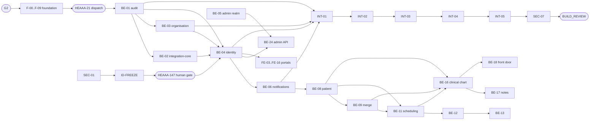

# DELIVERY-PLAN — Enterprise EHR Platform (Stage 2, post-alignment)

| Field | Value |
| --- | --- |
| Task | HEAAA-18 `[SDLC:delivery-plan]` (parent: none; gate task HEAAA-19, G2) |
| Author | Delivery Planner `452babff` |
| Independent reviewers | Orchestrator `6379e11e`, then Solution Architect `7efe9f61` (native review stages of HEAAA-18) |
| Date | 2026-11-05 |
| Version | **Draft 3** (corrects Solution Architect round-1 findings SA-DP-01..06 and round-2 findings SA-DP-04, 07, 08, 09, see sections 18 and 19). Orchestrator PASS applied to draft 1 only; draft 3 needs re-review of the changed content. Not human-approved. This is not G2. |
| Companion documents | `TICKETS.md` (all 83 tickets with owner, reviewer, paths, acceptance, checks) and `QUALITY-RELEASE-PLAN.md` (quality, evidence and release preparation; it points to `TEST-CASES.md` and `DEVOPS-PLAN.md` for the QA and DevOps plans) |
| Native records | Paperclip tasks are canonical. The 83 child tickets exist under the build-lane master tasks HEAAA-20, 22, 23, 24, 25, 26 and 29 with native parent and blocked-by relations. No external tracker is used or synchronised (Linear is not configured). |

## 1. Summary for the decision-maker

1. **Proposed scope for G2: Release 1 only** (foundation and booking: six surfaces minus the pharmacy portal, which is R2). R2 (prescribing, pharmacy network, payments) and R3 (delivery, labs) have no detailed design; R4 is not committed. They stay in Backlog (section 14). G2 approval of this plan would authorise only the 83 named R1 tickets in `TICKETS.md`, run in local or isolated `ci` resources.
2. **83 tickets, 239 effort points** (S=1, M=2, L=3, XL=5; relative sizes, not days). Backend carries 96 of them on one agent. With two workers the schedule needs 153 points of elapsed effort; with an unlimited number it still needs 147, because the single Backend Engineer is the bottleneck. Raising the cap above two buys little until a second backend capacity exists (section 8). I give **no calendar date**: there is no measured velocity. The PRD target (R1 in production by end of May 2027) is unverified and is at risk (section 15).
3. **The design is not clean, and this plan says so.** The frozen revisions carry open conditions (section 4, 23 items). The ones that bite hardest: the identity tables are Provisional (SEC-01, the owner's D-35 answer and an architecture erratum come first); QA's TEST-CASES contains two known-wrong items; the DevOps plan has four carried Medium findings; no environment, test tenant or vendor sandbox exists.
4. **Nothing runs before G2.** Every ticket is blocked on G2 (foundation tickets directly; all others through the dispatch task HEAAA-21). SEC-01 is the one ticket that does not wait: it is a design review, held in Backlog for the Orchestrator to promote, ideally before G2 is decided.
5. **Real authentication is not proven at foundation.** HEAAA-20 proves frozen install, builds, CI checks, migrations, and a browser -> same-origin API -> PostgreSQL slice with the scope setter and RLS. The first real sign-in slice is INT-01 (milestone M2), against a local OIDC conformance IdP. Real Google Workspace sign-in stays BLOCKED until a test tenant exists.
6. **Decisions asked of G2** are listed in section 13, including whether G2 also authorises a synthetic-data `staging` environment (the workflow has no gate for it before acceptance).

## 2. Inputs: frozen revisions this plan is built on

Only these revisions are used (HEAAA-17 `design-align` rev `ea043d8d`, section 1). Every ticket cites sections of these documents; a ticket never cites a superseded revision (HEAAA-13 `architecture` rev `21767dcd`, HEAAA-14 `ui-ux` rev `d88f87f1`, HEAAA-15 `test-cases` rev `9d3f1ec1`, HEAAA-16 `devops-plan` rev `a3b9f37f` are not current).

| Document | Paperclip source | Revision ID | sha256 (first 16) | State |
| --- | --- | --- | --- | --- |
| PRD | HEAAA-11 `prd` | bba336f3-e934-4dbb-9158-0909fda132d7 | 6a945656988bbf02 | G1-accepted 2026-11-04 (confirmation `cadd7751`); `docs/PRD.md` @ `f8d3d6e` per ARCHITECTURE 20.1 |
| ARCHITECTURE (Part I + II, draft 8.1) | HEAAA-48 `architecture` | b276930a-20af-4433-a8f0-60843f5a3eaf | 1e7fe57ed94d4412 | `docs/ARCHITECTURE.md` @ `481f32a` (local, not pushed); SA Reviewer PASS HEAAA-53 |
| SHARED-BOUNDARIES (draft 3) | HEAAA-12 `shared-boundaries` | 0fffc85d-c3cd-4bad-a7f3-4f774fbbbf5a | 84ba36816e5cb1d3 | @ `d14ed7f`; PASS; Cybersecurity review of 7, 9.1, 10 outstanding (SEC-01). Not a G2 key: it is cited by ARCHITECTURE and built against |
| UI-UX (draft 6) | HEAAA-49 `ui-ux` | 1fd76f7e-0356-46f9-bcd5-b94c5badf65e | 9d3224d81048910c | commit `fd1e92d` (local); human confirmed as is (`e1c9f09a`); PM check of the desktop image pending |
| BRAND-BRIEF | HEAAA-49 `brand-brief` | eb5307f6-8c80-4583-b2cc-2aaaae3780df | d27cbb5b3b1e8422 | placeholder identity; brand files missing (UX-O-01) |
| Mockup manifest (desktop and mobile PNG) | HEAAA-49 `mockup-manifest` | a0488c46-bba5-422d-ab54-4e546522f6b0 | 1b7fd1b871683622 | Desktop PNG sha256 `5056d2e1…ca17f`, attachment `9f33d19d`; Mobile PNG sha256 `01d432df…7a1b`, attachment `52aca846` (both on HEAAA-49) |
| TEST-CASES (draft 5) | HEAAA-51 `test-cases` | 4ecc71c0-a1b0-4cb4-a738-119f6f1d4983 | cd7de4efc0c6ec44 | `docs/TEST-CASES.md` @ `db4de04`; **not clean**; human declined a further cycle; TC-AU-04 step 2 and duplicate TC-API-10 are wrong (C-15) |
| DEVOPS-PLAN (draft 6) | HEAAA-50 `devops-plan` | 3023afa1-5018-4f57-94c8-82a7a9703aa0 | f6e2afff0d8a61ef | `docs/DEVOPS-PLAN.md` @ `46781a0`; SA review PASS (HEAAA-60), DevOps review CHANGES REQUIRED (HEAAA-61); human declined a further cycle; DPR-37..40 carried (C-14) |
| Alignment manifest | HEAAA-17 `design-align` | ea043d8d-f371-4830-bcd1-f1517411e87c | 7e8de2fadae722bc | frozen with conditions; sections 2 and 4 bind this plan |

**What I read.** PRD scope, releases and the release acceptance rows (4, 8.2); ARCHITECTURE 3, 4, 7, 19, 20, 24, 27.2-27.3, 29 (route catalogue structure and 29.1), 33.1, 37, 38.2, 39, 40, with the ERD of section 22 only at table-count level; SHARED-BOUNDARIES 3.2, 11, 12; UI-UX 3, 4, 12, 14; DEVOPS-PLAN 2, 4, 5, 15, 16; TEST-CASES 0, 12, 13, 14, 15.1, 20; the HEAAA-17 alignment manifest; the POR and SA reviews of TEST-CASES draft 5. I did **not** re-read every line of the 389,491-character ARCHITECTURE, the DEVOPS-PLAN or the TEST-CASES, nor re-diff the documents against each other; where HEAAA-17 states an alignment result I rely on it.

**Not frozen / not available.** Mockups are links and hashes (above); no document in this set has a human G2 decision. Local branches named in the design documents (`docs/ARCHITECTURE.md` @ `481f32a`, etc.) are **not pushed**; Paperclip documents are the shared copy. Ticket F-00 commits byte-identical copies to the product repository.

## 3. Scope proposed for G2

**In scope (R1, PRD 4.3, 4.5, 8.2):** identity and roles, Google Workspace SSO for staff, clinics and locations, brand site, patient portal (register, book, reschedule, cancel, reminders, telehealth join), doctor schedule and Google Calendar sync, pre-consultation forms and triage queue, basic clinical notes, document upload, system admin, audit log, duplicate detection and audited merge (BR-37, review-added), messaging for staff, privacy requests. The acceptance rows RA-R1-01..32 are covered in `QUALITY-RELEASE-PLAN.md` section 6.

**Built as defaults, rerun if the owner decides differently (PRD 4.4):** block-only booking policy, nothing charged (D-3); no lab sample booking (D-4); patient messaging behind a flag, off (D-5); no patient visit summary (D-6).

**Out of scope and not authorised by G2:** R2, R3, R4; the partner pharmacy portal and its `pharmacy.` host; payments; labs; native apps; multilingual (English only, D-9); any deployment, staging or production resource, vendor contact or purchase, and any real personal data.

**Partially buildable (mechanics yes, acceptance or content blocked):** RA-R1-07 and RA-R1-08 (D-12a), RA-R1-14 deletion (D-8), RA-R1-20b (D-7), vendor-dependent evidence (C-10, C-11).

## 4. Conditions register

A condition is not resolved by being listed. Each row says who can resolve it and which tickets it limits. A ticket that cites a condition either carries it explicitly in its acceptance or is Backlog (held). **I did not mark any ticket Ready on the assumption that a condition is resolved.**

| ID | Condition | What it means for the build | Who resolves | Tickets citing it (generated) and other effects |
| --- | --- | --- | --- | --- |
| C-01 | Environment authorisation and unverified cloud behaviour | No environment exists or is authorised. Staging, hosted demo and production each need their own release authorisation (WORKFLOW Stage 5; DEVOPS-PLAN 15.1). All build evidence is therefore `ci` (containers) only. Items that need real cloud stay Unverified or BLOCKED: role-level `transaction_timeout` on RDS, CloudFront/ALB behaviour for the alert stream, the malware-scan tag and timing, vendor sandboxes, the secret-store and storage prices, staging end-to-end, ZAP baseline. **Decision asked at G2:** does G2 also authorise creating the synthetic-data `staging` environment once DO tickets pass review, or will a separate staging authorisation be requested before QA runs staging cases? The workflow has no gate between BUILD_REVIEW and ACCEPTANCE for that. | Owner; human Architect; DevOps owner | DO-02, DO-03, DO-05, DO-06, DO-08. Also: DO-02, DO-03, DO-05, DO-06, DO-08; INT staging evidence; QA staging cases; every "Unverified" cloud item |
| C-02 | Identity freeze chain | ARCHITECTURE 22.4 and 26 are Provisional. Freeze needs (1) the Cybersecurity review SEC-01 of SHARED-BOUNDARIES 7, 9.1, 10 and Part II 26, (2) the owner's D-35 answer (path B in effect by default; path A is possible until the freeze), (3) the variant (B2 API-run WebAuthn recommended; B1 needs a cloud spike first), then (4) the architecture erratum ID-FREEZE, then (5) a human acceptance of the new architecture revision on the native gate task HEAAA-147 (`ID-FREEZE-GATE`), which natively blocks BE-04 and BE-05 (an agent PASS on ID-FREEZE alone does not release them). If the owner picks path A or B1, BE-05 and FE-17 are re-planned before work starts. No task for the SEC-01 review existed before this plan; it is created in Backlog and should be promoted by the Orchestrator, ideally before G2 is decided, because a change it forces reopens the affected G2 document. | Owner (D-35); Cybersecurity; Solution Architect | SEC-01, ID-FREEZE, F-08, BE-02, BE-04, BE-05, FE-17, DO-10. Also: BE-04, BE-05, FE-08 (sign-in contract), FE-17, DO-10, SEC-02 |
| C-03 | D-12a: R1 safety reviewer | RA-R1-07 and RA-R1-08 (red-flag alert, consent gate) and every rule text, threshold and escalation timing are BLOCKED until a clinical safety reviewer is named or an interim self-review is recorded and reported as self-review. Mechanics are buildable and testable now; rule content and acceptance are not asserted. PM-confirm-1 (escalation timer) is part of this. | Owner; PM | BE-07, BE-16, BE-18, FE-07, FE-09, FE-10. Also: BE-07, BE-16, BE-18, FE-07, FE-09, FE-10 (acceptance, not build) |
| C-04 | D-7: proxy rules | Only the default (a linked proxy sees appointments only) is built and tested (RA-R1-20a). Link creation, verification, age-out and revocation values (RA-R1-20b, AC-32) are BLOCKED. | Owner; clinical reviewer | BE-08, FE-05. Also: BE-08, FE-05 (RA-R1-20b part) |
| C-05 | D-8: meaning of deletion | Deletion requests are recorded and routed; no data is deleted. TC-PR-03 and the deletion part of RA-R1-14 are BLOCKED. | Owner; counsel | BE-20, FE-05. Also: BE-20, FE-05 |
| C-06 | D-2: operating states | Placeholder states are used and marked. Real licensing-state values and state privacy rules are BLOCKED. | Owner | BE-15, FE-07. Also: BE-15, FE-07 (TC-TH-06..08 with real data) |
| C-07 | PRD defaults D-3, D-4, D-5, D-6 | Block-only booking policy (nothing charged), no lab sample booking, no patient visit summary, patient messaging behind a flag and off. The default is built and tested; a different owner answer reopens the affected tickets and tests. | Owner; PM | BE-03, BE-11, BE-18, BE-19, FE-04, FE-05, FE-12. Also: BE-03, BE-11, BE-18, BE-19, FE-04, FE-05, FE-12 |
| C-08 | Product answers not yet recorded | BQ-1..BQ-12 use the defaults stated in ARCHITECTURE 20.2 and 37; PM-confirm-1..3, UX-P-01..03, SA-F-18/19 (PRD errata), QA-AL-02 (no billing role in R1) and SEC-confirm-1 are open. The default is used; the open assertion is not tested; a different answer changes a policy, setting or contract as listed there (BQ-6 unmerge is the exception: it needs a boundary revision). | PM; owner | BE-03, BE-06, BE-07, BE-08, BE-09, BE-11, BE-13, BE-16, BE-17, BE-18, FE-09. Also: BE-03, BE-06, BE-08, BE-09, BE-11, BE-13, BE-16, BE-17, BE-18, FE-09 |
| C-09 | UMLS licence | Real terminology content for coded entry needs the NLM UMLS licence account. Code, loader and tests are built; TC-CL-04 against real terminology is BLOCKED. | Owner | BE-16. Also: BE-16 |
| C-10 | Test tenant and vendor sandboxes | No Google Workspace test tenant, email, SMS, video, OCR or malware-scan sandbox is confirmed to exist (DEVOPS-PLAN 3.5, 16 item 19). A mock is never evidence for an external service: such cases stay BLOCKED naming the missing sandbox. | Owner; Workspace administrator | BE-04, BE-06, BE-10, BE-14, BE-15, FE-07, FE-11. Also: BE-04, BE-06, BE-10, BE-14, BE-15, FE-07, FE-11 (real-provider evidence only) |
| C-11 | Vendor selection and BAAs | Video, SMS/email/push, OCR and malware-scan providers are not chosen (ARCHITECTURE 7 gives a recommendation, not a decision). No vendor contact, signup or purchase is authorised by this plan. Adapters are built against the integration-core interface. | Owner | BE-06, BE-15, FE-07. Also: BE-06, BE-15, FE-07 |
| C-12 | Hosting choice and cost inputs | AWS is assumed, not decided (D-30). Owner inputs on DEVOPS-PLAN 13 and 16 (cost items, connection budget, region-loss scope D-26) are open. IaC is authored and validated only; nothing is applied. | Owner; Solution Architect (connection budget) | DO-01, DO-02, DO-03, DO-04, DO-07, DO-08, DO-09, DO-11. Also: DO-01..DO-04, DO-07..DO-09, DO-11 |
| C-13 | GitHub controls and a second human | The repository is private on a personal account; branch protection and rulesets answered 403 on 2026-11-04. Without an organisation on a plan that provides them, nothing technically stops a push to `main`, a merge without checks or a self-approved deployment; the approver and the agents share one login today. Dual control (C4 approver, audit archiving, bootstrap) needs a second human (RK-5). Tickets record the controls found and say "procedural only" where needed. | Owner | F-00, F-01, F-02, F-09, F-07, BE-05, DO-04, DO-05, DO-10. Also: F-00..F-02, F-09, DO-04, DO-05, DO-10 |
| C-14 | DevOps findings carried: DPR-37..DPR-40 | DPR-37 (staging Terraform apply role) and DPR-38 (name the role and trigger that create the loadtest, bootstrap and ENV-DR stacks) are fixed before any staging deploy workflow is enabled; DPR-39 (pin staging task definitions by ARN, add gate-check read actions, add a `gh-nightly-staging` row) with DO-06/DO-09; DPR-40 optional. The DevOps plan text correction is routed to the Solution Architect Reviewer. | DevOps; Solution Architect Reviewer | DO-04, DO-06, DO-09. Also: DO-04, DO-06, DO-09 |
| C-15 | Document errata carried into build | **TC-AU-04 step 2 and the duplicate case ID `TC-API-10` are wrong in the frozen TEST-CASES and must not be implemented as written** (design-align section 2). Also open: POR-02..04, SA-TC-07..10, QA-AL-01 (`410 Gone` sync token rule), ARCHITECTURE notes N-3..N-5 (open) and N-9..N-11 (build notes), DEV-1 N-8 (confirm), SA-F-18/19. QA-01 and ID-FREEZE are the bounded errata revisions; both reopen the affected approval, and neither resets the cumulative review ledger. | QA; Solution Architect; PM | ID-FREEZE, F-03, F-04, F-08, F-05, BE-01, BE-02, BE-03, BE-04, BE-05, BE-06, BE-07, BE-08, BE-09, BE-10, BE-11, BE-12, BE-13, BE-14, BE-15, BE-16, BE-17, BE-18, BE-19, BE-20, BE-21, BE-22, BE-23, BE-24, QA-01. Also: BE-01, BE-02..BE-24 (as listed per ticket), F-03, F-04, F-05, F-08, QA-01, QA-03..QA-05 |
| C-16 | UI/UX carried items | UXR-09 and UXR-12a residuals and UXR-13 (all Low); Architect items of UI-UX 13.2 (UXR-08 option A, UXR-10, UXR-11); UX-O-01 brand files missing (placeholder identity; G2 cannot approve identity without the files or an explicit decision), UX-O-02 CMS UI, UX-O-04 states, UX-O-06/07/08. The PM check of the desktop mockup is pending. | UI/UX; owner; PM | F-06, FE-01, FE-02, FE-03, FE-04, FE-05, FE-06, FE-07, FE-08, FE-17, FE-09, FE-10, FE-11, FE-12, FE-13, FE-14, FE-15. Also: F-06, FE-01..FE-17 |
| C-17 | Load environment cost | `loadtest` (production-equivalent) is not provisioned and its cost is not approved (DEP-14, D-25). Load cases are BLOCKED and are never run smaller to claim a pass. | Owner | DO-11, QA-07. Also: DO-11, QA-07, TC-PERF-* |
| C-18 | On-call rota | D-29 / DEP-15: no named rota. 99.9 % stays a target, not a claim. Blocks go-live and alert-delivery evidence, not build. | Owner; operations owner | DO-07. Also: DO-07 (evidence), G3 |
| C-19 | CMS runtime versus SaaS CMS | Self-hosted headless CMS in the marketing account or static export plus SaaS CMS; decided on cost (DEVOPS-PLAN 16 item 11). FE-16 is held until decided. | Owner | FE-15, FE-16. Also: FE-15 (data source), FE-16, deploy-marketing |
| C-20 | Retention periods | Audit, log and backup retention are set with counsel (longest of HIPAA, DEA and state rules). Retention is configuration; TC-AU-09 and TC-DOC-07 stay BLOCKED until the values exist. | Counsel; owner | BE-01, BE-10, BE-20. Also: BE-01, BE-10, BE-20 |
| C-21 | Platform-admin root of trust | Named platform admins, management-account SCP owner, Identity Center home Region and break-glass availability (DEVOPS-PLAN 16 items 9, 14, 18, 21). Blocks any production deployment, not build. | Owner; human Architect | DO-01, DO-08. Also: DO-01, DO-08, G3 |
| C-22 | Test tooling and licences | Playwright, Schemathesis, k6, axe-core and Lighthouse CI are Recommendations; the k6 AGPL licence needs an owner and counsel decision for use as an unmodified test tool (DEVOPS-PLAN 16 item 20). | Owner; human Architect | F-01, F-09, DO-11. Also: F-01, F-09, DO-11 |
| C-23 | G2 settings | The values proposed in PRD 7.2 and ARCHITECTURE 31.4 (hold time, reminders, idle timeout, cut-offs, thresholds, windows) are proposals until G2. They are configuration read from settings; no ticket hard-codes one. A different G2 value is a settings change plus a test rerun. | Owner; human Architect | . Also: BE-03, BE-11..BE-13, BE-17 |

## 5. Phases and milestones

| MS | Name | Tickets | Exit evidence |
| --- | --- | --- | --- |
| M0 | Gate and conditions | G2 decision; SEC-01 and ID-FREEZE started; owner decisions recorded | G2 decided on the exact revisions; conditions register acknowledged |
| M1 | Foundation proven | F-00..F-09 | HEAAA-20 closes: clean frozen install, production builds of every app, CI required checks green on the combined revision with raw reports, migrations from empty on PostgreSQL 17 with the catalog checks, and the browser -> same-origin API -> database slice with scope setter and RLS. No auth claim at this stage (see INT-01). |
| M2 | Platform layer | BE-01..BE-04, BE-06, FE-01, FE-02, INT-01 | INT-01 PASS: first real authentication slice (local OIDC conformance IdP) with audit event on the combined revision; real Google sign-in still BLOCKED (C-10) |
| M3 | Booking slice | BE-07..BE-15, BE-22, FE-03, FE-04, SEC-03, SEC-04, INT-02 | INT-02 PASS: register, book (100-parallel race), reminder, reschedule, cancel, waitlist, merge-versus-booking race on PostgreSQL 17. **Recommended interim BUILD_REVIEW** (first real journey); the Orchestrator creates the extra gate, the workflow only requires one at a planned milestone |
| M4 | Clinical, front desk and portals | BE-16..BE-21, FE-05..FE-12, FE-15, FE-16, SEC-08, INT-03 | INT-03 PASS: arrival, triage, alert mechanics, consultation, note signing and co-signing, documents, messaging, privacy request on the combined revision; rule content still BLOCKED on D-12a |
| M5 | Administration and controls | BE-05, BE-23, BE-24, FE-13, FE-14, FE-17, DO-01..DO-07, SEC-02, SEC-05, INT-04 | INT-04 PASS: C1, C4, C6 pass as tests; admin configuration, audit viewer and BTG review run end to end; pipelines re-linted on the merged tree |
| M6 | Release candidate | DO-08..DO-11, SEC-06, SEC-07, INT-05 (QA-02..QA-07 authoring runs alongside, Backlog until promoted) | INT-05 PASS and SEC-07 filed: candidate manifest with raw reports; Orchestrator prepares BUILD_REVIEW |

Milestone exits are evidence on the **combined** revision (an INT ticket), not a count of finished tickets. A milestone does not authorise the next human gate; the Orchestrator prepares BUILD_REVIEW from M6 (and, if the owner agrees, an interim one after M3).

## 6. Lanes, ownership and the native Paperclip structure

| Lane master (existing) | Children | Master closes when |
| --- | --- | --- |
| HEAAA-20 Foundation (DevOps owns the master; Backend, Frontend and DevOps own children) | 10: F-00, F-01, F-02, F-03, F-04, F-08, F-05, F-06, F-09, F-07 | all required children pass and the combined revision meets the master's acceptance |
| HEAAA-23 Backend | 24: BE-01, BE-02, BE-03, BE-04, BE-05, BE-06, BE-07, BE-08, BE-09, BE-10, BE-11, BE-12, BE-13, BE-14, BE-15, BE-16, BE-17, BE-18, BE-19, BE-20, BE-21, BE-22, BE-23, BE-24 | all required children pass and the combined revision meets the master's acceptance |
| HEAAA-22 Frontend | 17: FE-01, FE-02, FE-03, FE-04, FE-05, FE-06, FE-07, FE-08, FE-17, FE-09, FE-10, FE-11, FE-12, FE-13, FE-14, FE-15, FE-16 | all required children pass and the combined revision meets the master's acceptance |
| HEAAA-24 DevOps | 11: DO-01, DO-02, DO-03, DO-04, DO-05, DO-06, DO-07, DO-08, DO-09, DO-10, DO-11 | all required children pass and the combined revision meets the master's acceptance |
| HEAAA-25 Security assessments and design maintenance | 9: SEC-01, ID-FREEZE, SEC-02, SEC-03, SEC-04, SEC-05, SEC-06, SEC-07, SEC-08 | all required children pass and the combined revision meets the master's acceptance |
| HEAAA-26 Integration | 5: INT-01, INT-02, INT-03, INT-04, INT-05 | all required children pass and the combined revision meets the master's acceptance |
| HEAAA-29 QA automation | 7: QA-01, QA-02, QA-03, QA-04, QA-05, QA-06, QA-07 | all required children pass and the combined revision meets the master's acceptance |

- **One owner per ticket**, always the agent identity that exists for that role (there is one Backend Engineer, one Frontend Engineer, one DevOps Engineer). **One independent reviewer chain per ticket**; the reviewer is never the owner or the author of the design being built (Solution Architect appears as a reviewer only of contract transcription F-08).
- **Native relations.** `parentId` is the lane master. `blockedByIssueIds` carries (a) technical prerequisites, (b) scheduling prerequisites for the two-worker cap, (c) a gate: G2 (HEAAA-19) for foundation tickets, the dispatch task HEAAA-21 for all other implementation tickets. Only direct prerequisites are listed (blockers another listed blocker already waits for are omitted, gates and dispatch included). Lane masters HEAAA-22, 23, 24, 25, 26 and 29 are blocked by the final tickets (plus, for HEAAA-26 and HEAAA-29, the other masters they consume), so a master cannot close early. HEAAA-20 is blocked by its final foundation ticket F-07 (HEAAA-81), which waits on the rest of the foundation and, through F-00, on G2; the dispatch task HEAAA-21 waits on HEAAA-20, so BE-01 and DO-01 natively wait for the foundation proof (F-03 runner, F-04 registries) and not only for an agent closing HEAAA-20. FE-01 and FE-02 do not wait on the dispatch task, so there is no cycle (the API would reject one). HEAAA-20 closes by its stated completion rule once F-00..F-09 are done (QA-07 is tracked but needs the load environment).
- **Logical states** the native status cannot express live in each ticket's `review-ledger` document: Ready = `todo`; Review = `in_review`; **Verified**, **Integrated** and **Changes Required** are recorded there, not inferred from `done`. Held tickets are `backlog` (not Ready) until the Orchestrator promotes them.
- **Dispatch.** HEAAA-21 checks G2 scope and the Ready check of each ticket (conditions cited, prerequisites, isolation, tool access, reviewer capacity) before it completes. Completing it unblocks the implementation tickets; the scheduling prerequisites then keep at most two owner runs active.

## 7. Dependency graph and the checks I ran

Technical prerequisites follow BD-02 (calls go down only): kernel -> L1 `audit`, `integration-core`, `organisation`, `identity`, `notifications` -> L2 `patient`, `documents` -> L3 `scheduling`, `calendar-sync`, `telehealth`, `clinical`, `messaging`, `privacy` -> `reporting`. Frontend tickets depend on the real API ticket of the feature they consume (mocks are for authoring, not proof). Integration tickets depend on every ticket in their milestone and on the security assessments of it.

**Checks executed by me on 2026-11-05** with a small script over the ticket model (source is stored as the HEAAA-18 document `ticket-model-and-checks`; it is planning tooling, not product code, and is not committed to the product repository):

| Check | Result |
| --- | --- |
| Unknown prerequisites, missing owner/reviewer/paths/acceptance/checks, owner = reviewer | none found |
| Cycle check, technical prerequisites only (83 tickets) | acyclic |
| Cycle check, technical + scheduling prerequisites (114 scheduling edges) | acyclic |
| Largest set of tickets with no ordering between them, two-worker graph | 2 (cap is 2) |
| Write-path overlap between any two tickets that are not ordered, two-worker graph | none |
| Same check with only technical + same-agent ordering (the graph if the cap is lifted) | none |
| Largest unordered set in that lifted graph | 6 (this is why the cap is also a dispatch rule, section 8) |
| Every PRD row RA-R1-01..32 (with 20a/20b) has a build owner, a QA ticket and test cases | yes, `QUALITY-RELEASE-PLAN.md` section 6 (asserted by the generator) |

Limits of these checks: path overlap is a prefix comparison of the declared allowed paths, not a diff; "unordered" means no path in the prerequisite graph, not "never concurrent in time" (the cap enforces that). They do not check that the design itself is consistent.

**Critical path (technical prerequisites, 67 points):** F-00 → F-01 → F-03 → F-04 → F-05 → BE-01 → BE-03 → BE-04 → BE-06 → BE-08 → BE-09 → BE-11 → BE-12 → BE-13 → BE-18 → FE-09 → INT-03 → INT-04 → QA-05.

## 8. Scheduling, parallelism and isolation

- **Initial cap: two active workers** (an owner run on an implementation, integration or assessment ticket). Reviews are read-only on a frozen revision and may overlap, subject to quota.
- **How the cap is enforced.** A simulation (list scheduling by longest remaining path, one run per agent, two slots) fixed the order; the 114 resulting scheduling prerequisites are native blockers on the tickets, so Paperclip cannot start a third owner run. They are labelled in each ticket card and are removable; technical prerequisites are never removable.
- **Relative elapsed effort (points):** two workers 153, three workers 147, four workers 147, total effort 239. The Backend lane alone is 96 points on one agent. Three or four workers therefore gain 6 points (4 %) and need **separate branches/worktrees, independent test data and quota**; they are not worth the risk until a second Backend capacity is added or measured velocity shows otherwise.
- **Scaling to 3-4 workers** needs all of: (1) M1 evidence that two workers ran without branch, lockfile or migration conflicts; (2) the Orchestrator's record that subscription quota allows it; (3) one isolated PostgreSQL 17 container and test data set per active worker (`ci` sandbox, never shared); (4) a regenerated set of scheduling prerequisites for the new cap, created by the Delivery Planner (a re-plan task), because deleting the two-worker edges alone would let up to 6 unordered tickets start. Until then, ask for nothing more.
- **Isolation.** Every ticket runs in its own Paperclip isolated worktree/branch of the product repository `zainnaeem28/enterprise-app` (default branch `main`), never in the Paperclip source tree or this framework package. The Integrator merges reviewed branches in dependency order onto an integration branch. Nothing in the repository enforces this today (branch protection answers 403 on the current plan, C-13); it is procedural and the evidence says so.

## 9. Shared resources and single owners

| Resource | Single owner | Rule |
| --- | --- | --- |
| Root lockfile and root manifest | DevOps Engineer (F-01) | Other tickets list requested dependencies in their evidence and add them only inside their own app or package manifest. A lockfile conflict is resolved by re-resolving, never by hand-merging. A new top-level dependency needs its licence and reason in `docs/DEPENDENCIES.md` and passes OSV/licence scanning. |
| `db/migrations/**` | Backend Engineer (one agent, one range per ticket) | Ranges are fixed in each ticket card: F-03 0001-0099, F-04 0100-0149, F-05 0150-0199, then 100 numbers per Backend ticket in the native execution order of the Backend chain (technical plus two-worker scheduling edges): BE-01, BE-03, BE-02, BE-04, BE-06, BE-08, BE-09, BE-11, BE-10, BE-12, BE-07, BE-13, BE-14, BE-15, BE-16, BE-18, BE-17, BE-20, BE-19, BE-21, BE-05 from 0200 upwards. The ticket number is not the range order. `plan.py` fails if a ticket that precedes another natively holds a higher range. The runner rejects an out-of-order version (F-03). A ticket never writes outside its range. Migrations are DDL only (SBR-17); reference data and repairs are worker jobs. |
| `packages/contracts/openapi/**` | Backend Engineer, ticket F-08 owns `common.yaml` and the root index | ADR-018: after F-08 the file is the source of truth. A ticket that finds the design wrong raises a finding to the Solution Architect; a contract change is a separate reviewed change, never a side edit. BE-04 and BE-05 may only drop `x-provisional` after ID-FREEZE. |
| `apps/api/src/app.module.ts` and the worker job registry | Backend Engineer | Append-only registration lines; one writer. |
| `packages/ui`, `packages/app-shell` | Frontend Engineer (F-06 creates, FE-01 owns the system) | One agent; ordered by prerequisites. |
| `.github/**`, `infra/**`, `scripts/ci|release|deploy/**`, Dockerfiles | DevOps Engineer | No other lane edits these; a needed change is a DevOps ticket. |
| `docs/**` | DevOps Engineer (F-00 baseline); Solution Architect (ID-FREEZE) and QA (QA-01) only for the errata named | CODEOWNERS should require a human reviewer (C-13). |
| Environments (staging, loadtest, DR, bootstrap), test data, vendor sandboxes | DevOps Engineer | None is authorised or exists. Environment mutations are serialised and need the matching authorisation (C-01). |

## 10. Reviewers, capacity and the review ledger

| Reviewer role (one agent each) | Review stages across 83 tickets |
| --- | --- |
| Backend Reviewer | 37 |
| Security Reviewer | 33 |
| Frontend Reviewer | 22 |
| DevOps Reviewer | 16 |
| UI/UX Designer | 7 |
| QA Engineer | 5 |
| Solution Architect Reviewer | 2 |
| Solution Architect | 1 |
| Product Owner Reviewer | 1 |

- Security-sensitive tickets (audit, integration-core, organisation, identity, notifications, patient, merge, documents, clinical chart, front door, IaC trust, dual control) have a **Security Reviewer second stage**. Contract transcription F-08 has the Solution Architect as second stage. Safety-critical screens have the UI/UX Designer as second stage.
- One Backend Reviewer reviews every backend ticket: this is the second bottleneck. Reviews are independent and must read raw reports from the exact revision.
- **Ledger.** Each ticket gets a `review-ledger` document (finding IDs, rounds, dispositions). The count is cumulative across reassignment, resumed runs and integration failures. Three unresolved consolidated rounds stop the loop and escalate to the Orchestrator for a real human decision. The native `maxReviewRounds: 3` is set on every ticket but is not the ledger. Splitting a ticket does not reset its ledger; split tickets inherit the findings of the parent.

## 11. Findings, correction tickets and consumers

- A finding has a stable ID/fingerprint, source reviewer or tool, affected revision, evidence, severity, requirement or contract, owner, parent ticket, dependency impact, acceptance and disposition. Duplicates are merged without deleting history.
- An in-scope blocker creates an assigned **correction ticket** `COR-<finding ID>` under the same lane. It depends only on its own prerequisites, **not on the ticket it repairs**. The repaired ticket and its downstream consumers (`blocks` relation) are blocked until the correction is independently reviewed, retested, integrated and the Orchestrator records the disposition. Security blockers are never relabelled optional.
- Closure needs fix, independent re-review, required test or security rerun, integrated verification and a recorded disposition. A comment marked resolved or a green badge closes nothing.
- Optional enhancements stay in Backlog with a rationale (section 14).

## 12. Environment, credentials and authorisation boundaries

- G2 unlocks implementation tickets and local or `ci` checks only. **No staging, hosted demo or production resource, no cloud account, no vendor contact or purchase, no real personal data** (WORKFLOW Stage 5, DEVOPS-PLAN 15.1).
- IaC and deploy workflows are authored, validated (`fmt`, `validate`, `tflint`, policy scan, `plan` artifact) and committed **disabled**; nothing is applied (DO-01..DO-11). DPR-37..39 are fixed before any staging deploy workflow is enabled.
- No credential enters a ticket, document, screenshot or committed file. Deployment credentials are withheld until G3 for the exact environment.
- Evidence quality: results are only for the environment and candidate they name. A mock never proves an external service.

## 13. Decisions asked of the G2 approvers

G2 decides the exact plan revisions and the named implementation scope. Please state each of these explicitly (an unanswered item keeps its stated default and its ticket stays limited as shown):

| # | Decision | If not decided |
| --- | --- | --- |
| 1 | Authorise R1 implementation as the tickets in `TICKETS.md`, run on local/`ci` resources only | none: nothing starts |
| 2 | D-35 admin path A or B (B in effect; B2 variant recommended) | BE-05, FE-17 re-planned if A or B1 (C-02) |
| 3 | Promote SEC-01 now (recommended) or accept G2 with identity tickets blocked until it and ID-FREEZE are done | identity chain waits (C-02) |
| 4 | Does G2 also authorise the synthetic-data `staging` environment, or will a separate authorisation precede QA staging cases? | staging cases BLOCKED (C-01) |
| 5 | Hosting AWS confirmed or another choice (D-30); cost inputs | IaC tickets held by the Orchestrator (C-12) |
| 6 | GitHub organisation/plan, separate approver and agent identities, second human (RK-5) | controls stay procedural; dual-control items cannot execute (C-13) |
| 7 | CMS runtime vs SaaS CMS | FE-16 stays held (C-19) |
| 8 | Load-environment cost and the k6 licence use | DO-11, QA-07 stay held (C-17, C-22) |
| 9 | Owner answers still open: D-12a, D-7, D-8, D-2, D-3..D-6 confirmation, BQ-1..12, PM-confirm-1..3, UMLS, retention | defaults or BLOCKED as stated (C-03..C-09, C-20) |
| 10 | Brand files for the identity, or an explicit decision to ship the placeholder identity for the build | FE tickets use the placeholder (C-16) |
| 11 | Accept that TEST-CASES carries known errors and open findings (C-15) and that QA-01/ID-FREEZE will reopen those approvals in bounded erratum revisions | tests planned from those items are wrong |
| 12 | Accept the two-worker cap and the scaling rule of section 8 | cap stays 2 |
| 13 | An interim BUILD_REVIEW after M3 | only the one after M6 |

## 14. Backlog and enhancements (not tickets, not authorised)

| Item | Rationale | Disposition |
| --- | --- | --- |
| R2 prescribing, EPCS, pharmacy network and portal, refills, patient medicine status, card payments, health-record view | No detailed design (ARCHITECTURE 22.17); needs its own technical-design revision, TEST-CASES expansion and G2 for that release | Backlog, release R2 |
| R3 delivery status, labs, results, critical-result alerts | Same; labs integration hub undecided (C3) | Backlog, release R3 |
| R4 claims, analytics, warehouse export, AI scribe, native apps | Outside R1-R3 budget; not committed | Backlog, not planned |
| Multilingual site (F-BS-06) | S priority; English only until D-9 | Backlog |
| Unmerge (BQ-6) | Needs a boundary revision; wrong merges use a documented procedure | Backlog, needs decision |
| Billing role in R1 (QA-AL-02) | No R1 role in ARCHITECTURE 27.3; owner/PM confirmation needed | Backlog until confirmed |
| PWA install prompt (UX-O-07) | Not requested | Backlog |
| Patient-visible queue position (UX-O-06) | Not in PRD | Backlog |
| Independent accessibility specialist review (UX-O-08) | Recommended by UI/UX; not in the plan; risk RK-5 | Recommendation to the owner |
| Paediatric percentiles, condition-specific vital ranges, unit conversion | Explicit R1 non-goals (ARCHITECTURE 37, AL-02) | Backlog |
| Patient messaging (F-PP-09) | Built behind a flag, off unless D-5 retains it | In BE-19/FE-05, flagged |

## 15. Risks the approvers should weigh

| Risk | Statement |
| --- | --- |
| Schedule | No measured velocity; 96 points for one Backend agent; R1 by end of May 2027 is **unverified**. Trim levers are in PRD 4.4 and ARCHITECTURE 11 and are an owner decision, not mine. Re-baseline after M1. |
| Identity chain | SEC-01 -> ID-FREEZE -> human gate HEAAA-147 -> BE-04 gates everything that needs sign-in. If SEC-01 starts only after G2, M2 starts later. |
| Review capacity | One Backend Reviewer carries 37 review stages (backend, foundation and QA-authoring tickets); reviews of XL tickets may take several rounds. Three unresolved rounds escalate to a human. |
| No environment | All evidence is `ci` until C-01 is answered; RDS, edge, vendor and staging behaviours stay Unverified; QA staging, ZAP, DR and load cases cannot run. |
| Procedural controls | Without an organisation plan that enforces rulesets (C-13) and with one person holding every human gate (RK-5), review independence and dual control are procedural. Agents share a login with the approver today. |
| Known-wrong tests | TC-AU-04 step 2 and the duplicate TC-API-10 would fail a correct system or hide a case. QA-01 corrects them before QA-03..QA-05 script them. |
| Run cost | ARCHITECTURE 36: about US$13,950/month expected, US$22,350 high, against the owner's US$5-15k band (D-25). Not a planning decision; the owner must hold a position before G3. |
| Quota | Each ticket costs implementation runs plus up to two review runs; no usage figure exists. Review runs are read-only and not capped by this plan; the Orchestrator must watch quota. |

## 16. What is verified and what is not

- **Executed by me:** reading the frozen documents named in section 2; the ticket-model checks in section 7 (output reproduced there); creation of the 83 native tickets and their relations (see the HEAAA-18 comments for the read-back).
- **Not executed by anyone:** any build, test, scan, migration, deployment or vendor call. No product code or configuration exists. Every acceptance criterion is a plan, not a result.
- **Not verified:** that the sizes are right; that the frozen documents agree with each other beyond what HEAAA-17 reports; that reviewers have capacity; that quota allows two workers for the whole build.

## 17. Next permitted action

1. Orchestrator and Solution Architect review this exact revision (native stages of HEAAA-18). Findings return to me; the ledger is cumulative and a correction produces a new revision.
2. As the task instructs, the gate package was written to HEAAA-19 (G2) at submission: the ten documents named there, each with one `human_only` confirmation bound to its exact revision. **Nobody should answer those confirmations before HEAAA-18 is done**, because the reviews of these three documents run after submission. If a review changes a document, I write the new revision to the gate and create new confirmations for it; an old confirmation never accepts a new revision. I never accept a confirmation.
3. After a real human G2 decision on these revisions, the Orchestrator runs HEAAA-21 (dispatch). Before that: no scaffolding, installs, application or test code, executable migrations, runtime configuration or CI changes.

## 18. Changes in draft 2 (Solution Architect round 1, SA-DP-01..06)

| Finding | Correction |
| --- | --- |
| SA-DP-01 | The merge-participant and export-contributor registries are built in F-04 (kernel) before any consumer. BE-06, BE-10, BE-11, BE-13, BE-15..BE-19 each register `repointPatient` (22.16 rules) and `exportPart`, with the 38.2 item 11 count test for their tables. BE-20 consumes the registry with `privacy/**` paths only and fails if a patient-data module has no contributor. INT-02 and INT-03 assert found = re-pointed + resolved + kept across all registered participants. BE-19 now also depends on BE-09. |
| SA-DP-02 | The booking-confirm-versus-merge race moved from BE-09 to BE-11 (and INT-02). BE-09 keeps the patient-only lock-order race. |
| SA-DP-03 | New native human gate task HEAAA-147 (`ID-FREEZE-GATE`, assigned to the human, blocked by HEAAA-66, requires current-revision acceptance of document `architecture`). BE-04 and BE-05 are natively blocked by it. It is not an agent ticket and not counted in the 83. |
| SA-DP-04 | BE-05 migration range moved from 0600-0699 to 2300-2399 (above the last M4 range). F-03 acceptance adds: the runner rejects out-of-order versions. **Superseded in draft 3 (section 19): that range was ineffective because BE-05 does not integrate at M5 natively; ranges now follow native order.** |
| SA-DP-05 | BE-04 owns `identity.proxy_grant`, its RLS and the appointments-only scope contribution; BE-08 only uses it through the identity interface. |
| SA-DP-06 | BE-14 gains a Security Reviewer second stage and an acceptance item for the OAuth link callback and the refresh-token secret write. |

Cumulative Solution Architect ledger: round 1 CHANGES REQUIRED (6 findings), draft 2 is the correction. The findings stay open until the Solution Architect closes them on this revision.

## 19. Changes in draft 3 (Solution Architect round 2, SA-DP-04, 07, 08, 09)

| Finding | Correction |
| --- | --- |
| SA-DP-04 (raised to Medium) | Migration ranges are now allocated in the native execution order of the Backend chain, not by ticket number or milestone label (section 9 and each card). `plan.py` checks that if A natively precedes B and both own ranges, range(A) < range(B): no inversion, no unordered pair. BE-05 now takes the last range because it is the last Backend migration ticket (M5). |
| SA-DP-07 | The two-worker scheduler respects milestones: a ticket of milestone k does not start before every ticket of an earlier milestone has started, and `plan.py` checks that no ticket of a later milestone is a native ancestor of an INT ticket of an earlier one (result: none). SEC-03 is relabelled M4 to M3 because INT-02 (M3) waits for it. Consequence, stated plainly: the two-worker critical path is longer (153 effort points against 128 before; 147 at four workers against 117), because Backend work is now strictly milestone-ordered. M3 is again integrated before M4 work lands. The scheduling edges are re-applied natively. |
| SA-DP-08 | HEAAA-20 is now blocked by F-07 (HEAAA-81); G2 stays an ancestor through F-00. The cycle through FE-01/FE-02/HEAAA-21 no longer exists, so the exception is removed and section 4 text updated. BE-01 and DO-01 natively wait for the foundation proof. |
| SA-DP-09 | QUALITY-RELEASE-PLAN now contains what its header claims: HEAAA-147 in the levels 3/4 text, and the item 11 merge count test in the level 2 and section 3 rows. The header names exactly those changes. |

Cumulative Solution Architect ledger: round 1 CHANGES REQUIRED (6 findings; SA-DP-01, 02, 03, 05, 06 closed by the Solution Architect in round 2), round 2 CHANGES REQUIRED (SA-DP-04 open, SA-DP-07, 08, 09 new). Draft 3 is the correction; this is round 3 of 3 for this stage, so a further CHANGES REQUIRED escalates to a human. The open findings stay open until the Solution Architect closes them on this revision.
