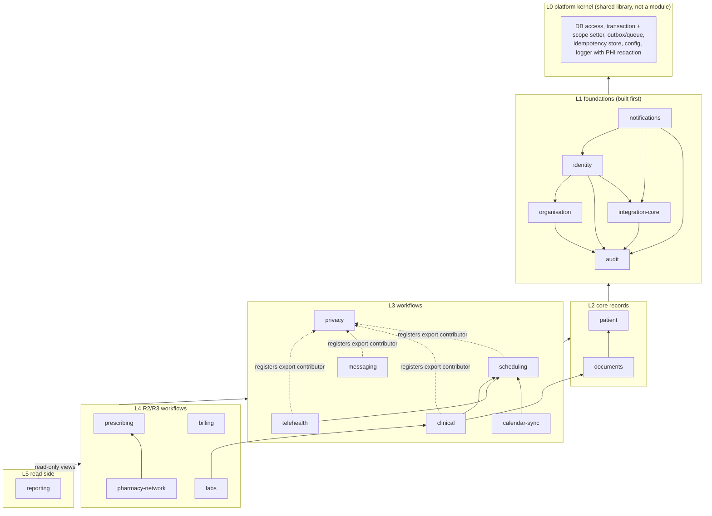
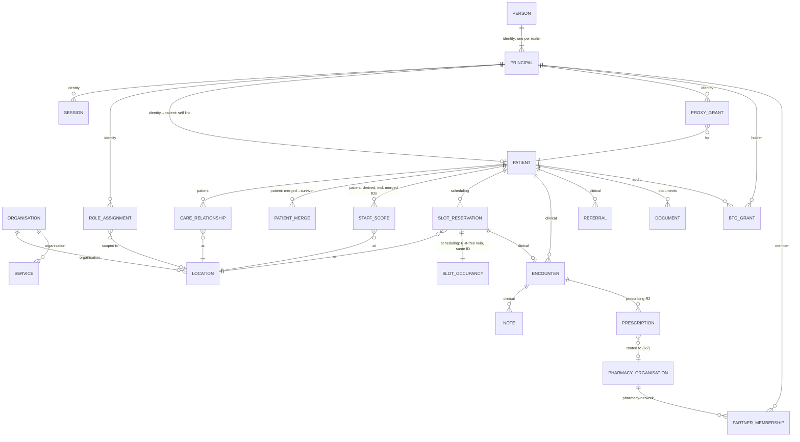

# SHARED BOUNDARIES — Enterprise EHR Platform (Stage 2, post-G1)

| Field | Value |
| --- | --- |
| Task | HEAAA-12 `[SDLC:shared-boundaries]` |
| Author | Solution Architect agent (`7efe9f61-495f-4237-82f9-fa178629da09`) |
| Version | **Shared boundaries draft 3 with amendments SB-A1, SB-A2 and SB-A3** (SB-A1: HEAAA-179, SEC03-F06, the 6.2 definer-function inventory only, section 15.0; SB-A2: HEAAA-190, section 15.00; SB-A3: HEAAA-335, ARCHITECTURE 21.6 amendment A-4, the 6.2 inventory and the 9.2 exempt-table list, section 15.000; SB-A4: HEAAA-460, ARCHITECTURE amendment A-6, the 6.2 inventory only, section 15.0000). **Draft 3** corrected review round 2, SBR-11..15; changes listed in section 15.1. Draft 2 corrected round 1 (SBR-01..10, section 15.2) |
| Approved inputs (G1) | HEAAA-11 `prd` rev `bba336f3-e934-4dbb-9158-0909fda132d7` (PRD revision 3, `docs/PRD.md` @ `f8d3d6e`, identical to `879d084`); HEAAA-11 `architecture` rev `f2d240e4-2f63-45a1-aaa1-16a1f8854c32` (ARCHITECTURE draft 4, `docs/ARCHITECTURE.md` @ `f8d3d6e`, identical to `8eaeca7`). Human acceptance: confirmations `cadd7751` (PRD) and `009ac8a9` (ARCHITECTURE), accepted 2026-11-04 22:03Z by user `YxilrdnzIdVdgOsk0nDAwBd3tSAoN5YT`. |
| Status | **DRAFT 3. Not yet independently reviewed. Not human-approved.** Draft 1 (rev `4e5a5531`, commit `c9e6625`) received CHANGES REQUIRED in review `shared-boundaries-review` rev `5bf47d9c`. Draft 2 (rev `f706ad13`, commit `b57ba7c`) received CHANGES REQUIRED in rev `195d761e`. Reviewer for this task: Solution Architect Reviewer (`338c0bb5`). Sections 7, 9.1 (BD-11) and 10 (including the 6.2 definer-function inventory) also need Cybersecurity review before G2 (SAR-15, SBR-08, SBR-09, SBR-14, O-2). |
| Review round | Submitted for **round 3 of 3** (cumulative, the last round) for this artifact. Round 2 ledger: SBR-01, 02, 04..07, 10 resolved; SBR-08, 09 resolved at boundary level with Cybersecurity review pending; SBR-03 superseded by SBR-12; SBR-11..15 open against draft 2. |
| Scope | Detailed design only, as G1 authorises. This document fixes boundaries; it contains no ERD columns, migrations, endpoint schemas or code. Those come in HEAAA-13 and must conform to this document. |

## 0. How to read this

G1 approved the direction: the shape of the system, its modules, trust zones and main technology choices (ARCHITECTURE draft 4). Four lanes now plan in parallel: technical design (HEAAA-13), UX (HEAAA-14), QA (HEAAA-15) and DevOps (HEAAA-16). They can only work in parallel if the things they all depend on are fixed first. This document fixes those things, in the order G1 requires:

1. **Data first (section 4):** which module owns which data, the keys every row carries for access scoping, and how one module may refer to another's data.
2. **Modules second (section 3):** the final module list, which module may call which, and the rules that stop cycles.
3. **Interfaces third (sections 5, 6 and 8):** origins and route prefixes, who may call them, the shared conventions for every API, and the cross-cutting contracts (audit, jobs, notifications, alerts, scope).

Each fixed decision has a stable ID (`BD-nn`). Later lanes cite the ID. Changing a `BD` needs a new revision of this document, a re-review, and a notice to every lane listed as a consumer (section 11).

Labels: **Fixed** (a boundary decision in this draft, binding on HEAAA-13..16 once reviewed), **Constraint** (carried from G1), **Proposal** (an Architect proposal another lane or a human must confirm), **Open** (needs a human or vendor answer), **Unverified** (a technical claim not yet tested).

## 1. Summary for the decision-maker

1. **The G1 direction does not change.** The design still has one application with strict internal modules, one PostgreSQL database, and the same hosting, trust zones and costs as G1. There are no new modules and no new deployables.
2. **One G1 default changes the identity design: admins get their own sign-in (path B).** G1 was approved without choosing a SEC-D-19 path. The stated default is path B: admin and compliance users sign in through a **separate admin user pool** with mandatory security keys, not through Google. Section 7 gives the boundary design for it. It costs about **2–4 engineer-weeks** (path A would have been 1–2). It adds **US$0–200/month, possibly up to US$1,000/month** if the identity replication add-on is charged per pool (SAR-16, unverified). That would move the expected R1 run cost from US$13,750 to between US$13,750 and US$14,750 a month. **If the owner prefers path A, say so before HEAAA-13 freezes the identity data model.** Switching is cheap now and expensive after build. Most of the design (approvals in code, kill switch, elevation window) is the same on both paths.
3. **Every row of patient data carries the same scope keys.** Together with one shared scope contract (section 6), this lets PostgreSQL row-level security work the same way in every module. This is the boundary most expensive to change later, so it is fixed now.
4. **Three gaps from the G1 reviews are closed at boundary level.** Referrals belong to `clinical` (AL-R2-01). Integration settings and their write-only secrets belong to `integration-core`, through a narrow write path (AL-R2-02). Patient merge has one owner and one protocol that every module follows (BR-37).
5. **Drafts 2 and 3 make access scoping work for every approved flow, not only for one patient's own data.** Booking checks the whole calendar through a PHI-free occupancy table, so a patient can never get a false "taken" (6.5). Staff see a patient through one published scope table that says which locations care for which patient, including merged records (6.3, 6.6). Merges run as one checked system transaction, so a chart can never be left half-merged (9.2). Draft 3 also closes a merged record to new writes in the database itself, so nothing can be written to it after or during a merge, and keeps the merged history visible at every location that later cares for the patient (9.2, 6.6). Compliance staff get a narrow, audited slice of patient data for their duties, without break-the-glass (6.7).
6. **Path B now has a fallback for every identity-provider feature nobody has verified (7.5).** If the managed admin pool cannot enforce security keys on its own, the API runs the security-key check itself. HEAAA-13 must test this before it freezes the identity data model. Either way the cost estimate in point 2 stands, plus up to about 1 engineer-week if the fallback is needed.
7. **Several things need a human answer (full list in section 12). None of them stops design work. The three with the widest effect are:**
   - **D-2, which states the platform operates in.** There is no safe default. The design carries states as data, so the licensing checks can be built and tested with synthetic states, but RA-R1-28 cannot pass on real data until the states are named.
   - **D-31, the owner's restatement in their own words.** The PRD says G1 is not complete without it, and the G1 task holds no record of it. Section 12 lists this for the Orchestrator.
   - **BQ-1, cross-location chart visibility.** Whether staff at Clinic A see the notes Clinic B wrote for a patient they share. Section 6.3 states the default this design uses.

## 2. Baseline in effect

### 2.1 G1 decisions as they now apply

The G1 confirmations said the owner's approval covers the open decisions **with their stated defaults if undecided**. No human recorded a different answer on any task (checked on HEAAA-1..47, 2026-11-04). So the following defaults are in effect. A default is not an owner choice in the owner's own words. If the owner later decides otherwise, the affected `BD` reopens.

| Decision | In effect (PRD default) | Boundary consequence |
| --- | --- | --- |
| D-1 build vs buy | Custom build; quote-only vendor contact allowed | ARCHITECTURE stays valid (A-11) |
| D-2 operating states | **No default** | States are reference data (BD-17). Licensing rules can be built, but RA-R1-28 is blocked until real states exist |
| D-3 fees | Block-only R1; fee fields stored, not charged | `organisation` stores price and fee fields; `billing` arrives in R2 |
| D-4 lab sample booking | Not in R1 | No `labs` data in R1 |
| D-5 patient messaging | Staff messaging R1; patient messaging S | `messaging` designs both thread types; patient threads can be switched off by flag |
| D-6 visit summary | R2 | No patient-facing clinical read model in R1 |
| D-7 proxy view | Appointments only | Proxy scope = appointment data only (BD-06) |
| D-15 Part 2 data | No Part 2 data | No per-class key; data classes allow adding one (BD-13) |
| D-19 admin and address | Admin has no address access | Admin realm has no PHI by default (BD-05) |
| D-24 Rx channel | Network for every prescription | `pharmacy-network` holds a mirror, never the dispensing record |
| D-26 region loss | In scope | Admin pool needs regional recovery too (section 7.4) |
| D-27 FHIR | No external FHIR API before R4 | No FHIR route in R1–R3 (section 8) |
| D-30 hosting | Design continues on AWS | AWS service names below are planning names |
| D-32..D-34 | Adopted as written | BR-37 merge (BD-14), coded data (BD-16), TL-1 (BD-17) |
| **D-35 SEC-D-19 path** | **Path B: separate admin user pool** | Section 7; SAR-15 design work starts here |

### 2.2 What this document does not change

ARCHITECTURE draft 4 sections 3 (topology and deployables), 5 (flows), 7 (technology), 8.1 (trust zones, apart from the path B delta in section 10), 9 (capacity) and 10 (cost, apart from the path B delta) stand as approved. ARCHITECTURE.md itself is not edited here. HEAAA-13 produces the G2 version of ARCHITECTURE.md, which folds in this document.

## 3. Modules (step 2 of the order, fixed after the data owners in section 4)

### 3.1 Module catalogue (BD-01, Fixed)

The module list is ARCHITECTURE section 4, unchanged. This table only **adds owners for data that G1 left without one**. "Added" rows are new in this draft.

| Module | Owns, as approved at G1 | Added owner assignments (this draft) | Rel |
| --- | --- | --- | --- |
| `audit` | Audit events, anchors, BTG events, export jobs | **BTG access grants** (the active grant that widens a scope, BD-06). "Export jobs" means **audit-log export only** (compliance investigations, accounting of disclosures); the patient's record export belongs to `privacy` (SBR-05) | R1 |
| `integration-core` | Outbound/inbound logs, idempotency of inbound messages, retry state | **Integration connection settings** and **secret references** (AL-R2-02, BD-11); vendor adapters; **inbound dispatch registry** (which module handles which vendor message type, 3.2 rule 6) | R1 |
| `organisation` | Organisation, locations, rooms, hours, holidays, services, policies, flags, templates | **US jurisdictions and operating-state list** (D-2, BD-17); questionnaire and consent **templates**; service **prices and fee fields** (D-3) | R1 |
| `identity` | Principals, sessions, roles, locations, proxy grants, staff profile with licensed states, SEC-D-19 data | **Person** (links one human's principals across realms, BD-05); **admin realm principals** (path B); **admin WebAuthn credentials and enrolment tokens** (only if fallback F-1 in 7.5 is used); permission catalogue | R1 |
| `notifications` | Templates, jobs, receipts, staff alerts | Alert stream endpoint (SSE) for both staff realms (SBR-10); **staff alert settings**. **Patient communication preferences move to `patient`** (single owner, SBR-05) | R1 |
| `patient` | Demographics, contacts, proxies' patient side, consents, preferences, care relationships, preferred pharmacy | **Insurance coverage and manual eligibility status** (RA-R1-29); **care-team membership**; **merge map** (BD-14); **staff scope table** `patient.staff_scope` (6.3); **duplicate-match function** (6.6); **patient communication preferences** (the only owner; channels, opt-outs, language, quiet hours) and the **recipient-resolution contributor** for `notifications` | R1 |
| `scheduling` | Templates, busy blocks, reservations, waitlist, check-ins, queue | **Follow-up bookings** (RA-R1-30, booking part); **occupancy table** `scheduling.slot_occupancy` and the booking functions (6.5) | R1 |
| `calendar-sync` | Calendar links, sync tokens, watch channels | — | R1 |
| `telehealth` | Video sessions, device checks, waiting room | Patient-confirmed location at join (TL-1) | R1 |
| `clinical` | Encounters, notes, addenda, co-signatures, problems, allergies, medications, vitals, triage, immunisations | **Referrals** (AL-R2-01); **pre-visit questionnaire responses** (they feed triage and red flags); **terminology reference data** (BD-16) | R1 |
| `documents` | Document metadata, versions, classification, holds, retention | **Signed-consent and e-signature artefacts** (files only; the consent record stays in `patient`) | R1 |
| `messaging` | Threads, messages, tasks | — | R1 |
| `privacy` | Privacy requests | Patient record export, assembled through an export-contributor interface (BD-02, 6.7); **privacy and security incident register** (A-16; G1 gave it no owner) | R1 |
| `reporting` | Read models | Operations dashboard read model, fed by `integration-core` | R1 |
| `cms` | Public content in the marketing account | — (not part of the monolith) | R1 |
| `prescribing` | Prescriptions, overrides, check outcomes, refill requests | — | R2 |
| `pharmacy-network` | Directory cache, partner organisations, Rx routing, fulfilment, hand-over, delivery events, API clients | **Partner membership** (principal → pharmacy organisation, role). Partner *principals and sessions* stay in `identity` | R2/R3 |
| `billing` | Invoices, payments (tokens), refunds | — | R2 |
| `labs` | Orders, specimens, results, acknowledgements, reconciliation | — | R3 |

Two overlaps in ARCHITECTURE section 4 are resolved here:

- "Partner users" appeared under both `identity` and `pharmacy-network`. **`identity` owns the principal, credentials link and sessions. `pharmacy-network` owns membership** (which pharmacy organisation a principal belongs to, and its role there).
- "BTG" appeared under `audit` (events, workflow) and as a scope input in `identity`. **`audit` owns the BTG grant and its review.** `identity` reads active grants by calling `audit`'s published interface (an allowed downward edge, BD-02).
- "Preferences" appeared under both `patient` and `notifications`. **`patient` owns patient communication preferences. `notifications` owns only staff alert settings** and asks `patient` for a patient's channels and preferences through the recipient-resolution contributor (3.2 rule 7).

### 3.2 Dependency direction (BD-02, Fixed)

Modules call each other **downwards only**, in process, through the called module's public service interface. A module never reads or writes another module's tables. Upward communication uses **domain events written to the outbox** in the same transaction (BD-09), consumed by the higher module's handler.

Rules:

1. **No cycles.** A module may call any module in a lower layer. Calls within one layer are allowed only along the drawn edges (for example `documents` → `patient`, so `patient` refers to documents by ID and never calls `documents`). Within L1 the drawn edges are `integration-core` → `audit`, `organisation` → `audit`, `identity` → `organisation`/`audit`/`integration-core` and `notifications` → `identity`/`integration-core`/`audit`. So `identity` calls `audit.record()` for sign-in events and reads active BTG grants from `audit` directly. L1 modules that need to raise an alert (`identity`, `audit`) emit an event that `notifications` consumes, instead of calling it. CI fails an import that points upwards or sideways without an entry in the allowed-edge list. The tool (for example dependency-cruiser or eslint-plugin-boundaries) is chosen at G2. The allowed edges are the arrows above, plus any edge HEAAA-13 adds with a reason.
2. **Inversion where a low module needs data from a high one.** `identity` builds the request scope (BD-06) but must not import `patient` or `pharmacy-network` (both are higher). It defines a **scope-contributor interface**. `patient` (the patient's own ID, proxies' patients and merged IDs, 6.1) and `pharmacy-network` (membership) register contributors. `audit` is lower than `identity`, so active BTG grants are read by a direct call, not a contributor. The same pattern serves **`privacy` export** (export contributors) and **patient merge** (merge participants, BD-14), with one rule about direction (SBR-15):
   - **Only modules above the registry owner register.** The registry owner is `patient` for merge and `privacy` for export. Higher modules (`documents`, which sits above `patient` in L2, and every L3–L4 module) register a participant or contributor.
   - **Modules below the registry owner are called downwards** through a named function in their published interface. The owner's code lists them explicitly, so the list is visible in review and in the CI import check. They return the same per-type counts or export part as a registered participant, and the owner checks them the same way.
   - **Merge (owner `patient`):** the L1 participants are `identity` (`identity.repointPatient`: proxy grants and the portal self-link) and `notifications` (`notifications.repointPatient`: open staff alerts and patient notifications not yet sent; sent receipts are kept). `audit` is **not** a participant: its rows are immutable and keep their patient ID, and active BTG grants keep opening only the patient they were granted for until they expire (9.2). `organisation` and `integration-core` hold no patient rows.
   - **Export (owner `privacy`, L3):** `audit.disclosuresFor` (accounting of disclosures), `identity.exportPart` (account and proxy data) and `notifications.exportPart` (messages sent to the patient) are called downwards. `patient` and `documents` are also below `privacy` and are called downwards the same way (`patient.exportPart`, `documents.exportPart`). `scheduling`, `clinical`, `messaging` and `telehealth` are in the same layer as `privacy`. They register export contributors over **registration edges** (`<module> → privacy`, drawn dotted in the diagram): the module imports only `privacy`'s registration interface. `privacy` never imports them. Anything else `privacy` starts in those modules goes through an outbox event (for example the correction task in 6.7 step 4). L4 modules register theirs when they arrive.
3. **The authorization guard is cross-cutting.** `identity` provides the deny-by-default guard (BD-07) and the API layer applies it to every route of every module. Applying the guard does not count as a module dependency.
4. **`reporting` only reads.** It reads through database views or read models that the owning module publishes. Nothing depends on `reporting`.
5. **`calendar-sync` depends on `scheduling`, not the reverse.** `scheduling` emits `scheduling.reservation_confirmed`/`_cancelled` events. `calendar-sync` writes Google busy events and feeds busy blocks back through `scheduling`'s interface.
6. **Inbound messages go up by registration, never by a call.** `integration-core` verifies the vendor signature, records the message in its inbound log under the vendor's event ID (CN-06), and answers the vendor. In the same transaction it writes the event `integration_core.inbound_received` (message ID and type only) to the outbox. Owning modules register an **inbound handler** for each (vendor, message type) in `integration-core`'s dispatch registry. The worker runs the handler, which reads the stored message through `integration-core`'s interface. A message type with no handler goes to the dead-letter view. The R3 partner API (`/partner/v1`) is served by `pharmacy-network` routes, which call `integration-core` downwards for logging and de-duplication.
7. **Recipient resolution by contributor.** `notifications.send` takes a recipient reference (`patient:<id>` or `principal:<id>`), never an address. For staff it calls `identity` (a lower edge). For patients, `patient` registers a **recipient-resolution contributor** that returns the permitted channels, addresses, language and quiet hours after applying the patient's preferences. It runs in the sending job's scope (audience `system`, narrowed to that patient). Addresses are used to send and are never stored in `notifications` job rows.

## 4. Data ownership (step 1 of the order)

### 4.1 Physical layout (BD-03, Fixed)

- One PostgreSQL database (Constraint, ADR-002). **One schema per module**, named after the module (`identity`, `scheduling`, …), plus `kernel` for the outbox, queue and idempotency store. A schema shows ownership. The import-boundary check in CI and code review enforce it. The database does not enforce per-module write rights, because one application role serves all modules (a role per module was considered and rejected: it adds pool complexity for little gain inside one codebase).
- **Engine: PostgreSQL 17 or later** (narrows G1's "16+"). Version 17 adds `transaction_timeout`, which closes SAR-10 at the source (section 9). **Unverified:** the RDS for PostgreSQL 17 minor version and parameter support are confirmed by DevOps at G2.
- **Cross-module foreign keys** may point only at the **published root keys** in 4.2, with `ON DELETE RESTRICT`. They never cascade across modules. Any other cross-module reference is an ID column without a foreign key, resolved through the owner's interface.
- **No hard delete of clinical or audit data.** Retention follows the longest legal minimum (Constraint). "Account deletion" (D-8) removes sign-in credentials and non-record data in `identity` and `notifications`. Records stay.

### 4.2 Published root keys and scope keys (BD-04, Fixed)

Root keys may be referenced by other modules:

| Root entity | Owner | Referenced by |
| --- | --- | --- |
| `organisation` | `organisation` | every scoped row |
| `location` | `organisation` | identity (role/location assignment), patient (care relationship), scheduling, clinical, documents, … |
| `service` | `organisation` | scheduling, billing |
| `person`, `principal` | `identity` | every actor column (`created_by`, `signed_by`, …) |
| `patient` | `patient` | every PHI row |
| `slot_reservation` (appointment) | `scheduling` | telehealth, clinical (encounter), billing. Its PHI-free twin `slot_occupancy` has the same ID (6.5) and is not referenced by other modules |
| `encounter` | `clinical` | prescribing, labs, documents |
| `document` | `documents` | clinical, patient (insurance card images), privacy |
| `prescription` | `prescribing` (R2) | pharmacy-network |
| `pharmacy_organisation` | `pharmacy-network` (R2) | prescribing (routing), patient (preferred pharmacy holds an NCPDP ID, not a foreign key, because R1 has no directory) |

**Scope keys.** Every table that holds PHI or pharmacy-tenant data carries, as non-null columns where the concept applies:

| Column | On which rows | Why |
| --- | --- | --- |
| `organisation_id` | every PHI and tenant row | Organisation boundary (TB3). Kept although R1–R3 run one organisation; the cost is one indexed UUID per row |
| `patient_id` | every row about a patient, **denormalised** onto child rows (for example note addenda carry it too) | Patient and proxy policies compare it with a setting, and the staff policy looks it up in exactly one published table, `patient.staff_scope` (6.3). No policy joins to the parent row (BD-06) |
| `location_id` | rows created at a location (reservation, encounter, check-in, triage) | Location reports and location-bound rules |
| `pharmacy_org_id` | pharmacy-tenant rows (R2+) | Tenant boundary (TB4) |

HEAAA-13 defines the indexes. Every RLS predicate column must lead an index on its table, and `patient_id` must be indexed on every PHI table because the staff predicate probes `patient.staff_scope` per row (6.3). ARCHITECTURE 9.2 requires the RLS cost to be measured in the load test; section 6.8 says what that test must contain.

### 4.3 Context ERD (ownership view)

This diagram shows root entities, ownership and the cross-module references allowed by BD-03. It is not the detailed ERD (HEAAA-13).

## 5. Interface map (step 3 of the order)

### 5.1 Origins, routes and callers (BD-12, Fixed)

All hosts sit behind CloudFront and WAF (Constraint, ADR-005). `/api/*` is never cached.

| Host | Route prefix | Caller | Authentication | Serves modules |
| --- | --- | --- | --- | --- |
| `my.` | `/api/v1/*` | Patient or proxy browser | `__Host-` session, audience `patient`, realm `patient_pool` | patient (including communication preferences), scheduling, telehealth, documents, messaging (if D-5), privacy; R2 prescribing (status read), billing; R3 labs (released results), pharmacy-network (delivery status read) |
| `staff.` | `/api/v1/*` | Clinic staff browser | `__Host-` session, audience `staff`, realm `google` | all clinical and front-desk modules; `notifications` alert stream at `/api/v1/alerts/stream` (SSE) |
| `staff.` | `/api/v1/admin/*` | Admin and compliance browser | `__Host-` session, audience `staff`, **realm `admin_pool`** (path B); privileged actions also need an elevation grant (BD-05) | identity (users, roles, approvals), organisation (configuration), audit (viewer, audit-log export, BTG review), integration-core (settings), privacy (request queue, incident register), patient (consent records, compliance slice 6.7), reporting. The alert stream `/api/v1/alerts/stream` is shared with the `google` realm (8.3) |
| `pharmacy.` | `/api/v1/*` | Partner pharmacy browser | `__Host-` session, audience `partner`, realm `partner_pool` | pharmacy-network (R2) |
| `integrations.` | `/partner/v1/*` | Partner pharmacy systems (R3) | OAuth 2.0 client credentials + HMAC signature or mTLS; no cookies | pharmacy-network |
| `integrations.` | `/webhooks/{vendor}/*` | Vendors (e-Rx, video, messaging receipts, Google push, payments) | Vendor signature + replay window; no cookies | integration-core, which records the message and dispatches it to the registered handler (3.2 rule 6) |
| `integrations.` | `/public/v1/*` | The `site` server in the marketing account (server to server) | None. GET only, PHI-free, rate-limited, CDN-cacheable for up to 60 s. Runs under audience `public` (6.1), which can read only C0 views and the occupancy-based availability function (6.5) | organisation (directory, services, locations), scheduling (next available slot per doctor) |
| `www.`, `cms.` | own | Visitors, marketing staff | CMS SSO (separate OAuth client) | `cms` (separate deployable) |

Notes:

- **Public read API placement (Proposal for review).** ARCHITECTURE leaves the host of the "public PHI-free read API" open. This draft puts it on `integrations.` under its own path and WAF rule group. Browsers never call it, so no portal origin gets a CORS rule. The `site` server fetches it during rendering (ISR). The "next available slot" on the brand site is therefore up to 60 seconds old. The booking hand-off re-checks it on `my.`. The alternative is a separate `public-api.` host. That costs one more certificate and WAF rule set, with no other difference. Because it adds an unauthenticated path to a host that had only token and signature authentication at G1, **Cybersecurity reviews this placement before G2** (section 10.2, SBR-09).
- **Admin routes stay on `staff.` (path B).** Section 7.2 explains why there is no separate `admin.` origin.
- **Realtime is limited to staff alerts (SSE).** No WebSockets. Patient and partner portals poll (Constraint, ADR-009; WORKFLOW: realtime only for an approved need).

### 5.2 API conventions every module follows (BD-15, Fixed)

| ID | Convention |
| --- | --- |
| CN-01 | REST over HTTPS with JSON bodies. **One OpenAPI 3.1 document per module** in the repository (proposed path `contracts/openapi/<module>.yaml`), the single source of truth. Client and server types are generated from it. HEAAA-13 writes the R1 contracts. |
| CN-02 | URI major version (`/v1`). Breaking changes create `/v2` alongside; the old version stays for at least one release (NFR-5). Additive changes need no new version. |
| CN-03 | Errors use RFC 9457 `application/problem+json` with a stable `code` (`<module>.<reason>`, for example `scheduling.slot_taken`), `status`, a human `title`, and `requestId`. **No PHI in any error field.** Validation errors list field paths, never values. |
| CN-04 | Authorization failures: `401` when there is no valid session; `403` with code `auth.forbidden` when the session is valid but the action is not allowed; **`404` when the resource exists but is outside the caller's scope**, so callers cannot probe for records (RA-R1-17). Because RLS hides out-of-scope rows, the API cannot tell "out of scope" from "does not exist". So **every by-ID request for a PHI resource that finds no visible row is audited as `denied` with reason `not_visible`**, whatever the cause. Denials by the API policy layer are audited with reason `forbidden`. How denials are written: BD-08 (8.1). |
| CN-05 | **No PHI in URLs.** Paths carry only random IDs. Searches that use names, dates of birth, phone numbers or emails are `POST …/search` with the terms in the body. |
| CN-06 | **Portal hosts only** (`my.`, `staff.`, `pharmacy.`). `Idempotency-Key` header (UUID) **required** on every POST that creates a side effect (holds, confirmations, payments, signing, messages, uploads). The key is stored for 24 hours **per (principal, route template, key)** with a hash of the request. A replay on the same route returns the first response. The same key with a different body **on the same route** returns `409 kernel.idempotency_conflict`. **Each step of a multi-step flow has its own key.** For booking (ARCHITECTURE 5.1), the client sends one key for the hold and another for the confirm. The confirm is also idempotent by state: confirming a reservation that this principal already confirmed returns the same result. ARCHITECTURE 5.1's "same idempotency key" for confirm is corrected accordingly in the G2 ARCHITECTURE revision (HEAAA-13). **`integrations.` does not use this header.** Vendor webhooks and partner events are de-duplicated by the sender's event ID, with a unique index on (vendor or partner client, event ID) in `integration-core`'s inbound log (ARCHITECTURE 5.3). |
| CN-07 | Optimistic concurrency on mutable records: responses carry `ETag` (row version); updates require `If-Match`; a stale version returns `412`. Signed and locked records are immutable; changes are new records (addenda, new prescription). |
| CN-08 | Pagination by opaque cursor: `?cursor=…&limit=…`, `limit` at most 100 (default 25). Responses return `nextCursor`. No offset pagination on PHI lists. |
| CN-09 | Time is RFC 3339 UTC (`Z`). Every location-bound resource also returns the location's IANA time zone. Clients convert for display (NFR-22). |
| CN-10 | `Cache-Control: no-store` on every `/api/*` and `/partner/*` response. Public `/public/v1/*` responses may set `max-age` of 60 or less. |
| CN-11 | Rate limits per principal and per IP, answered with `429` and `Retry-After`. The limits are set by the WAF and the API in HEAAA-13 and the DevOps plan. |
| CN-12 | Request size limits: JSON body 1 MB by default. Uploads never pass through the API; they use pre-signed URLs (ARCHITECTURE 5.5). Unknown JSON fields are rejected on `integrations.` and ignored on portal routes. |
| CN-13 | Every request has a `requestId` (generated at the edge or the API, returned in a header). It is written to logs, traces and audit events. |

## 6. Access scope contract (BD-06, Fixed)

This is the shared contract between the API policy layer and PostgreSQL row-level security (ADR-013). Every module's RLS policies read the same transaction settings. The kernel sets them with `SET LOCAL` at the start of every transaction, from the server-side session or the job record only.

Draft 2 changes this section so that it holds for every approved flow, not only for a patient reading their own data (SBR-01..04). The pieces are: the settings (6.1), the database roles and the one pattern for narrow privileged functions (6.2), who sees what (6.3), booking occupancy (6.5), care relationships and duplicate matching (6.6), the compliance slice (6.7), and what the tests must contain (6.8). Draft 3 closes merged records to writes, defines staff scope as an invariant, fixes the RLS mechanics for function-owner roles and views, and opens the compliance slice per permission in the database (SBR-11..14).

### 6.1 Transaction settings

| Setting | Values | Set from |
| --- | --- | --- |
| `app.org_id` | UUID | Session, job record, or (audience `public`) environment configuration |
| `app.audience` | `patient` · `staff` · `partner` · `system` · **`public`** | Request host and route (API) or worker role. `public` is set only for `integrations./public/v1/*` |
| `app.realm` | `patient_pool` · `google` · `admin_pool` · `partner_pool` · `worker` · **`none`** (audience `public`) | Session |
| `app.principal_id`, `app.person_id` | UUID (absent for `public` and `system`) | Session |
| `app.patient_ids` | UUID array: the patient's own ID, the patients of active proxy grants, **and every merged ID that resolves to one of them** (BD-14) (patient audience only) | `patient` scope contributor (merge map) and `identity` proxy grants |
| `app.proxy_patient_ids` | Subset of the above that is proxy-only, including their merged IDs. RLS limits these to appointment data (D-7 default) | `identity` |
| `app.location_ids` | UUID array from the principal's role assignments (staff, `google` realm only) | `identity` |
| `app.pharmacy_org_id` | UUID (partner only) | `pharmacy-network` contributor |
| `app.btg_patient_ids` | UUID array of patients with an active BTG grant held by this principal, **expanded with their merged IDs** | `audit` (direct call), expanded by the `patient` contributor |
| `app.phi_access` | `full` (`google` realm) · **`limited`** (`admin_pool` principal whose `app.compliance_scopes` is not empty, 6.7) · `off` (every other `admin_pool` principal; `public`) | Realm and permissions |
| `app.compliance_scopes` | Text array, `admin_pool` only: the slice keys of 6.7 (`audit_events`, `patient_label`, `consents`, `privacy_requests`, `incidents`, `btg_grants`, `epcs_reports`) for which the principal holds the permission (SBR-14). Empty for every other realm | `identity`, from the principal's permissions |
| `app.job_scope` | `patients` · `org` (audience `system` only) | Job type registry. `org` only for job types declared organisation-wide in code and reviewed (expiry sweep, audit anchoring, reporting refresh, terminology load, staff-scope drift check `patient.verify_staff_scope` in 6.6). Every other job is `patients` |
| `app.job_patient_ids` | UUID array (audience `system` with `job_scope = patients`): the job's patients and their merged IDs. A job patient ID that has itself been merged is handled by the job type's declared merge policy before the scope is set (9.2) | Job record, resolved through the `patient` scope contributor at job start |

**Merged IDs are for reading only (SBR-12).** The merged IDs in `app.patient_ids`, `app.proxy_patient_ids`, `app.btg_patient_ids` and `app.job_patient_ids`, and the merged-ID rows of `patient.staff_scope`, exist so that immutable history stays readable. They never make a merged patient writable. The database refuses every insert and update that names a merged patient, whatever the settings say, through the merge write guard in 9.2. The settings are built afresh for every transaction from the session or job record, so a session opened before a merge gets the new sets on its next request.

Missing settings fail closed: every policy treats a missing setting as "no rows". The application roles do not own the tables and have no `BYPASSRLS` (Constraint).

### 6.2 Database roles (Fixed)

| Role | Used by | Rights |
| --- | --- | --- |
| `app_owner` | Migrations only (CI) | Owns all module schemas except the tables owned by the function-owner roles below. **Has no INSERT on audit tables**; migrations never write audit rows (8.1) |
| `app_api` | `api` deployable | DML on module schemas under RLS; audit INSERT + SELECT only; EXECUTE on the published definer functions; **cannot set `app.audience = system`** (a policy checks `current_user`); no write on the tables in the inventory below and no UPDATE on `patient.patient.status` or `merged_into` |
| `app_worker` | `worker` deployable | Like `app_api`, and may use audience `system` under `app.job_scope` (6.1) |
| `audit_archiver` | Protected CI job with a second approver | Detach and drop verified audit partitions only (ARCHITECTURE section 6). Its own audit event is written in a separate short transaction (8.1) |
| `reporting_ro` | Operations counts, BI later | SELECT on published **C0/C1** views and read models only. **No PHI view or read model** (M-4) |
| Function-owner roles (`NOLOGIN`): `scheduling_booking_owner`, `patient_scope_owner`, `patient_match_owner` | Nobody logs in as them | Each owns only its definer functions and the tables only it writes (inventory below). Cross-scope reads only through policies targeted at the role and column grants (M-3). Audit INSERT so the function can write its audit row. No other rights |

Every login role that can insert audit rows has `transaction_timeout` set at role level (8.1, SAR-10). Function-owner roles are `NOLOGIN`, so they never start a transaction of their own: a definer function runs inside the caller's transaction and under the caller's `transaction_timeout`.

**RLS mechanics (SBR-13, Fixed).** PostgreSQL defaults would let table owners and owner-rights views bypass RLS, and would filter a definer function's reads by policies written for the caller. So:

- **M-1, FORCE everywhere.** Every table in a module schema and in `kernel` has row-level security enabled **and `FORCE ROW LEVEL SECURITY`**, with no exceptions, including the tables owned by function-owner roles. `kernel` policies scope the outbox and queue by organisation, and the idempotency store by organisation and principal, because a stored first response can contain PHI. Owning a table therefore never bypasses RLS. No runtime role is a superuser or has `BYPASSRLS`. The RDS master user is kept for break-glass database administration under the DevOps runbook and is never used by an application component.
- **M-2, every policy names its roles.** Policies are written `TO app_api, app_worker` (caller policies) or `TO <function-owner role>` (function policies). No policy is `TO PUBLIC`. So a caller policy never applies inside a definer function by accident, and a function policy never widens a caller.
- **M-3, cross-scope reads only through role-targeted policies and column grants.** Inside a definer function `current_user` is the owner role, so only policies `TO` that role apply. The function's own checks of the caller's settings and permission (rule 3 below) decide whether it acts. Where only some columns may be read, the role gets column-level grants. The rights of each role are in the inventory below.
- **M-4, views run as the reader.** Every view that exposes PHI is created `WITH (security_invoker = true)`, so the reader's RLS applies. A read model that holds PHI is a table with scope keys and its own policies, never an owner-rights view. PHI reports (for example the anomaly reports in ARCHITECTURE 6) are read by `app_api` under the caller's settings. `reporting_ro` reads C0/C1 only.
- **M-5, catalog checks in CI.** Against a freshly migrated database, CI fails if: a module or `kernel` table lacks RLS or `FORCE`; any policy is `TO PUBLIC`; a view without `security_invoker = true` is not on the C0/C1 view list; a table with a `patient_id` column lacks the merge write guard (9.2) and is not on its exemption list; a `SECURITY DEFINER` function is not in the inventory below or has no fixed `search_path`.

**Definer-function inventory (Fixed; SBR-13, SBR-14; revised by amendments SB-A1, HEAAA-179, section 15.0; SB-A2, HEAAA-190, section 15.00; SB-A3, HEAAA-335, section 15.000; and SB-A4, HEAAA-460, section 15.0000).** These are all the functions that act across the caller's scope. Adding one, or widening what one reads or returns, needs a revision of this document. The conditions each function must meet (DF-1..DF-13) are in ARCHITECTURE 21.6. The CI list `definerInventory` in `db/tools/catalog-lists.mjs` names every function of this table that exists in the migrated database, and nothing else (M-5).

| Function | Owner role | Reads or changes across scope (policies `TO` the owner role) | Returns | Audit | Where |
| --- | --- | --- | --- | --- | --- |
| `scheduling.occupy`, `scheduling.set_status` | `scheduling_booking_owner` | Owns and writes `scheduling.slot_occupancy` (organisation-only policy) | Reservation ID, `scheduling.slot_taken`, or the new status | Caller's booking audit row | 6.5 |
| `scheduling.expire_holds` (SB-A1) | `scheduling_booking_owner` | Moves `held` occupancy rows whose `expires_at` has passed to `expired`, at most 500 per call, organisation-wide. Writes nothing else and reads no patient table. Audience `system` with `job_scope = org` only; `EXECUTE` to `app_worker` only | The freed occupancy IDs (no patient identifier) | None (no PHI); the sweep job writes its summary row | 6.5; ARCHITECTURE 25.1 expiry sweep |
| `scheduling.next_available` | `scheduling_booking_owner` | SELECT on templates, busy blocks, location hours and occupancy, organisation-only policy. All C0/C1 | Start times only | None (no PHI); rate-limited at the WAF | 6.5 |
| `patient.register`, `patient.ensure_care_relationship`, `patient.attach`, `patient.end_care_relationship` | `patient_scope_owner` | Owns and writes `patient.care_relationship` and `patient.staff_scope`; `register` also inserts the `patient` row | Patient or relationship ID | Yes (`create`, `care_attach`, `update`) | 6.6 |
| `patient.request_merge` (SB-A1) | `patient_scope_owner` | Owns and writes `patient.merge_request` (insert, state `requested`). Checks that the caller (audience `staff`, realm `google`) sees **both** patients with the caller's own predicate, locks both roots `FOR KEY SHARE` in ascending order, refuses a merged patient and a second open request for the merged patient | The new request ID | `create` (both IDs; never the free-text reason) | 9.2 |
| `patient.get_merge_request` (SB-A1) | `patient_scope_owner` | Reads one `merge_request` row of the caller's organisation by ID (audience `staff`, realm `google`). The approver need not see the patients (BQ-3), so this read crosses scope | A fixed column list, not the row: ID, status, timestamps, `failure_code`, the counts after completion, and whether the caller is the requester. Each patient ID only when the caller sees that patient; the reason only to the requester or to a caller who sees both (ARCHITECTURE 21.6 DF-10) | None (no PHI beyond the caller's scope) | 9.2; ARCHITECTURE 25.4 |
| `patient.decide_merge` (SB-A1) | `patient_scope_owner` | Moves one `merge_request` from `requested` to `approved` or `rejected`; refuses the requester (person or principal); re-checks under root locks that both patients are still active before an approval | The same fixed column list as `get_merge_request` (DF-10) | `update` (decision, both IDs) | 9.2, BQ-3 |
| `patient.load_merge_job` (SB-A1) | `patient_scope_owner` | Reads one `merge_request` and the merge map, organisation-wide. Audience `system` with `job_scope = org` only; `EXECUTE` to `app_worker` only | Both IDs, the status, and the exact patient IDs the execute job must run with (both and every ID already merged into either) | None (IDs only, to a system job) | 9.2 execution scope |
| `patient.begin_merge`, `patient.complete_merge` (widened by SB-A1) | `patient_scope_owner` | Lock both patient roots `FOR UPDATE`, ascending (`complete_merge` re-takes the same lock, DF-11); move the request `approved` → `executing` → `completed`; write `status` and `merged_into` (column grants SELECT and UPDATE; the row lock needs UPDATE rights); own and write `patient.patient_merge` (the merge map) and `patient.merge_residue`; move and end care relationships, cancel every other open request that names the merged patient, recompute scope. Audience `system` with `job_scope = patients` and both IDs in `app.job_patient_ids` only; `EXECUTE` to `app_worker` only | Nothing | `merge`, written by the execute job in the same transaction (25.4) | 9.2 |
| `patient.fail_merge` (SB-A1) | `patient_scope_owner` | Moves one `merge_request` from `approved` or `executing` to `failed` with a code, in its own transaction after the rollback. Audience `system` with `job_scope = org` only; `EXECUTE` to `app_worker` only | Whether the row changed | None (no PHI); the job raises the operations alert | 9.2 |
| `patient.verify_staff_scope` | `patient_scope_owner` | Reads relationships and the merge map organisation-wide, compares with `staff_scope`, repairs only through the recompute | Drift counts, no patient data | Job summary row | 6.6 |
| `patient.guard_open_patient` (trigger function) | `patient_scope_owner` | Reads and locks (`FOR KEY SHARE`) one patient root's `status` | Nothing, or error `patient.merged` | None: a refused write changes nothing | 9.2 |
| `patient.match_candidates` | `patient_match_owner` | SELECT on the identity columns of `patient.patient` only (name, date of birth, phone, email, record number, `status`), organisation-only policy | At most 5 candidates (6.6) | `search` row, no search terms | 6.6 |
| `patient.identity_label` | `patient_match_owner` | Same column grant, one patient ID per call | Name, date of birth, record number, and `merged` with the survivor ID if merged | `view` row naming the referencing record | 6.7 |
| `patient.lock_patients` (ARCHITECTURE 21.6, folded in by SB-A1) | `patient_scope_owner` | Locks visible patient roots `FOR KEY SHARE` or `FOR NO KEY UPDATE` in ascending order | Nothing | None | ARCHITECTURE 21.2 point 2, 25.2 |
| `integration_core.receive_inbound` (ARCHITECTURE 21.6, folded in by SB-A1) | `integration_receiver_owner` | Inserts one verified inbound message | Inserted or duplicate | None (the handler audits) | ARCHITECTURE 29.5 |
| `queue_api.enqueue` (ARCHITECTURE 21.6 amendment A-1, folded in by SB-A1) | `queue_owner` | Inserts one job of an allow-listed API task type | The job ID | None (payloads hold IDs only) | ARCHITECTURE 21.8 |
| `scheduling.check_twin` (trigger function; ARCHITECTURE 21.6 amendment A-3, folded in by SB-A2) | `scheduling_booking_owner` | Reads one `slot_occupancy` row by the reservation's ID at commit | Nothing, or `PS001` | None | 6.5 |
| `scheduling.replace_busy_blocks` (ARCHITECTURE 21.6 amendment A-3, folded in by SB-A2) | `scheduling_booking_owner` | Owns the only write path of `scheduling.busy_block` (C1): replaces one clinician's `google` blocks in the caller's organisation. Audience `system` with `job_scope = org` only; `EXECUTE` to `app_worker` only | Counts | None (no PHI) | ARCHITECTURE 22.8, 33.1 |
| `messaging.is_participant`, `messaging.is_owner` (RLS predicate functions; ARCHITECTURE 21.6 amendment A-4, folded in by SB-A3) | `patient_scope_owner` | SELECT on `messaging.thread_participant` columns `thread_id`, `organisation_id`, `principal_id`, `role` only, through one policy `TO patient_scope_owner` that admits only the caller's own rows in the caller's organisation under audience `staff`/`patient`. No right on `messaging.thread`. Under any other audience, or with the caller's settings unset, they read nothing and return `false`; they never raise (A4-2). `EXECUTE` to `app_api` and `app_worker` | A boolean about the caller only: participant of, or owner of, the given thread. A foreign or missing thread gives `false` | None (no PHI; the caller can already read their own participant rows) | ARCHITECTURE 21.6 A-4, 22.12 |
| `identity.bootstrap_admins` (ARCHITECTURE 21.6 amendment A-6, folded in by SB-A4) | `identity_bootstrap_owner` | Once per environment: creates the first two `admin_pool` principals, their persons, applied `org_admin` role change requests and assignments, approved enrolment tokens (hash only) and an `identity.bootstrap_run` row in the caller's organisation, with the C4 triggers in force; or re-issues tokens for those two principals within the reissue bounds of ARCHITECTURE 26.3. Refuses once any other `admin_pool` principal exists. `EXECUTE` to `app_bootstrap` only (a login role that no service uses); the caller is checked by `session_user` (rule 3), and the function sets audience `system` itself | Mode, run ID, expiry and a per-enrollee issued/skipped result; never a token or hash | `create`, `update`, `role_change_request`, `role_change_decision` rows as the API writes them, `realm` `worker`, `job_id` `bootstrap-admins:<run>` | ARCHITECTURE 21.2, 21.6 A-6, 26.3; DEVOPS-PLAN 16.2 |

`patient.staff_sees` is **not** a definer function. It is an invoker function and runs under the caller's own policies (6.3).

**Not in the inventory (SB-A1, SB-A2).** A second copy of the merge write guard in another schema (for example `scheduling.guard_open_patient`, and by SB-A2 `documents.guard_open_patient`, `telehealth.guard_open_patient`, `scheduling.flow_guard_open_patient` and `scheduling.guard_open_patient_at_commit`) is refused: every table with `patient_id` calls the one `patient.guard_open_patient`, which takes the `FOR KEY SHARE` root lock that 9.2 depends on. A function-owner role other than `patient_scope_owner` and `patient_match_owner` gets no right on `patient.patient` for this purpose; `scheduling_booking_owner` keeps C1 rows only (6.8). How a migration attaches the one guard is in ARCHITECTURE 21.2. **SB-A3:** `messaging.is_creator` is refused. It read every thread row of the organisation and skipped the thread's patient-scope clause. The creator check of the participant policies is the invoker `EXISTS` on `messaging.thread` that ARCHITECTURE 22.12 (a) approved, so it runs under the thread's own read policy. The merge request, its decision and the execute job's bookkeeping are definer functions rather than invoker statements because the approver need not see the patients (BQ-3), because `merge_request` then has one write path that enforces its state machine (rule 2), and because invoker access would give every organisation-wide job write access to merge decisions.

**Definer-function pattern (Fixed).** A small number of operations must see or change rows that the caller's own scope cannot see: expiring another patient's stale hold, computing free slots, keeping the staff scope table current, and finding duplicate patients. Each one is a `SECURITY DEFINER` function that follows the same rules:

1. It is owned by a `NOLOGIN` function-owner role that owns only the tables the function must change, and it has a fixed `search_path`.
2. It is the **only** write path for those tables. The application roles have SELECT (under RLS) or nothing on them.
3. It checks the caller's scope settings and permission itself before acting (the merge write guard only ever refuses, so it needs no permission), and, where it reads or changes PHI, writes its own audit row in the caller's transaction. The inventory below states the audit for each function.
4. It returns no patient identifiers or PHI beyond what the caller's scope already allows. Each function's contract lists exactly what it returns.
5. It is owned by the module that owns the table, published in that module's interface, reviewed as an ASVS L3 path, and listed in section 6.8 tests.

### 6.3 Who sees what (the shape of the policies)

| Audience / realm | Row is visible when |
| --- | --- |
| patient | `patient_id = ANY(app.patient_ids)`, and for proxy-only patients only on appointment rows (D-7) |
| staff / google | `patient.staff_sees(patient_id)` (below), **or** `patient_id = ANY(app.btg_patient_ids)` |
| staff / admin_pool | No clinical rows. With `app.phi_access = limited`, only the parts of the compliance slice in 6.7 whose key is in `app.compliance_scopes`. With `off`, no PHI rows. In both cases `patient_id = ANY(app.btg_patient_ids)` opens a patient's rows under BTG. Configuration rows are visible by permission |
| partner | `pharmacy_org_id = app.pharmacy_org_id` |
| system (worker) | `job_scope = patients`: `patient_id = ANY(app.job_patient_ids)` within `app.org_id`. `job_scope = org`: rows of `app.org_id` |
| public | No PHI or C1 rows at all. Only C0 views and `scheduling.next_available` (6.5) are granted |

**The staff predicate (SBR-02).** A location can hold tens of thousands of patients, so the set cannot travel in a setting. Instead every PHI policy for the `google` realm calls one shared predicate:

- `patient.staff_sees(p uuid)` is a `LANGUAGE sql`, `STABLE`, `SECURITY INVOKER` function whose body is `EXISTS (SELECT 1 FROM patient.staff_scope s WHERE s.patient_id = p AND s.location_id = ANY(<app.location_ids>))`. Because it is a simple invoker SQL function, PostgreSQL can inline it into each policy. **HEAAA-13 confirms the inlining with `EXPLAIN`.** If it is not inlined, the policies use the `EXISTS` expression directly, generated from one migration template.
- `patient.staff_scope` holds one row per (patient ID, location) and nothing else. It is **derived** from care relationships and merges (6.6, 9.2) and is written only by `patient_scope_owner` functions. It is **the only table outside a module's own schema that any RLS policy may read**. This is the single, named exception to BD-02 at database level.
- Its own policy compares `location_id` with `app.location_ids` (staff), `patient_id` with `app.job_patient_ids` (system), or `patient_id` with `app.patient_ids` (patient). It reads only settings, so the policy cannot recurse.
- Required index: unique on `(patient_id, location_id)`. With that index, each probe is an index-only lookup. Every PHI table needs an index that leads with `patient_id` (BD-04).
- `staff_scope` follows the **scope invariant** in 6.6: every ID merged into a patient, directly or through a chain of merges, has a row at every location that currently cares for the survivor. So immutable rows that still hold a merged ID stay visible to exactly the staff who see the survivor, with no extra join, including at locations that start caring for the patient after the merge (SBR-11). Those rows open merged history for reading only (6.1, 9.2).

**Two layers, two jobs.** RLS enforces the organisation, location, patient-self, proxy, pharmacy-tenant, compliance-slice and BTG boundaries. The **API policy layer** additionally enforces role and **assignment** (for example "doctor sees assigned patients only"; BA matrix), because assignment rules change often and are too fine-grained for RLS. Negative tests cover both layers (RA-R1-17).

**BQ-1 (Open, for PM).** The rule above lets staff at Clinic A see the whole chart of a patient who has a care relationship with Clinic A, including notes written at Clinic B. Most single-organisation networks work this way for continuity of care. If the owner wants location-bound notes instead, policies on clinical rows also compare the row's `location_id`. That is a policy change in HEAAA-13, not a data model change.

### 6.4 Authorization policy (BD-07, Fixed)

- Permissions are named `<module>.<resource>.<action>` (for example `clinical.note.sign`). Each module **declares** its permissions in a registry. `identity` owns the catalogue and the role-to-permission mapping. The BA matrix is the starting role list and stays a proposal until G2.
- Every route declares its permission and a **resource-scope resolver** (which patient, location or pharmacy organisation the request touches). The guard denies a route that has no declaration. A CI test lists every route and fails on an undeclared one.
- Decisions use the server-side session and the scope settings in 6.1 only, never values sent by the client.
- Policy code is an ASVS L3 path (NFR-14). It is owned by `identity` and reviewed by the Security Reviewer.

### 6.5 Booking occupancy (SBR-01, Fixed)

ARCHITECTURE 5.1 needs every booking transaction to see **all** active holds and appointments for a doctor or room, whoever the patient is. A patient's scope cannot see other patients' reservations. So the booking invariant runs on a PHI-free twin table:

- **`scheduling.slot_occupancy`** has one row per reservation, with the same ID. It carries the organisation, location, doctor, optional room, the `tstzrange` period, `status`, `expires_at` and the overbook flag. It has **no `patient_id`, no service and no free text**. It is class C1 (internal), not PHI. It is the **single source of the reservation status**.
- **`scheduling.slot_reservation`** keeps everything about the patient: `patient_id`, service, reason, notes. It is C2 and under the normal patient-row policies. Both rows are created in the same transaction.
- The **partial exclusion constraints** of ARCHITECTURE 5.1 (doctor; room where set; `status IN ('held','confirmed')`; overbook rows excluded) sit on `slot_occupancy`.
- `slot_occupancy` is owned by `scheduling_booking_owner`. The application roles have **SELECT only**, with policy "row belongs to `app.org_id`" for audiences `patient`, `staff` and `system`. They cannot write it.
- **Write path:** occupancy rows change only through `scheduling` definer functions (6.2 pattern). The patient side is still checked by the caller's own RLS, because the reservation row is written by the caller in the same transaction:
  - **Hold** (one transaction): the definer `scheduling.occupy` marks overlapping occupancy rows that are `held` with `expires_at < now()` as `expired`, **for the doctor and for the room** (SAR-09). It then inserts the new occupancy row, and the exclusion constraint decides. Next, the API inserts the `slot_reservation` row **under the caller's RLS**, so `WITH CHECK` refuses a patient the caller may not book for. That means a patient outside `app.patient_ids`, or for staff a patient that `patient.staff_sees` does not cover, unless a registration or attach happened earlier in the same transaction (6.6). Any failure rolls back both rows. The result is the reservation ID or `scheduling.slot_taken`.
  - **Confirm** (one transaction): the API reads the reservation row under the caller's RLS; a caller who cannot see it gets `404`. The definer `scheduling.set_status` moves the occupancy row from `held` to `confirmed` only while `expires_at > now()`. In the same transaction the API calls `patient.ensure_care_relationship` for the location (6.6) and writes the audit row and the outbox events.
  - **Cancel and reschedule** follow the confirm pattern.
- **Reading availability:** slot search is "template − active occupancy − cached busy blocks". It runs as an invoker query on `slot_occupancy`, so it gives the same answer for every audience. The patient-facing response lists free start times only.
- **Public audience:** `scheduling.next_available(doctor, service, from)` is a definer function granted for audience `public`. It returns start times only, with no reservation, patient or room identifiers. It is the only scheduling object the `public` audience can reach.
- **Required tests (HEAAA-13 and HEAAA-15):** (a) the **two-different-patients stale-hold race**: patient A's hold expires, then patients B and C race for the same slot; exactly one wins and neither gets a false "taken"; (b) the same race for a room (SAR-09); (c) RA-R1-03 run with 100 **different** patients as well as with one; (d) the public endpoint and the patient slot search return no identifiers of other patients or reservations.

### 6.6 Care relationships, staff scope and duplicate matching (SBR-02, Fixed unless marked)

A patient enters a location's staff scope only through a **care relationship**. The relationship and its derived `staff_scope` rows are written only by `patient` definer functions, in the same transaction as the event that causes them. A merged patient never gets a new relationship: `patient.care_relationship` carries `patient_id`, so the merge write guard (9.2) refuses it.

| Event | Function and transaction | Relationship reason |
| --- | --- | --- |
| Front-desk registration at location L | `patient.register` creates the patient, the care relationship at L and the scope rows **in one transaction**. L must be in `app.location_ids` | `registration` |
| Self-registration on `my.` | Patient record and identity link only. **No staff scope yet** | — |
| Booking confirmed at L (by the patient or by staff) | `scheduling.confirm` calls `patient.ensure_care_relationship` in the confirm transaction (6.5) | `booking` |
| Referral accepted by L | `clinical` calls `patient.ensure_care_relationship` in the referral-acceptance transaction | `referral` |
| Attach after a duplicate match (Proposal, BQ-4) | `patient.attach` (below) | `attach` |
| Merge | The merged patient's active relationships move to the survivor (union, no duplicates) and the merged patient's are ended; scope recomputed for the survivor (9.2) | `merge` |

Video visits belong to a location row (a virtual location if needed), so the booking rule covers them. In R1, relationships do not end automatically (Proposal; HEAAA-13 may propose an inactivity rule to PM). Ending one is `patient.end_care_relationship`, which recomputes the scope as below.

**Scope invariant (SBR-11, Fixed).** `staff_scope` is not written step by step. It is a derivation that every `patient_scope_owner` function keeps true in the same transaction:

> `staff_scope` contains (P, L) **if and only if** there is a survivor S that is not merged, S has an active care relationship at L, and P is in closure(S). closure(S) is S together with every patient whose **final survivor** in the merge map is S (9.2), so it covers chains of merges (A into B, then B into C gives closure(C) = {C, B, A}).

- **Who maintains it.** `register`, `ensure_care_relationship`, `attach`, `end_care_relationship` and `complete_merge` each end by recomputing the scope rows of the affected survivor: rows for closure(S) that the derivation no longer gives are deleted, and missing ones are inserted. The sets are small (closure size × locations), so this is a set-based statement, not a loop. Ending S's relationship at L therefore removes (P, L) for every P in closure(S), merged IDs included.
- **Concurrency.** Each of these functions first locks S's root row `FOR NO KEY UPDATE`. Two changes for the same patient therefore run one after the other. Ordinary writers are not blocked, because their foreign-key and guard locks are `FOR KEY SHARE`, which does not conflict. The merge's `FOR UPDATE` (9.2) does conflict, so a relationship change and a merge of the same patient also run one after the other.
- **Drift check.** The organisation-wide job `patient.verify_staff_scope` (planning value: daily) recomputes the derivation for the whole organisation and compares it with the table. A missing row hides history from the staff who care for the patient (a safety problem). The job restores it through the same recompute and raises an operations alert. An extra row exposes a patient to a location that does not care for them (a privacy problem). The job removes it and raises a compliance alert with the affected count. The job's summary audit row records both counts, with no patient data in the alert.

**Duplicate matching across locations (BR-37).** `patient.match_candidates(name, date of birth, phone or email)` is a definer function owned by `patient_match_owner`, which can read only the patient identity columns across the organisation:

- For **staff** with permission `patient.register`, it returns at most 5 candidates. Each candidate has an opaque ID, the match strength and which fields matched. Candidates **inside** the caller's scope may also show the normal display data. Candidates **outside** it show only "probable match at another location" and no demographics.
- For **self-registration** it returns nothing to the patient. It flags the new record as a probable duplicate for the staff work queue at the location of the first booking.
- Merged patients are never returned as candidates. A match on a merged patient's identity returns its final survivor instead (SBR-12).
- Every call writes an audit row (`search`, candidate count, no search terms). It is rate-limited per principal.

**BQ-4 (Open, for PM): attaching an out-of-scope match.** Proposal: front-desk staff at L may call `patient.attach` for an out-of-scope candidate only when name, date of birth and phone or email match exactly and the patient is present to confirm. Every attach is audited as `care_attach` and listed in the compliance report. The alternative is to send the case to medical records for a merge or transfer decision. This widens chart access across locations, so PM decides it together with BQ-1.

### 6.7 Compliance slice and privacy fulfilment (SBR-04, Fixed)

Compliance users are `admin_pool` principals. Their routine duties (A-16, J-21, F-AD-09, VC-2) need some patient data, but break-the-glass must stay an exception that is reviewed as such. So `app.phi_access = limited` opens **only** the following. Each part is opened **in the database** by its slice key: the slice policies check `app.phi_access = 'limited'` **and** that the key is in `app.compliance_scopes` (6.1), which `identity` derives from the principal's permissions. The API guard also checks the permission on every route (BD-07), so both layers enforce the per-permission slice and the 6.8 tests cover both (SBR-14):

| Data | Permission | Slice key | What is visible | Why |
| --- | --- | --- | --- | --- |
| Audit events | `audit.event.read` | `audit_events` | All columns, **including `patient_id`, `ip` and `user_agent`**. This is intended: reviewing who accessed what is the compliance duty, and an accounting of disclosures needs it. Audit rows hold no clinical values (8.1) | A-16, J-18 |
| Patient identity label | `patient.label.read` | `patient_label` | Name, date of birth and record number for one patient ID, through the definer function `patient.identity_label` (6.2 inventory; the `patient` table itself stays invisible). The API first reads, under the caller's RLS, the audit event, privacy request, consent or incident that references the ID, and passes that reference; the function refuses if the key is missing. Each call writes a `view` audit row naming the referencing record. Rate-limited per principal (planning value 60 per hour). For a merged patient it also returns `merged` and the survivor ID | Minimum needed to act on a record |
| Consent records | `patient.consent.read` | `consents` | Consent type, template version, status, timestamps, signer, and the signed consent file in `documents` (classification "consent" only) | A-16, F-AD-09 |
| Privacy requests | `privacy.request.manage` | `privacy_requests` | Request, identity-verification status, decisions, export package metadata (not contents) | J-21 |
| Incident register | `privacy.incident.manage` | `incidents` | Incident entries and the patient IDs and audit events they reference | A-16 |
| BTG grants | `audit.btg.review` | `btg_grants` | Grant, holder, reason, timestamps, events under the grant | J-18 |
| EPCS audit reports (R2) | `prescribing.epcs_report.read` | `epcs_reports` | Vendor EPCS audit reports | VC-2 |

Clinical rows, other documents, messages, prescriptions and results are **not** in the slice. If an investigation truly needs clinical content, it uses BTG and is reviewed like any other BTG. Reading audit events through the viewer writes one audit row per query, not one per row returned.

**Privacy request fulfilment (J-21).** Compliance never sees the content of an export:

1. A request is created on `my.` (patient or proxy) or by staff. Identity is verified, and compliance approves or refuses with a reason.
2. On approval, the worker job `privacy.assemble_export` runs with audience `system`, `job_scope = patients`, and `app.job_patient_ids` set to the verified patient's ID and merged IDs (if the patient has since been merged, the job resolves to the survivor, 9.2). Each module's **export contributor** writes its part in **its own short transaction** (8.1). The parts go into an encrypted package in the documents store. `audit` contributes the patient's **accounting of disclosures**.
3. The package is released to the patient on `my.` as a signed, audited download. Release to a designated third party follows the documented procedure. The admin sees status, part counts and sizes, never the content.
4. A correction request becomes a task (through an outbox event that `messaging` handles, 3.2 rule 2) for a staff-realm user with clinical permission at a location that cares for the patient. Compliance tracks its status. Deletion waits for D-8.

**Audit-log export is separate.** `audit` owns exports of audit events for investigations: filtered by time, actor or patient, with elevation and a reason, and itself audited. `privacy` owns the patient's record export. Neither calls the other, apart from the `audit` export contributor in step 2.

### 6.8 What the tests and the load test must contain (Fixed)

- **RLS load test (ARCHITECTURE 9.2):** every PHI table's `google`-realm policy (the `staff_scope` probe) at 2 × sustained and 3 × burst, with the worst case of the year-1 patient count (ARCHITECTURE 9.3) all attached to one location; patient and system audiences; audit inserts; the merge write guard (one locked primary-key lookup per written row) on the booking and note-writing paths. If the probe is too slow, the fix is an index or a simpler policy, not dropping RLS (ARCHITECTURE 6).
- **Negative tests (RA-R1-17):** each audience and realm against each definer function in 6.2; `public` against every PHI table; `limited` against clinical tables; staff at L against a patient cared for only at M (and the BQ-1 outcome); a self-registered patient before and after first booking; the match function returning no out-of-scope demographics.
- **RLS mechanics (SBR-13):** the M-5 catalog checks; a direct `SELECT` with `SET ROLE` to each function-owner role on every PHI table returns only what its role-targeted policies and column grants allow (for `patient_match_owner`, identity columns only; for `scheduling_booking_owner`, C1 rows only); `reporting_ro` is refused on every PHI table, view and read model; a PHI view read by a staff caller returns only that caller's in-scope rows.
- **Compliance slice, both layers (SBR-14):** an `admin_pool` principal holding only `privacy.request.manage` sees no audit events, consents or incidents, both by direct SQL under its settings and through the API; `patient.identity_label` is refused without the `patient_label` key, refused without a visible referencing record, audited per call, and rate-limited.
- **Staff scope invariant (SBR-11):** a booking, referral and attach at a new location after a merge make the merged history visible there; a chained merge (A into B, then B into C) leaves A's immutable rows visible to C's staff; ending a relationship removes the merged-ID rows at that location; the drift check finds and corrects a deliberately removed row and a deliberately added row, with the right alerts.
- **Booking:** the race tests in 6.5.
- **Merge:** the tests in 9.2.

## 7. Identity realms under path B (BD-05, Fixed for design; needs Cybersecurity review)

### 7.1 Realms

| Realm | Who | Identity provider | Second factor | Session audience |
| --- | --- | --- | --- | --- |
| `patient_pool` | Patients, proxies | Managed user pool (Cognito Essentials, planning name) | Passkey or email OTP preferred; SMS fallback (Constraint) | `patient` on `my.` |
| `partner_pool` | Partner pharmacy users (R2) | Separate managed user pool | MFA mandatory | `partner` on `pharmacy.` |
| `google` | All clinic staff, including billing staff | Google Workspace OIDC | Workspace 2SV (SEC-D-04) | `staff` on `staff.` |
| **`admin_pool`** (path B) | Admin and compliance roles (and R2 billing-admin) | **Separate managed user pool** | **WebAuthn security key, mandatory, user verification required** | `staff` on `staff.`, admin routes only |

### 7.2 Boundary rules (Fixed)

1. **Privileged roles exist only in `admin_pool`.** The privileged roles are every role that can assign roles, change configuration or policy, read audit data, export data, or approve or review break-the-glass (ARCHITECTURE 8.4). A `google` principal can never hold them. An `admin_pool` principal can never hold a clinical role.
2. **Person link.** A human with both a staff identity and an admin identity has one `person` record with two principals. **Every "different person" rule compares `person_id`, not `principal_id`.** Examples are C4 (approver differs from requester and subject) and self-BTG review. Linking two principals to one person is itself a privileged change that needs a second approver (C4).
3. **No clinical data in the admin realm (C5).** `app.phi_access = off`, or `limited` for compliance permissions, which opens only the compliance slice in 6.7. Access to a patient's clinical data is a BTG with a reason and a compliance alert. SA-F-19 is resolved accordingly: **patient merge is a staff-realm permission (`patient.merge`), never an admin-realm one** (BD-14).
4. **One origin, one session per browser.** The admin sign-in is a second sign-in path on `staff.`. The session records its realm. Changing realm means signing out and in again; there are never two concurrent sessions in one browser on `staff.`. A separate `admin.` origin was considered. It would give admins their own cookie jar and CSP, but it adds a fifth PHI-adjacent origin to ADR-005 and to the WAF, certificate and CSP work. The realm check on every admin route gives the same separation of authority. **Cybersecurity may ask for the separate origin;** that would be a DevOps and UX change, not a data change.
5. **Elevation grant kept on path B.** A privileged action needs a server-side elevation grant, bound to the session and short-lived (planning value 15 minutes; final value in HEAAA-13). On path B the grant is issued after a **fresh WebAuthn assertion in the admin realm**, checked through the token's authentication time. That keeps RA-R1-32 (C1) testable on path B. **Unverified:** that the admin pool's ID token carries a reliable `auth_time` after a passkey sign-in (P-6 in 7.5). The fallback is F-1: the API issues its own WebAuthn challenge.
6. **Path-independent parts.** C4 (request and approval rows, expiry, approver-set changes), C6 (kill switch, same-day deprovisioning), C5 and C7 are the same on both paths. HEAAA-13 designs them once.
7. **Bootstrap and enrolment.** The first two admin principals per environment are created through a dual-controlled, audited runbook (C4; DevOps plan). Every later admin credential, including replacements after a lost key, is enrolled only with a single-use enrolment token created under dual control (7.5, P-4).
8. **Leaver detection (Proposal for Cybersecurity).** On path B, Workspace no longer guards admin roles (C2/C3 no longer apply to them). A person who leaves still has an admin-pool identity until the C6 runbook runs. Proposal: keep the **read-only Workspace directory crossing** from ARCHITECTURE 8.1 for one purpose only. If the person's staff identity is suspended or deleted, the hourly check disables the linked admin principal and revokes its sessions. A person with no staff identity (an external admin) relies on the runbook alone. Cybersecurity decides whether this backstop is required.

### 7.3 Owner switch to path A

If the owner chooses path A before HEAAA-13 freezes the identity ERD: drop the `admin_pool` realm and rule 4. Privileged roles then move to `google` principals with C1–C3. The person link, elevation grant, C4–C7 data and routes stay. After build, the switch costs roughly the path B build delta (ARCHITECTURE ADR-011).

### 7.4 Regional recovery and cost of the admin pool

The admin pool needs the same multi-Region replication as the other pools, because region loss is in scope (D-26). In the replica, password reset and profile changes are disabled (ARCHITECTURE 7). Passkey sign-in in the replica is **unverified** (P-7 in 7.5) and is part of the DR rehearsal (DEP-16). With fallback F-1 the dependency goes away. Without it, if security keys do not work in the replica, admins cannot elevate during a region failover. Clinical work continues, but configuration changes wait. The DevOps plan states whether that is acceptable during the 4-hour RTO.

Cost (Unverified, SAR-16): the pool has a few dozen users, so its MAU fee is small. The replication add-on is priced at US$200 / 400 / 1,000 per month in ARCHITECTURE A-12. If that is charged per pool, path B adds that much again. Both the per-pool question and the price must be answered before G2 (DevOps plan, G2 cost check).

### 7.5 Unverified admin-pool capabilities and their fallbacks (SBR-08, Fixed)

Path B is Cybersecurity's alternative to C1–C3 only if the admin realm keeps four properties. **Boundary (Fixed): path B is acceptable only while all four hold, whichever fallback is used:**

1. The admin realm is separate from the `google` realm and from the other pools.
2. Every sign-in and every elevation needs a phishing-resistant WebAuthn assertion with user verification. No password-only, OTP-only or SMS path exists.
3. There is no self-service recovery. Recovery and every new credential go through the dual-controlled runbook.
4. Killing a person's admin access (C6) takes effect at once, also in a regional failover.

None of the managed pool behaviours below has been verified. Each has a fallback that keeps the four properties.

| ID | Assumed pool capability | Fallback if the spike shows it is missing |
| --- | --- | --- |
| P-1 | The pool can turn off every first factor except WebAuthn (no password, no email or SMS code) | **F-1:** the API runs the WebAuthn ceremony itself with a server-side WebAuthn library. Credentials (public key, AAGUID, sign counter) live in `identity`'s admin credential table. The pool is then used only as a directory and token issuer through a custom-auth flow that accepts only the API's verified assertion. If the pool cannot be restricted even that way, `identity` issues the admin session itself and the pool is dropped from the admin realm |
| P-2 | User verification can be required | F-1 checks the UV flag itself |
| P-3 | Self-service recovery and profile changes can be switched off | Pool setting. If it cannot be switched off, F-1 |
| P-4 | A first credential can be enrolled when the user has no other factor | **Fixed regardless of the pool:** enrolment only through the runbook in rule 7.2.7. Two admins (or, for the first two, the bootstrap runbook) create a single-use enrolment token. It lasts at most 30 minutes (planning value), is bound to one person, is delivered out of band, and is audited. There is never a self-enrolment path |
| P-5 | Sign-in can be limited to roaming security keys (no platform passkeys) | F-1 checks attestation and an AAGUID allowlist. Whether roaming-only is required is Cybersecurity's call |
| P-6 | The ID token carries a reliable `auth_time` after a passkey sign-in (rule 7.2.5) | F-1: the API issues the elevation challenge and records the assertion time itself |
| P-7 | Passkeys work in the pool's replica during a regional failover (7.4) | F-1 keeps credentials in our own database, which is restored by our own region recovery. Without F-1, admins cannot sign in or elevate during a failover, and the DevOps plan must accept that |

**Kill switch does not depend on the pool.** Sessions are server-side `__Host-` sessions stored by `identity`. The C6 kill switch revokes them in our database and disables the principal there first. Disabling the user and signing them out globally in the pool is a second step. So property 4 holds in the replica too.

**Spike before the identity data model is frozen (Fixed).** HEAAA-13 runs a time-boxed spike on P-1..P-7 against a non-production pool. It records which fallbacks are needed, and Cybersecurity reviews the results before the identity ERD is frozen. F-1 adds the admin credential and enrolment-token tables to `identity`. That is why the spike comes before the freeze. Planning effort for F-1: about 1 engineer-week on top of the path B estimate in section 1 (estimate, not measured). F-1 is an ASVS L3 path.

## 8. Cross-cutting contracts (Fixed)

### 8.1 Audit event envelope (BD-08)

**Write rules (Fixed, SBR-07):**

1. **Allowed access:** every PHI read or write calls `audit.record()` **inside the same transaction** (ARCHITECTURE 6). If the audit insert fails, the business change rolls back too. So PHI is never accessed without an audit row.
2. **Denials:** a denial ends the business transaction with a rollback, which would discard an audit row written inside it. So the API rolls back first and then writes the `denied` event in **a separate, short transaction** on the same scope settings. If that write fails, the caller still gets the denial (fail closed), and the failure is logged and raises an operations alert. What counts as a denial, including RLS "not visible", is in CN-04.
3. **Only bounded transactions write audit rows.** An insert trigger on the audit table refuses any transaction whose `transaction_timeout` is unset or longer than the bound (planning value 60 s). `transaction_timeout` is set at role level on `app_api`, `app_worker` and `audit_archiver`. `app_owner` has no INSERT on audit tables, so migrations never write audit rows. The pipeline records a migration through the worker path.
4. **Long jobs are chunked.** Any job that could run longer than the bound (terminology loads, privacy export assembly, reporting refresh, audit archival) works in transactions that each stay inside the bound. Each chunk that touches PHI writes its own audit row. A job's summary audit row is written in its own short transaction. Patient merge stays inside the bound (9.2).

| Field | Content |
| --- | --- |
| `event_id`, `occurred_at` | UUID; `occurred_at` is `now()`, which is the **start time of the writing transaction**. PostgreSQL has no commit-time value for a column. The anchoring watermark is still safe: a row's commit happens at most `transaction_timeout` (60 s) after its `occurred_at`, which is less than the 2-minute watermark (SAR-10) |
| `request_id` | From CN-13; `null` for worker jobs, which use `job_id` instead |
| `actor_principal_id`, `actor_person_id`, `realm`, `audience` | From the scope settings |
| `action` | Closed list: `view`, `search`, `create`, `update`, `sign`, `cosign`, `addend`, `export`, `print`, `download`, `merge`, `btg_open`, `btg_review`, `config_change`, `role_change_request`, `role_change_decision`, `elevation`, `sign_in`, `sign_out`, `session_revoke`, `denied`. HEAAA-13 may add entries |
| `resource_type`, `resource_id` | Module-qualified type (`clinical.note`) and ID |
| `patient_id`, `location_id`, `organisation_id` | Scope keys where they apply |
| `reason` | Required for BTG and export |
| `ip`, `user_agent` | Recorded as received (NFR-13). They count as PHI-adjacent and never leave the audit store, apart from audited exports |
| `change` | For configuration and role changes only: before and after, **with secret fields replaced by the secret's version ID** (BD-11) |
| `outcome` | `allowed` or `denied`. Denials carry a reason: `forbidden` (API policy layer) or `not_visible` (RLS returned no row, CN-04) |

No clinical values go into audit rows. The audit store records *that* a note was viewed, not its text.

### 8.2 Outbox, jobs and domain events (BD-09)

- One queue in the `kernel` schema (pg-boss or Graphile Worker, chosen at G2). Jobs and domain events are inserted **in the same transaction** as the business change.
- Job and event names: `<module>.<past-tense event>` for events (`scheduling.reservation_confirmed`), `<module>.<verb_noun>` for jobs (`notifications.send_message`).
- **Payloads carry IDs and scope keys only, never PHI values.** Handlers load data through the owner's interface under the job's scope: audience `system`, with `app.job_scope = patients` and the job's patient IDs, unless the job type is registered as organisation-wide (6.1).
- Every handler is idempotent and keyed by `idempotency_key`. Retries use exponential back-off with a maximum attempt count per job type. Exhausted jobs go to a dead-letter state shown in the `integration-core` operations view (BR-33, NFR-21).
- Ordering: no global ordering. Where order matters (pharmacy status, BR-24), the consumer applies the monotonic rank rule, not queue order.

### 8.3 Notifications (BD-10)

- Modules call `notifications.send(templateKey, recipientRef, variables)`. Each template declares a **variable schema** drawn from an allowlist of non-clinical types: date and time, location display name, the service's **neutral display name** (BR-23 extension), portal link. A template cannot bind a free-text field from another module.
- **BQ-2 (Open, for PM):** whether a clinician's display name may appear in messages. A clinician's name can reveal a speciality. Until PM decides, the allowlist excludes it.
- Staff alerts (red flag, BTG, R3 critical results) are durable `staff_alert` rows owned by `notifications`. The flow is row, then `NOTIFY`, then SSE on `staff./api/v1/alerts/stream` (ADR-009). Escalation timers are `notifications` jobs.
- **Both staff realms use the same stream (SBR-10).** `staff./api/v1/alerts/stream` accepts `google` and `admin_pool` sessions. Every alert row has a target: a principal, or a role and location set for `google`, or a compliance permission for `admin_pool`. The stream sends a session only the alerts whose target matches it. The `admin_pool` realm receives compliance alert types only: BTG opened, privileged change requested or approved, kill switch used, audit anchor mismatch. Alert payloads carry the alert ID, type and a link, and no PHI. The detail is read through the normal audited routes. Reconnection, replay of unacknowledged alerts and the 15-second heartbeat are the same for both realms (ARCHITECTURE 5.4). Escalation of BTG compliance alerts goes to the compliance on-call, a role in `admin_pool` (window to be set in HEAAA-13).
- Patient messages resolve the recipient through `patient`'s recipient-resolution contributor (3.2 rule 7).

### 8.4 Identifiers and time (BD-15, continued)

- Primary keys are UUIDs generated in the application (version 7 preferred for index locality). They are not a security control (ARCHITECTURE 6).
- Human-facing identifiers (for example a medical record number) are separate columns owned by the module, never used in URLs.
- All timestamps are `timestamptz` in UTC. Every location has an IANA time zone (NFR-22).

## 9. Boundary-level answers to carried findings

| ID | Sev | Finding | Disposition in this draft | Closed where |
| --- | --- | --- | --- | --- |
| SAR-09 | Low | Expiring stale holds covers the doctor only, not the room | Boundary rule for `scheduling`: the inserting transaction expires overlapping stale holds **on the doctor and on the room** before inserting. It works on the PHI-free occupancy table through `scheduling.occupy`, so it sees every patient's holds (6.5). HEAAA-13 writes the exact statements and the race tests (6.5 a–c) | HEAAA-13 |
| SAR-10 | Low | Audit watermark not bounded by the timeouts | PostgreSQL 17+ (BD-03). `transaction_timeout` (planning value 60 s, below the 2-minute watermark) is set on **every role that can write audit rows**, and an audit insert trigger refuses unbounded transactions. `occurred_at` is the transaction start. Long jobs are chunked (8.1 rules 3–4). Rows that still arrive late are flagged and anchored next (ARCHITECTURE 6) | HEAAA-13 and DevOps plan |
| SAR-11 | Low | Site/CMS missing from region-loss table and availability target | Proposal: NFR-1..3 do not apply to `www.`/`cms.` (PRD NFR-1 names the patient and doctor portals). Booking still works directly on `my.`. CMS database backups are copied to the recovery Region (small cost). PM confirms the NFR scope | DevOps plan; PM |
| SAR-15 | Low | Path B reopens the identity design | Section 7 gives the path B boundary, including the fallbacks for unverified pool capabilities and the spike before the identity ERD freeze (7.5). The detailed design is in HEAAA-13. **Cybersecurity and the Solution Architect Reviewer review it before G2** | HEAAA-13; review routing by Orchestrator |
| SAR-16 | Low | Path B cost may be understated; Workspace edition unknown | Section 7.4. The Workspace edition question now concerns only staff 2SV (SEC-D-04), because admins no longer use Google on path B | DevOps plan, G2 cost check |
| SA-F-18 | Low | RA-R1-32 C1 wording assumes path A | Rule 7.2.5 keeps an elevation grant on path B, so the RA-R1-32 C1 test stays meaningful with one wording change: "app-enrolled WebAuthn credential" becomes "WebAuthn credential enrolled in the admin realm". RA-R1-01's "security keys recommended for admins" no longer applies to admins on path B | PM (PRD erratum) |
| SA-F-19 | Low | D-32 fallback has an admin merging | Rule 7.2.3: merge is a staff-realm permission | PM (PRD erratum, only if D-22 trim happens) |
| AL-R2-01 | — | No owner for referrals | `clinical` (BD-01) | Closed here, pending review |
| AL-R2-02 | — | Write path for integration secrets | BD-11 | Closed at boundary level; IAM detail in HEAAA-13 and the DevOps plan |
| AL-R2-03 | — | §18.2 uses old ID for D-35 | Erratum, folded into the G2 ARCHITECTURE revision (HEAAA-13) | HEAAA-13 |

### 9.1 Integration settings and secrets (BD-11, Fixed)

- `integration-core` owns each integration connection: non-secret settings, health status, last test result, and **references** to secrets (secret name and current version ID). Secret values live only in the cloud secret store (Secrets Manager, planning name).
- **Two secret classes, two write paths (SBR-09).** A compromised `api` that could write the secrets used to *check* inbound traffic could set a known value and forge vendor or partner events. So:

| Class | Examples | Who may write | How |
| --- | --- | --- | --- |
| `outbound` | API keys and tokens we present to vendors (e-Rx, video, messaging, payments, OCR) | `api` task role, only under the prefix `<env>/integration/outbound/` | An admin-realm principal with an active elevation grant calls `PUT /api/v1/admin/integrations/{id}/secrets/{name}` |
| `inbound_verification` | Webhook signing secrets, partner HMAC keys, partner OAuth client secrets | **`worker` task role only**, under the prefix `<env>/integration/inbound/`. The `api` role can read these but never write them | Values we create (partner client secrets, HMAC keys) are **generated server-side** by the worker and shown once to the partner through the documented hand-over. Values a vendor issues (for example a webhook signing secret) are entered through a **dual-controlled request** (C4: requester and a different approver, both elevated). The worker writes the value only after the approval exists. Cybersecurity decides whether the worker must also re-check the approval evidence, because the `api` can write approval rows |

- The API never returns a secret value, logs it, or writes it to audit. Audit records the new version ID (BD-08). An entered value travels from the API to the worker in an encrypted, short-lived job payload and is never stored in a database row. This is the single exception to "payloads carry IDs only" (BD-09). HEAAA-13 designs it, and Cybersecurity reviews it.
- **Read path:** adapters in `api` and `worker` read secrets at use, with caching of at most 5 minutes so that rotation takes effect.
- "Test connection" runs the adapter's health call and stores the result. It never echoes the credential.

### 9.2 Patient merge (BD-14, Fixed)

- `patient` owns the merge request, its approval and the **merge map** (merged patient → survivor). Permission `patient.merge` is held only by staff-realm roles (BQ-3 below for which ones).
- **Request and approval.** A staff-realm user with `patient.merge` requests the merge, naming the survivor. The approval rule is in BQ-3. The requester needs to see both patients (`patient.staff_sees` or BTG). Approval does not need that.
- **Merged state (SBR-12).** The `patient` root row has a `status`: `active` or `merged`. `merged` is **terminal** and comes with `merged_into` (the survivor). Only `patient.complete_merge` changes these two columns (6.2 inventory). The merge map `patient.patient_merge` holds, per merged ID, the direct survivor, the **final survivor** and the merge request. When a survivor is itself merged later, every map row whose final survivor it was is updated in that same merge, so a chain (A into B, then B into C) resolves in one lookup. closure(S) in 6.6 is read from this column.
- **Execution scope (SBR-03).** After approval, the worker job `patient.execute_merge` runs the merge with audience `system`, `app.job_scope = patients` and `app.job_patient_ids` set to **exactly the two patient IDs** and any IDs already merged into either. The merger's own location scope plays no part. So no row of either patient can be skipped because the merger cannot see it. If either of the two is no longer `active` when the job starts, the request fails with `patient.already_merged`. It is never redirected to a survivor, because the approval named those two records.
- **One transaction, in this order.** Any failure in any step rolls back the whole transaction. The request is then marked `failed` with an operations alert. A partial merge cannot exist.
  1. **Lock.** `patient.begin_merge` locks both patient root rows `FOR UPDATE`, lower ID first, so two merges that share a patient cannot deadlock. It then checks that both are `active`. `FOR UPDATE` conflicts with the `FOR KEY SHARE` lock that every child-row writer takes on the patient root (through its foreign key and the write guard below). So a writer that is already in progress commits first and the merge waits for it: its rows are then found and counted. A writer that comes later waits for the merge and is then refused (merged ID) or proceeds (survivor).
  2. **Participants.** `patient` runs its own re-pointing, then every registered participant (higher modules) and the downward participants `identity` and `notifications` (3.2 rule 2). Each reports, per resource type: rows found for the merged ID, rows re-pointed, and rows kept because they are immutable. Found must equal re-pointed plus kept. Each participant then checks that **no mutable row** of the merged ID remains.
  3. **Close.** `patient.complete_merge` moves the merged patient's active care relationships to the survivor and ends the merged patient's own; writes the map entry and updates final survivors; then, as its last write, sets the merged patient to `status = merged`, `merged_into` = survivor (last, so the earlier steps can still update the merged patient's own rows); and recomputes the survivor's `staff_scope` rows by the invariant in 6.6.
  4. **Record.** The `merge` audit row with both IDs and the per-participant counts, and the outbox event `patient.merged` (IDs only).
- **Mutable rows** (appointments not yet past, preferences, open tasks, open alerts, proxy grants, portal self-link) are re-pointed to the survivor. **Immutable rows** (signed notes, signed prescriptions, audit events, released results, sent receipts) keep their original `patient_id`. **New rows always carry the survivor's ID.** A new row that refers to an immutable row of a merged ID (for example an addendum to a signed note) carries the survivor's `patient_id` and references its parent by ID. So the denormalised `patient_id` of a child row (BD-04) equals its parent's or its parent's final survivor.
- **Merge write guard (SBR-12, Fixed).** Every table with a `patient_id` column has a `BEFORE INSERT OR UPDATE` row trigger that calls `patient.guard_open_patient` (6.2 inventory). It reads the root row of `NEW.patient_id` with `FOR KEY SHARE` and raises the error `patient.merged` (a fixed SQLSTATE; the message holds no PHI) if that patient is `merged`. Because the lock conflicts with the merge's `FOR UPDATE`, a writer racing a merge waits. The kernel runs transactions at `READ COMMITTED`. At that level the writer then re-reads the committed root row, sees `merged`, and is refused. A transaction at `REPEATABLE READ` or `SERIALIZABLE` gets a serialization failure instead; the kernel retries it, and the retry is refused. The guard holds for every writer, whatever its scope settings say: a stale staff or patient session, an in-flight transaction, a job, or a code path that skipped the API check.
  - **Exempt tables** (the M-5 list): audit tables (append-only; they record access to merged history), `patient.staff_scope`, `patient.patient_merge`, `privacy.incident_patient` (SB-A3), and the `patient` root itself, whose `status` only `complete_merge` changes. `privacy.incident_patient` is exempt because the incident register records history: it must be able to name the record a breach touched even after that record was merged, and the audit rows it cites carry the merged ID. Its own trigger `privacy.guard_incident_patient` keeps the link append-only. Being exempt, it is not a merge participant (ARCHITECTURE 22.14 `privacy` row and 22.16 note; HEAAA-310 ruling section 1).
  - **API response:** the API first reads the target patient under the caller's RLS. A patient the caller cannot read is `404` (CN-04), merged or not, so `patient.merged` is only ever returned for a record the caller can already read. Otherwise the answer is `409` with code `patient.merged`. The body includes the survivor's ID only when the caller may read the survivor (`patient.staff_sees`, `app.patient_ids` or BTG); otherwise no ID. The API also checks the status before writing so the user is told early. The guard is the guarantee. A refused write changes nothing.
  - **During the merge** (at most `transaction_timeout`, 60 s), writes for either patient wait. A request that reaches its statement timeout gets a retryable error. Reads do not wait.
- **Jobs and events that name a merged ID (SBR-12).** Every job type whose payload carries patient IDs declares `on_merged` in the job-type registry: `resolve` or `fail`. At job start, the `patient` scope contributor looks at each payload patient ID. An active ID is used as it is. A merged ID is handled as declared. Under `resolve` it is replaced by its final survivor, and the job scope is closure(survivor), whose merged IDs are readable only. Under `fail` the job goes to the dead-letter state with code `patient.merged`, shown in the operations view. A job type that declares nothing is treated as `fail`, and a CI test fails on any patient-scoped job type without a declaration. If a merge commits while a job runs, the guard refuses the job's write, the job retries, and the retry resolves. R1 declarations (planning job names; HEAAA-13 completes the registry):

  | Job type | `on_merged` | Why |
  | --- | --- | --- |
  | `notifications.send_message` (reminders, confirmations, portal notices) | `resolve` | The appointment or request it names was re-pointed; the survivor's preferences apply |
  | `notifications.escalate_alert` | `resolve` | A clinical alert must still reach staff |
  | `privacy.assemble_export` | `resolve` | The request moved to the survivor; the export covers closure(survivor) |
  | `telehealth` session jobs | `resolve` | The session belongs to the re-pointed appointment |
  | `integration-core` inbound handlers (video events, messaging receipts) | `resolve` | The vendor event refers to a re-pointed object |
  | `patient.execute_merge` | `fail` (`patient.already_merged`) | The approval named those exact records |
  | Jobs without patient IDs (`calendar-sync`, organisation-wide jobs) | — | Nothing to resolve |
  | R2/R3 job types (prescribing, pharmacy, labs) | Declared when designed; `fail` until then | Results and pharmacy events for a merged patient need a clinical decision on routing |

- **Scope after the merge.** Staff: the `staff_scope` invariant (6.6) gives every merged ID, including those from earlier merges, a row at every location that cares for the survivor, now and later. Staff who can see the survivor therefore also see the immutable rows that still carry a merged ID, through the same `staff_sees` probe (6.3). Patients and proxies: the merged IDs are in `app.patient_ids` for reading (6.1). BTG: a grant on the survivor opens closure(survivor) for reading; a grant on the merged patient keeps opening only that patient's rows until it expires (`audit` is not a participant, 3.2 rule 2). Partner rows are scoped by pharmacy organisation, so a merge does not change them. Read models query `patient_id = ANY(closure(survivor))`, so the survivor's chart shows both histories (RA-R1-27). Every one of these grants reading only. Writing is closed by the guard.
- **Time bound.** The merge transaction writes audit rows, so it runs inside the same `transaction_timeout` (60 s) as everything else (8.1). The re-pointing statements are set-based per resource type. HEAAA-13 measures a merge of a synthetic chart 10 times the largest expected chart in the load test, including how long writers for the two patients wait. If a merge still times out, it rolls back completely and is reported. It is never split across transactions.
- The merge is audited (`merge` action) with both IDs and the per-participant counts. "Reversible by audit trail" (PRD 7.3) means an unmerge procedure can restore the re-pointed rows from that record. Whether an unmerge is built in R1 is a HEAAA-13 question for PM. An unmerge would need its own boundary revision, because `merged` is terminal in this document.
- **Required tests (RA-R1-27, BR-37):**
  - the draft 2 tests: a merge where the two patients are cared for at different locations and the requester sees only one; immutable rows of the merged ID visible to the survivor's staff afterwards; a participant failure that rolls everything back; a non-holder of `patient.merge` refused;
  - a write against the merged ID from a **stale staff session** and from a **stale patient portal session** after the merge: refused with `409 patient.merged`, and nothing written;
  - a **hold racing the merge**, in both orders: hold first, and the reservation is counted and re-pointed; merge first, and the hold is refused and its occupancy row rolled back. Never an orphan on the merged ID. The same for a clinical note insert;
  - a queued job with the merged ID for one `resolve` type and for one `fail` type, each behaving as declared;
  - an addendum to a signed note of a merged ID carries the survivor's ID;
  - a merge request whose patient was merged meanwhile fails with `patient.already_merged`; two merges sharing a patient run at the same time without deadlock;
  - the chained-merge and new-location tests in 6.8.
- **BQ-3 (Open, for PM):** which staff roles hold `patient.merge`. The BA matrix has no row for it. Proposal: front desk lead and medical records roles, with a second staff approver for merges that involve clinical data.

### 9.3 Data classification (BD-13, Fixed)

| Class | Examples | Rule |
| --- | --- | --- |
| C0 Public | Services, locations, doctor directory, CMS content | May reach the marketing account and caches |
| C1 Internal | Configuration, templates, non-PHI operational data, booking occupancy (`slot_occupancy`, 6.5) | Production account only |
| C2 PHI | Every patient-linked row, audit rows, documents | RLS, encryption at rest, no logs, URLs, analytics or message bodies |
| C3 Sensitive PHI | Reserved for 42 CFR Part 2 (none under D-15) and state-protected categories (unknown until D-2) | Adds segmentation and a separate key when it applies. The class exists now so the data model can tag columns later without a redesign |
| CS Secret | Credentials, tokens, keys | Secret store only (BD-11) |

HEAAA-13 tags every table, and every column that departs from its table's class, with a class.

### 9.4 Terminology and jurisdictions (BD-16, BD-17, Fixed)

- **BD-16:** `clinical` owns terminology reference tables (RxNorm, SNOMED CT US Edition and/or ICD-10-CM, LOINC, and CVX for immunisations), loaded from licensed releases by a worker job, and read by other modules through its lookup interface. **Open input:** an NLM UMLS licence account is needed before R1 data entry. The owner applies; it has no fee for US use (ARCHITECTURE 6). This is not yet in the PRD dependency list, so it is reported to the Orchestrator.
- **BD-17:** `organisation` owns the list of US jurisdictions and the operating-state configuration (empty until D-2). `identity` stores clinician licensed states as jurisdiction codes. `scheduling` (booking) and `telehealth` (join) call one shared check, `organisation.licensingCheck(clinicianStates, patientState)`, so both enforcement points apply the same rule (TL-1).
## 10. Trust boundary delta from G1 (all of section 10 needs Cybersecurity review)

### 10.1 Path B

| Crossing | Who | Control |
| --- | --- | --- |
| Admin browser → admin user pool (new, Z0 → Z5-identity) | Admin and compliance users | Hosted sign-in on a custom auth domain; WebAuthn required with user verification; no password-only path; account recovery only by the dual-controlled runbook, never by self-service email reset. Every capability this relies on is listed with its fallback in 7.5 (P-1..P-7). With fallback F-1, the WebAuthn ceremony runs between the admin browser and the `api` instead |
| `api` → admin user pool | `identity` | Token validation (issuer, audience, `auth_time`); user disable and global sign-out on kill switch (C6), after our own server-side sessions are revoked (7.5) |
| `identity` → Workspace directory (read-only) | `identity` | Kept only as the optional leaver backstop in rule 7.2.8. Removed if Cybersecurity does not require it |

### 10.2 Other additions

- `integrations.` gains the `/public/v1/*` path (section 5.1). At G1 this host had only token and signature authentication. The new path is unauthenticated, GET-only, PHI-free (C0), runs under audience `public` (6.1), and sits behind its own WAF rule group and rate limits.
- The `api` task role gains secret-store **write** rights for the `outbound` class only. The `worker` task role gains write rights for the `inbound_verification` class, used only by server-side generation or a dual-controlled request (BD-11, 9.1).
- **Definer functions act across patient scopes inside the database.** They are a new crossing *within* Z3. All of them are listed by name, owner role, what they read or change, what they return and how they are audited in the 6.2 inventory: booking occupancy and status, public availability, care-relationship and staff-scope upkeep (including the drift check), merge lock and close, the merge write guard, duplicate matching, and **`patient.identity_label`**, which gives compliance users name, date of birth and record number for one patient at a time (6.7, SBR-14). They follow the 6.2 pattern and the RLS mechanics M-1..M-5 (`FORCE` everywhere, role-targeted policies, column grants, invoker views, catalog checks).
- `admin_pool` principals with compliance permissions get the limited PHI slice (6.7), opened in the database per permission through `app.compliance_scopes`. At G1 the admin realm had no PHI access except BTG.

No other zone or crossing changes.

## 11. What each lane may rely on now

| Lane | Stable now (cite the BD) | Still provisional |
| --- | --- | --- |
| HEAAA-13 technical design (Solution Architect; reviewer `338c0bb5`) | All BDs. HEAAA-13 writes ERDs, contracts and failure design inside them, including the occupancy tables and functions (6.5), `staff_scope`, the predicate and the scope invariant (6.3, 6.6), the definer-function inventory and RLS mechanics M-1..M-5 (6.2), the compliance slice keys (6.1, 6.7), the merge job, the patient `status`, the merge write guard and the `on_merged` job registry (9.2), the audit write rules (8.1), and the path B spike before the identity ERD freeze (7.5) | Anything marked Proposal or Open; the identity ERD until the spike and Cybersecurity review are done |
| HEAAA-14 UX (UI/UX; reviewers PM and Solution Architect) | Origins and portal split (5.1); four sign-in paths, including the admin sign-in on `staff.` and the realm switch (7.2.4); admin enrolment by token only, with no self-enrolment or self-recovery (7.5); session idle timeout; no PHI in URLs or deep links (CN-05); errors by `code` (CN-03) and 404 for out-of-scope (CN-04); proxy sees appointments only (D-7); notifications are PHI-free (8.3); the alert stream for both staff realms, with compliance alert types for admins (8.3); one idempotency key per step for hold and confirm (CN-06); duplicate warning shows no out-of-scope demographics (6.6); compliance screens show the 6.7 slice only and never export contents; a write to a merged record answers `409 patient.merged`, with the survivor's ID only when the user may see it, so screens offer "open the merged chart" or a neutral message (9.2); patient communication preferences sit in the patient portal's profile (`patient`) | Role list (BA matrix is a proposal until G2); BQ-1, BQ-2, BQ-3 and BQ-4; screens that need endpoints not yet in HEAAA-13 go to the Architect |
| HEAAA-15 QA (QA; reviewers Product Owner Reviewer and Solution Architect) | Scope contract and policy shape (6), including the tests in 6.8; the booking race tests (6.5 a–d); merge tests (9.2), including stale-session writes, the hold-versus-merge race in both orders, `on_merged` job behaviour, chained merges and the new-location case; the staff-scope invariant and drift check (6.6, 6.8); RLS mechanics tests as each function-owner role and as `reporting_ro`, and the compliance slice in both layers (6.8); C4–C7 and RA-R1-32 under path B (7.2, 7.5); audit envelope, denial write path and `not_visible` rule (8.1, CN-04); idempotency per route and step (CN-06), and integration de-duplication by event ID; concurrency (CN-07); alert delivery to both realms (8.3); SAR-09 race case | Exact codes and endpoints (HEAAA-13); D-2 states for RA-R1-28; BQ-4 outcome |
| HEAAA-16 DevOps (DevOps; reviewer `338c0bb5`) | Hosts and paths (5.1); deployables unchanged; database roles, including the `NOLOGIN` function-owner roles (6.2); `FORCE ROW LEVEL SECURITY` on every table, role-targeted policies only, column grants, `security_invoker` views and the M-5 catalog checks in CI (6.2); `reporting_ro` limited to C0/C1; the RDS master user kept out of every application component (M-1); the daily staff-scope drift job and its alerts (6.6); PostgreSQL 17+ and role-level `transaction_timeout` on every audit-writing role (BD-03, 8.1, SAR-10); RLS load-test contents (6.8); admin user pool and its replication (7.4, 7.5); bootstrap and enrolment runbook (7.2.7, 7.5 P-4); secret classes and IAM prefixes per task role (9.1); CMS backup copy (SAR-11 proposal) | Workspace edition (now staff-only); A-12 and SAR-16 pricing; RDS 17 availability; whether fallback F-1 is needed (spike) |

**Change control.** A lane that needs a boundary changed raises it with the Orchestrator for the Solution Architect. It does not work around the boundary. A changed `BD` produces a new revision of this document, an independent re-review, and a notice to the lanes listed as consumers.

## 12. Open items and limitations

| ID | Item | Owner | Blocks |
| --- | --- | --- | --- |
| D-2 | Operating states: no default | Owner | RA-R1-28 with real data; state privacy rules. Not the boundaries |
| D-31 | Owner restatement in their own words. The PRD says "G1 is not complete without it". No record of it on HEAAA-11 | Owner; Orchestrator to confirm | Reported, not decided here. Design continues because the human G1 acceptance authorised detailed design |
| D-35 | Path B is in effect by default. The owner may still choose path A (7.3), cheaply until HEAAA-13 freezes identity | Owner | Identity ERD freeze in HEAAA-13 |
| SAR-15, SBR-08, SBR-09, SBR-14, O-2 | Cybersecurity review before G2 of section 7 (including 7.5 fallbacks and enrolment), section 9.1 (BD-11 secret classes) and section 10 (all trust deltas, including `/public/v1`, the compliance slice and the definer-function inventory with `patient.identity_label`). Also O-2 from review round 2: a compromised `api` can write approval rows **and** enqueue jobs, so the worker-side check in 9.1 is a control only if the worker verifies approval evidence that the `api` alone cannot produce (for example two elevation assertions recorded by `identity` and bound to the request hash) | Orchestrator to route | Identity ERD freeze (7.5 spike results); G2 |
| BQ-1 | Cross-location chart visibility (6.3) | PM | RLS policy detail in HEAAA-13 |
| BQ-2 | Clinician name in notifications (8.3) | PM | Template allowlist |
| BQ-3 | Roles holding `patient.merge` and the approval rule (9.2) | PM | Permission matrix at G2 |
| BQ-4 | Whether front desk may attach an out-of-scope duplicate match to their location (6.6) | PM, with BQ-1 | `patient.attach` in HEAAA-13 |
| UMLS | NLM UMLS licence account (9.4) | Owner via Orchestrator | R1 coded data entry |
| SA-F-18/19 | PRD errata (section 9) | PM | None before G2 |
| O-3 (round 2) | Recommendation for HEAAA-13: make the occupancy↔reservation twin a database invariant with a deferrable foreign key from `slot_occupancy.id` to `slot_reservation.id`, `INITIALLY DEFERRED`. Not a boundary change; 6.5 already requires both rows in one transaction | Solution Architect (HEAAA-13) | None |
| ARCH 5.1 erratum | "Confirm with the same idempotency key" becomes one key per step (CN-06) | Solution Architect, in the G2 ARCHITECTURE revision (HEAAA-13) | None |

Limitations:

- Document design only. Nothing was built, run or load-tested. No cloud account or vendor was contacted. No SQL was executed, so the PostgreSQL behaviours in section 6 and 8.1 are design statements to be checked in HEAAA-13.
- **Unverified:** RDS for PostgreSQL 17 availability and `transaction_timeout` behaviour on RDS, including reading it from an audit insert trigger (8.1); the PostgreSQL locking and RLS behaviour relied on in 6.2 and 9.2 (`FOR UPDATE` against `FOR KEY SHARE`, the `READ COMMITTED` re-read after a lock wait, `FORCE ROW LEVEL SECURITY`, role-targeted policies inside definer functions, `security_invoker` views, and lock clauses needing UPDATE rights) is standard documented behaviour but was not executed here; the cost of the merge write guard (6.8 load test); inlining of `patient.staff_sees` into policies and the probe's cost (6.3, measured in the 6.8 load test); every admin-pool capability P-1..P-7 (7.5); the replication add-on's price and whether it is charged per pool; the F-1 effort estimate.
- Not legal advice. BTG, retention, accounting-of-disclosures and state-privacy statements are an engineering reading.
- One person holds every human gate in this project (PRD RK-5). The G1 acceptance was recorded by one user for both documents.

## 13. Revision register

| Item | Identifier | Owner |
| --- | --- | --- |
| This document | HEAAA-12 document key `shared-boundaries`, **draft 3**. The revision ID and repo commit are in the HEAAA-12 resubmission comment. Repo path `docs/SHARED-BOUNDARIES.md` on branch `HEAAA-12-sdlc-shared-boundaries-establish-shared-module-data-and-interface-boundaries` | Solution Architect (author); Solution Architect Reviewer `338c0bb5` (review) |
| Previous drafts | Draft 2: rev `f706ad13-f4f9-47c2-b5cc-1ae64990e46e`, commit `b57ba7c` (sha256 `7f4acc78…82fd`). Draft 1: rev `4e5a5531-27bf-4f48-adbd-0cfef8526cfd`, commit `c9e6625` (sha256 `ea9da49b…b31b`) | Solution Architect |
| Review round 1 | HEAAA-12 `shared-boundaries-review` rev `5bf47d9c-8629-4f5c-a9d4-f7507d308696` (SBR-01..10, CHANGES REQUIRED); comment `812bdccb` | Solution Architect Reviewer `338c0bb5` |
| Review round 2 | HEAAA-12 `shared-boundaries-review` rev `195d761e-31bf-4a76-942d-04098719fb91` (SBR-11..15, CHANGES REQUIRED); comment `996cb6c2` | Solution Architect Reviewer `338c0bb5` |
| PRD (approved G1) | HEAAA-11 `prd` rev `bba336f3-e934-4dbb-9158-0909fda132d7`; `docs/PRD.md` @ `f8d3d6e` (sha256 `6a945656…872f`) | Product Manager |
| ARCHITECTURE (approved G1) | HEAAA-11 `architecture` rev `f2d240e4-2f63-45a1-aaa1-16a1f8854c32`; `docs/ARCHITECTURE.md` @ `f8d3d6e` (sha256 `4e236e23…37fa`) | Solution Architect |
| G1 human acceptance | HEAAA-11 confirmations `cadd7751-0517-481b-9977-e56abcbf00e1` (PRD) and `009ac8a9-3841-4185-8aaf-99e4c7d9b8e6` (ARCHITECTURE), 2026-11-04 | Owner (user `YxilrdnzIdVdgOsk0nDAwBd3tSAoN5YT`) |
| G1 package comment (defaults) | HEAAA-11 comment `b613635e-9416-4ded-babb-74cfef563614` | Orchestrator |
| Architecture reviews carried | HEAAA-8 `architecture-review` rev `46cabf10` (SAR-09..11); HEAAA-44 `architecture-review` rev `941973fa` (SAR-15, SAR-16) | Solution Architect Reviewer |
| PRD technical recheck carried | HEAAA-47 `prd-technical-recheck-r2` rev `610a01c2` (SA-F-18, SA-F-19, AL-R2-01..03) | Solution Architect |
| Security input | HEAAA-9 `security-assessment` rev `22d5dcc6`; HEAAA-42 disposition comment `e6414334` | Cybersecurity |
| Intake | Revision 2, commit `6ea01b5` | Intake |

## 14. Next permitted action

1. The Solution Architect Reviewer (`338c0bb5`) reviews this exact revision (**round 3 of 3, the last**). The re-review scope set in round 2 is the changed sections (listed in section 15.1) plus BD-06 and BD-14 as wholes. If a High or Medium finding is still open after this round, the reviewer escalates to the Orchestrator for a human decision.
2. The Orchestrator routes to Cybersecurity: section 7 (including 7.5), section 9.1 (BD-11) and section 10, including the definer-function inventory with `patient.identity_label` (6.2) and observation O-2 (section 12). It routes BQ-1..4, SAR-11 scope and SA-F-18/19 to PM. It also asks the owner about D-2, D-31, D-35 (path A still possible) and the UMLS licence.
3. When the review passes, HEAAA-13..16 start on this revision. HEAAA-13 must not freeze the identity ERD before the 7.5 spike, before Cybersecurity has reviewed section 7, or before the owner has had the chance to choose path A.

This document is not G2 and authorises no implementation.

## 15. Change log

### 15.0000 Amendment SB-A4 (HEAAA-460; ARCHITECTURE amendment A-6, SEC02-F02, INT04-F02)

Authority: HEAAA-460, assigned to the Solution Architect; revision 3 of its `decision-log` (HEAAA-470, answering the Solution Architect Reviewer's round 1 finding F02B-SA-05). This amendment changes only the 6.2 inventory. Every other section is unchanged.

| Item | Change | Where |
| --- | --- | --- |
| SB-A4.1 | Accepted as a definer function: `identity.bootstrap_admins`, owned by the new `NOLOGIN` role `identity_bootstrap_owner`, executable only by the new login role `app_bootstrap`. Its grant list, conditions and the CI list (the base `definerInventory` plus this one entry; no fixed count, revision 5, F02B-SA-09) are in ARCHITECTURE 21.2 and 21.6 amendment A-6 and the HEAAA-460 decision log, section 2.1 | 6.2 inventory |

Not changed: modules, data ownership, scope settings, audiences, the C4 rules, and every API, UX and QA contract. The two new roles are recorded in ARCHITECTURE 21.2 and fold into 6.2's role list at this document's next revision, like the other 21.2 roles. Review: Solution Architect Reviewer and Security Reviewer (with A-6). Not human-approved.

### 15.000 Amendment SB-A3 (HEAAA-335; ARCHITECTURE 21.6 amendment A-4, INT03-F03 Part B)

Authority: HEAAA-335, assigned to the Solution Architect by the Orchestrator (HEAAA-317). Decision: HEAAA-332 `decision-log` rev `bf854c3a-fb72-4912-8c87-8c017b867d9c` (Solution Architect Reviewer PASS, round 1 of 3), on HEAAA-310 `ruling` rev `d9504db5-1908-43fb-8226-82f8b923fddf` sections 1, 2 and 3 Part B; Cybersecurity input HEAAA-333 comment `5f4974c6`. The behaviour stated here was proven on PostgreSQL 17.11 by HEAAA-334 (migrations 2203/2204, evidence `c8af1ee`, `docs/evidence/corrections/INT03-F03B/`), reviewed PASS by the Backend Reviewer and the Security Reviewer. This amendment changes only the 6.2 inventory, the "Not in the inventory" paragraph and the 9.2 exempt-table list. Every other section is unchanged.

| Item | Change | Where |
| --- | --- | --- |
| SB-A3.1 | Accepted as definer functions: `messaging.is_participant` and `messaging.is_owner`, the RLS predicates of the messaging policies. Their conditions (DF-1, DF-5, DF-8, A4-1..A4-4, C-1..C-4) and the 25-entry CI list are in ARCHITECTURE 21.6 amendment A-4. `patient_scope_owner` holds no right on `messaging.thread` and only four `thread_participant` columns, through a policy limited to the caller's own rows | 6.2 inventory |
| SB-A3.2 | Refused: `messaging.is_creator`. The creator check is the invoker `EXISTS` of ARCHITECTURE 22.12 (a) | 6.2, after the inventory |
| SB-A3.3 | `privacy.incident_patient` added to the exempt tables. It was already exempt in the G2-approved ARCHITECTURE (22.14 table row, 22.16 note) and in the CI list `patientGuardExempt` (HEAAA-310 Part A); this closes the gap between the two documents | 9.2 |

Not changed: modules, data ownership, scope settings, roles, audiences, the merge protocol of 9.2, and every API, UX, QA and DevOps contract. Open, outside this amendment: observation O-1 of ARCHITECTURE 22.12 (an owner cannot remove another principal's participant row through `app_api`; pre-existing). Review: Solution Architect Reviewer (independent, this exact revision). Not human-approved.

### 15.00 Amendment SB-A2 (HEAAA-190; INT02-F02)

Authority: HEAAA-190 assignment to the Solution Architect, from the HEAAA-186 triage of the db-foundation failures on the M3 combined candidate `52fd4cd`. This amendment changes only the 6.2 inventory and the "Not in the inventory" paragraph. Every other section is unchanged.

| Item | Change | Where |
| --- | --- | --- |
| SB-A2.1 | Accepted as definer functions: `scheduling.check_twin` (trigger function) and `scheduling.replace_busy_blocks` (worker only). Their rows and conditions are in ARCHITECTURE 21.6 amendment A-3 | 6.2 inventory |
| SB-A2.2 | Refused: the guard copies `documents.guard_open_patient`, `telehealth.guard_open_patient`, `scheduling.flow_guard_open_patient` and the stopgap `scheduling.guard_open_patient_at_commit`. One guard everywhere, as SB-A1 already says | 6.2, after the inventory |
| SB-A2.3 | How a migration attaches the one guard when the runner refuses `SET ROLE`: ARCHITECTURE 21.2 point 5 (owner steps) | Reference only |

Not changed: modules, data ownership, scope settings, policies, the merge protocol of 9.2, and every API, UX, QA and DevOps contract. Review: Solution Architect Reviewer (independent, this exact revision) and Cybersecurity (the owner-step mechanism). Not human-approved.

### 15.0 Amendment SB-A1 (HEAAA-179; SEC-03 finding SEC03-F06)

Authority: HEAAA-179 assignment to the Solution Architect, from SEC-03 (`docs/security/SEC-03-rls-assessment.md` @ `f4aa0ec`, section 5 F06, assessed candidate `eeecca6`). Cybersecurity reviewed the five merge functions in that assessment and accepted them with conditions. This amendment changes **only** the 6.2 definer-function inventory and the sentence above it. Every other section of draft 3 is unchanged. The roles that ARCHITECTURE 21.2 adds are still to be folded in at the next full revision of this document.

| Item | Change | Where |
| --- | --- | --- |
| SB-A1.1 | Accepted as definer functions: `patient.request_merge`, `patient.get_merge_request`, `patient.decide_merge`, `patient.load_merge_job`, `patient.fail_merge`, each with its row and the conditions of ARCHITECTURE 21.6 (DF-10 narrows what `get_merge_request` and `decide_merge` return) | 6.2 inventory |
| SB-A1.2 | `begin_merge` and `complete_merge` widened to what they really write (`merge_request` state, `merge_residue`, care relationships, other open requests); `complete_merge` locks the roots itself (DF-11) | 6.2 inventory |
| SB-A1.3 | Accepted: `scheduling.expire_holds` (the 25.1 sweep as one bounded, system-only call) | 6.2 inventory |
| SB-A1.4 | Refused: `scheduling.guard_open_patient` (the guard copy without a lock, SEC03-F05, deviation D1). One guard everywhere; `scheduling_booking_owner` gets no right on `patient.patient` | 6.2, after the inventory |
| SB-A1.5 | The three ARCHITECTURE 21.6 additions (`lock_patients`, `receive_inbound`, `queue_api.enqueue`) folded into the table, unchanged | 6.2 inventory |

Not changed: modules, data ownership, scope settings, policies, the merge protocol of 9.2, and every API, UX, QA and DevOps contract. Review: Solution Architect Reviewer (independent, this exact revision) and Cybersecurity confirmation of the conditions. Not human-approved.

### 15.1 Changes in draft 3 (review round 2)

| Finding | Sev | Change | Where |
| --- | --- | --- | --- |
| SBR-12 | High | A merged patient has a terminal `status = merged` with `merged_into`. A **merge write guard** trigger on every table with `patient_id` locks the patient root `FOR KEY SHARE` and refuses any insert or update naming a merged patient (`409 patient.merged`, survivor ID only if the caller may see it), so stale sessions, in-flight transactions and jobs cannot split the chart again. Merged IDs in settings and `staff_scope` are for reading only. The merge locks both patient roots `FOR UPDATE` (lower ID first) before any participant runs, so racing writers are either counted or refused. Ordered merge steps, a residual-zero check for mutable rows, new rows always on the survivor. Every patient-scoped job type declares `on_merged` (`resolve` or `fail`, default `fail`), with the R1 declarations listed. New tests: stale staff and patient sessions, hold and note racing the merge in both orders, `resolve`/`fail` jobs, addendum, already-merged request, concurrent merges | 9.2, 6.1, 6.6, 6.2 inventory, 1 point 5 |
| SBR-11 | Medium | `staff_scope` is now defined by an invariant over the merge map's **final survivor** (closure, covers chained merges), kept by every `patient_scope_owner` function in the same transaction, serialised per patient with `FOR NO KEY UPDATE`, and checked by a daily drift job with operations and compliance alerts. Ending a relationship removes merged-ID rows too. Tests: new location after a merge, chained merge, ending a relationship, drift detection | 6.6, 6.3, 6.1, 6.8, 9.2 |
| SBR-13 | Low | RLS mechanics M-1..M-5: `FORCE ROW LEVEL SECURITY` on every table without exception; every policy names its roles (no `TO PUBLIC`); cross-scope reads only through role-targeted policies and column grants; PHI views `security_invoker`, PHI read models as tables with policies, `reporting_ro` C0/C1 only; CI catalog checks. Definer-function inventory with owner role, reads, returns and audit. Tests as each function-owner role and as `reporting_ro` | 6.2, 6.8 |
| SBR-14 | Low | New setting `app.compliance_scopes` (slice keys derived from permissions); slice policies check it, so the per-permission slice holds in the database and in the API, tested in both. `patient.identity_label` defined (owner `patient_match_owner`, referencing record required, audited, rate-limited) and listed in 6.2, 6.7 and 10.2 | 6.1, 6.3, 6.7, 6.2, 10.2, 6.8 |
| SBR-15 | Low | Rule 2 extended: only modules above the registry owner register; lower modules are called downwards through named functions with the same counts. L1 merge participants: `identity`, `notifications`; `audit` is not one. Export: lower modules called downwards; L3 peers of `privacy` register over dotted registration edges | 3.2 (rule 2 and diagram), 6.7 step 4 |
| O-2, O-3, O-4 | — | O-2 added to the Cybersecurity routing; O-3 recorded for HEAAA-13; section 1 point 7 wording fixed | 12, 14, 1 |
| Section 11 | — | HEAAA-13, UX, QA and DevOps rows updated for the above | 11 |

Not taken up: O-1 (CN-06 request hash coverage) is a wording point in 5.2, outside the round-2 correction scope. HEAAA-13 states in the CN-06 contract that the hash covers the method, the resolved path with its parameters, and the body.

Unchanged in draft 3: sections 2, 4, 5, 6.4, 6.5, 7, 8, 9 (table), 9.1, 9.3 and 9.4.

### 15.2 Changes in draft 2 (review round 1)

| Finding | Sev | Change | Where |
| --- | --- | --- | --- |
| SBR-01 | High | PHI-free `scheduling.slot_occupancy` table holds the status and the exclusion constraints. Occupancy changes only through `scheduling` definer functions; the patient side is checked by the caller's RLS on `slot_reservation`. Availability reads occupancy for every audience. New `public` audience with access only to C0 views and `scheduling.next_available`. Two-different-patients stale-hold race, room race and 100-different-patients tests required | 6.1, 6.3, 6.5, 4.2, 4.3, 5.1, 9 (SAR-09), 9.3 |
| SBR-02 | High | Staff predicate fixed as `patient.staff_sees`, an inlinable invoker SQL function over the published, derived `patient.staff_scope` table (non-recursive policy, unique index on patient and location, included in the load test). The only cross-schema table any policy may read. Rules for when a patient enters staff scope (registration, booking confirm, referral, attach, merge). Duplicate matching across locations through `patient.match_candidates` with no out-of-scope demographics; attach is BQ-4 | 6.3, 6.6, 6.8, 4.2 |
| SBR-03 | High | Merge runs as a worker job, audience `system`, narrowed to exactly the two patient IDs. One transaction with per-participant counts that must add up, otherwise a full rollback. Survivor gets the union of care relationships, and `staff_scope` rows are written for the merged ID, so immutable rows stay visible. Merged IDs are added to patient and BTG settings. The merge runs inside `transaction_timeout` and is never split | 9.2, 6.1, 6.3 |
| SBR-04 | Medium | `app.phi_access = limited` for compliance permissions opens a listed slice: all audit columns (intended), patient identity label, consent records, privacy requests, incident register (new `privacy` ownership), BTG grants, EPCS reports. No clinical rows. Privacy export runs as a system job narrowed to the verified patient; admins see status only | 6.1, 6.3, 6.7, 3.1, 7.2.3 |
| SBR-05 | Medium | Rule 1 and rule 2 now match the diagram (`identity` → `audit` allowed; BTG read directly). Inbound messages dispatched by handler registration (rule 6). `patient` is the single owner of patient preferences; recipient-resolution contributor (rule 7). Audit-log export separated from privacy export | 3.1, 3.2, 5.1, 6.7, 8.3 |
| SBR-06 | Medium | CN-06 limited to portal hosts, keyed per (principal, route template, key), one key per step for hold and confirm, confirm idempotent by state. `integrations.` de-duplicates by vendor or partner event ID in `integration-core`. ARCHITECTURE 5.1 erratum listed | 5.2, 12 |
| SBR-07 | Medium | Denials written in a separate short transaction after rollback. RLS "not visible" by ID audited as `denied`/`not_visible`. `occurred_at` is the transaction start, with the watermark argument stated. `transaction_timeout` on every audit-writing role, an insert trigger refusing unbounded transactions, `app_owner` without audit INSERT, and long jobs chunked | 8.1, CN-04, 6.2, 9 (SAR-10) |
| SBR-08 | Medium | Four properties that make path B acceptable fixed as a boundary. Each unverified pool capability P-1..P-7 has a fallback (F-1: the API runs WebAuthn itself). Enrolment only by a dual-controlled single-use token. Kill switch works on our own sessions first. Spike in HEAAA-13 before the identity ERD freeze | 7.2.5, 7.2.7, 7.4, 7.5, 10.1 |
| SBR-09 | Low | Secret classes `outbound` (written through the `api`) and `inbound_verification` (written only by the worker, generated server-side or through a dual-controlled request). Section 9.1 and all of section 10 added to the Cybersecurity routing request | 9.1, 10.2, 12, 14 |
| SBR-10 | Low | One alert stream for both staff realms with targeted, realm-filtered alert types. Compliance on-call for BTG alert escalation. Section 11 UX and QA rows updated | 8.3, 5.1, 11 |

Unchanged in draft 2: sections 2, 4.1, 6.4, 7.1, 7.3, 8.4, 9.3 (apart from the C1 example), 9.4.
