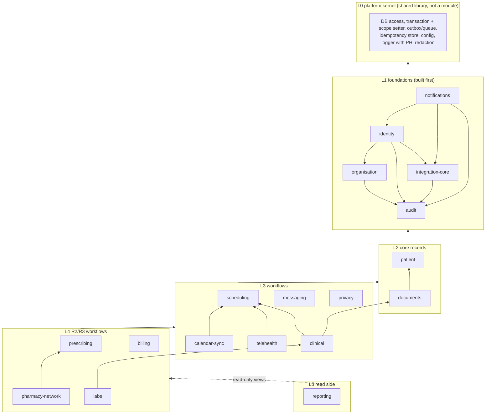
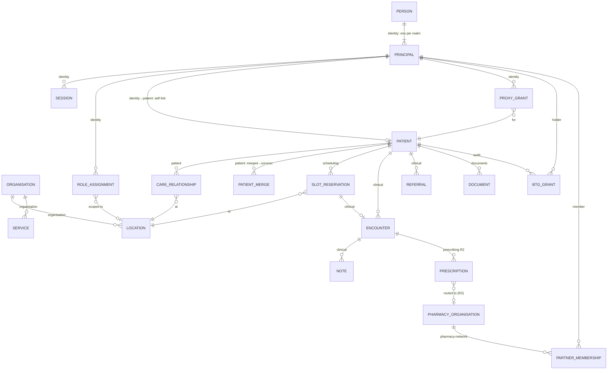

# SHARED BOUNDARIES — Enterprise EHR Platform (Stage 2, post-G1)

| Field | Value |
| --- | --- |
| Task | HEAAA-12 `[SDLC:shared-boundaries]` |
| Author | Solution Architect agent (`7efe9f61-495f-4237-82f9-fa178629da09`) |
| Version | **Shared boundaries draft 1** |
| Approved inputs (G1) | HEAAA-11 `prd` rev `bba336f3-e934-4dbb-9158-0909fda132d7` (PRD revision 3, `docs/PRD.md` @ `f8d3d6e`, identical to `879d084`); HEAAA-11 `architecture` rev `f2d240e4-2f63-45a1-aaa1-16a1f8854c32` (ARCHITECTURE draft 4, `docs/ARCHITECTURE.md` @ `f8d3d6e`, identical to `8eaeca7`). Human acceptance: confirmations `cadd7751` (PRD) and `009ac8a9` (ARCHITECTURE), accepted 2026-11-04 22:03Z by user `YxilrdnzIdVdgOsk0nDAwBd3tSAoN5YT`. |
| Status | **DRAFT 1. Not yet independently reviewed. Not human-approved.** Reviewer for this task: Solution Architect Reviewer (`338c0bb5`). Sections 7 and 10.1 (identity path B) also need Cybersecurity review before G2 (SAR-15). |
| Review round | Round 1 of 3 (cumulative) for this artifact. |
| Scope | Detailed design only, as G1 authorises. This document fixes boundaries; it contains no ERD columns, migrations, endpoint schemas or code. Those come in HEAAA-13 and must conform to this document. |

## 0. How to read this

G1 approved the direction: the shape of the system, its modules, trust zones and main technology choices (ARCHITECTURE draft 4). Four lanes now plan in parallel: technical design (HEAAA-13), UX (HEAAA-14), QA (HEAAA-15) and DevOps (HEAAA-16). They can only work in parallel if the things they all depend on are fixed first. This document fixes those things, in the order G1 requires:

1. **Data first (section 4):** which module owns which data, the keys every row carries for access scoping, and how one module may refer to another's data.
2. **Modules second (section 3):** the final module list, which module may call which, and the rules that stop cycles.
3. **Interfaces third (sections 5, 6 and 8):** origins and route prefixes, who may call them, the shared conventions for every API, and the cross-cutting contracts (audit, jobs, notifications, alerts, scope).

Each fixed decision has a stable ID (`BD-nn`). Later lanes cite the ID. Changing a `BD` needs a new revision of this document, a re-review, and a notice to every lane listed as a consumer (section 11).

Labels: **Fixed** (a boundary decision in this draft, binding on HEAAA-13..16 once reviewed), **Constraint** (carried from G1), **Proposal** (an Architect proposal another lane or a human must confirm), **Open** (needs a human or vendor answer), **Unverified** (a technical claim not yet tested).

## 1. Summary for the decision-maker

1. **The G1 direction does not change.** The design still has one application with strict internal modules, one PostgreSQL database, and the same hosting, trust zones and costs as G1. There are no new modules and no new deployables.
2. **One G1 default changes the identity design: admins get their own sign-in (path B).** G1 was approved without choosing a SEC-D-19 path. The stated default is path B: admin and compliance users sign in through a **separate admin user pool** with mandatory security keys, not through Google. Section 7 gives the boundary design for it. It costs about **2–4 engineer-weeks** (path A would have been 1–2). It adds **US$0–200/month, possibly up to US$1,000/month** if the identity replication add-on is charged per pool (SAR-16, unverified). That would move the expected R1 run cost from US$13,750 to between US$13,750 and US$14,750 a month. **If the owner prefers path A, say so before HEAAA-13 freezes the identity data model.** Switching is cheap now and expensive after build. Most of the design (approvals in code, kill switch, elevation window) is the same on both paths.
3. **Every row of patient data carries the same scope keys.** Together with one shared scope contract (section 6), this lets PostgreSQL row-level security work the same way in every module. This is the boundary most expensive to change later, so it is fixed now.
4. **Three gaps from the G1 reviews are closed at boundary level.** Referrals belong to `clinical` (AL-R2-01). Integration settings and their write-only secrets belong to `integration-core`, through a narrow write path (AL-R2-02). Patient merge has one owner and one protocol that every module follows (BR-37).
5. **Three things need a human answer. None of them stops design work:**
   - **D-2, which states the platform operates in.** There is no safe default. The design carries states as data, so the licensing checks can be built and tested with synthetic states, but RA-R1-28 cannot pass on real data until the states are named.
   - **D-31, the owner's restatement in their own words.** The PRD says G1 is not complete without it, and the G1 task holds no record of it. Section 12 lists this for the Orchestrator.
   - **BQ-1, cross-location chart visibility.** Whether staff at Clinic A see the notes Clinic B wrote for a patient they share. Section 6.3 states the default this design uses.

## 2. Baseline in effect

### 2.1 G1 decisions as they now apply

The G1 confirmations said the owner's approval covers the open decisions **with their stated defaults if undecided**. No human recorded a different answer on any task (checked on HEAAA-1..47, 2026-11-04). So the following defaults are in effect. A default is not an owner choice in the owner's own words. If the owner later decides otherwise, the affected `BD` reopens.

| Decision | In effect (PRD default) | Boundary consequence |
| --- | --- | --- |
| D-1 build vs buy | Custom build; quote-only vendor contact allowed | ARCHITECTURE stays valid (A-11) |
| D-2 operating states | **No default** | States are reference data (BD-17). Licensing rules can be built, but RA-R1-28 is blocked until real states exist |
| D-3 fees | Block-only R1; fee fields stored, not charged | `organisation` stores price and fee fields; `billing` arrives in R2 |
| D-4 lab sample booking | Not in R1 | No `labs` data in R1 |
| D-5 patient messaging | Staff messaging R1; patient messaging S | `messaging` designs both thread types; patient threads can be switched off by flag |
| D-6 visit summary | R2 | No patient-facing clinical read model in R1 |
| D-7 proxy view | Appointments only | Proxy scope = appointment data only (BD-06) |
| D-15 Part 2 data | No Part 2 data | No per-class key; data classes allow adding one (BD-13) |
| D-19 admin and address | Admin has no address access | Admin realm has no PHI by default (BD-05) |
| D-24 Rx channel | Network for every prescription | `pharmacy-network` holds a mirror, never the dispensing record |
| D-26 region loss | In scope | Admin pool needs regional recovery too (section 7.4) |
| D-27 FHIR | No external FHIR API before R4 | No FHIR route in R1–R3 (section 8) |
| D-30 hosting | Design continues on AWS | AWS service names below are planning names |
| D-32..D-34 | Adopted as written | BR-37 merge (BD-14), coded data (BD-16), TL-1 (BD-17) |
| **D-35 SEC-D-19 path** | **Path B: separate admin user pool** | Section 7; SAR-15 design work starts here |

### 2.2 What this document does not change

ARCHITECTURE draft 4 sections 3 (topology and deployables), 5 (flows), 7 (technology), 8.1 (trust zones, apart from the path B delta in section 10), 9 (capacity) and 10 (cost, apart from the path B delta) stand as approved. ARCHITECTURE.md itself is not edited here. HEAAA-13 produces the G2 version of ARCHITECTURE.md, which folds in this document.

## 3. Modules (step 2 of the order, fixed after the data owners in section 4)

### 3.1 Module catalogue (BD-01, Fixed)

The module list is ARCHITECTURE section 4, unchanged. This table only **adds owners for data that G1 left without one**. "Added" rows are new in this draft.

| Module | Owns, as approved at G1 | Added owner assignments (this draft) | Rel |
| --- | --- | --- | --- |
| `audit` | Audit events, anchors, BTG events, export jobs | **BTG access grants** (the active grant that widens a scope, BD-06) | R1 |
| `integration-core` | Outbound/inbound logs, idempotency of inbound messages, retry state | **Integration connection settings** and **secret references** (AL-R2-02, BD-11); vendor adapters | R1 |
| `organisation` | Organisation, locations, rooms, hours, holidays, services, policies, flags, templates | **US jurisdictions and operating-state list** (D-2, BD-17); questionnaire and consent **templates**; service **prices and fee fields** (D-3) | R1 |
| `identity` | Principals, sessions, roles, locations, proxy grants, staff profile with licensed states, SEC-D-19 data | **Person** (links one human's principals across realms, BD-05); **admin realm principals** (path B); permission catalogue | R1 |
| `notifications` | Templates, jobs, receipts, preferences, staff alerts | Alert stream endpoint (SSE) | R1 |
| `patient` | Demographics, contacts, proxies' patient side, consents, preferences, care relationships, preferred pharmacy | **Insurance coverage and manual eligibility status** (RA-R1-29); **care-team membership**; **merge map** (BD-14) | R1 |
| `scheduling` | Templates, busy blocks, reservations, waitlist, check-ins, queue | **Follow-up bookings** (RA-R1-30, booking part) | R1 |
| `calendar-sync` | Calendar links, sync tokens, watch channels | — | R1 |
| `telehealth` | Video sessions, device checks, waiting room | Patient-confirmed location at join (TL-1) | R1 |
| `clinical` | Encounters, notes, addenda, co-signatures, problems, allergies, medications, vitals, triage, immunisations | **Referrals** (AL-R2-01); **pre-visit questionnaire responses** (they feed triage and red flags); **terminology reference data** (BD-16) | R1 |
| `documents` | Document metadata, versions, classification, holds, retention | **Signed-consent and e-signature artefacts** (files only; the consent record stays in `patient`) | R1 |
| `messaging` | Threads, messages, tasks | — | R1 |
| `privacy` | Privacy requests | Export assembly through an export-contributor interface (BD-02) | R1 |
| `reporting` | Read models | Operations dashboard read model, fed by `integration-core` | R1 |
| `cms` | Public content in the marketing account | — (not part of the monolith) | R1 |
| `prescribing` | Prescriptions, overrides, check outcomes, refill requests | — | R2 |
| `pharmacy-network` | Directory cache, partner organisations, Rx routing, fulfilment, hand-over, delivery events, API clients | **Partner membership** (principal → pharmacy organisation, role). Partner *principals and sessions* stay in `identity` | R2/R3 |
| `billing` | Invoices, payments (tokens), refunds | — | R2 |
| `labs` | Orders, specimens, results, acknowledgements, reconciliation | — | R3 |

Two overlaps in ARCHITECTURE section 4 are resolved here:

- "Partner users" appeared under both `identity` and `pharmacy-network`. **`identity` owns the principal, credentials link and sessions. `pharmacy-network` owns membership** (which pharmacy organisation a principal belongs to, and its role there).
- "BTG" appeared under `audit` (events, workflow) and as a scope input in `identity`. **`audit` owns the BTG grant and its review.** `identity` reads it only through the scope-contributor interface (BD-02).

### 3.2 Dependency direction (BD-02, Fixed)

Modules call each other **downwards only**, in process, through the called module's public service interface. A module never reads or writes another module's tables. Upward communication uses **domain events written to the outbox** in the same transaction (BD-09), consumed by the higher module's handler.

Rules:

1. **No cycles.** A module may call any module in a lower layer. Calls within one layer are allowed only along the drawn edges (for example `documents` → `patient`, so `patient` refers to documents by ID and never calls `documents`). L1 modules that need to raise an alert (`identity`, `audit`) emit an event that `notifications` consumes, instead of calling it. CI fails an import that points upwards or sideways without an entry in the allowed-edge list. The tool (for example dependency-cruiser or eslint-plugin-boundaries) is chosen at G2. The allowed edges are the arrows above, plus any edge HEAAA-13 adds with a reason.
2. **Inversion where a low module needs data from a high one.** `identity` builds the request scope (BD-06) but must not import `patient`, `audit` or `pharmacy-network`. It defines a **scope-contributor interface**. `patient` (care relationships, care team), `audit` (active BTG grants) and `pharmacy-network` (membership) register contributors. The same pattern serves **`privacy` export** (each module registers an export contributor) and **patient merge** (each module registers a merge participant, BD-14).
3. **The authorization guard is cross-cutting.** `identity` provides the deny-by-default guard (BD-07) and the API layer applies it to every route of every module. Applying the guard does not count as a module dependency.
4. **`reporting` only reads.** It reads through database views or read models that the owning module publishes. Nothing depends on `reporting`.
5. **`calendar-sync` depends on `scheduling`, not the reverse.** `scheduling` emits `scheduling.reservation_confirmed`/`_cancelled` events. `calendar-sync` writes Google busy events and feeds busy blocks back through `scheduling`'s interface.

## 4. Data ownership (step 1 of the order)

### 4.1 Physical layout (BD-03, Fixed)

- One PostgreSQL database (Constraint, ADR-002). **One schema per module**, named after the module (`identity`, `scheduling`, …), plus `kernel` for the outbox, queue and idempotency store. A schema shows ownership. The import-boundary check in CI and code review enforce it. The database does not enforce per-module write rights, because one application role serves all modules (a role per module was considered and rejected: it adds pool complexity for little gain inside one codebase).
- **Engine: PostgreSQL 17 or later** (narrows G1's "16+"). Version 17 adds `transaction_timeout`, which closes SAR-10 at the source (section 9). **Unverified:** the RDS for PostgreSQL 17 minor version and parameter support are confirmed by DevOps at G2.
- **Cross-module foreign keys** may point only at the **published root keys** in 4.2, with `ON DELETE RESTRICT`. They never cascade across modules. Any other cross-module reference is an ID column without a foreign key, resolved through the owner's interface.
- **No hard delete of clinical or audit data.** Retention follows the longest legal minimum (Constraint). "Account deletion" (D-8) removes sign-in credentials and non-record data in `identity` and `notifications`. Records stay.

### 4.2 Published root keys and scope keys (BD-04, Fixed)

Root keys may be referenced by other modules:

| Root entity | Owner | Referenced by |
| --- | --- | --- |
| `organisation` | `organisation` | every scoped row |
| `location` | `organisation` | identity (role/location assignment), patient (care relationship), scheduling, clinical, documents, … |
| `service` | `organisation` | scheduling, billing |
| `person`, `principal` | `identity` | every actor column (`created_by`, `signed_by`, …) |
| `patient` | `patient` | every PHI row |
| `slot_reservation` (appointment) | `scheduling` | telehealth, clinical (encounter), billing |
| `encounter` | `clinical` | prescribing, labs, documents |
| `document` | `documents` | clinical, patient (insurance card images), privacy |
| `prescription` | `prescribing` (R2) | pharmacy-network |
| `pharmacy_organisation` | `pharmacy-network` (R2) | prescribing (routing), patient (preferred pharmacy holds an NCPDP ID, not a foreign key, because R1 has no directory) |

**Scope keys.** Every table that holds PHI or pharmacy-tenant data carries, as non-null columns where the concept applies:

| Column | On which rows | Why |
| --- | --- | --- |
| `organisation_id` | every PHI and tenant row | Organisation boundary (TB3). Kept although R1–R3 run one organisation; the cost is one indexed UUID per row |
| `patient_id` | every row about a patient, **denormalised** onto child rows (for example note addenda carry it too) | Row-level security needs it without joins (BD-06) |
| `location_id` | rows created at a location (reservation, encounter, check-in, triage) | Location reports and location-bound rules |
| `pharmacy_org_id` | pharmacy-tenant rows (R2+) | Tenant boundary (TB4) |

HEAAA-13 defines the indexes. Every RLS predicate column must lead an index on its table (section 9.2 of ARCHITECTURE: RLS cost is measured in the load test).

### 4.3 Context ERD (ownership view)

This diagram shows root entities, ownership and the cross-module references allowed by BD-03. It is not the detailed ERD (HEAAA-13).

## 5. Interface map (step 3 of the order)

### 5.1 Origins, routes and callers (BD-12, Fixed)

All hosts sit behind CloudFront and WAF (Constraint, ADR-005). `/api/*` is never cached.

| Host | Route prefix | Caller | Authentication | Serves modules |
| --- | --- | --- | --- | --- |
| `my.` | `/api/v1/*` | Patient or proxy browser | `__Host-` session, audience `patient`, realm `patient_pool` | patient, scheduling, telehealth, documents, messaging (if D-5), notifications (preferences), privacy; R2 prescribing (status read), billing; R3 labs (released results), pharmacy-network (delivery status read) |
| `staff.` | `/api/v1/*` | Clinic staff browser | `__Host-` session, audience `staff`, realm `google` | all clinical and front-desk modules; `notifications` alert stream at `/api/v1/alerts/stream` (SSE) |
| `staff.` | `/api/v1/admin/*` | Admin and compliance browser | `__Host-` session, audience `staff`, **realm `admin_pool`** (path B); privileged actions also need an elevation grant (BD-05) | identity (users, roles, approvals), organisation (configuration), audit (viewer, export, BTG review), integration-core (settings), privacy (request queue), reporting |
| `pharmacy.` | `/api/v1/*` | Partner pharmacy browser | `__Host-` session, audience `partner`, realm `partner_pool` | pharmacy-network (R2) |
| `integrations.` | `/partner/v1/*` | Partner pharmacy systems (R3) | OAuth 2.0 client credentials + HMAC signature or mTLS; no cookies | pharmacy-network |
| `integrations.` | `/webhooks/{vendor}/*` | Vendors (e-Rx, video, messaging receipts, Google push, payments) | Vendor signature + replay window; no cookies | integration-core, which hands the message to the owning module |
| `integrations.` | `/public/v1/*` | The `site` server in the marketing account (server to server) | None. GET only, PHI-free, rate-limited, CDN-cacheable for up to 60 s | organisation (directory, services, locations), scheduling (next available slot per doctor) |
| `www.`, `cms.` | own | Visitors, marketing staff | CMS SSO (separate OAuth client) | `cms` (separate deployable) |

Notes:

- **Public read API placement (Proposal for review).** ARCHITECTURE leaves the host of the "public PHI-free read API" open. This draft puts it on `integrations.` under its own path and WAF rule group. Browsers never call it, so no portal origin gets a CORS rule. The `site` server fetches it during rendering (ISR). The "next available slot" on the brand site is therefore up to 60 seconds old. The booking hand-off re-checks it on `my.`. The alternative is a separate `public-api.` host. That costs one more certificate and WAF rule set, with no other difference.
- **Admin routes stay on `staff.` (path B).** Section 7.2 explains why there is no separate `admin.` origin.
- **Realtime is limited to staff alerts (SSE).** No WebSockets. Patient and partner portals poll (Constraint, ADR-009; WORKFLOW: realtime only for an approved need).

### 5.2 API conventions every module follows (BD-15, Fixed)

| ID | Convention |
| --- | --- |
| CN-01 | REST over HTTPS with JSON bodies. **One OpenAPI 3.1 document per module** in the repository (proposed path `contracts/openapi/<module>.yaml`), the single source of truth. Client and server types are generated from it. HEAAA-13 writes the R1 contracts. |
| CN-02 | URI major version (`/v1`). Breaking changes create `/v2` alongside; the old version stays for at least one release (NFR-5). Additive changes need no new version. |
| CN-03 | Errors use RFC 9457 `application/problem+json` with a stable `code` (`<module>.<reason>`, for example `scheduling.slot_taken`), `status`, a human `title`, and `requestId`. **No PHI in any error field.** Validation errors list field paths, never values. |
| CN-04 | Authorization failures: `401` when there is no valid session; `403` with code `auth.forbidden` when the session is valid but the action is not allowed; **`404` when the resource exists but is outside the caller's scope**, so callers cannot probe for records (RA-R1-17). Every denial is audited (BD-08). |
| CN-05 | **No PHI in URLs.** Paths carry only random IDs. Searches that use names, dates of birth, phone numbers or emails are `POST …/search` with the terms in the body. |
| CN-06 | `Idempotency-Key` header (UUID) **required** on every POST that creates a side effect (holds, confirmations, payments, signing, messages, uploads). The key is stored per principal for 24 hours with a hash of the request. A replay returns the first response. The same key with a different body returns `409 kernel.idempotency_conflict`. |
| CN-07 | Optimistic concurrency on mutable records: responses carry `ETag` (row version); updates require `If-Match`; a stale version returns `412`. Signed and locked records are immutable; changes are new records (addenda, new prescription). |
| CN-08 | Pagination by opaque cursor: `?cursor=…&limit=…`, `limit` at most 100 (default 25). Responses return `nextCursor`. No offset pagination on PHI lists. |
| CN-09 | Time is RFC 3339 UTC (`Z`). Every location-bound resource also returns the location's IANA time zone. Clients convert for display (NFR-22). |
| CN-10 | `Cache-Control: no-store` on every `/api/*` and `/partner/*` response. Public `/public/v1/*` responses may set `max-age` of 60 or less. |
| CN-11 | Rate limits per principal and per IP, answered with `429` and `Retry-After`. The limits are set by the WAF and the API in HEAAA-13 and the DevOps plan. |
| CN-12 | Request size limits: JSON body 1 MB by default. Uploads never pass through the API; they use pre-signed URLs (ARCHITECTURE 5.5). Unknown JSON fields are rejected on `integrations.` and ignored on portal routes. |
| CN-13 | Every request has a `requestId` (generated at the edge or the API, returned in a header). It is written to logs, traces and audit events. |

## 6. Access scope contract (BD-06, Fixed)

This is the shared contract between the API policy layer and PostgreSQL row-level security (ADR-013). Every module's RLS policies read the same transaction settings. The kernel sets them with `SET LOCAL` at the start of every transaction, from the server-side session only.

### 6.1 Transaction settings

| Setting | Values | Set from |
| --- | --- | --- |
| `app.org_id` | UUID | Session |
| `app.audience` | `patient` · `staff` · `partner` · `system` | Request host (API) or worker role |
| `app.realm` | `patient_pool` · `google` · `admin_pool` · `partner_pool` · `worker` | Session |
| `app.principal_id`, `app.person_id` | UUID | Session |
| `app.patient_ids` | UUID array: the patient's own ID plus active proxy grants (patient audience only) | `identity` proxy grants |
| `app.proxy_patient_ids` | Subset of the above that is proxy-only; RLS limits these to appointment data (D-7 default) | `identity` |
| `app.location_ids` | UUID array from the principal's role assignments (staff only) | `identity` |
| `app.pharmacy_org_id` | UUID (partner only) | `pharmacy-network` contributor |
| `app.btg_patient_ids` | UUID array of patients with an active BTG grant held by this principal | `audit` contributor |
| `app.phi_access` | `on` · `off`. `off` for the admin realm (C5) | Realm |

Missing settings fail closed: every policy treats a missing setting as "no rows". The application roles do not own the tables and have no `BYPASSRLS` (Constraint).

### 6.2 Database roles (Fixed)

| Role | Used by | Rights |
| --- | --- | --- |
| `app_owner` | Migrations only (CI) | Owns all schemas except the audit hot store's grants below |
| `app_api` | `api` deployable | DML on module schemas under RLS; audit INSERT + SELECT only; **cannot set `app.audience = system`** (a policy checks `current_user`) |
| `app_worker` | `worker` deployable | Like `app_api`, and may use audience `system`. Jobs narrow their scope to the job's organisation and patient wherever the job concerns one patient |
| `audit_archiver` | Protected CI job with a second approver | Detach and drop verified audit partitions only (ARCHITECTURE section 6) |
| `reporting_ro` | Reporting read models, BI later | SELECT on published views only |

### 6.3 Who sees what (the shape of the policies)

| Audience / realm | Row is visible when |
| --- | --- |
| patient | `patient_id = ANY(app.patient_ids)`, and for proxy-only patients only on appointment rows (D-7) |
| staff / google | the patient has a **care relationship** with any location in `app.location_ids`, **or** `patient_id = ANY(app.btg_patient_ids)` |
| staff / admin_pool | no PHI rows (`app.phi_access = off`), except `patient_id = ANY(app.btg_patient_ids)`; configuration and audit-metadata rows are visible |
| partner | `pharmacy_org_id = app.pharmacy_org_id` |
| system (worker) | the job's organisation, narrowed to the job's patient where set |

**Two layers, two jobs.** RLS enforces the organisation, location, patient-self, proxy, pharmacy-tenant and BTG boundaries. The **API policy layer** additionally enforces role and **assignment** (for example "doctor sees assigned patients only"; BA matrix), because assignment rules change often and are too fine-grained for RLS. Negative tests cover both layers (RA-R1-17).

**BQ-1 (Open, for PM).** The rule above lets staff at Clinic A see the whole chart of a patient who has a care relationship with Clinic A, including notes written at Clinic B. Most single-organisation networks work this way for continuity of care. If the owner wants location-bound notes instead, policies on clinical rows use the row's `location_id`. That is a policy change in HEAAA-13, not a data model change.

### 6.4 Authorization policy (BD-07, Fixed)

- Permissions are named `<module>.<resource>.<action>` (for example `clinical.note.sign`). Each module **declares** its permissions in a registry. `identity` owns the catalogue and the role-to-permission mapping. The BA matrix is the starting role list and stays a proposal until G2.
- Every route declares its permission and a **resource-scope resolver** (which patient, location or pharmacy organisation the request touches). The guard denies a route that has no declaration. A CI test lists every route and fails on an undeclared one.
- Decisions use the server-side session and the scope settings in 6.1 only, never values sent by the client.
- Policy code is an ASVS L3 path (NFR-14). It is owned by `identity` and reviewed by the Security Reviewer.

## 7. Identity realms under path B (BD-05, Fixed for design; needs Cybersecurity review)

### 7.1 Realms

| Realm | Who | Identity provider | Second factor | Session audience |
| --- | --- | --- | --- | --- |
| `patient_pool` | Patients, proxies | Managed user pool (Cognito Essentials, planning name) | Passkey or email OTP preferred; SMS fallback (Constraint) | `patient` on `my.` |
| `partner_pool` | Partner pharmacy users (R2) | Separate managed user pool | MFA mandatory | `partner` on `pharmacy.` |
| `google` | All clinic staff, including billing staff | Google Workspace OIDC | Workspace 2SV (SEC-D-04) | `staff` on `staff.` |
| **`admin_pool`** (path B) | Admin and compliance roles (and R2 billing-admin) | **Separate managed user pool** | **WebAuthn security key, mandatory, user verification required** | `staff` on `staff.`, admin routes only |

### 7.2 Boundary rules (Fixed)

1. **Privileged roles exist only in `admin_pool`.** The privileged roles are every role that can assign roles, change configuration or policy, read audit data, export data, or approve or review break-the-glass (ARCHITECTURE 8.4). A `google` principal can never hold them. An `admin_pool` principal can never hold a clinical role.
2. **Person link.** A human with both a staff identity and an admin identity has one `person` record with two principals. **Every "different person" rule compares `person_id`, not `principal_id`.** Examples are C4 (approver differs from requester and subject) and self-BTG review. Linking two principals to one person is itself a privileged change that needs a second approver (C4).
3. **No PHI by default in the admin realm (C5).** `app.phi_access = off`. Access to a patient's data is a BTG with a reason and a compliance alert. SA-F-19 is resolved accordingly: **patient merge is a staff-realm permission (`patient.merge`), never an admin-realm one** (BD-14).
4. **One origin, one session per browser.** The admin sign-in is a second sign-in path on `staff.`. The session records its realm. Changing realm means signing out and in again; there are never two concurrent sessions in one browser on `staff.`. A separate `admin.` origin was considered. It would give admins their own cookie jar and CSP, but it adds a fifth PHI-adjacent origin to ADR-005 and to the WAF, certificate and CSP work. The realm check on every admin route gives the same separation of authority. **Cybersecurity may ask for the separate origin;** that would be a DevOps and UX change, not a data change.
5. **Elevation grant kept on path B.** A privileged action needs a server-side elevation grant, bound to the session and short-lived (planning value 15 minutes; final value in HEAAA-13). On path B the grant is issued after a **fresh WebAuthn assertion in the admin pool**, checked through the token's authentication time. That keeps RA-R1-32 (C1) testable on path B. **Unverified:** that the admin pool's ID token carries a reliable `auth_time` after a passkey sign-in; HEAAA-13 tests it. The fallback is that the API issues its own WebAuthn challenge against the credential registered in the pool.
6. **Path-independent parts.** C4 (request and approval rows, expiry, approver-set changes), C6 (kill switch, same-day deprovisioning), C5 and C7 are the same on both paths. HEAAA-13 designs them once.
7. **Bootstrap.** The first two admin principals per environment are created through a dual-controlled, audited runbook (C4; DevOps plan).
8. **Leaver detection (Proposal for Cybersecurity).** On path B, Workspace no longer guards admin roles (C2/C3 no longer apply to them). A person who leaves still has an admin-pool identity until the C6 runbook runs. Proposal: keep the **read-only Workspace directory crossing** from ARCHITECTURE 8.1 for one purpose only. If the person's staff identity is suspended or deleted, the hourly check disables the linked admin principal and revokes its sessions. A person with no staff identity (an external admin) relies on the runbook alone. Cybersecurity decides whether this backstop is required.

### 7.3 Owner switch to path A

If the owner chooses path A before HEAAA-13 freezes the identity ERD: drop the `admin_pool` realm and rule 4. Privileged roles then move to `google` principals with C1–C3. The person link, elevation grant, C4–C7 data and routes stay. After build, the switch costs roughly the path B build delta (ARCHITECTURE ADR-011).

### 7.4 Regional recovery and cost of the admin pool

The admin pool needs the same multi-Region replication as the other pools, because region loss is in scope (D-26). In the replica, password reset and profile changes are disabled (ARCHITECTURE 7). Passkey sign-in in the replica is **unverified** and is part of the DR rehearsal (DEP-16). If security keys do not work in the replica, admins cannot elevate during a region failover. Clinical work continues, but configuration changes wait. The DevOps plan states whether that is acceptable during the 4-hour RTO.

Cost (Unverified, SAR-16): the pool has a few dozen users, so its MAU fee is small. The replication add-on is priced at US$200 / 400 / 1,000 per month in ARCHITECTURE A-12. If that is charged per pool, path B adds that much again. Both the per-pool question and the price must be answered before G2 (DevOps plan, G2 cost check).

## 8. Cross-cutting contracts (Fixed)

### 8.1 Audit event envelope (BD-08)

Every PHI read or write calls `audit.record()` **inside the same transaction** (ARCHITECTURE 6). Denied attempts are recorded too.

| Field | Content |
| --- | --- |
| `event_id`, `occurred_at` | UUID; database commit-time clock |
| `request_id` | From CN-13; `null` for worker jobs, which use `job_id` instead |
| `actor_principal_id`, `actor_person_id`, `realm`, `audience` | From the scope settings |
| `action` | Closed list: `view`, `search`, `create`, `update`, `sign`, `cosign`, `addend`, `export`, `print`, `download`, `merge`, `btg_open`, `btg_review`, `config_change`, `role_change_request`, `role_change_decision`, `elevation`, `sign_in`, `sign_out`, `session_revoke`, `denied`. HEAAA-13 may add entries |
| `resource_type`, `resource_id` | Module-qualified type (`clinical.note`) and ID |
| `patient_id`, `location_id`, `organisation_id` | Scope keys where they apply |
| `reason` | Required for BTG and export |
| `ip`, `user_agent` | Recorded as received (NFR-13). They count as PHI-adjacent and never leave the audit store, apart from audited exports |
| `change` | For configuration and role changes only: before and after, **with secret fields replaced by the secret's version ID** (BD-11) |
| `outcome` | `allowed` or `denied` |

No clinical values go into audit rows. The audit store records *that* a note was viewed, not its text.

### 8.2 Outbox, jobs and domain events (BD-09)

- One queue in the `kernel` schema (pg-boss or Graphile Worker, chosen at G2). Jobs and domain events are inserted **in the same transaction** as the business change.
- Job and event names: `<module>.<past-tense event>` for events (`scheduling.reservation_confirmed`), `<module>.<verb_noun>` for jobs (`notifications.send_message`).
- **Payloads carry IDs and scope keys only, never PHI values.** Handlers load data through the owner's interface under the job's scope.
- Every handler is idempotent and keyed by `idempotency_key`. Retries use exponential back-off with a maximum attempt count per job type. Exhausted jobs go to a dead-letter state shown in the `integration-core` operations view (BR-33, NFR-21).
- Ordering: no global ordering. Where order matters (pharmacy status, BR-24), the consumer applies the monotonic rank rule, not queue order.

### 8.3 Notifications (BD-10)

- Modules call `notifications.send(templateKey, recipientRef, variables)`. Each template declares a **variable schema** drawn from an allowlist of non-clinical types: date and time, location display name, the service's **neutral display name** (BR-23 extension), portal link. A template cannot bind a free-text field from another module.
- **BQ-2 (Open, for PM):** whether a clinician's display name may appear in messages. A clinician's name can reveal a speciality. Until PM decides, the allowlist excludes it.
- Staff alerts (red flag, BTG, R3 critical results) are durable `staff_alert` rows owned by `notifications`. The flow is row, then `NOTIFY`, then SSE on `staff./api/v1/alerts/stream` (ADR-009). Escalation timers are `notifications` jobs.

### 8.4 Identifiers and time (BD-15, continued)

- Primary keys are UUIDs generated in the application (version 7 preferred for index locality). They are not a security control (ARCHITECTURE 6).
- Human-facing identifiers (for example a medical record number) are separate columns owned by the module, never used in URLs.
- All timestamps are `timestamptz` in UTC. Every location has an IANA time zone (NFR-22).

## 9. Boundary-level answers to carried findings

| ID | Sev | Finding | Disposition in this draft | Closed where |
| --- | --- | --- | --- | --- |
| SAR-09 | Low | Expiring stale holds covers the doctor only, not the room | Boundary rule for `scheduling`: the inserting transaction expires overlapping stale holds **on the doctor and on the room** before inserting. HEAAA-13 writes the exact statements and the race test | HEAAA-13 |
| SAR-10 | Low | Audit watermark not bounded by the timeouts | PostgreSQL 17+ (BD-03) with `transaction_timeout` set on `app_api` and `app_worker` below the 2-minute watermark (planning value 60 s). Rows that still arrive late are flagged and anchored next (ARCHITECTURE 6) | HEAAA-13 and DevOps plan |
| SAR-11 | Low | Site/CMS missing from region-loss table and availability target | Proposal: NFR-1..3 do not apply to `www.`/`cms.` (PRD NFR-1 names the patient and doctor portals). Booking still works directly on `my.`. CMS database backups are copied to the recovery Region (small cost). PM confirms the NFR scope | DevOps plan; PM |
| SAR-15 | Low | Path B reopens the identity design | Section 7 gives the path B boundary. The detailed design is in HEAAA-13. **Cybersecurity and the Solution Architect Reviewer review it before G2** | HEAAA-13; review routing by Orchestrator |
| SAR-16 | Low | Path B cost may be understated; Workspace edition unknown | Section 7.4. The Workspace edition question now concerns only staff 2SV (SEC-D-04), because admins no longer use Google on path B | DevOps plan, G2 cost check |
| SA-F-18 | Low | RA-R1-32 C1 wording assumes path A | Rule 7.2.5 keeps an elevation grant on path B, so the RA-R1-32 C1 test stays meaningful with one wording change: "app-enrolled WebAuthn credential" becomes "WebAuthn credential enrolled in the admin realm". RA-R1-01's "security keys recommended for admins" no longer applies to admins on path B | PM (PRD erratum) |
| SA-F-19 | Low | D-32 fallback has an admin merging | Rule 7.2.3: merge is a staff-realm permission | PM (PRD erratum, only if D-22 trim happens) |
| AL-R2-01 | — | No owner for referrals | `clinical` (BD-01) | Closed here, pending review |
| AL-R2-02 | — | Write path for integration secrets | BD-11 | Closed at boundary level; IAM detail in HEAAA-13 and the DevOps plan |
| AL-R2-03 | — | §18.2 uses old ID for D-35 | Erratum, folded into the G2 ARCHITECTURE revision (HEAAA-13) | HEAAA-13 |

### 9.1 Integration settings and secrets (BD-11, Fixed)

- `integration-core` owns each integration connection: non-secret settings, health status, last test result, and **references** to secrets (secret name and current version ID). Secret values live only in the cloud secret store (Secrets Manager, planning name).
- **Write path:** an admin-realm principal with an active elevation grant calls `PUT /api/v1/admin/integrations/{id}/secrets/{name}`. The `api` task role may **put** values only under the integration-secret path prefix for its environment. The API never returns a secret value, logs it, or writes it to audit. Audit records the new version ID (BD-08).
- **Read path:** adapters in `api` and `worker` read secrets at use, with caching of at most 5 minutes so that rotation takes effect.
- "Test connection" runs the adapter's health call and stores the result. It never echoes the credential.

### 9.2 Patient merge (BD-14, Fixed)

- `patient` owns the merge request, its approval and the **merge map** (merged patient → survivor). Permission `patient.merge` is held only by staff-realm roles (BQ-3 below for which ones).
- Merge runs in **one database transaction**. `patient` calls every registered merge participant (each module with patient rows). **Mutable rows** (appointments not yet past, care relationships, preferences, open tasks) are re-pointed to the survivor. **Immutable rows** (signed notes, signed prescriptions, audit events, released results) keep their original `patient_id`. Reads resolve them through the merge map, so the survivor's chart shows both histories (RA-R1-27).
- The merge is audited (`merge` action) with both IDs and the list of re-pointed resource types. "Reversible by audit trail" (PRD 7.3) means an unmerge procedure can restore the re-pointed rows from that record. Whether an unmerge is built in R1 is a HEAAA-13 question for PM.
- RLS treats a merged patient ID as the survivor through the merge map in the scope contributor.
- **BQ-3 (Open, for PM):** which staff roles hold `patient.merge`. The BA matrix has no row for it. Proposal: front desk lead and medical records roles, with a second staff approver for merges that involve clinical data.

### 9.3 Data classification (BD-13, Fixed)

| Class | Examples | Rule |
| --- | --- | --- |
| C0 Public | Services, locations, doctor directory, CMS content | May reach the marketing account and caches |
| C1 Internal | Configuration, templates, non-PHI operational data | Production account only |
| C2 PHI | Every patient-linked row, audit rows, documents | RLS, encryption at rest, no logs, URLs, analytics or message bodies |
| C3 Sensitive PHI | Reserved for 42 CFR Part 2 (none under D-15) and state-protected categories (unknown until D-2) | Adds segmentation and a separate key when it applies. The class exists now so the data model can tag columns later without a redesign |
| CS Secret | Credentials, tokens, keys | Secret store only (BD-11) |

HEAAA-13 tags every table, and every column that departs from its table's class, with a class.

### 9.4 Terminology and jurisdictions (BD-16, BD-17, Fixed)

- **BD-16:** `clinical` owns terminology reference tables (RxNorm, SNOMED CT US Edition and/or ICD-10-CM, LOINC, and CVX for immunisations), loaded from licensed releases by a worker job, and read by other modules through its lookup interface. **Open input:** an NLM UMLS licence account is needed before R1 data entry. The owner applies; it has no fee for US use (ARCHITECTURE 6). This is not yet in the PRD dependency list, so it is reported to the Orchestrator.
- **BD-17:** `organisation` owns the list of US jurisdictions and the operating-state configuration (empty until D-2). `identity` stores clinician licensed states as jurisdiction codes. `scheduling` (booking) and `telehealth` (join) call one shared check, `organisation.licensingCheck(clinicianStates, patientState)`, so both enforcement points apply the same rule (TL-1).

## 10. Trust boundary delta from G1

### 10.1 Path B (needs Cybersecurity review)

| Crossing | Who | Control |
| --- | --- | --- |
| Admin browser → admin user pool (new, Z0 → Z5-identity) | Admin and compliance users | Hosted sign-in on a custom auth domain; WebAuthn required with user verification; no password-only path; account recovery only by the dual-controlled runbook, never by self-service email reset. **Unverified:** whether the pool can be restricted to roaming security keys only (no platform passkeys); HEAAA-13 checks this |
| `api` → admin user pool | `identity` | Token validation (issuer, audience, `auth_time`); user disable and global sign-out on kill switch (C6) |
| `identity` → Workspace directory (read-only) | `identity` | Kept only as the optional leaver backstop in rule 7.2.8. Removed if Cybersecurity does not require it |

### 10.2 Other additions

- `integrations.` gains the `/public/v1/*` path (section 5.1). It is unauthenticated, GET-only, PHI-free (C0), behind its own WAF rule group and rate limits.
- `api` task role gains secret-store write rights limited to the integration-secret prefix (BD-11).

No other zone or crossing changes.

## 11. What each lane may rely on now

| Lane | Stable now (cite the BD) | Still provisional |
| --- | --- | --- |
| HEAAA-13 technical design (Solution Architect; reviewer `338c0bb5`) | All BDs. HEAAA-13 writes ERDs, contracts and failure design inside them | Anything marked Proposal or Open |
| HEAAA-14 UX (UI/UX; reviewers PM and Solution Architect) | Origins and portal split (5.1); four sign-in paths, including the admin sign-in on `staff.` and the realm switch (7.2.4); session idle timeout; no PHI in URLs or deep links (CN-05); errors by `code` (CN-03) and 404 for out-of-scope (CN-04); proxy sees appointments only (D-7); notifications are PHI-free (8.3); realtime only for staff alerts | Role list (BA matrix is a proposal until G2); BQ-1, BQ-2 and BQ-3; screens that need endpoints not yet in HEAAA-13 go to the Architect |
| HEAAA-15 QA (QA; reviewers Product Owner Reviewer and Solution Architect) | Scope contract and policy shape (6) for negative tests by role pair and tenant; C4–C7 and RA-R1-32 under path B (7.2); audit envelope and denied events (8.1); idempotency and concurrency (CN-06, CN-07); merge protocol (9.2); SAR-09 race case | Exact codes and endpoints (HEAAA-13); D-2 states for RA-R1-28 |
| HEAAA-16 DevOps (DevOps; reviewer `338c0bb5`) | Hosts and paths (5.1); deployables unchanged; database roles (6.2); PostgreSQL 17+ and `transaction_timeout` (BD-03, SAR-10); admin user pool and its replication (7.4); bootstrap runbook (7.2.7); secret write path (9.1); CMS backup copy (SAR-11 proposal) | Workspace edition (now staff-only); A-12 and SAR-16 pricing; RDS 17 availability |

**Change control.** A lane that needs a boundary changed raises it with the Orchestrator for the Solution Architect. It does not work around the boundary. A changed `BD` produces a new revision of this document, an independent re-review, and a notice to the lanes listed as consumers.

## 12. Open items and limitations

| ID | Item | Owner | Blocks |
| --- | --- | --- | --- |
| D-2 | Operating states: no default | Owner | RA-R1-28 with real data; state privacy rules. Not the boundaries |
| D-31 | Owner restatement in their own words. The PRD says "G1 is not complete without it". No record of it on HEAAA-11 | Owner; Orchestrator to confirm | Reported, not decided here. Design continues because the human G1 acceptance authorised detailed design |
| D-35 | Path B is in effect by default. The owner may still choose path A (7.3), cheaply until HEAAA-13 freezes identity | Owner | Identity ERD freeze in HEAAA-13 |
| SAR-15 | Path B review by Cybersecurity before G2 | Orchestrator to route | G2 |
| BQ-1 | Cross-location chart visibility (6.3) | PM | RLS policy detail in HEAAA-13 |
| BQ-2 | Clinician name in notifications (8.3) | PM | Template allowlist |
| BQ-3 | Roles holding `patient.merge` (9.2) | PM | Permission matrix at G2 |
| UMLS | NLM UMLS licence account (9.4) | Owner via Orchestrator | R1 coded data entry |
| SA-F-18/19 | PRD errata (section 9) | PM | None before G2 |

Limitations:

- Document design only. Nothing was built, run or load-tested. No cloud account or vendor was contacted.
- **Unverified:** RDS for PostgreSQL 17 availability and `transaction_timeout` behaviour on RDS; `auth_time` from the admin pool after a passkey sign-in; restricting the pool to roaming security keys; passkeys in the pool replica; the replication add-on's price and whether it is charged per pool.
- Not legal advice. BTG, retention and state-privacy statements are an engineering reading.
- One person holds every human gate in this project (PRD RK-5). The G1 acceptance was recorded by one user for both documents.

## 13. Revision register

| Item | Identifier | Owner |
| --- | --- | --- |
| This document | HEAAA-12 document key `shared-boundaries`, draft 1. The revision ID and repo commit are in the HEAAA-12 submission comment. Repo path `docs/SHARED-BOUNDARIES.md` on branch `HEAAA-12-sdlc-shared-boundaries-establish-shared-module-data-and-interface-boundaries` | Solution Architect (author); Solution Architect Reviewer `338c0bb5` (review) |
| PRD (approved G1) | HEAAA-11 `prd` rev `bba336f3-e934-4dbb-9158-0909fda132d7`; `docs/PRD.md` @ `f8d3d6e` (sha256 `6a945656…872f`) | Product Manager |
| ARCHITECTURE (approved G1) | HEAAA-11 `architecture` rev `f2d240e4-2f63-45a1-aaa1-16a1f8854c32`; `docs/ARCHITECTURE.md` @ `f8d3d6e` (sha256 `4e236e23…37fa`) | Solution Architect |
| G1 human acceptance | HEAAA-11 confirmations `cadd7751-0517-481b-9977-e56abcbf00e1` (PRD) and `009ac8a9-3841-4185-8aaf-99e4c7d9b8e6` (ARCHITECTURE), 2026-11-04 | Owner (user `YxilrdnzIdVdgOsk0nDAwBd3tSAoN5YT`) |
| G1 package comment (defaults) | HEAAA-11 comment `b613635e-9416-4ded-babb-74cfef563614` | Orchestrator |
| Architecture reviews carried | HEAAA-8 `architecture-review` rev `46cabf10` (SAR-09..11); HEAAA-44 `architecture-review` rev `941973fa` (SAR-15, SAR-16) | Solution Architect Reviewer |
| PRD technical recheck carried | HEAAA-47 `prd-technical-recheck-r2` rev `610a01c2` (SA-F-18, SA-F-19, AL-R2-01..03) | Solution Architect |
| Security input | HEAAA-9 `security-assessment` rev `22d5dcc6`; HEAAA-42 disposition comment `e6414334` | Cybersecurity |
| Intake | Revision 2, commit `6ea01b5` | Intake |

## 14. Next permitted action

1. The Solution Architect Reviewer (`338c0bb5`) reviews this exact revision (round 1 of 3).
2. The Orchestrator routes the section 7 and 10.1 path B boundary to Cybersecurity, and BQ-1..3, SAR-11 scope and SA-F-18/19 to PM. It also asks the owner about D-2, D-31, D-35 (path A still possible) and the UMLS licence.
3. When the review passes, HEAAA-13..16 start on this revision. HEAAA-13 must not freeze the identity ERD before Cybersecurity has reviewed section 7, or before the owner has had the chance to choose path A.

This document is not G2 and authorises no implementation.
